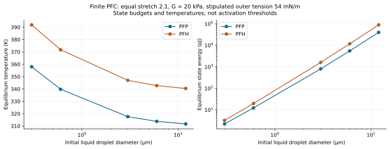
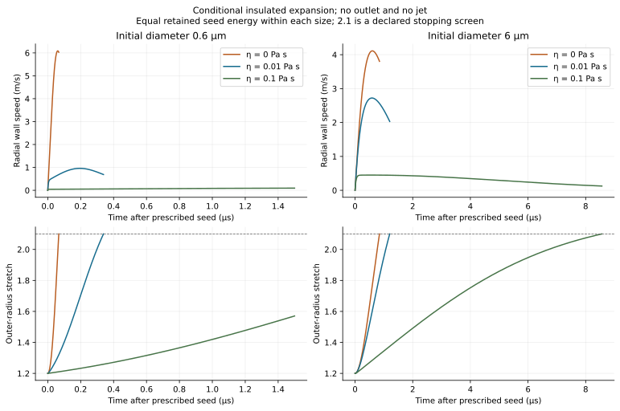
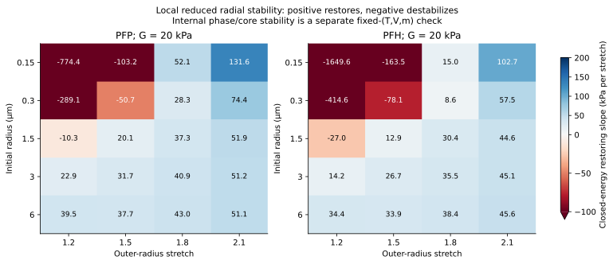
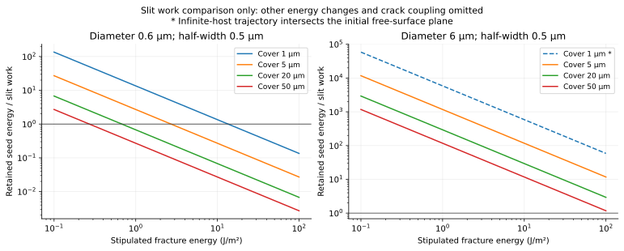

# PFC droplets in hydrogel: feasibility and parameter comparison

**Result:** published experiments demonstrate optical cavitation of PFC droplets inside hydrogel. This study verifies a conditional finite-PFC model. Target laser threshold, channel formation, collapse jets and impact peaks are **not established**. Missing: the spatial models and measurements listed below.

The earlier ideal-gas control calculates gel deformation and discharge through an existing outlet. Its open-gel peaks are **1.625 m/s outlet speed and 9.143 kPa elastic resistance**. Its sealed control emits zero liquid. These results belong to that outlet model. PFC vaporization and fracture require additional equations.

## 1. Solved models and evidence

Two native COMSOL 6.4 models include **finite real-fluid PFC mass, a vapor core, a surviving liquid shell and intact gel**. Each retains separate inner and outer interfaces. The stationary model solves four phase, mass and traction equations. The transient uses three differential states and four thermodynamic algebraic unknowns. Native Helmholtz EOS functions are checked against independent CoolProp calculations. The transient starts from a supplied post-nucleation seed. Seed formation remains outside the solved model.

| Question | Current evidence | Status |
|---|---|---|
| Can a PFC droplet cavitate inside gel? | Published optical experiments in fibrin, PAAm and gelatin; PFP/PFH/PFO and several micrometre diameters | Feasible for published architectures [S1] |
| Does the new finite-PFC control conserve mass and energy? | 60 native stationary cases and six native transients compared with independent roots/integration | Numerically verified |
| Is a stationary phase root stable? | 132 radial-branch tests plus fixed-(T,V,m) internal phase/core Hessians | Constraint-specific local tests completed |
| What laser fluence activates this specimen? | Absorption, local heating, sites and activation data unavailable | Unresolved |
| Does an intact gel open a fluid-filled path? | No calibrated damage or path coupling in these controls | Unresolved |
| What exterior jet or impact pressure follows? | No outlet, directional collapse or compressible sensor model in new controls | Unresolved; emitted exterior mass is exactly zero |

[S1: embedded-droplet experiments](https://doi.org/10.1016/j.jmbbm.2024.106776) establish feasibility in published specimens. Their bubble model includes water vapor and noncondensable gas. These PFC models omit both. Read the [complete derivation](DERIVATION.md) and [source ledger](SOURCES.md).

## 2. Parameters and comparison conditions

| Input | Comparison values | Meaning |
|---|---|---|
| PFC species | PFP; PFH | Gao/CoolProp 8.0.0 real-fluid EOS [S2] |
| Initial radius / diameter | 0.15, 0.3, 1.5, 3, 6 µm / 0.3, 0.6, 3, 6, 12 µm | Initial LIQUID size, not initial gas size |
| Shear modulus | 5, 20, 100 kPa | Stipulated intact neo-Hookean controls; not measured target gel |
| Effective viscosity | 0, 0.01, 0.1 Pa s | Kelvin-Voigt controls, not target high-rate fits |
| Outer / inner tensions | Outer 54 mN/m; PFP inner 9.41, PFH inner 12 mN/m | Room-temperature reference proxies held constant; PFH outer value is stipulated [S4,S5] |
| Outer-tension sensitivity | 5, 18, 54 mN/m for PFP radius 0.3 µm | Alternative stipulated interfaces; no coating equivalence asserted |
| Initial conditions | 293.15 K, ambient 100 kPa; liquid initially at ambient + outer Laplace pressure | Absolute pressures, finite liquid mass |
| Stationary stretch | 1.2, 1.5, 1.8, 2.1 | Equal-size mechanical/phase state comparisons, not laser trajectories |
| Transient seed | Stretch 1.2, zero wall speed, liquid pressure 50 kPa above static host requirement | Conditional post-nucleation state; retained seed energy calculated |
| Stopping screens | First expansion turning, stretch 2.1, Mach 0.1 or 50 reference time scales | 2.1 is not measured rupture; domain exits are rejected/stopped |
| Host and boundaries | Density 1000 kg/m³, sound-speed screen 1500 m/s; effectively infinite undrained host | No external free surface, fracture, outlet, or mass leakage |

Equal stationary stretch compares equilibrium state energies. Required state energy varies between those cases. The viscosity sweep holds retained seed energy fixed within each size. Optical design comparisons must match local incident fluence and absorption law. Mechanical comparisons must match absorbed energy and geometry. Retained seed energy includes storage and ambient work relative to the all-liquid reference. Preparation is lossless here. Measured absorption must also account for pre-seed conduction, viscosity, acoustics and water/coating heating.

## 3. Size and PFC species

At stretch 2.1, shear modulus 20 kPa and the same stipulated 54 mN/m outer interface:

| PFC | Initial diameter (µm) | State temperature (K) | Equilibrium state energy | Vapor MASS fraction |
|---|---|---|---|---|
| PFP | 0.6 | 339.79 | 12.26 pJ | 20.19% |
| PFH | 0.6 | 371.74 | 19.61 pJ | 21.70% |
| PFP | 6 | 313.78 | 5.476 nJ | 9.22% |
| PFH | 6 | 342.72 | 11.703 nJ | 9.60% |

PFP requires lower state temperature and energy than PFH here. The 0.6 µm droplet has stronger capillary confinement. Its initial Laplace excess is 360 kPa. The 6 µm droplet has 36 kPa. Their elastic-to-capillary ratios at 20 kPa modulus are 0.111 and 1.111. Smaller droplets therefore face stronger curvature effects despite lower total energy. These temperatures describe finite-mass curved equilibrium states. Optical activation temperatures are **not established**.

The liquid shell survives substantial expansion. At outer stretch 2.1, vapor contains about 20.2% of the smaller PFP mass. The larger case has about 9.2%. A pre-existing gas approximation removes this finite inventory constraint. Reproducing these states requires phase-specific sensible and phase energy.

## 4. Gel stiffness and interface chemistry

PFP equilibria at matched stretch 2.1 and outer tension 54 mN/m:

| Initial diameter (µm) | Shear modulus (kPa) | State temperature (K) | State energy | Elastic resistance (kPa) |
|---|---|---|---|---|
| 0.6 | 5 | 337.26 | 11.57 pJ | 7.610 |
| 0.6 | 20 | 339.79 | 12.26 pJ | 30.438 |
| 0.6 | 100 | 351.43 | 15.55 pJ | 152.191 |
| 6 | 5 | 308.97 | 4.342 nJ | 7.610 |
| 6 | 20 | 313.78 | 5.476 nJ | 30.438 |
| 6 | 100 | 332.70 | 10.226 nJ | 152.191 |

Higher modulus raises gel resistance and equilibrium state energy. Modulus matters more when capillary confinement is weaker. The 20 kPa, stretch-2.1 state has **30.438 kPa** elastic resistance. The earlier outlet model reaches a separate 9.143 kPa peak. Strength and fracture toughness require independent measurements.

For 0.6 µm-diameter PFP at 20 kPa modulus and stretch 2.1:

| Stipulated outer tension (mN/m) | State temperature (K) | State energy |
|---|---|---|
| 5 | 318.78 | 6.70 pJ |
| 18 | 325.42 | 8.39 pJ |
| 54 | 339.79 | 12.26 pJ |

Interface chemistry strongly affects the smaller droplets. Inner liquid/vapor tension sets the core pressure jump. Outer liquid/aqueous tension sets initial compression and gel traction. Use values matching interface, coating, composition and temperature. Shell disappearance requires a new gas/aqueous-gel interface and phase closure.

## 5. Viscosity and radial expansion

PFP, 20 kPa shear modulus, the specified seed, and no hydraulic outlet:

| Initial diameter (µm) | Viscosity (Pa s) | Retained seed energy | Peak RADIAL speed (m/s) | End time (µs) | Endpoint |
|---|---|---|---|---|---|
| 0.6 | 0 | 13.50 pJ | 6.0888 | 0.0669 | stretch 2.1 screen |
| 0.6 | 0.01 | 13.50 pJ | 0.9596 | 0.3384 | stretch 2.1 screen |
| 0.6 | 0.1 | 13.50 pJ | 0.0957 | 1.5000 | time window ends; unfinished growth |
| 6 | 0 | 5.857 nJ | 4.1132 | 0.8470 | stretch 2.1 screen |
| 6 | 0.01 | 5.857 nJ | 2.7231 | 1.2022 | stretch 2.1 screen |
| 6 | 0.1 | 5.857 nJ | 0.4497 | 8.5620 | stretch 2.1 screen |

At 0.01 Pa s, the 0.6 µm case reaches stretch 2.1 in 0.3384 µs. Its peak radial wall speed is 0.9596 m/s. The 6 µm case reaches it in 1.2022 µs. Its peak is 2.7231 m/s. All six cases emit **zero exterior mass**. The small, high-viscosity case still grows at its 1.5 µs cutoff. Its maximum radius is **not established** beyond that window.

At 0.01 Pa s, dimensionless viscous coefficients are 3.333 and 0.333. They correspond to the smaller and larger radii. Higher viscosity slows radial growth in these matched-seed cases. An outlet adds another route for energy and fluid motion. Compare radial motion and outlet flow with their own observables.

## 6. Equilibrium existence and stability

All 132 stationary states have finite inventory and positive shell thickness. Phase densities are ordered. Both phase pressure-density slopes are positive. Every state passes the internal core/phase Hessian test at fixed temperature, volume and mass. The minimum bulk-to-capillary curvature ratio is 20.4526. Nucleation accessibility and general shape stability are **not established**.

**36** closed-energy states and **94** fixed-temperature states have non-restoring radial slopes. Thermal constraints change the stability result. Halving the perturbation changes closed-energy slopes by at most 3.205e-05 relatively. No sign changes occur. Test branch stability separately from phase-root convergence.

## 7. Optical, fracture and depth screens

Use an illustrative **local incident** fluence of 20 mJ/cm² (200 J/m²). Projected-disk energies are 56.55 pJ and 5.655 nJ for 0.6 and 6 µm diameters. PFP stretch-2.1 state-energy ratios are 0.217 and 0.968. These are required effective cross-section ratios under lossless energy allocation. Effective absorption cross section divided by geometric area can exceed one. Measured absorption and activation thresholds are **not established**. Missing: absorber/coating heating, depth attenuation, nucleation sites and preparation losses. [S7](https://doi.org/10.3390/nano13152238) uses different size, formulation, temperature and exposure history.

A stipulated thermal diffusivity of 1.4 × 10^-7 m²/s and 5 ns pulse gives Fourier numbers 0.00778 and 0.0000778. Heating remains spatially confined during the pulse. Uniform PFC temperature is **not established**. Activation requires spatial heat transfer and a nucleation-rate model. Apply equilibrium closure after a seed forms under compatible conditions.

The slit-cost sweep uses covers 1/5/20/50 µm, half-widths 0.5/1/5 µm and toughnesses 0.1/1/10/100 J/m². These values define hypothetical cracks. A 20 µm cover, 0.5 µm half-width and 1 J/m² toughness costs 20 pJ. Small and large PFP seed energies are 13.50 pJ and 5.857 nJ. Under retained-seed allocation, the smaller case falls below this cost. Fracture impossibility is **not established**. Cooling, interface changes, prestress and other reference-energy changes alter available work. Exceeding the cost also leaves initiation and channel connectivity unresolved.

Finite depth requires a separate geometry check. Center-to-surface distance equals initial radius plus cover. A 3 µm radius under 1 µm cover encounters the initial surface plane at stretch 1.333. This occurs before the 2.1 screen. The infinite-host trajectory then loses its intact-interior interpretation. The CSV records standoff and this gate for every case. Finite-domain convergence remains necessary for other depths.

## 8. Models and measurements still required

| Stage | Model change | Required independent observable |
|---|---|---|
| 1. Laser and onset | Spatial absorber/PFC/water/gel heat transfer; normalized optical source; metastable liquid and calibrated heterogeneous nucleation hazard | Absorbed/local fluence and activation probability over size/fluence |
| 2. Intact expansion | Finite PFC and aqueous inventories; curved interfaces and phase-transfer heat balance; finite-depth gel dynamics; shell inertia/rate rheology when needed | Radius-time trace, displacement field, temperature/composition evidence |
| 3. Channel formation | Measured rate-dependent strength and fracture energy; cohesive/damage law; actual gap aperture, fluid filling and pressure work | Crack time/path/opening, ejection threshold versus cover |
| 4. Exterior ejection | Connected crack/outlet plus supplied liquid and exterior free surface; integrated mass, kinetic-energy and momentum flux | Emitted mass, velocity history and impulse |
| 5. Collapse and pressure | Nonspherical compressible multiphase calculation, actual boundary/receiver and sensor averaging | Resolved jet movies, hydrophone trace, location/bandwidth and impulse |

[The implementation plan](IMPLEMENTATION_HANDOFF.md) lists boundary conditions, tolerances, calibration and held-out comparisons. Begin with one 6 µm PFP droplet and a defined free surface. Retain a 0.6 µm case to test curvature and viscosity. This sequence supports validation. An optimal size is **not established**. Measure absorption, high-rate gel properties, toughness, strength and depth. Couple solid damage to an actual fluid-filled path. A prescribed outlet tests discharge after connection exists.

## 9. Verification and files

Maximum native/reference stationary relative difference is **4.516e-09**. Maximum normalized transient waveform difference is **2.958e-05**. Maximum native normalized energy residual is **4.971e-09**. Independent DOP853/Radau and tighter-step calculations agree. Entropy drift is checked separately from the energy equation. Fresh-process reload and refinement evidence is in `verification/`. The prior independent review corrected seed-energy wording, fracture bounds, depth applicability, branch guards, stability scope and notation.

The [offline reader](index.html) includes a computed-state selector. Download the native [curved-equilibrium model](models/Embedded_PFC_Curved_Equilibrium.mph) and [post-nucleation model](models/Embedded_PFC_PostNucleation_Intact_Gel.mph). The package includes Java/Python sources, parameter and native/reference CSVs, LaTeX, the accepted English PDF and verification records. [README.md](README.md) gives reproduction commands.

**Status:** the conditional finite-PFC comparison is complete and numerically verified. Target laser-to-fracture-to-jet validation is **not established**. Missing: specimen-specific spatial models and measured mechanism checks.
