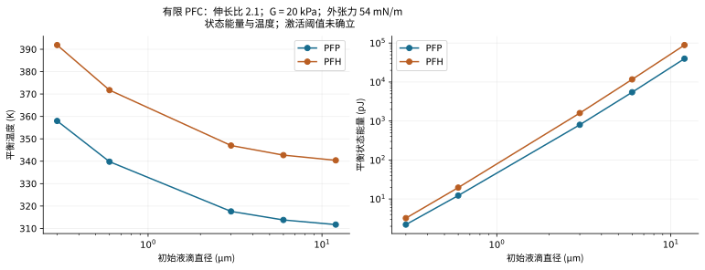
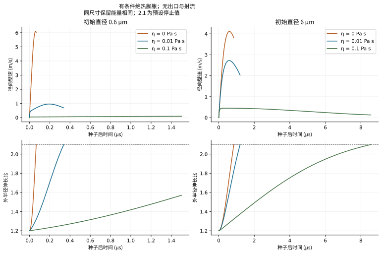
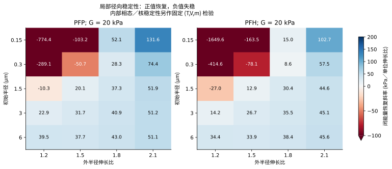
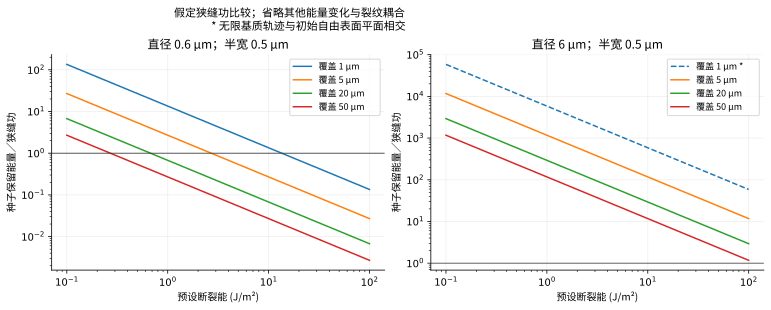

# 水凝胶中的 PFC 液滴：可行性与参数比较

**结果：**已发表实验表明，水凝胶中的 PFC 液滴可以发生光致空化。本研究验证一个有条件的有限 PFC 模型。目标样品的激光阈值、通道形成、塌缩射流和冲击峰值**尚未确立**。缺少：下文列出的空间模型与实测数据。

此前的理想气体模型计算凝胶变形及已有出口中的排液。开口凝胶的峰值为**出口速度 1.625 m/s、弹性阻力 9.143 kPa**。密封对照的排液量为零。这些结果属于该出口模型。PFC 汽化和断裂需要额外方程。

## 1. 已求解模型与证据

两个原生 COMSOL 6.4 模型包含**有限真实流体 PFC 质量、蒸气核、剩余液体壳层和完整凝胶**。内外界面分别处理。稳态模型求解四个相态、质量与牵引方程。瞬态模型包含三个微分状态及四个热力学代数未知量。原生 Helmholtz 状态方程与独立 CoolProp 计算比较。瞬态从预设的成核后种子开始。种子形成仍在已求解模型范围之外。

| 问题 | 现有证据 | 状态 |
|---|---|---|
| PFC 液滴能否在凝胶内空化？ | 纤维蛋白、PAAm 和明胶中的光学实验；PFP/PFH/PFO 及多种微米直径 | 已发表结构具有可行性 [S1] |
| 有限 PFC 模型是否守恒质量和能量？ | 60 个原生稳态算例和六个原生瞬态与独立求根／积分比较 | 数值验证通过 |
| 稳态相平衡根是否稳定？ | 132 个径向分支检验及固定 (T,V,m) 的内部相态／蒸气核 Hessian 检验 | 完成相应约束下的局部检验 |
| 何种激光能流密度激活目标样品？ | 缺少吸收、局部加热、成核位点与激活数据 | 未解决 |
| 完整凝胶能否打开充液通道？ | 模型没有标定损伤及通道耦合 | 未解决 |
| 会产生何种外部射流或冲击压力？ | 模型没有出口、定向塌缩或可压缩传感器模型 | 未解决；外排质量严格为零 |

[S1：嵌入液滴实验](https://doi.org/10.1016/j.jmbbm.2024.106776)确立了已发表样品中的可行性。其气泡模型含水蒸气和不凝气体。当前 PFC 模型省略两者。参阅[完整推导](DERIVATION.md)和[来源台账](SOURCES.md)。

## 2. 参数与比较条件

| 输入 | 比较值 | 含义 |
|---|---|---|
| PFC 种类 | PFP; PFH | Gao/CoolProp 8.0.0 真实流体状态方程 [S2] |
| 初始半径／直径 | 0.15, 0.3, 1.5, 3, 6 µm / 0.3, 0.6, 3, 6, 12 µm | 初始液态尺寸；气体种子尺寸另行定义 |
| 剪切模量 | 5, 20, 100 kPa | 预设完整 neo-Hookean 对照；目标凝胶尚未实测 |
| 有效黏度 | 0, 0.01, 0.1 Pa s | Kelvin–Voigt 对照；目标高速响应尚未拟合 |
| 外／内界面张力 | 外界面 54 mN/m；PFP 内界面 9.41、PFH 内界面 12 mN/m | 采用恒定室温参考值；PFH 外张力为预设值 [S4,S5] |
| 外张力敏感性 | PFP 半径 0.3 µm；5, 18, 54 mN/m | 替代预设界面；涂层等效性尚未确立 |
| 初始条件 | 293.15 K；环境 100 kPa；初始液压为环境压力加外界面 Laplace 压力 | 绝对压力；有限液态质量 |
| 稳态伸长比 | 1.2, 1.5, 1.8, 2.1 | 比较同伸长比的力学／相态；激光轨迹另行求解 |
| 瞬态种子 | 伸长比 1.2；壁速为零；液压高于静态基质要求 50 kPa | 有条件的成核后状态；计算保留种子能量 |
| 停止条件 | 首次膨胀转折、伸长比 2.1、Mach 0.1 或 50 个参考时间尺度 | 2.1 是预设条件；越出适用域的分支停止或拒绝 |
| 基质与边界 | 密度 1000 kg/m³；声速筛查 1500 m/s；有效无限、不排水基质 | 无外部自由表面、断裂、出口或质量泄漏 |

同稳态伸长比比较平衡状态能量。各算例所需的状态能量不同。黏度扫描在同尺寸内固定保留种子能量。光学设计比较须匹配局部入射能流密度与吸收规律。力学比较须匹配吸收能量和几何。保留种子能量包含相对全液态参考的储能与环境功。这里假定制备无损。实测吸收还须计入成核前导热、黏性、声学及水／涂层加热。

## 3. 尺寸与 PFC 种类

条件：伸长比 2.1、剪切模量 20 kPa、预设外界面张力 54 mN/m。

| PFC | 初始直径 (µm) | 状态温度 (K) | 平衡状态能量 | 蒸气质量分数 |
|---|---|---|---|---|
| PFP | 0.6 | 339.79 | 12.26 pJ | 20.19% |
| PFH | 0.6 | 371.74 | 19.61 pJ | 21.70% |
| PFP | 6 | 313.78 | 5.476 nJ | 9.22% |
| PFH | 6 | 342.72 | 11.703 nJ | 9.60% |

这些对照中，PFP 的状态温度和能量低于 PFH。0.6 µm 液滴受到更强的毛细约束。其初始 Laplace 超压为 360 kPa。6 µm 液滴为 36 kPa。在 20 kPa 模量下，两者弹性／毛细比为 0.111 和 1.111。小液滴总能量较低，但曲率效应更强。这些温度描述有限质量的曲面平衡状态。光学激活温度**尚未确立**。

显著膨胀后，液壳仍然存活。外伸长比 2.1 时，小 PFP 算例约 20.2% 的质量为蒸气。大算例约为 9.2%。预存气体近似会移除有限物质量约束。重现这些状态需要各相的显热及相变能量。

## 4. 凝胶刚度与界面化学

PFP 平衡条件：同伸长比 2.1、外界面张力 54 mN/m。

| 初始直径 (µm) | 剪切模量 (kPa) | 状态温度 (K) | 状态能量 | 弹性阻力 (kPa) |
|---|---|---|---|---|
| 0.6 | 5 | 337.26 | 11.57 pJ | 7.610 |
| 0.6 | 20 | 339.79 | 12.26 pJ | 30.438 |
| 0.6 | 100 | 351.43 | 15.55 pJ | 152.191 |
| 6 | 5 | 308.97 | 4.342 nJ | 7.610 |
| 6 | 20 | 313.78 | 5.476 nJ | 30.438 |
| 6 | 100 | 332.70 | 10.226 nJ | 152.191 |

模量越高，凝胶阻力和平衡状态能量越大。毛细约束较弱时，模量影响更明显。20 kPa、伸长比 2.1 的状态具有 **30.438 kPa** 弹性阻力。此前出口模型的峰值为另一状态下的 9.143 kPa。强度与断裂韧性须独立实测。

条件：PFP 直径 0.6 µm、模量 20 kPa、伸长比 2.1。

| 预设外张力 (mN/m) | 状态温度 (K) | 状态能量 |
|---|---|---|
| 5 | 318.78 | 6.70 pJ |
| 18 | 325.42 | 8.39 pJ |
| 54 | 339.79 | 12.26 pJ |

界面化学显著影响小液滴。内侧液／汽张力控制蒸气核压差。外侧液／水张力控制初始压缩与凝胶牵引。取值须匹配界面、涂层、组分及温度。液壳消失后，需要新的气体／水性凝胶界面规律与相态闭合。

## 5. 黏度与径向膨胀

条件：PFP、剪切模量 20 kPa、指定种子、无液压出口。

| 初始直径 (µm) | 黏度 (Pa s) | 保留种子能量 | 径向峰速 (m/s) | 结束时间 (µs) | 终止条件 |
|---|---|---|---|---|---|
| 0.6 | 0 | 13.50 pJ | 6.0888 | 0.0669 | 伸长比 2.1 |
| 0.6 | 0.01 | 13.50 pJ | 0.9596 | 0.3384 | 伸长比 2.1 |
| 0.6 | 0.1 | 13.50 pJ | 0.0957 | 1.5000 | 时间窗口结束；仍在膨胀 |
| 6 | 0 | 5.857 nJ | 4.1132 | 0.8470 | 伸长比 2.1 |
| 6 | 0.01 | 5.857 nJ | 2.7231 | 1.2022 | 伸长比 2.1 |
| 6 | 0.1 | 5.857 nJ | 0.4497 | 8.5620 | 伸长比 2.1 |

黏度 0.01 Pa s 时，0.6 µm 算例在 0.3384 µs 达到伸长比 2.1。其径向壁速峰值为 0.9596 m/s。6 µm 算例在 1.2022 µs 达到该值。其峰值为 2.7231 m/s。全部六个算例的**外排质量为零**。小尺寸高黏度算例在 1.5 µs 截止时仍在膨胀。窗口之后的最大半径**尚未确立**。

在 0.01 Pa s 下，无量纲黏性系数为 3.333 和 0.333，分别对应小半径与大半径。匹配种子条件下，黏度增加会减慢径向膨胀。出口提供另一条能量和流体运动路径。径向运动与出口流动须分别比较各自观测量。

## 6. 平衡解与稳定性

全部 132 个稳态具有有限物质量和正液壳厚度。相密度顺序正确。两相的压力－密度斜率均为正。每个状态均通过固定温度、体积与质量的内部蒸气核／相态 Hessian 检验。最小体积／毛细曲率比为 20.4526。成核可达性与一般形状稳定性**尚未确立**。

**36** 个闭能量状态和 **94** 个定温状态具有非恢复径向斜率。热约束会改变稳定性结果。扰动减半时，闭能量斜率的最大相对变化为 3.205e-05。符号均未变化。分支稳定性须与相平衡根收敛分开检验。

## 7. 光学、断裂与深度筛查

采用示例**局部入射**能流密度 20 mJ/cm²（200 J/m²）。0.6 和 6 µm 直径的投影圆盘能量为 56.55 pJ 和 5.655 nJ。PFP 在伸长比 2.1 的状态能量比为 0.217 和 0.968。这是假定无损分配时所需的有效截面比。有效吸收截面除以几何面积的比值可以超过一。实测吸收与激活阈值**尚未确立**。缺少：吸收体／涂层加热、深度衰减、成核位点与制备损失。[S7](https://doi.org/10.3390/nano13152238)使用不同尺寸、配方、温度及照射历史。

预设热扩散率 1.4 × 10^-7 m²/s 和 5 ns 脉冲得到 Fourier 数 0.00778 与 0.0000778。脉冲期间加热局限于局部空间。PFC 温度均匀性**尚未确立**。激活阶段需要空间传热与成核速率模型。种子形成后，在相容条件下应用平衡闭合。

狭缝功扫描采用覆盖厚度 1/5/20/50 µm、半宽 0.5/1/5 µm、韧性 0.1/1/10/100 J/m²。这些值定义假想裂纹。20 µm 覆盖、0.5 µm 半宽及 1 J/m² 韧性的功为 20 pJ。小、大 PFP 种子能量为 13.50 pJ 与 5.857 nJ。分配保留种子能量时，小算例低于该成本。断裂不可能性**尚未确立**。冷却、界面变化、预应力及其他参考能量变化会改变可用功。超过该成本仍无法确定起裂与通道连通。

有限深度须单独检验几何。中心到表面的距离等于初始半径加覆盖厚度。半径 3 µm、覆盖 1 µm 的液滴在伸长比 1.333 接触初始表面平面。这早于 2.1 的筛查值。此后，无限基质轨迹不再代表完整内部膨胀。CSV 为每个算例记录距离及该门槛。其他深度仍须检验有限域收敛。

## 8. 仍需建立的模型与测量

| 阶段 | 模型扩展 | 所需独立观测量 |
|---|---|---|
| 1. 激光与起始 | 吸收体／PFC／水／凝胶空间传热；归一化光源；亚稳液体与标定异质成核危险率 | 吸收／局部能流密度及尺寸／能流密度下的激活概率 |
| 2. 完整膨胀 | 有限 PFC 与水物质量；曲面及相变传热；有限深度凝胶动力学；必要时加入液壳惯性与速率流变 | 半径－时间轨迹、位移场、温度／组分证据 |
| 3. 通道形成 | 实测速率强度和断裂能；黏聚／损伤律；实际缝隙、充液与压力功 | 裂纹时间／路径／开度、随覆盖厚度变化的排液阈值 |
| 4. 外部排液 | 连通裂纹／出口、液体供给、外部自由表面；积分质量、动能与动量通量 | 外排质量、速度历史、冲量 |
| 5. 塌缩与压力 | 非球形可压缩多相计算；实际边界／接收体和传感器平均 | 分辨射流影像、水听器曲线、位置／带宽与冲量 |

[实施计划](IMPLEMENTATION_HANDOFF.md)列出边界条件、容差、标定与留出比较。先采用一个 6 µm PFP 液滴及明确自由表面。保留 0.6 µm 算例检验曲率与黏度。该顺序用于验证。最优尺寸**尚未确立**。须测量吸收、高速凝胶性能、韧性、强度与深度。固体损伤须耦合实际充液通道。预设出口检验连通后的排液。

## 9. 验证与文件

原生／参考稳态最大相对差为 **4.516e-09**。瞬态归一化波形最大差为 **2.958e-05**。原生归一化能量最大残差为 **4.971e-09**。独立 DOP853/Radau 与更小步长计算一致。熵漂移独立于能量方程检验。新进程重载和细化证据位于 `verification/`。此前独立审查修正了种子能量表述、断裂上界、深度适用性、分支限制、稳定性范围与符号。

[离线阅读器](index.html)包含计算状态选择器。可下载原生[曲面平衡模型](models/Embedded_PFC_Curved_Equilibrium.mph)和[成核后模型](models/Embedded_PFC_PostNucleation_Intact_Gel.mph)。包中包含 Java/Python 源码、参数与原生／参考 CSV、LaTeX、已接受的英文 PDF 和验证记录。[README.md](README.md)提供复现命令。

**状态：**有条件的有限 PFC 比较已完成并通过数值验证。目标激光－断裂－射流验证**尚未确立**。缺少：样品专属空间模型及机制实测检验。
