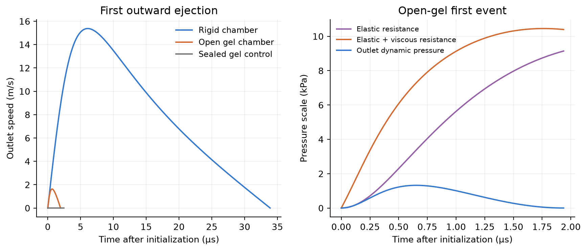
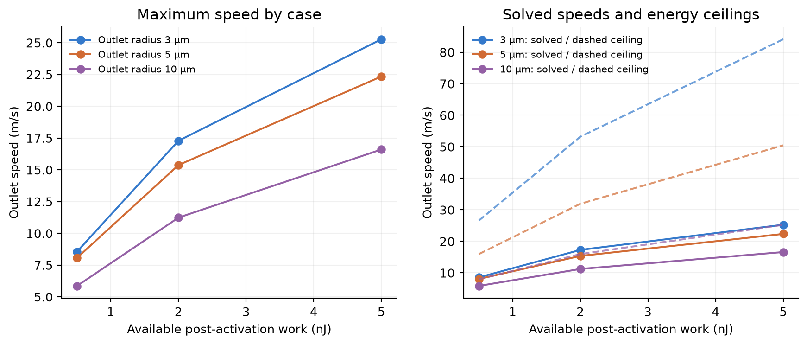
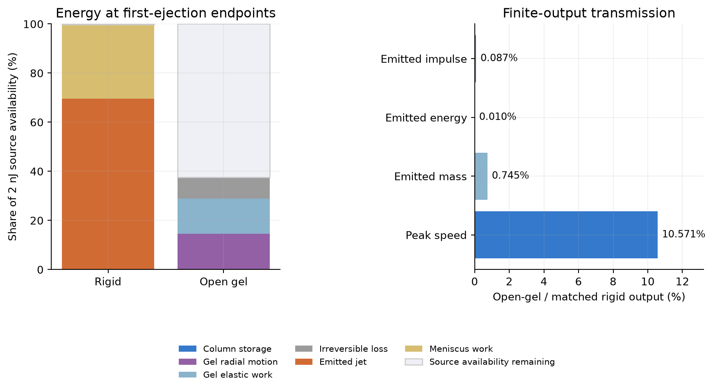
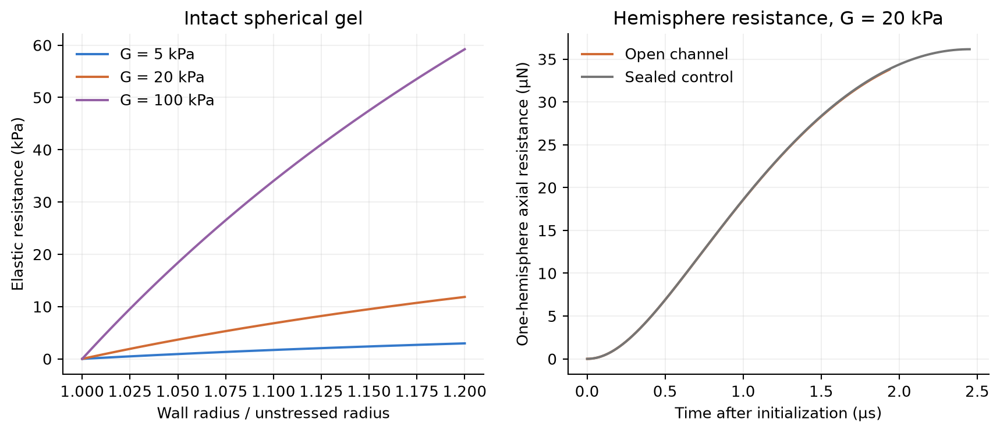

# 结果与解释

两个原生模型使用**全局方程（Global Equations）**。模型 A 求解两个流动状态及三个累计量。模型 B 加入两个凝胶壁面状态。标称 **10 ns 脉冲以激活后初始数据表示**。光热、成核与激活压力瞬态不在范围内。

基准输入：可用功 2 nJ；初始气体半径 15 µm；腔室半径 30 µm；出口半径 5 µm；有效惯性长度 50 µm；密度 1000 kg/m³；环境压力 100 kPa；绝热指数 1.4。连通腔室液体决定有限排出量。凝胶输入为 G = 20 kPa、黏度 0.010 Pa s。这些输入定义对照。PFC 与水凝胶校准尚未解决。

| 已定义的输出 | 刚性腔室 A | 开放通道水凝胶 B |
|---|---:|---:|
| 初始腔室超压 | 279.632 kPa | 279.632 kPa |
| 首次排出过程的最大出口速度 | 15.37608 m/s | 1.62538 m/s |
| 最大出口动压尺度 | 118.2119 kPa | 1.3209 kPa |
| 首次排出过程的排出质量 | 20.96789 ng | 0.15612 ng |
| 排出动能 | 1.391345 nJ | 0.000136 nJ |
| 排出冲量 | 2.270810e-10 N s | 1.982567e-13 N s |
| 首次向外排出过程的持续时间 | 33.8850 µs | 1.9370 µs |
| 最大弹性约束压力 | — | 9.1430 kPa |
| 最大单半球弹性合力 | — | 33.7705 µN |

最高采样出口速率出现在 **A_E5nJ_a3um**：**25.27982 m/s**。源超压为 **512.212 kPa**。出口动压为 **319.535 kPa**。参数族采样功 0.5、2、5 nJ，以及出口半径 3、5、10 µm。初始气体／腔室半径及惯性长度固定。所得为采样族内的条件最大值。普适极限尚未建立。

基准能量上限为 **31.91538 m/s**。对应动压上限为 **509.296 kPa**。解还向排液及弯月面功分配能量。液柱运动与源中仍有剩余能量。因此，求解最大值低于这些上界。

开放凝胶峰值速度传导率为 **10.5709%**。排出能量传导率为 **0.00980%**。排出冲量传导率为 **0.08731%**。能量和冲量需积分出口通量。峰值速度比无法替代这些积分。本算例中，凝胶运动获得能量，并缩短首次排液。模量与黏度的普遍单调效应尚未建立。

密封对照排出质量、能量与冲量均为零。最大弹性压力为 9.6259 kPa。最大内壁伸长比为 1.15252。凝胶发生变形，外部排液仍为零。

观测诊断由排出冲量约束平均制动压力。采用出口面积及 1 µs 时间窗。峰值冲击压力尚未建立。缺少：接触动力学、到达质量、靶标传导及凝胶断裂。

全部 17 个原生案例通过数值验证。最大归一化能量残差：1.260e-07。最大原生／独立参考波形误差：1.152e-04。最大压力传播诊断量：0.08356，低于规定的 0.1 筛查值。两个基准均在新 COMSOL 进程中重新载入并求解。峰值速度通过 2 ns／1 ns 分辨率检查。这些检查验证给定实现及时间收敛性。实验验证尚未解决。缺少：PFC 状态方程／相存量、激光转换、凝胶校准及装置几何。

参见[完整推导](MODEL_SPEC.md)、[原生案例登记表](data/native_case_register.json)、[数值审计](verification/NUMERICAL_AUDIT.json)，以及 [models/](models/) 中的两个原生文件。
