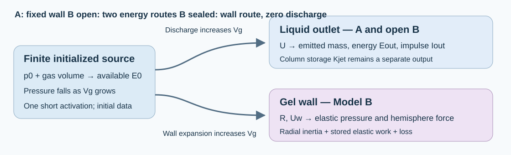
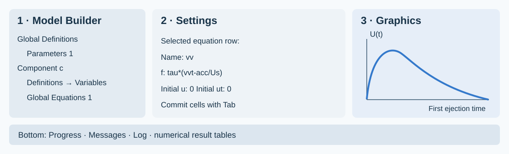

# Step-by-step COMSOL 6.4: two minimal single-pulse models

Open COMSOL beside this guide. Complete one step at a time. The route is **a blank 0D model → solved Model A → hydrogel Model B → sealed control → verified output tables**. Each step gives a node, input and check. Save checkpoints in your practice folder.

Model A calculates pressure and outlet speed for a finite source. Model B adds spherical gel confinement, emitted energy and impulse. The nominal 10 ns pulse supplies post-activation initial data. Time zero follows pressure equilibration. There is no later forcing.

**Declared controls.** The source is a closed adiabatic ideal gas, with uniform pressure, constant exponent greater than one and finite available work. Carrier density and effective outlet inertance are constant. The outlet is already open. Its constant meniscus entry pressure is an approximation. Model B uses an intact, undrained incompressible neo-Hookean gel with Kelvin–Voigt loss, approximated as a spherical medium around the chamber. Initial mechanical velocities are zero. The chamber's reference wall is stress-free. The far-field pressure and outlet exit pressure are ambient. Outward liquid speed and expanding wall speed are positive. Later rebound, phase exchange, gel rupture and target impact are outside this first-ejection calculation. Actual PFC and gel properties require calibration.

Find the derivation, symbols and validity checks in [MODEL_SPEC.md](MODEL_SPEC.md) and [the full offline report](index.html#theory). The tables below use COMSOL syntax for those equations.



*Mechanism schematic. Model A fixes the wall. Model B permits outlet discharge and wall expansion. Both increase source volume.*

## A — Learn the interface and create the practice model

### Step 01 — Identify the three working areas

**Where:** COMSOL Desktop.

**Do:** Identify **Model Builder** at the left, **Settings** for the selected node in the middle, and **Graphics** for plots at the right. Progress, Messages, Log and Results tables normally appear below. A node path such as `Global Definitions → Parameters 1` means expand the first node and select its child. A right-click creates a child of the node under the pointer. After editing a table cell, press Tab or click outside the cell to commit the entry.

**Check:** Select a node. Confirm that Settings changes.



*Interface schematic. Layout varies with your window. Use the node and field names.*

### Step 02 — Open a new model

**Where:** `File → New → Model Wizard`.

**Do:** Open COMSOL Multiphysics 6.4. Choose Model Wizard on the New page. Save existing work before switching models. Work inside a new `practice/` folder beside this guide. Create that folder in the Save As dialog when prompted later.

**Check:** The wizard displays **Select Space Dimension**.

### Step 03 — Select the space dimension

**Where:** `Model Wizard → Select Space Dimension`.

**Enter:** Select **0D**.

**Check:** The wizard advances to Select Physics. The unknowns are time-dependent scalars. Chamber and outlet radii enter as parameters. This model needs no spatial geometry.

### Step 04 — Add the scalar equation interface

**Where:** `Select Physics → Mathematics → ODE and DAE Interfaces → Global ODEs and DAEs`.

**Do:** Select Global ODEs and DAEs and click **Add**. Search the full interface name if needed. Add one interface.

**Check:** Added physics interfaces contains Global ODEs and DAEs. It supplies the Global Equations table.

**If stuck:** Clear the search filter and confirm 0D was selected. The native files use the base COMSOL license. Gel mechanics enters as scalar expressions.

### Step 05 — Add the time study

**Where:** `Model Wizard → Study → General Studies`.

**Enter:** Choose **Time Dependent**, then click **Done**.

**Check:** Model Builder contains a Component, Global ODEs and DAEs, and `Study 1 → Step 1: Time Dependent`.

### Step 06 — Set the component namespace

**Where:** Click `Component 1`.

**Enter:** Set **Name** to `c` and **Label** to `c: Model A practice`. Keep the SI unit system. Name sets the namespace, as in `c.U`. Label sets the visible caption.

**Check:** The component's Name is `c`. Label does not change the namespace.

**If stuck:** If Name remains `comp1`, correct it now. All result and stop expressions below use the `c.` prefix. [Component Name documentation](https://doc.comsol.com/6.4/doc/com.comsol.help.comsol/comsol_ref_modeling.19.007.html).

### Step 07 — Save the first checkpoint

**Where:** `File → Save As`.

**Enter:** Save as `practice/A_01_setup.mph`. Use Ctrl+S afterward. Save new checkpoints at the milestones below.

**Check:** The title bar shows your practice filename. The accepted native files in `models/` remain available for comparison.

## B — Enter every Model A input and expression

### Step 08 — Enter all 32 parameters

**Where:** `Global Definitions → Parameters 1`.

**Do:** Enter all rows below, or click **Load from File** under the table and choose [A_parameters_import.txt](resources/gui/A_parameters_import.txt). Import its two tab-separated columns once. The file has no header. Descriptions appear below. If you type manually, use the exact case of each name and the square brackets around units.

**Check:** There are 32 parameter names and no duplicate names. Finish all rows before checking unresolved dependencies in Value. `p0` is absolute pressure and `E0` is an expression derived from it.

| Name | Expression — enter exactly | Meaning |
| --- | --- | --- |
| `tauLaser` | `10[ns]` | One optical pulse, replaced by a post-activation initial state; pulse onset is not solved |
| `Rg0` | `15[um]` | Post-activation source radius; not a liquid PFC-droplet radius |
| `Rc0` | `30[um]` | Initially stress-free spherical chamber radius |
| `a` | `5.0E-6[m]` | Radius of the pre-existing liquid outlet |
| `L` | `50[um]` | Effective liquid-column inertance length |
| `Lbudget` | `(Vc0-Vg0)/A` | Connected chamber liquid inventory divided by outlet area; separate from inertance length |
| `rho` | `1000[kg/m^3]` | Stipulated water-like carrier density |
| `rhoG` | `1000[kg/m^3]` | Stipulated undrained gel density |
| `pInf` | `100[kPa]` | Absolute ambient pressure |
| `kap` | `1.4` | Adiabatic ideal-gas control exponent; not a validated PFC-vapor EOS |
| `p0` | `379631.6312499547[Pa]` | Post-activation absolute source pressure, set from available work by the builder |
| `sigma` | `0.072[N/m]` | Stipulated water-like surface tension |
| `G` | `20000.0[Pa]` | Intact incompressible neo-Hookean shear modulus |
| `etaG` | `0.01[Pa*s]` | Kelvin-Voigt effective network viscosity |
| `Kloss` | `0.0` | Conditional outlet minor-loss coefficient, dimensionless |
| `Rloss` | `0[Pa*s/m]` | Measured/fitted pressure-to-speed resistance; not an instantaneous Poiseuille approximation |
| `outletOpen` | `1` | 1 for a pre-existing open liquid channel; 0 for sealed control |
| `cL` | `1500[m/s]` | Reference communication speed used only for a validity diagnostic |
| `Us` | `10[m/s]` | Velocity scale for dimensionless state variables |
| `tau` | `Rc0/Us` | Numerical nondimensionalization time scale |
| `A` | `pi*a^2` | Liquid-plug cross-section |
| `Vg0` | `4*pi*Rg0^3/3` | Initial finite gas source volume |
| `Vc0` | `4*pi*Rc0^3/3` | Initial chamber volume |
| `Veq` | `Vg0*(p0/pInf)^(1/kap)` | Gas volume at ambient pressure |
| `E0` | `p0*Vg0/(kap-1)*(1-(Vg0/Veq)^(kap-1))-pInf*(Veq-Vg0)` | Available reversible source work above ambient |
| `mJet` | `rho*A*L` | Effective liquid-column inertia mass, not emitted mass |
| `Iscale` | `mJet*Us` | Scaling momentum for the emitted-impulse accumulator |
| `Uceiling` | `sqrt(2*E0/mJet)` | Energy-only peak outlet-speed bound from column inertia; not an achieved velocity |
| `qCeiling` | `E0/(A*L)` | Energy-only liquid dynamic-pressure upper bound |
| `pCap` | `2*sigma/a` | Pinned hemispherical-meniscus resistance |
| `tObs` | `1[us]` | Declared averaging interval for an impulse-only arrest-pressure bound |
| `AObs` | `A` | Declared pressure observer area |

### Step 09 — Check the initialized energy and geometry

**Where:** Stay in `Parameters 1`, looking at the Value column.

**Check against:**

| Quantity | Expected value |
| --- | --- |
| Initial gas volume `Vg0` | 1.413716694e-14 m³ |
| Initial chamber volume `Vc0` | 1.130973355e-13 m³ |
| Outlet area `A` | 7.853981634e-11 m² |
| Finite budget `Lbudget` | 1260.000000 µm |
| Inertance length `L` | 50 µm |
| Meniscus pressure `pCap` | 28.8 kPa |
| Time scale `tau` | 3 µs |
| Initial absolute `p0` | 379.631631 kPa |
| Available work `E0` | 2 nJ |
| Column-speed bound `Uceiling` | 31.915382 m/s |

**Why:** `L` defines liquid inertia. `Lbudget` defines how much connected liquid can leave. These have different meanings. The 2 nJ value is mechanical availability after activation. It is not incident laser energy. `tauLaser=10[ns]` records the short-pulse assumption. It is not a time-dependent forcing function and changing it alone will not change this solution.

**If stuck:** A negative available work or invalid equilibrium volume usually indicates a pressure/unit error. Use the supplied absolute `p0`. Do not replace it with the 279.632 kPa gauge value.

### Step 10 — Create Variables and enter the source geometry

**Where:** Right-click `Component c → Definitions → Variables`.

**Do:** Set the Label to `Source, outlet and accounting`. Enter the first seven rows below. For the whole 33-row table, you may instead use **Load from File** and select [A_variables_import.txt](resources/gui/A_variables_import.txt). Then inspect the three groups in Steps 10–12. Use local names inside this component table, without adding `c.` to the Name column.

**Check:** The chamber radius is fixed through `R=Rc0`. Wall speed is exactly `0[m/s]`. The gas volume includes discharged liquid volume. `qq` and `vv` will become defined when you add the equation rows in Step 14.

| Name | Expression — enter exactly | Unit | Meaning |
| --- | --- | --- | --- |
| `x` | `Lbudget*qq` | `m` | Discharged liquid volume divided by outlet area, m |
| `U` | `Us*vv` | `m/s` | Outward liquid-plug speed, m/s |
| `R` | `Rc0` | `m` | Chamber wall radius, m |
| `Uw` | `0[m/s]` | `m/s` | Chamber wall expansion speed, m/s |
| `Vg` | `Vg0+A*x+4*pi*(R^3-Rc0^3)/3` | `m^3` | Finite gas volume including expelled liquid and chamber expansion |
| `Vdot` | `A*U+4*pi*R^2*Uw` | `m^3/s` | Total source volume rate |
| `pb` | `p0*(Vg0/Vg)^kap` | `Pa` | Uniform absolute pressure of finite ideal-gas control source |

### Step 11 — Enter the resistance and stored-energy expressions

**Where:** The same Variables node.

**Do:** Add the following seven rows if you are entering manually. Model A sets the gel-related terms to dimensioned zero. The loss expression permits later sensitivity controls. The baseline loss inputs are zero.

**Check:** The column energy `Kjet` uses effective column inertia. The emitted energy is `Eout`, entered next. Meniscus work is the work of the declared constant entry-pressure control. Its evolving free surface is not solved.

| Name | Expression — enter exactly | Unit | Meaning |
| --- | --- | --- | --- |
| `pEl` | `0[Pa]` | `Pa` | Elastic resistance pressure at spherical gel wall |
| `pRes` | `0[Pa]` | `Pa` | Elastic plus viscous gel wall resistance |
| `Wgel` | `0[J]` | `J` | Recoverable elastic gel work |
| `Kgel` | `0[J]` | `J` | Spherical gel radial kinetic energy |
| `Kjet` | `mJet*U^2/2` | `J` | Stored kinetic energy of effective liquid-column inertia; not emitted energy |
| `Esurf` | `pCap*A*x` | `J` | Reversible meniscus work during outward motion |
| `ploss` | `Rloss*U+rho*Kloss*U*abs(U)/2` | `Pa` | Declared dissipative port pressure drop |

### Step 12 — Enter acceleration, emitted output and checks

**Where:** The same Variables node.

**Do:** Add the remaining 19 rows. Keep the outgoing kinetic-head term `-rho*U^2/2` in `acc`, and keep `Eout` in `energyResidual`. These terms account for energy leaving the outlet. Retain both.

**Check:** The completed node has 33 names. `Eout`, `Iout` and `Mout` mean actual emitted energy, axial impulse and liquid mass. `Ijet` means instantaneous effective column momentum. The communication ratio is a validity diagnostic calculated from scalar rates.

| Name | Expression — enter exactly | Unit | Meaning |
| --- | --- | --- | --- |
| `acc` | `outletOpen*(pb-pInf-pCap-ploss-rho*U^2/2)/(rho*L)` | `m/s^2` | Outlet acceleration from unsteady Bernoulli with discharged kinetic head |
| `wallAcc` | `0[m/s^2]` | `m/s^2` | Spherical gel wall acceleration |
| `Pdis` | `outletOpen*A*(Rloss*U^2+rho*Kloss*abs(U)^3/2)` | `W` | Nonnegative irreversible port and gel loss power |
| `Edis` | `E0*dd` | `J` | Accumulated irreversible loss |
| `Eout` | `E0*ee` | `J` | Kinetic energy actually discharged at the outlet |
| `Iout` | `Iscale*ii` | `N*s` | Axial momentum actually discharged at the outlet |
| `Mout` | `rho*A*x` | `kg` | Finite emitted liquid mass |
| `Pout` | `outletOpen*rho*A*U^3/2` | `W` | Discharged kinetic power on the outward branch |
| `energyResidual` | `(pb*Vg/(kap-1)-p0*Vg0/(kap-1)+pInf*(Vg-Vg0)+Kjet+Kgel+Wgel+Esurf+Edis+Eout)/E0` | `1` | Normalized energy residual including actual outflow |
| `Fconf` | `pi*R^2*pEl` | `N` | Axial resultant on one gel hemisphere, not a net force on the whole sphere |
| `qJet` | `rho*U^2/2` | `Pa` | Liquid-plug dynamic-pressure scale, not an impact pressure |
| `Ijet` | `mJet*U` | `N*s` | Effective column momentum; actual discharged impulse is Iout |
| `Fflux` | `rho*A*U^2` | `N` | Momentum-flux scale, not a resolved unsteady target force |
| `pArrestBound` | `Iout/(AObs*tObs)` | `Pa` | Mean arrest-pressure upper bound from emitted impulse on the declared observer |
| `stroke` | `x/Lbudget` | `1` | Fraction of the finite discharge-volume budget |
| `stretch` | `R/Rc0` | `1` | Gel inner-wall circumferential stretch |
| `Mjet` | `abs(U)/cL` | `1` | Liquid-speed Mach diagnostic |
| `Mwall` | `abs(Uw)/cL` | `1` | Wall-speed Mach diagnostic |
| `communication` | `L/cL*kap*abs(Vdot)/Vg` | `1` | Pressure-change communication ratio; no propagation field is solved |

### Step 13 — Set the equation quantities

**Where:** `Component c → Global ODEs and DAEs → Global Equations 1`.

**Enter:** Keep the equation group name `ODE1`. Set **Dependent variable quantity** to **Dimensionless (1)** and **Source term quantity** to **Dimensionless (1)**. Delete the default placeholder equation row before entering your five rows.

**Check:** Both quantities are dimensionless. The factor `tau` in each equation converts a rate into a dimensionless residual.

**State meanings before the equation entries:** `qq=x/Lbudget`; `vv=U/Us`; `dd=Edis/E0`; `ee=Eout/E0`; `ii=Iout/Iscale`. These are the five solved scalars. The Variables node supplies algebraic expressions. The equation rows supply independent states.

### Step 14 — Enter all five Global Equations rows

**Where:** The Global Equations table from Step 13.

**Do:** Enter every row below, including both initial-value columns. COMSOL sets the residual `f(u,ut,utt,t)` to zero. Select a long row to edit its fields below. [A_equations.tsv](resources/gui/A_equations.tsv) is a headed copy/paste reference. The parameter/variable Load from File buttons do not import it into this equation table.

**Check:** The only names are `qq`, `vv`, `dd`, `ee`, `ii`. Their initial values are all zero. The row for `ii` integrates momentum flux, rather than assigning `mJet*U` to emitted impulse.

| Name | f(u,ut,utt,t) — enter exactly | u_0 | ut_0 |
| --- | --- | --- | --- |
| `qq` | `tau*(qqt-outletOpen*U/Lbudget)` | `0` | `0` |
| `vv` | `tau*(vvt-acc/Us)` | `0` | `0` |
| `dd` | `tau*(ddt-Pdis/E0)` | `0` | `0` |
| `ee` | `tau*(eet-Pout/E0)` | `0` | `0` |
| `ii` | `tau*(iit-outletOpen*rho*A*U^2/Iscale)` | `0` | `0` |

### Step 15 — Check derivative spelling and initial conditions

**Where:** The five equation rows and the Variables node.

**Do:** Inspect `qqt`, `vvt`, `ddt`, `eet`, `iit`. They are COMSOL's first-time-derivative names: `vvt` is the derivative of `vv`. Do not type `vv*t`, which is multiplication. Initial value `ut_0=0` is retained from the accepted setup. The first-order equations calculate the evolving derivatives.

**Check:** Zero initial speed does not mean zero initial acceleration. With the baseline pressure, `acc` starts positive. The source, volume and output expressions should now resolve through the five declared states. [Global Equations documentation](https://doc.comsol.com/6.4/doc/com.comsol.help.comsol/comsol_ref_equationbased.32.089.html).

### Step 16 — Enter the output time list

**Where:** `Study 1 → Step 1: Time Dependent`.

**Enter:** Keep Time unit **s** and replace Output times with:

```text
range(0,1[ns],100[us])
```

**Check:** The requested list begins at zero and ends at 100 µs, with 1 ns output spacing. The stop conditions will terminate the first episode earlier. This list is numerical sampling, not the 10 ns optical pulse.

### Step 17 — Reveal the time solver

**Where:** Right-click `Study 1 → Show Default Solver`.

**Do:** Expand `Solver Configurations → Solution 1` and click **Time-Dependent Solver 1**. If these nodes are already present, expand them directly. Keep the generated Dependent Variables node. It connects the `ODE1` equation group to the solver.

**Check:** Time-Dependent Solver 1 is visible and selected in Settings. You have not added a second study or a second physics interface.

### Step 18 — Match the accepted solver settings

**Where:** `Solution 1 → Time-Dependent Solver 1`.

**Enter:** Use the following General, Absolute Tolerance and Time Stepping settings. If General inherits from the study, choose **User defined** in **Defined by study step**. The solver's time list must match Step 16.

| Section / field | Set to |
|---|---|
| General → Defined by study step | User defined |
| General → Output times | `range(0,1[ns],100[us])` |
| General → Relative tolerance | `1e-9` |
| Absolute Tolerance → Global method | Scaled |
| Absolute Tolerance → Tolerance method | Factor |
| Absolute Tolerance → Tolerance factor | `0.1` |
| Absolute Tolerance → variable Method | Use global |
| Time Stepping → Solver type | Implicit |
| Time Stepping → Method | BDF |
| Time Stepping → Steps taken by solver | Strict |
| Time Stepping → Algebraic Variable Settings → Consistent initialization | Off |

**Check:** BDF, Strict, `1e-9` and initialization Off are visible. Keep automatically selected initial steps, BDF orders and variable scaling. These are first-order ODEs. Turning initialization Off preserves the prescribed zero velocities. Strict stepping reaches the listed times and can take extra internal steps when needed. [Time solver documentation](https://doc.comsol.com/6.4/doc/com.comsol.help.comsol/comsol_ref_solver.36.139.html).

### Step 19 — Add all four stopping rules

**Where:** Right-click `Time-Dependent Solver 1 → Stop Condition`.

**Do:** Add the four rows below. In **every row**, set **Stop if** to **Negative (<0)** and select **Active**. Under Output at Stop, keep **Add solution = No**, matching the accepted files. Add warning can remain enabled.

**Check:** Four active rows are present. Component expressions have the `c.` prefix because this solver node is outside the component namespace.

| Stop expression | Stop if | Active | Description |
| --- | --- | --- | --- |
| `if(outletOpen>0.5,c.U,c.Uw)` | Negative (<0) | Yes | First outward ejection ends, or first sealed wall turning point |
| `Lbudget-c.x` | Negative (<0) | Yes | Connected chamber liquid inventory exhausted |
| `1.2-c.stretch` | Negative (<0) | Yes | Declared 20% wall-stretch screen (not measured fracture) |
| `0.1-max(c.Mjet,c.Mwall)` | Negative (<0) | Yes | Declared Mach 0.1 screen |

**Why:** The first row stops after the first outward speed returns through zero. In a sealed case it instead checks wall speed. The other rows enforce liquid inventory, a declared stretch screen and a Mach screen. The initial zero speed is not negative, so the baseline can start. The communication screen is checked after solving in Step 28. It is not an online stop row. [Stop Condition documentation](https://doc.comsol.com/6.4/doc/com.comsol.help.comsol/comsol_ref_solver.36.212.html).

### Step 20 — Make the before-solve check

**Where:** Parameters, Variables, Global Equations, Time-Dependent study and its solver.

**Check each item:** 32 parameters; 33 variables; 5 equation rows. Both equation quantities Dimensionless. All initial states zero. Study and solver both use the 1 ns list; BDF Strict. Consistent initialization Off. Four active Negative stop rules. Initial Values of Variables Solved For must come from the physics initial values, not a previous nonzero solution.

**Do:** Save a checkpoint `practice/A_02_ready_to_solve.mph`. If an unknown-variable message names `comp1` or `c`, correct the namespace. If it names `qq` or `vv`, inspect the equation Name column.

### Step 21 — Compute the first ejection

**Where:** `Study 1` toolbar, or right-click `Study 1 → Compute`.

**Do:** Click Compute. Watch Progress and Log. Let the solve finish before opening a result table. A warning stating that a stop condition was fulfilled is expected when its description matches one of the declared rules.

**Check:** The stored episode ends around **33.885 µs**, before the requested 100 µs. The baseline emits outward, reaches a speed maximum and returns toward zero. Read the first causal error if a solve fails. Do not continue to plot an old solution.

## C — Plot, evaluate and answer Model A's question

### Step 22 — Plot outlet velocity

**Where:** Right-click `Results → 1D Plot Group`. Right-click the new group → **Global**.

**Enter:** Label the group `A outlet speed`. Choose the dataset for Study 1 / Solution 1. In Global's y-Axis Data table enter `c.U`, Unit `m/s`, Description `Outward outlet speed`. In x-Axis Data use **Time** as the axis source. Select `us` as the time unit if available. Otherwise keep seconds and read the axis accordingly. Click **Plot**.

**Check:** Speed begins at zero, peaks near **15.3761 m/s**, then decays toward zero. Do not use Surface or Volume plots for these scalar data.

### Step 23 — Plot the distinct pressure outputs

**Where:** Add another `1D Plot Group → Global`.

**Enter:** Label it `A pressure definitions`. Use the same dataset and time axis. Enter:

| Expression | Unit | Description |
|---|---|---|
| `c.pb-pInf` | `kPa` | Chamber source overpressure |
| `c.qJet` | `kPa` | Outlet dynamic-pressure scale |
| `pInf` | `kPa` | Ambient absolute pressure reference |

**Check:** Initial source overpressure is about **279.632 kPa**. Maximum outlet dynamic pressure is about **118.212 kPa**. Absolute chamber pressure would be `c.pb`, including ambient. Dynamic pressure is an outlet kinetic-energy scale and does not calculate a target impact peak.

### Step 24 — Plot energy accounting

**Where:** Add another `1D Plot Group → Global`, label `A energy accounting`.

**Enter:** Plot the following dimensionless quantities against time, with Unit `1`:

| Expression | Meaning |
|---|---|
| `c.Kjet/E0` | Energy stored in effective liquid-column motion |
| `c.Eout/E0` | Energy actually emitted in liquid discharge |
| `c.Esurf/E0` | Work of the constant meniscus-load control |
| `c.Edis/E0` | Accumulated irreversible loss |
| `c.energyResidual` | Normalized first-law residual |

**Check:** `Eout` increases over the outward episode, while stored column energy rises and falls. Near the end, low `Kjet` can coexist with substantial emitted energy. The residual stays near zero. Remaining source availability explains energy not yet allocated to these four destinations.

### Step 25 — Create the complete history table

**Where:** Right-click `Results → Derived Values → Global Evaluation`.

**Enter:** Label the node `A complete first-ejection history`. Select the Study 1 solution dataset and **Time selection = All**. Leave **Data Series Operation → Transformation = None**. Enter the complete expression table below and click **Evaluate**. [global_evaluation.tsv](resources/gui/global_evaluation.tsv) is a headed copy/paste reference.

**Check:** You obtain multiple time rows covering the solved episode, rather than one maximum or an assumed 100 µs endpoint. The emitted-output columns are included separately from stored column energy/momentum.

| Expression | Unit | Description |
| --- | --- | --- |
| `t` | `s` | Time after initialization |
| `c.x` | `m` | Discharged volume / outlet area |
| `c.U` | `m/s` | Outward outlet speed |
| `c.R` | `m` | Chamber wall radius |
| `c.Uw` | `m/s` | Wall expansion speed |
| `c.Vg` | `m^3` | Gas source volume |
| `c.pb-pInf` | `Pa` | Source gauge pressure |
| `c.pEl` | `Pa` | Elastic gel pressure |
| `c.pRes` | `Pa` | Elastic plus viscous gel resistance |
| `c.Fconf` | `N` | Elastic hemisphere force |
| `c.qJet` | `Pa` | Outlet dynamic-pressure scale |
| `c.Ijet` | `N*s` | Effective column momentum |
| `c.Fflux` | `N` | Momentum-flux scale |
| `c.Kjet` | `J` | Stored column kinetic energy |
| `c.Kgel` | `J` | Gel radial kinetic energy |
| `c.Wgel` | `J` | Gel elastic work |
| `c.Esurf` | `J` | Constant meniscus-load work |
| `c.Edis` | `J` | Irreversible loss |
| `c.energyResidual` | `1` | Normalized energy residual |
| `c.stroke` | `1` | Liquid budget fraction |
| `c.stretch` | `1` | Inner wall stretch |
| `c.Mjet` | `1` | Liquid Mach diagnostic |
| `c.Mwall` | `1` | Wall Mach diagnostic |
| `c.communication` | `1` | Pressure communication screen |
| `c.acc` | `m/s^2` | Outlet acceleration |
| `c.wallAcc` | `m/s^2` | Wall acceleration |
| `c.pArrestBound` | `Pa` | Declared mean arrest-pressure bound |
| `c.Eout` | `J` | Actually emitted kinetic energy |
| `c.Iout` | `N*s` | Actually emitted axial impulse |
| `c.Mout` | `kg` | Actually emitted liquid mass |

### Step 26 — Evaluate temporal maxima correctly

**Where:** Add a separate `Derived Values → Global Evaluation` node.

**Enter:** Label it `A temporal maxima`. Dataset = Study 1 solution; Time selection = All; **Data Series Operation → Transformation = Maximum**. Enter the expressions below and Evaluate. If Data Series Operation is collapsed, expand it.

| Expression | Unit | Baseline target |
|---|---|---|
| `c.U` | `m/s` | about 15.37608 |
| `c.pb-pInf` | `kPa` | about 279.63163 |
| `c.qJet` | `kPa` | about 118.2119 |
| `abs(c.energyResidual)` | `1` | below `1e-6` |
| `c.communication` | `1` | below `0.1` |
| `c.stroke` | `1` | at most `1`, up to numerical tolerance |

**Check:** These are maxima over time for each listed scalar, not spatial maxima. The time of maximum source pressure need not equal the time of maximum speed.

### Step 27 — Evaluate the actual endpoint outputs

**Where:** Add another `Global Evaluation`, label `A endpoint output`.

**Enter:** Dataset = Study 1 solution; **Time selection = Last**; **Transformation = None**. Enter `t`, `c.Eout`, `c.Iout`, `c.Mout`, `c.x`, `c.U`, and `c.energyResidual`, using the units in the table below.

| Expression | Unit | Accepted last stored value |
| --- | --- | --- |
| `t` | `us` | 33.8850 |
| `c.Eout` | `nJ` | 1.391345448 |
| `c.Iout` | `N*s` | 2.270809686e-10 |
| `c.Mout` | `ng` | 20.9678882 |
| `c.x` | `um` | 266.9714446 |
| `c.U` | `m/s` | 0.0001702102 |
| `c.energyResidual` | `1` | -1.0350e-10 |

**Check:** Last means the last stored time in this stopped solution, about 33.885 µs. It does not mean the nominal 100 µs final time. Stop Condition checks discrete solver steps. The exact zero-crossing time differs slightly from the final stored row. Use this same endpoint convention for emitted-output comparisons.

### Step 28 — Accept and save the baseline

**Where:** The plots, maxima and endpoint tables you just created.

**Do:** Check zero initial liquid/wall velocities, positive gas volume/absolute pressure, outward speed throughout the reported episode, normalized residual below `1e-6`, communication below `0.1`, both Mach diagnostics below `0.1`, and stroke no greater than the finite liquid budget. Inspect the stop description. Then save `practice/A_baseline_my_rebuild.mph`.

**Check:** The baseline peak agrees with 15.37608 m/s and endpoint emitted energy with about 1.391345 nJ. These check implementation of the stated controls. They do not calibrate the PFC EOS or laser conversion.

### Step 29 — Select source work through absolute pressure

**Where:** `Global Definitions → Parameters 1`.

**Do:** For the sampled source-work levels, use the absolute pressures below. They were obtained by inverting the finite adiabatic available-work relation at the same `Rg0`, `kap` and `pInf`. Edit `p0`. Leave the `E0` expression in place. Keep all other inputs fixed for the source-work comparison.

| Available work | Absolute p0 — enter exactly |
| --- | --- |
| 0.5 nJ | `220113.1907789512[Pa]` |
| 2 nJ | `379631.6312499268[Pa]` |
| 5 nJ | `612212.3087264621[Pa]` |

**Check:** The Value column for `E0` evaluates to the intended available work. If you change source radius, ambient pressure or exponent, recalculate this map using Step 2 of [MODEL_SPEC.md](MODEL_SPEC.md) or `source_pressure` in [reference.py](scripts/reference.py). This particular three-pressure table then no longer applies.

### Step 30 — Reproduce the nine-case conditional envelope

**Where:** Parameters, Study 1 Compute, and `A temporal maxima`.

**Do:** Perform each row of the following trial table: set `p0` and `a`. Commit both cells. Verify `E0`. Recompute Study 1 from its initial values; Evaluate the maxima and endpoint nodes on the newly computed dataset. Record peak speed, both defined pressures, emitted energy/impulse, and the validity diagnostics. Save each trial under its own practice filename if you want to preserve that solution. Repeat this entire sequence for every row.

| Case | E0 (nJ) | p0 | a | Expected peak U (m/s) |
| --- | --- | --- | --- | --- |
| A_E0.5nJ_a3um | 0.5 | `220113.1907789512[Pa]` | `3[um]` | 8.560117 |
| A_E0.5nJ_a5um | 0.5 | `220113.1907789512[Pa]` | `5[um]` | 8.068346 |
| A_E0.5nJ_a10um | 0.5 | `220113.1907789512[Pa]` | `10[um]` | 5.860144 |
| A_E2nJ_a3um | 2 | `379631.6312499268[Pa]` | `3[um]` | 17.286430 |
| A_E2nJ_a5um | 2 | `379631.6312499268[Pa]` | `5[um]` | 15.376078 |
| A_E2nJ_a10um | 2 | `379631.6312499268[Pa]` | `10[um]` | 11.237538 |
| A_E5nJ_a3um | 5 | `612212.3087264621[Pa]` | `3[um]` | 25.279819 |
| A_E5nJ_a5um | 5 | `612212.3087264621[Pa]` | `5[um]` | 22.350558 |
| A_E5nJ_a10um | 5 | `612212.3087264621[Pa]` | `10[um]` | 16.601975 |

**Check:** The largest sampled speed is about **25.27982 m/s** at 5 nJ and a 3 µm outlet. Its source overpressure is about 512.212 kPa and dynamic-pressure scale about 319.535 kPa. The maximum is conditional on the declared family. Raising available work or changing architecture changes the family.

### Step 31 — Interpret the pressure and speed limits

**Where:** Parameter values `Uceiling`, `qCeiling`, and the nine-case results.

**Do:** Compare solved maximum speed with `Uceiling`, and solved dynamic pressure with `qCeiling`, case by case. These bounds allocate all available work to column motion and are consequently larger than the achieved peaks. Use the included [conditional envelope figure](assets/conditional_velocity_envelope.png) for the accepted comparison.

**Check:** At the baseline the energy-only speed bound is about **31.9154 m/s**, while solved speed is 15.3761 m/s. Record chamber pressure, outlet dynamic pressure and the energy-only bound in separate columns. The excluded activation transient and target impact have no pressure prediction in these models.

## D — Add hydrogel confinement to obtain Model B

### Step 32 — Return to the baseline and save a Model B copy

**Where:** `File → Open`, then `File → Save As`.

**Do:** Open your saved `A_baseline_my_rebuild.mph` from Step 28. Save a separate copy as `practice/B_01_from_A.mph`. Change the component Label to `c: Model B practice`. Keep its Name `c`.

**Check:** You are editing the Model B practice copy. `p0=379631.6312499547[Pa]`, `a=5[um]` or its equivalent in metres, `G=20[kPa]`, `etaG=0.010[Pa*s]`, `rhoG=1000[kg/m^3]`, `Kloss=0`, `Rloss=0[Pa*s/m]`, `outletOpen=1`. These are the matched baseline inputs. [B_parameters_import.txt](resources/gui/B_parameters_import.txt) contains the full baseline table if you are building B in a separate blank model.

### Step 33 — Replace the nine gel-dependent expressions

**Where:** `Component c → Definitions → Source, outlet and accounting`.

**Do:** Replace the nine existing rows below. Keep the other 24 expressions from Model A. You may use [B_variables_patch_import.txt](resources/gui/B_variables_patch_import.txt) to update these names, or edit their Expression cells manually. [B_variables_import.txt](resources/gui/B_variables_import.txt) contains all 33 B rows for a fresh Variables table.

**Check:** Gas volume now depends on both expelled liquid and expanding wall radius. `pEl`, `Wgel`, `Kgel` and gel loss are active. `rr` and `ww` become defined in the next card.

| Name | Expression — enter exactly | Unit | Meaning |
| --- | --- | --- | --- |
| `R` | `Rc0*rr` | `m` | Chamber wall radius, m |
| `Uw` | `Us*ww` | `m/s` | Chamber wall expansion speed, m/s |
| `pEl` | `G/2*(5-4*Rc0/R-(Rc0/R)^4)` | `Pa` | Elastic resistance pressure at spherical gel wall |
| `pRes` | `pEl+4*etaG*Uw/R` | `Pa` | Elastic plus viscous gel wall resistance |
| `Wgel` | `2*pi*G*(5*R^3/3-2*Rc0*R^2+Rc0^4/R-2*Rc0^3/3)` | `J` | Recoverable elastic gel work |
| `Kgel` | `2*pi*rhoG*R^3*Uw^2` | `J` | Spherical gel radial kinetic energy |
| `wallAcc` | `((pb-pInf-pRes)/rhoG-1.5*Uw^2)/R` | `m/s^2` | Spherical gel wall acceleration |
| `Pdis` | `outletOpen*A*(Rloss*U^2+rho*Kloss*abs(U)^3/2)+16*pi*etaG*R*Uw^2` | `W` | Nonnegative irreversible port and gel loss power |
| `communication` | `max(L,2*Rc0)/cL*kap*abs(Vdot)/Vg` | `1` | Pressure-change communication ratio; no propagation field is solved |

### Step 34 — Enter the seven Model B equation rows

**Where:** The existing `Global Equations 1` table.

**Do:** Replace the five-row table with the complete seven-row table below. Retain Dimensionless for both quantities. `rr=R/Rc0` is wall-radius ratio and `ww=Uw/Us` is normalized wall speed. All other state meanings remain those in Step 13. Set `rr`'s initial value to **1**. Initial values of the other six states, and every `ut_0` entry, are zero. [B_equations.tsv](resources/gui/B_equations.tsv) is the headed copy/paste reference.

**Check:** Names are `qq`, `vv`, `rr`, `ww`, `dd`, `ee`, `ii`. There are seven rows. A zero initial `rr` would give a zero-radius singularity and is incorrect.

| Name | f(u,ut,utt,t) — enter exactly | u_0 | ut_0 |
| --- | --- | --- | --- |
| `qq` | `tau*(qqt-outletOpen*U/Lbudget)` | `0` | `0` |
| `vv` | `tau*(vvt-acc/Us)` | `0` | `0` |
| `rr` | `tau*(rrt-Uw/Rc0)` | `1` | `0` |
| `ww` | `tau*(wwt-wallAcc/Us)` | `0` | `0` |
| `dd` | `tau*(ddt-Pdis/E0)` | `0` | `0` |
| `ee` | `tau*(eet-Pout/E0)` | `0` | `0` |
| `ii` | `tau*(iit-outletOpen*rho*A*U^2/Iscale)` | `0` | `0` |

### Step 35 — Recheck the inherited study and solver

**Where:** `Study 1 → Time Dependent`, then `Solution 1 → Time-Dependent Solver 1`.

**Do:** Keep the 1 ns output list in both nodes. Match all fields from Step 18. Initial states must come from the updated physics table. The existing `ODE1` equation group now contains seven states. Do not manually select the old final A solution as the new initial state.

**Check:** The solver has one active Global ODEs and DAEs interface. Consistent initialization remains Off. If you regenerate the default solver after editing the physics, re-enter Step 18 and recreate Step 19's four stopping rules before computing.

### Step 36 — Check the Model B stopping logic

**Where:** The inherited `Time-Dependent Solver 1 → Stop Condition`.

**Do:** Compare all four rows with Step 19. Keep each Active and Negative. The first expression must still be `if(outletOpen>0.5,c.U,c.Uw)`.

**Check:** Open B ends at the first outlet-speed return, while sealed B ends at the first wall-speed return. The 20% stretch rule is a declared screen, not a measured gel-fracture threshold. Stop warnings identify which episode was retained.

### Step 37 — Compute the open-gel baseline

**Where:** `Study 1 → Compute`.

**Do:** Save `practice/B_02_ready_to_solve.mph`, then Compute with `outletOpen=1`. After completion, reselect the current Study 1 dataset in inherited plots and evaluation nodes as needed. Relabel those nodes with B so you can distinguish their results from the saved A practice file.

**Check:** Peak outlet speed is about **1.62538 m/s** and the retained outward episode ends around **1.937 µs**. These differ from A because wall expansion and gel loss provide additional destinations for source work.

### Step 38 — Plot wall motion and gel resistance

**Where:** Add `Results → 1D Plot Group → Global` nodes.

**Enter:** In one group plot `c.stretch` with Unit `1`, and in another group plot `c.Uw` with Unit `m/s`. In a pressure group plot `c.pEl`, `c.pRes`, `c.pb-pInf` and `c.qJet`, all in `kPa`. Use the current B dataset and Time x-axis.

**Check:** Initial stretch is 1 and initial wall speed is zero. `pEl` is elastic resistance; `pRes` adds viscous resistance. The chamber driving pressure also supplies wall inertia, so it is not interchangeable with either resistance curve. Maximum baseline elastic resistance is about **9.143 kPa**.

### Step 39 — Plot the defined confinement force

**Where:** Add another `1D Plot Group → Global`, label `B hemisphere resistance`.

**Enter:** Plot `c.Fconf` with Unit `uN`. Its definition is the axial resultant of elastic wall traction on one hemisphere. Optionally add `pi*c.R^2*c.pRes`, also in `uN`, labeled `Elastic plus viscous hemisphere resistance`.

**Check:** Maximum elastic force is about **33.77 µN**. This is a defined hemisphere resultant. Spherically symmetric wall traction has zero net vector force on the complete sphere. This number is not a measured target force or a resolved planar-layer force.

### Step 40 — Evaluate Model B maxima

**Where:** Duplicate or create a `Global Evaluation` node. Label `B temporal maxima`.

**Enter:** Current B dataset; Time selection All; Transformation Maximum. Evaluate `c.U` in `m/s`, `c.qJet` and `c.pEl` in `kPa`, `c.Fconf` in `uN`, `c.stretch`, `c.communication`, both Mach diagnostics and `abs(c.energyResidual)` in `1`.

**Check:** Each maximum belongs to its own time history. Do not calculate confinement force by multiplying the maximum pressure by the initial area if the wall radius changed. Evaluate the full `Fconf` expression. The validity checks remain part of accepting the output.

### Step 41 — Evaluate Model B emitted output

**Where:** `Global Evaluation`, label `B endpoint output`.

**Enter:** Current B dataset; **Time selection Last**; **Transformation None**. Use the same endpoint expression list as Step 27.

| Expression | Unit | Accepted last stored value |
| --- | --- | --- |
| `t` | `us` | 1.9370 |
| `c.Eout` | `nJ` | 0.000136295 |
| `c.Iout` | `N*s` | 1.982567108e-13 |
| `c.Mout` | `ng` | 0.1561203 |
| `c.x` | `um` | 1.9877850 |
| `c.U` | `m/s` | 0.0007545839 |
| `c.energyResidual` | `1` | -1.2237e-07 |

**Check:** The very small emitted energy reflects the complete, short B discharge episode. `Kjet` is not a substitute for that emitted energy; `Ijet` is not a substitute for emitted impulse. A speed peak alone cannot supply the integrated output.

### Step 42 — Calculate matched transmission ratios

**Where:** Two additional Global Evaluation nodes in your B model.

**Do:** First retain the matching A peak and endpoint values from Steps 26–27. For this baseline, the expressions below use those accepted A values as explicit denominators. If you change source state or geometry, replace every denominator with the corresponding value from your newly matched A control.

| Expression (Unit 1) | Time selection → Transformation | Meaning |
| --- | --- | --- |
| `c.U/(15.376077990105143[m/s])` | All → Maximum | Peak-speed ratio |
| `c.qJet/(118211.88717889792[Pa])` | All → Maximum | Peak dynamic-pressure ratio |
| `c.Eout/(1.3913454479823484e-09[J])` | Last → None | Emitted-energy ratio |
| `c.Iout/(2.2708096862657052e-10[N*s])` | Last → None | Emitted-impulse ratio |

**Check:** Use All times + Maximum for peak-speed/dynamic-pressure ratios, and Last + None for emitted-energy/impulse ratios. Multiply a dimensionless ratio by 100 to report percent. Expected baseline results are about **10.5709% speed**, **1.1174% dynamic pressure**, **0.00980% emitted energy**, and **0.08731% emitted impulse**. Only the dynamic-pressure ratio equals speed ratio squared at matched density. The episode-integrated energy and impulse ratios depend on the full discharge histories.

### Step 43 — Solve the sealed hydrogel control

**Where:** Parameters, then Study 1 Compute.

**Do:** Save the open baseline as `practice/B_open_baseline_my_rebuild.mph`. Save a separate copy `practice/B_sealed_control_my_rebuild.mph`. Change only `outletOpen` to `0`, then recompute from the physics initial values. Leave the first stop expression's conditional switch intact.

**Check:** `U`, `x`, `Mout`, `Eout` and `Iout` remain zero throughout. The wall can move and the gas pressure can change. The sealed control's maximum elastic pressure is about **9.6259 kPa**, maximum stretch about **1.15252**, and endpoint about **2.452 µs**. A sealed wall response is not an external liquid jet.

### Step 44 — Run the gel and loss sensitivity controls

**Where:** Reopen `B_open_baseline_my_rebuild.mph`. Edit Parameters and Compute for each trial.

**Do:** Use the seven-case table below. For each row, restore the other baseline values, commit the changed cells, recompute from the same initial state and Evaluate the same maxima/endpoint/screen nodes. Save outputs under distinct practice names. You may use the accepted [native case register](data/native_case_register.json) to compare the complete outputs.

| Case | G | etaG | Kloss | outletOpen | Expected peak U (m/s) |
| --- | --- | --- | --- | --- | --- |
| B_open_baseline | `20[kPa]` | `0.01[Pa*s]` | `0.0` | `1` | 1.625385 |
| B_sealed_control | `20[kPa]` | `0.01[Pa*s]` | `0.0` | `0` | 0.000000 |
| B_open_loss_K1 | `20[kPa]` | `0.01[Pa*s]` | `1` | `1` | 1.615803 |
| B_open_G5kPa | `5[kPa]` | `0.01[Pa*s]` | `0.0` | `1` | 1.624346 |
| B_open_G100kPa | `100[kPa]` | `0.01[Pa*s]` | `0.0` | `1` | 1.631024 |
| B_open_eta0 | `20[kPa]` | `0[Pa*s]` | `0.0` | `1` | 1.619889 |
| B_open_eta0p1 | `20[kPa]` | `0.1[Pa*s]` | `0.0` | `1` | 1.677217 |

**Check:** Every trial remains a first-event result. A different modulus or viscosity can change both the peak and discharge duration. Inspect energy allocation and stopping reason before describing its effect. Do not assume that one stiffness trend proves a universal transmission law.

## E — Verify, export and preserve the results

### Step 45 — Perform the 2 ns / 1 ns resolution check

**Where:** Time Dependent study and Time-Dependent Solver 1.

**Do:** On a baseline copy, set both lists to `range(0,2[ns],100[us])`; Compute and record peak U, last Eout and last Iout. Change both lists back to `range(0,1[ns],100[us])`; Compute and record them again. Keep tolerances, inputs and stopping rules fixed. Compare relative changes using the 1 ns value as denominator.

**Check:** Accepted peak-speed changes are about `1.4e-8` relative for A and `9.5e-7` for open B. A baseline rebuild should show peak change below `1e-4`. Endpoint quantities can vary with the discrete stop time. Inspect those changes as well. Retain the final 1 ns baseline. Changing only a plot's interpolation is not a solver-resolution test.

### Step 46 — Apply the full acceptance checklist

**Where:** Global Evaluation of All times with Maximum or Minimum, and the endpoint table.

**Do:** Check the following conditions individually. If a physical screen fails, record the failed regime rather than reporting that output as an accepted prediction.

| Check | Expression / method | Acceptance for these controls |
|---|---|---|
| Initial values | First stored row | U and Uw zero; B stretch 1 |
| First law | Maximum `abs(c.energyResidual)` | below `1e-6` |
| Gas volume and absolute pressure | Minimum `c.Vg`, minimum `c.pb` | both positive |
| Finite liquid inventory | Maximum `c.stroke` | no greater than 1, within numerical tolerance |
| Wall stretch | Maximum `c.stretch` | no greater than the declared 1.2 screen |
| Liquid/wall Mach | Maximum of `c.Mjet`, `c.Mwall` | below 0.1 |
| Uniform-pressure regime | Maximum `c.communication` | below 0.1 |
| Outward episode | Inspect U and stop description | no later rebound included |
| Finite output | Last Eout, Iout and Mout | nonnegative; sealed outputs zero |
| Implementation agreement | Compare declared inputs and output tables | agrees with accepted case and numerical audit |

**Check:** The supplied 17-case [NUMERICAL_AUDIT.json](verification/NUMERICAL_AUDIT.json) has largest normalized first-law residual about `1.26e-7` and largest normalized native/reference waveform discrepancy about `1.15e-4`. These are implementation checks. Material/phase calibration is separate.

### Step 47 — Export complete histories and reduced tables

**Where:** The Results table produced by each Global Evaluation.

**Do:** Evaluate the full-history node with All times and Transformation None. In the resulting table's toolbar use Save/Export to save a CSV under `practice/`, for example `A_baseline_GUI_history.csv` or `B_open_GUI_history.csv`. Export maxima and endpoint tables separately so their meanings remain distinct. Include units in the table descriptions or retain COMSOL's unit-bearing header.

**Check:** The history CSV has many time rows and contains emitted energy, impulse and mass. A maxima CSV is not a time history. Confirm that the endpoint CSV reports the actual stopped time. Native and independent comparison CSVs are already included under `data/`.

### Step 48 — Save the final practice copies

**Where:** `File → Save As`.

**Do:** Retain A baseline, B open baseline and B sealed control as separately named practice MPH files. Store each solved case with its matching input values and tables. Return to the open baseline after a sensitivity trial if you want that to be the main B practice file.

**Check:** Reopen each practice file and verify the title, input values and stored plotted data. Both saved baselines use 1 ns output. Your own practice files are in `practice/`. The delivery ZIP excludes that folder.

### Step 49 — Inspect the delivered native models

**Where:** `File → Open`, selecting either native file in `models/`.

**Do:** Inspect Parameters 1, the component's Variables node, Global Equations 1, Time-Dependent Solver 1, its Stop Condition, and the saved result plots/table. The interface labels in the delivered files describe the retained motion/accounting states. They may differ from the wizard's default caption. Use Global Equations 1 to identify the interface.

**Check:** A has five state rows and B seven. Both have 32 parameters, 33 variables, a single Global Equations interface and stored solutions. The accepted baseline files were reloaded in a fresh COMSOL process and from an extracted package. Numerical and portability evidence are linked in the report.

### Step 50 — Use the reproducible script route when needed

**Where:** Windows PowerShell in a separate working copy of this entire self-contained folder.

**Do:** With COMSOL 6.4 installed, run:

```powershell
.\Run-Rebuild.ps1
.\Run-Verify.ps1
.\Run-CheckGuide.ps1
python -m pip install -r requirements.txt
python scripts/reference.py
python scripts/verify_results.py
python scripts/build_guide.py
```

`Run-Rebuild.ps1` constructs the 17-case family and writes its native files and histories. `Run-Verify.ps1` performs fresh-process and 2 ns / 1 ns checks and saves the refined baselines. The Python reference independently integrates the dimensional equations. Rebuild in a working copy because these commands replace its generated models/data. Use `-ComsolBin` on the PowerShell runners if COMSOL is installed elsewhere.

**Check:** Native batch logs must show completed runs and no internal Java error. Checking shell exit code alone is insufficient. Solver error details are under `build/`. This route reproduces the same equations as the GUI tables.

## F — Fix common errors and report the correct claim

### Step 51 — Diagnose the first failure

**Where:** The first causal Messages/Log error or unexpected output, and the node named there.

**Do:** Use the specific correction below before changing unrelated settings.

| Symptom | Inspect | Correction |
|---|---|---|
| Unknown `c.U` | Component Name | Set Name c, or replace the namespace everywhere consistently |
| Unknown `qq`, `rr` or their derivatives | Equation Name column | Enter the exact five/seven names; finish B's new rows |
| Six/eight equations instead of five/seven | Placeholder row | Delete the unused default row in your practice table |
| Wrong residual units | Equation quantities and `tau` factors | Dimensionless for both quantities; retain each complete residual |
| Wrong source work | `p0`, `pInf`, units | Use absolute p0; keep E0's derived expression |
| Zero-radius singularity in B | Initial `rr` | Set rr to 1, not zero |
| Nonzero initial velocity | Initialization and reused solution | Initialization Off; begin from physics initial values |
| Immediate stop at time zero | Stop if column | All four rows use Negative (<0), not the Boolean True default |
| Later reversal or repeated episodes | Missing/disabled Stop Condition | Restore the first outward-return rule and all other rows |
| Energy residual drifts | Acceleration and output terms | Retain outgoing kinetic head and Eout; use the full source volume |
| False large “jet energy” | Chosen result expression | Use Eout, not stored Kjet |
| False emitted impulse | Chosen result expression | Use Iout, not column momentum Ijet |
| Old A result after solving B | Result Dataset | Select the current B solution and re-Evaluate |
| Empty spatial plot | Plot type | Add 1D Plot Group → Global |
| “Last” output assumed at 100 µs | Actual stored time | Evaluate t with Last; the stop truncates the requested list |
| Gel trial exceeds a physical screen | Communication/stretch/Mach | Classify it outside the declared validity regime |

**Check:** Recompute only after correcting the implicated input or node. If input changes, rerun conservation and validity checks. A previously accepted table may no longer apply.

### Step 52 — Connect the controls to an experiment

**Where:** Your experiment record and the Parameters table.

**Do:** Supply an evidence-based post-activation gas/phase volume and pressure-volume path or supported available-work estimate. Actual connected liquid volume and outlet inertance. Carrier properties. Gel modulus/viscosity at the relevant rate. And whether the channel already exists. Measure cavity volume, wall motion and emitted speed/mass on the same shot where possible. Use those data to update the controls, then repeat the complete acceptance sequence.

**Check:** A 5 nJ available-work input is not automatically a 5 nJ optical pulse. The spherical gel control is not an exact planar hydrogel-layer model. No external jet is predicted through unbroken sealed gel. Keep those architecture and calibration statements with every reported maximum or transmission ratio.

### Step 53 — Complete the walkthrough

**Where:** Your saved practice files and output tables.

**Check that you can independently reproduce:** the 15.3761 m/s A baseline. The 25.2798 m/s largest sampled family case. The 1.62538 m/s open-gel baseline. Its 9.143 kPa elastic resistance and 33.77 µN hemisphere force. Matched emitted-energy/impulse ratios. And zero emitted output in the sealed control. Verify the stopping rules and numerical/physical screens, rather than checking peak values alone.

**Completion record:** Note the software version, input case, source-state assumption, actual stored endpoint, peak definitions, emitted-output definitions, maximum conservation residual, communication/Mach/stretch checks and refinement comparison. The [project log](PUBLICATION.md) and [results report](RESULTS.md) provide the accepted record for the supplied controls.

## References and companion files

The requested [M1 lesson](https://pfgaophilip.github.io/cavitation-course/comsol/lessons/M1.html) supplied the paced interface format. This guide's parameter, variable and equation tables were extracted from the current two solved native files, not from M1's separate model recipes. Its archived HTML/text are under `sources/reference-lesson/`. Native metadata for the guide are under `sources/native-guide-evidence/`.

- [Full derivation and assumptions](MODEL_SPEC.md) · [Editable LaTeX](THEORY_DERIVATION.tex) · [Offline results](index.html).
- [Model A](models/Model_A_Finite_Energy_Pressure_Jet.mph) · [Model B](models/Model_B_Hydrogel_Confinement_Jet_Transmission.mph).
- [COMSOL Model Wizard](https://doc.comsol.com/6.4/doc/com.comsol.help.comsol/comsol_ref_environment.18.43.html), [Global Equations](https://doc.comsol.com/6.4/doc/com.comsol.help.comsol/comsol_ref_equationbased.32.089.html), [Time solver](https://doc.comsol.com/6.4/doc/com.comsol.help.comsol/comsol_ref_solver.36.139.html), [Stop Condition](https://doc.comsol.com/6.4/doc/com.comsol.help.comsol/comsol_ref_solver.36.212.html).

Verification scope: tables matched against the saved native equations. Parameter/variable import and A-to-B conversion checked with COMSOL's native API. Result targets come from the accepted solved controls. The diagrams are schematics. A live Desktop click-through is not claimed.
