# Chapter 1: Cavity pressure, carrier inertia and directional jets

# 第 1 章：空腔压力、载液惯性与定向射流

## 1.1 Cavity growth, collapse and ejection

## 1.1 空腔增长、塌缩与喷射

This chapter derives how a cavity accelerates the surrounding liquid. It then identifies the boundaries needed to direct a jet. A PFC droplet starts as a finite liquid inventory. A bubble contains vapor, permanent gas, or both. Their radii measure different objects. Remaining PFC mass requires a separate inventory balance.

本章推导空腔如何加速周围液体，并确定射流定向所需的边界。PFC 液滴起初具有有限的液体物质量。气泡含蒸气、非凝结气体或两者。两者半径描述不同对象。剩余 PFC 质量需要单独的物质平衡。

Pressure reduction and thermal vaporization can each create a moving cavity. Here, laser-induced cavitation covers heating, activation, growth, collapse and possible jetting. Identify the activation mechanism for each case. Chapter 2 supplies absorption, heat transfer, nucleation and phase inventory. This chapter takes internal pressure as a prescribed input.

降压与热汽化均可产生运动空腔。这里的激光诱导空化包括加热、激活、增长、塌缩及可能的射流。每个情形都需明确激活机制。第二章给出吸收、传热、成核与相变物质量。本章将内部压力作为给定输入。

| Mechanism 机制 | Moving liquid and boundary 运动液体与边界 | What establishes the classification 判定依据 |
| --- | --- | --- |
| Expansion-driven ejection 膨胀驱动喷射 | The growing cavity displaces carrier toward an outlet or meniscus; the emitted jet is outside the cavity. 增长空腔将载液推向出口或弯月面；喷出射流位于空腔之外。 | Track cavity growth and the outgoing liquid together. 同时追踪空腔增长与向外喷出的液体。 |
| Collapse-driven re-entrant jet 塌缩驱动的再入射流 | An asymmetric liquid interface penetrates the collapsing cavity and can strike its opposite side or a wall. 非对称液体界面穿入塌缩空腔，可撞击另一侧界面或壁面。 | Show penetration into the cavity; do not rename it an external transfer jet. 观测射流穿入空腔；不能直接把它称为外部转印射流。 |
| Sealed-cavity inflation 密闭空腔膨胀 | Pressure deforms an intact membrane or stamp; liquid need not cross a gap. 压力使完整膜或印章变形；液体不必跨越间隙。 | Locate the closed boundary and the transmitted deformation. 确定封闭边界及其传递的变形。 |
| Liquid-bridge stretching 液桥拉伸 | A moving solid pulls a filament; the filament need not originate as a cavitation jet. 运动固体拉出液丝；液丝不一定起源于空化射流。 | Establish which moved first: the liquid tip or the solid. 辨明最先运动的是液体前端还是固体。 |

Mechanism identification requires the cavity boundary and liquid trajectories. Also track the outlet, receiver and event order. A bright cavity and detached payload leave the mechanism unresolved. The cited meniscus and collapse studies use different geometries. Apply their results after matching the boundary conditions. [[R3]](../reference/sources.html#r3) [[R4]](../reference/sources.html#r4)

判断机制需要观测空腔边界和液体轨迹，还需追踪出口、受载表面和事件顺序。明亮空腔与脱离载荷不足以确定机制。所引弯月面与塌缩研究采用不同几何。应用其结果前须匹配边界条件。 [[R3]](../reference/sources.html#r3) [[R4]](../reference/sources.html#r4)

## 1.2 Spherical model and conventions

## 1.2 球形模型与约定

Model one spherical cavity in an infinite incompressible Newtonian carrier. Fix its center. Radius increases outward into the liquid. Positive wall velocity means expansion. Density, viscosity and effective surface tension remain constant. Omit gravity, bulk vorticity, phase-transfer velocity slip and gas viscous stress. Internal pressure is spatially uniform and may vary with time. The model describes one transient without periodic acoustic forcing.

模型为无限不可压缩牛顿载液中的单个球形空腔。中心固定，径向坐标向液体外侧增加。正壁面速度表示膨胀。密度、黏度和有效表面张力保持恒定。忽略重力、体内涡量、相变速度滑移及气相黏性应力。内部压力空间均匀，可随时间变化。模型描述单次瞬态，不施加周期声驱动。

| Symbol 符号 | Physical meaning 物理意义 | SI units SI 单位 | Role and convention 作用与约定 |
| --- | --- | --- | --- |
| $t$ | Elapsed time 经过时间 | s | Independent time coordinate; the initial instant is t = 0. 独立时间坐标；初始时刻取 t = 0。 |
| $r$ | Liquid radial coordinate 液体径向坐标 | m | Distance from the fixed cavity center to an observation point in the carrier; r ≥ R. 从固定空腔中心到载液中观察点的距离；r ≥ R。 |
| $R$ | Instantaneous cavity radius 瞬时空腔半径 | m | Locates the moving liquid–bubble interface; it is not the initial PFC-core radius. 定位运动的液体—气泡界面；并非初始 PFC 核半径。 |
| $\dot R$ | Wall radial velocity 壁面径向速度 | m s⁻¹ | First time derivative of R; positive means expansion and negative means collapse. R 对时间的一阶导数；正值表示膨胀，负值表示塌缩。 |
| $\ddot R$ | Wall radial acceleration 壁面径向加速度 | m s⁻² | Second time derivative of R; its sign describes velocity change, not motion direction alone. R 对时间的二阶导数；其符号描述速度变化，不能单独代表运动方向。 |
| $R_0$ | Prescribed initial cavity radius 给定初始空腔半径 | m | Positive initial value R(0); a state input to the mechanical model. 正的初始值 R(0)；是力学模型的状态输入。 |
| $U_0$ | Initial wall velocity 初始壁面速度 | m s⁻¹ | Prescribed value of the first time derivative of R at the initial instant. 初始时刻给定的 R 的一阶时间导数。 |
| $\rho$ | Carrier mass density 载液质量密度 | kg m⁻³ | Sets surrounding-liquid inertia; it must not be replaced by PFC vapor density. 决定周围液体的惯性；不能替换成 PFC 蒸气密度。 |
| $\mu$ | Carrier dynamic viscosity 载液动力黏度 | Pa s | Newtonian stress coefficient; viscous resistance dissipates energy in either motion direction. 牛顿流体应力系数；黏性阻力在两个运动方向均耗散能量。 |
| $\sigma$ | Effective bubble–carrier surface tension 有效气泡—载液表面张力 | N m⁻¹ | Belongs to the specified interface; contributes the spherical capillary pressure 2σ/R. 属于指定界面；产生球形毛细压力 2σ/R。 |
| $p_b$ | Uniform bubble absolute pressure 均匀气泡绝对压力 | Pa | Pressure on the cavity side of the interface; its history is supplied here. 界面空腔侧压力；本章将其时间历程作为输入。 |
| $p_l$ | Adjacent-liquid absolute pressure 邻近液体绝对压力 | Pa | Liquid-side pressure at the moving interface; stress balance relates it to bubble pressure. 运动界面的液体侧压力；通过应力平衡与泡内压力关联。 |
| $p_\infty$ | Far-field absolute pressure 远场绝对压力 | Pa | Pressure prescribed far from the cavity; pressure differences drive acceleration. 远离空腔处的给定压力；加速度由压力差驱动。 |
| $p$ | Liquid pressure field 液体压力场 | Pa | Pressure at a general liquid observation point, evaluated at the stated position and time. 指定位置与时间的普通液体观察点压力。 |
| $u$ | Scalar radial carrier velocity 标量载液径向速度 | m s⁻¹ | Positive outward from the center; differs from the spatial velocity vector below. 从中心向外取正；与下文空间速度矢量区别使用。 |
| $C(t)$ | Radial volume-flux factor 径向体积流量因子 | m³ s⁻¹ | Continuity makes r²u independent of r; this function is not a material constant. 连续性使 r²u 与 r 无关；该函数并非材料常数。 |
| $\phi$ | Velocity potential 速度势 | m² s⁻¹ | Its spatial derivative gives radial velocity; the reference value is fixed at infinity. 其空间导数给出径向速度；参考值固定在无穷远。 |
| $V_b$ | Cavity volume 空腔体积 | m³ | Geometric volume enclosed by the bubble boundary; pressure work uses its rate of change. 气泡边界围成的几何体积；压力功使用其变化率。 |
| $K_l$ | Carrier kinetic energy 载液动能 | J | Integrates motion throughout the exterior liquid, rather than mass inside the bubble. 对外部液体的运动进行积分，而不是计算气泡内部质量。 |
| $E_\sigma$ | Interfacial energy 界面能 | J | Surface tension multiplied by spherical interface area under the constant-tension assumption. 在张力恒定假设下，等于表面张力乘球形界面面积。 |
| $R_{\max}$ | Radius at the start of ideal collapse 理想塌缩开始时的半径 | m | Maximum cavity radius with zero initial wall velocity in the Rayleigh control. Rayleigh 对照中壁面初始速度为零时的最大空腔半径。 |
| $p_v$ | Stipulated constant vapor pressure 假定恒定蒸气压 | Pa | Ideal-collapse internal-pressure input; real thermal or finite-inventory evolution may change it. 理想塌缩的内部压力输入；实际热过程或有限存量变化可能改变它。 |
| $\Delta p_c$ | Positive ideal-collapse pressure difference 正的理想塌缩压差 | Pa | Defined as far-field pressure minus the stipulated vapor pressure in this control. 在该对照中定义为远场压力减去假定蒸气压。 |
| $t_c$ | Ideal collapse time 理想塌缩时间 | s | Time from the initial maximum radius to the excluded zero-radius limit of the ideal model. 从初始最大半径到理想模型所排除的零半径极限的时间。 |
| $E_B$ | Displaced-volume pressure-work scale 排开体积的压力功尺度 | J | Uses the stated pressure difference and initial cavity volume; not an assigned jet energy. 由所声明压差与初始空腔体积构成；并非预设的射流能量。 |
| $\boldsymbol x$ | Spatial position vector 空间位置矢量 | m | Locates a point in the nonspherical liquid domain. 定位非球形液体域中的一点。 |
| $\boldsymbol u$ | Spatial carrier velocity vector 空间载液速度矢量 | m s⁻¹ | Contains direction and spatial variation needed for a jet; scalar wall speed is insufficient. 包含射流所需的方向与空间变化；标量壁面速度不足以替代它。 |
| $\Pi$ | Pressure impulse per unit area 单位面积压力冲量 | Pa s | Time integral of the specified excess pressure; its gradient changes liquid velocity. 指定超压对时间的积分；其梯度改变液体速度。 |
| $\Gamma$ | Moving liquid–gas interface 运动液—气界面 | — | Geometric surface, not fracture energy; its position evolves with the interface condition. 几何曲面，不是断裂能；其位置按界面条件演化。 |
| $\boldsymbol n$ | Liquid-to-gas unit normal 液体指向气体的单位法向 | 1 | Fixes traction and signed-curvature conventions; reversing it changes those signs. 确定牵引与带符号曲率约定；反转法向会改变相关符号。 |
| $\kappa$ | Signed sum of principal curvatures 带符号的两主曲率之和 | m⁻¹ | For the stated liquid-to-gas normal on a spherical cavity, κ = −2/R. 对于所声明的球形空腔液体指向气体法向，κ = −2/R。 |

Superscripts denote powers unless stated otherwise. Bold symbols denote vectors or tensors. π is the dimensionless circle constant. Gradient, divergence and Laplacian use Cartesian definitions. Partial time derivatives hold position fixed. Each display defines its symbols locally. The positive initial radius permits division by radius. Zero radius is an excluded limit.

除非另行说明，上标表示幂，粗体表示矢量或张量。π 是无量纲圆周率。梯度、散度与拉普拉斯算子采用笛卡尔定义。时间偏导保持位置固定。每个公式前给出局部符号定义。初始半径为正，允许除以半径。零半径属于模型排除的极限。

**Symbols before Eq. (C1-E01).**

**式（C1-E01）前的符号定义。**

| First individual definition / 第一项单独定义 | Second individual definition / 第二项单独定义 |
| --- | --- |
| $R$ is the cavity radius (m) $R$ 为空腔半径（m） | $t$ is time (s), with 0 the chosen initial instant $t$ 为时间（s），0 为选定的初始时刻 |
| $R_0$ is its prescribed positive initial value (m) $R_0$ 为给定的正初始半径（m） | $\dot R$ is wall speed (m s⁻¹) $\dot R$ 为壁面速度（m s⁻¹） |
| $U_0$ its initial value (m s⁻¹) $U_0$ 为其初值（m s⁻¹） | $r$ is radial position (m) $r$ 为径向位置（m） |
| $u$ is radial liquid speed (m s⁻¹) $u$ 为液体径向速度（m s⁻¹） | $p$ is liquid pressure (Pa) $p$ 为液体压力（Pa） |
| $p_\infty$ is prescribed far-field pressure (Pa) $p_\infty$ 为给定远场压力（Pa） |  |

**Conventions and conditions.** The arrow denotes the far-field limit.

**约定与条件。** 箭头表示远场极限。

(C1-E01) · Prescribed initial and boundary conditions / 给定的初始条件与边界条件

$$
R(0)=R_0>0,\qquad \dot R(0)=U_0,\qquad u(r,t)\to0,\quad p(r,t)\to p_\infty(t)\quad(r\to\infty)
$$

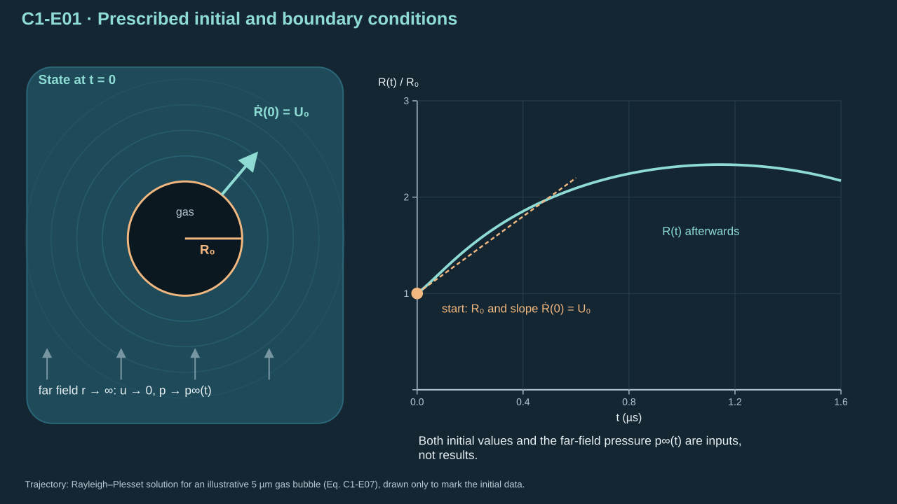

The evolving spherical boundary and the prescribed far-field state.

运动球形边界与给定的远场状态。

## 1.3 Rayleigh–Plesset derivation

## 1.3 Rayleigh–Plesset 方程推导

**Step 1 — Conserve carrier volume.** Radial incompressibility makes volume flux independent of radius. Integrate its radial derivative. Apply equal normal liquid and interface velocities at the wall. Vapor density does not enter this carrier-flow calculation.

**步骤 1——载液体积守恒。** 径向不可压缩流的体积流量与半径无关。积分径向导数，再令壁面处液体法向速度等于界面速度。这一载液流动计算不需要蒸气密度。

**Symbols before Eq. (C1-E02).**

**式（C1-E02）前的符号定义。**

| First individual definition / 第一项单独定义 | Second individual definition / 第二项单独定义 |
| --- | --- |
| $r\ge R(t)>0$ is radial position (m) $r\ge R(t)>0$ 为径向位置（m） | $R$ is cavity radius (m) $R$ 为空腔半径（m） |
| $t$ is time (s) $t$ 为时间（s） | $u$ is radial carrier velocity (m s⁻¹) $u$ 为载液径向速度（m s⁻¹） |
| $\dot R$ is wall speed (m s⁻¹) $\dot R$ 为壁面速度（m s⁻¹） | $C(t)$ is the radius-independent flux factor (m³ s⁻¹), not a material constant $C(t)$ 为与径向位置无关的流量因子（m³ s⁻¹），并非材料常数 |

**Conventions and conditions.** $\partial/\partial r$ differentiates at fixed time; The implication arrows indicate integration and use of the interface condition.

**约定与条件。** $\partial/\partial r$ 表示固定时间下的径向求导；箭头表示积分及应用界面条件。

(C1-E02) · Exact continuity within the spherical model / 球形模型内的精确连续性关系

$$
\frac{1}{r^2}\frac{\partial(r^2u)}{\partial r}=0\ \Longrightarrow\ r^2u=C(t),\qquad u(R,t)=\dot R\ \Longrightarrow\ C(t)=R^2\dot R,\qquad u(r,t)=\frac{R^2\dot R}{r^2}
$$

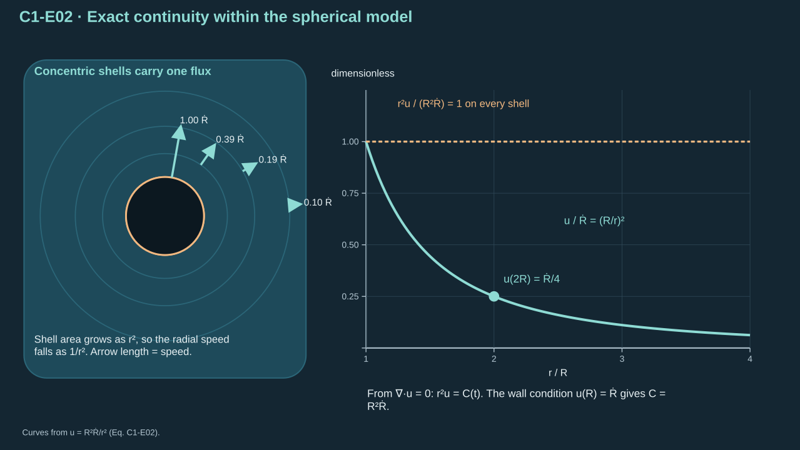

Inverse-square velocity decay places the inertia in the surrounding carrier.

速度按距离平方反比衰减，惯性来自周围载液。

**Step 2 — Fix the potential reference.** Integrate velocity from infinity to the observation point. The potential applies outside the cavity. Zero potential at infinity fixes the time-dependent integration constant.

**步骤 2——固定速度势参考值。** 从无穷远积分速度至观察点。速度势适用于空腔外域。令无穷远速度势为零，确定随时间变化的积分常数。

**Symbols before Eq. (C1-E03).**

**式（C1-E03）前的符号定义。**

| First individual definition / 第一项单独定义 | Second individual definition / 第二项单独定义 |
| --- | --- |
| $\phi$ is velocity potential (m² s⁻¹) $\phi$ 为速度势（m² s⁻¹） | $r$ is liquid radial position (m) $r$ 为液体径向位置（m） |
| $R$ cavity radius (m) $R$ 为空腔半径（m） | $t$ is time (s) $t$ 为时间（s） |
| $s$ is a dummy radial integration coordinate (m) $s$ 为径向积分哑变量（m） | $u$ is radial velocity (m s⁻¹) $u$ 为径向速度（m s⁻¹） |
| $\dot R$ is wall speed (m s⁻¹) $\dot R$ 为壁面速度（m s⁻¹） |  |

**Conventions and conditions.** the integral is an improper integral convergent for $r\ge R>0$; $\partial/\partial r$ is the fixed-time spatial derivative.

**约定与条件。** 该广义积分在 $r\ge R>0$ 时收敛；$\partial/\partial r$ 为固定时间的空间导数。

(C1-E03) · Derived velocity potential / 推导得到的速度势

$$
\phi(r,t)=\int_\infty^r u(s,t)\,ds=R^2\dot R\int_\infty^r s^{-2}\,ds=-\frac{R^2\dot R}{r},\qquad \frac{\partial\phi}{\partial r}=u
$$

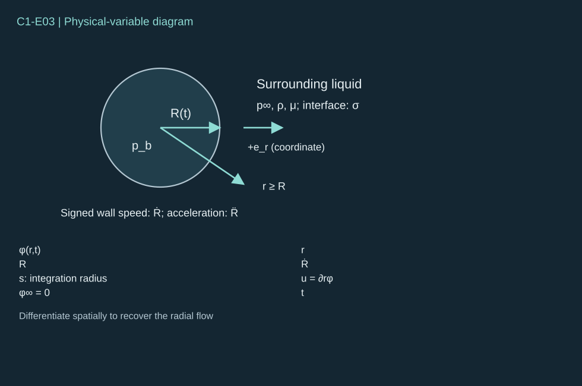

The potential reference is fixed at infinity before differentiation.

在求导之前，先固定无穷远处的速度势参考值。

**Step 3 — Differentiate at fixed position.** Hold the denominator fixed while differentiating the potential numerator. Then evaluate the result at the moving wall. Differentiating the wall value instead includes a convective contribution.

**步骤 3——在固定位置求导。** 保持速度势分母不变，对分子求时间导数。随后在运动壁面处取值。直接对壁面取值求导会包含对流贡献。

**Symbols before Eq. (C1-E04).**

**式（C1-E04）前的符号定义。**

| First individual definition / 第一项单独定义 | Second individual definition / 第二项单独定义 |
| --- | --- |
| $\phi$ is velocity potential (m² s⁻¹) $\phi$ 为速度势（m² s⁻¹） | $t$ is time (s) $t$ 为时间（s） |
| $r$ is fixed radial position (m) $r$ 为固定径向位置（m） | $R(t)>0$ is moving cavity radius (m) $R(t)>0$ 为运动空腔半径（m） |
| $\dot R$ — Wall radial velocity (m s⁻¹) $\dot R$ — 壁面径向速度（m s⁻¹） | $\ddot R$ — Wall radial acceleration (m s⁻²) $\ddot R$ — 壁面径向加速度（m s⁻²） |

**Conventions and conditions.** vertical bars specify where the derivative is taken or evaluated; $d/dt$ follows the moving wall value; Each derivative has units m² s⁻².

**约定与条件。** 竖线表示求导或取值条件；$d/dt$ 跟随运动壁面的取值；各导数的单位均为 m² s⁻²。

(C1-E04) · Exact Eulerian and moving-point derivatives / 精确的欧拉导数与运动点导数

$$
\left.\frac{\partial\phi}{\partial t}\right|_r=-\frac{2R\dot R^2+R^2\ddot R}{r},\qquad \left.\frac{\partial\phi}{\partial t}\right|_{r=R}=-(2\dot R^2+R\ddot R),\qquad \frac{d\phi(R(t),t)}{dt}=-\dot R^2-R\ddot R
$$

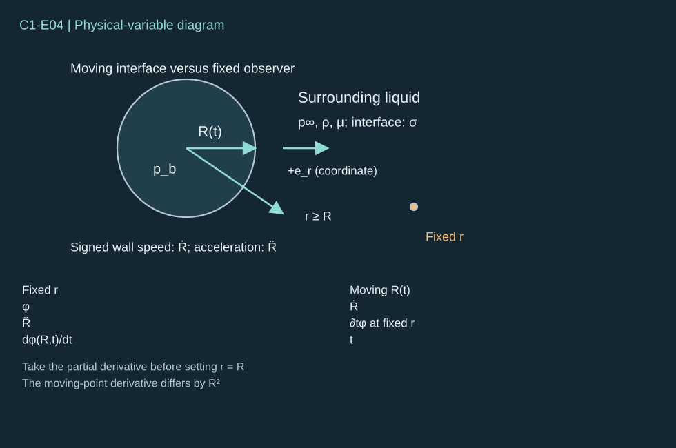

A fixed liquid observation point and a moving interface point have different time derivatives.

固定液体观察点与运动界面点对应不同的时间导数。

**Step 4 — Integrate radial momentum.** The exterior field is irrotational with zero vector Laplacian. Bulk viscous force therefore vanishes. Viscous wall stress and dissipation remain. Reference unsteady Bernoulli to infinity. Insert the fixed-position derivative and wall velocity. Subtracting one half from two gives the inertial coefficient.

**步骤 4——积分径向动量。** 外域流场无旋，矢量拉普拉斯为零，因而体内黏性力为零。壁面黏性应力和耗散仍存在。以无穷远为参考应用非定常伯努利方程。代入固定位置导数与壁面速度。二减去二分之一得到惯性项系数。

**Symbols before Eq. (C1-E05).**

**式（C1-E05）前的符号定义。**

| First individual definition / 第一项单独定义 | Second individual definition / 第二项单独定义 |
| --- | --- |
| $p_l$ is liquid pressure at the wall (Pa) $p_l$ 为壁面液体压力（Pa） | $p_\infty$ far-field pressure (Pa) $p_\infty$ 为远场压力（Pa） |
| $\rho>0$ is carrier density (kg m⁻³) $\rho>0$ 为载液密度（kg m⁻³） | $\phi$ is velocity potential (m² s⁻¹) $\phi$ 为速度势（m² s⁻¹） |
| $t$ is time (s) $t$ 为时间（s） | $r$ is radial position (m) $r$ 为径向位置（m） |
| $R>0$ cavity radius (m) $R>0$ 为空腔半径（m） | $u$ is radial velocity (m s⁻¹) $u$ 为径向速度（m s⁻¹） |
| $\dot R$ wall speed (m s⁻¹) $\dot R$ 为壁面速度（m s⁻¹） | $\ddot R$ is wall acceleration (m s⁻²) $\ddot R$ 为壁面加速度（m s⁻²） |

**Conventions and conditions.** $\partial_t$ is taken at fixed position before wall evaluation.

**约定与条件。** $\partial_t$ 必须先在固定位置求导，再于壁面取值。

(C1-E05) · Derived inertial pressure / 推导得到的惯性压力

$$
\frac{p_l-p_\infty}{\rho}=-\left.\frac{\partial\phi}{\partial t}\right|_{r=R}-\frac{u(R,t)^2}{2}=2\dot R^2+R\ddot R-\frac{\dot R^2}{2}=R\ddot R+\frac32\dot R^2
$$

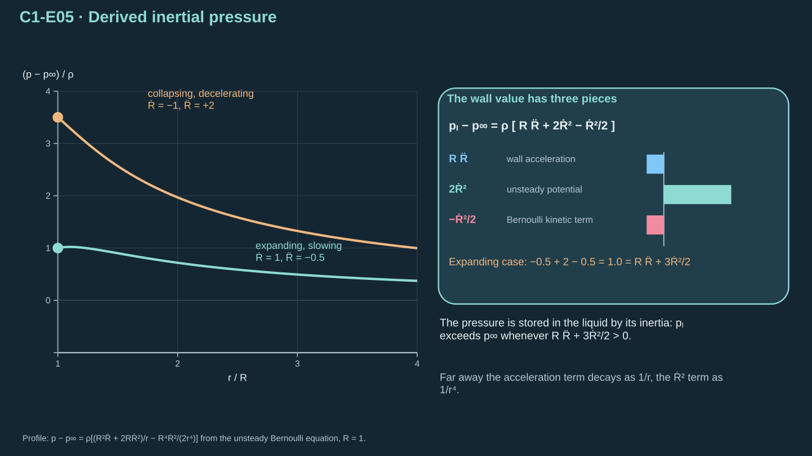

Liquid inertia relates the interface pressure to wall acceleration and squared speed.

液体惯性把界面压力与壁面加速度及速度平方联系起来。

**Step 5 — Balance normal stress.** Expansion gives a negative radial strain rate at the wall. The capillary jump lowers liquid pressure relative to cavity pressure. Balance normal traction with Newtonian viscous stress included.

**步骤 5——平衡法向应力。** 膨胀时壁面径向应变率为负。毛细压差使液体侧压力低于腔内压力。将牛顿黏性应力计入法向牵引平衡。

**Symbols before Eq. (C1-E06).**

**式（C1-E06）前的符号定义。**

| First individual definition / 第一项单独定义 | Second individual definition / 第二项单独定义 |
| --- | --- |
| $u$ — Radial liquid velocity (m s⁻¹) $u$ — 液体径向速度（m s⁻¹） | $\dot R$ — Bubble-wall radial velocity (m s⁻¹) $\dot R$ — 气泡壁面径向速度（m s⁻¹） |
| $r$ — Radial liquid position (m) $r$ — 液体径向位置（m） | $R>0$ — Positive cavity radius (m) $R>0$ — 正的空腔半径（m） |
| $p_l$ — Liquid-side pressure at the cavity wall (Pa) $p_l$ — 空腔壁面处的液体侧压力（Pa） | $p_b$ — Spatially uniform bubble pressure (Pa) $p_b$ — 空间均匀的气泡压力（Pa） |
| $\sigma\ge0$ — Nonnegative surface tension (N m⁻¹) $\sigma\ge0$ — 非负表面张力（N m⁻¹） | $\mu\ge0$ — Nonnegative carrier dynamic viscosity (Pa s) $\mu\ge0$ — 非负载液动力黏度（Pa s） |
| $\partial_r u$ — Radial strain rate, evaluated at the wall (s⁻¹) $\partial_r u$ — 在壁面取值的径向应变率（s⁻¹） |  |

**Conventions and conditions.** wall evaluation is performed at $r=R$.

**约定与条件。** 壁面取值在 $r=R$ 处进行。

(C1-E06) · Newtonian stress and capillary boundary condition / 牛顿流体应力与毛细边界条件

$$
\left.\frac{\partial u}{\partial r}\right|_{r=R}=\left.-\frac{2R^2\dot R}{r^3}\right|_{r=R}=-\frac{2\dot R}{R},\qquad p_l=p_b-\frac{2\sigma}{R}+2\mu\left.\frac{\partial u}{\partial r}\right|_{r=R}=p_b-\frac{2\sigma}{R}-\frac{4\mu\dot R}{R}
$$

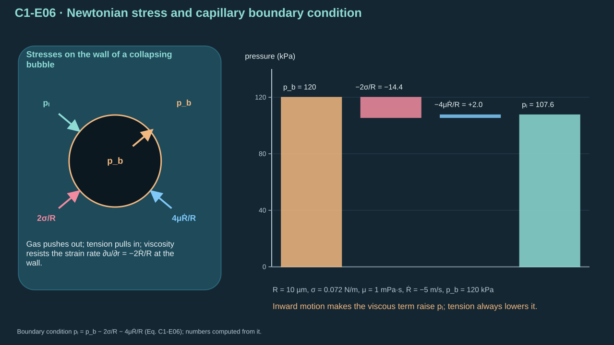

Capillary and viscous stresses act at the interface even when the radial bulk viscous force is zero.

即使径向体内黏性力为零，毛细与黏性应力仍作用于界面。

**Step 6 — Combine inertia and traction.** Insert Eq. (C1-E06) into Eq. (C1-E05). Multiply by carrier density to obtain radial momentum balance. Internal pressure still requires a source model. Use aqueous carrier density for the exterior inertia. PFC density describes a different material domain.

**步骤 6——合并惯性与牵引。** 将式（C1-E06）代入式（C1-E05），再乘以载液密度，得到径向动量平衡。内部压力仍需源模型。外域惯性采用水相载液密度。PFC 密度对应另一材料区域。

**Symbols before Eq. (C1-E07).**

**式（C1-E07）前的符号定义。**

| First individual definition / 第一项单独定义 | Second individual definition / 第二项单独定义 |
| --- | --- |
| $\rho>0$ is carrier density (kg m⁻³) $\rho>0$ 为载液密度（kg m⁻³） | $R>0$ is cavity radius (m) $R>0$ 为空腔半径（m） |
| $\dot R$ — Wall radial velocity (m s⁻¹) $\dot R$ — 壁面径向速度（m s⁻¹） | $\ddot R$ — Wall radial acceleration (m s⁻²) $\ddot R$ — 壁面径向加速度（m s⁻²） |
| $p_b$ — Uniform bubble absolute pressure (Pa) $p_b$ — 均匀气泡绝对压力（Pa） | $p_\infty$ — Far-field absolute pressure (Pa) $p_\infty$ — 远场绝对压力（Pa） |
| $\sigma$ is constant surface tension (N m⁻¹) $\sigma$ 为常数表面张力（N m⁻¹） | $\mu$ is constant carrier viscosity (Pa s) $\mu$ 为常数载液黏度（Pa s） |

**Conventions and conditions.** Every term is a pressure.

**约定与条件。** 各项均具有压力单位。

(C1-E07) · Rayleigh–Plesset under the declared assumptions / 所述假设下的 Rayleigh–Plesset 方程

$$
\rho\left(R\ddot R+\frac32\dot R^2\right)=p_b-p_\infty-\frac{2\sigma}{R}-\frac{4\mu\dot R}{R}
$$

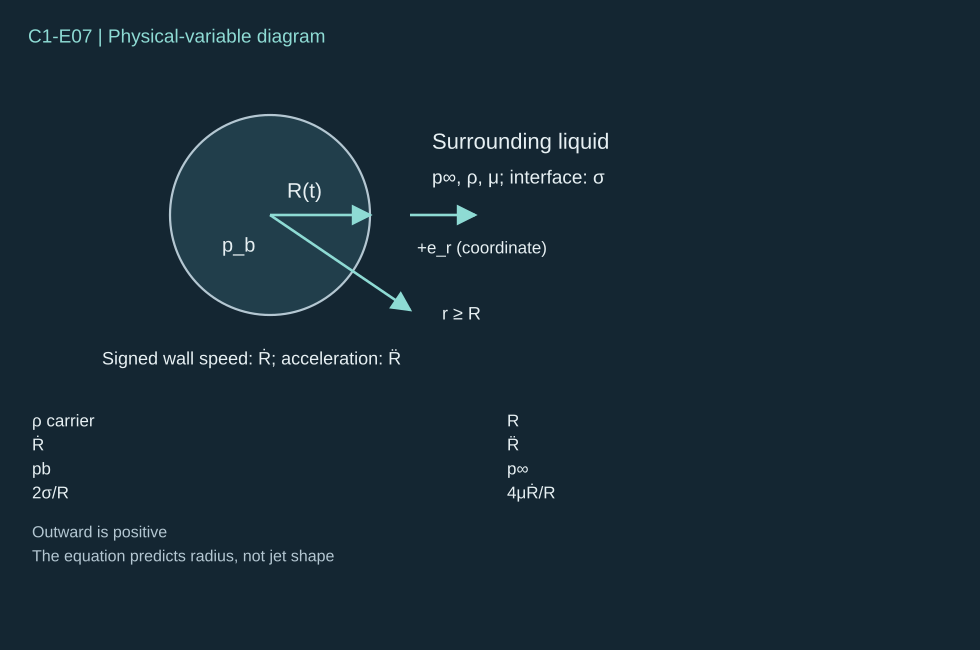

The spherical pressure–inertia balance has a scalar radial state.

球形压力—惯性平衡只具有标量径向状态。

Every term has pressure units: density × length × acceleration, tension/radius, and viscosity × speed/radius. At rest, internal overpressure equals the capillary jump. During collapse, the viscous term resists inward motion. To obtain acceleration, also subtract the squared-speed term. This matches the classical spherical model. [[R1]](../reference/sources.html#r1) [[Brennen, Ch. 2]](https://media.library.caltech.edu/CaltechBOOK%3A1995.001/chap2.htm)

各项均为压力：密度 × 长度 × 加速度、张力／半径，以及黏度 × 速度／半径。静止时，内部过压等于毛细压差。塌缩时，黏性项阻碍向内运动。求加速度时还须减去速度平方项。结果与经典球形模型一致。 [[R1]](../reference/sources.html#r1) [[Brennen，第 2 章]](https://media.library.caltech.edu/CaltechBOOK%3A1995.001/chap2.htm)

**Symbols before Eq. (C1-E08).**

**式（C1-E08）前的符号定义。**

| First individual definition / 第一项单独定义 | Second individual definition / 第二项单独定义 |
| --- | --- |
| $p_b$ is uniform total bubble pressure (Pa) $p_b$ 为空间均匀的气泡总压力（Pa） | $p_{v,\mathrm{PFC}}$ is the PFC-vapor partial pressure (Pa) $p_{v,\mathrm{PFC}}$ 为 PFC 蒸气分压（Pa） |
| $p_{v,w}$ water-vapor partial pressure (Pa) $p_{v,w}$ 为水蒸气分压（Pa） | $p_g$ permanent-gas partial pressure (all Pa) $p_g$ 为非凝结气体分压（均为 Pa） |

**Conventions and conditions.** Subscript $v$ labels vapor, PFC its chemical family; Additivity assumes a gas-mixture pressure description with the stated partial pressures; $w$ water; $g$ noncondensable gas.

**约定与条件。** 下标 $v$ 表示蒸气，PFC 表示该化学物质族；相加关系采用具有上述分压定义的气体混合物压力描述；$w$ 表示水；$g$ 表示非凝结气体。

(C1-E08) · Pressure composition requiring thermodynamic closure / 需要热力学闭合的压力组成关系

$$
p_b=p_{v,\mathrm{PFC}}+p_{v,w}+p_g
$$

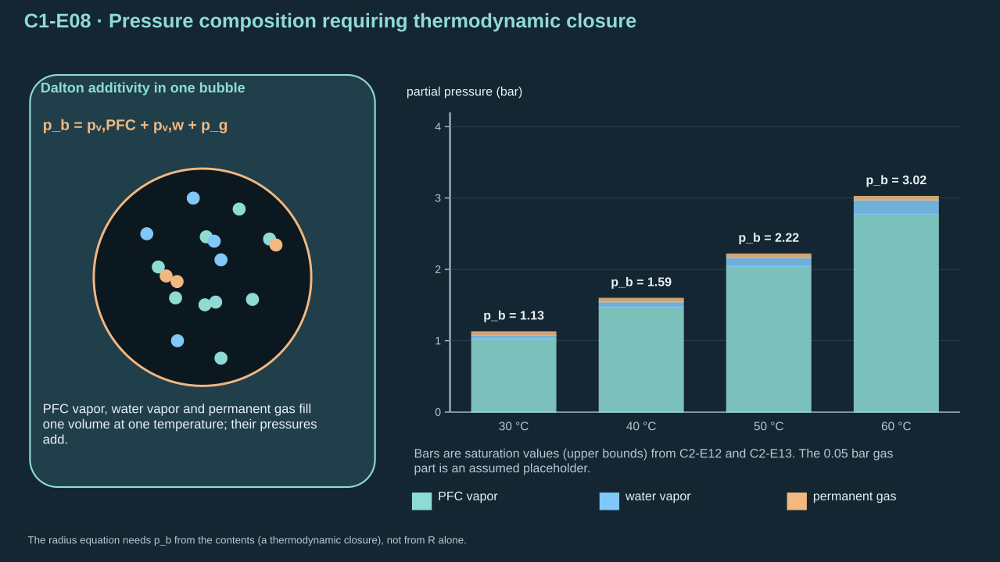

The mechanical input comes from the evolving contents, not from radius alone.

力学输入来自不断变化的气泡内容物，不能仅由半径决定。

A fixed-mass polytropic gas control requires its stated thermal assumptions. Evaporation and condensation exchange mass and latent heat. A permanent-gas closure omits those exchanges. Uniform internal pressure requires communication faster than state evolution. Chapter 2 supplies a finite-inventory closure. [[R5]](../reference/sources.html#r5)

固定质量多方气体对照要求满足其热学假设。蒸发和凝结交换质量与潜热，非凝结气体闭合省略了这些交换。均匀内压要求内部通信快于状态演化。第二章给出有限物质量闭合。 [[R5]](../reference/sources.html#r5)

## 1.4 Carrier energy balance

## 1.4 载液能量平衡

**Step 7 — Integrate exterior kinetic energy.** Square the velocity in Eq. (C1-E02). Multiply by the spherical volume element and integrate. The inverse-square integral converges over the infinite exterior. Carrier liquid beyond the wall supplies the moving inertia.

**步骤 7——积分外域动能。** 将式（C1-E02）的速度平方，乘以球形体积微元并积分。平方反比积分在无限外域收敛。壁面之外的载液构成运动惯性。

**Symbols before Eq. (C1-E09).**

**式（C1-E09）前的符号定义。**

| First individual definition / 第一项单独定义 | Second individual definition / 第二项单独定义 |
| --- | --- |
| $K_l$ is exterior liquid kinetic energy (J) $K_l$ 为外部液体动能（J） | $\rho$ is carrier density (kg m⁻³) $\rho$ 为载液密度（kg m⁻³） |
| $u$ is radial liquid speed (m s⁻¹) $u$ 为径向液体速度（m s⁻¹） | $\dot R$ wall speed (m s⁻¹) $\dot R$ 为壁面速度（m s⁻¹） |
| $t$ is time (s) $t$ 为时间（s） | $R>0$ is cavity radius (m) $R>0$ 为空腔半径（m） |
| $r$ the integration radius (m) $r$ 为积分半径（m） | $\pi$ is the circle constant (dimensionless) $\pi$ 为圆周率（无量纲） |

**Conventions and conditions.** $4\pi r^2dr$ is the spherical volume element (m³); endpoint brackets mean upper minus lower evaluation.

**约定与条件。** $4\pi r^2dr$ 为球形体积元（m³）；端点方括号表示上限取值减下限取值。

(C1-E09) · Exact kinetic-energy integral in the spherical model / 球形模型内的精确动能积分

$$
\begin{aligned}K_l&=\int_R^\infty\frac12\rho u(r,t)^2\,4\pi r^2\,dr\\&=2\pi\rho R^4\dot R^2\int_R^\infty r^{-2}\,dr\\&=2\pi\rho R^4\dot R^2\left[-\frac1r\right]_R^\infty=2\pi\rho R^3\dot R^2.\end{aligned}
$$

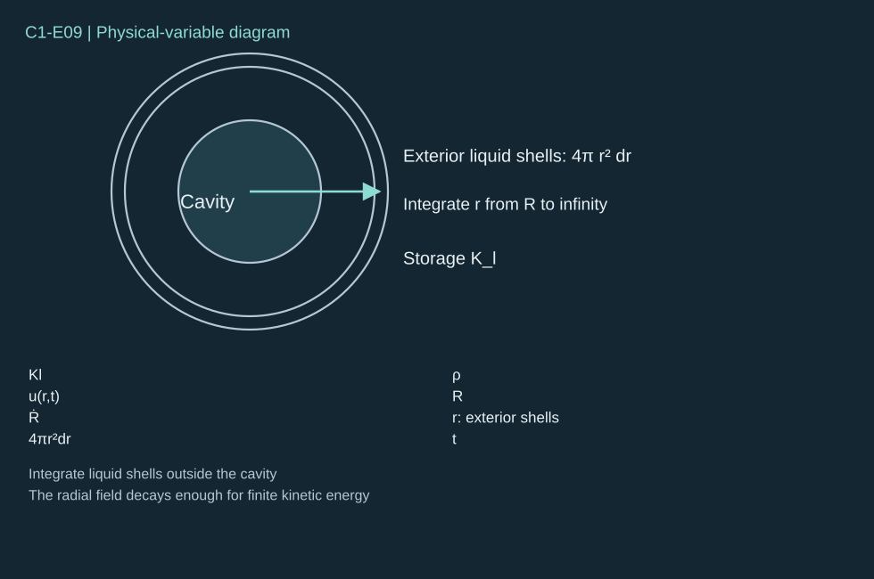

Exterior shells contribute finite kinetic energy even in an infinite domain.

即使外域无限，外部液壳贡献的总动能仍有限。

**Step 8 — Differentiate stored energy.** Apply the product rule to radius and squared speed. Differentiate cavity volume and interface energy separately. The surface-energy derivative assumes constant surface tension.

**步骤 8——对储存能量求导。** 对半径与速度平方应用乘积法则。分别对空腔体积和界面能求导。表面能导数假设表面张力恒定。

**Symbols before Eq. (C1-E10).**

**式（C1-E10）前的符号定义。**

| First individual definition / 第一项单独定义 | Second individual definition / 第二项单独定义 |
| --- | --- |
| $K_l$ — Carrier kinetic energy (J) $K_l$ — 载液动能（J） | $E_\sigma$ — Interfacial energy (J) $E_\sigma$ — 界面能（J） |
| $t$ is time (s) $t$ 为时间（s） | $\rho$ is carrier density (kg m⁻³) $\rho$ 为载液密度（kg m⁻³） |
| $R$ is radius (m) $R$ 为半径（m） | $\dot R$ — Wall radial velocity (m s⁻¹) $\dot R$ — 壁面径向速度（m s⁻¹） |
| $\ddot R$ — Wall radial acceleration (m s⁻²) $\ddot R$ — 壁面径向加速度（m s⁻²） | $V_b$ is cavity volume (m³) $V_b$ 为空腔体积（m³） |
| $\dot V_b$ its time derivative (m³ s⁻¹) $\dot V_b$ 为其时间导数（m³ s⁻¹） | $\sigma$ is constant surface tension (N m⁻¹) $\sigma$ 为常数表面张力（N m⁻¹） |
| $\pi$ is the circle constant (dimensionless) $\pi$ 为圆周率（无量纲） |  |

**Conventions and conditions.** Energy derivatives are powers (W).

**约定与条件。** 能量的时间导数为功率（W）。

(C1-E10) · Exact product-rule derivatives / 乘积求导法则的精确应用

$$
\begin{aligned}\frac{dK_l}{dt}&=2\pi\rho\left(3R^2\dot R^3+2R^3\dot R\ddot R\right)=4\pi R^2\dot R\,\rho\left(R\ddot R+\frac32\dot R^2\right),\\V_b&=\frac{4\pi R^3}{3},\qquad \dot V_b=4\pi R^2\dot R,\\E_\sigma&=4\pi\sigma R^2,\qquad \frac{dE_\sigma}{dt}=8\pi\sigma R\dot R.\end{aligned}
$$

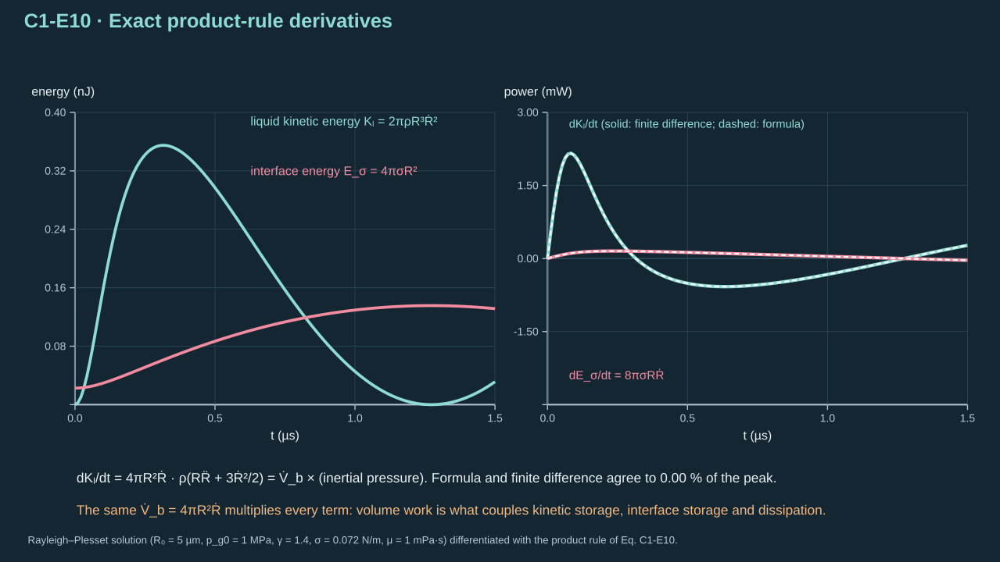

Volume work couples kinetic storage, interface storage and dissipation.

体积功耦合动能储存、界面能储存与耗散。

**Step 9 — Convert momentum balance into power balance.** Multiply by cavity volume rate. The inertial term becomes Eq. (C1-E10), first row. The capillary term equals minus the surface-energy derivative. Squared speed makes viscous power nonpositive in both motion directions.

**步骤 9——将动量平衡转为功率平衡。** 乘以空腔体积变化率。惯性项成为式（C1-E10）第一行。毛细项等于表面能导数的负值。速度平方使两种运动方向的黏性功率均不为正。

**Symbols before Eq. (C1-E11).**

**式（C1-E11）前的符号定义。**

| First individual definition / 第一项单独定义 | Second individual definition / 第二项单独定义 |
| --- | --- |
| $t$ is time (s) $t$ 为时间（s） | $K_l$ — Carrier kinetic energy (J) $K_l$ — 载液动能（J） |
| $E_\sigma$ — Interfacial energy (J) $E_\sigma$ — 界面能（J） | $p_b$ — Uniform bubble absolute pressure (Pa) $p_b$ — 均匀气泡绝对压力（Pa） |
| $p_\infty$ — Far-field absolute pressure (Pa) $p_\infty$ — 远场绝对压力（Pa） | $\dot V_b$ is cavity volume rate (m³ s⁻¹) $\dot V_b$ 为空腔体积变化率（m³ s⁻¹） |
| $\mu\ge0$ is carrier viscosity (Pa s) $\mu\ge0$ 为载液黏度（Pa s） | $R>0$ is cavity radius (m) $R>0$ 为空腔半径（m） |
| $\dot R$ is wall speed (m s⁻¹) $\dot R$ 为壁面速度（m s⁻¹） | $\pi$ is the circle constant (dimensionless) $\pi$ 为圆周率（无量纲） |

**Conventions and conditions.** The nonnegative term is dissipated power (W).

**约定与条件。** 非负项是耗散功率（W）。

(C1-E11) · Derived mechanical-energy balance / 推导得到的机械能平衡

$$
\frac{d}{dt}(K_l+E_\sigma)=(p_b-p_\infty)\dot V_b-16\pi\mu R\dot R^2,\qquad 16\pi\mu R\dot R^2\ge0
$$

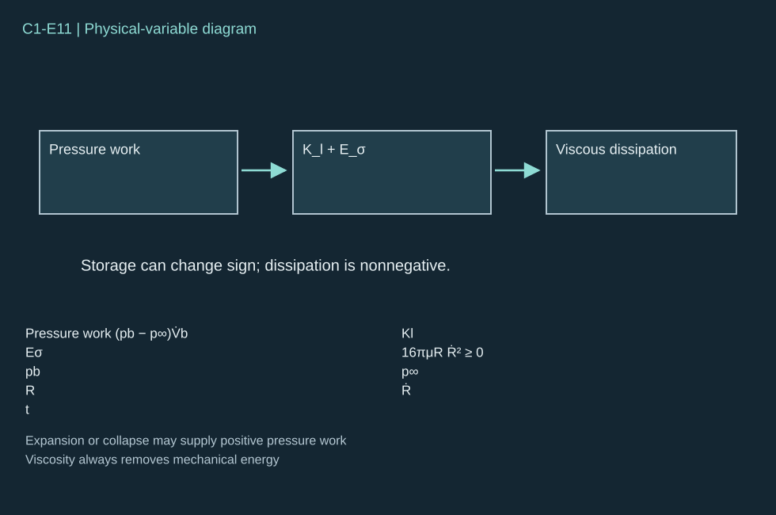

The pressure source supplies mechanical work; focusing cannot create extra energy.

压力源提供机械功；聚焦不能产生额外能量。

Check dissipation directly from the strain rates. Their coefficients are −2, 1 and 1. Their squared sum is six times the flux-factor square. Integrating Newtonian dissipation recovers Eq. (C1-E11). This checks the sign and coefficient by a separate calculation.

直接用应变率检验耗散。三个系数为 −2、1 和 1，其平方和为流量因子平方的六倍。积分牛顿耗散可恢复式（C1-E11）。这一独立计算检验了符号与系数。

**Symbols before Eq. (C1-E12).**

**式（C1-E12）前的符号定义。**

| First individual definition / 第一项单独定义 | Second individual definition / 第二项单独定义 |
| --- | --- |
| $D_{rr}$ — Radial strain-rate component (s⁻¹) $D_{rr}$ — 径向应变率分量（s⁻¹） | $D_{\theta\theta}$ — Polar tangential strain-rate component (s⁻¹) $D_{\theta\theta}$ — 极角切向应变率分量（s⁻¹） |
| $D_{\psi\psi}$ — Azimuthal tangential strain-rate component (s⁻¹) $D_{\psi\psi}$ — 方位角切向应变率分量（s⁻¹） | $\mathcal D_\mu$ is total viscous dissipation rate (W) $\mathcal D_\mu$ 为总黏性耗散率（W） |
| $\mu$ is viscosity (Pa s) $\mu$ 为黏度（Pa s） | $R>0$ is radius (m) $R>0$ 为半径（m） |
| $r$ radial integration position (m) $r$ 为径向积分位置（m） | $\dot R$ is wall speed (m s⁻¹) $\dot R$ 为壁面速度（m s⁻¹） |
| $\pi$ is the circle constant (dimensionless) $\pi$ 为圆周率（无量纲） | $\theta$ — Polar direction label in the strain-rate components (—) $\theta$ — 应变率分量中的极角方向标记（—） |
| $\psi$ — Azimuthal direction label, distinct from velocity potential (—) $\psi$ — 与速度势区别使用的方位角方向标记（—） | $\phi$ — Velocity potential (m² s⁻¹) $\phi$ — 速度势（m² s⁻¹） |

**Conventions and conditions.** The integral is over the liquid exterior; angular labels do not reuse the potential symbol $\phi$.

**约定与条件。** 积分区域为液体外域；角向标记不复用速度势符号 $\phi$。

(C1-E12) · Independent dissipation and conservation check / 独立的耗散与守恒检验

$$
\begin{aligned}D_{rr}&=-\frac{2R^2\dot R}{r^3},\qquad D_{\theta\theta}=D_{\psi\psi}=\frac{R^2\dot R}{r^3},\\\mathcal D_\mu&=\int_R^\infty 2\mu\left(D_{rr}^2+D_{\theta\theta}^2+D_{\psi\psi}^2\right)4\pi r^2\,dr\\&=48\pi\mu R^4\dot R^2\int_R^\infty r^{-4}\,dr=16\pi\mu R\dot R^2.\end{aligned}
$$

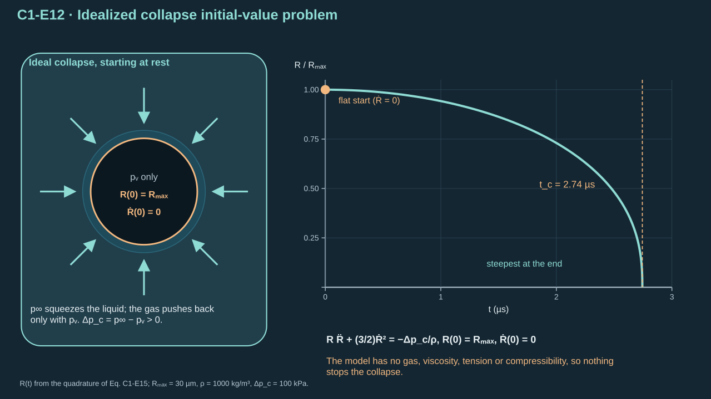

Direct strain-rate integration verifies the mechanical-energy loss.

直接积分应变率检验机械能损失。

Confinement can redirect liquid and change its energy budget. It may store elastic energy or increase dissipation. Predicting carrier motion requires the thermodynamic source and mechanical receiver. Incident pulse energy alone leaves that budget unresolved.

约束可改变液体方向及能量分配，也可能储存弹性能或增加耗散。预测载液运动需同时计算热力学源与力学受载体系。仅知入射脉冲能量，能量分配仍未确定。

## 1.5 Ideal collapse time and coefficient

## 1.5 理想塌缩时间与系数

**Step 10 — Specify the ideal collapse problem.** Start at maximum radius with zero wall speed. Far-field and vapor pressures are constant with positive collapse difference. Omit tension, viscosity, permanent gas and liquid compressibility. Thermal and phase dynamics are excluded assumptions. Their smallness for PFC remains unestablished. A hot vapor-rich cavity can still expand.

**步骤 10——规定理想塌缩问题。** 从最大半径及零壁面速度开始。远场压力与蒸气压恒定，塌缩压差为正。忽略张力、黏性、非凝结气体及液体可压缩性。热学与相变动力学被模型排除。它们对 PFC 是否足够小尚未确立。高温蒸气丰富的空腔仍可膨胀。

**Symbols before Eq. (C1-E13).**

**式（C1-E13）前的符号定义。**

| First individual definition / 第一项单独定义 | Second individual definition / 第二项单独定义 |
| --- | --- |
| $\Delta p_c>0$ is constant collapse-driving pressure (Pa) $\Delta p_c>0$ 为常数塌缩驱动压差（Pa） | $p_\infty$ — Constant Far-field absolute pressure (Pa) $p_\infty$ — 恒定的远场绝对压力（Pa） |
| $p_v$ — Stipulated constant vapor pressure (Pa) $p_v$ — 假定恒定蒸气压（Pa） | $t=0$ is maximum-radius time (s) $t=0$ 为最大半径时刻（s） |
| $R>0$ — Instantaneous cavity radius (m) $R>0$ — 瞬时空腔半径（m） | $R_{\max}>0$ — Radius at the start of ideal collapse (m) $R_{\max}>0$ — 理想塌缩开始时的半径（m） |
| $\dot R$ — Wall radial velocity (m s⁻¹) $\dot R$ — 壁面径向速度（m s⁻¹） | $\ddot R$ — Wall radial acceleration (m s⁻²) $\ddot R$ — 壁面径向加速度（m s⁻²） |
| $\rho>0$ is carrier density (kg m⁻³) $\rho>0$ 为载液密度（kg m⁻³） |  |(C1-E13) · Idealized collapse initial-value problem / 理想化塌缩的初值问题

$$
\Delta p_c=p_\infty-p_v>0,\qquad R(0)=R_{\max},\quad \dot R(0)=0,\qquad R\ddot R+\frac32\dot R^2=-\frac{\Delta p_c}{\rho}
$$

The ideal control begins at rest and excludes the mechanisms that arrest real collapse.

理想对照从静止开始，并排除了阻止实际塌缩的机制。

**Step 11 — Use radius on the collapse branch.** Negative initial acceleration starts decreasing radius. Define squared speed as a radius function. Away from the turning point, apply the chain rule. Cancel the nonzero speed there. Extend the relation continuously to the initial endpoint. Multiply by radius cubed to form an exact derivative.

**步骤 11——在塌缩分支上以半径为自变量。** 负初始加速度使半径开始减小。将速度平方定义为半径函数。在转折点之外应用链式法则，再约去非零速度。连续延拓关系至初始端点。乘以半径三次方，形成完整导数。

**Symbols before Eq. (C1-E14).**

**式（C1-E14）前的符号定义。**

| First individual definition / 第一项单独定义 | Second individual definition / 第二项单独定义 |
| --- | --- |
| $y(R)$ is squared wall speed (m² s⁻²) $y(R)$ 为壁面速度平方（m² s⁻²） | $R\in(0,R_{\max})$ is decreasing radius (m) $R\in(0,R_{\max})$ 为递减半径（m） |
| $t$ is time (s) $t$ 为时间（s） | $\dot R\ne0$ — Wall radial velocity (m s⁻¹) $\dot R\ne0$ — 壁面径向速度（m s⁻¹） |
| $\ddot R$ — Wall radial acceleration (m s⁻²) $\ddot R$ — 壁面径向加速度（m s⁻²） | $\Delta p_c$ is positive pressure difference (Pa) $\Delta p_c$ 为正压差（Pa） |
| $\rho$ is carrier density (kg m⁻³) $\rho$ 为载液密度（kg m⁻³） |  |

**Conventions and conditions.** $d/dR$ and $d/dt$ are ordinary derivatives on the monotonic branch; Radius powers are the integrating factor, not derivatives.

**约定与条件。** $d/dR$ 与 $d/dt$ 为单调分支上的普通导数；半径幂构成积分因子，并非导数。

(C1-E14) · Exact chain rule and integrating factor / 精确的链式法则与积分因子

$$
\begin{aligned}y(R)&=\dot R^2,\qquad \frac{dy}{dt}=\frac{dy}{dR}\dot R=2\dot R\ddot R\quad\Longrightarrow\quad\ddot R=\frac12\frac{dy}{dR},\\\frac{dy}{dR}+\frac{3y}{R}&=-\frac{2\Delta p_c}{\rho R},\\\frac{d(R^3y)}{dR}&=R^3\frac{dy}{dR}+3R^2y=-\frac{2\Delta p_c}{\rho}R^2.\end{aligned}
$$

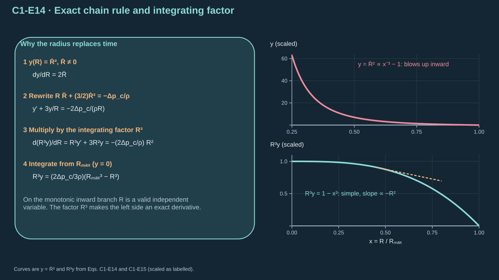

The monotonic collapse branch allows radius to replace time in the first integration.

单调塌缩分支允许在第一次积分中以半径取代时间。

**Symbols before Eq. (C1-E15).**

**式（C1-E15）前的符号定义。**

| First individual definition / 第一项单独定义 | Second individual definition / 第二项单独定义 |
| --- | --- |
| $R\in(0,R_{\max}]$ — Instantaneous cavity radius (m) $R\in(0,R_{\max}]$ — 瞬时空腔半径（m） | $R_{\max}$ — Radius at the start of ideal collapse (m) $R_{\max}$ — 理想塌缩开始时的半径（m） |
| $y$ is squared speed (m² s⁻²) $y$ 为速度平方（m² s⁻²） | $s$ is dummy radius (m) $s$ 为积分哑半径（m） |
| $\Delta p_c>0$ is collapse pressure (Pa) $\Delta p_c>0$ 为塌缩压差（Pa） | $\rho>0$ is carrier density (kg m⁻³) $\rho>0$ 为载液密度（kg m⁻³） |
| $\dot R\le0$ is inward wall velocity (m s⁻¹) $\dot R\le0$ 为向内壁面速度（m s⁻¹） |  |

**Conventions and conditions.** The square root denotes the nonnegative root; its prefixed minus sign selects collapse.

**约定与条件。** 根号表示非负平方根；前置负号选择塌缩分支。

(C1-E15) · Integrated speed with initial constant and branch / 含初始积分常数与分支选择的速度积分解

$$
\begin{aligned}R^3y(R)-R_{\max}^3y(R_{\max})&=-\frac{2\Delta p_c}{\rho}\int_{R_{\max}}^R s^2\,ds=-\frac{2\Delta p_c}{3\rho}(R^3-R_{\max}^3),\\y(R_{\max})&=0,\qquad \dot R=-\sqrt{\frac{2\Delta p_c}{3\rho}\left[\left(\frac{R_{\max}}{R}\right)^3-1\right]}.\end{aligned}
$$

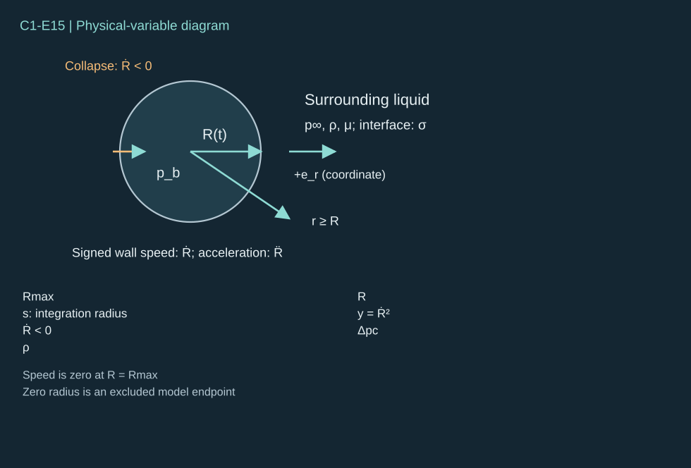

The initial condition fixes the integration constant and the inward sign fixes the branch.

初值确定积分常数，向内的符号确定解分支。

**Step 12 — Separate scale from trajectory.** Integrate reciprocal inward speed from maximum radius to zero. Normalize radius by its maximum. Every case in this ideal family shares the resulting dimensionless integral. That common integral establishes the time proportionality.

**步骤 12——分离尺度与轨迹。** 从最大半径至零积分向内速度的倒数。用最大半径归一化半径。此理想模型族各情形共有所得无量纲积分。该共同积分确立时间的比例关系。

**Symbols before Eq. (C1-E16).**

**式（C1-E16）前的符号定义。**

| First individual definition / 第一项单独定义 | Second individual definition / 第二项单独定义 |
| --- | --- |
| $t_c$ is ideal collapse time (s) $t_c$ 为理想塌缩时间（s） | $R$ is radius (m) $R$ 为半径（m） |
| $R_{\max}$ its maximum (m) $R_{\max}$ 为其最大值（m） | $\dot R<0$ is inward velocity (m s⁻¹) $\dot R<0$ 为向内速度（m s⁻¹） |
| $\rho$ is density (kg m⁻³) $\rho$ 为密度（kg m⁻³） | $\Delta p_c>0$ is pressure difference (Pa) $\Delta p_c>0$ 为压差（Pa） |
| $x=R/R_{\max}\in[0,1]$ is dimensionless radius $x=R/R_{\max}\in[0,1]$ 为无量纲半径 | $C_t$ is the dimensionless time coefficient $C_t$ 为无量纲时间系数 |
| $dx$ — Dimensionless-radius integration measure (dimensionless) $dx$ — 无量纲半径积分微元（无量纲） | $dR$ — Radius integration measure (m) $dR$ — 半径积分微元（m） |

**Conventions and conditions.** definite integrals follow the collapse branch.

**约定与条件。** 定积分沿塌缩分支进行。

(C1-E16) · Exact separation and nondimensionalization / 精确的变量分离与无量纲化

$$
\begin{aligned}t_c&=\int_{R_{\max}}^0\frac{dR}{\dot R}=\sqrt{\frac{3\rho}{2\Delta p_c}}\int_0^{R_{\max}}\frac{dR}{\sqrt{(R_{\max}/R)^3-1}},\\x&=\frac{R}{R_{\max}},\qquad dR=R_{\max}dx,\\t_c&=R_{\max}\sqrt{\frac{\rho}{\Delta p_c}}\ C_t,\qquad C_t=\sqrt{\frac32}\int_0^1\frac{x^{3/2}}{\sqrt{1-x^3}}\,dx.\end{aligned}
$$

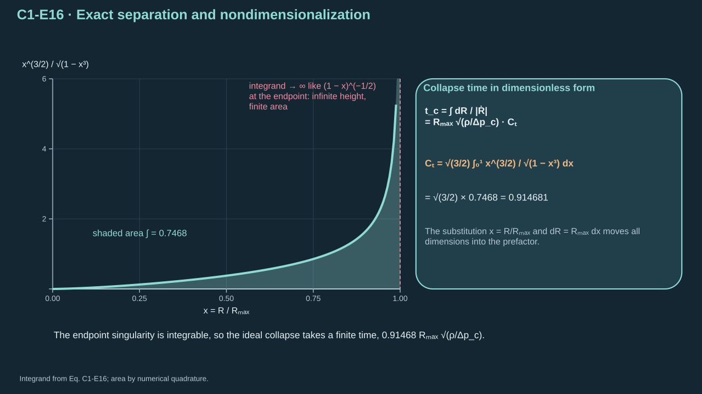

The endpoint singularity is integrable, so the model has a finite collapse time.

端点奇异性可积，因此该模型具有有限塌缩时间。

**Step 13 — Evaluate the coefficient.** Substitute the cube of normalized radius, including its Jacobian. The exponents combine as one half minus two thirds. The result is minus one sixth. Both beta-function arguments are positive, so the integral converges. The coefficient agrees with the published Rayleigh factor. [[R1]](../reference/sources.html#r1) [[R3]](../reference/sources.html#r3)

**步骤 13——计算系数。** 用无量纲半径的三次方换元，并计入雅可比因子。指数由二分之一减去三分之二，得到负六分之一。贝塔函数两个参数均为正，积分收敛。系数与文献瑞利因子一致。 [[R1]](../reference/sources.html#r1) [[R3]](../reference/sources.html#r3)

**Symbols before Eq. (C1-E17).**

**式（C1-E17）前的符号定义。**

| First individual definition / 第一项单独定义 | Second individual definition / 第二项单独定义 |
| --- | --- |
| $x$ — Dimensionless radius divided by the maximum radius (dimensionless) $x$ — 半径除以最大半径所得无量纲量（无量纲） | $q=x^3$ — Dimensionless substitution variable equal to the cube of the radius fraction (dimensionless) $q=x^3$ — 等于半径比例立方的无量纲换元变量（无量纲） |
| $C_t$ is the dimensionless collapse-time coefficient $C_t$ 为无量纲塌缩时间系数 | $B(a,b)$ is the beta function, defined by the displayed convergent integral (dimensionless) $B(a,b)$ 为贝塔函数，由公式中的收敛积分定义（无量纲） |
| $a$ — Positive first argument of the beta function (dimensionless) $a$ — 贝塔函数的正第一参数（无量纲） | $b$ — Positive second argument of the beta function (dimensionless) $b$ — 贝塔函数的正第二参数（无量纲） |
| $dx$ — Dimensionless-radius integration measure (dimensionless) $dx$ — 无量纲半径积分微元（无量纲） | $dq$ — Dimensionless substitution integration measure (dimensionless) $dq$ — 无量纲换元积分微元（无量纲） |

**Conventions and conditions.** The numeral 6 inside the root is a dimensionless constant; the ellipsis indicates decimal continuation; $x,q\in[0,1]$ and $q=x^3$ define the substitution domain..

**约定与条件。** 根号中的数字 6 为无量纲常数；省略号表示后续小数；$x,q\in[0,1]$ 且 $q=x^3$ 确定换元范围。。

(C1-E17) · Evaluated beta-function coefficient / 通过贝塔函数计算的系数

$$
\begin{aligned}q&=x^3,\quad x=q^{1/3},\quad dx=\frac13q^{-2/3}\,dq,\\C_t&=\frac{1}{\sqrt6}\int_0^1q^{-1/6}(1-q)^{-1/2}\,dq=\frac{1}{\sqrt6}B\left(\frac56,\frac12\right)=0.9146813565\ldots,\\B(a,b)&=\int_0^1q^{a-1}(1-q)^{b-1}\,dq\quad(a>0,b>0).\end{aligned}
$$

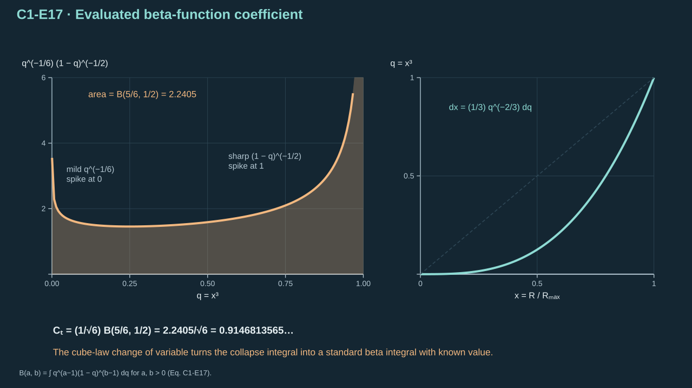

The change of variables exposes the beta integral that fixes the numerical coefficient.

换元揭示贝塔积分，从而确定数值系数。

**Step 14 — Check pressure work.** Insert Eq. (C1-E15) into the kinetic-energy integral. The result equals work from the lost cavity volume. Energy vanishes at maximum radius and becomes positive during collapse. This checks the integration constant and sign.

**步骤 14——检验压力功。** 将式（C1-E15）代入动能积分。结果等于空腔体积减少产生的压力功。最大半径处动能为零，塌缩过程中为正。这检验了积分常数与符号。

**Symbols before Eq. (C1-E18).**

**式（C1-E18）前的符号定义。**

| First individual definition / 第一项单独定义 | Second individual definition / 第二项单独定义 |
| --- | --- |
| $K_l$ is carrier kinetic energy (J) $K_l$ 为载液动能（J） | $E_B$ the maximum-volume pressure-work scale (J) $E_B$ 为最大体积的压力功尺度（J） |
| $R\in(0,R_{\max}]$ — Instantaneous cavity radius (m) $R\in(0,R_{\max}]$ — 瞬时空腔半径（m） | $R_{\max}$ — Radius at the start of ideal collapse (m) $R_{\max}$ — 理想塌缩开始时的半径（m） |
| $\rho$ is density (kg m⁻³) $\rho$ 为密度（kg m⁻³） | $\Delta p_c$ is constant positive pressure difference (Pa) $\Delta p_c$ 为常数正压差（Pa） |
| $V_{\max}$ is maximum cavity volume (m³) $V_{\max}$ 为最大空腔体积（m³） | $\pi$ is the circle constant (dimensionless) $\pi$ 为圆周率（无量纲） |
| $K_l/E_B$ is dimensionless and this control has zero viscous and capillary losses $K_l/E_B$ 无量纲，此对照模型的黏性与毛细损失为零 |  |(C1-E18) · Independent pressure-work conservation check / 独立的压力功守恒检验

$$
\begin{aligned}K_l(R)&=2\pi\rho R^3\frac{2\Delta p_c}{3\rho}\left[\left(\frac{R_{\max}}R\right)^3-1\right]=\frac{4\pi}{3}\Delta p_c(R_{\max}^3-R^3),\\E_B&=\Delta p_cV_{\max}=\frac{4\pi}{3}\Delta p_cR_{\max}^3,\qquad \frac{K_l}{E_B}=1-\left(\frac R{R_{\max}}\right)^3.\end{aligned}
$$

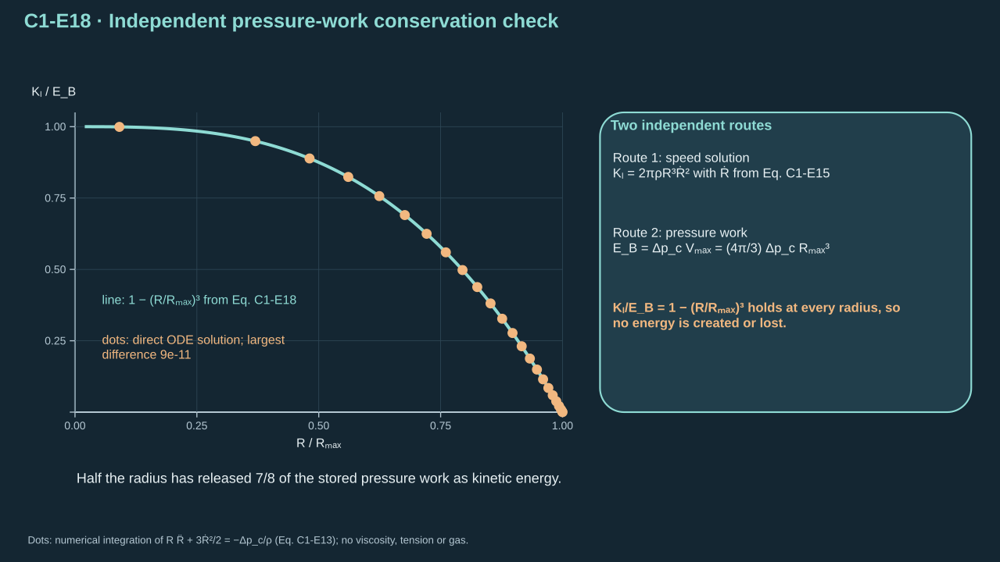

The Rayleigh speed solution and pressure-work balance agree exactly.

瑞利速度解与压力功平衡严格一致。

### Worked example: 30 μm cavity

### 计算示例：30 μm 空腔

Prescribe maximum radius 30 μm, density 1000 kg m⁻³, and collapse pressure 100 kPa. These teaching inputs are not measured PFC properties. Substitute SI values before converting units. At half radius, the cubic ratio is eight. Subtracting one leaves seven.

规定最大半径 30 μm、密度 1000 kg m⁻³、塌缩压差 100 kPa。这些教学输入并非 PFC 实测物性。先代入 SI 数值，再换算单位。一半半径处的三次方比值为八，减去一得到七。

**Symbols before Eq. (C1-E19).**

**式（C1-E19）前的符号定义。**

| First individual definition / 第一项单独定义 | Second individual definition / 第二项单独定义 |
| --- | --- |
| $t_c$ is collapse time (s) $t_c$ 为塌缩时间（s） | $E_B$ pressure-work scale (J) $E_B$ 为压力功尺度（J） |
| $K_l$ carrier kinetic energy (J) $K_l$ 为载液动能（J） | $R$ current radius (m) $R$ 为当前半径（m） |
| $R_{\max}=30\times10^{-6}$ m maximum radius $R_{\max}=30\times10^{-6}$ m 为最大半径 | $\dot R$ is signed wall speed (m s⁻¹) $\dot R$ 为带符号壁面速度（m s⁻¹） |
| $\Delta p_c=100\times10^3$ — Positive ideal-collapse pressure difference (Pa) $\Delta p_c=100\times10^3$ — 正的理想塌缩压差（Pa） | $\pi$ is the circle constant (dimensionless) $\pi$ 为圆周率（无量纲） |
| $\rho=1000$ — Substituted carrier density (kg m⁻³) $\rho=1000$ — 代入的载液密度（kg m⁻³） |  |

**Conventions and conditions.** s, J, μs and nJ mean seconds, joules, microseconds and nanojoules; the vertical bar specifies half-radius evaluation.

**约定与条件。** s、J、μs 与 nJ 分别为秒、焦耳、微秒与纳焦耳；竖线表示在一半半径处取值。

(C1-E19) · Declared teaching calculation / 采用明确给定参数的教学计算

$$
\begin{aligned}t_c&=0.9146813565(30\times10^{-6})\sqrt{\frac{1000}{100\times10^3}}\ \mathrm s=2.74404\ \mu\mathrm s,\\E_B&=\frac{4\pi}{3}(100\times10^3)(30\times10^{-6})^3\ \mathrm J=11.3097\ \mathrm{nJ},\\\dot R\big|_{R=R_{\max}/2}&=-\sqrt{\frac{2(100\times10^3)}{3(1000)}(8-1)}\ \mathrm{m\,s^{-1}}=-21.6025\ \mathrm{m\,s^{-1}},\\K_l\big|_{R=R_{\max}/2}&=\frac78E_B=9.89602\ \mathrm{nJ}.\end{aligned}
$$

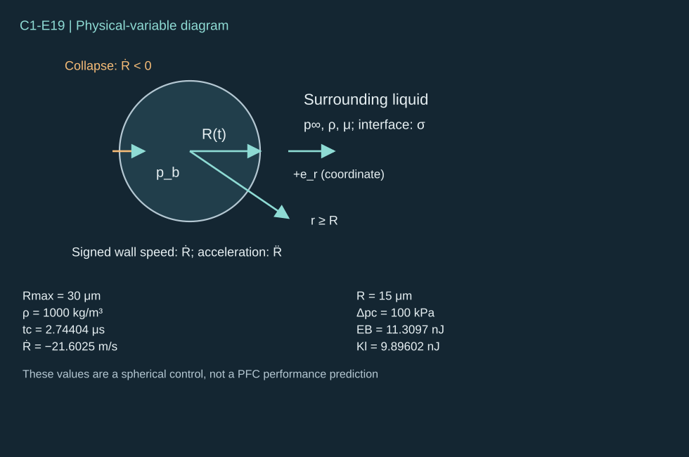

The original numerical control is preserved with its energy and branch checks.

保留原始数值对照，并补充能量与解分支检验。

Length × √(density/pressure) has units of seconds. Doubling radius doubles collapse time and increases work eightfold. Quadrupling pressure halves time and doubles speed at fixed radius fraction. The dimensionless initial-value problem, and hence its coefficient, stays unchanged. Gas cushioning, varying vapor pressure or confinement can change that problem.

长度 × √（密度／压力）的单位为秒。半径加倍使塌缩时间加倍、压力功增至八倍。压差增至四倍使时间减半、固定半径比例处速率加倍。无量纲初值问题及其系数保持不变。气体缓冲、变化蒸气压或约束可改变该问题。

The zero-radius limit gives finite energy and divergent wall speed. Physical maximum speed: Not established. Missing: compressibility, internal pressure, heat and mass transfer, molecular scales and interface distortion. The next equation locates a chosen Mach threshold on the ideal trajectory. It supplies a diagnostic, not a collapse-arrest law.

零半径极限给出有限能量与发散壁面速率。实际最大速率尚未确立。缺失：可压缩性、内部压力、传热传质、分子尺度及界面变形。下一式定位理想轨迹上的所选马赫数阈值。它是诊断条件，并非塌缩终止规律。

**Symbols before Eq. (C1-E20).**

**式（C1-E20）前的符号定义。**

| First individual definition / 第一项单独定义 | Second individual definition / 第二项单独定义 |
| --- | --- |
| $M_w$ is wall Mach number (dimensionless) $M_w$ 为壁面马赫数（无量纲） | $\dot R$ is wall speed (m s⁻¹) $\dot R$ 为壁面速度（m s⁻¹） |
| $c>0$ is stipulated carrier sound speed (m s⁻¹) $c>0$ 为给定载液声速（m s⁻¹） | $M_*>0$ is a selected diagnostic Mach value (dimensionless) $M_*>0$ 为选择的诊断马赫值（无量纲） |
| $x_M=R_M/R_{\max}$ is the radius fraction when $M_w=M_*$ (dimensionless) $x_M=R_M/R_{\max}$ 为 $M_w=M_*$ 时的半径比例（无量纲） | $R_M$ — Cavity radius at the selected Mach value (m) $R_M$ — 选定马赫数处的空腔半径（m） |
| $R_{\max}$ — Radius at the start of ideal collapse (m) $R_{\max}$ — 理想塌缩开始时的半径（m） | $\rho$ is carrier density (kg m⁻³) $\rho$ 为载液密度（kg m⁻³） |
| $\Delta p_c$ is positive collapse pressure (Pa) $\Delta p_c$ 为正塌缩压差（Pa） |  |

**Conventions and conditions.** absolute bars denote magnitude; The number uses the previous teaching density and pressure.

**约定与条件。** 绝对值符号表示大小；数值使用前述教学密度与压差。

(C1-E20) · Ideal-trajectory diagnostic, not a physical limit / 理想轨迹的诊断指标，而非物理极限

$$
M_w=\frac{|\dot R|}{c},\qquad x_M=\left[1+\frac{3\rho c^2M_*^2}{2\Delta p_c}\right]^{-1/3},\qquad M_*=0.1,\ c=1500\ \mathrm{m\,s^{-1}}\ \Longrightarrow\ x_M=0.143487
$$

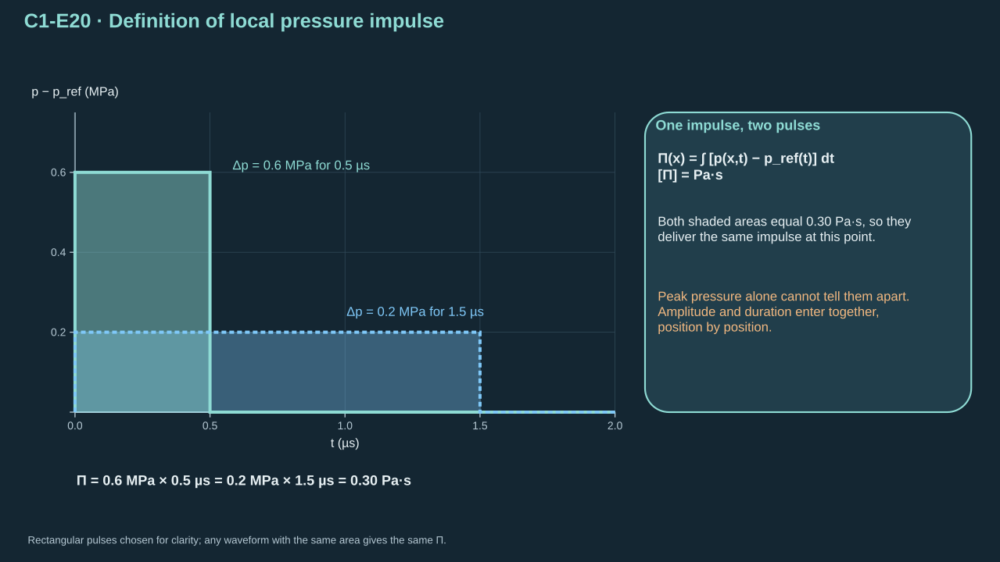

A Mach diagnostic exposes the shrinking validity range of incompressible collapse.

马赫数诊断揭示不可压缩塌缩模型的适用范围不断缩小。

## 1.6 Pressure impulse and direction

## 1.6 压力冲量与方向

**Step 15 — Define pressure impulse.** Integrate local pressure relative to a spatially uniform reference over time. Pressure impulse has units Pa s. Its spatial gradient drives liquid velocity change. Acoustic crossing time has units s. The cited short-event model motivates the following integration and approximation. [[R2]](../reference/sources.html#r2)

**步骤 15——定义压力冲量。** 对局部压力相对于空间均匀参考值作时间积分。压力冲量单位为 Pa s，其空间梯度驱动液体速度变化。声传播时间单位为 s。所引短事件模型提供以下积分与近似的依据。 [[R2]](../reference/sources.html#r2)

**Symbols before Eq. (C1-E21).**

**式（C1-E21）前的符号定义。**

| First individual definition / 第一项单独定义 | Second individual definition / 第二项单独定义 |
| --- | --- |
| $\boldsymbol x$ is fixed liquid position (m) $\boldsymbol x$ 为固定液体位置（m） | $\Pi$ is pressure impulse (Pa s) $\Pi$ 为压力冲量（Pa s） |
| $p$ is local pressure (Pa) $p$ 为局部压力（Pa） | $p_{\mathrm{ref}}$ a spatially uniform reference (Pa) $p_{\mathrm{ref}}$ 为空间均匀参考压力（Pa） |
| $t$ is time (s) $t$ 为时间（s） | $t_0$ — Event start time (s) $t_0$ — 事件开始时刻（s） |
| $t_1$ — Event end time (s) $t_1$ — 事件结束时刻（s） | $\tau$ is event duration (s) $\tau$ 为持续时间（s） |

**Conventions and conditions.** Square brackets on $\Pi$ denote units, not endpoint evaluation; The integral is at fixed position in a liquid domain whose displacement will be assessed below.

**约定与条件。** $\Pi$ 的方括号表示单位，而非端点取值；积分在固定位置进行，液体区域的位移将在下文评估。

(C1-E21) · Definition of local pressure impulse / 局部压力冲量的定义

$$
\Pi(\boldsymbol x)=\int_{t_0}^{t_1}\left[p(\boldsymbol x,t)-p_{\mathrm{ref}}(t)\right]dt,\qquad \tau=t_1-t_0>0,\qquad [\Pi]=\mathrm{Pa\,s}
$$

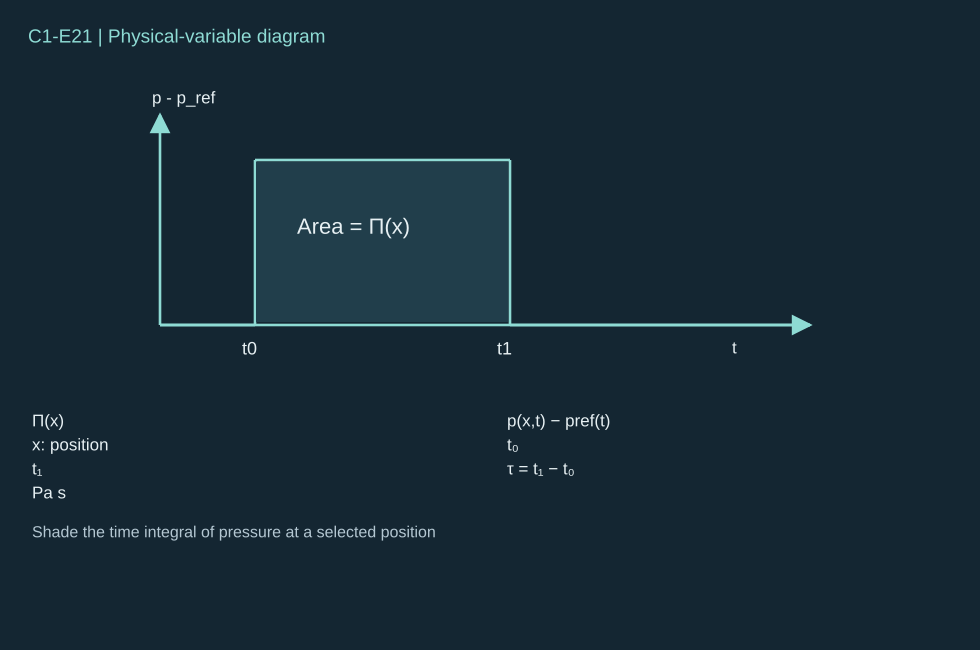

Impulse combines duration and amplitude at each liquid position.

压力冲量在每个液体位置组合压力幅值与持续时间。

**Symbols before Eq. (C1-E22).**

**式（C1-E22）前的符号定义。**

| First individual definition / 第一项单独定义 | Second individual definition / 第二项单独定义 |
| --- | --- |
| $\Delta\boldsymbol u$ is fixed-position velocity change (m s⁻¹) $\Delta\boldsymbol u$ 为固定位置速度变化（m s⁻¹） | $\boldsymbol u$ velocity (m s⁻¹) $\boldsymbol u$ 为速度（m s⁻¹） |
| $\Pi$ is pressure impulse (Pa s) $\Pi$ 为压力冲量（Pa s） | $\rho$ is constant density (kg m⁻³) $\rho$ 为常数密度（kg m⁻³） |
| $\mu$ is viscosity (Pa s) $\mu$ 为黏度（Pa s） | $\nu$ is kinematic viscosity (m² s⁻¹) $\nu$ 为运动黏度（m² s⁻¹） |
| $t_0$ — Event start time (s) $t_0$ — 事件开始时刻（s） | $t_1$ — Event end time (s) $t_1$ — 事件结束时刻（s） |
| $t$ — Elapsed time (s) $t$ — 经过时间（s） | $\boldsymbol x$ is fixed position (m) $\boldsymbol x$ 为固定位置（m） |

**Conventions and conditions.** $\nabla$ is spatial gradient (m⁻¹), $\nabla^2$ the vector Laplacian (m⁻²); the dot is a true vector contraction in convective acceleration, not an equation separator.

**约定与条件。** $\nabla$ 为空间梯度（m⁻¹），$\nabla^2$ 为矢量拉普拉斯（m⁻²）；圆点是对流加速度中的真正矢量缩并，并非公式分隔符。

(C1-E22) · Exact fixed-position integrated incompressible momentum / 固定位置处不可压缩动量方程的精确时间积分

$$
\Delta\boldsymbol u=-\frac{\nabla\Pi}{\rho}-\int_{t_0}^{t_1}(\boldsymbol u\cdot\nabla)\boldsymbol u\,dt+\nu\int_{t_0}^{t_1}\nabla^2\boldsymbol u\,dt,\qquad \Delta\boldsymbol u=\boldsymbol u(\boldsymbol x,t_1)-\boldsymbol u(\boldsymbol x,t_0),\quad \nu=\frac\mu\rho
$$

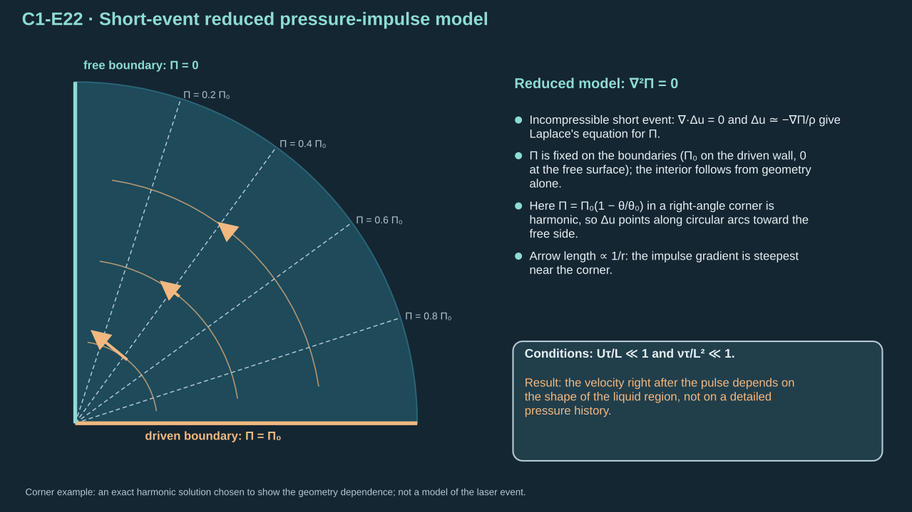

The short-event approximation must justify removing convective and viscous impulses.

短事件近似必须说明为何可以删除对流与黏性冲量。

**Step 16 — Bound the omitted scales.** Choose representative liquid speed and variation length. Convective impulse scales as speed × duration/length. Viscous impulse scales as kinematic viscosity × duration/length². Small interface displacement permits fixed boundary geometry. These scale diagnostics provide no guaranteed singular-boundary-layer error bound. Under these conditions, subtract incompressible velocities and take the divergence.

**步骤 16——估算被忽略项的尺度。** 选取代表性液体速率与变化长度。对流冲量尺度为速率 × 时间／长度。黏性冲量尺度为运动黏度 × 时间／长度²。小界面位移允许固定边界几何。这些尺度诊断不能保证奇异边界层的误差界限。在这些条件下，将不可压缩速度相减并取散度。

**Symbols before Eq. (C1-E23).**

**式（C1-E23）前的符号定义。**

| First individual definition / 第一项单独定义 | Second individual definition / 第二项单独定义 |
| --- | --- |
| $U>0$ is a characteristic liquid speed (m s⁻¹) $U>0$ 为特征液体速度（m s⁻¹） | $\tau$ is impulse duration (s) $\tau$ 为冲量持续时间（s） |
| $L>0$ is liquid variation length (m) $L>0$ 为液体变化长度（m） | $\nu$ is kinematic viscosity (m² s⁻¹) $\nu$ 为运动黏度（m² s⁻¹） |
| $\Delta\boldsymbol u$ is velocity change (m s⁻¹) $\Delta\boldsymbol u$ 为速度变化（m s⁻¹） | $\Pi$ is pressure impulse (Pa s) $\Pi$ 为压力冲量（Pa s） |
| $\rho$ is density (kg m⁻³) $\rho$ 为密度（kg m⁻³） |  |

**Conventions and conditions.** $\nabla\cdot$ denotes divergence and $\nabla^2$ Laplacian; $\ll$ means asymptotically small, and $\simeq$ marks the reduced approximation; The last Laplace equation belongs to that reduced model.

**约定与条件。** $\nabla\cdot$ 表示散度，$\nabla^2$ 表示拉普拉斯算子；$\ll$ 表示渐近很小，$\simeq$ 表示约化近似；最后的拉普拉斯方程属于该约化模型。

(C1-E23) · Short-event reduced pressure-impulse model / 短时事件的简化压力冲量模型

$$
\frac{U\tau}{L}\ll1,\qquad \frac{\nu\tau}{L^2}\ll1,\qquad \Delta\boldsymbol u\simeq-\frac{\nabla\Pi}{\rho},\qquad 0=\nabla\cdot\Delta\boldsymbol u\simeq-\frac{\nabla^2\Pi}{\rho}\ \Longrightarrow\ \nabla^2\Pi=0
$$

The velocity depends on a spatial impulse gradient constrained by boundary geometry.

速度取决于受边界几何约束的空间压力冲量梯度。

A fixed impermeable wall requires zero normal velocity change. Its normal impulse derivative therefore vanishes. A driven cavity prescribes impulse or pressure history. A communicating outlet supplies its pressure reference. A spatially uniform impulse addition has zero gradient and changes no velocity. Pulse duration and boundary geometry can change the response at fixed peak pressure.

固定不透壁要求法向速度变化为零，因而法向冲量导数为零。受驱空腔给定冲量或压力历程，连通出口给定压力参考值。空间均匀增加冲量的梯度为零，不改变速度。峰值压力固定时，脉冲时长与边界几何仍可改变响应。

**Step 17 — Solve a straight-column benchmark.** Start with a stationary uniform column along the positive axis. Area is constant and side walls are fixed. Prescribe positive inlet impulse and zero outlet impulse. Integrate the one-dimensional Laplace equation twice. Apply both endpoint values to obtain its gradient.

**步骤 17——求解直液柱基准。** 初始均匀液柱沿正轴静止，面积恒定，侧壁固定。入口冲量给定为正，出口冲量为零。将一维拉普拉斯方程积分两次，再用两个端点值确定梯度。

**Symbols before Eq. (C1-E24).**

**式（C1-E24）前的符号定义。**

| First individual definition / 第一项单独定义 | Second individual definition / 第二项单独定义 |
| --- | --- |
| $z\in[0,L]$ is axial position (m) $z\in[0,L]$ 为轴向位置（m） | $L>0$ column length (m) $L>0$ 为液柱长度（m） |
| $\Pi(z)$ — Local column pressure impulse (Pa s) $\Pi(z)$ — 液柱局部压力冲量（Pa s） | $\Pi_0>0$ — Driven-end pressure impulse (Pa s) $\Pi_0>0$ — 驱动端压力冲量（Pa s） |
| $A_0$ is an integration constant (Pa s) $A_0$ 为积分常数（Pa s） | $A_1$ a gradient constant (Pa s m⁻¹) $A_1$ 为梯度常数（Pa s m⁻¹） |
| $\rho>0$ is carrier density (kg m⁻³) $\rho>0$ 为载液密度（kg m⁻³） | $\Delta u_z$ is positive axial speed change (m s⁻¹) $\Delta u_z$ 为正轴向速度变化（m s⁻¹） |

**Conventions and conditions.** $d/dz$ is an axial derivative; Subscript $z$ labels the component and 0 the driven endpoint.

**约定与条件。** $d/dz$ 为轴向导数；下标 $z$ 表示分量，0 表示受驱动端点。

(C1-E24) · Exact straight-column solution of the reduced model / 简化模型中直液柱的精确解

$$
\begin{aligned}\frac{d^2\Pi}{dz^2}&=0\quad\Longrightarrow\quad\Pi=A_1z+A_0,\\\Pi(0)&=\Pi_0,\quad\Pi(L)=0\quad\Longrightarrow\quad A_0=\Pi_0,\quad A_1=-\frac{\Pi_0}{L},\\\Pi(z)&=\Pi_0\left(1-\frac zL\right),\qquad \Delta u_z=-\frac1\rho\frac{d\Pi}{dz}=\frac{\Pi_0}{\rho L}.\end{aligned}
$$

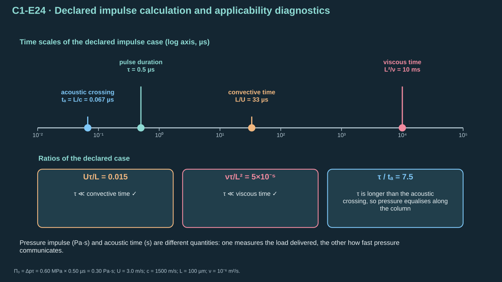

A linear spatial impulse drop accelerates liquid toward the outlet.

线性的空间冲量下降使液体向出口加速。

Prescribe 0.60 MPa for 0.50 μs across a 100 μm column. Use the earlier density, viscosity 0.001 Pa s, and sound speed 1500 m s⁻¹. The velocity change is 3.0 m s⁻¹. Crossing time is shorter than the pulse. Uniform pressure and final jet speed remain unestablished. The solved column has an end-to-end pressure gradient.

在 100 μm 液柱两端施加 0.60 MPa 压差，持续 0.50 μs。采用前述密度、黏度 0.001 Pa s 和声速 1500 m s⁻¹。速度变化为 3.0 m s⁻¹。传播时间短于脉冲时长。均匀压力及最终射流速率尚未确立。已解液柱具有端到端压力梯度。

**Symbols before Eq. (C1-E25).**

**式（C1-E25）前的符号定义。**

| First individual definition / 第一项单独定义 | Second individual definition / 第二项单独定义 |
| --- | --- |
| $\Pi_0$ is driven-end impulse (Pa s) $\Pi_0$ 为受驱动端冲量（Pa s） | $\Delta p$ is constant applied column pressure difference (Pa) $\Delta p$ 为施加的常数液柱压差（Pa） |
| $\tau$ is pulse duration (s) $\tau$ 为脉冲持续时间（s） | $U$ is column speed increment (m s⁻¹) $U$ 为液柱速度增量（m s⁻¹） |
| $\rho=1000$ kg m⁻³ is density $\rho=1000$ kg m⁻³ 为密度 | $L=100\times10^{-6}$ m is length $L=100\times10^{-6}$ m 为长度 |
| $c=1500$ m s⁻¹ is sound speed $c=1500$ m s⁻¹ 为声速 | $t_a$ is acoustic crossing time (s) $t_a$ 为声传播时间（s） |
| $\nu=\mu/\rho=10^{-6}$ m² s⁻¹ with $\mu=0.001$ Pa s $\nu=\mu/\rho=10^{-6}$ m² s⁻¹，且 $\mu=0.001$ Pa s | $\mu$ — Carrier dynamic viscosity (Pa s) $\mu$ — 载液动力黏度（Pa s） |

**Conventions and conditions.** The three ratios are dimensionless; μs means microseconds.

**约定与条件。** 三个比值均无量纲；μs 表示微秒。

(C1-E25) · Declared impulse calculation and applicability diagnostics / 采用给定参数的冲量计算与适用性诊断

$$
\begin{aligned}\Pi_0&=\Delta p\tau=(0.60\times10^6)(0.50\times10^{-6})\ \mathrm{Pa\,s}=0.30\ \mathrm{Pa\,s},\\U&=\frac{\Pi_0}{\rho L}=3.0\ \mathrm{m\,s^{-1}},\qquad t_a=\frac Lc=0.066667\ \mu\mathrm s,\\\frac{U\tau}{L}&=0.015,\qquad\frac{\nu\tau}{L^2}=5.0\times10^{-5},\qquad\frac{\tau}{t_a}=7.5.\end{aligned}
$$

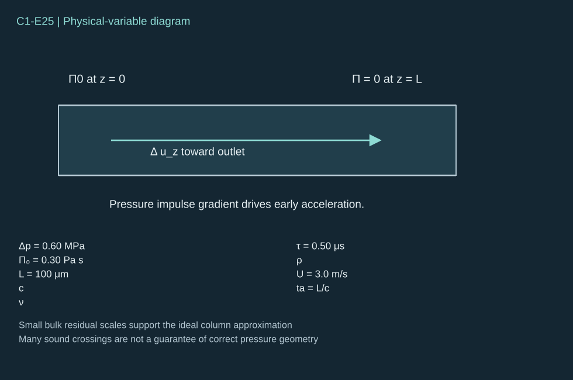

Pressure impulse and acoustic time have distinct definitions, dimensions and roles.

压力冲量与声传播时间具有不同的定义、量纲与作用。

Directional motion requires asymmetry. A sphere in uniform infinite liquid has no preferred direction. Outlets, menisci, walls, neighbors or uneven heating break that symmetry. Stand-off is center-to-boundary distance divided by maximum radius. Equal stand-off still permits different curvature and material response. Collapse near a rigid plane commonly directs a jet toward it. Deformable boundaries can change or split that response. [[R3]](../reference/sources.html#r3) [[R12]](../reference/sources.html#r12)

定向运动需要非对称性。均匀无限液体中的球形空腔没有优选方向。出口、弯月面、壁面、邻近空腔或不均匀加热可破坏对称性。离壁参数为中心至边界距离除以最大半径。相同离壁参数仍可对应不同曲率和材料响应。刚性平面附近的塌缩射流通常朝向平面。可变形边界可改变或分裂该响应。 [[R3]](../reference/sources.html#r3) [[R12]](../reference/sources.html#r12)

**Symbols before Eq. (C1-E26).**

**式（C1-E26）前的符号定义。**

| First individual definition / 第一项单独定义 | Second individual definition / 第二项单独定义 |
| --- | --- |
| $\gamma$ is dimensionless stand-off $\gamma$ 为无量纲离壁比 | $h$ is bubble-center-to-boundary distance (m) $h$ 为气泡中心到边界的距离（m） |
| $R_{\max}$ is maximum radius (m) $R_{\max}$ 为最大半径（m） | $S^2$ denotes all directions on the unit sphere (—) $S^2$ 表示单位球面上的全部方向（—） |
| $\boldsymbol e_r$ is the outward radial unit vector (dimensionless) $\boldsymbol e_r$ 为向外径向单位矢量（无量纲） | $d\Omega$ is the dimensionless solid-angle measure $d\Omega$ 为无量纲立体角测度 |
| $\boldsymbol0$ is the zero vector (dimensionless) $\boldsymbol0$ 为零矢量（无量纲） |  |

**Conventions and conditions.** The angular identity expresses directional cancellation under perfect spherical symmetry; it is not a boundary-jet prediction.

**约定与条件。** 角积分恒等式表示完全球对称下方向相互抵消，并非边界射流预测。

(C1-E26) · Geometry definition and exact symmetry identity / 几何定义与精确的对称性恒等式

$$
\gamma=\frac h{R_{\max}},\qquad \int_{S^2}\boldsymbol e_r\,d\Omega=\boldsymbol0
$$

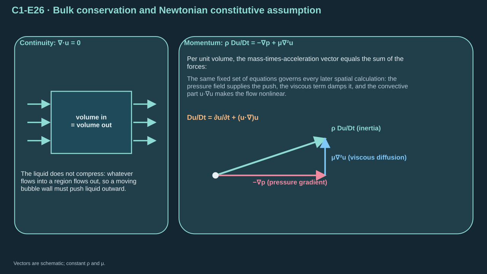

Stand-off locates a boundary; perfect spherical symmetry selects no outgoing direction.

离壁比定位边界；完全球对称不能选出向外喷射方向。

## 1.7 Moving-interface model

## 1.7 运动界面模型

**Step 18 — Specify the spatial jet problem.** Prescribe initial interface shape and carrier velocity. Define solid boundaries, outlet, contact-line behavior and pressure closure. The following equations conserve mass and momentum for constant-property incompressible Newtonian liquid. Gravity is omitted. Solve them with the interface and boundary conditions below. A fitted radius history leaves these spatial conditions unresolved.

**步骤 18——规定空间射流问题。** 给定初始界面形状和载液速度，定义固体边界、出口、接触线规律及压力闭合。以下方程描述常物性不可压缩牛顿液体的质量与动量守恒，忽略重力。须结合下述界面和边界条件求解。拟合半径历程仍未确定这些空间条件。

**Symbols before Eq. (C1-E27).**

**式（C1-E27）前的符号定义。**

| First individual definition / 第一项单独定义 | Second individual definition / 第二项单独定义 |
| --- | --- |
| $\boldsymbol u(\boldsymbol x,t)$ is liquid velocity (m s⁻¹) $\boldsymbol u(\boldsymbol x,t)$ 为液体速度（m s⁻¹） | $\boldsymbol x$ is spatial position (m) $\boldsymbol x$ 为空间位置（m） |
| $t$ is time (s) $t$ 为时间（s） | $\rho$ is constant carrier density (kg m⁻³) $\rho$ 为常数载液密度（kg m⁻³） |
| $p$ is liquid pressure (Pa) $p$ 为液体压力（Pa） | $\mu$ is constant viscosity (Pa s) $\mu$ 为常数黏度（Pa s） |

**Conventions and conditions.** $\nabla\cdot,\nabla,\nabla^2$ denote divergence, gradient and vector Laplacian; $\partial_t$ is the fixed-position derivative; The dot in convection is vector contraction; The momentum equation has force-per-volume units (N m⁻³).

**约定与条件。** $\nabla\cdot,\nabla,\nabla^2$ 分别为散度、梯度与矢量拉普拉斯；$\partial_t$ 为固定位置导数；对流中的圆点为矢量缩并；动量方程各项单位为单位体积力（N m⁻³）。

(C1-E27) · Bulk conservation and Newtonian constitutive assumption / 体相守恒律与牛顿流体本构假设

$$
\nabla\cdot\boldsymbol u=0,\qquad \rho\left(\frac{\partial\boldsymbol u}{\partial t}+(\boldsymbol u\cdot\nabla)\boldsymbol u\right)=-\nabla p+\mu\nabla^2\boldsymbol u
$$

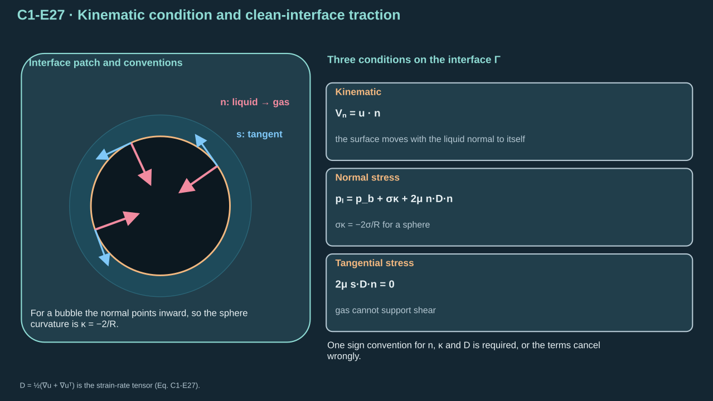

Bulk momentum and volume conservation supply the spatial field needed for jet formation.

体内动量与体积守恒给出射流形成所需的空间场。

**Step 19 — Set interface orientation and stress.** The normal points from liquid into gas. An inner spherical cavity therefore has negative curvature. An outer liquid droplet has positive curvature. This reproduces Eq. (C1-E06). A clean interface with negligible gas viscosity has zero tangential viscous traction. At zero liquid viscosity, that condition adds no strain-rate constraint. Without phase transfer, interface and liquid normal velocities match.

**步骤 19——规定界面方向与应力。** 法向由液体指向气体，故内球形空腔曲率为负，外液滴曲率为正。这一约定恢复式（C1-E06）。清洁界面且气相黏性可忽略时，切向黏性牵引为零。液体黏度为零时，该条件不增加应变率约束。没有相变时，界面与液体法向速度相等。

**Symbols before Eq. (C1-E28).**

**式（C1-E28）前的符号定义。**

| First individual definition / 第一项单独定义 | Second individual definition / 第二项单独定义 |
| --- | --- |
| $\boldsymbol D$ is symmetric liquid strain-rate tensor (s⁻¹) $\boldsymbol D$ 为液体对称应变率张量（s⁻¹） | $\boldsymbol u$ is velocity (m s⁻¹) $\boldsymbol u$ 为速度（m s⁻¹） |
| $\boldsymbol n$ is the unit normal from liquid into gas (dimensionless) $\boldsymbol n$ 为从液体指向气体的单位法向（无量纲） | $\kappa$ is signed curvature (m⁻¹) $\kappa$ 为带符号曲率（m⁻¹） |
| $V_n$ is interface normal speed (m s⁻¹) $V_n$ 为界面法向速度（m s⁻¹） | $p_l$ — Adjacent-liquid absolute pressure (Pa) $p_l$ — 邻近液体绝对压力（Pa） |
| $p_b$ — Uniform bubble absolute pressure (Pa) $p_b$ — 均匀气泡绝对压力（Pa） | $\sigma$ is surface tension (N m⁻¹) $\sigma$ 为表面张力（N m⁻¹） |
| $\mu$ is viscosity (Pa s) $\mu$ 为黏度（Pa s） | $\boldsymbol s$ is any unit tangent (dimensionless) $\boldsymbol s$ 为任意单位切向（无量纲） |
| $R$ is spherical cavity radius (m) $R$ 为球形空腔半径（m） |  |

**Conventions and conditions.** $\nabla\boldsymbol u$ is its spatial gradient, with superscript $\mathsf T$ denoting transpose; $\nabla_s\cdot$ is surface divergence; Dots denote tensor/vector contractions.

**约定与条件。** $\nabla\boldsymbol u$ 为其空间梯度，上标 $\mathsf T$ 表示转置；$\nabla_s\cdot$ 为表面散度；圆点表示张量或矢量缩并。

(C1-E28) · Kinematic condition and clean-interface traction / 运动学条件与洁净界面牵引

$$
\begin{aligned}\boldsymbol D&=\frac12\left(\nabla\boldsymbol u+(\nabla\boldsymbol u)^\mathsf T\right),\qquad \kappa=\nabla_s\cdot\boldsymbol n,\\V_n&=\boldsymbol u\cdot\boldsymbol n,\qquad p_l=p_b+\sigma\kappa+2\mu\boldsymbol n\cdot\boldsymbol D\boldsymbol n,\\2\mu\boldsymbol s\cdot\boldsymbol D\boldsymbol n&=0,\qquad \kappa_{\mathrm{sphere}}=-\frac2R.\end{aligned}
$$

Interface normals, signed curvature and material motion must use one consistent convention.

界面法向、带符号曲率与物质运动必须采用一致约定。

Set zero liquid velocity at a stationary viscous wall. Couple liquid velocity and stress to a moving film. Supply external pressure and stress at the outlet or meniscus. Close the contact line with a pinned or moving-angle law. Chapter 4 supplies payload and release mechanics. Appreciable phase transfer replaces equal normal velocities with Chapter 2’s mass-flux balance.

静止黏性壁面采用零液体速度。运动薄膜须与液体速度和应力耦合。出口或弯月面给定外部压力与应力。接触线采用固定或动态接触角规律闭合。第四章给出载荷与释放力学。相变显著时，用第二章质量通量平衡代替法向速度相等条件。

**Step 20 — Derive the potential-flow reduction.** Assume inviscid, initially irrotational flow away from shocks and unresolved wall layers. The potential satisfies Laplace’s equation. Without phase slip, interface nodes follow liquid velocity. Convert the Eulerian Bernoulli derivative to the material derivative. Add velocity dotted with the potential gradient. This closes a spatial pre-impact model under the stated assumptions. Boundary-integral microjet models use this reduction. [[R4]](../reference/sources.html#r4)

**步骤 20——推导势流约化。** 假设流动无黏且初始无旋，并避开激波及未解析壁面层。速度势满足拉普拉斯方程。无相变滑移时，界面节点随液体速度运动。将欧拉伯努利导数转为物质导数，加入速度与速度势梯度的点积。由此在已声明假设下闭合撞击前空间模型。边界积分微射流模型采用此约化。 [[R4]](../reference/sources.html#r4)

**Symbols before Eq. (C1-E29).**

**式（C1-E29）前的符号定义。**

| First individual definition / 第一项单独定义 | Second individual definition / 第二项单独定义 |
| --- | --- |
| $\boldsymbol u$ is liquid velocity (m s⁻¹) $\boldsymbol u$ 为液体速度（m s⁻¹） | $\phi$ is velocity potential (m² s⁻¹) $\phi$ 为速度势（m² s⁻¹） |
| $\boldsymbol X$ is a material interface position (m) $\boldsymbol X$ 为物质界面点位置（m） | $t$ is time (s) $t$ 为时间（s） |
| $\Gamma$ is the liquid–gas interface (—) $\Gamma$ 为液—气界面（—） | $p_\infty$ — Far-field absolute pressure (Pa) $p_\infty$ — 远场绝对压力（Pa） |
| $p_b$ — Uniform bubble absolute pressure (Pa) $p_b$ — 均匀气泡绝对压力（Pa） | $\sigma$ is surface tension (N m⁻¹) $\sigma$ 为表面张力（N m⁻¹） |
| $\kappa$ is curvature for the liquid-to-gas normal (m⁻¹) $\kappa$ 为液体指向气体法向下的曲率（m⁻¹） | $\rho$ is density (kg m⁻³) $\rho$ 为密度（kg m⁻³） |

**Conventions and conditions.** $\nabla$ and $\nabla^2$ are spatial gradient and Laplacian; $D/Dt$ is the material derivative; $|\boldsymbol u|$ is speed and the dot a vector contraction; The potential gauge is fixed at infinity.

**约定与条件。** $\nabla$ 与 $\nabla^2$ 为空间梯度与拉普拉斯；$D/Dt$ 为物质导数；$|\boldsymbol u|$ 为速率，圆点为矢量缩并；速度势参考值固定在无穷远。

(C1-E29) · Inviscid pre-impact moving-interface closure / 冲击前无黏运动界面的闭合关系

$$
\begin{aligned}\boldsymbol u&=\nabla\phi,\qquad \nabla^2\phi=0,\qquad\frac{d\boldsymbol X}{dt}=\boldsymbol u(\boldsymbol X,t),\\\frac{\partial\phi}{\partial t}&=\frac{p_\infty-p_b-\sigma\kappa}{\rho}-\frac12|\boldsymbol u|^2,\\\frac{D\phi}{Dt}&=\frac{\partial\phi}{\partial t}+\boldsymbol u\cdot\nabla\phi=\frac{p_\infty-p_b-\sigma\kappa}{\rho}+\frac12|\boldsymbol u|^2\qquad(\boldsymbol X\in\Gamma).\end{aligned}
$$

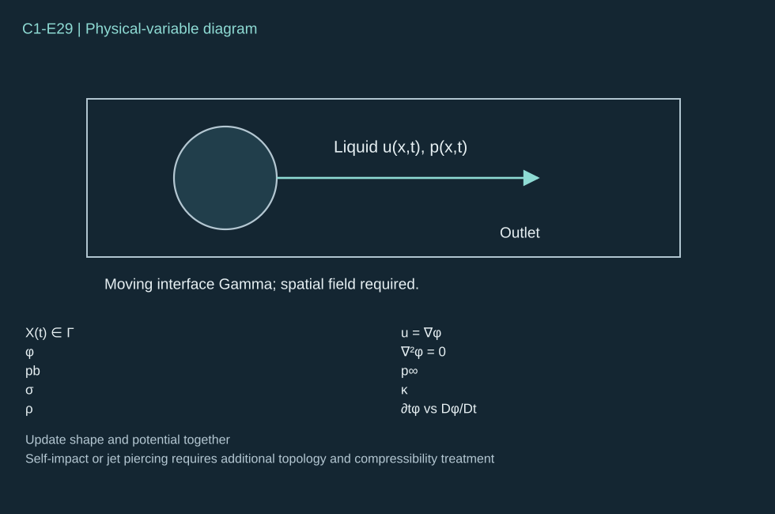

The interface shape evolves jointly with potential; changing geometry creates focusing.

界面形状与速度势共同演化，几何变化产生聚焦。

Check the spherical limit of Eq. (C1-E29). Wall potential is minus radius × wall speed. Curvature is minus two/radius. Differentiate the wall potential and rearrange the squared-speed term. This recovers inviscid Rayleigh–Plesset. Interface penetration then changes topology. Post-penetration flow requires a new domain and pressure-transmission model.

检验式（C1-E29）的球形极限。壁面速度势为半径 × 壁面速度的负值，曲率为负二／半径。对壁面速度势求导并移项速度平方项，可恢复无黏 Rayleigh–Plesset 方程。界面穿透会改变拓扑，之后的流动需要新区域和压力传播模型。

**Symbols before Eq. (C1-E30).**

**式（C1-E30）前的符号定义。**

| First individual definition / 第一项单独定义 | Second individual definition / 第二项单独定义 |
| --- | --- |
| $\phi_\Gamma$ is the velocity potential evaluated on the spherical interface (m² s⁻¹), with subscript $\Gamma$ the interface label $\phi_\Gamma$ 为球形界面处速度势（m² s⁻¹），下标 $\Gamma$ 标识界面 | $R>0$ is radius (m) $R>0$ 为半径（m） |
| $\dot R$ — Wall radial velocity (m s⁻¹) $\dot R$ — 壁面径向速度（m s⁻¹） | $\ddot R$ — Wall radial acceleration (m s⁻²) $\ddot R$ — 壁面径向加速度（m s⁻²） |
| $\kappa$ is signed liquid-to-gas curvature (m⁻¹) $\kappa$ 为液体指向气体约定下的带符号曲率（m⁻¹） | $p_\infty$ — Far-field absolute pressure (Pa) $p_\infty$ — 远场绝对压力（Pa） |
| $p_b$ — Uniform bubble absolute pressure (Pa) $p_b$ — 均匀气泡绝对压力（Pa） | $\sigma$ is surface tension (N m⁻¹) $\sigma$ 为表面张力（N m⁻¹） |
| $\rho$ is carrier density (kg m⁻³) $\rho$ 为载液密度（kg m⁻³） | $\Gamma$ — Moving liquid–gas interface (—) $\Gamma$ — 运动液—气界面（—） |

**Conventions and conditions.** The potential is differentiated along the wall; viscosity is zero in this check.

**约定与条件。** 速度势沿壁面求导；此检验中黏度为零。

(C1-E30) · Exact spherical recovery of the potential closure / 势流闭合关系对球形模型的精确恢复

$$
\begin{aligned}\phi_\Gamma&=-R\dot R,\qquad\kappa=-\frac2R,\\-\dot R^2-R\ddot R&=\frac{p_\infty-p_b+2\sigma/R}{\rho}+\frac12\dot R^2,\\\rho\left(R\ddot R+\frac32\dot R^2\right)&=p_b-p_\infty-\frac{2\sigma}{R}.\end{aligned}
$$

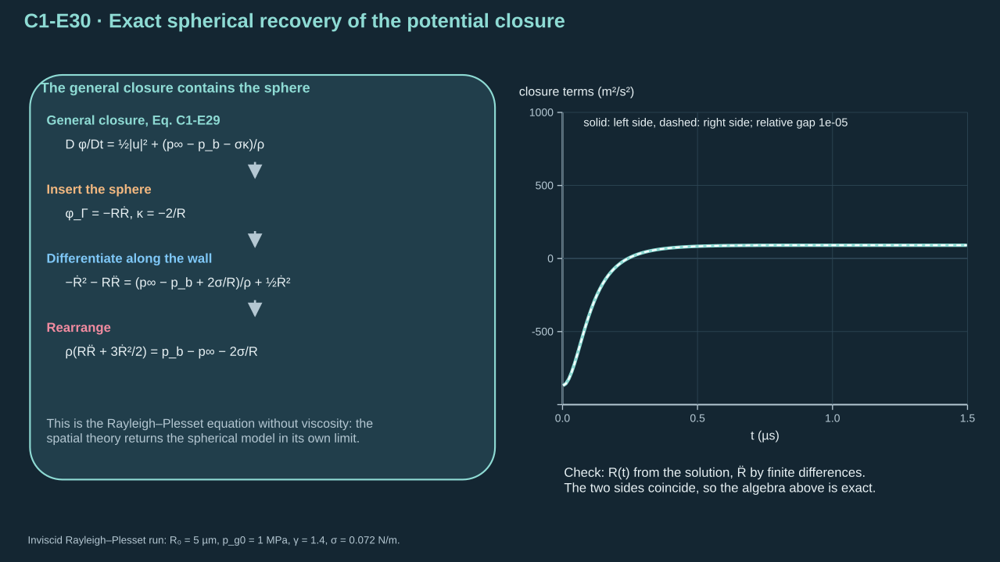

The spatial potential formulation returns the spherical model under spherical geometry.

空间势流表述在球形几何下恢复球形模型。

**Symbols before Eq. (C1-E31).**

**式（C1-E31）前的符号定义。**

| First individual definition / 第一项单独定义 | Second individual definition / 第二项单独定义 |
| --- | --- |
| $M_w$ is wall Mach number (dimensionless) $M_w$ 为壁面马赫数（无量纲） | $\mathcal C_e$ a pressure-communication ratio (both dimensionless) $\mathcal C_e$ 为压力通信比（两者均无量纲） |
| $\dot R$ is wall speed (m s⁻¹) $\dot R$ 为壁面速度（m s⁻¹） | $c>0$ is carrier sound speed (m s⁻¹) $c>0$ 为载液声速（m s⁻¹） |
| $L_e>0$ is the distance across which loading must communicate (m) $L_e>0$ 为载荷必须传播的距离（m） | $\tau_e>0$ is the event's relevant rise or change time (s) $\tau_e>0$ 为事件相关的上升或变化时间（s） |

**Conventions and conditions.** $|\ |$ denotes magnitude; subscript $e$ labels the selected event scale.

**约定与条件。** $|\ |$ 表示大小；下标 $e$ 标识选定事件尺度。

(C1-E31) · Compressibility applicability diagnostics / 可压缩性适用性诊断

$$
M_w=\frac{|\dot R|}{c},\qquad \mathcal C_e=\frac{L_e}{c\tau_e}
$$

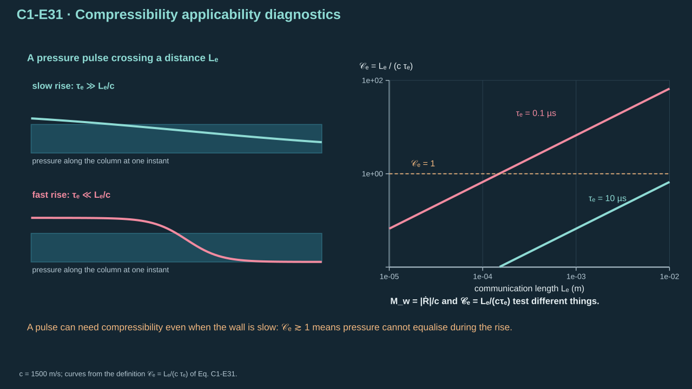

A pressure pulse can require compressibility even while the bulk wall speed is modest.

即使总体壁面速率不高，压力脉冲仍可能要求考虑可压缩性。

Small wall Mach number and communication ratio test different incompressible assumptions. Jet survival, arriving mass, footprint and receiver response need further models. Chapter 3 defines finite-mass, finite-time jet observables. Chapter 4 connects those loads to release. Here, compressibility enters through rapid transmission and arrest.

小壁面马赫数与小通信比检验不同的不可压缩假设。射流存续、到达质量、作用面积及受载响应需要进一步模型。第三章定义有限质量、有限时间射流观测量，第四章将载荷连接至释放。这里通过快速传播与终止过程考虑可压缩性。

**Results and remaining inputs.** The radial momentum, energy, collapse-time and column-impulse calculations are derived above. The spatial jet model includes oriented interface conditions. PFC jet prediction still requires thermodynamic pressure history and actual geometry. It also requires the evolving spatial solution.

**结果与所需输入。** 上文已推导径向动量、能量、塌缩时间及液柱冲量。空间射流模型明确了界面方向条件。预测 PFC 射流仍需热力学压力历程、实际几何及演化空间解。

## 1.8 Oral questions

## 1.8 口头问题

Answer each question in your own words. Explain the governing equations and their assumptions. The reference answers support comparison after your attempt. Mastery requires a demonstrated explanation. Saving a response does not establish understanding.

请用自己的话回答各题，解释控制方程及其假设。作答后可与参考答案比较。掌握需要通过解释展示。保存回答并不代表理解。

### Question 1 — What connects cavity motion to an external transfer jet?

### 问题 1——哪些力学环节将空腔运动连接至外部转印射流？

Explain the mechanism, assumptions, and limits in your own words.

用自己的话解释机制、假设与限制。

\*\*Reference answer and mastery criteria / 参考答案与掌握标准\*\*

**Symbols before Eq. (C1-E32).**

**式（C1-E32）前的符号定义。**

| First individual definition / 第一项单独定义 | Second individual definition / 第二项单独定义 |
| --- | --- |
| $\rho$ is carrier density (kg m⁻³) $\rho$ 为载液密度（kg m⁻³） | $R>0$ is cavity radius (m) $R>0$ 为空腔半径（m） |
| $\dot R$ — Wall radial velocity (m s⁻¹) $\dot R$ — 壁面径向速度（m s⁻¹） | $\ddot R$ — Wall radial acceleration (m s⁻²) $\ddot R$ — 壁面径向加速度（m s⁻²） |
| $p_b$ — Uniform bubble absolute pressure (Pa) $p_b$ — 均匀气泡绝对压力（Pa） | $p_\infty$ — Far-field absolute pressure (Pa) $p_\infty$ — 远场绝对压力（Pa） |
| $\sigma$ is surface tension (N m⁻¹) $\sigma$ 为表面张力（N m⁻¹） | $\mu$ is viscosity (Pa s) $\mu$ 为黏度（Pa s） |
| $p_{v,\mathrm{PFC}}$ — PFC-vapor partial pressure (Pa) $p_{v,\mathrm{PFC}}$ — PFC 蒸气分压（Pa） | $p_{v,w}$ — Water-vapor partial pressure (Pa) $p_{v,w}$ — 水蒸气分压（Pa） |
| $p_g$ — Noncondensable-gas partial pressure (Pa) $p_g$ — 非凝结气体分压（Pa） |  |

**Conventions and conditions.** The equations are the spherical mechanical balance and the pressure-composition closure target.

**约定与条件。** 两式分别为球形力学平衡与需要闭合的压力组成。

(C1-E32) · Original formulas quoted for defense 1 / 答辩问题 1 引用的原始公式

$$
\rho\left(R\ddot R+\frac32\dot R^2\right)=p_b-p_\infty-\frac{2\sigma}{R}-\frac{4\mu\dot R}{R},\qquad p_b=p_{v,\mathrm{PFC}}+p_{v,w}+p_g
$$

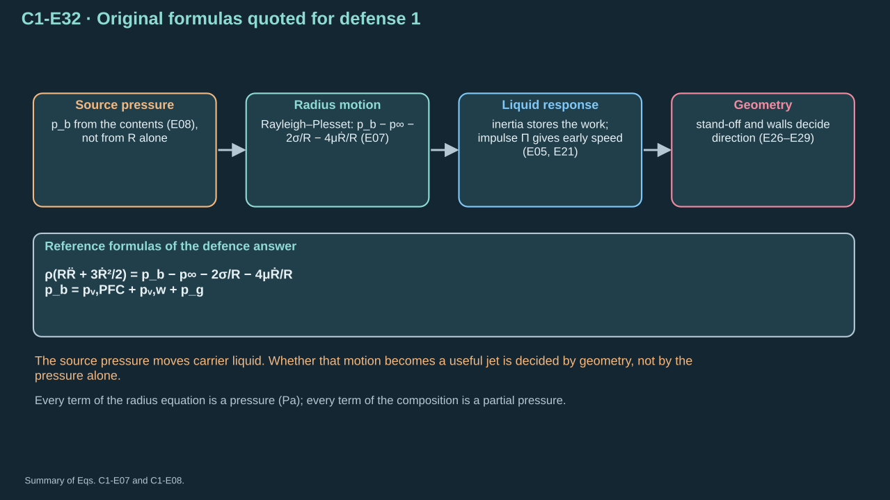

The source pressure moves carrier liquid; geometry determines whether that motion is a useful jet.

源压力使载液运动；几何决定这种运动能否成为有用射流。

Identify PFC inventory, absorber, cavity and force path first. Absorption and phase change must supply the pressure history. Low boiling point leaves that history unresolved. The spherical balance gives acceleration of the surrounding carrier. Capillarity resists expansion and assists collapse. Viscosity dissipates energy in both directions. Keep the liquid inclusion distinct from the cavity.

先辨认 PFC 物质量、吸收体、空腔和传力路径。吸收与相变需提供压力历程。低沸点仍不能确定该历程。球形平衡给出周围载液加速度。毛细作用阻碍膨胀并促进塌缩，黏性在两种方向耗散能量。液态夹杂与空腔须分别描述。

An external jet needs directing geometry, coherent moving liquid and a receiver. Internal collapse jets, sealed inflation and stretched bridges have different event sequences. Track cavity shape, emitted liquid and film motion together. Chapter 2 supplies thermal closure. Chapters 3 and 4 address arrival, fracture and intact placement.

外部射流需要定向几何、相干运动液体及受载表面。内部塌缩射流、密闭膨胀及拉伸液桥有不同事件顺序。应同时追踪空腔形状、喷出液体及薄膜运动。第二章给出热学闭合，第三、四章处理到达、断裂与完整落位。

#### Review criteria

#### 审阅标准

* Distinguishes PFC liquid inventory, cavity contents and accelerated carrier, and states that the pressure history needs thermal/phase closure.

  区分 PFC 液体库存、空腔内容物与被加速载液，并说明压力历程需要热与相变闭合。
* Explains why a radial balance cannot select a jet direction; identifies a concrete asymmetric boundary or outlet.

  解释径向平衡为何不能选定射流方向，并指出具体非对称边界或出口。
* Distinguishes external ejection, re-entrant penetration, sealed inflation and liquid bridging using observable event order.

  利用可观测事件顺序区分外部喷射、再入穿透、密闭膨胀与液桥。
* Does not infer successful fracture or intact placement from cavity size or visible release alone.

  不单凭空腔尺寸或可见释放推断成功断裂或完整落位。

### Question 2 — Explain the Rayleigh coefficient and its speed singularity.

### 问题 2——解释瑞利系数及其速度奇异性的物理范围。

Explain the mechanism, assumptions, and limits in your own words.

用自己的话解释机制、假设与限制。

\*\*Reference answer and mastery criteria / 参考答案与掌握标准\*\*

**Symbols before Eq. (C1-E33).**

**式（C1-E33）前的符号定义。**

| First individual definition / 第一项单独定义 | Second individual definition / 第二项单独定义 |
| --- | --- |
| $\dot R\le0$ is inward wall velocity (m s⁻¹) $\dot R\le0$ 为向内壁面速度（m s⁻¹） | $R\in(0,R_{\max}]$ — Instantaneous cavity radius (m) $R\in(0,R_{\max}]$ — 瞬时空腔半径（m） |
| $R_{\max}$ — Radius at the start of ideal collapse (m) $R_{\max}$ — 理想塌缩开始时的半径（m） | $\Delta p_c>0$ is constant collapse pressure (Pa) $\Delta p_c>0$ 为常数塌缩压差（Pa） |
| $\rho$ is carrier density (kg m⁻³) $\rho$ 为载液密度（kg m⁻³） | $t_c$ is ideal collapse time (s) $t_c$ 为理想塌缩时间（s） |
| $B$ is the dimensionless beta function defined in Eq $B$ 为式（C1-E17）定义的无量纲贝塔函数 | $K_l$ is carrier kinetic energy (J) $K_l$ 为载液动能（J） |
| $\pi$ is the circle constant (dimensionless) $\pi$ 为圆周率（无量纲） |  |

**Conventions and conditions.** (C1-E17); The initial cavity is at rest, with no gas, viscosity, capillarity or compressibility.

**约定与条件。** 初始空腔静止，并忽略非凝结气体、黏性、毛细及可压缩性。

(C1-E33) · Original formulas quoted for defense 2 / 答辩问题 2 引用的原始公式

$$
\dot R=-\sqrt{\frac{2\Delta p_c}{3\rho}\left[\left(\frac{R_{\max}}R\right)^3-1\right]},\qquad t_c=\frac{B(5/6,1/2)}{\sqrt6}R_{\max}\sqrt{\frac\rho{\Delta p_c}},\qquad K_l=\frac{4\pi}{3}\Delta p_c(R_{\max}^3-R^3)
$$

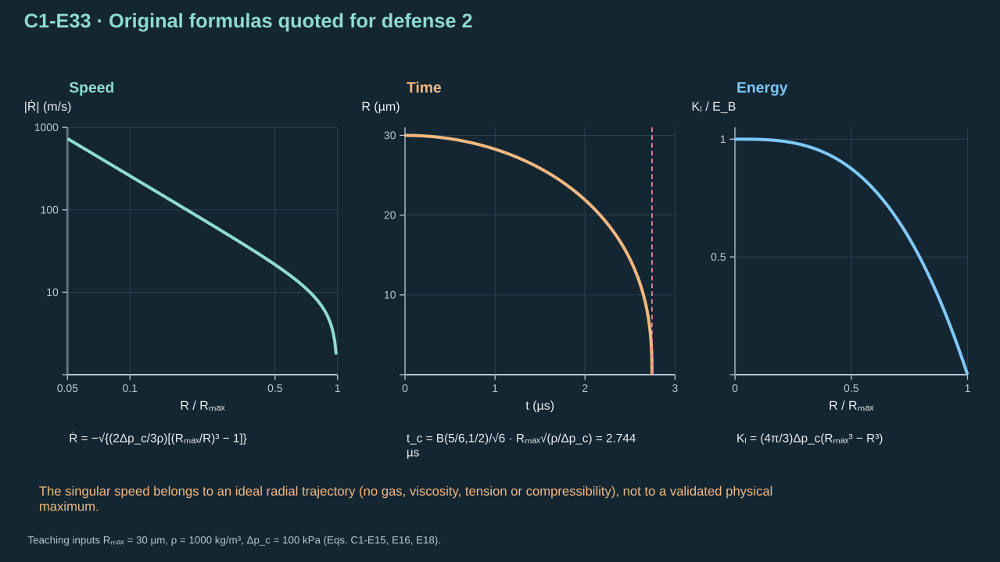

The singular velocity belongs to an ideal radial trajectory, not a validated physical maximum.

奇异速度属于理想径向轨迹，而非经过验证的实际最大值。

The coefficient integrates the common dimensionless collapse trajectory. Squared speed gives a first-order radial equation. Its integrating factor is radius cubed. Zero initial speed fixes the constant; the negative root selects collapse. Integrating reciprocal speed yields the beta function and 0.9146813565. Quadrupling pressure halves time under the same assumptions.

系数来自共同的无量纲塌缩轨迹积分。速度平方给出一阶径向方程，积分因子为半径三次方。初始零速度确定常数，负平方根选择塌缩分支。速度倒数积分给出贝塔函数及 0.9146813565。在相同假设下，压差增至四倍使时间减半。

The 30 μm control gives 2.744 μs and 11.31 nJ. Half-radius inward speed is 21.60 m s⁻¹. These are spherical pressure–inertia results. PFC activation and emitted jet speed remain unestablished. Finite work coexists with divergent speed because inertia scales with radius cubed. Gas, vapor pressure, compressibility, transport and distortion can arrest that ideal trajectory. A finite-mass maximum needs geometry and observation scales.

30 μm 对照给出 2.744 μs 和 11.31 nJ。一半半径处向内速率为 21.60 m s⁻¹。这些是球形压力—惯性结果。PFC 激活及外部射流速率尚未确立。惯性按半径三次方缩小，因此有限功可与发散速率共存。气体、蒸气压、可压缩性、输运及变形可终止理想轨迹。有限质量最大值需要几何与观测尺度。

#### Review criteria

#### 审阅标准

* Connects the coefficient to the nondimensional radius integral, including the initial condition and collapse branch.

  把系数联系到无量纲半径积分，并说明初始条件与塌缩分支。
* Explains the pressure and radius scaling and gives a consistent numerical or proportionality example.

  解释压差与半径的尺度关系，并给出一致的数值或比例例子。
* Reconciles finite pressure work with the shrinking inertia scale, then identifies concrete neglected arrest mechanisms.

  用不断缩小的惯性尺度解释有限压力功，再指出具体被忽略的终止机制。
* Distinguishes radial wall velocity from a directional jet and refuses a universal maximum without defined geometry, mass and observation scale.

  区分径向壁面速度与定向射流，且在几何、质量和观测尺度未定义时不声称通用最大值。

### Question 3 — Which spatial and temporal inputs determine a transfer jet?

### 问题 3——哪些空间及时间输入决定转印射流？

Explain the mechanism, assumptions, and limits in your own words.

用自己的话解释机制、假设与限制。

\*\*Reference answer and mastery criteria / 参考答案与掌握标准\*\*

**Symbols before Eq. (C1-E34).**

**式（C1-E34）前的符号定义。**

| First individual definition / 第一项单独定义 | Second individual definition / 第二项单独定义 |
| --- | --- |
| $\Pi$ is local pressure impulse (Pa s) $\Pi$ 为局部压力冲量（Pa s） | $\boldsymbol x$ is fixed position (m) $\boldsymbol x$ 为固定位置（m） |
| $t$ — Elapsed time (s) $t$ — 经过时间（s） | $t_0$ — Event start time (s) $t_0$ — 事件开始时刻（s） |
| $t_1$ — Event end time (s) $t_1$ — 事件结束时刻（s） | $p$ — Liquid pressure field (Pa) $p$ — 液体压力场（Pa） |
| $p_{\mathrm{ref}}$ — Spatially uniform reference pressure (Pa) $p_{\mathrm{ref}}$ — 空间均匀参考压力（Pa） | $\Delta\boldsymbol u$ is liquid speed change (m s⁻¹) $\Delta\boldsymbol u$ 为液体速度变化（m s⁻¹） |
| $\rho$ is carrier density (kg m⁻³) $\rho$ 为载液密度（kg m⁻³） | $U_{\mathrm{column}}$ is the ideal straight-column speed increment (m s⁻¹) $U_{\mathrm{column}}$ 为理想直液柱速度增量（m s⁻¹） |
| $\Pi_0$ is driven-end impulse (Pa s) $\Pi_0$ 为受驱动端冲量（Pa s） | $L$ is column length (m) $L$ 为液柱长度（m） |
| $t_a$ is crossing time (s) $t_a$ 为传播时间（s） | $c$ is sound speed (m s⁻¹) $c$ 为声速（m s⁻¹） |

**Conventions and conditions.** $\nabla,\nabla^2$ denote spatial gradient and Laplacian; The reduced momentum formula needs a frozen geometry and small omitted impulses.

**约定与条件。** $\nabla,\nabla^2$ 为空间梯度与拉普拉斯；约化动量公式要求冻结几何，且被忽略的冲量项较小。

(C1-E34) · Original formulas quoted for defense 3 / 答辩问题 3 引用的原始公式

$$
\Pi(\boldsymbol x)=\int_{t_0}^{t_1}(p-p_{\mathrm{ref}})dt,\qquad\Delta\boldsymbol u\simeq-\frac{\nabla\Pi}{\rho},\quad\nabla^2\Pi=0,\qquad U_{\mathrm{column}}=\frac{\Pi_0}{\rho L},\quad t_a=\frac Lc
$$

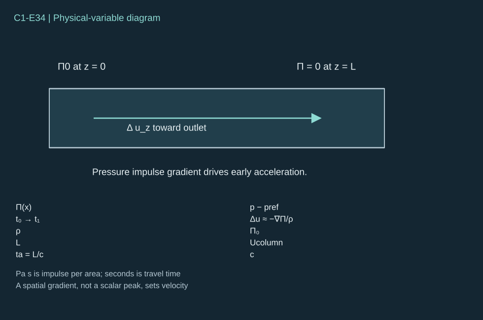

The impulse benchmark gives an early velocity field, followed by a moving-interface problem.

冲量基准给出早期速度场，之后还需解运动界面问题。

Specify driven boundary, outlet, meniscus and receiver geometry. Integrate pressure over time at every location. Equal peaks can have different durations and impulses. Equal scalar impulses can produce different spatial gradients. The gradient sets early velocity. Boundary conditions determine that gradient. A uniform impulse addition causes no acceleration.

规定受驱边界、出口、弯月面及受载几何。在每个位置对压力作时间积分。相同峰值可对应不同时长和冲量，相同标量冲量可产生不同空间梯度。梯度决定早期速度，边界条件决定梯度。均匀增加冲量不产生加速度。

The column gives 0.30 Pa s and 3.0 m s⁻¹. Its separate crossing time is 0.0667 μs. Several crossings support communication during the pulse. Uniform pressure remains unestablished. Check displacement, convection and viscosity. Then evolve the interface with pressure, stress and contact-line conditions. Focusing follows from that spatial evolution and thermodynamic pressure history. Rapid changes or impact can require compressibility at low bulk speed.

液柱给出 0.30 Pa s 与 3.0 m s⁻¹，传播时间另为 0.0667 μs。多次传播支持脉冲期间的通信，均匀压力仍未确立。先检查位移、对流及黏性，再结合压力、应力和接触线条件演化界面。聚焦取决于空间演化及热力学压力历程。快速变化或撞击时，即使总体速率低也可能需要可压缩性。

#### Review criteria

#### 审阅标准

* Distinguishes pressure (Pa), pressure impulse (Pa s), momentum (N s) and crossing time (s), without equating their units.

  区分压力（Pa）、压力冲量（Pa s）、动量（N s）与传播时间（s），不混淆其单位。
* Uses the spatial impulse gradient and actual boundary conditions to explain the initial velocity; a scalar peak is insufficient.

  利用空间冲量梯度与实际边界条件解释初始速度，说明单一峰值不足。
* Explains what the ideal column predicts and what its small-displacement and residual-impulse diagnostics do not guarantee.

  解释理想液柱预测的内容，以及小位移与残余冲量诊断不能保证的内容。
* Identifies the subsequent moving-interface, pressure, phase-transfer and compressibility information needed for a physical jet.

  指出实际射流还需要后续运动界面、压力、相变传质与可压缩性信息。