# Chapter 3: Arrays, finite jets and measurable impact

# 第 3 章：阵列、有限射流与可测冲击

## 1. Array inputs and outputs

## 1. 阵列输入与输出

Follow a finite array from cavity motion to emitted jet and receiver pressure. Chapter 2 supplies each site’s heat, PFC inventory and pressure history. Here, mechanical controls use declared source histories. Target PFC maximum speed: Not established. Carrier liquid supplies most moving mass. Cavity pressure, jet speed, surface pressure and buried-interface traction require separate observables.

本章从有限阵列空腔运动追踪至喷出射流和受载压力。第二章提供各位点热量、PFC 物质量及压力历程。这里的力学对照采用给定源历程。目标 PFC 最大速率尚未确立。载液构成主要运动质量。腔内压力、射流速率、表面压力及埋藏界面牵引须分别定义观测量。

First fix bubble centers in Cartesian coordinates. Omit translation, gravity, walls, coalescence and shape modes. Require nearly spherical cavities with radius much smaller than separation. Also require low wall Mach and rapid pressure communication. Collapse controls start at maximum radius with zero speed and constant positive driving pressure. PFC pressures require Chapter 2 coupling. The later launch model resolves actual walls, outlets and interfaces. Its liquid-to-gas normal gives positive cylindrical-jet and negative cavity curvature.

首先在笛卡尔坐标中固定气泡中心。忽略平移、重力、壁面、合并及形状模态。要求空腔近球形且半径远小于间距，并满足低壁面马赫数及快速压力通信。塌缩对照从最大半径、零速率和恒定正驱动压差开始。PFC 压力需耦合第二章。后续发射模型解析实际壁面、出口及界面。液体指向气体的法向给出圆柱射流正曲率及空腔负曲率。

| Symbol 符号 | Physical meaning 物理意义 | SI units SI 单位 | Role and convention 作用与约定 |
| --- | --- | --- | --- |
| $i$ | Index of the bubble being evaluated 当前评估气泡的编号 | 1 | Integer from 1 to the activated-bubble count; selects the local radial equation. 从 1 到已激活气泡数的整数；选择局部径向方程。 |
| $j$ | Index of a neighboring bubble 相邻气泡的编号 | 1 | In an interaction sum the evaluated site is excluded: j ≠ i. 相互作用求和中排除当前位点：j ≠ i。 |
| $N_d$ | Fabricated droplet-site count 制造的液滴位点数 | 1 | Counts available sites; it does not imply every site activates. 计数可用位点；不意味着每个位点都激活。 |
| $N_b$ | Activated-bubble count 已激活气泡数 | 1 | Counts actual bubble sources used in the interaction equations. 计数相互作用方程中实际使用的气泡源。 |
| $R_i$ | Radius of bubble i 气泡 i 的半径 | m | Moving radial coordinate of the selected bubble; Newton dots denote its time derivatives. 选定气泡的运动径向坐标；牛顿点号表示其时间导数。 |
| $d_{ij}$ | Bubble-center separation 气泡中心间距 | m | Distance between centers i and j; reciprocal distance weights dilute interactions. 中心 i 与 j 的距离；距离倒数加权稀疏相互作用。 |
| $s$ | Nearest-vertex array pitch 阵列相邻顶点间距 | m | Defined nearest-neighbor spacing in the regular-polygon control. 正多边形对照中定义的最近邻间距。 |
| $R_{\max}$ | Maximum bubble radius 最大气泡半径 | m | Reference radius for the specified collapse control and geometric interaction parameter. 指定塌缩对照与几何相互作用参数采用的参考半径。 |
| $\rho$ | Carrier-liquid density 载液密度 | kg m⁻³ | Sets bubble-exterior inertia and emitted liquid mass; not PFC-vapor density. 决定泡外惯性与喷出液体质量；不是 PFC 蒸气密度。 |
| $\mu$ | Carrier dynamic viscosity 载液动力黏度 | Pa s | Controls viscous stresses and jet dissipation in the stated liquid model. 在指定液体模型中控制黏性应力及射流耗散。 |
| $\sigma_b$ | Bubble-interface surface tension 气泡界面表面张力 | N m⁻¹ | Bubble capillary coefficient; need not equal the jet-interface coefficient. 气泡毛细系数；不必等于射流界面系数。 |
| $\sigma_j$ | Jet-interface surface tension 射流界面表面张力 | N m⁻¹ | Coefficient for the emitted jet and its capillary disturbance growth. 喷出射流及其毛细扰动增长使用的系数。 |
| $c$ | Liquid sound speed 液体声速 | m s⁻¹ | Sets acoustic transit and ideal early-contact impedance, not a universal jet-speed ceiling. 决定声传播时间及理想早期接触阻抗，并非通用射流速度上限。 |
| $\phi$ | Velocity potential 速度势 | m² s⁻¹ | Its spatial gradient gives the adopted potential-flow velocity. 其空间梯度给出所采用的势流速度。 |
| $\Pi$ | Pressure impulse per unit area 单位面积压力冲量 | Pa s | Pressure integrated over a stated time interval; distinct from total force impulse. 指定时间区间内的压力积分；与总力冲量不同。 |
| $\boldsymbol u$ | Liquid velocity field 液体速度场 | m s⁻¹ | Vector field needed to distinguish focusing, jet formation and transport. 用于区分聚焦、射流形成与输运的矢量场。 |
| $E$ | Specified mechanical energy 指定力学能量 | J | The subscript identifies its budget; optical, bubble and jet energies are not interchangeable. 下标标识预算对象；光能、气泡能与射流能不能混同。 |
| $m$ | Finite moving-liquid mass 有限运动液体质量 | kg | Mass of the declared jet or control volume used in energy and momentum bounds. 能量与动量界限中所声明射流或控制体的质量。 |
| $P$ | Directional liquid momentum 液体方向动量 | N s | Projection of moving-liquid momentum along the selected transfer direction. 运动液体动量沿选定转印方向的投影。 |
| $\mathcal J$ | Delivered force impulse 传递的力冲量 | N s | Time integral of force at the specified target; not pressure impulse per area. 指定目标处的力对时间的积分；不是单位面积压力冲量。 |
| $a_j$ | Jet radius 射流半径 | m | Half the declared circular jet diameter; sets lateral-release and capillary scales. 所声明圆形射流直径的一半；决定侧向释放与毛细尺度。 |
| $d_j$ | Jet diameter 射流直径 | m | Transverse size used with emitted length to determine finite jet volume. 与喷出长度共同确定有限射流体积的横向尺寸。 |
| $L_j$ | Finite emitted-jet length 有限喷出射流长度 | m | Longitudinal liquid inventory; must not be replaced by an unlimited steady stream. 液体纵向存量；不能替换为无限稳态液流。 |
| $H$ | Flight gap 飞行间隙 | m | Distance traveled by the emitted liquid before reaching the specified target. 喷出液体到达指定目标之前经过的距离。 |
| $z$ | Jet axial coordinate 射流轴向坐标 | m | Coordinate along the transport direction used for slice conservation. 用于切片守恒的输运方向坐标。 |
| $S$ | Neighbor reciprocal-distance sum 邻距倒数和 | m⁻¹ | Finite sum of the inverse center separations in the regular-array control. 规则阵列对照中中心间距倒数的有限和。 |
| $\chi$ | Dimensionless interaction parameter 无量纲相互作用参数 | 1 | Maximum radius multiplied by S; quantifies interaction within the adopted dilute model. 最大半径乘以 S；量化所采用稀疏模型中的相互作用。 |
| $C(\chi)$ | Formal collapse-time coefficient 形式塌缩时间系数 | 1 | Result of the stated array-control integral; not a pressure amplification factor. 指定阵列对照积分的结果；不是压力放大系数。 |
| $b_i$ | Radial source strength of bubble i 气泡 i 的径向源强度 | m³ s⁻¹ | Defined by radius squared times wall velocity in the monopole-flow control. 在单极流动对照中定义为半径平方乘壁面速度。 |
| $\Gamma$ | Moving liquid interface 运动液体界面 | — | Geometric surface carrying kinematic and traction conditions; not fracture energy. 承载运动学及牵引条件的几何曲面；不是断裂能。 |
| $\Omega$ | Liquid spatial domain 液体空间域 | — | Region occupied by liquid in the spatial-flow problem. 空间流动问题中液体占据的区域。 |
| $\boldsymbol n$ | Outward liquid unit normal 液体外向单位法向 | 1 | Points out of liquid; fixes traction and signed curvature. 指向液体外部；确定牵引及带符号曲率。 |
| $\kappa$ | Signed interfacial curvature 带符号界面曲率 | m⁻¹ | Sum of principal curvatures for the stated normal convention. 在指定法向约定下的两主曲率之和。 |
| $g$ | Disturbance growth rate 扰动增长率 | s⁻¹ | Exponential capillary growth coefficient; this symbol is not gravitational acceleration. 指数毛细增长系数；该符号不是重力加速度。 |
| $\delta$ | Jet-radius disturbance amplitude 射流半径扰动振幅 | m | Small deviation from the undeformed jet; linear growth ceases to apply at large amplitude. 相对未变形射流的小偏差；大振幅时线性增长不再适用。 |
| $k$ | Axial disturbance wavenumber 轴向扰动波数 | m⁻¹ | Spatial oscillation frequency along the jet; not thermal conductivity. 沿射流的空间振荡频率；不是导热系数。 |
| $q$ | Dimensionless disturbance wavenumber 无量纲扰动波数 | 1 | Defined as axial wavenumber multiplied by jet radius. 定义为轴向波数乘射流半径。 |
| $I_0$ | Modified Bessel function of order zero 零阶修正 Bessel 函数 | 1 | Dimensionless radial eigenfunction in the cylindrical capillary control. 圆柱毛细对照中的无量纲径向特征函数。 |
| $I_1$ | Modified Bessel function of order one 一阶修正 Bessel 函数 | 1 | Used with I₀ in the stated disturbance dispersion relation. 在指定扰动色散关系中与 I₀ 共同使用。 |
| $Z_l$ | Liquid acoustic impedance 液体声阻抗 | Pa s m⁻¹ | Density times sound speed in the adopted one-dimensional early-contact model. 在所采用的一维早期接触模型中为密度乘声速。 |
| $Z_r$ | Receiver acoustic impedance 接收体声阻抗 | Pa s m⁻¹ | Determines early wave matching; finite thickness and motion can invalidate the half-space control. 决定早期波匹配；有限厚度与运动可能使半空间对照失效。 |
| $A_o$ | Pressure observation area 压力观测面积 | m² | Fixed footprint over which the reported load is spatially averaged. 用于对报告载荷进行空间平均的固定范围。 |
| $\tau_o$ | Pressure averaging interval 压力平均时间区间 | s | Specified time window; changing it changes the observable pressure. 指定时间窗口；改变它会改变可观测压力。 |
| $p_{\mathrm{obs}}$ | Observed mean excess pressure 观测平均超压 | Pa | Area/time average on the defined target; differs from a brief local pressure spike. 指定目标上的面积／时间平均；不同于短暂局部压力尖峰。 |

Step 1 — Distinguish core inventory, carrier volume, pitch, fluence and activation time. Sum separate-cell outputs after calculating finite jets and arrival times. Shared-domain bubbles modify common liquid inertia and surrounding pressure. Regular spacing defines geometry. Count-proportional pressure remains unestablished.

步骤 1——分别考察核心物质量、载液体积、节距、能量面密度及激活时间。独立单元须先计算有限射流及到达时间，再求和输出。共域气泡改变共同液体惯性与周围压力。规则间距定义几何，压力与数量成比例尚未确立。

**Symbols before Eq. (C3-E01).**

**式（C3-E01）前的符号定义。**

| First individual definition / 第一项单独定义 | Second individual definition / 第二项单独定义 |
| --- | --- |
| $N_d$ is positive integer site count (dimensionless) $N_d$ 是正整数位点数（无量纲） | $N_b$ is the random activated count (dimensionless) $N_b$ 为随机已激活数量（无量纲） |
| $p_a\in(0,1]$ is identical independent activation probability (dimensionless) $p_a\in(0,1]$ 为相同且相互独立的激活概率（无量纲） | $\mathbb E$ — Expectation operator (—) $\mathbb E$ — 期望算子（—） |
| $\operatorname{Var}$ — Variance operator (—) $\operatorname{Var}$ — 方差算子（—） | $\Pr$ — Probability operator (—) $\Pr$ — 概率算子（—） |
| $\mathrm{CV}$ is standard deviation divided by nonzero mean (dimensionless) $\mathrm{CV}$ 是标准差除以非零均值（无量纲） |  |

**Conventions and conditions.** All are dimensionless.

**约定与条件。** 所有量均无量纲。

(C3-E01) · Independent-event statistical model / 独立事件的统计模型

$$
\begin{aligned}\mathbb E[N_b]&=N_dp_a,\quad \operatorname{Var}(N_b)=N_dp_a(1-p_a),\\ \mathrm{CV}(N_b)&=\frac{\sqrt{N_dp_a(1-p_a)}}{N_dp_a}=\sqrt{\frac{1-p_a}{N_dp_a}},\quad \Pr(N_b=N_d)=p_a^{N_d}.\end{aligned}
$$

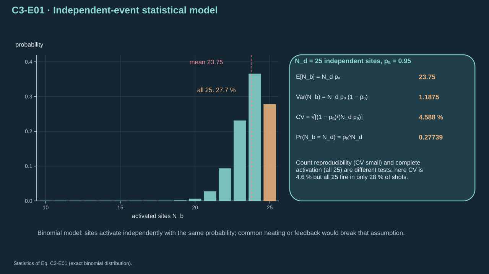

Count reproducibility and complete activation are different tests.

数量重复性与全部激活是不同检验。

With 25 independent sites and activation probability 0.95, mean count is 23.75. Relative standard deviation is 4.588%. Complete activation probability is 0.27739. Common heating or mechanical feedback can violate independence. Measure site activation before inferring load symmetry.

二十五个独立位点、激活概率 0.95 时，平均数量为 23.75，相对标准差为 4.588%，全部激活概率为 0.27739。共同加热或力学反馈可破坏独立性。推断载荷对称性前须测量各位点激活。

**Symbols before Eq. (C3-E02).**

**式（C3-E02）前的符号定义。**

| First individual definition / 第一项单独定义 | Second individual definition / 第二项单独定义 |
| --- | --- |
| $F(r)$ is Gaussian pulse fluence at radial distance $r$ (J m⁻²) $F(r)$ 是径向距离 $r$ 处的 Gaussian 脉冲通量（J m⁻²） | $F_0>0$ is central fluence (J m⁻²) $F_0>0$ 为中心通量（J m⁻²） |
| $R_A>0$ encloses the array (m) $R_A>0$ 包围阵列（m） | $w>0$ is the Gaussian 1/e² radius (m) $w>0$ 为 Gaussian 的 1/e² 半径（m） |
| $\epsilon\in(0,1)$ is allowed fractional edge decrease (dimensionless) $\epsilon\in(0,1)$ 是允许的边缘相对降低量（无量纲） | $r$ — Transverse distance from the laser axis (m) $r$ — 到激光轴线的横向距离（m） |

**Conventions and conditions.** $\exp$ and $\ln$ are exponential and natural logarithm of dimensionless arguments.

**约定与条件。** $\exp$、$\ln$ 分别为无量纲自变量的指数及自然对数。

(C3-E02) · Derived optical-uniformity condition / 推导得到的光学均匀性条件

$$
\frac{F(R_A)}{F_0}=\exp(-2R_A^2/w^2)\ge1-\epsilon\ \Longrightarrow\ w^2\ge\frac{2R_A^2}{-\ln(1-\epsilon)}\ \Longrightarrow\ w\ge R_A\sqrt{\frac{2}{-\ln(1-\epsilon)}}.
$$

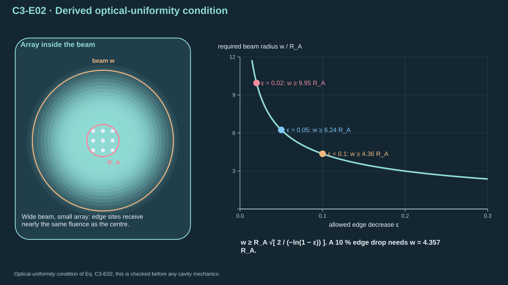

An optical condition can be checked before solving cavity mechanics.

求解腔体力学前即可检验光学条件。

Logarithms preserve order; multiplying by minus one reverses it. The allowed decrease lies between zero and one, keeping the denominator positive. A 10% decrease requires beam radius ≥ 4.35688 × array radius. Wider beams improve this fluence uniformity while exposing more surrounding area. Core absorption still requires site-specific calculation.

对数保持不等式方向，乘负一使方向反转。允许下降比例介于零与一之间，分母因此为正。下降不超过 10% 要求光束半径 ≥ 4.35688 × 阵列半径。宽光束改善该能量面密度均匀性，同时照射更多外围区域。核心吸收仍需逐位点计算。

## 2. Leading bubble interaction

## 2. 主阶气泡相互作用

Step 2 — Derive one spherical source potential. Incompressibility fixes volume flux across concentric spheres. Integrate radial velocity with zero potential at infinity. At a distant bubble, this potential is nearly uniform over its surface. Its fixed-position time derivative gives the leading Bernoulli pressure correction.

步骤 2——推导单个球形源速度势。不可压缩性使同心球面体积流量相等。积分径向速度，并取无穷远速度势为零。远处气泡表面上的该速度势近似均匀。固定位置时间导数给出主阶伯努利压力修正。

**Symbols before Eq. (C3-E03).**

**式（C3-E03）前的符号定义。**

| First individual definition / 第一项单独定义 | Second individual definition / 第二项单独定义 |
| --- | --- |
| $j$ labels the emitting bubble (dimensionless) $j$ 标记发射气泡（无量纲） | $i\ne j$ a receiving center (dimensionless) $i\ne j$ 标记接收中心（无量纲） |
| $R_j(t)>0$ — Time-dependent radius of source bubble j (m) $R_j(t)>0$ — 源气泡 j 的随时间变化半径（m） | $r_j\ge R_j$ — Radial distance from the center of source bubble j (m) $r_j\ge R_j$ — 到源气泡 j 中心的径向距离（m） |
| $t$ is time (s) $t$ 为时间（s） | $\dot R_j$ — Wall radial velocity of source bubble j (m s⁻¹) $\dot R_j$ — 源气泡 j 的壁面径向速度（m s⁻¹） |
| $\ddot R_j$ — Wall radial acceleration of source bubble j (m s⁻²) $\ddot R_j$ — 源气泡 j 的壁面径向加速度（m s⁻²） | $u_j$ is radial velocity (m s⁻¹) $u_j$ 为径向速度（m s⁻¹） |
| $\phi_j$ is velocity potential (m² s⁻¹) $\phi_j$ 为速度势（m² s⁻¹） | $\pi$ is dimensionless $\pi$ 无量纲 |
| $d_{ij}>0$ — Fixed separation between source j and observation center i (m) $d_{ij}>0$ — 源 j 与观察中心 i 之间的固定距离（m） | $\xi$ — Dummy radial integration coordinate (m) $\xi$ — 径向积分哑坐标（m） |

**Conventions and conditions.** $\partial_t$ holds position fixed; $\int$ is radial integration, $\infty$ the zero-potential far field.

**约定与条件。** $\partial_t$ 保持位置固定；$\int$ 为径向积分，$\infty$ 为速度势为零的远场。

(C3-E03) · Continuity and potential integration / 连续性关系与势函数积分

$$
\begin{aligned}4\pi r_j^2u_j(r_j,t)&=4\pi R_j^2\dot R_j,\\ \phi_j(r_j,t)&=\int_{\infty}^{r_j}\frac{R_j^2\dot R_j}{\xi^2}\,d\xi=-\frac{R_j^2\dot R_j}{r_j},\\ \partial_t\phi_j\big|_{r_j=d_{ij}}&=-\frac{2R_j\dot R_j^2+R_j^2\ddot R_j}{d_{ij}}.\end{aligned}
$$

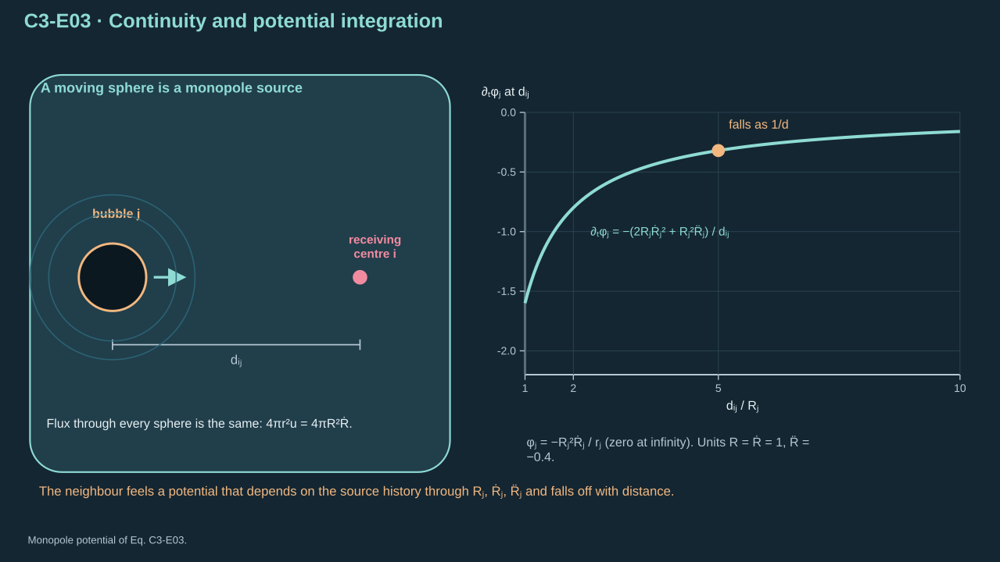

A moving spherical volume produces a monopole potential.

运动球体体积产生单极子速度势。

**Symbols before Eq. (C3-E04).**

**式（C3-E04）前的符号定义。**

| First individual definition / 第一项单独定义 | Second individual definition / 第二项单独定义 |
| --- | --- |
| $i$ — Bubble index over the declared activated sources (dimensionless) $i$ — 遍历声明的已激活源的气泡指标（无量纲） | $j$ — Bubble index over the declared activated sources (dimensionless) $j$ — 遍历声明的已激活源的气泡指标（无量纲） |
| $p'_{j\to i}$ is source $j$'s pressure disturbance at $i$ (Pa) $p'_{j\to i}$ 是源 $j$ 在 $i$ 处的压力扰动（Pa） | $p_{\mathrm{ext},i}$ external pressure (Pa) $p_{\mathrm{ext},i}$ 为外压（Pa） |
| $p_\infty$ remote pressure (Pa) $p_\infty$ 为远场压力（Pa） | $\rho$ is constant carrier density (kg m⁻³) $\rho$ 为恒定载液密度（kg m⁻³） |
| $\phi_j$ is potential (m² s⁻¹) $\phi_j$ 为速度势（m² s⁻¹） | $t$ is time (s), $\partial_t$ its fixed-position derivative $t$ 为时间（s），$\partial_t$ 为固定位置导数 |
| $R_j$ — Radius of source bubble j (m) $R_j$ — 源气泡 j 的半径（m） | $d_{ij}$ — Bubble-center separation (m) $d_{ij}$ — 气泡中心间距（m） |
| $N_b$ — Activated-bubble count (dimensionless) $N_b$ — 已激活气泡数（无量纲） |  |

**Conventions and conditions.** $\sum_{j\ne i}$ adds all other sources; $\simeq$ marks the leading far-separated approximation; $i\ne j$; each index runs from 1 to $N_b$; Newton dots on a radius denote its time derivatives..

**约定与条件。** $\sum_{j\ne i}$ 对其他源求和；$\simeq$ 表示充分分离时的首阶近似；$i\ne j$；每个指标从 1 遍历至 $N_b$；半径上的牛顿点号表示其时间导数。。

(C3-E04) · Leading unsteady-Bernoulli approximation / 非定常伯努利方程的首阶近似

$$
p'_{j\to i}\simeq-\rho\partial_t\phi_j(d_{ij},t)=\frac{\rho}{d_{ij}}(R_j^2\ddot R_j+2R_j\dot R_j^2),\qquad p_{\mathrm{ext},i}\simeq p_\infty+\sum_{j\ne i}p'_{j\to i}.
$$

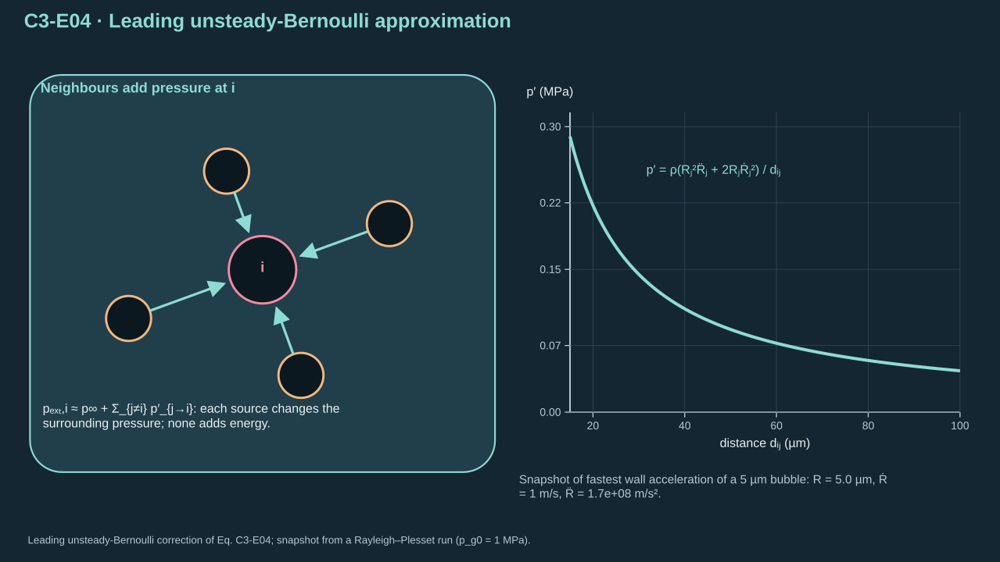

The correction changes surrounding pressure; it is not a new energy reservoir.

该修正改变周围压力，并不增加新的能量库。

The product rule gives both numerator terms. Each term/separation has units m² s⁻²; multiplying density gives pressure. Require small squared-speed, nonuniform-pressure, translation and reflected-field corrections. Positive volume acceleration raises surrounding pressure. Other event stages can reverse the correction. Bremond et al. observed shielding and delayed interior collapse. Their spherical model failed at final jetting. This is an interaction benchmark with different activation conditions. [Bremond et al. (2006)](https://doi.org/10.1103/PhysRevLett.96.224501)

乘积法则给出分子两项。每项除以间距的单位为 m² s⁻²，乘密度得到压力。要求速度平方、非均匀压力、平移及反射场修正较小。正体积加速度提高周围压力，其他事件阶段可反转修正。Bremond 等观测到屏蔽及内部气泡延迟塌缩。其球形模型在最终射流阶段失效。该研究提供不同激活条件下的相互作用基准。[Bremond 等（2006）](https://doi.org/10.1103/PhysRevLett.96.224501)

**Symbols before Eq. (C3-E05).**

**式（C3-E05）前的符号定义。**

| First individual definition / 第一项单独定义 | Second individual definition / 第二项单独定义 |
| --- | --- |
| $i$ — Bubble index over the declared activated sources (dimensionless) $i$ — 遍历声明的已激活源的气泡指标（无量纲） | $j$ — Bubble index over the declared activated sources (dimensionless) $j$ — 遍历声明的已激活源的气泡指标（无量纲） |
| $R_i$ — Radius of bubble i (m) $R_i$ — 气泡 i 的半径（m） | $R_j$ — Radius of source bubble j (m) $R_j$ — 源气泡 j 的半径（m） |
| $d_{ij}>0$ — Bubble-center separation (m) $d_{ij}>0$ — 气泡中心间距（m） | $p_{b,i}$ is bubble $i$'s internal pressure (Pa) $p_{b,i}$ 为第 $i$ 个气泡内压（Pa） |
| $p_\infty$ remote pressure (Pa) $p_\infty$ 为远场压力（Pa） | $\sigma_b$ is bubble–carrier tension (N m⁻¹) $\sigma_b$ 为泡—载液张力（N m⁻¹） |
| $\mu$ carrier dynamic viscosity (Pa s) $\mu$ 为载液动力黏度（Pa s） | $\rho$ carrier density (kg m⁻³) $\rho$ 为载液密度（kg m⁻³） |
| $B_i$ is the isolated radial driving expression (m² s⁻²) $B_i$ 为孤立泡径向驱动表达式（m² s⁻²） | $\dot R_j$ — Wall radial velocity of source bubble j (m s⁻¹) $\dot R_j$ — 源气泡 j 的壁面径向速度（m s⁻¹） |
| $\ddot R_j$ — Wall radial acceleration of source bubble j (m s⁻²) $\ddot R_j$ — 源气泡 j 的壁面径向加速度（m s⁻²） | $\dot R_i$ — Wall radial velocity of bubble i (m s⁻¹) $\dot R_i$ — 气泡 i 的壁面径向速度（m s⁻¹） |
| $\ddot R_i$ — Wall radial acceleration of bubble i (m s⁻²) $\ddot R_i$ — 气泡 i 的壁面径向加速度（m s⁻²） |  |

**Conventions and conditions.** $\sum_{j\ne i}$ sums other sources; Every term has unit m² s⁻².

**约定与条件。** $\sum_{j\ne i}$ 对其他源求和；各项单位均为 m² s⁻²。

(C3-E05) · Coupled spherical approximation / 耦合球形近似

$$
\begin{aligned}R_i\ddot R_i+\frac32\dot R_i^2+\sum_{j\ne i}\frac{R_j^2\ddot R_j+2R_j\dot R_j^2}{d_{ij}}&=B_i,\\ B_i&=\frac{p_{b,i}-p_\infty-2\sigma_b/R_i-4\mu\dot R_i/R_i}{\rho}.\end{aligned}
$$

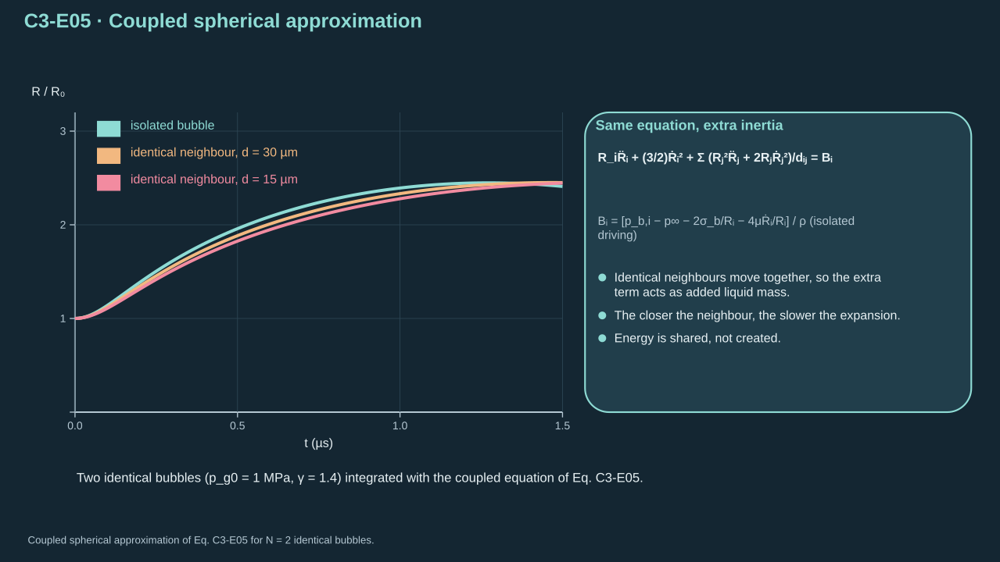

Substitute the corrected external pressure into each radial balance.

将修正外压代入各径向平衡。

Step 3 — Move neighbor pressure to the left in Eq. (C3-E05). The result couples bubble accelerations. Each site retains its own phase-pressure law. Infinite separation removes coupling and recovers the isolated equation. Radius comparable to separation violates the approximation.

步骤 3——在式（C3-E05）中将邻居压力移至左侧，得到气泡加速度耦合。各位点保留独立相变压力规律。间距趋于无穷远时，耦合消失并恢复单泡方程。半径接近间距时，近似失效。

## 3. Three-, four- and five-bubble examples

## 3. 三、四、五气泡示例

Step 4 — Place identical cavities on a regular polygon. Give them identical initial states and pressure histories. Cyclic symmetry equates their neighbor-distance sums and permits a shared radius. Calculate each sum from polygon distances. Pitch means adjacent-vertex distance.

步骤 4——将相同空腔置于正多边形顶点，给定相同初态及压力历程。循环对称性使邻居距离和相同，允许共同半径。根据多边形距离计算各和。节距指相邻顶点距离。

**Symbols before Eq. (C3-E06).**

**式（C3-E06）前的符号定义。**

| First individual definition / 第一项单独定义 | Second individual definition / 第二项单独定义 |
| --- | --- |
| $N\in\{3,4,5\}$ is regular-polygon bubble count (dimensionless) $N\in\{3,4,5\}$ 为正多边形气泡数（无量纲） | $k=1,\ldots,N-1$ counts steps from one vertex (dimensionless) $k=1,\ldots,N-1$ 为从一个顶点出发的步数（无量纲） |
| $s>0$ — Nearest-vertex array pitch (m) $s>0$ — 阵列相邻顶点间距（m） | $d_k>0$ — Bubble-center separation across k polygon steps (m) $d_k>0$ — 相隔 k 个多边形步长的气泡中心距离（m） |
| $S_N$ is the reciprocal-distance sum (m⁻¹) $S_N$ 为距离倒数和（m⁻¹） | $\varphi_g$ is the dimensionless golden ratio $\varphi_g$ 为无量纲黄金比 |
| $\pi$ — Circle constant (dimensionless) $\pi$ — 圆周率（无量纲） |  |

**Conventions and conditions.** $k$-step center distances (m); $\sin$ takes angles in radians; $\sum$ sums the stated polygon steps; $k$ runs from 1 to $N-1$..

**约定与条件。** $\sin$ 的角度采用弧度；$\sum$ 对规定步数求和；$\sum$ 对规定多边形步数求和；$k$ 从 1 遍历至 $N-1$。。

(C3-E06) · Exact polygon geometry / 精确的多边形几何关系

$$
\begin{aligned}d_k&=s\frac{\sin(k\pi/N)}{\sin(\pi/N)},\qquad S_N=\sum_{k=1}^{N-1}\frac1{d_k},\\ S_3&=\frac2s,\qquad S_4=\frac{2+1/\sqrt2}{s},\qquad S_5=\frac{2+2/\varphi_g}{s},\quad\varphi_g=\frac{1+\sqrt5}{2}.\end{aligned}
$$

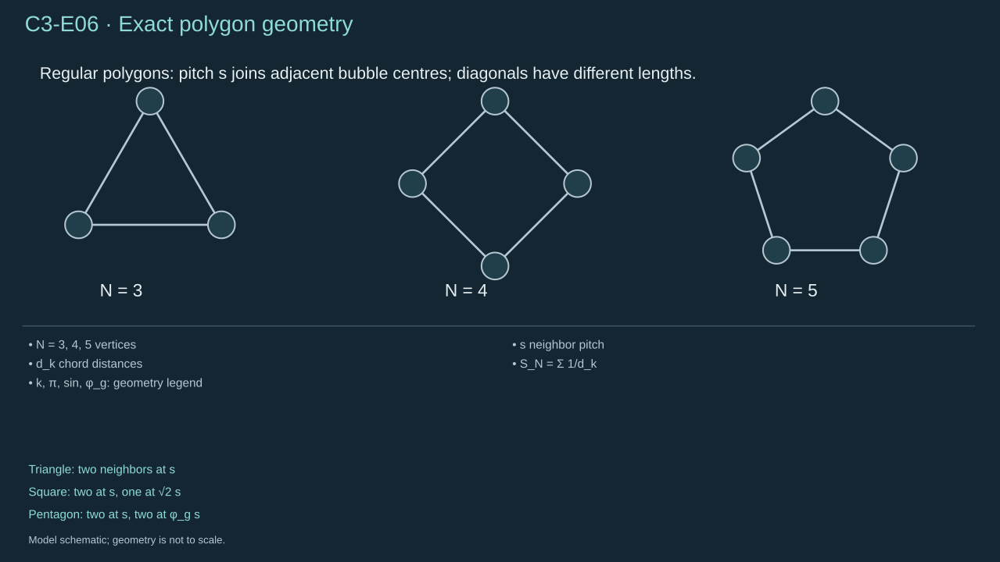

Equal geometric sums justify a shared radial trajectory in this constrained control.

相同几何和使这一约束对照可采用共同径向轨迹。

**Symbols before Eq. (C3-E07).**

**式（C3-E07）前的符号定义。**

| First individual definition / 第一项单独定义 | Second individual definition / 第二项单独定义 |
| --- | --- |
| $p_\infty$ — Constant Remote carrier pressure (Pa) $p_\infty$ — 恒定的远场载液压力（Pa） | $p_b$ — Constant Uniform internal bubble pressure in the stated control (Pa) $p_b$ — 恒定的指定对照中的均匀气泡内部压力（Pa） |
| $\Delta p_c>0$ their collapse-driving difference (Pa) $\Delta p_c>0$ 为其塌缩驱动压差（Pa） | $S=S_N\ge0$ is the fixed reciprocal-distance sum (m⁻¹) $S=S_N\ge0$ 为固定距离倒数和（m⁻¹） |
| $R(t)>0$ — Shared time-dependent bubble radius (m) $R(t)>0$ — 共同的随时间变化气泡半径（m） | $R_{\max}>0$ — Maximum bubble radius (m) $R_{\max}>0$ — 最大气泡半径（m） |
| $t=0$ the initial time (s) $t=0$ 为初始时刻（s） | $\rho>0$ is carrier density (kg m⁻³) $\rho>0$ 为载液密度（kg m⁻³） |
| $SR$ is dimensionless $SR$ 无量纲 | $\dot R$ — Bubble-wall radial velocity (m s⁻¹) $\dot R$ — 气泡壁面径向速度（m s⁻¹） |
| $\ddot R$ — Bubble-wall radial acceleration (m s⁻²) $\ddot R$ — 气泡壁面径向加速度（m s⁻²） |  |

**Conventions and conditions.** Dots are time derivatives; Surface tension and viscosity are omitted in this ideal control.

**约定与条件。** 点为时间导数；本理想对照忽略表面张力及黏度。

(C3-E07) · Symmetric constant-pressure collapse control / 对称恒压塌缩对照模型

$$
\begin{aligned}\Delta p_c&=p_\infty-p_b>0,\qquad S=S_N,\\ (1+SR)R\ddot R+\left(\frac32+2SR\right)\dot R^2&=-\frac{\Delta p_c}{\rho},\qquad R(0)=R_{\max},\quad\dot R(0)=0.\end{aligned}
$$

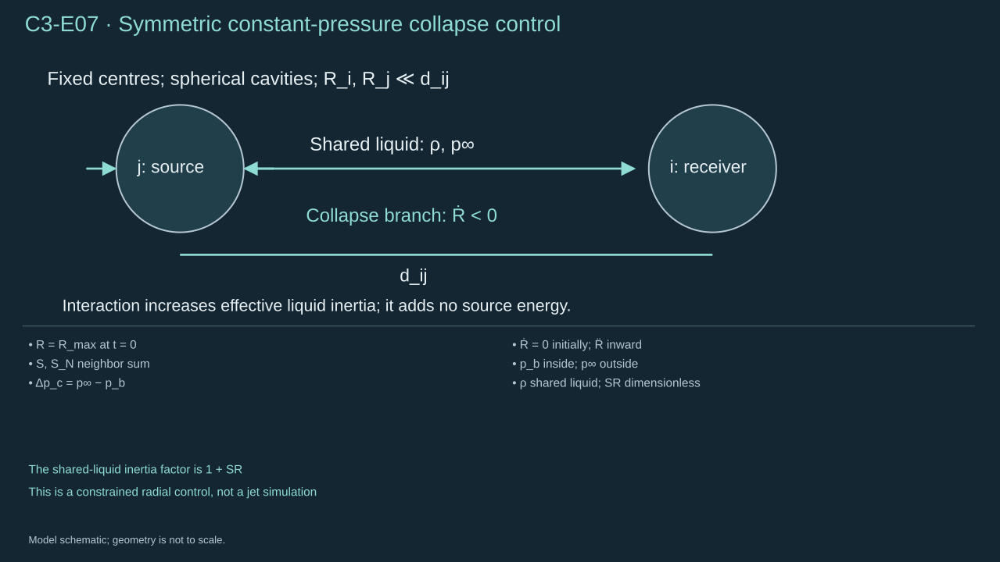

Substitution of the common radius collects the two interaction contributions.

代入共同半径后合并两种相互作用贡献。

Step 5 — Solve on the inward branch. Away from the turning point, express squared speed as a radius function. The chain rule gives its derivative as twice wall acceleration. The linear equation’s integrating factor is radius cubed × interaction factor. Check that choice with the displayed logarithmic derivatives. Extend continuously to zero initial speed.

步骤 5——在向内分支求解。转折点之外，将速度平方表示为半径函数。链式法则给出其导数为壁面加速度两倍。线性方程积分因子为半径三次方 × 相互作用因子。用显示的对数导数验证该选择。连续延拓至初始零速度。

**Symbols before Eq. (C3-E08).**

**式（C3-E08）前的符号定义。**

| First individual definition / 第一项单独定义 | Second individual definition / 第二项单独定义 |
| --- | --- |
| $y(R)\ge0$ is squared wall speed (m² s⁻²) $y(R)\ge0$ 为壁速平方（m² s⁻²） | $y'=dy/dR$ (m s⁻²) $y'=dy/dR$（m s⁻²） |
| $R>0$ is radius (m) and dots its time derivatives $R>0$ 为半径（m），点表示其时间导数 | $S\ge0$ is neighbor sum (m⁻¹) $S\ge0$ 为邻距和（m⁻¹） |
| $\rho>0$ density (kg m⁻³) $\rho>0$ 为密度（kg m⁻³） | $\Delta p_c>0$ pressure difference (Pa) $\Delta p_c>0$ 为压差（Pa） |
| $\ell_*>0$ is an arbitrary constant reference length (m), inserted solely to make the logarithm dimensionless $\ell_*>0$ 为任意恒定参考长度（m），仅用来使对数无量纲，并在积分因子中抵消 | $\dot R$ — Bubble-wall radial velocity (m s⁻¹) $\dot R$ — 气泡壁面径向速度（m s⁻¹） |
| $\ddot R$ — Bubble-wall radial acceleration (m s⁻²) $\ddot R$ — 气泡壁面径向加速度（m s⁻²） |  |

**Conventions and conditions.** it cancels from the integrating factor; $\ln$ is natural logarithm; $d/dR$ differentiates in radius; Division by $\dot R$ is used only on the moving branch.

**约定与条件。** $\ln$ 为自然对数；$d/dR$ 对半径求导；仅在运动分支除以 $\dot R$。

(C3-E08) · Chain rule and integrating-factor derivation / 链式法则与积分因子推导

$$
\begin{aligned}y(R)&=\dot R^2,\quad \frac{dy}{dR}=\frac{2\dot R\ddot R}{\dot R}=2\ddot R\quad(\dot R\ne0),\\ y'+\frac{3+4SR}{R(1+SR)}y&=-\frac{2\Delta p_c}{\rho R(1+SR)},\\ \frac{3+4SR}{R(1+SR)}&=\frac3R+\frac S{1+SR}=\frac{d}{dR}\ln[R^3(1+SR)/\ell_*^3],\\ \frac{d}{dR}\left[R^3(1+SR)y\right]&=-\frac{2\Delta p_c}{\rho}R^2.\end{aligned}
$$

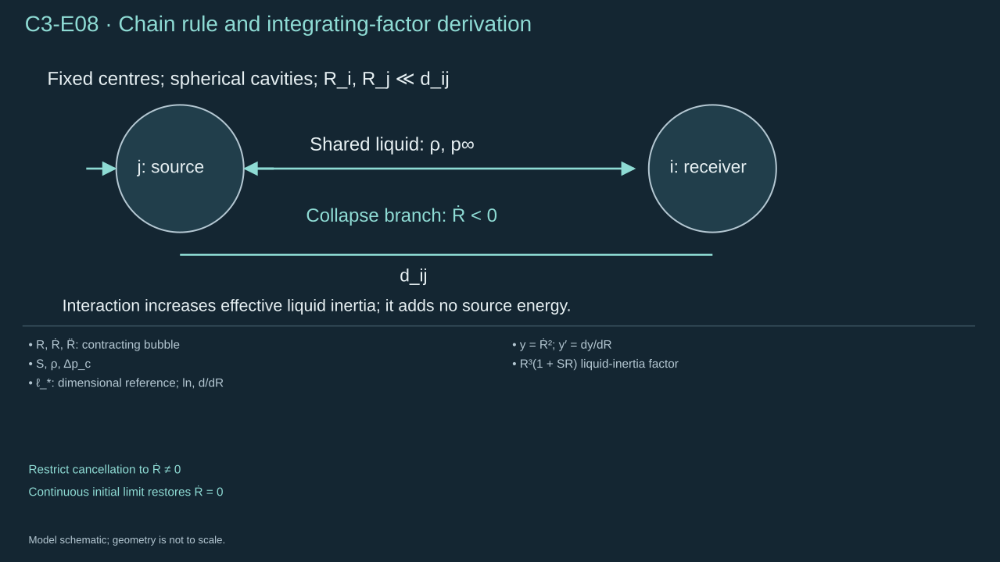

Every term of the integrating factor can be reconstructed from the radial equation.

积分因子的每一项均可从径向方程重构。

**Symbols before Eq. (C3-E09).**

**式（C3-E09）前的符号定义。**

| First individual definition / 第一项单独定义 | Second individual definition / 第二项单独定义 |
| --- | --- |
| $R\in(0,R_{\max}]$ — Shared instantaneous bubble radius (m) $R\in(0,R_{\max}]$ — 共同瞬时气泡半径（m） | $R_{\max}$ — Maximum bubble radius (m) $R_{\max}$ — 最大气泡半径（m） |
| $\xi$ is dummy radius (m), dots radius time derivatives $\xi$ 为积分半径（m），点为半径时间导数 | $y=\dot R^2$ (m² s⁻²) $y=\dot R^2$（m² s⁻²） |
| $S\ge0$ neighbor sum (m⁻¹) $S\ge0$ 为邻距和（m⁻¹） | $\rho>0$ density (kg m⁻³) $\rho>0$ 为密度（kg m⁻³） |
| $\Delta p_c>0$ pressure difference (Pa) $\Delta p_c>0$ 为压差（Pa） | $\dot R$ — Bubble-wall radial velocity (m s⁻¹) $\dot R$ — 气泡壁面径向速度（m s⁻¹） |
| $\ddot R$ — Bubble-wall radial acceleration (m s⁻²) $\ddot R$ — 气泡壁面径向加速度（m s⁻²） |  |

**Conventions and conditions.** Brackets mean upper minus lower endpoint, $\int$ definite integration and $\sqrt{\ }$ the nonnegative root; the explicit minus sign selects collapse.

**约定与条件。** 方括号表示上端减下端，$\int$ 为定积分，$\sqrt{\ }$ 取非负根；显式负号选择塌缩。

(C3-E09) · Integrated solution on the inward branch / 向内运动分支上的积分解

$$
\begin{aligned}[R^3(1+SR)y]_{R_{\max}}^R&=-\frac{2\Delta p_c}{\rho}\int_{R_{\max}}^R\xi^2d\xi=\frac{2\Delta p_c}{3\rho}(R_{\max}^3-R^3),\\ \dot R^2&=\frac{2\Delta p_c}{3\rho}\frac{R_{\max}^3-R^3}{R^3(1+SR)},\qquad \dot R=-\sqrt{\frac{2\Delta p_c}{3\rho}\frac{R_{\max}^3-R^3}{R^3(1+SR)}}.\end{aligned}
$$

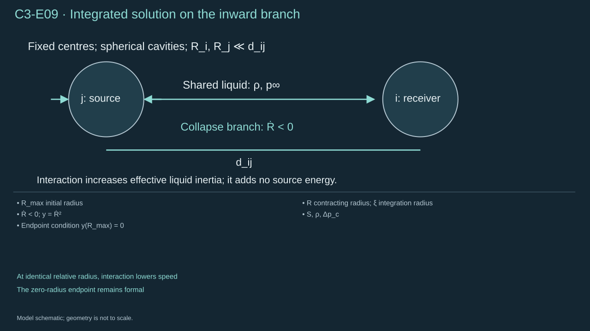

The initial condition removes the integration constant and the physical branch fixes the sign.

初值消去积分常数，物理分支固定符号。

**Symbols before Eq. (C3-E10).**

**式（C3-E10）前的符号定义。**

| First individual definition / 第一项单独定义 | Second individual definition / 第二项单独定义 |
| --- | --- |
| $t_c$ is formal collapse time (s) $t_c$ 为形式塌缩时间（s） | $R$ — Shared instantaneous bubble radius (m) $R$ — 共同瞬时气泡半径（m） |
| $R_{\max}>0$ — Maximum bubble radius (m) $R_{\max}>0$ — 最大气泡半径（m） | $\dot R$ wall velocity (m s⁻¹), $\|\ \|$ absolute value $\dot R$ 为壁速（m s⁻¹），$\|\ \|$ 为绝对值 |
| $\rho$ is density (kg m⁻³) $\rho$ 为密度（kg m⁻³） | $\Delta p_c>0$ pressure difference (Pa) $\Delta p_c>0$ 为压差（Pa） |
| $S\ge0$ neighbor sum (m⁻¹) $S\ge0$ 为邻距和（m⁻¹） | $x\in[0,1]$ is dimensionless integration radius $x\in[0,1]$ 为无量纲积分半径 |
| $\chi\ge0$ interaction strength (dimensionless) $\chi\ge0$ 为相互作用强度（无量纲） | $C$ — Collapse-time coefficient as a function of interaction strength (dimensionless) $C$ — 相互作用强度的塌缩时间系数函数（无量纲） |
| $C'=dC/d\chi$ — Derivative of that coefficient with respect to interaction strength (dimensionless) $C'=dC/d\chi$ — 该系数对相互作用强度的导数（无量纲） |  |

**Conventions and conditions.** integrals are convergent improper integrals at $x=1$.

**约定与条件。** 积分在 $x=1$ 处为收敛广义积分。

(C3-E10) · Collapse-time quadrature and sign check / 塌缩时间的求积表达式与符号检验

$$
\begin{aligned}t_c&=\int_0^{R_{\max}}\frac{dR}{|\dot R|}=R_{\max}\sqrt{\frac{\rho}{\Delta p_c}}\,C(\chi),\quad x=R/R_{\max},\quad\chi=SR_{\max},\\ C(\chi)&=\sqrt{\frac32}\int_0^1\sqrt{\frac{x^3(1+\chi x)}{1-x^3}}\,dx,\\ C'(\chi)&=\frac12\sqrt{\frac32}\int_0^1\frac{x^{5/2}}{\sqrt{(1-x^3)(1+\chi x)}}\,dx>0\quad(\chi\ge0).\end{aligned}
$$

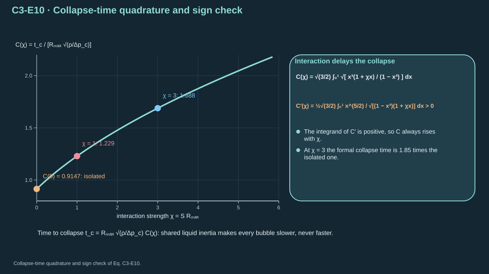

Shared-liquid interaction increases this constrained collapse time.

共享液体相互作用使这一约束塌缩时间增加。

The upper-endpoint singularity is an integrable inverse square root. The differentiated integrand is positive with the same endpoint behavior. This supports differentiation and monotonicity. Zero interaction recovers Rayleigh coefficient 0.9146813565. Use radius 30 μm, pitch 200 μm, density 1000 kg m⁻³ and pressure 100 kPa. Radius/separation is 0.15. These leading-order controls have no certified approximation error.

上端点为可积的平方根反比奇异性。求导后的被积函数为正且具有相同端点形式，支持求导与单调性。零相互作用恢复瑞利系数 0.9146813565。采用半径 30 μm、节距 200 μm、密度 1000 kg m⁻³、压差 100 kPa。半径／间距为 0.15。这些主阶对照未给出经认证近似误差。

| Configuration 构型 | $\chi$ $\chi$ | $C(\chi)$ $C(\chi)$ | Formal time (μs) 形式时间（μs） |
| --- | --- | --- | --- |
| Isolated 孤立 | 0 0 | 0.914681 0.914681 | 2.744044 2.744044 |
| Triangle 正三角形 | 0.300000 0.300000 | 1.019836 1.019836 | 3.059509 3.059509 |
| Square 正方形 | 0.406066 0.406066 | 1.054396 1.054396 | 3.163188 3.163188 |
| Pentagon 正五边形 | 0.485410 0.485410 | 1.079497 1.079497 | 3.238492 3.238492 |

Step 6 — Include pair terms in shared-liquid energy. Green’s identity converts the interaction integral to the cavity boundary. Liquid-domain outward normal points into the cavity. Outward wall speed gives negative liquid-normal velocity. Two negative boundary factors yield positive cross energy for synchronized motion.

步骤 6——共同液体能量中计入成对项。格林恒等式将相互作用积分转至空腔边界。液域外法向指向腔内。向外壁速给出负液域法向速度。同步运动的两个负边界因子产生正交叉能量。

**Symbols before Eq. (C3-E11).**

**式（C3-E11）前的符号定义。**

| First individual definition / 第一项单独定义 | Second individual definition / 第二项单独定义 |
| --- | --- |
| $K_N$ is leading cluster liquid kinetic energy (J) $K_N$ 为首阶气泡群液体动能（J） | $N$ count (dimensionless) $N$ 为数量（无量纲） |
| $i$ — Index of the bubble being evaluated (dimensionless) $i$ — 当前评估气泡的编号（无量纲） | $j$ — Index of a neighboring bubble (dimensionless) $j$ — 相邻气泡的编号（无量纲） |
| $R_i$ — Radius of bubble i (m) $R_i$ — 气泡 i 的半径（m） | $R_j$ — Radius of source bubble j (m) $R_j$ — 源气泡 j 的半径（m） |
| $r_i$ radial distance from $i$ (m) $r_i$ 为至 $i$ 的径距（m） | $d_{ij}$ center separation (m) $d_{ij}$ 为中心间距（m） |
| $R$ common radius (m) $R$ 为共同半径（m） | $R_{\max}$ its initial maximum (m) $R_{\max}$ 为其初始最大值（m） |
| $R_{\max,N}$ fixed-total-work maximum (m) $R_{\max,N}$ 为固定总做功最大半径（m） | $R_*$ isolated reference radius (all m) $R_*$ 为孤立参考半径（均为 m） |
| $b_i=R_i^2\dot R_i$ — Volume-source strength of bubble i (m³ s⁻¹) $b_i=R_i^2\dot R_i$ — 气泡 i 的体积源强度（m³ s⁻¹） | $b_j=R_j^2\dot R_j$ — Volume-source strength of bubble j (m³ s⁻¹) $b_j=R_j^2\dot R_j$ — 气泡 j 的体积源强度（m³ s⁻¹） |
| $\phi_i$ — Velocity potential of source bubble i (m² s⁻¹) $\phi_i$ — 源气泡 i 的速度势（m² s⁻¹） | $\phi_j$ — Velocity potential of source bubble j (m² s⁻¹) $\phi_j$ — 源气泡 j 的速度势（m² s⁻¹） |
| $\Omega$ liquid domain (—) $\Omega$ 为液体域（—） | $\Gamma_j$ bubble boundary (—) $\Gamma_j$ 为泡边界（—） |
| $dV$ — Volume integration element (m³) $dV$ — 体积积分微元（m³） | $dA$ — Area integration element (m²) $dA$ — 面积积分微元（m²） |
| $dr_i$ — Radial integration element from center i (m) $dr_i$ — 以中心 i 为原点的径向积分微元（m） | $S$ equal reciprocal-distance sum (m⁻¹) $S$ 为相同距离倒数和（m⁻¹） |
| $\rho$ density (kg m⁻³) $\rho$ 为密度（kg m⁻³） | $\Delta p_c$ pressure difference (Pa) $\Delta p_c$ 为压差（Pa） |
| $E_{B,\mathrm{tot}}$ fixed initial work (J) $E_{B,\mathrm{tot}}$ 为固定初始做功（J） | $\pi$ dimensionless $\pi$ 无量纲 |

**Conventions and conditions.** dots are time derivatives; $\nabla$ gradient, $\partial_n$ liquid-outward normal derivative; $i<j$ counts each unordered pair once; $|\ |$ is vector norm and $\infty$ the far radial endpoint; Far separation justifies retaining self and leading pair integrals; $*$ labels a reference.

**约定与条件。** 点为时间导数；$\nabla$ 为梯度，$\partial_n$ 为液体外法向导数；$i<j$ 将各无序对计一次；$|\ |$ 为向量范数，$\infty$ 为径向远端；充分分离使保留自身及首阶两泡积分成立；$*$ 标记参考。

(C3-E11) · Leading-model energy check and fixed-total-work comparison / 首阶模型的能量检验与固定总功比较

$$
\begin{aligned}b_i&=R_i^2\dot R_i,\quad \phi_i=-b_i/r_i,\quad K_N\simeq\frac{\rho}{2}\sum_{i,j=1}^{N}\int_\Omega\nabla\phi_i\cdot\nabla\phi_j\,dV,\\ \int_\Omega|\nabla\phi_i|^2\,dV&\simeq4\pi b_i^2\int_{R_i}^\infty r_i^{-2}\,dr_i=4\pi R_i^3\dot R_i^2,\\ \int_\Omega\nabla\phi_i\cdot\nabla\phi_j\,dV&\simeq\int_{\Gamma_j}\phi_i\partial_n\phi_j\,dA\simeq(-b_i/d_{ij})(-\dot R_j)4\pi R_j^2=\frac{4\pi b_ib_j}{d_{ij}}\quad(i\ne j),\\ K_N&\simeq2\pi\rho\sum_i R_i^3\dot R_i^2+4\pi\rho\sum_{i<j}\frac{b_ib_j}{d_{ij}}=2\pi\rho NR^3(1+SR)\dot R^2,\\ K_N&=\frac{4\pi N}{3}\Delta p_c(R_{\max}^3-R^3)\quad\text{in the leading symmetric model},\\ E_{B,\mathrm{tot}}&=N\frac{4\pi}{3}\Delta p_c R_{\max,N}^3=\frac{4\pi}{3}\Delta p_c R_*^3,\quad R_{\max,N}=R_*N^{-1/3}.\end{aligned}
$$

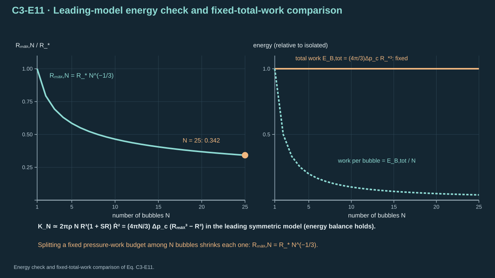

The integrated trajectory conserves the leading energy budget.

积分轨迹守恒首阶能量预算。

The inverse-square integral gives reciprocal lower radius. The infinity endpoint vanishes. A distant harmonic source is nearly constant over the emitting surface. Ordered cross terms appear twice; unordered pairs therefore carry coefficient four. Identical sums give bubble count × neighbor sum/2. Inserting Eq. (C3-E09) cancels the interaction factor and recovers pressure work. At fixed total work, take the positive cube root. From isolated radius 30 μm, three, four and five radii become 20.80084, 18.89882 and 17.54411 μm. At 200 μm pitch, times are 2.05687, 1.89946 and 1.77980 μs. Smaller cavities explain the shorter times. Stronger jets and improved optical efficiency remain unestablished.

平方反比积分给出下限半径的倒数，无穷远端点为零。远处调和源在发射球面上近似恒定。有序交叉项出现两次，故无序气泡对的系数为四。相同邻居和给出气泡数 × 邻居距离和／2。代入式（C3-E09），约去相互作用因子并恢复压力功。总功固定时取正立方根。孤立参照半径为 30 μm 时，三、四、五气泡半径分别为 20.80084、18.89882、17.54411 μm。200 μm 节距下，时间为 2.05687、1.89946、1.77980 μs。空腔变小解释时间变短。更强射流及更高光学效率尚未确立。

A center-and-four-arm cross has unequal neighbor sums. With arm length equal to pitch, the center sum is four/pitch. The outer sum is (one + one half + √two)/pitch. Their radii therefore cannot share the same history. Homogenization requires averaging length above pitch and below macroscopic variation length. Volume fraction leaves that separation unresolved.

中心加四臂十字形具有不同邻居和。臂长等于节距时，中心和为四／节距，外点和为（一 + 二分之一 + √二）／节距。因此其半径不能采用共同历程。均匀化要求平均长度大于节距且小于宏观变化长度。体积分数不能确定该尺度分离。

**Symbols before Eq. (C3-E12).**

**式（C3-E12）前的符号定义。**

| First individual definition / 第一项单独定义 | Second individual definition / 第二项单独定义 |
| --- | --- |
| $\phi_b$ is dimensionless instantaneous bubble-volume fraction $\phi_b$ 为无量纲瞬时气泡体积分数 | $V_i$ bubble volume (m³) $V_i$ 为泡体积（m³） |
| $V_\Omega>0$ representative-region volume (m³) $V_\Omega>0$ 为代表区体积（m³） | $N_b$ bubble count (dimensionless) $N_b$ 为泡数（无量纲） |
| $R_i$ — Radius of bubble i (m) $R_i$ — 气泡 i 的半径（m） | $R$ — Shared instantaneous bubble radius (m) $R$ — 共同瞬时气泡半径（m） |
| $s$ — Nearest-vertex array pitch (m) $s$ — 阵列相邻顶点间距（m） | $\pi$ dimensionless $\pi$ 无量纲 |
| $\phi(\boldsymbol x,t)$ is weak far-field potential (m² s⁻¹) $\phi(\boldsymbol x,t)$ 为弱扰动远场势（m² s⁻¹） | $p'$ pressure disturbance (Pa) $p'$ 为压力扰动（Pa） |
| $\boldsymbol x$ observation position (m) $\boldsymbol x$ 为观察位置（m） | $t$ time (s) $t$ 为时间（s） |
| $r_i>0$ distance to source $i$ (m) $r_i>0$ 为至源 $i$ 的距离（m） | $c$ sound speed (m s⁻¹) $c$ 为声速（m s⁻¹） |
| $\rho$ density (kg m⁻³) $\rho$ 为密度（kg m⁻³） | $t-r_i/c$ is retarded time (s) $t-r_i/c$ 为延迟时间（s） |
| $\dot V_i$ — First time derivative of bubble-i volume (m³ s⁻¹) $\dot V_i$ — 气泡 i 体积的一阶时间导数（m³ s⁻¹） | $\ddot V_i$ — Second time derivative of bubble-i volume (m³ s⁻²) $\ddot V_i$ — 气泡 i 体积的二阶时间导数（m³ s⁻²） |
| $i$ — Index of the bubble being evaluated (dimensionless) $i$ — 当前评估气泡的编号（无量纲） |  |

**Conventions and conditions.** Dots on $V_i$ are volume time derivatives (m³ s⁻¹, m³ s⁻²); $\sum$ sums sources; $\simeq$ is a distant, compact, weak-source approximation.

**约定与条件。** $V_i$ 上的点为体积时间导数（m³ s⁻¹、m³ s⁻²）；$\sum$ 对源求和；$\simeq$ 为远距、紧致、弱源近似。

(C3-E12) · Volume-fraction definition and retarded monopole approximation / 体积分数定义与延迟单极源近似

$$
\begin{aligned}\phi_b&=\frac{\sum_{i=1}^{N_b}V_i}{V_\Omega},\quad V_i=\frac{4\pi}{3}R_i^3,\quad\phi_b\big|_{\mathrm{cubic}}=\frac{4\pi R^3}{3s^3},\\ \phi(\boldsymbol x,t)&\simeq-\sum_i\frac{\dot V_i(t-r_i/c)}{4\pi r_i},\qquad p'(\boldsymbol x,t)\simeq\sum_i\frac{\rho}{4\pi r_i}\ddot V_i(t-r_i/c).\end{aligned}
$$

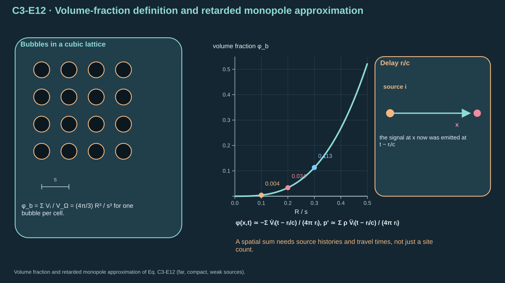

A spatial sum needs source histories and travel times, not only site count.

空间求和需要源历程及传播时间，不能只给位点数。

Step 7 — Use retarded time for a weak compact source. Differentiate far-field potential at fixed observation position to obtain pressure. Bubble volume fraction differs from initial liquid-PFC loading. A planar array needs layer thickness to define region volume. Coupled source histories must be solved before propagation. At 200 μm and 1480 m s⁻¹, travel time is 0.13514 μs. This is short against 3 μs but can exceed nanosecond pulses. Edges, delay and nonlinear shielding remain relevant.

步骤 7——弱紧致源采用延迟时间。固定观察位置求远场速度势时间导数，得到压力。气泡体积分数不同于初始液态 PFC 装载量。平面阵列需层厚才能定义区域体积。传播之前须先求耦合源历程。200 μm、1480 m s⁻¹ 下传播时间为 0.13514 μs，相对 3 μs 很短，却可超过纳秒脉冲。边缘、延迟及非线性屏蔽仍需考虑。

## 4. Spatial launch and focusing budgets

## 4. 空间发射与聚焦预算

Step 8 — Resolve liquid shape during meniscus deformation or re-entry. A radius history gives cavity scale and timing. Directional shape requires the spatial domain. During inertial launch, assume inviscid, irrotational, incompressible carrier and introduce a potential. Interfaces are material surfaces in this control. Appreciable evaporation requires Chapter 2’s mass-flux condition.

步骤 8——在弯月面变形或再入过程中解析液体形状。半径历程给出空腔尺度与时间，定向形状需要空间区域。惯性发射期间，假设载液无黏、无旋、不可压缩，并引入速度势。此对照将界面视为物质面。蒸发显著时须采用第二章质量通量条件。

**Symbols before Eq. (C3-E13).**

**式（C3-E13）前的符号定义。**

| First individual definition / 第一项单独定义 | Second individual definition / 第二项单独定义 |
| --- | --- |
| $\boldsymbol u(\boldsymbol x,t)$ is velocity (m s⁻¹) $\boldsymbol u(\boldsymbol x,t)$ 为速度（m s⁻¹） | $\phi(\boldsymbol x,t)$ potential (m² s⁻¹) $\phi(\boldsymbol x,t)$ 为势（m² s⁻¹） |
| $\boldsymbol x$ spatial position (m) $\boldsymbol x$ 为空间位置（m） | $t$ time (s) $t$ 为时间（s） |
| $\Omega(t)$ the moving liquid domain (—) $\Omega(t)$ 为运动液体域（—） |  |

**Conventions and conditions.** $\nabla$, $\nabla\cdot$ and $\nabla^2$ are spatial gradient, divergence and Laplacian; the central dot is an actual contraction, not an equation separator.

**约定与条件。** $\nabla$、$\nabla\cdot$、$\nabla^2$ 为空间梯度、散度、Laplace 算子；中心点是真正缩并，并非方程分隔符。

(C3-E13) · Potential-flow reduction / 势流简化模型

$$
\boldsymbol u=\nabla\phi,\qquad \nabla\cdot\boldsymbol u=0\ \Longrightarrow\ \nabla^2\phi=0\quad\text{in }\Omega(t).
$$

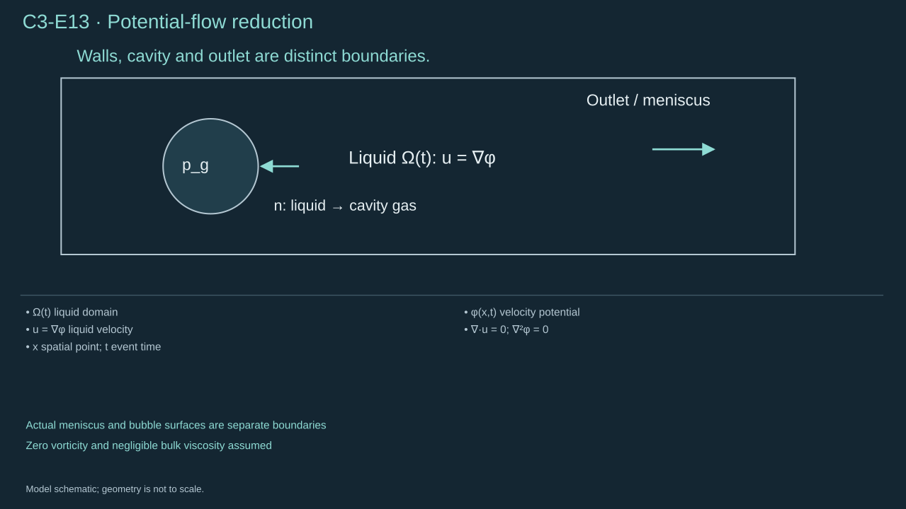

Geometry enters through the domain and its boundary conditions.

几何通过区域及边界条件进入。

**Symbols before Eq. (C3-E14).**

**式（C3-E14）前的符号定义。**

| First individual definition / 第一项单独定义 | Second individual definition / 第二项单独定义 |
| --- | --- |
| $\boldsymbol X$ is a material interface point (m) $\boldsymbol X$ 为材料界面点（m） | $t$ is time (s), $d/dt$ its trajectory derivative $t$ 为时间（s），$d/dt$ 为轨迹导数 |
| $\boldsymbol u$ is liquid velocity (m s⁻¹) $\boldsymbol u$ 为液速（m s⁻¹） | $\boldsymbol V_w$ prescribed wall velocity (m s⁻¹) $\boldsymbol V_w$ 为规定壁速（m s⁻¹） |
| $\boldsymbol n$ is outward from liquid toward gas or solid, unitless (dimensionless) $\boldsymbol n$ 从液体指向气体或固体，是无量纲单位法向（无量纲） | $V_n$ normal interface speed (m s⁻¹), $\partial_n\phi=\nabla\phi\cdot\boldsymbol n$ $V_n$ 为界面法向速度（m s⁻¹），$\partial_n\phi=\nabla\phi\cdot\boldsymbol n$ |
| $\phi$ potential (m² s⁻¹) $\phi$ 为势（m² s⁻¹） | $\Gamma$ is the complete moving interface (—) $\Gamma$ 为完整运动界面（—） |
| $\phi_\Gamma$ its potential (m² s⁻¹) $\phi_\Gamma$ 为其势（m² s⁻¹） | $\Gamma_0$ — Prescribed initial interface geometry (—) $\Gamma_0$ — 给定初始界面几何（—） |
| $\phi_0$ — Prescribed initial velocity potential (m² s⁻¹) $\phi_0$ — 给定初始速度势（m² s⁻¹） |  |

**Conventions and conditions.** Arrows indicate the stated far-field limit.

**约定与条件。** 箭头表示规定远场极限。

(C3-E14) · Kinematic, initial and wall conditions / 运动学条件、初始条件与壁面条件

$$
\begin{aligned}\frac{d\boldsymbol X}{dt}&=\boldsymbol u(\boldsymbol X,t),\quad V_n=\partial_n\phi,\quad \partial_n\phi=\boldsymbol V_w\cdot\boldsymbol n\quad\text{on walls},\\ (\Gamma,\phi_\Gamma)_{t=0}&=(\Gamma_0,\phi_0),\qquad \phi\to0\quad\text{in a quiescent far field}.\end{aligned}
$$

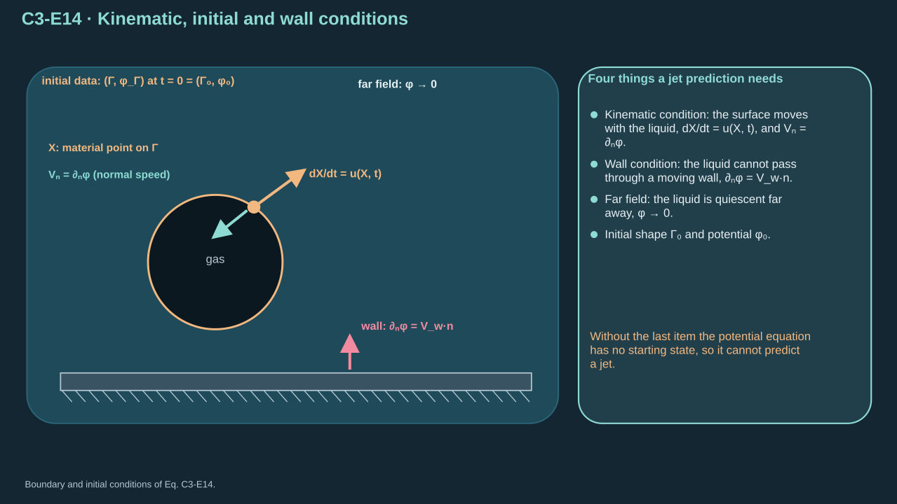

A potential equation without initial shape and wall data cannot predict a jet.

无初始形状及壁面数据的势方程无法预测射流。

**Symbols before Eq. (C3-E15).**

**式（C3-E15）前的符号定义。**

| First individual definition / 第一项单独定义 | Second individual definition / 第二项单独定义 |
| --- | --- |
| $p_l$ — Interface-liquid pressure (Pa) $p_l$ — 界面液体压力（Pa） | $p_g$ — Adjacent gas pressure (Pa) $p_g$ — 邻接气体压力（Pa） |
| $p_\infty$ — Remote carrier pressure (Pa) $p_\infty$ — 远场载液压力（Pa） | $\sigma$ is the tension appropriate to that interface (N m⁻¹) $\sigma$ 为对应界面张力（N m⁻¹） |
| $\kappa$ is signed total curvature (m⁻¹), $\nabla_s\cdot$ surface divergence $\kappa$ 为带符号总曲率（m⁻¹），$\nabla_s\cdot$ 为表面散度 | $\boldsymbol n$ the liquid-to-gas unit normal (dimensionless) $\boldsymbol n$ 为液体指向气体的单位法向（无量纲） |
| $R$ inner-cavity radius (m) $R$ 为内部腔体半径（m） | $a_j$ exterior-cylinder radius (m) $a_j$ 为外部圆柱半径（m） |
| $\phi_\Gamma$ — Interface velocity potential (m² s⁻¹) $\phi_\Gamma$ — 界面速度势（m² s⁻¹） | $\phi$ — Velocity potential (m² s⁻¹) $\phi$ — 速度势（m² s⁻¹） |
| $\boldsymbol u$ velocity (m s⁻¹) $\boldsymbol u$ 为速度（m s⁻¹） | $\rho$ density (kg m⁻³) $\rho$ 为密度（kg m⁻³） |
| $t$ time (s) $t$ 为时间（s） |  |

**Conventions and conditions.** $D/Dt$ is the material derivative, $\partial_t$ fixed-position derivative, $\nabla$ spatial gradient, $|\ |$ Euclidean norm; labels cavity and jet select geometries.

**约定与条件。** $D/Dt$ 为材料导数，$\partial_t$ 为固定位置导数，$\nabla$ 为空间梯度，$|\ |$ 为 Euclidean 范数；cavity、jet 标签选择几何。

(C3-E15) · Normal stress and material Bernoulli condition / 法向应力与随界面运动的伯努利条件

$$
\begin{aligned}p_l&=p_g+\sigma\kappa,\quad\kappa=\nabla_s\cdot\boldsymbol n,\quad\kappa_{\mathrm{cavity}}=-2/R,\quad\kappa_{\mathrm{jet}}=1/a_j,\\ \frac{D\phi_\Gamma}{Dt}&=\frac12|\nabla\phi|^2+\frac{p_\infty-p_g-\sigma\kappa}{\rho},\qquad \frac D{Dt}=\partial_t+\boldsymbol u\cdot\nabla.\end{aligned}
$$

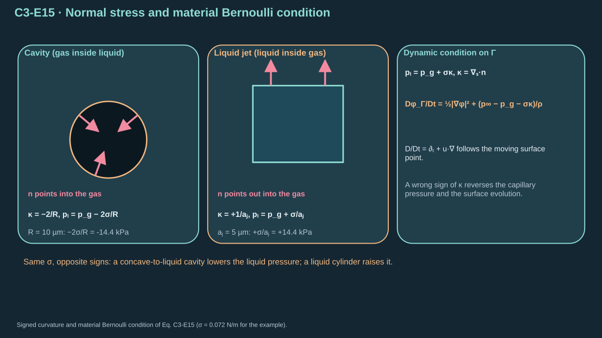

Signed curvature and the material derivative keep the dynamic condition consistent.

带符号曲率及材料导数使动力学条件自洽。

Step 9 — Apply normal stress in Eq. (C3-E15). Eulerian Bernoulli gives minus half squared speed. Converting to the material derivative adds squared speed, leaving plus half. For a sphere, wall potential is minus radius × wall speed. Its derivative recovers the spherical balance with capillary resistance. The shown gauge uses a quiescent reservoir. Sealed cells need their actual pressure–volume boundary and gauge. Solve the harmonic problem and advance shape and potential. Stop that stage when topology or compressibility changes its assumptions. Distinguish internal re-entry from exterior emission. Peters et al. resolve the free surface explicitly. [[R4]](../reference/sources.html#r4)

步骤 9——在式（C3-E15）应用法向应力。欧拉伯努利式给出负二分之一速度平方。转换为物质导数增加速度平方，留下正二分之一。球形壁面速度势为半径 × 壁速的负值，其导数恢复含毛细阻力的球形平衡。所示参考采用静止储库。密闭单元需实际压力—体积边界及参考。求解调和问题并推进形状和速度势。拓扑或可压缩性改变假设时，该阶段结束。区分内部再入与外部喷射。Peters 等显式解析了自由表面。 [[R4]](../reference/sources.html#r4)

**Symbols before Eq. (C3-E16).**

**式（C3-E16）前的符号定义。**

| First individual definition / 第一项单独定义 | Second individual definition / 第二项单独定义 |
| --- | --- |
| $\Pi(\boldsymbol x)$ — Local pressure impulse per unit area (Pa s) $\Pi(\boldsymbol x)$ — 局部单位面积压力冲量（Pa s） | $\Pi_0$ — Driven-end pressure impulse (Pa s) $\Pi_0$ — 驱动端压力冲量（Pa s） |
| $p$ — Local liquid pressure (Pa) $p$ — 局部液体压力（Pa） | $p_{\mathrm{ref}}$ — Specified reference pressure (Pa) $p_{\mathrm{ref}}$ — 指定参考压力（Pa） |
| $\boldsymbol x$ position (m) $\boldsymbol x$ 为位置（m） | $t$ — Time (s) $t$ — 时间（s） |
| $t_0$ — Pulse start time (s) $t_0$ — 脉冲开始时刻（s） | $\tau_p>0$ — Pressure-pulse duration (s) $\tau_p>0$ — 压力脉冲时长（s） |
| $\Delta\boldsymbol u$ velocity increment (m s⁻¹) $\Delta\boldsymbol u$ 为速度增量（m s⁻¹） | $U$ column speed (m s⁻¹) $U$ 为液柱速度（m s⁻¹） |
| $\rho>0$ density (kg m⁻³) $\rho>0$ 为密度（kg m⁻³） | $z\in[0,L]$ axial coordinate (m) $z\in[0,L]$ 为轴坐标（m） |
| $L>0$ length (m) $L>0$ 为长度（m） | $A>0$ area (m²) $A>0$ 为面积（m²） |
| $m>0$ liquid mass (kg) $m>0$ 为液体质量（kg） | $\mathcal J$ is total directional force impulse (N s) $\mathcal J$ 为总方向力冲量（N s） |
| $E$ kinetic energy (J) $E$ 为动能（J） |  |

**Conventions and conditions.** $\nabla,\nabla^2$ are gradient/Laplacian; $\int$ time integration and vertical bars denote a stated fixed-budget branch; The pulse approximation freezes geometry and neglects integrated convection and viscosity.

**约定与条件。** $\nabla,\nabla^2$ 为梯度／Laplace 算子；$\int$ 为时间积分，竖线表示指定固定预算分支；脉冲近似冻结几何并忽略积分后的对流及黏性。

(C3-E16) · Pressure-impulse control and distinct focusing budgets / 压力冲量对照模型与不同聚焦过程的收支

$$
\begin{aligned}\Pi(\boldsymbol x)&=\int_{t_0}^{t_0+\tau_p}(p-p_{\mathrm{ref}})\,dt,\quad \Delta\boldsymbol u\simeq-\nabla\Pi/\rho,\quad\nabla^2\Pi=0,\\ \Pi(z)&=\Pi_0(1-z/L),\quad U=\frac{\Pi_0}{\rho L},\quad m=\rho AL,\quad\mathcal J=\Pi_0A=mU,\\ U\big|_{\mathcal J\ \mathrm{fixed}}&=\frac{\mathcal J}{m},\quad E=\frac{\mathcal J^2}{2m},\qquad U\big|_{E\ \mathrm{fixed}}=\sqrt{\frac{2E}{m}}.\end{aligned}
$$

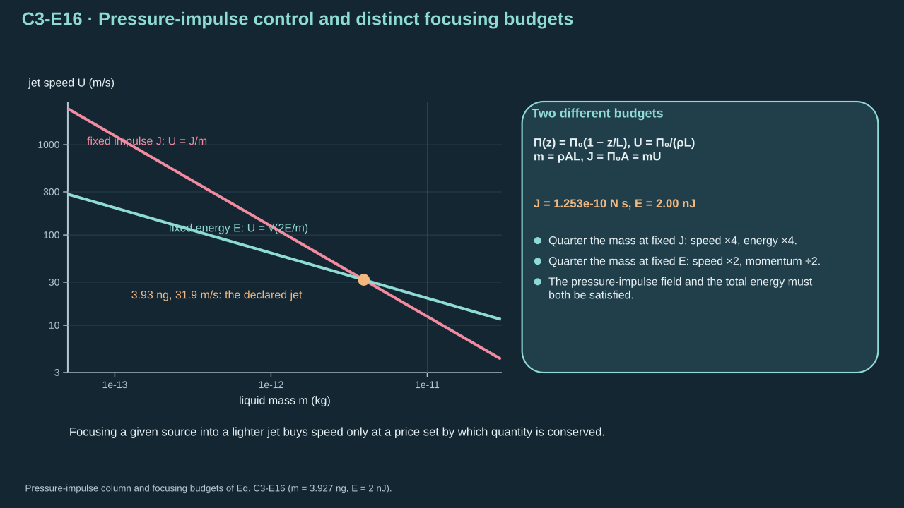

The pressure-impulse field and the total energy constraint must be compatible.

压力冲量场必须与总能量约束相容。

Step 10 — Integrate short-pulse momentum and take divergence. The column obeys endpoint impulses and impermeable sidewalls. Its impulse gradient sets initial speed. Smaller area at fixed impulse/area leaves speed unchanged. Quartering mass at fixed total impulse quadruples speed and required energy. At fixed energy, speed doubles and momentum halves. Meniscus focusing therefore needs an energy budget as well as continuity. Fixed geometry requires small pulse displacement and viscous corrections. Acoustic crossings alone leave those conditions unresolved. [[R2]](../reference/sources.html#r2)

步骤 10——积分短脉冲动量并取散度。液柱满足两端冲量及不透侧壁条件。冲量梯度决定初速。单位面积冲量固定时，面积变小不改变速率。总冲量固定、质量降至四分之一时，速率与所需能量均增至四倍。能量固定时，速率加倍而动量减半。弯月面聚焦因此需能量预算及连续性。固定几何要求脉冲位移与黏性修正较小。声传播次数不能确定这些条件。 [[R2]](../reference/sources.html#r2)

**Symbols before Eq. (C3-E17).**

**式（C3-E17）前的符号定义。**

| First individual definition / 第一项单独定义 | Second individual definition / 第二项单独定义 |
| --- | --- |
| $Q$ is steady volume flow (m³ s⁻¹) $Q$ 为稳态体积流量（m³ s⁻¹） | $a_{\mathrm{in}}$ — Solid-tube inlet radius (m) $a_{\mathrm{in}}$ — 固体管入口半径（m） |
| $U_{\mathrm{in}}$ — Uniform inlet speed (m s⁻¹) $U_{\mathrm{in}}$ — 均匀入口速度（m s⁻¹） | $U_j$ — Uniform jet speed (m s⁻¹) $U_j$ — 均匀射流速度（m s⁻¹） |
| $\alpha$ — Jet-to-inlet cross-sectional area ratio (dimensionless) $\alpha$ — 射流截面积与入口截面积之比（无量纲） | $p_{\mathrm{in}}$ — Tube-inlet pressure (Pa) $p_{\mathrm{in}}$ — 管入口压力（Pa） |
| $p_g$ — Adjacent gas pressure (Pa) $p_g$ — 邻接气体压力（Pa） | $\Delta p_{\mathrm{loss}}\ge0$ prescribed loss (Pa) $\Delta p_{\mathrm{loss}}\ge0$ 为给定损失（Pa） |
| $\rho>0$ density (kg m⁻³) $\rho>0$ 为密度（kg m⁻³） | $\sigma_j$ jet–gas tension (N m⁻¹) $\sigma_j$ 为射流—气体张力（N m⁻¹） |
| $\pi$ dimensionless $\pi$ 无量纲 | $a_j$ — Exterior cylindrical-jet radius (m) $a_j$ — 外部圆柱射流半径（m） |

**Conventions and conditions.** The square root requires nonnegative numerator; This is a steady inviscid-core nozzle control with optional loss, not a transient cavity solution; $a_{\mathrm{in}}>a_j>0$; $\alpha=(a_j/a_{\mathrm{in}})^2$ and $0<\alpha<1$..

**约定与条件。** 平方根要求分子非负；它是允许损失的稳态无黏核心喷嘴对照，并非瞬态腔体解；$a_{\mathrm{in}}>a_j>0$；$\alpha=(a_j/a_{\mathrm{in}})^2$ 且 $0<\alpha<1$。。

(C3-E17) · Continuity plus Bernoulli focusing benchmark / 连续性关系与伯努利方程的聚焦基准模型

$$
\begin{aligned}Q&=\pi a_{\mathrm{in}}^2U_{\mathrm{in}}=\pi a_j^2U_j,\qquad \alpha=(a_j/a_{\mathrm{in}})^2,\quad U_{\mathrm{in}}=\alpha U_j,\\ p_{\mathrm{in}}-p_g&=\frac12\rho(U_j^2-U_{\mathrm{in}}^2)+\frac{\sigma_j}{a_j}+\Delta p_{\mathrm{loss}},\\ U_j&=\sqrt{\frac{2[p_{\mathrm{in}}-p_g-\sigma_j/a_j-\Delta p_{\mathrm{loss}}]}{\rho(1-\alpha^2)}}\quad(0<\alpha<1).\end{aligned}
$$

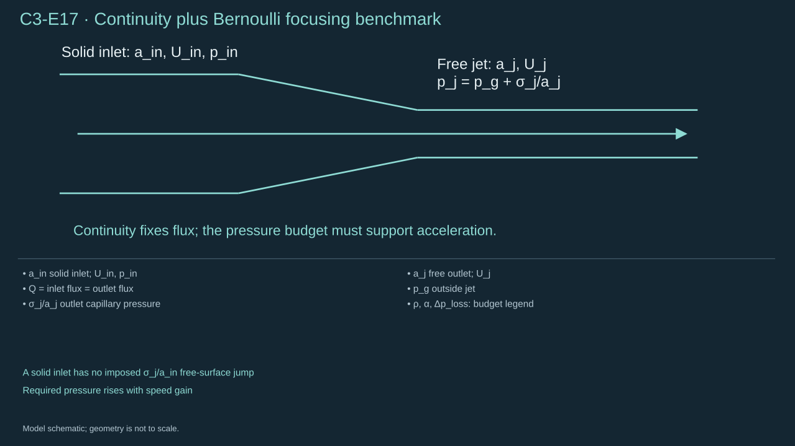

Specify either source pressure or flow and solve the compatible remaining quantity.

指定源压力或流量，再求其余相容量。

Use inlet radius 40 μm, outlet radius 10 μm and inlet speed 3 m s⁻¹. Continuity gives outlet speed 48 m s⁻¹. With density 1000 kg m⁻³, tension 0.072 N m⁻¹ and zero loss, overpressure must be 1.1547 MPa. This comprises 1.1475 MPa kinetic increase plus 7.2 kPa capillarity. Fixing overpressure at 0.20 MPa instead gives outlet speed 19.6752 m s⁻¹ and inlet speed 1.22970 m s⁻¹. The original speed with the lower pressure violates the budget. Meniscus evolution still requires Eqs. (C3-E13–15).

采用入口半径 40 μm、出口半径 10 μm、入口速率 3 m s⁻¹。连续性给出出口速率 48 m s⁻¹。密度 1000 kg m⁻³、张力 0.072 N m⁻¹、零损失时，所需过压为 1.1547 MPa，包括 1.1475 MPa 动能增加及 7.2 kPa 毛细压力。改为固定过压 0.20 MPa 时，出口速率为 19.6752 m s⁻¹、入口速率为 1.22970 m s⁻¹。原入口速率与较低压力同时指定会违反预算。弯月面演化仍需式（C3-E13–15）。

**Symbols before Eq. (C3-E18).**

**式（C3-E18）前的符号定义。**

| First individual definition / 第一项单独定义 | Second individual definition / 第二项单独定义 |
| --- | --- |
| $A_j$ is area (m²) $A_j$ 为面积（m²） | $d_j$ — Jet diameter (m) $d_j$ — 射流直径（m） |
| $L_j>0$ — Finite emitted-jet length (m) $L_j>0$ — 有限喷出射流长度（m） | $\rho$ carrier density (kg m⁻³) $\rho$ 为载液密度（kg m⁻³） |
| $m_j>0$ emitted mass (kg) $m_j>0$ 为喷出质量（kg） | $\mathcal M_j$ is the emitted material collection (—) $\mathcal M_j$ 为喷出材料集合（—） |
| $dm$ mass element (kg) $dm$ 为质量微元（kg） | $\boldsymbol u$ velocity field (m s⁻¹) $\boldsymbol u$ 为速度场（m s⁻¹） |
| $U_{\mathrm{rms}}$ mass-weighted root-mean-square speed (m s⁻¹) $U_{\mathrm{rms}}$ 为质量加权均方根速度（m s⁻¹） | $\boldsymbol e_z$ is a unit vector along intended transfer (dimensionless) $\boldsymbol e_z$ 为期望转印方向的单位向量（无量纲） |
| $P_j$ its signed momentum (N s) $P_j$ 为该方向带符号动量（N s） | $E_j$ kinetic energy (J) $E_j$ 为动能（J） |
| $E_{\mathrm{avail}}\ge E_j$ available mechanical energy (J) $E_{\mathrm{avail}}\ge E_j$ 为可用机械能（J） | $\pi$ is dimensionless $\pi$ 无量纲 |

**Conventions and conditions.** the cylinder expression assumes uniform area/density; $\int$ integrates over emitted mass; $|\ |$ denotes vector norm or scalar magnitude.

**约定与条件。** 圆柱式假设面积及密度均匀；$\int$ 对喷出质量积分；$|\ |$ 为向量范数或标量大小。

(C3-E18) · Finite-mass definitions and Cauchy–Schwarz bound / 有限质量定义与柯西–施瓦茨界限

$$
\begin{aligned}A_j&=\pi d_j^2/4,\qquad m_j=\rho A_jL_j,\qquad E_j=\frac12\int_{\mathcal M_j}|\boldsymbol u|^2dm=\frac12m_jU_{\mathrm{rms}}^2,\\ P_j&=\int_{\mathcal M_j}(\boldsymbol u\cdot\boldsymbol e_z)\,dm,\\ |P_j|^2&\le\left(\int_{\mathcal M_j}1\,dm\right)\left(\int_{\mathcal M_j}|\boldsymbol u\cdot\boldsymbol e_z|^2dm\right)\le2m_jE_j,\qquad U_{\mathrm{rms}}\le\sqrt{2E_{\mathrm{avail}}/m_j}.\end{aligned}
$$

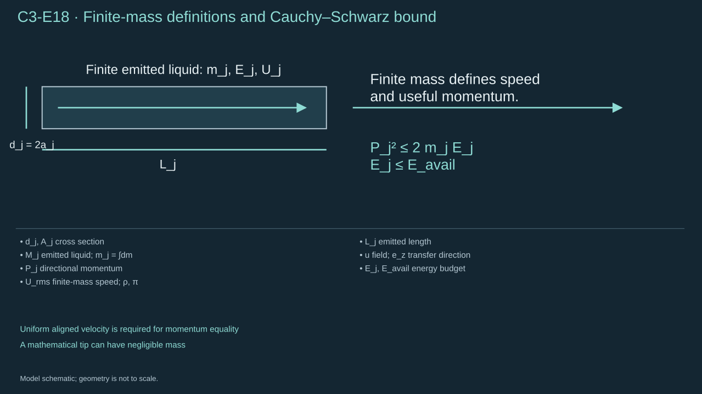

Finite jet mass converts an energy budget into a meaningful speed and momentum bound.

有限射流质量将能量预算转化为有意义的速度及动量界。

Step 11 — Apply Cauchy–Schwarz to mass and axial velocity. Bound axial velocity squared by total speed squared. Equality requires uniform speed along the chosen axis. Energy/mass has units m² s⁻². Momentum² and mass × energy share units kg² m² s⁻². The same proof applies to total emitted mass and energy. Lateral flow, opposing jets or tiny fast tips can reduce useful axial momentum.

步骤 11——对质量与轴向速度应用柯西—施瓦茨不等式。用总速率平方界定轴向速度平方。等号要求沿所选轴统一速率。能量／质量单位为 m² s⁻²。动量平方与质量 × 能量均为 kg² m² s⁻²。同一证明适用于总喷出质量与能量。侧向流、相反射流或微小高速前端可降低有用轴向动量。

## 5. Slender-jet transport and stability

## 5. 细射流输运与稳定性

Step 12 — Model an axisymmetric Newtonian jet after launch. Assume negligible surrounding gas, constant density and tension, zero gravity and mass exchange. Radius and axial velocity vary along flight. Integrate area over a fixed slice for exact mass conservation. Divide by positive slice length and take its limit for differentiable fields. Substitute area = π × radius², then divide by positive 2π × radius. Supply initial shape, velocity, inflow and end conditions from the launch model or measurements. Strongly two-dimensional startup necks exceed this approximation.

步骤 12——发射后采用轴对称牛顿射流模型。假设周围气体作用可忽略、密度与张力恒定、无重力及质量交换。半径与轴向速度沿飞行方向变化。对固定小段中的面积积分，得到精确质量守恒。除以正段长，并对可微场取零段长极限。代入面积 = π × 半径²，再除以正 2π × 半径。初始形状、速度、流入及端点条件由发射模型或测量给定。强二维起始颈部超出此近似。

**Symbols before Eq. (C3-E19).**

**式（C3-E19）前的符号定义。**

| First individual definition / 第一项单独定义 | Second individual definition / 第二项单独定义 |
| --- | --- |
| $z$ is axial position (m) $z$ 为轴向位置（m） | $t$ time (s) $t$ 为时间（s） |
| $\Delta z>0$ fixed finite slice length (m) $\Delta z>0$ 为固定有限切片长度（m） | $\xi$ — Dummy axial integration coordinate (m) $\xi$ — 轴向积分哑坐标（m） |
| $a(z,t)>0$ is local jet radius (m) $a(z,t)>0$ 为局部射流半径（m） | $A(z,t)$ area (m²) $A(z,t)$ 为面积（m²） |
| $v(z,t)$ cross-sectional average axial velocity (m s⁻¹) $v(z,t)$ 为截面平均轴速（m s⁻¹） | $\pi$ dimensionless $\pi$ 无量纲 |
| $[Av]$ denotes the volume flux (m³ s⁻¹) evaluated at the stated end $[Av]$ 表示在指定端点评价的体积流率（m³ s⁻¹） | $d\xi$ — Integration-coordinate element (m) $d\xi$ — 积分坐标微元（m） |

**Conventions and conditions.** $\partial_t,\partial_z$ are fixed-coordinate derivatives; $\int$ integrates over the slice; the differential limit requires differentiable fields; The last step divides by positive $2\pi a$.

**约定与条件。** $\partial_t,\partial_z$ 为固定坐标导数；$\int$ 为切片积分；微分极限要求场可微；最后一步除以正的 $2\pi a$。

(C3-E19) · Slender-jet volume conservation / 细长射流的体积守恒

$$
\begin{aligned}A(z,t)&=\pi a(z,t)^2,\\ \partial_t\int_z^{z+\Delta z}A(\xi,t)\,d\xi&=[Av](z,t)-[Av](z+\Delta z,t),\\ \partial_t\frac{1}{\Delta z}\int_z^{z+\Delta z}A\,d\xi+\frac{[Av](z+\Delta z,t)-[Av](z,t)}{\Delta z}&=0,\\ \Delta z\to0:\quad \partial_tA+\partial_z(Av)&=0\ \Longrightarrow\ \partial_ta+v\partial_za=-\frac a2\partial_zv.\end{aligned}
$$

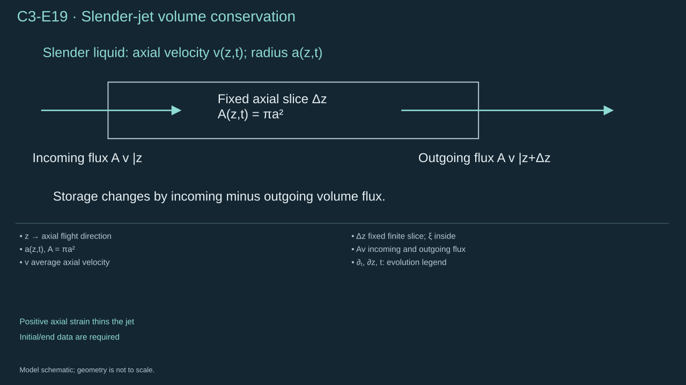

Axial stretching changes radius even before capillary necking grows.

在毛细颈缩增长前，轴向拉伸即会改变半径。

**Symbols before Eq. (C3-E20).**

**式（C3-E20）前的符号定义。**

| First individual definition / 第一项单独定义 | Second individual definition / 第二项单独定义 |
| --- | --- |
| $r\in[0,a]$ — Radial position measured from the liquid-jet axis (m) $r\in[0,a]$ — 从液体射流轴线计量的径向位置（m） | $z$ — Axial liquid-jet coordinate (m) $z$ — 液体射流轴向坐标（m） |
| $t$ time (s) $t$ 为时间（s） | $u_r$ is radial (m s⁻¹) $u_r$ 为径向（m s⁻¹） |
| $v$ axial velocity (m s⁻¹) $v$ 为轴向速度（m s⁻¹） | $a>0$ radius (m) $a>0$ 为半径（m） |
| $A=\pi a^2$ area (m²) $A=\pi a^2$ 为面积（m²） | $\rho$ is density (kg m⁻³) $\rho$ 为密度（kg m⁻³） |
| $\mu$ Newtonian viscosity (Pa s) $\mu$ 为 Newton 黏度（Pa s） | $\sigma_j$ jet–gas tension (N m⁻¹) $\sigma_j$ 为射流—气体张力（N m⁻¹） |
| $\tau_{zz}$ — Axial viscous normal stress (Pa) $\tau_{zz}$ — 轴向黏性法向应力（Pa） | $\tau_{rr}$ — Radial viscous normal stress (Pa) $\tau_{rr}$ — 径向黏性法向应力（Pa） |
| $\kappa$ is outward liquid-to-gas curvature (m⁻¹) $\kappa$ 为液体朝气体外法向曲率（m⁻¹） |  |

**Conventions and conditions.** $\partial_r,\partial_z,\partial_t$ are partial derivatives; $\partial_{zz}$ is a second axial derivative; The axial momentum law is a slender approximation although the geometric curvature is retained in full.

**约定与条件。** $\partial_r,\partial_z,\partial_t$ 为偏导数；$\partial_{zz}$ 为轴向二阶导数；虽然保留完整几何曲率，轴向动量规律仍为细长近似。

(C3-E20) · Newtonian stress and slender axial momentum / 牛顿流体应力与细长射流的轴向动量

$$
\begin{aligned}\partial_r u_r+u_r/r+\partial_zv&=0\ \Longrightarrow\ u_r=-\frac r2\partial_zv,\\ \tau_{zz}&=2\mu\partial_zv,\quad\tau_{rr}=2\mu\partial_ru_r=-\mu\partial_zv,\quad\tau_{zz}-\tau_{rr}=3\mu\partial_zv,\\ \partial_tv+v\partial_zv&=-\frac{\sigma_j}{\rho}\partial_z\kappa+\frac{3\mu}{\rho A}\partial_z(A\partial_zv),\\ \kappa&=\frac1{a\sqrt{1+(\partial_za)^2}}-\frac{\partial_{zz}a}{[1+(\partial_za)^2]^{3/2}}.\end{aligned}
$$

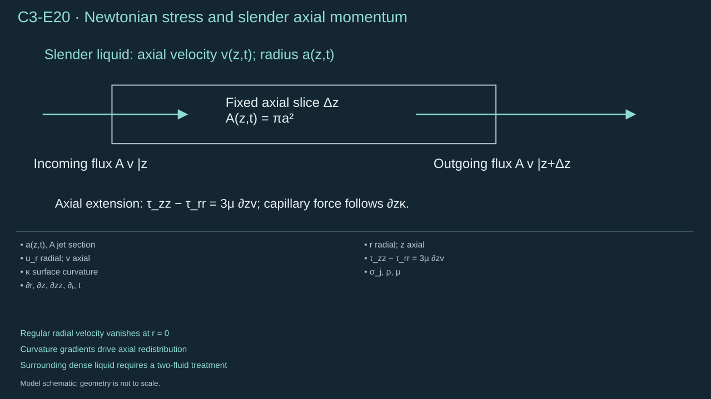

The factor three follows from extensional stress, rather than ordinary shear drag.

因子三来自拉伸应力，而不是普通剪切阻力。

Step 13 — Integrate radial continuity with axis regularity. Insert the radial derivative into Newtonian stresses. Axial minus radial stress gives extensional factor three. Normal stress removes radial stress from pressure. The remaining axial force contains extension and capillary gradient. Divide by mass/length for Eq. (C3-E20). Each acceleration term has units m s⁻². Constant radius and speed give zero acceleration. Axial strain changes radius through Eq. (C3-E19). Eggers and Dupont establish the reduced model and dissipation. Exact curvature still leaves a reduced momentum equation. [[R14]](../reference/sources.html#r14)

步骤 13——结合轴线正则性积分径向连续方程。将径向导数代入牛顿应力。轴向减径向应力给出拉伸系数三。法向应力从压力中消去径向应力。剩余轴向力包含拉伸及毛细梯度。除以单位长度质量，得到式（C3-E20）。各加速度项单位均为 m s⁻²。恒定半径和速率给出零加速度。轴向应变通过式（C3-E19）改变半径。Eggers 与 Dupont 建立了约化模型及耗散。采用精确曲率仍属于约化动量方程。 [[R14]](../reference/sources.html#r14)

**Symbols before Eq. (C3-E21).**

**式（C3-E21）前的符号定义。**

| First individual definition / 第一项单独定义 | Second individual definition / 第二项单独定义 |
| --- | --- |
| $a$ is perturbed radius (m) $a$ 为扰动半径（m） | $a_0>0$ base-cylinder radius (m) $a_0>0$ 为基态圆柱半径（m） |
| $\delta_0$ — Initial small radius-disturbance amplitude (m) $\delta_0$ — 初始微小半径扰动振幅（m） | $\delta(t)$ — Time-dependent small radius-disturbance amplitude (m) $\delta(t)$ — 随时间变化的微小半径扰动振幅（m） |
| $z$ — Axial liquid-column or jet position (m) $z$ — 液柱或射流的轴向位置（m） | $r$ — Radial position measured from the liquid-jet axis (m) $r$ — 从液体射流轴线计量的径向位置（m） |
| $t$ time (s) $t$ 为时间（s） | $U_j$ base axial speed (m s⁻¹) $U_j$ 为基态轴速（m s⁻¹） |
| $k>0$ wavenumber (m⁻¹) $k>0$ 为波数（m⁻¹） | $\kappa$ is curvature (m⁻¹) $\kappa$ 为曲率（m⁻¹） |
| $\psi$ perturbation potential (m² s⁻¹) $\psi$ 为扰动势（m² s⁻¹） | $B\ne0$ its amplitude (m² s⁻¹) $B\ne0$ 为其振幅（m² s⁻¹） |
| $g>0$ — Positive temporal growth rate, not gravitational acceleration (s⁻¹) $g>0$ — 正的时间增长率，并非重力加速度（s⁻¹） | $I_0$ — Modified Bessel function of order zero (dimensionless) $I_0$ — 零阶修正贝塞尔函数（无量纲） |
| $I_1$ — Modified Bessel function of order one (dimensionless) $I_1$ — 一阶修正贝塞尔函数（无量纲） | $q$ dimensionless wavenumber $q$ 为无量纲波数 |
| $\rho$ density (kg m⁻³) $\rho$ 为密度（kg m⁻³） | $\sigma_j$ tension (N m⁻¹) $\sigma_j$ 为张力（N m⁻¹） |

**Conventions and conditions.** $g$ does not denote gravity in this chapter; cosine and exponential have dimensionless arguments; This inviscid infinite-cylinder linear control neglects surrounding-gas dynamics; $0<\delta_0\le\delta(t)\ll a_0$ defines the small-disturbance regime..

**约定与条件。** 本章 $g$ 不表示重力；余弦及指数自变量无量纲；该无黏无限圆柱线性对照忽略周围气体动力学；$0<\delta_0\le\delta(t)\ll a_0$ 定义微小扰动范围。。

(C3-E21) · Inviscid-cylinder instability derivation / 无黏液柱失稳的推导

$$
\begin{aligned}a&=a_0+\delta(t)\cos[k(z-U_jt)],\quad \kappa\simeq a_0^{-1}+(k^2-a_0^{-2})\delta\cos[k(z-U_jt)],\\ \psi&=B I_0(kr)e^{gt}\cos[k(z-U_jt)],\quad\delta=\delta_0e^{gt},\\ g\delta_0&=BkI_1(ka_0),\quad \rho gB I_0(ka_0)=\sigma_j(a_0^{-2}-k^2)\delta_0,\\ g^2&=\frac{\sigma_j}{\rho a_0^3}\,q(1-q^2)\frac{I_1(q)}{I_0(q)},\quad q=ka_0\in(0,1).\end{aligned}
$$

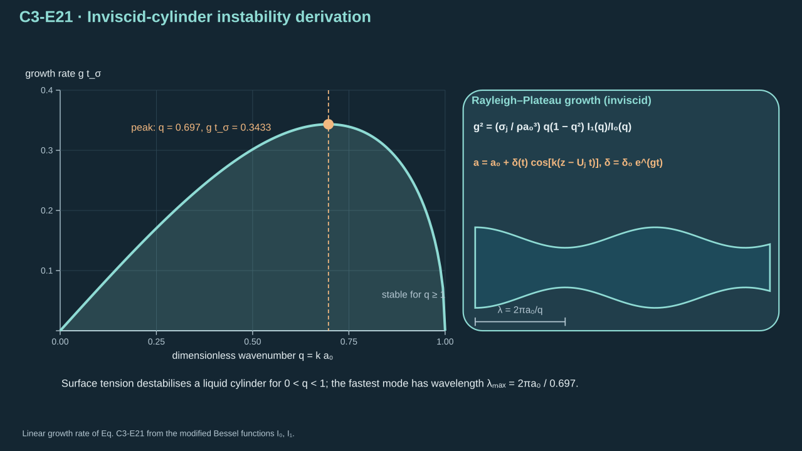

Kinematic and pressure conditions eliminate the potential amplitude and determine growth.

运动学及压力条件消去势振幅，从而确定增长。

Step 14 — Linearize curvature. Reciprocal radius contributes −amplitude/base-radius². Axial curvature contributes wavenumber² × amplitude. Solve Laplace’s equation with the regular modified Bessel function. Its radial derivative gives wavenumber × order-one function. Combine the kinematic condition and linear Bernoulli pressure. Eliminate nonzero potential amplitude for Eq. (C3-E21). Growth requires dimensionless wavenumber below one. Maximization gives 0.697019 and normalized growth rate 0.343339. These match the cylinder benchmark. [MIT, Lecture 11](https://ocw.mit.edu/courses/18-357-interfacial-phenomena-fall-2010/d77da8d5f1bb8b69a62682bc0dbc5845_MIT18_357F10_Lecture11.pdf)

步骤 14——线性化曲率。半径倒数项贡献 −振幅／基准半径²，轴向曲率贡献波数² × 振幅。用正则修正贝塞尔函数求解拉普拉斯方程。其径向导数给出波数 × 一阶函数。结合运动条件与线性伯努利压力，消去非零速度势振幅，得到式（C3-E21）。增长要求无量纲波数小于一。极值计算给出 0.697019 和归一化增长率 0.343339，与圆柱基准一致。[MIT，第 11 讲](https://ocw.mit.edu/courses/18-357-interfacial-phenomena-fall-2010/d77da8d5f1bb8b69a62682bc0dbc5845_MIT18_357F10_Lecture11.pdf)

**Symbols before Eq. (C3-E22).**

**式（C3-E22）前的符号定义。**

| First individual definition / 第一项单独定义 | Second individual definition / 第二项单独定义 |
| --- | --- |
| $t_\sigma$ — Capillary response-time scale (s) $t_\sigma$ — 毛细响应时间尺度（s） | $t_{\mathrm{lin}}$ — Time to the selected small linear threshold (s) $t_{\mathrm{lin}}$ — 达到选定微小线性阈值的时间（s） |
| $t_{\mathrm{flight}}$ — Jet flight time (s) $t_{\mathrm{flight}}$ — 射流飞行时间（s） | $\rho$ density (kg m⁻³) $\rho$ 为密度（kg m⁻³） |
| $a_0$ — Base-cylinder radius (m) $a_0$ — 基态圆柱半径（m） | $d_j$ — Jet diameter (m) $d_j$ — 射流直径（m） |
| $H$ — Liquid-jet flight gap (m) $H$ — 液体射流飞行间隙（m） | $\sigma_j$ tension (N m⁻¹) $\sigma_j$ 为张力（N m⁻¹） |
| $\mu$ viscosity (Pa s) $\mu$ 为黏度（Pa s） | $U_j>0$ uniform speed (m s⁻¹) $U_j>0$ 为均匀速度（m s⁻¹） |
| $g_{\max}>0$ fastest inviscid growth rate (s⁻¹) $g_{\max}>0$ 为最快无黏增长率（s⁻¹） | $\lambda_{\max}$ its wavelength (m) $\lambda_{\max}$ 为其波长（m） |
| $\delta_0$ — Initial small radius-disturbance amplitude (m) $\delta_0$ — 初始微小半径扰动振幅（m） | $\delta_{\mathrm{arr}}$ arrival amplitude (m) $\delta_{\mathrm{arr}}$ 为到达振幅（m） |
| $\pi$ dimensionless $\pi$ 无量纲 | $\mathrm{Re}_j$ — Diameter-based jet Reynolds number (dimensionless) $\mathrm{Re}_j$ — 以直径定义的射流雷诺数（无量纲） |
| $\mathrm{We}_j$ — Diameter-based jet Weber number (dimensionless) $\mathrm{We}_j$ — 以直径定义的射流韦伯数（无量纲） | $\mathrm{Oh}_j$ — Diameter-based jet Ohnesorge number (dimensionless) $\mathrm{Oh}_j$ — 以直径定义的射流奥内佐格数（无量纲） |
| $\delta_{\mathrm{crit}}$ — Chosen small linear-response threshold amplitude (m) $\delta_{\mathrm{crit}}$ — 选定的微小线性响应阈值振幅（m） |  |

**Conventions and conditions.** $\ln,\exp$ are natural logarithm/exponential; Constant base state and a sufficiently long cylinder are assumed for growth; $\delta_0<\delta_{\mathrm{crit}}\ll a_0$; the chosen threshold remains within linear theory..

**约定与条件。** $\ln,\exp$ 为自然对数／指数；增长计算假设基态恒定且圆柱足够长；$\delta_0<\delta_{\mathrm{crit}}\ll a_0$；所选阈值仍处于线性理论范围。。

(C3-E22) · Finite-flight growth and regime diagnostics / 有限飞行时间内的扰动增长与适用区间诊断

$$
\begin{aligned}t_\sigma&=\sqrt{\rho a_0^3/\sigma_j},\quad g_{\max}=0.343339/t_\sigma,\quad\lambda_{\max}=2\pi a_0/0.697019,\\ t_{\mathrm{lin}}&=\frac1{g_{\max}}\ln\left(\frac{\delta_{\mathrm{crit}}}{\delta_0}\right),\qquad\frac{\delta_{\mathrm{arr}}}{a_0}=\frac{\delta_0}{a_0}\exp\left(g_{\max}\frac H{U_j}\right),\quad t_{\mathrm{flight}}=H/U_j,\\ \mathrm{Re}_j&=\frac{\rho U_jd_j}{\mu},\quad\mathrm{We}_j=\frac{\rho U_j^2d_j}{\sigma_j},\quad\mathrm{Oh}_j=\frac{\mu}{\sqrt{\rho\sigma_jd_j}},\qquad d_j=2a_0.\end{aligned}
$$

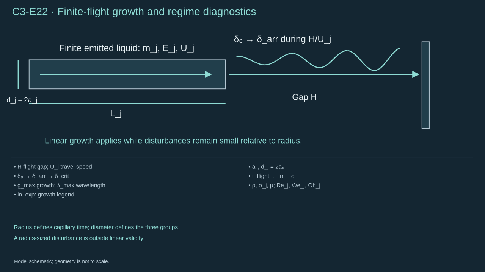

Compare growth during actual flight against a declared small-amplitude threshold.

比较实际飞行期间增长与明确的小振幅阈值。

Step 15 — Solve exponential growth for a small threshold. Capillary-time² has units kg/(kg s⁻²) = s². Growth vanishes at zero tension and wavenumber endpoints zero and one. A 0.1-radius threshold marks a chosen linearity limit. Extrapolation to full radius gives 17.7 μs in the example. Exact breakup time remains unestablished. A 50 μm jet spans about one fastest wavelength. Finite ends and startup therefore matter. Stretching needs evolving disturbance histories; dense surrounding liquid needs two-fluid stability. Large Weber number leaves coherent arrival unresolved.

步骤 15——由指数增长求小扰动阈值时间。毛细时间平方单位为 kg／（kg s⁻²）= s²。零张力及波数零、一端点处增长为零。0.1 半径阈值标记选定线性范围。示例外推至完整半径得到 17.7 μs，精确破断时间尚未确立。50 μm 射流约含一个最快波长，端部和起始形状因此重要。拉伸需演化扰动历程，密集外液需双流体稳定性。大韦伯数仍不能确定相干到达。

## 6. Impact pressure and finite impulse

## 6. 撞击压力与有限冲量

Step 16 — Separate impact regimes. Steady redirection gives momentum-flux force when outgoing axial momentum vanishes. Initial contact compresses both media and launches waves. Both derive from the same finite incoming jet. Count the load consistently through time. Positive normal velocity points into the stationary receiver. Compressive pressure is excess over precontact pressure.

步骤 16——区分撞击阶段。流出轴向动量为零时，稳态转向给出动量流力。初始接触压缩两介质并发射波。两者均来自同一有限入射射流。载荷须沿时间一致记账。法向正速度指向静止受载体。压缩压力为相对接触前的过压。

**Symbols before Eq. (C3-E23).**

**式（C3-E23）前的符号定义。**

| First individual definition / 第一项单独定义 | Second individual definition / 第二项单独定义 |
| --- | --- |
| $q_j$ is jet dynamic-pressure scale (Pa) $q_j$ 为射流动压尺度（Pa） | $\rho$ density (kg m⁻³) $\rho$ 为密度（kg m⁻³） |
| $U_j>0$ uniform speed (m s⁻¹) $U_j>0$ 为均匀速度（m s⁻¹） | $A_j$ incident area (m²) $A_j$ 为入射面积（m²） |
| $\dot m$ positive mass-flow rate (kg s⁻¹; dot on $m$ here denotes throughflow, not changing the finite emitted mass) $\dot m$ 为正的质量流率（kg s⁻¹；此处 $m$ 上的点表示通过流率，并非有限喷出质量变化） | $F_{\mathrm{steady}}$ receiver-normal steady force (N) $F_{\mathrm{steady}}$ 为接收体法向稳态力（N） |
| $m$ — Liquid-column mass (kg) $m$ — 液柱质量（kg） |  |

**Conventions and conditions.** Complete lateral redirection, fixed receiver, negligible other axial forces and uniform inlet are assumed.

**约定与条件。** 假设完全侧向转流、接收体固定、其他轴向力可忽略且入口均匀。

(C3-E23) · Dynamic-pressure definition and steady momentum flux / 动压定义与稳态动量通量

$$
q_j=\frac12\rho U_j^2,\qquad\dot m=\rho A_jU_j,\qquad F_{\mathrm{steady}}=\dot mU_j=\rho A_jU_j^2=2q_jA_j.
$$

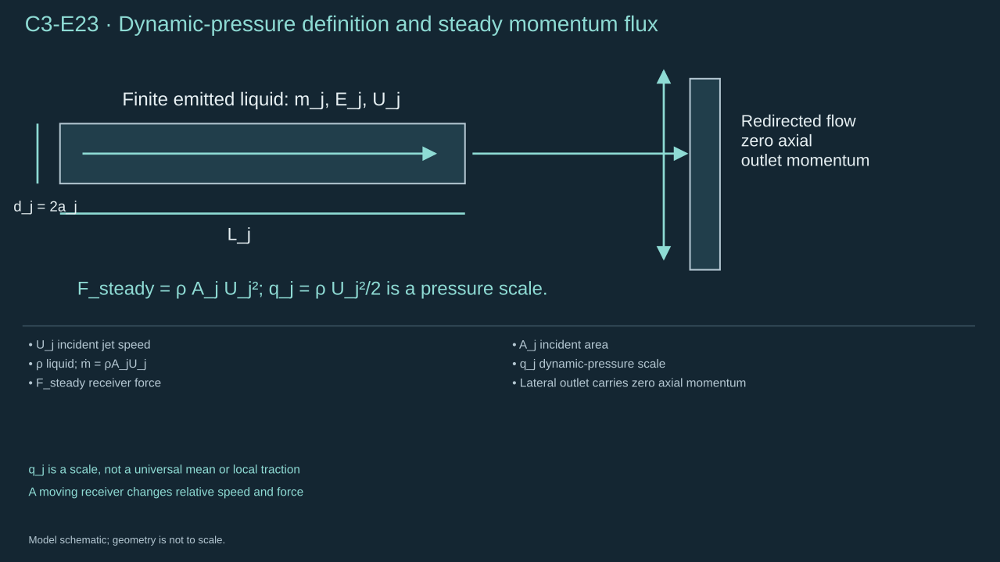

Steady force follows from momentum flux, rather than assigning dynamic pressure everywhere.

稳态力来自动量流率，而非将动压指定至全部表面。

**Symbols before Eq. (C3-E24).**

**式（C3-E24）前的符号定义。**

| First individual definition / 第一项单独定义 | Second individual definition / 第二项单独定义 |
| --- | --- |
| $u$ is liquid normal velocity (m s⁻¹) $u$ 为液体法向速度（m s⁻¹） | $U_j$ its initial incident speed (m s⁻¹) $U_j$ 为初始入射速度（m s⁻¹） |
| $v_i$ common contact velocity (m s⁻¹) $v_i$ 为共同接触速度（m s⁻¹） | $p'$ is linear compressive pressure disturbance (Pa) $p'$ 为线性压缩压力扰动（Pa） |
| $p_{\mathrm{early}}$ contact value (Pa) $p_{\mathrm{early}}$ 为接触值（Pa） | $\rho$ is liquid density (kg m⁻³) $\rho$ 为液体密度（kg m⁻³） |
| $c$ liquid longitudinal sound speed (m s⁻¹) $c$ 为液体纵向声速（m s⁻¹） | $Z_l=\rho c>0$ liquid (Pa s m⁻¹) $Z_l=\rho c>0$ 为液体阻抗（Pa s m⁻¹） |
| $Z_r>0$ receiver longitudinal impedance (Pa s m⁻¹) $Z_r>0$ 为接收体纵向阻抗（Pa s m⁻¹） | $z$ is normal coordinate (m) $z$ 为法向坐标（m） |
| $t$ — Time (s) $t$ — 时间（s） |  |

**Conventions and conditions.** The two differential operators follow right/left characteristics; Both media are locally semi-infinite and initially unpressurized relative to the same contact reference; the receiver is initially at rest.

**约定与条件。** 两个微分算子沿右／左行特征；两介质局部半无限，相对同一接触参考值初始无压力扰动；接收体初始静止。

(C3-E24) · Linear transient wave equations and impact matching / 线性瞬态波动方程与冲击匹配条件

$$
\begin{aligned}\partial_tu&=-\rho^{-1}\partial_zp',\qquad\partial_tp'=-\rho c^2\partial_zu,\quad Z_l=\rho c,\\ (\partial_t+c\partial_z)(u+p'/Z_l)&=0,\quad(\partial_t-c\partial_z)(u-p'/Z_l)=0,\\ p_{\mathrm{early}}&=Z_l(U_j-v_i)=Z_rv_i\ \Longrightarrow\ v_i=\frac{Z_l}{Z_l+Z_r}U_j,\quad p_{\mathrm{early}}=\frac{Z_lZ_r}{Z_l+Z_r}U_j.\end{aligned}
$$

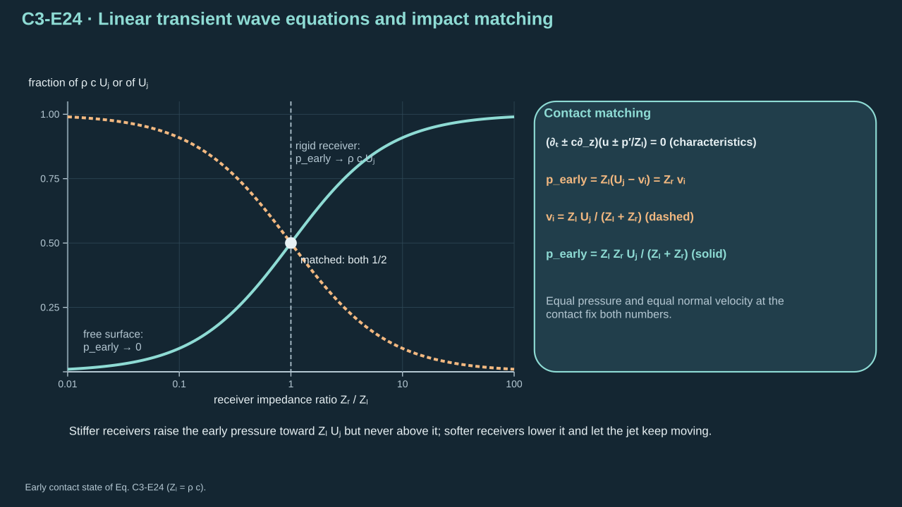

Pressure continuity and equal normal velocity determine the early contact state.

压力连续及相同法向速度确定早期接触状态。

Step 17 — Insert momentum and compression equations into the characteristic derivatives. Pressure and velocity gradients cancel. The upstream liquid wave slows flow to contact velocity. Pressure equals impedance × speed reduction. The receiver wave begins from rest. Match pressure and divide by summed positive impedances. Infinite receiver impedance gives zero contact speed and pressure = density × sound speed × incident speed. Zero receiver impedance gives zero pressure. These limits check compliance and signs. [MIT continuum acoustics](https://ocw.mit.edu/courses/6-013-electromagnetics-and-applications-spring-2009/50a609ff2cc992401a099bca53801474_MIT6_013S09_chap13.pdf)

步骤 17——将动量与压缩方程代入特征导数。压力和速度梯度项抵消。上行液体波将流速降至接触速度，压力等于阻抗 × 速度降幅。受载波从静止开始。匹配压力，再除以正阻抗之和。受载阻抗趋无穷时，接触速度趋零，压力等于密度 × 声速 × 入射速率。受载阻抗趋零时，压力趋零。这些极限检验柔顺性及符号。[MIT 连续介质声学](https://ocw.mit.edu/courses/6-013-electromagnetics-and-applications-spring-2009/50a609ff2cc992401a099bca53801474_MIT6_013S09_chap13.pdf)

**Symbols before Eq. (C3-E25).**

**式（C3-E25）前的符号定义。**

| First individual definition / 第一项单独定义 | Second individual definition / 第二项单独定义 |
| --- | --- |
| $\mathcal J_{\mathrm{rec}}$ is receiver normal contact impulse (N s) $\mathcal J_{\mathrm{rec}}$ 为接收体法向接触冲量（N s） | $P_{\mathrm{in}}$ — Incoming axial liquid momentum (N s) $P_{\mathrm{in}}$ — 入射液体轴向动量（N s） |
| $P_{\mathrm{out}}$ — Outgoing axial liquid momentum (N s) $P_{\mathrm{out}}$ — 出射液体轴向动量（N s） | $m_j$ emitted mass (kg) $m_j$ 为喷出质量（kg） |
| $\rho$ liquid density (kg m⁻³) $\rho$ 为密度（kg m⁻³） | $A_j$ area (m²) $A_j$ 为面积（m²） |
| $a_j$ — Exterior cylindrical-jet radius (m) $a_j$ — 外部圆柱射流半径（m） | $L_j$ — Finite emitted-jet length (m) $L_j$ — 有限喷出射流长度（m） |
| $U_j$ incident speed (m s⁻¹) $U_j$ 为入射速度（m s⁻¹） | $c$ sound speed (m s⁻¹) $c$ 为声速（m s⁻¹） |
| $\tau_{\mathrm{eq}}$ is an impulse-equivalent duration (s) for a fictitious uniform rigid-contact rectangle with zero outgoing axial momentum $\tau_{\mathrm{eq}}$ 为出射轴向动量为零时，假想均匀刚性接触矩形载荷的冲量等效时长（s） | $t_{\mathrm{side}}$ — Side-release time (s) $t_{\mathrm{side}}$ — 侧向释放时间（s） |
| $t_{\mathrm{axial}}$ — Axial-release time (s) $t_{\mathrm{axial}}$ — 轴向释放时间（s） | $t_{\mathrm{early}}$ — Early observation time (s) $t_{\mathrm{early}}$ — 早期观察时间（s） |
| $t_{\mathrm{return}}$ — First receiver-return time (s) $t_{\mathrm{return}}$ — 首个接收体回波时间（s） |  |

**Conventions and conditions.** The liquid momentum balance excludes additional direct source forces or a separate collapse shock; receiver support reactions affect receiver motion but are not counted as a second direct liquid impulse; $\min$ selects the earliest.

**约定与条件。** 液体动量平衡排除额外直接源力或独立塌缩激波；接收体支撑反力影响其运动，但不另算为第二个直接液体冲量；$\min$ 取最早值。

(C3-E25) · Finite momentum and early-impact duration conditions / 有限动量与冲击早期持续时间的条件

$$
\begin{aligned}\mathcal J_{\mathrm{rec}}&=P_{\mathrm{in}}-P_{\mathrm{out}},\quad P_{\mathrm{in}}=m_jU_j=\rho A_jL_jU_j,\\ (\rho cU_j)A_j\tau_{\mathrm{eq}}&=m_jU_j\ \Longrightarrow\ \tau_{\mathrm{eq}}=L_j/c,\\ t_{\mathrm{side}}&=a_j/c,\quad t_{\mathrm{axial}}=L_j/c,\quad t_{\mathrm{early}}\ll\min(t_{\mathrm{side}},t_{\mathrm{axial}},t_{\mathrm{return}}).\end{aligned}
$$

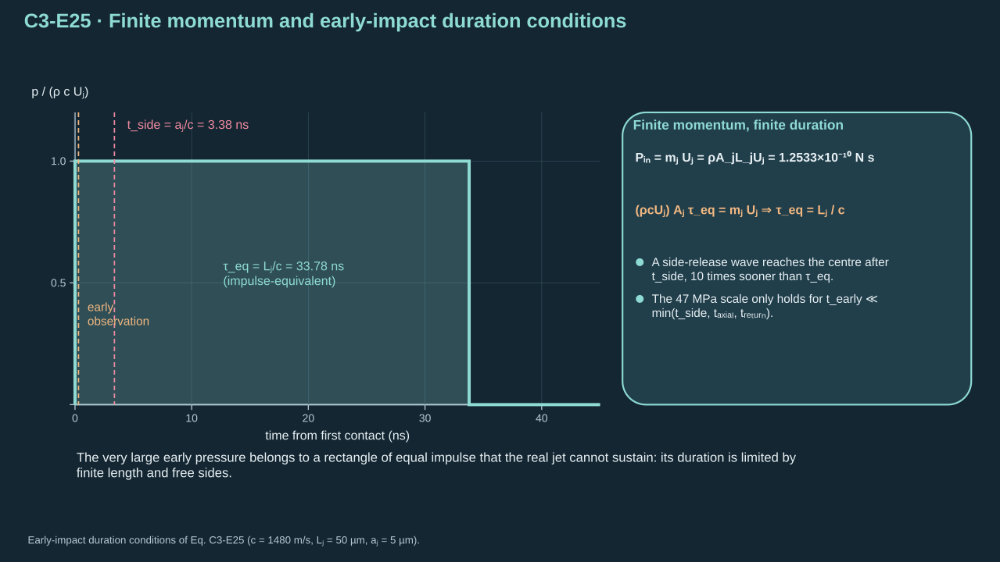

A very large initial pressure has a finite momentum budget and restricted duration.

很大的初始压力仍受有限动量预算及持续时间限制。

Step 18 — Integrate receiver force over the full event. Zero outgoing axial momentum gives stopping impulse. Divide it by full-area water-hammer force for an equivalent duration. A rectangular trace remains unestablished. One-dimensional pressure requires observation before lateral release and receiver reflections. Thin-film bending needs its own response. Rebound increases momentum change. Extra source work or collapse waves require separate balances.

步骤 18——对整个事件的受载力积分。流出轴向动量为零时，得到停止冲量。除以全面积水锤力，求等效时长。矩形压力迹线尚未确立。一维压力要求在侧向卸载及受载反射之前观测。薄膜弯曲需独立响应模型。反弹会增加动量变化。额外源功或塌缩波需独立平衡。

**Symbols before Eq. (C3-E26).**

**式（C3-E26）前的符号定义。**

| First individual definition / 第一项单独定义 | Second individual definition / 第二项单独定义 |
| --- | --- |
| $p_{\mathrm{obs}}$ is signed area–time mean excess pressure (Pa) $p_{\mathrm{obs}}$ 为带符号面积—时间平均超压（Pa） | $p$ local pressure (Pa) $p$ 为局部压力（Pa） |
| $p_{\mathrm{ref}}$ fixed reference (Pa) $p_{\mathrm{ref}}$ 为固定参考值（Pa） | $\boldsymbol x$ position (m) $\boldsymbol x$ 为位置（m） |
| $t$ current time (s) $t$ 为当前时间（s） | $\xi$ — Dummy time in the pressure-observation integral (s) $\xi$ — 压力观察积分中的时间哑变量（s） |
| $A_o>0$ is the fixed observer area (m²) $A_o>0$ 为固定观察面积（m²） | $\tau_o>0$ averaging duration (s) $\tau_o>0$ 为平均时长（s） |
| $dA$ area element (m²) $dA$ 为面积微元（m²） | $\mathcal J_{\mathrm{rec}}\ge0$ total compressive normal impulse over the observed footprint (N s) $\mathcal J_{\mathrm{rec}}\ge0$ 为观察载荷区域上的总法向压缩冲量（N s） |

**Conventions and conditions.** Integrals sum the area and preceding time window; The bound assumes negligible normal viscous stress, so excess pressure equals compressive normal traction; this excess must be nonnegative throughout the full-event footprint budget, with no omitted forces; An arbitrary signed waveform, finite normal viscous stress or a different interface does not satisfy these premises.

**约定与条件。** 积分对面积及前一时间窗口求和；界限假设法向黏性应力可忽略，因而超压等于法向压缩牵引；在采用完整事件冲量预算的整个区域内，该超压须始终非负，且不存在漏项力；任意带符号波形、有限法向黏性应力或另一界面不满足这些前提。

(C3-E26) · Observer definition and conditional impulse bound / 观测量定义与有条件的冲量界限

$$
\begin{aligned}p_{\mathrm{obs}}(t)&=\frac1{A_o\tau_o}\int_{t-\tau_o}^t\int_{A_o}[p(\boldsymbol x,\xi)-p_{\mathrm{ref}}]\,dA\,d\xi,\\ 0\le p_{\mathrm{obs}}(t)&\le\frac{\mathcal J_{\mathrm{rec}}}{A_o\tau_o},\\ &\text{for nonnegative excess pressure, negligible normal viscous stress,}\\ &\text{and full-event footprint impulse }\mathcal J_{\mathrm{rec}}.\end{aligned}
$$

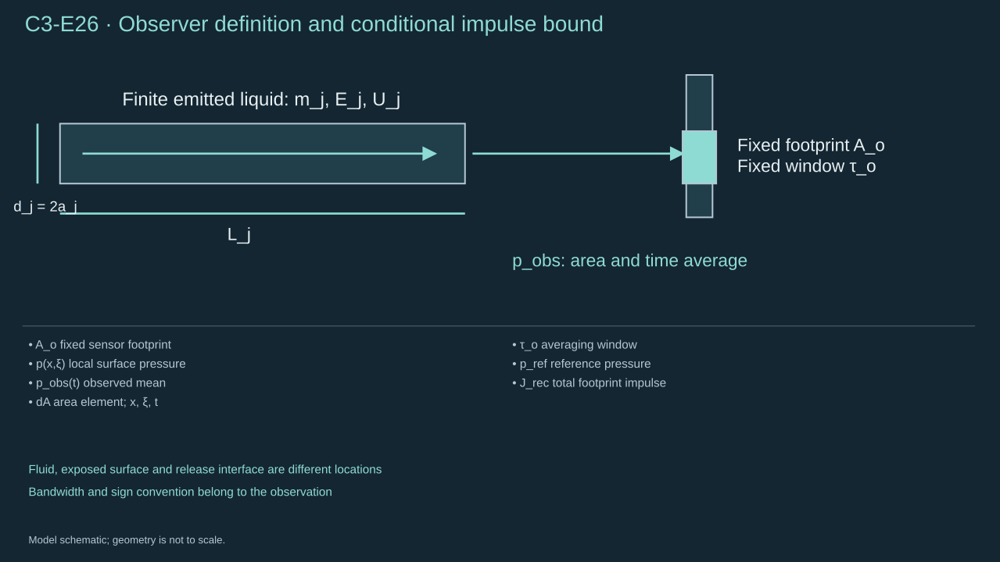

A reported maximum is meaningful only for an unchanged observer.

仅在观察定义不变时，报告的最大值才具有可比较含义。

**Symbols before Eq. (C3-E27).**

**式（C3-E27）前的符号定义。**

| First individual definition / 第一项单独定义 | Second individual definition / 第二项单独定义 |
| --- | --- |
| $E_w$ is outgoing linear plane-wave energy crossing the stated footprint/window (J) $E_w$ 为通过规定面积／时间窗口的单向线性平面波能量（J） | $p'$ its pressure disturbance (Pa) $p'$ 为其压力扰动（Pa） |
| $\overline p$ signed area–time mean (Pa) $\overline p$ 为带符号面积—时间均值（Pa） | $Z_l>0$ constant wave impedance (Pa s m⁻¹) $Z_l>0$ 为恒定波阻抗（Pa s m⁻¹） |
| $A_o>0$ area (m²) $A_o>0$ 为面积（m²） | $\tau_o>0$ duration (s) $\tau_o>0$ 为时长（s） |
| $t$ time (s) $t$ 为时间（s） | $dA$ area element (m²) $dA$ 为面积微元（m²） |

**Conventions and conditions.** $\int$ is area/time integration and $|\ |$ magnitude; The premise is one-way linear pressure–velocity relation $u'=p'/Z_l$, so intensity is $p'^2/Z_l$; This is not an energy bound on arbitrary standing-wave or solid contact traction.

**约定与条件。** $\int$ 为面积／时间积分，$|\ |$ 为大小；前提为单向线性压力—速度关系 $u'=p'/Z_l$，故强度为 $p'^2/Z_l$；它不是任意驻波或固体接触牵引的能量界。

(C3-E27) · One-way-wave energy and finite-observer Cauchy–Schwarz bound / 单向行波能量与有限观测条件下的柯西–施瓦茨界限

$$
\begin{aligned}E_w&=\int_0^{\tau_o}\int_{A_o}\frac{p'^2}{Z_l}\,dA\,dt,\qquad \overline p=\frac1{A_o\tau_o}\int_0^{\tau_o}\int_{A_o}p'\,dA\,dt,\\ |\overline p|^2&\le\frac1{A_o\tau_o}\int_0^{\tau_o}\int_{A_o}p'^2\,dA\,dt=\frac{Z_lE_w}{A_o\tau_o}.\end{aligned}
$$

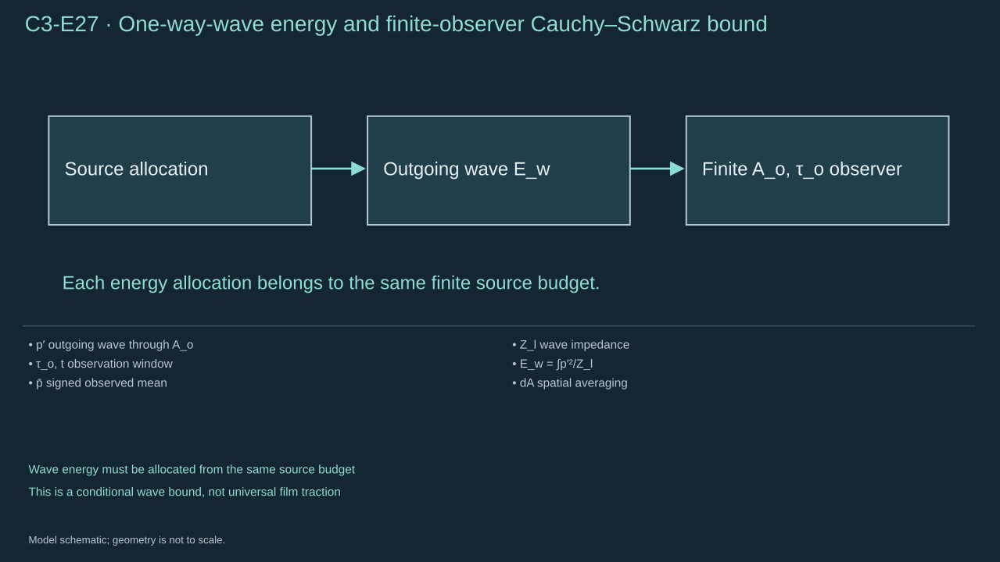

Finite area and time prevent an unmeasured point spike from standing in for delivered loading.

有限面积及时间避免用未测量点尖峰代替实际传递载荷。

Step 19 — Bound nonnegative load in a subwindow by full impulse. This gives Eq. (C3-E26). For a one-way linear wave, apply Cauchy–Schwarz over area × duration. Insert wave energy for Eq. (C3-E27). Keep these different assumptions with their bounds. Smaller windows or areas can raise averages at fixed energy. Pointwise mesh spikes leave measured maxima unestablished. Single-shot and repeatable intact-transfer maxima need separate admissible conditions.

步骤 19——用全事件冲量界定子窗口内非负载荷，得到式（C3-E26）。单向线性波中，对面积 × 时长应用柯西—施瓦茨不等式，代入波能得到式（C3-E27）。两类界限须分别保留各自假设。能量固定时，小窗口或面积可提高平均值。网格点峰仍未确立测量最大值。单发及可重复完整转印最大值需分别规定可接受条件。

**Symbols before Eq. (C3-E28).**

**式（C3-E28）前的符号定义。**

| First individual definition / 第一项单独定义 | Second individual definition / 第二项单独定义 |
| --- | --- |
| $\rho(\boldsymbol x,t)$ is compressible density (kg m⁻³) $\rho(\boldsymbol x,t)$ 为可压缩密度（kg m⁻³） | $\boldsymbol u$ velocity (m s⁻¹) $\boldsymbol u$ 为速度（m s⁻¹） |
| $p$ absolute thermodynamic pressure (Pa) $p$ 为绝对热力学压力（Pa） | $e$ specific internal energy (J kg⁻¹) $e$ 为比内能（J kg⁻¹） |
| $e_t$ total specific energy (J kg⁻¹) $e_t$ 为总比能（J kg⁻¹） | $\boldsymbol I$ is identity tensor (dimensionless) $\boldsymbol I$ 为单位张量（无量纲） |
| $\boldsymbol\tau$ viscous stress (Pa) $\boldsymbol\tau$ 为黏性应力（Pa） | $\boldsymbol q$ conductive heat flux (W m⁻²) $\boldsymbol q$ 为导热通量（W m⁻²） |
| $Q_{\mathrm{abs}}$ optical volumetric heating (W m⁻³; zero after heating if no continued absorption) $Q_{\mathrm{abs}}$ 为光学体积加热（W m⁻³；加热后若无继续吸收则为零） | $\mathcal P$ is the adopted equation-of-state function (—) $\mathcal P$ 为采用的状态方程函数（—） |
| $Y_k$ species mass fractions (dimensionless) $Y_k$ 为组分质量分数（无量纲） | $k$ — Species index, not the jet-instability wavenumber (dimensionless) $k$ — 组分指标，并非射流失稳波数（无量纲） |
| $\boldsymbol x$ position (m) $\boldsymbol x$ 为位置（m） | $t$ time (s), $\partial_t$ fixed-position derivative $t$ 为时间（s），$\partial_t$ 为固定位置导数 |

**Conventions and conditions.** $\nabla\cdot$ tensor/vector divergence, $\otimes$ tensor product and $\cdot$ contraction; $|\ |$ velocity norm.

**约定与条件。** $\nabla\cdot$ 为张量／向量散度，$\otimes$ 为张量积、$\cdot$ 为缩并；$|\ |$ 为速度范数。

(C3-E28) · Compressible bulk conservation and required constitutive closure / 可压缩体相守恒律与所需本构闭合关系

$$
\begin{aligned}\partial_t\rho+\nabla\cdot(\rho\boldsymbol u)&=0,\\ \partial_t(\rho\boldsymbol u)+\nabla\cdot(\rho\boldsymbol u\otimes\boldsymbol u+p\boldsymbol I-\boldsymbol\tau)&=0,\\ \partial_t(\rho e_t)+\nabla\cdot[(\rho e_t+p)\boldsymbol u-\boldsymbol\tau\cdot\boldsymbol u+\boldsymbol q]&=Q_{\mathrm{abs}},\quad e_t=e+|\boldsymbol u|^2/2,\quad p=\mathcal P(\rho,e,\{Y_k\}).\end{aligned}
$$

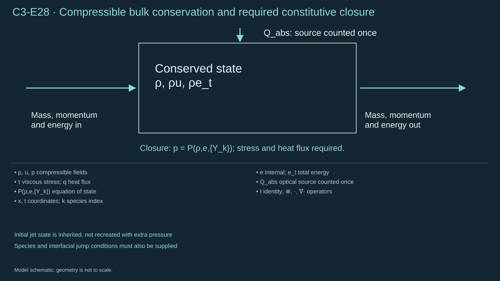

Strong compression requires conservative evolution with an appropriate equation of state.

强压缩需要采用适当状态方程的守恒演化。

Step 20 — Restore compressible conservation at appreciable Mach number. Conserve mass, momentum and total energy. Include pressure and viscous traction in momentum flux. Energy flux contains pressure work, viscous work and heat. Count optical heating once. Close species, phase jumps, material laws and solid response. Inherit source and incoming-jet states consistently. Sound speed flags model refinement. Universal jet-speed ceiling: Not established. Missing: source conversion, geometry, inventories, damage limits and observer. [[R5]](../reference/sources.html#r5)

步骤 20——马赫数显著时恢复可压缩守恒。守恒质量、动量及总能量。动量通量计入压力与黏性牵引。能量通量包含压力功、黏性功及热。光学加热计入一次。闭合组分、相界面跳跃、材料规律和固体响应。须一致继承源状态与入射射流。声速提示细化模型。通用射流速率上限尚未确立。缺失：源转换、几何、物质量、损伤限及观测条件。 [[R5]](../reference/sources.html#r5)

## 7. Twenty-five-cell worked example

## 7. 二十五单元计算示例

Prescribe 25 separate cells in a 5 × 5 pattern at 200 μm pitch. Each contains Chapter 2’s PFP teaching inventory and 50 pL carrier. Equal allocation assumes ideal patterned/addressed illumination and stipulated interception. This differs from the broad Gaussian control. The polygon interaction solution does not multiply these separate-cell pressures. The 5 μm core is a teaching input.

规定二十五个独立单元，按 5 × 5 排列，节距 200 μm。每个含第二章 PFP 教学物质量及 50 pL 载液。相等分配假设理想图案／寻址照明及指定截获比例。这不同于宽高斯光束对照。多边形相互作用解不能用作独立单元压力倍数。5 μm 核心为教学输入。

Step 21 — Allocate optical energy before assuming conversion. Incident energy is 25 μJ, interception 0.8 and absorptance 0.5. Equal allocation gives 400 nJ absorbed/site. Assume 40% reaches PFC by the activation deadline. The resulting 160 nJ exceeds the 97.82 nJ preparation screen. Uniform temperature and onset timing remain unestablished. Separately assume final jet energy is 0.5% of absorbed energy. Thermal and kinetic fractions track successive transfers of the same energy.

步骤 21——先分配光能，再假设转换。入射能量为 25 μJ，截获比例 0.8，吸收率 0.5。均分后每位点吸收 400 nJ。假设激活期限前 40% 到达 PFC，所得 160 nJ 超过 97.82 nJ 制备筛选。均温及起始时序尚未确立。另假设最终射流能量为吸收能量的 0.5%。热与动能比例追踪同一能量的先后传递。

**Symbols before Eq. (C3-E29).**

**式（C3-E29）前的符号定义。**

| First individual definition / 第一项单独定义 | Second individual definition / 第二项单独定义 |
| --- | --- |
| $E_L$ is incident laser energy (J) $E_L$ 为入射激光能（J） | $E_{\mathrm{abs,tot}}$ total absorbed energy (J) $E_{\mathrm{abs,tot}}$ 为总吸收能（J） |
| $E_{\mathrm{abs,site}}$ per-site absorbed energy (J) $E_{\mathrm{abs,site}}$ 为单个位点吸收能（J） | $E_{\mathrm{PFC,deadline}}$ energy delivered to that PFC inventory by the activation deadline (J) $E_{\mathrm{PFC,deadline}}$ 为激活截止前到达该 PFC 储量的能量（J） |
| $E_j$ final per-jet kinetic energy (J) $E_j$ 为最终单射流动能（J） | $E_{j,\mathrm{tot}}$ total jet energy (J; μJ = 10⁻⁶ J, nJ = 10⁻⁹ J) $E_{j,\mathrm{tot}}$ 为总射流动能（J；μJ = 10⁻⁶ J，nJ = 10⁻⁹ J） |
| $N_d=25$ is site count (dimensionless) $N_d=25$ 为位点数（无量纲） | $f_{\mathrm{geo}}=0.8$ intercepted fraction (dimensionless) $f_{\mathrm{geo}}=0.8$ 为截获比例（无量纲） |
| $A_\lambda=0.5$ effective absorptance at laser wavelength $\lambda$ (m) $A_\lambda=0.5$ 为激光波长 $\lambda$（m）处有效吸收率 | $f_T=0.40$ stipulated thermal fraction (dimensionless) $f_T=0.40$ 为假设热比例（无量纲） |
| $\eta_j=0.005$ stipulated absorbed-to-jet kinetic efficiency (dimensionless) $\eta_j=0.005$ 为假设吸收能至射流动能效率（无量纲） | $\lambda$ — Laser wavelength (m) $\lambda$ — 激光波长（m） |

**Conventions and conditions.** Subscripts label reservoirs/stages.

**约定与条件。** 下标区分能量库／阶段。

(C3-E29) · Declared optical and mechanical allocation / 明确给定的光能与机械能分配

$$
\begin{aligned}E_{\mathrm{abs,tot}}&=f_{\mathrm{geo}}A_\lambda E_L=(0.8)(0.5)(25\,\mu\mathrm J)=10\,\mu\mathrm J,\\ E_{\mathrm{abs,site}}&=E_{\mathrm{abs,tot}}/N_d=400\,\mathrm{nJ},\quad E_{\mathrm{PFC,deadline}}=f_T E_{\mathrm{abs,site}}=160\,\mathrm{nJ},\\ E_j&=\eta_j E_{\mathrm{abs,site}}=2.00\,\mathrm{nJ},\quad E_{j,\mathrm{tot}}=N_dE_j=50.0\,\mathrm{nJ}.\end{aligned}
$$

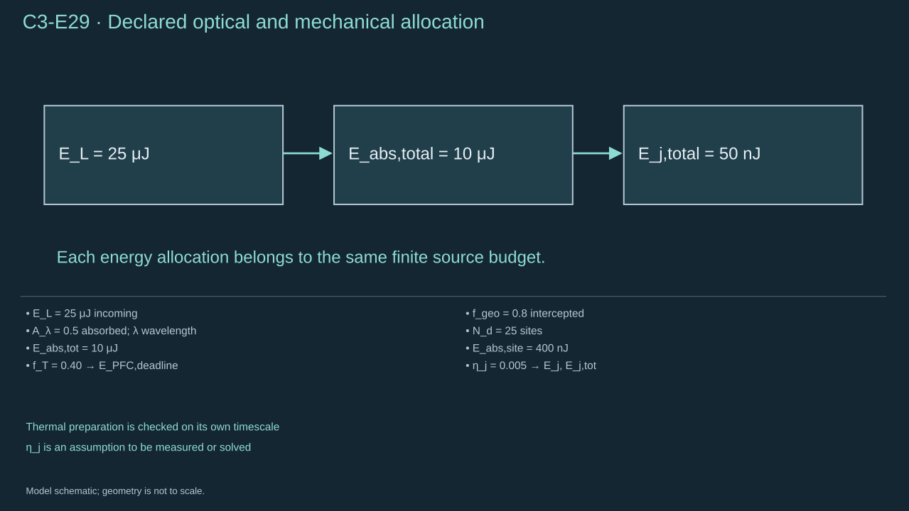

Energy allocations follow the project chain without double counting.

沿项目因果链分配能量，并避免重复计数。

**Symbols before Eq. (C3-E30).**

**式（C3-E30）前的符号定义。**

| First individual definition / 第一项单独定义 | Second individual definition / 第二项单独定义 |
| --- | --- |
| $m_j$ is per-jet carrier mass (kg) $m_j$ 为单射流载液质量（kg） | $\rho=1000$ kg m⁻³ carrier density $\rho=1000$ kg m⁻³ 为载液密度 |
| $d_j=10\times10^{-6}$ m diameter $d_j=10\times10^{-6}$ m 直径及 $L_j=50\times10^{-6}$ m 喷出长度用于第一行 | $L_j=50\times10^{-6}$ — Specified emitted jet length (m) $L_j=50\times10^{-6}$ — 指定喷出射流长度（m） |
| $E_j=2.00\times10^{-9}$ J is per-jet kinetic energy $E_j=2.00\times10^{-9}$ J 为单射流动能 | $U_j$ uniform speed (m s⁻¹) $U_j$ 为均匀速度（m s⁻¹） |
| $q_j=\rho U_j^2/2$ dynamic pressure (Pa) $q_j=\rho U_j^2/2$ 为动压（Pa） | $p_{\mathrm{rigid,early}}$ early rigid-contact pressure (Pa; MPa = 10⁶ Pa) $p_{\mathrm{rigid,early}}$ 为早期刚性接触压力（Pa；MPa = 10⁶ Pa） |
| $c=1480$ m s⁻¹ is stipulated sound speed $c=1480$ m s⁻¹ 为给定声速 | $P_j$ — Signed jet momentum along the transfer direction (N s) $P_j$ — 沿转印方向的带符号射流动量（N s） |
| $P_{\mathrm{tot}}$ — Total aligned incoming jet momentum (N s) $P_{\mathrm{tot}}$ — 总对齐入射射流动量（N s） | $\pi$ dimensionless $\pi$ 无量纲 |

**Conventions and conditions.** Uniform direction, full activation and independent cells are assumed.

**约定与条件。** 假设方向相同、全部激活且单元独立。

(C3-E30) · Worked finite jet mass, speed and pressure scales / 有限射流质量、速度与压力尺度的示例计算

$$
\begin{aligned}m_j&=(1000\,\mathrm{kg\,m^{-3}})\frac{\pi(10\times10^{-6}\,\mathrm m)^2}{4}(50\times10^{-6}\,\mathrm m)\simeq3.926991\times10^{-12}\,\mathrm{kg},\\ U_j&=\sqrt{\frac{2(2.00\times10^{-9}\,\mathrm J)}{3.926991\times10^{-12}\,\mathrm{kg}}}\simeq31.91538\,\mathrm{m\,s^{-1}},\\ q_j&\simeq0.5092958\,\mathrm{MPa},\quad p_{\mathrm{rigid,early}}=\rho cU_j\simeq47.23477\,\mathrm{MPa},\\ P_j&=m_jU_j\simeq1.253314\times10^{-10}\,\mathrm{N\,s},\quad P_{\mathrm{tot}}=25P_j\simeq3.133285\times10^{-9}\,\mathrm{N\,s}.\end{aligned}
$$

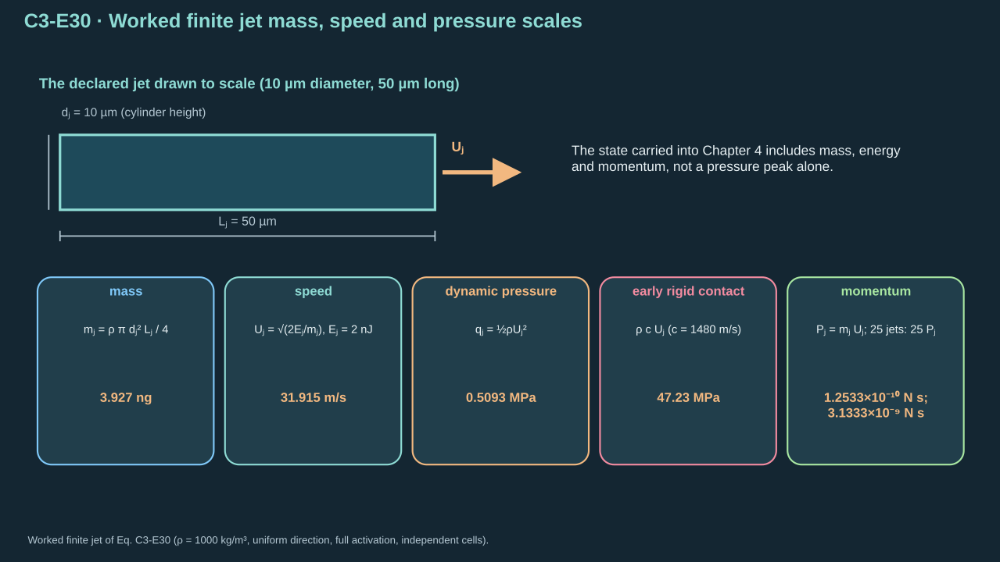

The finite state carried to Chapter 4 includes mass and energy, not only a pressure peak.

传入第四章的有限状态包含质量及能量，而非只有压力峰值。

| Checked quantity 已核验量 | Result 结果 | Interpretation 解释 |
| --- | --- | --- |
| Emitted volume per site 各位点喷出体积 | 3.926991 pL 3.926991 pL | Below the 50-pL carrier inventory 小于 50 pL 载液储量 |
| Total emitted mass 总喷出质量 | 98.17477 ng 98.17477 ng | 25 independent finite jets 25 个独立有限射流 |
| Emission duration estimate 发射时长估计 | 1.566643 μs 1.566643 μs | Length divided by assigned uniform speed 长度除以给定均匀速度 |
| Flight across 100 μm air gap 飞越 100 μm 气隙 | 3.133285 μs 3.133285 μs | No dense-liquid drag assumed 假设无稠密液体阻力 |
| Impulse-equivalent early duration 冲量等效早期时长 | 33.78378 ns 33.78378 ns | Not a predicted rectangular pulse 并非预测矩形脉冲 |
| Side-release scale 侧向释放尺度 | 3.378378 ns 3.378378 ns | Central 1D impact requires still earlier observation 中心一维冲击要求更早观察 |
| Reynolds / Weber / Ohnesorge Reynolds／Weber／Ohnesorge 数 | 319.1538 / 141.4711 / 0.0372678 319.1538 / 141.4711 / 0.0372678 | Diameter-based diagnostics 以直径定义的诊断量 |
| Capillary time / fastest wavelength 毛细时间／最快波长 | 1.317616 μs / 45.07184 μm 1.317616 μs／45.07184 μm | Radius-based infinite-cylinder benchmark 以半径定义的无限圆柱对照 |
| Arrival disturbance from 1% initial amplitude 初始 1% 振幅的到达扰动 | 2.26247% of radius 半径的 2.26247% | Linear control permits coherent arrival 线性对照允许相干到达 |
| 1% to 10% radius linear-threshold time 半径 1% 到 10% 的线性阈值时间 | 8.836529 μs 8.836529 μs | A declared validity screen, not pinch-off time 声明的适用性筛查，并非夹断时间 |
| Formal extrapolation from 1% to full radius 1% 到整个半径的形式外推 | 17.67306 μs 17.67306 μs | Reproduces source estimate outside linear validity 还原原文估计，但超出线性适用范围 |

Properties and efficiencies are stipulated water-like teaching inputs. The 47.2348 MPa value is an early rigid-contact scale. Its spatial validity lasts nanoseconds. Sustaining it over 1.5666 μs requires 46.37 times available axial momentum. Energy stays 2.00 nJ/site and 50.0 nJ total. Chapter 4 tests opening work along the actual force path. High initial pressure can coexist with insufficient fracture work.

物性及效率为给定类水教学输入。47.2348 MPa 是初始刚性接触尺度，其空间适用时间为纳秒级。维持至 1.5666 μs 需要可用轴向动量的 46.37 倍。能量仍为每位点 2.00 nJ、总计 50.0 nJ。第四章检验实际传力路径中的张开功。高初压可与断裂功不足同时出现。

## Three-stage resolver

## 三阶段求解器

Apply the chapter’s balances to a finite-volume solver. The worked lesson covers equations, code, output readers, and checks.

将本章平衡方程用于有限体积求解器。示例课程包括方程、代码、输出读取与核验。

| Stage 阶段 | Recorded outcome 记录结果 |
| --- | --- |
| Stage 1: model and solver 阶段一：模型与求解器 | CLOSED\_LOOSENED: accepted with recorded waivers. CLOSED\_LOOSENED：按记录的豁免接受关闭。 |
| Stage 2: calculation campaign 阶段二：计算任务 | STAGE2\_LOOSENED\_CLOSED: accepted with recorded waivers. STAGE2\_LOOSENED\_CLOSED：按记录的豁免接受关闭。 |
| Stage 3: engineering report 阶段三：工程报告 | Reporting, independent arithmetic, and delivery are complete. 报告、独立算术核验与交付已完成。 |

Maximum: Not established. Missing: 18 attained objectives and certificates.

最大值：尚未建立。缺少：18 项已达到的目标及证书。

* [Three-stage resolver](../learning-records/resolver-progress/index.html)

  [三阶段求解器](../learning-records/resolver-progress/index.html?lang=zh)

## 8. Oral questions

## 8. 口头问题

### How would you calculate a 25-site array under fixed energy?

### 如何在固定能量下计算二十五位点阵列？

Explain the mechanism, assumptions, and limits in your own words.

用自己的话解释机制、假设与限制。

\*\*Reference answer and mastery criteria / 参考答案与掌握标准\*\*

**Symbols before Eq. (C3-E31).**

**式（C3-E31）前的符号定义。**

| First individual definition / 第一项单独定义 | Second individual definition / 第二项单独定义 |
| --- | --- |
| $i$ — Bubble index over the declared activated sources (dimensionless) $i$ — 遍历声明的已激活源的气泡指标（无量纲） | $j$ — Bubble index over the declared activated sources (dimensionless) $j$ — 遍历声明的已激活源的气泡指标（无量纲） |
| $R_i$ — Radius of bubble i (m) $R_i$ — 气泡 i 的半径（m） | $R_j$ — Radius of source bubble j (m) $R_j$ — 源气泡 j 的半径（m） |
| $d_{ij}$ — Bubble-center separation (m) $d_{ij}$ — 气泡中心间距（m） | $p_{b,i}$ — Constant Internal pressure of bubble i (Pa) $p_{b,i}$ — 恒定的气泡 i 的内部压力（Pa） |
| $p_\infty$ — Constant Remote carrier pressure (Pa) $p_\infty$ — 恒定的远场载液压力（Pa） | $\Delta p_c>0$ — Positive constant ideal-collapse pressure difference (Pa) $\Delta p_c>0$ — 正的恒定理想塌缩压差（Pa） |
| $\sigma_b$ tension (N m⁻¹) $\sigma_b$ 为张力（N m⁻¹） | $\mu$ viscosity (Pa s) $\mu$ 为黏度（Pa s） |
| $\rho$ carrier density (kg m⁻³), $\sum$ sums neighbors $\rho$ 为载液密度（kg m⁻³），$\sum$ 对邻泡求和 | $N$ is count (dimensionless) $N$ 为数量（无量纲） |
| $E_{B,\mathrm{tot}}$ fixed total initial pressure work (J) $E_{B,\mathrm{tot}}$ 为固定初始总压力做功（J） | $R_{\max,N}$ per-bubble maximum radius (m) $R_{\max,N}$ 为单泡最大半径（m） |
| $R_*$ isolated reference radius (m) $R_*$ 为孤立参考半径（m） | $\pi$ dimensionless $\pi$ 无量纲 |
| $\dot R_j$ — Wall radial velocity of source bubble j (m s⁻¹) $\dot R_j$ — 源气泡 j 的壁面径向速度（m s⁻¹） | $\ddot R_j$ — Wall radial acceleration of source bubble j (m s⁻²) $\ddot R_j$ — 源气泡 j 的壁面径向加速度（m s⁻²） |
| $\dot R_i$ — Wall radial velocity of bubble i (m s⁻¹) $\dot R_i$ — 气泡 i 的壁面径向速度（m s⁻¹） | $\ddot R_i$ — Wall radial acceleration of bubble i (m s⁻²) $\ddot R_i$ — 气泡 i 的壁面径向加速度（m s⁻²） |

**Conventions and conditions.** $*$ reference label; The coupled row requires far separation; the fixed-work row assumes identical constant-pressure ideal cavities.

**约定与条件。** $*$ 为参考标签；耦合行要求充分分离；固定做功行假设相同恒定压力理想腔体。

(C3-E31) · Reference answer: original interaction and allocation formulas / 参考答案：原始相互作用与分配公式

$$
\begin{aligned}R_i\ddot R_i+\frac32\dot R_i^2&=\frac{p_{b,i}-p_\infty-2\sigma_b/R_i-4\mu\dot R_i/R_i}{\rho}-\sum_{j\ne i}\frac{R_j^2\ddot R_j+2R_j\dot R_j^2}{d_{ij}},\\ E_{B,\mathrm{tot}}&=N\frac{4\pi}{3}\Delta p_cR_{\max,N}^3,\qquad R_{\max,N}=R_*N^{-1/3}.\end{aligned}
$$

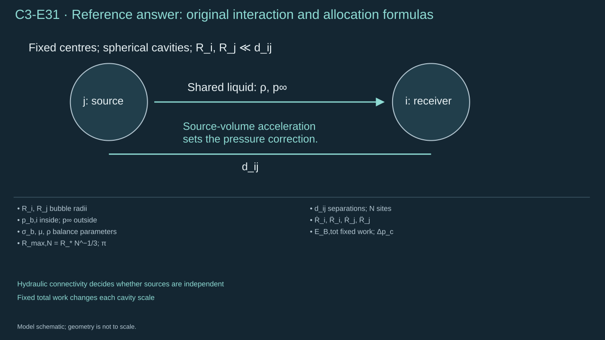

Use connectivity and source allocation before any sum of outputs.

求和输出前先确定液体连通性及源分配。

Check core size, carrier supply, pitch, fluence and activation time separately. Identify hydraulic separation. For separate cells, sum calculated jet energies and aligned momenta. Pressure stays local unless fields overlap at a defined observer. For connected bubbles, solve coupled source histories and liquid inertia. Regular spacing leaves edges and failed activation relevant. Polygon controls delay collapse at fixed radius. Fixed-total-work controls shrink radii as count increases. Count-proportional useful pressure remains unestablished.

分别检查核心尺寸、载液供给、节距、能量面密度及激活时间，并辨认水力分隔。独立单元中，求和已算射流能量及同向动量。压力保持局部量，除非场在指定观测处重叠。共域气泡需求耦合源历程及液体惯性。规则间距仍有边缘与激活失败影响。固定半径多边形对照延迟塌缩，固定总功对照则随数量增加缩小半径。压力与数量成比例尚未确立。

Twenty-five independent sites at probability 0.95 all activate in 27.7% of shots. Measure each site’s activation and arrival delay. Preserve the common energy budget during propagation. Contact, coalescence, distortion and strong waves exceed the monopole model. Its analytic table supplies a conditional control.

二十五个独立位点、概率 0.95 时，全部激活占发射次数的 27.7%。测量各位点激活及到达延迟。传播时保持共同能量预算。接触、合并、变形及强波超出单极模型。解析表提供有条件对照。

#### Review criteria

#### 审阅标准

* Distinguishes optical/statistical uniformity from hydraulic independence, including activation and arrival-time evidence.

  区分光学／统计均匀性与液压独立性，并说明激活及到达时序证据。
* Explains neighbor-pressure coupling and fixed-total-energy allocation without multiplying single-bubble pressure by count.

  解释邻泡压力耦合及固定总能量分配，避免把单泡压力直接乘数量。
* States the separated-spherical and weak-wave limits, and keeps the polygon control separate from the independent-cell example.

  说明分离球形及弱波限制，并把多边形对照与独立单元算例分开。

### Which launch and transport calculations establish useful jet momentum?

### 哪些发射及输运计算能确定有用射流动量？

Explain the mechanism, assumptions, and limits in your own words.

用自己的话解释机制、假设与限制。

\*\*Reference answer and mastery criteria / 参考答案与掌握标准\*\*

**Symbols before Eq. (C3-E32).**

**式（C3-E32）前的符号定义。**

| First individual definition / 第一项单独定义 | Second individual definition / 第二项单独定义 |
| --- | --- |
| $U_{\mathrm{rms}}$ is mass-weighted speed (m s⁻¹) $U_{\mathrm{rms}}$ 为质量加权速度（m s⁻¹） | $U_j$ uniform benchmark speed (m s⁻¹) $U_j$ 为均匀对照速度（m s⁻¹） |
| $m_j>0$ emitted carrier mass (kg) $m_j>0$ 为喷出载液质量（kg） | $E_{\mathrm{avail}}$ — Available mechanical-energy budget (J) $E_{\mathrm{avail}}$ — 可用力学能量预算（J） |
| $E_j$ — Jet kinetic energy (J) $E_j$ — 射流动能（J） | $P_j$ directional momentum (N s) $P_j$ 为方向动量（N s） |
| $a_0$ — Base-cylinder radius (m) $a_0$ — 基态圆柱半径（m） | $H$ — Liquid-jet flight gap (m) $H$ — 液体射流飞行间隙（m） |
| $\delta_0$ — Initial small radius-disturbance amplitude (m) $\delta_0$ — 初始微小半径扰动振幅（m） | $\delta_{\mathrm{arr}}$ — Disturbance amplitude at arrival (m) $\delta_{\mathrm{arr}}$ — 到达时的扰动振幅（m） |
| $g_{\max}$ fastest cylinder growth rate (s⁻¹), $\exp$ exponential of dimensionless argument $g_{\max}$ 为最快圆柱增长率（s⁻¹），$\exp$ 为无量纲自变量的指数 |  |

**Conventions and conditions.** Growth assumes constant inviscid base cylinder and a small perturbation in negligible surrounding gas.

**约定与条件。** 增长假设恒定无黏基态圆柱、微小扰动及周围气体动力学可忽略。

(C3-E32) · Reference answer: original finite-mass and growth formulas / 参考答案：原始有限质量与扰动增长公式

$$
U_{\mathrm{rms}}\le\sqrt{\frac{2E_{\mathrm{avail}}}{m_j}},\qquad P_j^2\le2m_jE_j,\qquad \frac{\delta_{\mathrm{arr}}}{a_0}=\frac{\delta_0}{a_0}\exp(g_{\max}H/U_j).
$$

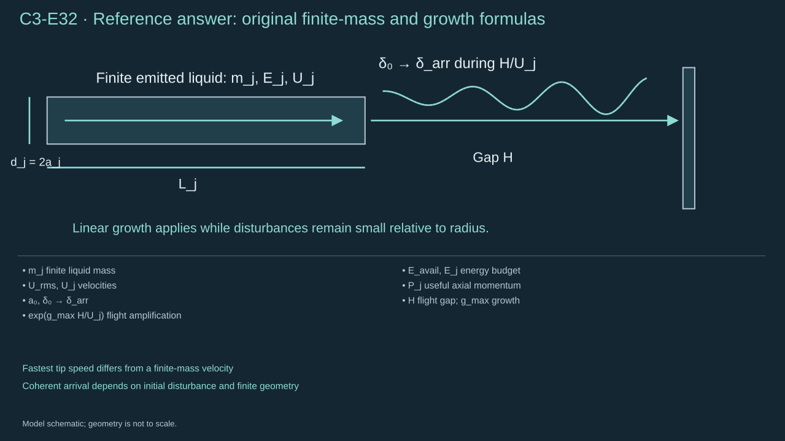

Speed, focusing and survival must refer to the same emitted liquid state.

速度、聚焦及存活须指向同一喷出液体状态。

Jet shape requires interfaces, source pressure, walls, outlets and energy balance. Fixed impulse and fixed energy impose different focusing limits. Quartering mass at fixed impulse quadruples speed and energy demand. At fixed energy it doubles speed and halves momentum. Report tip speed, finite mass, mass-weighted speed, axial momentum and energy separately.

射流形状需要界面、源压力、壁面、出口及能量平衡。固定冲量与固定能量施加不同聚焦限制。固定冲量下质量降至四分之一，速率及能量需求增至四倍。固定能量下速率加倍、动量减半。分别报告前端速率、有限质量、质量加权速率、轴向动量及能量。

Use slender-jet balances after launch. Compare disturbance growth with actual flight duration. In the example, a 1% disturbance grows to 2.26% during 3.133 μs. This supports coherent arrival within the cylinder approximation. The 17.7 μs extrapolation leaves exact breakup unresolved. Finite ends, startup, stretch, viscosity and surrounding liquid can change survival. Measure shape and delivered mass through time.

发射后采用细射流平衡。将扰动增长与实际飞行时长比较。示例中，1% 扰动在 3.133 μs 内增长至 2.26%，支持圆柱近似内的相干到达。17.7 μs 外推仍未确定精确破断。端部、起始形状、拉伸、黏性及外液可改变存续。测量随时间变化的形状和到达质量。

#### Review criteria

#### 审阅标准

* Explains why spatial interface geometry and source/wall conditions are required for a directional emitted jet.

  解释定向喷出射流为什么需要空间界面几何及源／壁面条件。
* Separates fixed impulse, fixed energy and fixed impulse per area; connects finite mass to speed, momentum and focusing cost.

  区分固定冲量、固定能量及固定单位面积冲量，将有限质量联系至速度、动量及聚焦代价。
* Uses flight-time versus disturbance-growth reasoning and acknowledges nonlinear/finite-length breakdown instead of guaranteeing breakup-free arrival.

  用飞行时间与扰动增长推理，并承认非线性／有限长度失效，避免保证无断裂到达。

### A 47 MPa initial impact fails transfer. Explain the budget and observer.

### 47 MPa 初始撞击未实现转印。解释预算及观测条件。

Explain the mechanism, assumptions, and limits in your own words.

用自己的话解释机制、假设与限制。

\*\*Reference answer and mastery criteria / 参考答案与掌握标准\*\*

**Symbols before Eq. (C3-E33).**

**式（C3-E33）前的符号定义。**

| First individual definition / 第一项单独定义 | Second individual definition / 第二项单独定义 |
| --- | --- |
| $p_{\mathrm{early}}$ is early compressive impact scale (Pa) $p_{\mathrm{early}}$ 为早期压缩冲击尺度（Pa） | $p_{\mathrm{obs}}$ signed finite-observer mean (Pa) $p_{\mathrm{obs}}$ 为带符号有限观察均值（Pa） |
| $Z_l$ — Liquid longitudinal wave impedance (Pa s m⁻¹) $Z_l$ — 液体纵向波阻抗（Pa s m⁻¹） | $Z_r>0$ — Receiver longitudinal wave impedance (Pa s m⁻¹) $Z_r>0$ — 接收体纵向波阻抗（Pa s m⁻¹） |
| $\rho$ carrier density (kg m⁻³) $\rho$ 为载液密度（kg m⁻³） | $c$ sound speed (m s⁻¹) $c$ 为声速（m s⁻¹） |
| $U_j$ incident speed (m s⁻¹) $U_j$ 为入射速度（m s⁻¹） | $L_j$ finite jet length (m) $L_j$ 为有限射流长度（m） |
| $\tau_{\mathrm{eq}}$ rigid stopping-impulse equivalent duration (s) $\tau_{\mathrm{eq}}$ 为刚性停止冲量等效时长（s） | $A_o$ observation area (m²) $A_o$ 为观察面积（m²） |
| $dA$ element (m²) $dA$ 为面积微元（m²） | $\tau_o$ averaging duration (s) $\tau_o$ 为平均时长（s） |
| $t$ current time (s) $t$ 为当前时间（s） | $\xi$ — Dummy time in the pressure-observation integral (s) $\xi$ — 压力观察积分中的时间哑变量（s） |
| $p$ — Local liquid pressure (Pa) $p$ — 局部液体压力（Pa） | $p_{\mathrm{ref}}$ — Specified reference pressure (Pa) $p_{\mathrm{ref}}$ — 指定参考压力（Pa） |
| $\boldsymbol x$ — Spatial observation position (m) $\boldsymbol x$ — 空间观察位置（m） |  |

**Conventions and conditions.** $\int$ integrates local pressure $p(\boldsymbol x,\xi)$ over the footprint/window, with position $\boldsymbol x$ (m) implicit; Impact is locally one-dimensional and linear; equivalent duration assumes zero outgoing axial momentum and no added force source.

**约定与条件。** $\int$ 将局部压力 $p(\boldsymbol x,\xi)$ 在载荷区域／窗口积分，位置 $\boldsymbol x$（m）为隐含自变量；冲击局部一维且线性；等效时长假设出射轴向动量为零且无额外力源。

(C3-E33) · Reference answer: original impact and observer formulas / 参考答案：原始冲击与观测量公式

$$
p_{\mathrm{early}}\simeq\frac{Z_lZ_r}{Z_l+Z_r}U_j,\quad Z_l=\rho c,\qquad \tau_{\mathrm{eq}}=\frac{L_j}{c},\qquad p_{\mathrm{obs}}(t)=\frac1{A_o\tau_o}\int_{t-\tau_o}^t\int_{A_o}(p-p_{\mathrm{ref}})\,dA\,d\xi.
$$

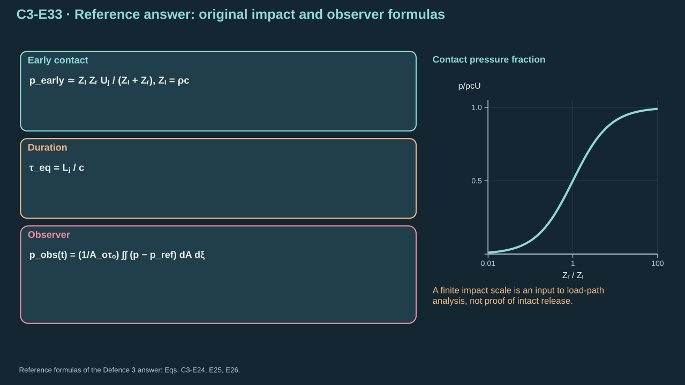

A finite impact scale is an input to load-path analysis, not proof of intact release.

有限冲击尺度是传力路径分析的输入，并非完整释放的证明。

Initial rigid-contact compression gives the 47.2348 MPa scale. Per-jet incoming state is 3.92699 ng, 2 nJ and 1.25331 × 10⁻¹⁰ N s. Equivalent full-area duration is 33.78 ns. Lateral release begins on about 3.38 ns. Resolve actual pressure and receiver response. Specify location, reference, footprint, bandwidth and averaging interval. Check momentum and energy against that same incoming state.

初始刚性接触压缩给出 47.2348 MPa 尺度。每束入射状态为 3.92699 ng、2 nJ 和 1.25331 × 10⁻¹⁰ N s。等效全面积时长为 33.78 ns，侧向卸载约在 3.38 ns 出现。须解析实际压力及受载响应。注明位置、参考、面积、带宽及平均时窗。用同一入射状态检查动量和能量。

Chapter 4 transmits loads through the liquid/film/PVC path. It tests interface strength, fracture work and payload damage. A 50 nJ jet budget may fail release despite high initial pressure. A maximum requires optical damage limits, PFC and carrier supply, geometry, finite mass and observer. Report verified single shots separately from repeatable intact transfer. Universal maximum: Not established.

第四章沿液体／薄膜／PVC 路径传递载荷，检验界面强度、断裂功及载荷损伤。初压高时，50 nJ 射流预算仍可能无法释放。最大值需光学损伤限、PFC 与载液供给、几何、有限质量和观测条件。已验证单发结果与可重复完整转印分别报告。通用最大值尚未确立。

#### Review criteria

#### 审阅标准

* Distinguishes dynamic pressure, early impedance pressure, finite observed pressure and buried-interface opening traction.

  区分动压、早期阻抗压力、有限观察压力及埋藏界面张开牵引。
* Explains finite mass/energy/impulse and duration, retaining the exact 25-cell state for fracture analysis.

  解释有限质量／能量／冲量及持续时间，并保留明确的 25 单元状态用于断裂分析。
* Defines the observer and operating constraints, separates single-shot output from repeatable intact transfer, and identifies unresolved geometry/material evidence.

  定义观察量及运行约束，分开单次输出与可重复完整转印，并指出尚缺的几何／材料证据。