# Chapter 1: Cavity pressure, carrier inertia and directional jets

# 第 1 章：空腔压力、载液惯性与定向射流

## 1.1 Cavity growth, collapse and ejection

## 1.1 空腔增长、塌缩与喷射

This chapter derives how a cavity accelerates the surrounding liquid. It then identifies the boundaries needed to direct a jet. A PFC droplet starts as a finite liquid inventory. A bubble contains vapor, permanent gas, or both. Their radii measure different objects. Remaining PFC mass requires a separate inventory balance.

本章推导空腔如何加速周围液体，并确定射流定向所需的边界。PFC 液滴起初具有有限的液体物质量。气泡含蒸气、非凝结气体或两者。两者半径描述不同对象。剩余 PFC 质量需要单独的物质平衡。

Pressure reduction and thermal vaporization can each create a moving cavity. Here, laser-induced cavitation covers heating, activation, growth, collapse and possible jetting. Identify the activation mechanism for each case. Chapter 2 supplies absorption, heat transfer, nucleation and phase inventory. This chapter takes internal pressure as a prescribed input.

降压与热汽化均可产生运动空腔。这里的激光诱导空化包括加热、激活、增长、塌缩及可能的射流。每个情形都需明确激活机制。第二章给出吸收、传热、成核与相变物质量。本章将内部压力作为给定输入。

| Mechanism 机制 | Moving liquid and boundary 运动液体与边界 | What establishes the classification 判定依据 |
| --- | --- | --- |
| Expansion-driven ejection 膨胀驱动喷射 | The growing cavity displaces carrier toward an outlet or meniscus; the emitted jet is outside the cavity. 增长空腔将载液推向出口或弯月面；喷出射流位于空腔之外。 | Track cavity growth and the outgoing liquid together. 同时追踪空腔增长与向外喷出的液体。 |
| Collapse-driven re-entrant jet 塌缩驱动的再入射流 | An asymmetric liquid interface penetrates the collapsing cavity and can strike its opposite side or a wall. 非对称液体界面穿入塌缩空腔，可撞击另一侧界面或壁面。 | Show penetration into the cavity; do not rename it an external transfer jet. 观测射流穿入空腔；不能直接把它称为外部转印射流。 |
| Sealed-cavity inflation 密闭空腔膨胀 | Pressure deforms an intact membrane or stamp; liquid need not cross a gap. 压力使完整膜或印章变形；液体不必跨越间隙。 | Locate the closed boundary and the transmitted deformation. 确定封闭边界及其传递的变形。 |
| Liquid-bridge stretching 液桥拉伸 | A moving solid pulls a filament; the filament need not originate as a cavitation jet. 运动固体拉出液丝；液丝不一定起源于空化射流。 | Establish which moved first: the liquid tip or the solid. 辨明最先运动的是液体前端还是固体。 |

Mechanism identification requires the cavity boundary and liquid trajectories. Also track the outlet, receiver and event order. A bright cavity and detached payload leave the mechanism unresolved. The cited meniscus and collapse studies use different geometries. Apply their results after matching the boundary conditions. [[R3]](../reference/sources.html#r3) [[R4]](../reference/sources.html#r4)

判断机制需要观测空腔边界和液体轨迹，还需追踪出口、受载表面和事件顺序。明亮空腔与脱离载荷不足以确定机制。所引弯月面与塌缩研究采用不同几何。应用其结果前须匹配边界条件。 [[R3]](../reference/sources.html#r3) [[R4]](../reference/sources.html#r4)

## 1.2 Spherical model and conventions

## 1.2 球形模型与约定

Model one spherical cavity in an infinite incompressible Newtonian carrier. Fix its center. Radius increases outward into the liquid. Positive wall velocity means expansion. Density, viscosity and effective surface tension remain constant. Omit gravity, bulk vorticity, phase-transfer velocity slip and gas viscous stress. Internal pressure is spatially uniform and may vary with time. The model describes one transient without periodic acoustic forcing.

模型为无限不可压缩牛顿载液中的单个球形空腔。中心固定，径向坐标向液体外侧增加。正壁面速度表示膨胀。密度、黏度和有效表面张力保持恒定。忽略重力、体内涡量、相变速度滑移及气相黏性应力。内部压力空间均匀，可随时间变化。模型描述单次瞬态，不施加周期声驱动。

| Symbol 符号 | Physical meaning 物理意义 | SI units SI 单位 | Role and convention 作用与约定 |
| --- | --- | --- | --- |
| $t$ | Elapsed time 经过时间 | s | Independent time coordinate; the initial instant is t = 0. 独立时间坐标；初始时刻取 t = 0。 |
| $r$ | Liquid radial coordinate 液体径向坐标 | m | Distance from the fixed cavity center to an observation point in the carrier; r ≥ R. 从固定空腔中心到载液中观察点的距离；r ≥ R。 |
| $R$ | Instantaneous cavity radius 瞬时空腔半径 | m | Locates the moving liquid–bubble interface; it is not the initial PFC-core radius. 定位运动的液体—气泡界面；并非初始 PFC 核半径。 |
| $\dot R$ | Wall radial velocity 壁面径向速度 | m s⁻¹ | First time derivative of R; positive means expansion and negative means collapse. R 对时间的一阶导数；正值表示膨胀，负值表示塌缩。 |
| $\ddot R$ | Wall radial acceleration 壁面径向加速度 | m s⁻² | Second time derivative of R; its sign describes velocity change, not motion direction alone. R 对时间的二阶导数；其符号描述速度变化，不能单独代表运动方向。 |
| $R_0$ | Prescribed initial cavity radius 给定初始空腔半径 | m | Positive initial value R(0); a state input to the mechanical model. 正的初始值 R(0)；是力学模型的状态输入。 |
| $U_0$ | Initial wall velocity 初始壁面速度 | m s⁻¹ | Prescribed value of the first time derivative of R at the initial instant. 初始时刻给定的 R 的一阶时间导数。 |
| $\rho$ | Carrier mass density 载液质量密度 | kg m⁻³ | Sets surrounding-liquid inertia; it must not be replaced by PFC vapor density. 决定周围液体的惯性；不能替换成 PFC 蒸气密度。 |
| $\mu$ | Carrier dynamic viscosity 载液动力黏度 | Pa s | Newtonian stress coefficient; viscous resistance dissipates energy in either motion direction. 牛顿流体应力系数；黏性阻力在两个运动方向均耗散能量。 |
| $\sigma$ | Effective bubble–carrier surface tension 有效气泡—载液表面张力 | N m⁻¹ | Belongs to the specified interface; contributes the spherical capillary pressure 2σ/R. 属于指定界面；产生球形毛细压力 2σ/R。 |
| $p_b$ | Uniform bubble absolute pressure 均匀气泡绝对压力 | Pa | Pressure on the cavity side of the interface; its history is supplied here. 界面空腔侧压力；本章将其时间历程作为输入。 |
| $p_l$ | Adjacent-liquid absolute pressure 邻近液体绝对压力 | Pa | Liquid-side pressure at the moving interface; stress balance relates it to bubble pressure. 运动界面的液体侧压力；通过应力平衡与泡内压力关联。 |
| $p_\infty$ | Far-field absolute pressure 远场绝对压力 | Pa | Pressure prescribed far from the cavity; pressure differences drive acceleration. 远离空腔处的给定压力；加速度由压力差驱动。 |
| $p$ | Liquid pressure field 液体压力场 | Pa | Pressure at a general liquid observation point, evaluated at the stated position and time. 指定位置与时间的普通液体观察点压力。 |
| $u$ | Scalar radial carrier velocity 标量载液径向速度 | m s⁻¹ | Positive outward from the center; differs from the spatial velocity vector below. 从中心向外取正；与下文空间速度矢量区别使用。 |
| $C(t)$ | Radial volume-flux factor 径向体积流量因子 | m³ s⁻¹ | Continuity makes r²u independent of r; this function is not a material constant. 连续性使 r²u 与 r 无关；该函数并非材料常数。 |
| $\phi$ | Velocity potential 速度势 | m² s⁻¹ | Its spatial derivative gives radial velocity; the reference value is fixed at infinity. 其空间导数给出径向速度；参考值固定在无穷远。 |
| $V_b$ | Cavity volume 空腔体积 | m³ | Geometric volume enclosed by the bubble boundary; pressure work uses its rate of change. 气泡边界围成的几何体积；压力功使用其变化率。 |
| $K_l$ | Carrier kinetic energy 载液动能 | J | Integrates motion throughout the exterior liquid, rather than mass inside the bubble. 对外部液体的运动进行积分，而不是计算气泡内部质量。 |
| $E_\sigma$ | Interfacial energy 界面能 | J | Surface tension multiplied by spherical interface area under the constant-tension assumption. 在张力恒定假设下，等于表面张力乘球形界面面积。 |
| $R_{\max}$ | Radius at the start of ideal collapse 理想塌缩开始时的半径 | m | Maximum cavity radius with zero initial wall velocity in the Rayleigh control. Rayleigh 对照中壁面初始速度为零时的最大空腔半径。 |
| $p_v$ | Stipulated constant vapor pressure 假定恒定蒸气压 | Pa | Ideal-collapse internal-pressure input; real thermal or finite-inventory evolution may change it. 理想塌缩的内部压力输入；实际热过程或有限存量变化可能改变它。 |
| $\Delta p_c$ | Positive ideal-collapse pressure difference 正的理想塌缩压差 | Pa | Defined as far-field pressure minus the stipulated vapor pressure in this control. 在该对照中定义为远场压力减去假定蒸气压。 |
| $t_c$ | Ideal collapse time 理想塌缩时间 | s | Time from the initial maximum radius to the excluded zero-radius limit of the ideal model. 从初始最大半径到理想模型所排除的零半径极限的时间。 |
| $E_B$ | Displaced-volume pressure-work scale 排开体积的压力功尺度 | J | Uses the stated pressure difference and initial cavity volume; not an assigned jet energy. 由所声明压差与初始空腔体积构成；并非预设的射流能量。 |
| $\boldsymbol x$ | Spatial position vector 空间位置矢量 | m | Locates a point in the nonspherical liquid domain. 定位非球形液体域中的一点。 |
| $\boldsymbol u$ | Spatial carrier velocity vector 空间载液速度矢量 | m s⁻¹ | Contains direction and spatial variation needed for a jet; scalar wall speed is insufficient. 包含射流所需的方向与空间变化；标量壁面速度不足以替代它。 |
| $\Pi$ | Pressure impulse per unit area 单位面积压力冲量 | Pa s | Time integral of the specified excess pressure; its gradient changes liquid velocity. 指定超压对时间的积分；其梯度改变液体速度。 |
| $\Gamma$ | Moving liquid–gas interface 运动液—气界面 | — | Geometric surface, not fracture energy; its position evolves with the interface condition. 几何曲面，不是断裂能；其位置按界面条件演化。 |
| $\boldsymbol n$ | Liquid-to-gas unit normal 液体指向气体的单位法向 | 1 | Fixes traction and signed-curvature conventions; reversing it changes those signs. 确定牵引与带符号曲率约定；反转法向会改变相关符号。 |
| $\kappa$ | Signed sum of principal curvatures 带符号的两主曲率之和 | m⁻¹ | For the stated liquid-to-gas normal on a spherical cavity, κ = −2/R. 对于所声明的球形空腔液体指向气体法向，κ = −2/R。 |

Superscripts denote powers unless stated otherwise. Bold symbols denote vectors or tensors. π is the dimensionless circle constant. Gradient, divergence and Laplacian use Cartesian definitions. Partial time derivatives hold position fixed. Each display defines its symbols locally. The positive initial radius permits division by radius. Zero radius is an excluded limit.

除非另行说明，上标表示幂，粗体表示矢量或张量。π 是无量纲圆周率。梯度、散度与拉普拉斯算子采用笛卡尔定义。时间偏导保持位置固定。每个公式前给出局部符号定义。初始半径为正，允许除以半径。零半径属于模型排除的极限。

**Symbols before Eq. (C1-E01).**

**式（C1-E01）前的符号定义。**

| First individual definition / 第一项单独定义 | Second individual definition / 第二项单独定义 |
| --- | --- |
| $R$ is the cavity radius (m) $R$ 为空腔半径（m） | $t$ is time (s), with 0 the chosen initial instant $t$ 为时间（s），0 为选定的初始时刻 |
| $R_0$ is its prescribed positive initial value (m) $R_0$ 为给定的正初始半径（m） | $\dot R$ is wall speed (m s⁻¹) $\dot R$ 为壁面速度（m s⁻¹） |
| $U_0$ its initial value (m s⁻¹) $U_0$ 为其初值（m s⁻¹） | $r$ is radial position (m) $r$ 为径向位置（m） |
| $u$ is radial liquid speed (m s⁻¹) $u$ 为液体径向速度（m s⁻¹） | $p$ is liquid pressure (Pa) $p$ 为液体压力（Pa） |
| $p_\infty$ is prescribed far-field pressure (Pa) $p_\infty$ 为给定远场压力（Pa） |  |

**Conventions and conditions.** The arrow denotes the far-field limit.

**约定与条件。** 箭头表示远场极限。

(C1-E01) · Prescribed initial and boundary conditions / 给定的初始条件与边界条件

$$
R(0)=R_0>0,\qquad \dot R(0)=U_0,\qquad u(r,t)\to0,\quad p(r,t)\to p_\infty(t)\quad(r\to\infty)
$$

The evolving spherical boundary and the prescribed far-field state.

运动球形边界与给定的远场状态。

## 1.3 Rayleigh–Plesset derivation

## 1.3 Rayleigh–Plesset 方程推导

**Step 1 — Conserve carrier volume.** Radial incompressibility makes volume flux independent of radius. Integrate its radial derivative. Apply equal normal liquid and interface velocities at the wall. Vapor density does not enter this carrier-flow calculation.

**步骤 1——载液体积守恒。** 径向不可压缩流的体积流量与半径无关。积分径向导数，再令壁面处液体法向速度等于界面速度。这一载液流动计算不需要蒸气密度。

**Symbols before Eq. (C1-E02).**

**式（C1-E02）前的符号定义。**

| First individual definition / 第一项单独定义 | Second individual definition / 第二项单独定义 |
| --- | --- |
| $r\ge R(t)>0$ is radial position (m) $r\ge R(t)>0$ 为径向位置（m） | $R$ is cavity radius (m) $R$ 为空腔半径（m） |
| $t$ is time (s) $t$ 为时间（s） | $u$ is radial carrier velocity (m s⁻¹) $u$ 为载液径向速度（m s⁻¹） |
| $\dot R$ is wall speed (m s⁻¹) $\dot R$ 为壁面速度（m s⁻¹） | $C(t)$ is the radius-independent flux factor (m³ s⁻¹), not a material constant $C(t)$ 为与径向位置无关的流量因子（m³ s⁻¹），并非材料常数 |

**Conventions and conditions.** $\partial/\partial r$ differentiates at fixed time; The implication arrows indicate integration and use of the interface condition.

**约定与条件。** $\partial/\partial r$ 表示固定时间下的径向求导；箭头表示积分及应用界面条件。

(C1-E02) · Exact continuity within the spherical model / 球形模型内的精确连续性关系

$$
\frac{1}{r^2}\frac{\partial(r^2u)}{\partial r}=0\ \Longrightarrow\ r^2u=C(t),\qquad u(R,t)=\dot R\ \Longrightarrow\ C(t)=R^2\dot R,\qquad u(r,t)=\frac{R^2\dot R}{r^2}
$$

Inverse-square velocity decay places the inertia in the surrounding carrier.

速度按距离平方反比衰减，惯性来自周围载液。

**Step 2 — Fix the potential reference.** Integrate velocity from infinity to the observation point. The potential applies outside the cavity. Zero potential at infinity fixes the time-dependent integration constant.

**步骤 2——固定速度势参考值。** 从无穷远积分速度至观察点。速度势适用于空腔外域。令无穷远速度势为零，确定随时间变化的积分常数。

**Symbols before Eq. (C1-E03).**

**式（C1-E03）前的符号定义。**

| First individual definition / 第一项单独定义 | Second individual definition / 第二项单独定义 |
| --- | --- |
| $\phi$ is velocity potential (m² s⁻¹) $\phi$ 为速度势（m² s⁻¹） | $r$ is liquid radial position (m) $r$ 为液体径向位置（m） |
| $R$ cavity radius (m) $R$ 为空腔半径（m） | $t$ is time (s) $t$ 为时间（s） |
| $s$ is a dummy radial integration coordinate (m) $s$ 为径向积分哑变量（m） | $u$ is radial velocity (m s⁻¹) $u$ 为径向速度（m s⁻¹） |
| $\dot R$ is wall speed (m s⁻¹) $\dot R$ 为壁面速度（m s⁻¹） |  |

**Conventions and conditions.** the integral is an improper integral convergent for $r\ge R>0$; $\partial/\partial r$ is the fixed-time spatial derivative.

**约定与条件。** 该广义积分在 $r\ge R>0$ 时收敛；$\partial/\partial r$ 为固定时间的空间导数。

(C1-E03) · Derived velocity potential / 推导得到的速度势

$$
\phi(r,t)=\int_\infty^r u(s,t)\,ds=R^2\dot R\int_\infty^r s^{-2}\,ds=-\frac{R^2\dot R}{r},\qquad \frac{\partial\phi}{\partial r}=u
$$

The potential reference is fixed at infinity before differentiation.

在求导之前，先固定无穷远处的速度势参考值。

**Step 3 — Differentiate at fixed position.** Hold the denominator fixed while differentiating the potential numerator. Then evaluate the result at the moving wall. Differentiating the wall value instead includes a convective contribution.

**步骤 3——在固定位置求导。** 保持速度势分母不变，对分子求时间导数。随后在运动壁面处取值。直接对壁面取值求导会包含对流贡献。

**Symbols before Eq. (C1-E04).**

**式（C1-E04）前的符号定义。**

| First individual definition / 第一项单独定义 | Second individual definition / 第二项单独定义 |
| --- | --- |
| $\phi$ is velocity potential (m² s⁻¹) $\phi$ 为速度势（m² s⁻¹） | $t$ is time (s) $t$ 为时间（s） |
| $r$ is fixed radial position (m) $r$ 为固定径向位置（m） | $R(t)>0$ is moving cavity radius (m) $R(t)>0$ 为运动空腔半径（m） |
| $\dot R$ — Wall radial velocity (m s⁻¹) $\dot R$ — 壁面径向速度（m s⁻¹） | $\ddot R$ — Wall radial acceleration (m s⁻²) $\ddot R$ — 壁面径向加速度（m s⁻²） |

**Conventions and conditions.** vertical bars specify where the derivative is taken or evaluated; $d/dt$ follows the moving wall value; Each derivative has units m² s⁻².

**约定与条件。** 竖线表示求导或取值条件；$d/dt$ 跟随运动壁面的取值；各导数的单位均为 m² s⁻²。

(C1-E04) · Exact Eulerian and moving-point derivatives / 精确的欧拉导数与运动点导数

$$
\left.\frac{\partial\phi}{\partial t}\right|_r=-\frac{2R\dot R^2+R^2\ddot R}{r},\qquad \left.\frac{\partial\phi}{\partial t}\right|_{r=R}=-(2\dot R^2+R\ddot R),\qquad \frac{d\phi(R(t),t)}{dt}=-\dot R^2-R\ddot R
$$

A fixed liquid observation point and a moving interface point have different time derivatives.

固定液体观察点与运动界面点对应不同的时间导数。

**Step 4 — Integrate radial momentum.** The exterior field is irrotational with zero vector Laplacian. Bulk viscous force therefore vanishes. Viscous wall stress and dissipation remain. Reference unsteady Bernoulli to infinity. Insert the fixed-position derivative and wall velocity. Subtracting one half from two gives the inertial coefficient.

**步骤 4——积分径向动量。** 外域流场无旋，矢量拉普拉斯为零，因而体内黏性力为零。壁面黏性应力和耗散仍存在。以无穷远为参考应用非定常伯努利方程。代入固定位置导数与壁面速度。二减去二分之一得到惯性项系数。

**Symbols before Eq. (C1-E05).**

**式（C1-E05）前的符号定义。**

| First individual definition / 第一项单独定义 | Second individual definition / 第二项单独定义 |
| --- | --- |
| $p_l$ is liquid pressure at the wall (Pa) $p_l$ 为壁面液体压力（Pa） | $p_\infty$ far-field pressure (Pa) $p_\infty$ 为远场压力（Pa） |
| $\rho>0$ is carrier density (kg m⁻³) $\rho>0$ 为载液密度（kg m⁻³） | $\phi$ is velocity potential (m² s⁻¹) $\phi$ 为速度势（m² s⁻¹） |
| $t$ is time (s) $t$ 为时间（s） | $r$ is radial position (m) $r$ 为径向位置（m） |
| $R>0$ cavity radius (m) $R>0$ 为空腔半径（m） | $u$ is radial velocity (m s⁻¹) $u$ 为径向速度（m s⁻¹） |
| $\dot R$ wall speed (m s⁻¹) $\dot R$ 为壁面速度（m s⁻¹） | $\ddot R$ is wall acceleration (m s⁻²) $\ddot R$ 为壁面加速度（m s⁻²） |

**Conventions and conditions.** $\partial_t$ is taken at fixed position before wall evaluation.

**约定与条件。** $\partial_t$ 必须先在固定位置求导，再于壁面取值。

(C1-E05) · Derived inertial pressure / 推导得到的惯性压力

$$
\frac{p_l-p_\infty}{\rho}=-\left.\frac{\partial\phi}{\partial t}\right|_{r=R}-\frac{u(R,t)^2}{2}=2\dot R^2+R\ddot R-\frac{\dot R^2}{2}=R\ddot R+\frac32\dot R^2
$$

Liquid inertia relates the interface pressure to wall acceleration and squared speed.

液体惯性把界面压力与壁面加速度及速度平方联系起来。

**Step 5 — Balance normal stress.** Expansion gives a negative radial strain rate at the wall. The capillary jump lowers liquid pressure relative to cavity pressure. Balance normal traction with Newtonian viscous stress included.

**步骤 5——平衡法向应力。** 膨胀时壁面径向应变率为负。毛细压差使液体侧压力低于腔内压力。将牛顿黏性应力计入法向牵引平衡。

**Symbols before Eq. (C1-E06).**

**式（C1-E06）前的符号定义。**

| First individual definition / 第一项单独定义 | Second individual definition / 第二项单独定义 |
| --- | --- |
| $u$ — Radial liquid velocity (m s⁻¹) $u$ — 液体径向速度（m s⁻¹） | $\dot R$ — Bubble-wall radial velocity (m s⁻¹) $\dot R$ — 气泡壁面径向速度（m s⁻¹） |
| $r$ — Radial liquid position (m) $r$ — 液体径向位置（m） | $R>0$ — Positive cavity radius (m) $R>0$ — 正的空腔半径（m） |
| $p_l$ — Liquid-side pressure at the cavity wall (Pa) $p_l$ — 空腔壁面处的液体侧压力（Pa） | $p_b$ — Spatially uniform bubble pressure (Pa) $p_b$ — 空间均匀的气泡压力（Pa） |
| $\sigma\ge0$ — Nonnegative surface tension (N m⁻¹) $\sigma\ge0$ — 非负表面张力（N m⁻¹） | $\mu\ge0$ — Nonnegative carrier dynamic viscosity (Pa s) $\mu\ge0$ — 非负载液动力黏度（Pa s） |
| $\partial_r u$ — Radial strain rate, evaluated at the wall (s⁻¹) $\partial_r u$ — 在壁面取值的径向应变率（s⁻¹） |  |

**Conventions and conditions.** wall evaluation is performed at $r=R$.

**约定与条件。** 壁面取值在 $r=R$ 处进行。

(C1-E06) · Newtonian stress and capillary boundary condition / 牛顿流体应力与毛细边界条件

$$
\left.\frac{\partial u}{\partial r}\right|_{r=R}=\left.-\frac{2R^2\dot R}{r^3}\right|_{r=R}=-\frac{2\dot R}{R},\qquad p_l=p_b-\frac{2\sigma}{R}+2\mu\left.\frac{\partial u}{\partial r}\right|_{r=R}=p_b-\frac{2\sigma}{R}-\frac{4\mu\dot R}{R}
$$

Capillary and viscous stresses act at the interface even when the radial bulk viscous force is zero.

即使径向体内黏性力为零，毛细与黏性应力仍作用于界面。

**Step 6 — Combine inertia and traction.** Insert Eq. (C1-E06) into Eq. (C1-E05). Multiply by carrier density to obtain radial momentum balance. Internal pressure still requires a source model. Use aqueous carrier density for the exterior inertia. PFC density describes a different material domain.

**步骤 6——合并惯性与牵引。** 将式（C1-E06）代入式（C1-E05），再乘以载液密度，得到径向动量平衡。内部压力仍需源模型。外域惯性采用水相载液密度。PFC 密度对应另一材料区域。

**Symbols before Eq. (C1-E07).**

**式（C1-E07）前的符号定义。**

| First individual definition / 第一项单独定义 | Second individual definition / 第二项单独定义 |
| --- | --- |
| $\rho>0$ is carrier density (kg m⁻³) $\rho>0$ 为载液密度（kg m⁻³） | $R>0$ is cavity radius (m) $R>0$ 为空腔半径（m） |
| $\dot R$ — Wall radial velocity (m s⁻¹) $\dot R$ — 壁面径向速度（m s⁻¹） | $\ddot R$ — Wall radial acceleration (m s⁻²) $\ddot R$ — 壁面径向加速度（m s⁻²） |
| $p_b$ — Uniform bubble absolute pressure (Pa) $p_b$ — 均匀气泡绝对压力（Pa） | $p_\infty$ — Far-field absolute pressure (Pa) $p_\infty$ — 远场绝对压力（Pa） |
| $\sigma$ is constant surface tension (N m⁻¹) $\sigma$ 为常数表面张力（N m⁻¹） | $\mu$ is constant carrier viscosity (Pa s) $\mu$ 为常数载液黏度（Pa s） |

**Conventions and conditions.** Every term is a pressure.

**约定与条件。** 各项均具有压力单位。

(C1-E07) · Rayleigh–Plesset under the declared assumptions / 所述假设下的 Rayleigh–Plesset 方程

$$
\rho\left(R\ddot R+\frac32\dot R^2\right)=p_b-p_\infty-\frac{2\sigma}{R}-\frac{4\mu\dot R}{R}
$$

The spherical pressure–inertia balance has a scalar radial state.

球形压力—惯性平衡只具有标量径向状态。

Every term has pressure units: density × length × acceleration, tension/radius, and viscosity × speed/radius. At rest, internal overpressure equals the capillary jump. During collapse, the viscous term resists inward motion. To obtain acceleration, also subtract the squared-speed term. This matches the classical spherical model. [[R1]](../reference/sources.html#r1) [[Brennen, Ch. 2]](https://media.library.caltech.edu/CaltechBOOK%3A1995.001/chap2.htm)

各项均为压力：密度 × 长度 × 加速度、张力／半径，以及黏度 × 速度／半径。静止时，内部过压等于毛细压差。塌缩时，黏性项阻碍向内运动。求加速度时还须减去速度平方项。结果与经典球形模型一致。 [[R1]](../reference/sources.html#r1) [[Brennen，第 2 章]](https://media.library.caltech.edu/CaltechBOOK%3A1995.001/chap2.htm)

**Symbols before Eq. (C1-E08).**

**式（C1-E08）前的符号定义。**

| First individual definition / 第一项单独定义 | Second individual definition / 第二项单独定义 |
| --- | --- |
| $p_b$ is uniform total bubble pressure (Pa) $p_b$ 为空间均匀的气泡总压力（Pa） | $p_{v,\mathrm{PFC}}$ is the PFC-vapor partial pressure (Pa) $p_{v,\mathrm{PFC}}$ 为 PFC 蒸气分压（Pa） |
| $p_{v,w}$ water-vapor partial pressure (Pa) $p_{v,w}$ 为水蒸气分压（Pa） | $p_g$ permanent-gas partial pressure (all Pa) $p_g$ 为非凝结气体分压（均为 Pa） |

**Conventions and conditions.** Subscript $v$ labels vapor, PFC its chemical family; Additivity assumes a gas-mixture pressure description with the stated partial pressures; $w$ water; $g$ noncondensable gas.

**约定与条件。** 下标 $v$ 表示蒸气，PFC 表示该化学物质族；相加关系采用具有上述分压定义的气体混合物压力描述；$w$ 表示水；$g$ 表示非凝结气体。

(C1-E08) · Pressure composition requiring thermodynamic closure / 需要热力学闭合的压力组成关系

$$
p_b=p_{v,\mathrm{PFC}}+p_{v,w}+p_g
$$

The mechanical input comes from the evolving contents, not from radius alone.

力学输入来自不断变化的气泡内容物，不能仅由半径决定。

A fixed-mass polytropic gas control requires its stated thermal assumptions. Evaporation and condensation exchange mass and latent heat. A permanent-gas closure omits those exchanges. Uniform internal pressure requires communication faster than state evolution. Chapter 2 supplies a finite-inventory closure. [[R5]](../reference/sources.html#r5)

固定质量多方气体对照要求满足其热学假设。蒸发和凝结交换质量与潜热，非凝结气体闭合省略了这些交换。均匀内压要求内部通信快于状态演化。第二章给出有限物质量闭合。 [[R5]](../reference/sources.html#r5)

## 1.4 Carrier energy balance

## 1.4 载液能量平衡

**Step 7 — Integrate exterior kinetic energy.** Square the velocity in Eq. (C1-E02). Multiply by the spherical volume element and integrate. The inverse-square integral converges over the infinite exterior. Carrier liquid beyond the wall supplies the moving inertia.

**步骤 7——积分外域动能。** 将式（C1-E02）的速度平方，乘以球形体积微元并积分。平方反比积分在无限外域收敛。壁面之外的载液构成运动惯性。

**Symbols before Eq. (C1-E09).**

**式（C1-E09）前的符号定义。**

| First individual definition / 第一项单独定义 | Second individual definition / 第二项单独定义 |
| --- | --- |
| $K_l$ is exterior liquid kinetic energy (J) $K_l$ 为外部液体动能（J） | $\rho$ is carrier density (kg m⁻³) $\rho$ 为载液密度（kg m⁻³） |
| $u$ is radial liquid speed (m s⁻¹) $u$ 为径向液体速度（m s⁻¹） | $\dot R$ wall speed (m s⁻¹) $\dot R$ 为壁面速度（m s⁻¹） |
| $t$ is time (s) $t$ 为时间（s） | $R>0$ is cavity radius (m) $R>0$ 为空腔半径（m） |
| $r$ the integration radius (m) $r$ 为积分半径（m） | $\pi$ is the circle constant (dimensionless) $\pi$ 为圆周率（无量纲） |

**Conventions and conditions.** $4\pi r^2dr$ is the spherical volume element (m³); endpoint brackets mean upper minus lower evaluation.

**约定与条件。** $4\pi r^2dr$ 为球形体积元（m³）；端点方括号表示上限取值减下限取值。

(C1-E09) · Exact kinetic-energy integral in the spherical model / 球形模型内的精确动能积分

$$
\begin{aligned}K_l&=\int_R^\infty\frac12\rho u(r,t)^2\,4\pi r^2\,dr\\&=2\pi\rho R^4\dot R^2\int_R^\infty r^{-2}\,dr\\&=2\pi\rho R^4\dot R^2\left[-\frac1r\right]_R^\infty=2\pi\rho R^3\dot R^2.\end{aligned}
$$

Exterior shells contribute finite kinetic energy even in an infinite domain.

即使外域无限，外部液壳贡献的总动能仍有限。

**Step 8 — Differentiate stored energy.** Apply the product rule to radius and squared speed. Differentiate cavity volume and interface energy separately. The surface-energy derivative assumes constant surface tension.

**步骤 8——对储存能量求导。** 对半径与速度平方应用乘积法则。分别对空腔体积和界面能求导。表面能导数假设表面张力恒定。

**Symbols before Eq. (C1-E10).**

**式（C1-E10）前的符号定义。**

| First individual definition / 第一项单独定义 | Second individual definition / 第二项单独定义 |
| --- | --- |
| $K_l$ — Carrier kinetic energy (J) $K_l$ — 载液动能（J） | $E_\sigma$ — Interfacial energy (J) $E_\sigma$ — 界面能（J） |
| $t$ is time (s) $t$ 为时间（s） | $\rho$ is carrier density (kg m⁻³) $\rho$ 为载液密度（kg m⁻³） |
| $R$ is radius (m) $R$ 为半径（m） | $\dot R$ — Wall radial velocity (m s⁻¹) $\dot R$ — 壁面径向速度（m s⁻¹） |
| $\ddot R$ — Wall radial acceleration (m s⁻²) $\ddot R$ — 壁面径向加速度（m s⁻²） | $V_b$ is cavity volume (m³) $V_b$ 为空腔体积（m³） |
| $\dot V_b$ its time derivative (m³ s⁻¹) $\dot V_b$ 为其时间导数（m³ s⁻¹） | $\sigma$ is constant surface tension (N m⁻¹) $\sigma$ 为常数表面张力（N m⁻¹） |
| $\pi$ is the circle constant (dimensionless) $\pi$ 为圆周率（无量纲） |  |

**Conventions and conditions.** Energy derivatives are powers (W).

**约定与条件。** 能量的时间导数为功率（W）。

(C1-E10) · Exact product-rule derivatives / 乘积求导法则的精确应用

$$
\begin{aligned}\frac{dK_l}{dt}&=2\pi\rho\left(3R^2\dot R^3+2R^3\dot R\ddot R\right)=4\pi R^2\dot R\,\rho\left(R\ddot R+\frac32\dot R^2\right),\\V_b&=\frac{4\pi R^3}{3},\qquad \dot V_b=4\pi R^2\dot R,\\E_\sigma&=4\pi\sigma R^2,\qquad \frac{dE_\sigma}{dt}=8\pi\sigma R\dot R.\end{aligned}
$$

Volume work couples kinetic storage, interface storage and dissipation.

体积功耦合动能储存、界面能储存与耗散。

**Step 9 — Convert momentum balance into power balance.** Multiply by cavity volume rate. The inertial term becomes Eq. (C1-E10), first row. The capillary term equals minus the surface-energy derivative. Squared speed makes viscous power nonpositive in both motion directions.

**步骤 9——将动量平衡转为功率平衡。** 乘以空腔体积变化率。惯性项成为式（C1-E10）第一行。毛细项等于表面能导数的负值。速度平方使两种运动方向的黏性功率均不为正。

**Symbols before Eq. (C1-E11).**

**式（C1-E11）前的符号定义。**

| First individual definition / 第一项单独定义 | Second individual definition / 第二项单独定义 |
| --- | --- |
| $t$ is time (s) $t$ 为时间（s） | $K_l$ — Carrier kinetic energy (J) $K_l$ — 载液动能（J） |
| $E_\sigma$ — Interfacial energy (J) $E_\sigma$ — 界面能（J） | $p_b$ — Uniform bubble absolute pressure (Pa) $p_b$ — 均匀气泡绝对压力（Pa） |
| $p_\infty$ — Far-field absolute pressure (Pa) $p_\infty$ — 远场绝对压力（Pa） | $\dot V_b$ is cavity volume rate (m³ s⁻¹) $\dot V_b$ 为空腔体积变化率（m³ s⁻¹） |
| $\mu\ge0$ is carrier viscosity (Pa s) $\mu\ge0$ 为载液黏度（Pa s） | $R>0$ is cavity radius (m) $R>0$ 为空腔半径（m） |
| $\dot R$ is wall speed (m s⁻¹) $\dot R$ 为壁面速度（m s⁻¹） | $\pi$ is the circle constant (dimensionless) $\pi$ 为圆周率（无量纲） |

**Conventions and conditions.** The nonnegative term is dissipated power (W).

**约定与条件。** 非负项是耗散功率（W）。

(C1-E11) · Derived mechanical-energy balance / 推导得到的机械能平衡

$$
\frac{d}{dt}(K_l+E_\sigma)=(p_b-p_\infty)\dot V_b-16\pi\mu R\dot R^2,\qquad 16\pi\mu R\dot R^2\ge0
$$

The pressure source supplies mechanical work; focusing cannot create extra energy.

压力源提供机械功；聚焦不能产生额外能量。

Check dissipation directly from the strain rates. Their coefficients are −2, 1 and 1. Their squared sum is six times the flux-factor square. Integrating Newtonian dissipation recovers Eq. (C1-E11). This checks the sign and coefficient by a separate calculation.

直接用应变率检验耗散。三个系数为 −2、1 和 1，其平方和为流量因子平方的六倍。积分牛顿耗散可恢复式（C1-E11）。这一独立计算检验了符号与系数。

**Symbols before Eq. (C1-E12).**

**式（C1-E12）前的符号定义。**

| First individual definition / 第一项单独定义 | Second individual definition / 第二项单独定义 |
| --- | --- |
| $D_{rr}$ — Radial strain-rate component (s⁻¹) $D_{rr}$ — 径向应变率分量（s⁻¹） | $D_{\theta\theta}$ — Polar tangential strain-rate component (s⁻¹) $D_{\theta\theta}$ — 极角切向应变率分量（s⁻¹） |
| $D_{\psi\psi}$ — Azimuthal tangential strain-rate component (s⁻¹) $D_{\psi\psi}$ — 方位角切向应变率分量（s⁻¹） | $\mathcal D_\mu$ is total viscous dissipation rate (W) $\mathcal D_\mu$ 为总黏性耗散率（W） |
| $\mu$ is viscosity (Pa s) $\mu$ 为黏度（Pa s） | $R>0$ is radius (m) $R>0$ 为半径（m） |
| $r$ radial integration position (m) $r$ 为径向积分位置（m） | $\dot R$ is wall speed (m s⁻¹) $\dot R$ 为壁面速度（m s⁻¹） |
| $\pi$ is the circle constant (dimensionless) $\pi$ 为圆周率（无量纲） | $\theta$ — Polar direction label in the strain-rate components (—) $\theta$ — 应变率分量中的极角方向标记（—） |
| $\psi$ — Azimuthal direction label, distinct from velocity potential (—) $\psi$ — 与速度势区别使用的方位角方向标记（—） | $\phi$ — Velocity potential (m² s⁻¹) $\phi$ — 速度势（m² s⁻¹） |

**Conventions and conditions.** The integral is over the liquid exterior; angular labels do not reuse the potential symbol $\phi$.

**约定与条件。** 积分区域为液体外域；角向标记不复用速度势符号 $\phi$。

(C1-E12) · Independent dissipation and conservation check / 独立的耗散与守恒检验

$$
\begin{aligned}D_{rr}&=-\frac{2R^2\dot R}{r^3},\qquad D_{\theta\theta}=D_{\psi\psi}=\frac{R^2\dot R}{r^3},\\\mathcal D_\mu&=\int_R^\infty 2\mu\left(D_{rr}^2+D_{\theta\theta}^2+D_{\psi\psi}^2\right)4\pi r^2\,dr\\&=48\pi\mu R^4\dot R^2\int_R^\infty r^{-4}\,dr=16\pi\mu R\dot R^2.\end{aligned}
$$

Direct strain-rate integration verifies the mechanical-energy loss.

直接积分应变率检验机械能损失。

Confinement can redirect liquid and change its energy budget. It may store elastic energy or increase dissipation. Predicting carrier motion requires the thermodynamic source and mechanical receiver. Incident pulse energy alone leaves that budget unresolved.

约束可改变液体方向及能量分配，也可能储存弹性能或增加耗散。预测载液运动需同时计算热力学源与力学受载体系。仅知入射脉冲能量，能量分配仍未确定。

## 1.5 Ideal collapse time and coefficient

## 1.5 理想塌缩时间与系数

**Step 10 — Specify the ideal collapse problem.** Start at maximum radius with zero wall speed. Far-field and vapor pressures are constant with positive collapse difference. Omit tension, viscosity, permanent gas and liquid compressibility. Thermal and phase dynamics are excluded assumptions. Their smallness for PFC remains unestablished. A hot vapor-rich cavity can still expand.

**步骤 10——规定理想塌缩问题。** 从最大半径及零壁面速度开始。远场压力与蒸气压恒定，塌缩压差为正。忽略张力、黏性、非凝结气体及液体可压缩性。热学与相变动力学被模型排除。它们对 PFC 是否足够小尚未确立。高温蒸气丰富的空腔仍可膨胀。

**Symbols before Eq. (C1-E13).**

**式（C1-E13）前的符号定义。**

| First individual definition / 第一项单独定义 | Second individual definition / 第二项单独定义 |
| --- | --- |
| $\Delta p_c>0$ is constant collapse-driving pressure (Pa) $\Delta p_c>0$ 为常数塌缩驱动压差（Pa） | $p_\infty$ — Constant Far-field absolute pressure (Pa) $p_\infty$ — 恒定的远场绝对压力（Pa） |
| $p_v$ — Stipulated constant vapor pressure (Pa) $p_v$ — 假定恒定蒸气压（Pa） | $t=0$ is maximum-radius time (s) $t=0$ 为最大半径时刻（s） |
| $R>0$ — Instantaneous cavity radius (m) $R>0$ — 瞬时空腔半径（m） | $R_{\max}>0$ — Radius at the start of ideal collapse (m) $R_{\max}>0$ — 理想塌缩开始时的半径（m） |
| $\dot R$ — Wall radial velocity (m s⁻¹) $\dot R$ — 壁面径向速度（m s⁻¹） | $\ddot R$ — Wall radial acceleration (m s⁻²) $\ddot R$ — 壁面径向加速度（m s⁻²） |
| $\rho>0$ is carrier density (kg m⁻³) $\rho>0$ 为载液密度（kg m⁻³） |  |(C1-E13) · Idealized collapse initial-value problem / 理想化塌缩的初值问题

$$
\Delta p_c=p_\infty-p_v>0,\qquad R(0)=R_{\max},\quad \dot R(0)=0,\qquad R\ddot R+\frac32\dot R^2=-\frac{\Delta p_c}{\rho}
$$

The ideal control begins at rest and excludes the mechanisms that arrest real collapse.

理想对照从静止开始，并排除了阻止实际塌缩的机制。

**Step 11 — Use radius on the collapse branch.** Negative initial acceleration starts decreasing radius. Define squared speed as a radius function. Away from the turning point, apply the chain rule. Cancel the nonzero speed there. Extend the relation continuously to the initial endpoint. Multiply by radius cubed to form an exact derivative.

**步骤 11——在塌缩分支上以半径为自变量。** 负初始加速度使半径开始减小。将速度平方定义为半径函数。在转折点之外应用链式法则，再约去非零速度。连续延拓关系至初始端点。乘以半径三次方，形成完整导数。

**Symbols before Eq. (C1-E14).**

**式（C1-E14）前的符号定义。**

| First individual definition / 第一项单独定义 | Second individual definition / 第二项单独定义 |
| --- | --- |
| $y(R)$ is squared wall speed (m² s⁻²) $y(R)$ 为壁面速度平方（m² s⁻²） | $R\in(0,R_{\max})$ is decreasing radius (m) $R\in(0,R_{\max})$ 为递减半径（m） |
| $t$ is time (s) $t$ 为时间（s） | $\dot R\ne0$ — Wall radial velocity (m s⁻¹) $\dot R\ne0$ — 壁面径向速度（m s⁻¹） |
| $\ddot R$ — Wall radial acceleration (m s⁻²) $\ddot R$ — 壁面径向加速度（m s⁻²） | $\Delta p_c$ is positive pressure difference (Pa) $\Delta p_c$ 为正压差（Pa） |
| $\rho$ is carrier density (kg m⁻³) $\rho$ 为载液密度（kg m⁻³） |  |

**Conventions and conditions.** $d/dR$ and $d/dt$ are ordinary derivatives on the monotonic branch; Radius powers are the integrating factor, not derivatives.

**约定与条件。** $d/dR$ 与 $d/dt$ 为单调分支上的普通导数；半径幂构成积分因子，并非导数。

(C1-E14) · Exact chain rule and integrating factor / 精确的链式法则与积分因子

$$
\begin{aligned}y(R)&=\dot R^2,\qquad \frac{dy}{dt}=\frac{dy}{dR}\dot R=2\dot R\ddot R\quad\Longrightarrow\quad\ddot R=\frac12\frac{dy}{dR},\\\frac{dy}{dR}+\frac{3y}{R}&=-\frac{2\Delta p_c}{\rho R},\\\frac{d(R^3y)}{dR}&=R^3\frac{dy}{dR}+3R^2y=-\frac{2\Delta p_c}{\rho}R^2.\end{aligned}
$$

The monotonic collapse branch allows radius to replace time in the first integration.

单调塌缩分支允许在第一次积分中以半径取代时间。

**Symbols before Eq. (C1-E15).**

**式（C1-E15）前的符号定义。**

| First individual definition / 第一项单独定义 | Second individual definition / 第二项单独定义 |
| --- | --- |
| $R\in(0,R_{\max}]$ — Instantaneous cavity radius (m) $R\in(0,R_{\max}]$ — 瞬时空腔半径（m） | $R_{\max}$ — Radius at the start of ideal collapse (m) $R_{\max}$ — 理想塌缩开始时的半径（m） |
| $y$ is squared speed (m² s⁻²) $y$ 为速度平方（m² s⁻²） | $s$ is dummy radius (m) $s$ 为积分哑半径（m） |
| $\Delta p_c>0$ is collapse pressure (Pa) $\Delta p_c>0$ 为塌缩压差（Pa） | $\rho>0$ is carrier density (kg m⁻³) $\rho>0$ 为载液密度（kg m⁻³） |
| $\dot R\le0$ is inward wall velocity (m s⁻¹) $\dot R\le0$ 为向内壁面速度（m s⁻¹） |  |

**Conventions and conditions.** The square root denotes the nonnegative root; its prefixed minus sign selects collapse.

**约定与条件。** 根号表示非负平方根；前置负号选择塌缩分支。

(C1-E15) · Integrated speed with initial constant and branch / 含初始积分常数与分支选择的速度积分解

$$
\begin{aligned}R^3y(R)-R_{\max}^3y(R_{\max})&=-\frac{2\Delta p_c}{\rho}\int_{R_{\max}}^R s^2\,ds=-\frac{2\Delta p_c}{3\rho}(R^3-R_{\max}^3),\\y(R_{\max})&=0,\qquad \dot R=-\sqrt{\frac{2\Delta p_c}{3\rho}\left[\left(\frac{R_{\max}}{R}\right)^3-1\right]}.\end{aligned}
$$

The initial condition fixes the integration constant and the inward sign fixes the branch.

初值确定积分常数，向内的符号确定解分支。

**Step 12 — Separate scale from trajectory.** Integrate reciprocal inward speed from maximum radius to zero. Normalize radius by its maximum. Every case in this ideal family shares the resulting dimensionless integral. That common integral establishes the time proportionality.

**步骤 12——分离尺度与轨迹。** 从最大半径至零积分向内速度的倒数。用最大半径归一化半径。此理想模型族各情形共有所得无量纲积分。该共同积分确立时间的比例关系。

**Symbols before Eq. (C1-E16).**

**式（C1-E16）前的符号定义。**

| First individual definition / 第一项单独定义 | Second individual definition / 第二项单独定义 |
| --- | --- |
| $t_c$ is ideal collapse time (s) $t_c$ 为理想塌缩时间（s） | $R$ is radius (m) $R$ 为半径（m） |
| $R_{\max}$ its maximum (m) $R_{\max}$ 为其最大值（m） | $\dot R<0$ is inward velocity (m s⁻¹) $\dot R<0$ 为向内速度（m s⁻¹） |
| $\rho$ is density (kg m⁻³) $\rho$ 为密度（kg m⁻³） | $\Delta p_c>0$ is pressure difference (Pa) $\Delta p_c>0$ 为压差（Pa） |
| $x=R/R_{\max}\in[0,1]$ is dimensionless radius $x=R/R_{\max}\in[0,1]$ 为无量纲半径 | $C_t$ is the dimensionless time coefficient $C_t$ 为无量纲时间系数 |
| $dx$ — Dimensionless-radius integration measure (dimensionless) $dx$ — 无量纲半径积分微元（无量纲） | $dR$ — Radius integration measure (m) $dR$ — 半径积分微元（m） |

**Conventions and conditions.** definite integrals follow the collapse branch.

**约定与条件。** 定积分沿塌缩分支进行。

(C1-E16) · Exact separation and nondimensionalization / 精确的变量分离与无量纲化

$$
\begin{aligned}t_c&=\int_{R_{\max}}^0\frac{dR}{\dot R}=\sqrt{\frac{3\rho}{2\Delta p_c}}\int_0^{R_{\max}}\frac{dR}{\sqrt{(R_{\max}/R)^3-1}},\\x&=\frac{R}{R_{\max}},\qquad dR=R_{\max}dx,\\t_c&=R_{\max}\sqrt{\frac{\rho}{\Delta p_c}}\ C_t,\qquad C_t=\sqrt{\frac32}\int_0^1\frac{x^{3/2}}{\sqrt{1-x^3}}\,dx.\end{aligned}
$$

The endpoint singularity is integrable, so the model has a finite collapse time.

端点奇异性可积，因此该模型具有有限塌缩时间。

**Step 13 — Evaluate the coefficient.** Substitute the cube of normalized radius, including its Jacobian. The exponents combine as one half minus two thirds. The result is minus one sixth. Both beta-function arguments are positive, so the integral converges. The coefficient agrees with the published Rayleigh factor. [[R1]](../reference/sources.html#r1) [[R3]](../reference/sources.html#r3)

**步骤 13——计算系数。** 用无量纲半径的三次方换元，并计入雅可比因子。指数由二分之一减去三分之二，得到负六分之一。贝塔函数两个参数均为正，积分收敛。系数与文献瑞利因子一致。 [[R1]](../reference/sources.html#r1) [[R3]](../reference/sources.html#r3)

**Symbols before Eq. (C1-E17).**

**式（C1-E17）前的符号定义。**

| First individual definition / 第一项单独定义 | Second individual definition / 第二项单独定义 |
| --- | --- |
| $x$ — Dimensionless radius divided by the maximum radius (dimensionless) $x$ — 半径除以最大半径所得无量纲量（无量纲） | $q=x^3$ — Dimensionless substitution variable equal to the cube of the radius fraction (dimensionless) $q=x^3$ — 等于半径比例立方的无量纲换元变量（无量纲） |
| $C_t$ is the dimensionless collapse-time coefficient $C_t$ 为无量纲塌缩时间系数 | $B(a,b)$ is the beta function, defined by the displayed convergent integral (dimensionless) $B(a,b)$ 为贝塔函数，由公式中的收敛积分定义（无量纲） |
| $a$ — Positive first argument of the beta function (dimensionless) $a$ — 贝塔函数的正第一参数（无量纲） | $b$ — Positive second argument of the beta function (dimensionless) $b$ — 贝塔函数的正第二参数（无量纲） |
| $dx$ — Dimensionless-radius integration measure (dimensionless) $dx$ — 无量纲半径积分微元（无量纲） | $dq$ — Dimensionless substitution integration measure (dimensionless) $dq$ — 无量纲换元积分微元（无量纲） |

**Conventions and conditions.** The numeral 6 inside the root is a dimensionless constant; the ellipsis indicates decimal continuation; $x,q\in[0,1]$ and $q=x^3$ define the substitution domain..

**约定与条件。** 根号中的数字 6 为无量纲常数；省略号表示后续小数；$x,q\in[0,1]$ 且 $q=x^3$ 确定换元范围。。

(C1-E17) · Evaluated beta-function coefficient / 通过贝塔函数计算的系数

$$
\begin{aligned}q&=x^3,\quad x=q^{1/3},\quad dx=\frac13q^{-2/3}\,dq,\\C_t&=\frac{1}{\sqrt6}\int_0^1q^{-1/6}(1-q)^{-1/2}\,dq=\frac{1}{\sqrt6}B\left(\frac56,\frac12\right)=0.9146813565\ldots,\\B(a,b)&=\int_0^1q^{a-1}(1-q)^{b-1}\,dq\quad(a>0,b>0).\end{aligned}
$$

The change of variables exposes the beta integral that fixes the numerical coefficient.

换元揭示贝塔积分，从而确定数值系数。

**Step 14 — Check pressure work.** Insert Eq. (C1-E15) into the kinetic-energy integral. The result equals work from the lost cavity volume. Energy vanishes at maximum radius and becomes positive during collapse. This checks the integration constant and sign.

**步骤 14——检验压力功。** 将式（C1-E15）代入动能积分。结果等于空腔体积减少产生的压力功。最大半径处动能为零，塌缩过程中为正。这检验了积分常数与符号。

**Symbols before Eq. (C1-E18).**

**式（C1-E18）前的符号定义。**

| First individual definition / 第一项单独定义 | Second individual definition / 第二项单独定义 |
| --- | --- |
| $K_l$ is carrier kinetic energy (J) $K_l$ 为载液动能（J） | $E_B$ the maximum-volume pressure-work scale (J) $E_B$ 为最大体积的压力功尺度（J） |
| $R\in(0,R_{\max}]$ — Instantaneous cavity radius (m) $R\in(0,R_{\max}]$ — 瞬时空腔半径（m） | $R_{\max}$ — Radius at the start of ideal collapse (m) $R_{\max}$ — 理想塌缩开始时的半径（m） |
| $\rho$ is density (kg m⁻³) $\rho$ 为密度（kg m⁻³） | $\Delta p_c$ is constant positive pressure difference (Pa) $\Delta p_c$ 为常数正压差（Pa） |
| $V_{\max}$ is maximum cavity volume (m³) $V_{\max}$ 为最大空腔体积（m³） | $\pi$ is the circle constant (dimensionless) $\pi$ 为圆周率（无量纲） |
| $K_l/E_B$ is dimensionless and this control has zero viscous and capillary losses $K_l/E_B$ 无量纲，此对照模型的黏性与毛细损失为零 |  |(C1-E18) · Independent pressure-work conservation check / 独立的压力功守恒检验

$$
\begin{aligned}K_l(R)&=2\pi\rho R^3\frac{2\Delta p_c}{3\rho}\left[\left(\frac{R_{\max}}R\right)^3-1\right]=\frac{4\pi}{3}\Delta p_c(R_{\max}^3-R^3),\\E_B&=\Delta p_cV_{\max}=\frac{4\pi}{3}\Delta p_cR_{\max}^3,\qquad \frac{K_l}{E_B}=1-\left(\frac R{R_{\max}}\right)^3.\end{aligned}
$$

The Rayleigh speed solution and pressure-work balance agree exactly.

瑞利速度解与压力功平衡严格一致。

### Worked example: 30 μm cavity

### 计算示例：30 μm 空腔

Prescribe maximum radius 30 μm, density 1000 kg m⁻³, and collapse pressure 100 kPa. These teaching inputs are not measured PFC properties. Substitute SI values before converting units. At half radius, the cubic ratio is eight. Subtracting one leaves seven.

规定最大半径 30 μm、密度 1000 kg m⁻³、塌缩压差 100 kPa。这些教学输入并非 PFC 实测物性。先代入 SI 数值，再换算单位。一半半径处的三次方比值为八，减去一得到七。

**Symbols before Eq. (C1-E19).**

**式（C1-E19）前的符号定义。**

| First individual definition / 第一项单独定义 | Second individual definition / 第二项单独定义 |
| --- | --- |
| $t_c$ is collapse time (s) $t_c$ 为塌缩时间（s） | $E_B$ pressure-work scale (J) $E_B$ 为压力功尺度（J） |
| $K_l$ carrier kinetic energy (J) $K_l$ 为载液动能（J） | $R$ current radius (m) $R$ 为当前半径（m） |
| $R_{\max}=30\times10^{-6}$ m maximum radius $R_{\max}=30\times10^{-6}$ m 为最大半径 | $\dot R$ is signed wall speed (m s⁻¹) $\dot R$ 为带符号壁面速度（m s⁻¹） |
| $\Delta p_c=100\times10^3$ — Positive ideal-collapse pressure difference (Pa) $\Delta p_c=100\times10^3$ — 正的理想塌缩压差（Pa） | $\pi$ is the circle constant (dimensionless) $\pi$ 为圆周率（无量纲） |
| $\rho=1000$ — Substituted carrier density (kg m⁻³) $\rho=1000$ — 代入的载液密度（kg m⁻³） |  |

**Conventions and conditions.** s, J, μs and nJ mean seconds, joules, microseconds and nanojoules; the vertical bar specifies half-radius evaluation.

**约定与条件。** s、J、μs 与 nJ 分别为秒、焦耳、微秒与纳焦耳；竖线表示在一半半径处取值。

(C1-E19) · Declared teaching calculation / 采用明确给定参数的教学计算

$$
\begin{aligned}t_c&=0.9146813565(30\times10^{-6})\sqrt{\frac{1000}{100\times10^3}}\ \mathrm s=2.74404\ \mu\mathrm s,\\E_B&=\frac{4\pi}{3}(100\times10^3)(30\times10^{-6})^3\ \mathrm J=11.3097\ \mathrm{nJ},\\\dot R\big|_{R=R_{\max}/2}&=-\sqrt{\frac{2(100\times10^3)}{3(1000)}(8-1)}\ \mathrm{m\,s^{-1}}=-21.6025\ \mathrm{m\,s^{-1}},\\K_l\big|_{R=R_{\max}/2}&=\frac78E_B=9.89602\ \mathrm{nJ}.\end{aligned}
$$

The original numerical control is preserved with its energy and branch checks.

保留原始数值对照，并补充能量与解分支检验。

Length × √(density/pressure) has units of seconds. Doubling radius doubles collapse time and increases work eightfold. Quadrupling pressure halves time and doubles speed at fixed radius fraction. The dimensionless initial-value problem, and hence its coefficient, stays unchanged. Gas cushioning, varying vapor pressure or confinement can change that problem.

长度 × √（密度／压力）的单位为秒。半径加倍使塌缩时间加倍、压力功增至八倍。压差增至四倍使时间减半、固定半径比例处速率加倍。无量纲初值问题及其系数保持不变。气体缓冲、变化蒸气压或约束可改变该问题。

The zero-radius limit gives finite energy and divergent wall speed. Physical maximum speed: Not established. Missing: compressibility, internal pressure, heat and mass transfer, molecular scales and interface distortion. The next equation locates a chosen Mach threshold on the ideal trajectory. It supplies a diagnostic, not a collapse-arrest law.

零半径极限给出有限能量与发散壁面速率。实际最大速率尚未确立。缺失：可压缩性、内部压力、传热传质、分子尺度及界面变形。下一式定位理想轨迹上的所选马赫数阈值。它是诊断条件，并非塌缩终止规律。

**Symbols before Eq. (C1-E20).**

**式（C1-E20）前的符号定义。**

| First individual definition / 第一项单独定义 | Second individual definition / 第二项单独定义 |
| --- | --- |
| $M_w$ is wall Mach number (dimensionless) $M_w$ 为壁面马赫数（无量纲） | $\dot R$ is wall speed (m s⁻¹) $\dot R$ 为壁面速度（m s⁻¹） |
| $c>0$ is stipulated carrier sound speed (m s⁻¹) $c>0$ 为给定载液声速（m s⁻¹） | $M_*>0$ is a selected diagnostic Mach value (dimensionless) $M_*>0$ 为选择的诊断马赫值（无量纲） |
| $x_M=R_M/R_{\max}$ is the radius fraction when $M_w=M_*$ (dimensionless) $x_M=R_M/R_{\max}$ 为 $M_w=M_*$ 时的半径比例（无量纲） | $R_M$ — Cavity radius at the selected Mach value (m) $R_M$ — 选定马赫数处的空腔半径（m） |
| $R_{\max}$ — Radius at the start of ideal collapse (m) $R_{\max}$ — 理想塌缩开始时的半径（m） | $\rho$ is carrier density (kg m⁻³) $\rho$ 为载液密度（kg m⁻³） |
| $\Delta p_c$ is positive collapse pressure (Pa) $\Delta p_c$ 为正塌缩压差（Pa） |  |

**Conventions and conditions.** absolute bars denote magnitude; The number uses the previous teaching density and pressure.

**约定与条件。** 绝对值符号表示大小；数值使用前述教学密度与压差。

(C1-E20) · Ideal-trajectory diagnostic, not a physical limit / 理想轨迹的诊断指标，而非物理极限

$$
M_w=\frac{|\dot R|}{c},\qquad x_M=\left[1+\frac{3\rho c^2M_*^2}{2\Delta p_c}\right]^{-1/3},\qquad M_*=0.1,\ c=1500\ \mathrm{m\,s^{-1}}\ \Longrightarrow\ x_M=0.143487
$$

A Mach diagnostic exposes the shrinking validity range of incompressible collapse.

马赫数诊断揭示不可压缩塌缩模型的适用范围不断缩小。

## 1.6 Pressure impulse and direction

## 1.6 压力冲量与方向

**Step 15 — Define pressure impulse.** Integrate local pressure relative to a spatially uniform reference over time. Pressure impulse has units Pa s. Its spatial gradient drives liquid velocity change. Acoustic crossing time has units s. The cited short-event model motivates the following integration and approximation. [[R2]](../reference/sources.html#r2)

**步骤 15——定义压力冲量。** 对局部压力相对于空间均匀参考值作时间积分。压力冲量单位为 Pa s，其空间梯度驱动液体速度变化。声传播时间单位为 s。所引短事件模型提供以下积分与近似的依据。 [[R2]](../reference/sources.html#r2)

**Symbols before Eq. (C1-E21).**

**式（C1-E21）前的符号定义。**

| First individual definition / 第一项单独定义 | Second individual definition / 第二项单独定义 |
| --- | --- |
| $\boldsymbol x$ is fixed liquid position (m) $\boldsymbol x$ 为固定液体位置（m） | $\Pi$ is pressure impulse (Pa s) $\Pi$ 为压力冲量（Pa s） |
| $p$ is local pressure (Pa) $p$ 为局部压力（Pa） | $p_{\mathrm{ref}}$ a spatially uniform reference (Pa) $p_{\mathrm{ref}}$ 为空间均匀参考压力（Pa） |
| $t$ is time (s) $t$ 为时间（s） | $t_0$ — Event start time (s) $t_0$ — 事件开始时刻（s） |
| $t_1$ — Event end time (s) $t_1$ — 事件结束时刻（s） | $\tau$ is event duration (s) $\tau$ 为持续时间（s） |

**Conventions and conditions.** Square brackets on $\Pi$ denote units, not endpoint evaluation; The integral is at fixed position in a liquid domain whose displacement will be assessed below.

**约定与条件。** $\Pi$ 的方括号表示单位，而非端点取值；积分在固定位置进行，液体区域的位移将在下文评估。

(C1-E21) · Definition of local pressure impulse / 局部压力冲量的定义

$$
\Pi(\boldsymbol x)=\int_{t_0}^{t_1}\left[p(\boldsymbol x,t)-p_{\mathrm{ref}}(t)\right]dt,\qquad \tau=t_1-t_0>0,\qquad [\Pi]=\mathrm{Pa\,s}
$$

Impulse combines duration and amplitude at each liquid position.

压力冲量在每个液体位置组合压力幅值与持续时间。

**Symbols before Eq. (C1-E22).**

**式（C1-E22）前的符号定义。**

| First individual definition / 第一项单独定义 | Second individual definition / 第二项单独定义 |
| --- | --- |
| $\Delta\boldsymbol u$ is fixed-position velocity change (m s⁻¹) $\Delta\boldsymbol u$ 为固定位置速度变化（m s⁻¹） | $\boldsymbol u$ velocity (m s⁻¹) $\boldsymbol u$ 为速度（m s⁻¹） |
| $\Pi$ is pressure impulse (Pa s) $\Pi$ 为压力冲量（Pa s） | $\rho$ is constant density (kg m⁻³) $\rho$ 为常数密度（kg m⁻³） |
| $\mu$ is viscosity (Pa s) $\mu$ 为黏度（Pa s） | $\nu$ is kinematic viscosity (m² s⁻¹) $\nu$ 为运动黏度（m² s⁻¹） |
| $t_0$ — Event start time (s) $t_0$ — 事件开始时刻（s） | $t_1$ — Event end time (s) $t_1$ — 事件结束时刻（s） |
| $t$ — Elapsed time (s) $t$ — 经过时间（s） | $\boldsymbol x$ is fixed position (m) $\boldsymbol x$ 为固定位置（m） |

**Conventions and conditions.** $\nabla$ is spatial gradient (m⁻¹), $\nabla^2$ the vector Laplacian (m⁻²); the dot is a true vector contraction in convective acceleration, not an equation separator.

**约定与条件。** $\nabla$ 为空间梯度（m⁻¹），$\nabla^2$ 为矢量拉普拉斯（m⁻²）；圆点是对流加速度中的真正矢量缩并，并非公式分隔符。

(C1-E22) · Exact fixed-position integrated incompressible momentum / 固定位置处不可压缩动量方程的精确时间积分

$$
\Delta\boldsymbol u=-\frac{\nabla\Pi}{\rho}-\int_{t_0}^{t_1}(\boldsymbol u\cdot\nabla)\boldsymbol u\,dt+\nu\int_{t_0}^{t_1}\nabla^2\boldsymbol u\,dt,\qquad \Delta\boldsymbol u=\boldsymbol u(\boldsymbol x,t_1)-\boldsymbol u(\boldsymbol x,t_0),\quad \nu=\frac\mu\rho
$$

The short-event approximation must justify removing convective and viscous impulses.

短事件近似必须说明为何可以删除对流与黏性冲量。

**Step 16 — Bound the omitted scales.** Choose representative liquid speed and variation length. Convective impulse scales as speed × duration/length. Viscous impulse scales as kinematic viscosity × duration/length². Small interface displacement permits fixed boundary geometry. These scale diagnostics provide no guaranteed singular-boundary-layer error bound. Under these conditions, subtract incompressible velocities and take the divergence.

**步骤 16——估算被忽略项的尺度。** 选取代表性液体速率与变化长度。对流冲量尺度为速率 × 时间／长度。黏性冲量尺度为运动黏度 × 时间／长度²。小界面位移允许固定边界几何。这些尺度诊断不能保证奇异边界层的误差界限。在这些条件下，将不可压缩速度相减并取散度。

**Symbols before Eq. (C1-E23).**

**式（C1-E23）前的符号定义。**

| First individual definition / 第一项单独定义 | Second individual definition / 第二项单独定义 |
| --- | --- |
| $U>0$ is a characteristic liquid speed (m s⁻¹) $U>0$ 为特征液体速度（m s⁻¹） | $\tau$ is impulse duration (s) $\tau$ 为冲量持续时间（s） |
| $L>0$ is liquid variation length (m) $L>0$ 为液体变化长度（m） | $\nu$ is kinematic viscosity (m² s⁻¹) $\nu$ 为运动黏度（m² s⁻¹） |
| $\Delta\boldsymbol u$ is velocity change (m s⁻¹) $\Delta\boldsymbol u$ 为速度变化（m s⁻¹） | $\Pi$ is pressure impulse (Pa s) $\Pi$ 为压力冲量（Pa s） |
| $\rho$ is density (kg m⁻³) $\rho$ 为密度（kg m⁻³） |  |

**Conventions and conditions.** $\nabla\cdot$ denotes divergence and $\nabla^2$ Laplacian; $\ll$ means asymptotically small, and $\simeq$ marks the reduced approximation; The last Laplace equation belongs to that reduced model.

**约定与条件。** $\nabla\cdot$ 表示散度，$\nabla^2$ 表示拉普拉斯算子；$\ll$ 表示渐近很小，$\simeq$ 表示约化近似；最后的拉普拉斯方程属于该约化模型。

(C1-E23) · Short-event reduced pressure-impulse model / 短时事件的简化压力冲量模型

$$
\frac{U\tau}{L}\ll1,\qquad \frac{\nu\tau}{L^2}\ll1,\qquad \Delta\boldsymbol u\simeq-\frac{\nabla\Pi}{\rho},\qquad 0=\nabla\cdot\Delta\boldsymbol u\simeq-\frac{\nabla^2\Pi}{\rho}\ \Longrightarrow\ \nabla^2\Pi=0
$$

The velocity depends on a spatial impulse gradient constrained by boundary geometry.

速度取决于受边界几何约束的空间压力冲量梯度。

A fixed impermeable wall requires zero normal velocity change. Its normal impulse derivative therefore vanishes. A driven cavity prescribes impulse or pressure history. A communicating outlet supplies its pressure reference. A spatially uniform impulse addition has zero gradient and changes no velocity. Pulse duration and boundary geometry can change the response at fixed peak pressure.

固定不透壁要求法向速度变化为零，因而法向冲量导数为零。受驱空腔给定冲量或压力历程，连通出口给定压力参考值。空间均匀增加冲量的梯度为零，不改变速度。峰值压力固定时，脉冲时长与边界几何仍可改变响应。

**Step 17 — Solve a straight-column benchmark.** Start with a stationary uniform column along the positive axis. Area is constant and side walls are fixed. Prescribe positive inlet impulse and zero outlet impulse. Integrate the one-dimensional Laplace equation twice. Apply both endpoint values to obtain its gradient.

**步骤 17——求解直液柱基准。** 初始均匀液柱沿正轴静止，面积恒定，侧壁固定。入口冲量给定为正，出口冲量为零。将一维拉普拉斯方程积分两次，再用两个端点值确定梯度。

**Symbols before Eq. (C1-E24).**

**式（C1-E24）前的符号定义。**

| First individual definition / 第一项单独定义 | Second individual definition / 第二项单独定义 |
| --- | --- |
| $z\in[0,L]$ is axial position (m) $z\in[0,L]$ 为轴向位置（m） | $L>0$ column length (m) $L>0$ 为液柱长度（m） |
| $\Pi(z)$ — Local column pressure impulse (Pa s) $\Pi(z)$ — 液柱局部压力冲量（Pa s） | $\Pi_0>0$ — Driven-end pressure impulse (Pa s) $\Pi_0>0$ — 驱动端压力冲量（Pa s） |
| $A_0$ is an integration constant (Pa s) $A_0$ 为积分常数（Pa s） | $A_1$ a gradient constant (Pa s m⁻¹) $A_1$ 为梯度常数（Pa s m⁻¹） |
| $\rho>0$ is carrier density (kg m⁻³) $\rho>0$ 为载液密度（kg m⁻³） | $\Delta u_z$ is positive axial speed change (m s⁻¹) $\Delta u_z$ 为正轴向速度变化（m s⁻¹） |

**Conventions and conditions.** $d/dz$ is an axial derivative; Subscript $z$ labels the component and 0 the driven endpoint.

**约定与条件。** $d/dz$ 为轴向导数；下标 $z$ 表示分量，0 表示受驱动端点。

(C1-E24) · Exact straight-column solution of the reduced model / 简化模型中直液柱的精确解

$$
\begin{aligned}\frac{d^2\Pi}{dz^2}&=0\quad\Longrightarrow\quad\Pi=A_1z+A_0,\\\Pi(0)&=\Pi_0,\quad\Pi(L)=0\quad\Longrightarrow\quad A_0=\Pi_0,\quad A_1=-\frac{\Pi_0}{L},\\\Pi(z)&=\Pi_0\left(1-\frac zL\right),\qquad \Delta u_z=-\frac1\rho\frac{d\Pi}{dz}=\frac{\Pi_0}{\rho L}.\end{aligned}
$$

A linear spatial impulse drop accelerates liquid toward the outlet.

线性的空间冲量下降使液体向出口加速。

Prescribe 0.60 MPa for 0.50 μs across a 100 μm column. Use the earlier density, viscosity 0.001 Pa s, and sound speed 1500 m s⁻¹. The velocity change is 3.0 m s⁻¹. Crossing time is shorter than the pulse. Uniform pressure and final jet speed remain unestablished. The solved column has an end-to-end pressure gradient.

在 100 μm 液柱两端施加 0.60 MPa 压差，持续 0.50 μs。采用前述密度、黏度 0.001 Pa s 和声速 1500 m s⁻¹。速度变化为 3.0 m s⁻¹。传播时间短于脉冲时长。均匀压力及最终射流速率尚未确立。已解液柱具有端到端压力梯度。

**Symbols before Eq. (C1-E25).**

**式（C1-E25）前的符号定义。**

| First individual definition / 第一项单独定义 | Second individual definition / 第二项单独定义 |
| --- | --- |
| $\Pi_0$ is driven-end impulse (Pa s) $\Pi_0$ 为受驱动端冲量（Pa s） | $\Delta p$ is constant applied column pressure difference (Pa) $\Delta p$ 为施加的常数液柱压差（Pa） |
| $\tau$ is pulse duration (s) $\tau$ 为脉冲持续时间（s） | $U$ is column speed increment (m s⁻¹) $U$ 为液柱速度增量（m s⁻¹） |
| $\rho=1000$ kg m⁻³ is density $\rho=1000$ kg m⁻³ 为密度 | $L=100\times10^{-6}$ m is length $L=100\times10^{-6}$ m 为长度 |
| $c=1500$ m s⁻¹ is sound speed $c=1500$ m s⁻¹ 为声速 | $t_a$ is acoustic crossing time (s) $t_a$ 为声传播时间（s） |
| $\nu=\mu/\rho=10^{-6}$ m² s⁻¹ with $\mu=0.001$ Pa s $\nu=\mu/\rho=10^{-6}$ m² s⁻¹，且 $\mu=0.001$ Pa s | $\mu$ — Carrier dynamic viscosity (Pa s) $\mu$ — 载液动力黏度（Pa s） |

**Conventions and conditions.** The three ratios are dimensionless; μs means microseconds.

**约定与条件。** 三个比值均无量纲；μs 表示微秒。

(C1-E25) · Declared impulse calculation and applicability diagnostics / 采用给定参数的冲量计算与适用性诊断

$$
\begin{aligned}\Pi_0&=\Delta p\tau=(0.60\times10^6)(0.50\times10^{-6})\ \mathrm{Pa\,s}=0.30\ \mathrm{Pa\,s},\\U&=\frac{\Pi_0}{\rho L}=3.0\ \mathrm{m\,s^{-1}},\qquad t_a=\frac Lc=0.066667\ \mu\mathrm s,\\\frac{U\tau}{L}&=0.015,\qquad\frac{\nu\tau}{L^2}=5.0\times10^{-5},\qquad\frac{\tau}{t_a}=7.5.\end{aligned}
$$

Pressure impulse and acoustic time have distinct definitions, dimensions and roles.

压力冲量与声传播时间具有不同的定义、量纲与作用。

Directional motion requires asymmetry. A sphere in uniform infinite liquid has no preferred direction. Outlets, menisci, walls, neighbors or uneven heating break that symmetry. Stand-off is center-to-boundary distance divided by maximum radius. Equal stand-off still permits different curvature and material response. Collapse near a rigid plane commonly directs a jet toward it. Deformable boundaries can change or split that response. [[R3]](../reference/sources.html#r3) [[R12]](../reference/sources.html#r12)

定向运动需要非对称性。均匀无限液体中的球形空腔没有优选方向。出口、弯月面、壁面、邻近空腔或不均匀加热可破坏对称性。离壁参数为中心至边界距离除以最大半径。相同离壁参数仍可对应不同曲率和材料响应。刚性平面附近的塌缩射流通常朝向平面。可变形边界可改变或分裂该响应。 [[R3]](../reference/sources.html#r3) [[R12]](../reference/sources.html#r12)

**Symbols before Eq. (C1-E26).**

**式（C1-E26）前的符号定义。**

| First individual definition / 第一项单独定义 | Second individual definition / 第二项单独定义 |
| --- | --- |
| $\gamma$ is dimensionless stand-off $\gamma$ 为无量纲离壁比 | $h$ is bubble-center-to-boundary distance (m) $h$ 为气泡中心到边界的距离（m） |
| $R_{\max}$ is maximum radius (m) $R_{\max}$ 为最大半径（m） | $S^2$ denotes all directions on the unit sphere (—) $S^2$ 表示单位球面上的全部方向（—） |
| $\boldsymbol e_r$ is the outward radial unit vector (dimensionless) $\boldsymbol e_r$ 为向外径向单位矢量（无量纲） | $d\Omega$ is the dimensionless solid-angle measure $d\Omega$ 为无量纲立体角测度 |
| $\boldsymbol0$ is the zero vector (dimensionless) $\boldsymbol0$ 为零矢量（无量纲） |  |

**Conventions and conditions.** The angular identity expresses directional cancellation under perfect spherical symmetry; it is not a boundary-jet prediction.

**约定与条件。** 角积分恒等式表示完全球对称下方向相互抵消，并非边界射流预测。

(C1-E26) · Geometry definition and exact symmetry identity / 几何定义与精确的对称性恒等式

$$
\gamma=\frac h{R_{\max}},\qquad \int_{S^2}\boldsymbol e_r\,d\Omega=\boldsymbol0
$$

Stand-off locates a boundary; perfect spherical symmetry selects no outgoing direction.

离壁比定位边界；完全球对称不能选出向外喷射方向。

## 1.7 Moving-interface model

## 1.7 运动界面模型

**Step 18 — Specify the spatial jet problem.** Prescribe initial interface shape and carrier velocity. Define solid boundaries, outlet, contact-line behavior and pressure closure. The following equations conserve mass and momentum for constant-property incompressible Newtonian liquid. Gravity is omitted. Solve them with the interface and boundary conditions below. A fitted radius history leaves these spatial conditions unresolved.

**步骤 18——规定空间射流问题。** 给定初始界面形状和载液速度，定义固体边界、出口、接触线规律及压力闭合。以下方程描述常物性不可压缩牛顿液体的质量与动量守恒，忽略重力。须结合下述界面和边界条件求解。拟合半径历程仍未确定这些空间条件。

**Symbols before Eq. (C1-E27).**

**式（C1-E27）前的符号定义。**

| First individual definition / 第一项单独定义 | Second individual definition / 第二项单独定义 |
| --- | --- |
| $\boldsymbol u(\boldsymbol x,t)$ is liquid velocity (m s⁻¹) $\boldsymbol u(\boldsymbol x,t)$ 为液体速度（m s⁻¹） | $\boldsymbol x$ is spatial position (m) $\boldsymbol x$ 为空间位置（m） |
| $t$ is time (s) $t$ 为时间（s） | $\rho$ is constant carrier density (kg m⁻³) $\rho$ 为常数载液密度（kg m⁻³） |
| $p$ is liquid pressure (Pa) $p$ 为液体压力（Pa） | $\mu$ is constant viscosity (Pa s) $\mu$ 为常数黏度（Pa s） |

**Conventions and conditions.** $\nabla\cdot,\nabla,\nabla^2$ denote divergence, gradient and vector Laplacian; $\partial_t$ is the fixed-position derivative; The dot in convection is vector contraction; The momentum equation has force-per-volume units (N m⁻³).

**约定与条件。** $\nabla\cdot,\nabla,\nabla^2$ 分别为散度、梯度与矢量拉普拉斯；$\partial_t$ 为固定位置导数；对流中的圆点为矢量缩并；动量方程各项单位为单位体积力（N m⁻³）。

(C1-E27) · Bulk conservation and Newtonian constitutive assumption / 体相守恒律与牛顿流体本构假设

$$
\nabla\cdot\boldsymbol u=0,\qquad \rho\left(\frac{\partial\boldsymbol u}{\partial t}+(\boldsymbol u\cdot\nabla)\boldsymbol u\right)=-\nabla p+\mu\nabla^2\boldsymbol u
$$

Bulk momentum and volume conservation supply the spatial field needed for jet formation.

体内动量与体积守恒给出射流形成所需的空间场。

**Step 19 — Set interface orientation and stress.** The normal points from liquid into gas. An inner spherical cavity therefore has negative curvature. An outer liquid droplet has positive curvature. This reproduces Eq. (C1-E06). A clean interface with negligible gas viscosity has zero tangential viscous traction. At zero liquid viscosity, that condition adds no strain-rate constraint. Without phase transfer, interface and liquid normal velocities match.

**步骤 19——规定界面方向与应力。** 法向由液体指向气体，故内球形空腔曲率为负，外液滴曲率为正。这一约定恢复式（C1-E06）。清洁界面且气相黏性可忽略时，切向黏性牵引为零。液体黏度为零时，该条件不增加应变率约束。没有相变时，界面与液体法向速度相等。

**Symbols before Eq. (C1-E28).**

**式（C1-E28）前的符号定义。**

| First individual definition / 第一项单独定义 | Second individual definition / 第二项单独定义 |
| --- | --- |
| $\boldsymbol D$ is symmetric liquid strain-rate tensor (s⁻¹) $\boldsymbol D$ 为液体对称应变率张量（s⁻¹） | $\boldsymbol u$ is velocity (m s⁻¹) $\boldsymbol u$ 为速度（m s⁻¹） |
| $\boldsymbol n$ is the unit normal from liquid into gas (dimensionless) $\boldsymbol n$ 为从液体指向气体的单位法向（无量纲） | $\kappa$ is signed curvature (m⁻¹) $\kappa$ 为带符号曲率（m⁻¹） |
| $V_n$ is interface normal speed (m s⁻¹) $V_n$ 为界面法向速度（m s⁻¹） | $p_l$ — Adjacent-liquid absolute pressure (Pa) $p_l$ — 邻近液体绝对压力（Pa） |
| $p_b$ — Uniform bubble absolute pressure (Pa) $p_b$ — 均匀气泡绝对压力（Pa） | $\sigma$ is surface tension (N m⁻¹) $\sigma$ 为表面张力（N m⁻¹） |
| $\mu$ is viscosity (Pa s) $\mu$ 为黏度（Pa s） | $\boldsymbol s$ is any unit tangent (dimensionless) $\boldsymbol s$ 为任意单位切向（无量纲） |
| $R$ is spherical cavity radius (m) $R$ 为球形空腔半径（m） |  |

**Conventions and conditions.** $\nabla\boldsymbol u$ is its spatial gradient, with superscript $\mathsf T$ denoting transpose; $\nabla_s\cdot$ is surface divergence; Dots denote tensor/vector contractions.

**约定与条件。** $\nabla\boldsymbol u$ 为其空间梯度，上标 $\mathsf T$ 表示转置；$\nabla_s\cdot$ 为表面散度；圆点表示张量或矢量缩并。

(C1-E28) · Kinematic condition and clean-interface traction / 运动学条件与洁净界面牵引

$$
\begin{aligned}\boldsymbol D&=\frac12\left(\nabla\boldsymbol u+(\nabla\boldsymbol u)^\mathsf T\right),\qquad \kappa=\nabla_s\cdot\boldsymbol n,\\V_n&=\boldsymbol u\cdot\boldsymbol n,\qquad p_l=p_b+\sigma\kappa+2\mu\boldsymbol n\cdot\boldsymbol D\boldsymbol n,\\2\mu\boldsymbol s\cdot\boldsymbol D\boldsymbol n&=0,\qquad \kappa_{\mathrm{sphere}}=-\frac2R.\end{aligned}
$$

Interface normals, signed curvature and material motion must use one consistent convention.

界面法向、带符号曲率与物质运动必须采用一致约定。

Set zero liquid velocity at a stationary viscous wall. Couple liquid velocity and stress to a moving film. Supply external pressure and stress at the outlet or meniscus. Close the contact line with a pinned or moving-angle law. Chapter 4 supplies payload and release mechanics. Appreciable phase transfer replaces equal normal velocities with Chapter 2’s mass-flux balance.

静止黏性壁面采用零液体速度。运动薄膜须与液体速度和应力耦合。出口或弯月面给定外部压力与应力。接触线采用固定或动态接触角规律闭合。第四章给出载荷与释放力学。相变显著时，用第二章质量通量平衡代替法向速度相等条件。

**Step 20 — Derive the potential-flow reduction.** Assume inviscid, initially irrotational flow away from shocks and unresolved wall layers. The potential satisfies Laplace’s equation. Without phase slip, interface nodes follow liquid velocity. Convert the Eulerian Bernoulli derivative to the material derivative. Add velocity dotted with the potential gradient. This closes a spatial pre-impact model under the stated assumptions. Boundary-integral microjet models use this reduction. [[R4]](../reference/sources.html#r4)

**步骤 20——推导势流约化。** 假设流动无黏且初始无旋，并避开激波及未解析壁面层。速度势满足拉普拉斯方程。无相变滑移时，界面节点随液体速度运动。将欧拉伯努利导数转为物质导数，加入速度与速度势梯度的点积。由此在已声明假设下闭合撞击前空间模型。边界积分微射流模型采用此约化。 [[R4]](../reference/sources.html#r4)

**Symbols before Eq. (C1-E29).**

**式（C1-E29）前的符号定义。**

| First individual definition / 第一项单独定义 | Second individual definition / 第二项单独定义 |
| --- | --- |
| $\boldsymbol u$ is liquid velocity (m s⁻¹) $\boldsymbol u$ 为液体速度（m s⁻¹） | $\phi$ is velocity potential (m² s⁻¹) $\phi$ 为速度势（m² s⁻¹） |
| $\boldsymbol X$ is a material interface position (m) $\boldsymbol X$ 为物质界面点位置（m） | $t$ is time (s) $t$ 为时间（s） |
| $\Gamma$ is the liquid–gas interface (—) $\Gamma$ 为液—气界面（—） | $p_\infty$ — Far-field absolute pressure (Pa) $p_\infty$ — 远场绝对压力（Pa） |
| $p_b$ — Uniform bubble absolute pressure (Pa) $p_b$ — 均匀气泡绝对压力（Pa） | $\sigma$ is surface tension (N m⁻¹) $\sigma$ 为表面张力（N m⁻¹） |
| $\kappa$ is curvature for the liquid-to-gas normal (m⁻¹) $\kappa$ 为液体指向气体法向下的曲率（m⁻¹） | $\rho$ is density (kg m⁻³) $\rho$ 为密度（kg m⁻³） |

**Conventions and conditions.** $\nabla$ and $\nabla^2$ are spatial gradient and Laplacian; $D/Dt$ is the material derivative; $|\boldsymbol u|$ is speed and the dot a vector contraction; The potential gauge is fixed at infinity.

**约定与条件。** $\nabla$ 与 $\nabla^2$ 为空间梯度与拉普拉斯；$D/Dt$ 为物质导数；$|\boldsymbol u|$ 为速率，圆点为矢量缩并；速度势参考值固定在无穷远。

(C1-E29) · Inviscid pre-impact moving-interface closure / 冲击前无黏运动界面的闭合关系

$$
\begin{aligned}\boldsymbol u&=\nabla\phi,\qquad \nabla^2\phi=0,\qquad\frac{d\boldsymbol X}{dt}=\boldsymbol u(\boldsymbol X,t),\\\frac{\partial\phi}{\partial t}&=\frac{p_\infty-p_b-\sigma\kappa}{\rho}-\frac12|\boldsymbol u|^2,\\\frac{D\phi}{Dt}&=\frac{\partial\phi}{\partial t}+\boldsymbol u\cdot\nabla\phi=\frac{p_\infty-p_b-\sigma\kappa}{\rho}+\frac12|\boldsymbol u|^2\qquad(\boldsymbol X\in\Gamma).\end{aligned}
$$

The interface shape evolves jointly with potential; changing geometry creates focusing.

界面形状与速度势共同演化，几何变化产生聚焦。

Check the spherical limit of Eq. (C1-E29). Wall potential is minus radius × wall speed. Curvature is minus two/radius. Differentiate the wall potential and rearrange the squared-speed term. This recovers inviscid Rayleigh–Plesset. Interface penetration then changes topology. Post-penetration flow requires a new domain and pressure-transmission model.

检验式（C1-E29）的球形极限。壁面速度势为半径 × 壁面速度的负值，曲率为负二／半径。对壁面速度势求导并移项速度平方项，可恢复无黏 Rayleigh–Plesset 方程。界面穿透会改变拓扑，之后的流动需要新区域和压力传播模型。

**Symbols before Eq. (C1-E30).**

**式（C1-E30）前的符号定义。**

| First individual definition / 第一项单独定义 | Second individual definition / 第二项单独定义 |
| --- | --- |
| $\phi_\Gamma$ is the velocity potential evaluated on the spherical interface (m² s⁻¹), with subscript $\Gamma$ the interface label $\phi_\Gamma$ 为球形界面处速度势（m² s⁻¹），下标 $\Gamma$ 标识界面 | $R>0$ is radius (m) $R>0$ 为半径（m） |
| $\dot R$ — Wall radial velocity (m s⁻¹) $\dot R$ — 壁面径向速度（m s⁻¹） | $\ddot R$ — Wall radial acceleration (m s⁻²) $\ddot R$ — 壁面径向加速度（m s⁻²） |
| $\kappa$ is signed liquid-to-gas curvature (m⁻¹) $\kappa$ 为液体指向气体约定下的带符号曲率（m⁻¹） | $p_\infty$ — Far-field absolute pressure (Pa) $p_\infty$ — 远场绝对压力（Pa） |
| $p_b$ — Uniform bubble absolute pressure (Pa) $p_b$ — 均匀气泡绝对压力（Pa） | $\sigma$ is surface tension (N m⁻¹) $\sigma$ 为表面张力（N m⁻¹） |
| $\rho$ is carrier density (kg m⁻³) $\rho$ 为载液密度（kg m⁻³） | $\Gamma$ — Moving liquid–gas interface (—) $\Gamma$ — 运动液—气界面（—） |

**Conventions and conditions.** The potential is differentiated along the wall; viscosity is zero in this check.

**约定与条件。** 速度势沿壁面求导；此检验中黏度为零。

(C1-E30) · Exact spherical recovery of the potential closure / 势流闭合关系对球形模型的精确恢复

$$
\begin{aligned}\phi_\Gamma&=-R\dot R,\qquad\kappa=-\frac2R,\\-\dot R^2-R\ddot R&=\frac{p_\infty-p_b+2\sigma/R}{\rho}+\frac12\dot R^2,\\\rho\left(R\ddot R+\frac32\dot R^2\right)&=p_b-p_\infty-\frac{2\sigma}{R}.\end{aligned}
$$

The spatial potential formulation returns the spherical model under spherical geometry.

空间势流表述在球形几何下恢复球形模型。

**Symbols before Eq. (C1-E31).**

**式（C1-E31）前的符号定义。**

| First individual definition / 第一项单独定义 | Second individual definition / 第二项单独定义 |
| --- | --- |
| $M_w$ is wall Mach number (dimensionless) $M_w$ 为壁面马赫数（无量纲） | $\mathcal C_e$ a pressure-communication ratio (both dimensionless) $\mathcal C_e$ 为压力通信比（两者均无量纲） |
| $\dot R$ is wall speed (m s⁻¹) $\dot R$ 为壁面速度（m s⁻¹） | $c>0$ is carrier sound speed (m s⁻¹) $c>0$ 为载液声速（m s⁻¹） |
| $L_e>0$ is the distance across which loading must communicate (m) $L_e>0$ 为载荷必须传播的距离（m） | $\tau_e>0$ is the event's relevant rise or change time (s) $\tau_e>0$ 为事件相关的上升或变化时间（s） |

**Conventions and conditions.** $|\ |$ denotes magnitude; subscript $e$ labels the selected event scale.

**约定与条件。** $|\ |$ 表示大小；下标 $e$ 标识选定事件尺度。

(C1-E31) · Compressibility applicability diagnostics / 可压缩性适用性诊断

$$
M_w=\frac{|\dot R|}{c},\qquad \mathcal C_e=\frac{L_e}{c\tau_e}
$$

A pressure pulse can require compressibility even while the bulk wall speed is modest.

即使总体壁面速率不高，压力脉冲仍可能要求考虑可压缩性。

Small wall Mach number and communication ratio test different incompressible assumptions. Jet survival, arriving mass, footprint and receiver response need further models. Chapter 3 defines finite-mass, finite-time jet observables. Chapter 4 connects those loads to release. Here, compressibility enters through rapid transmission and arrest.

小壁面马赫数与小通信比检验不同的不可压缩假设。射流存续、到达质量、作用面积及受载响应需要进一步模型。第三章定义有限质量、有限时间射流观测量，第四章将载荷连接至释放。这里通过快速传播与终止过程考虑可压缩性。

**Results and remaining inputs.** The radial momentum, energy, collapse-time and column-impulse calculations are derived above. The spatial jet model includes oriented interface conditions. PFC jet prediction still requires thermodynamic pressure history and actual geometry. It also requires the evolving spatial solution.

**结果与所需输入。** 上文已推导径向动量、能量、塌缩时间及液柱冲量。空间射流模型明确了界面方向条件。预测 PFC 射流仍需热力学压力历程、实际几何及演化空间解。

## 1.8 Oral questions

## 1.8 口头问题

Answer each question in your own words. Explain the governing equations and their assumptions. The reference answers support comparison after your attempt. Mastery requires a demonstrated explanation. Saving a response does not establish understanding.

请用自己的话回答各题，解释控制方程及其假设。作答后可与参考答案比较。掌握需要通过解释展示。保存回答并不代表理解。

### Question 1 — What connects cavity motion to an external transfer jet?

### 问题 1——哪些力学环节将空腔运动连接至外部转印射流？

Explain the mechanism, assumptions, and limits in your own words.

用自己的话解释机制、假设与限制。

\*\*Reference answer and mastery criteria / 参考答案与掌握标准\*\*

**Symbols before Eq. (C1-E32).**

**式（C1-E32）前的符号定义。**

| First individual definition / 第一项单独定义 | Second individual definition / 第二项单独定义 |
| --- | --- |
| $\rho$ is carrier density (kg m⁻³) $\rho$ 为载液密度（kg m⁻³） | $R>0$ is cavity radius (m) $R>0$ 为空腔半径（m） |
| $\dot R$ — Wall radial velocity (m s⁻¹) $\dot R$ — 壁面径向速度（m s⁻¹） | $\ddot R$ — Wall radial acceleration (m s⁻²) $\ddot R$ — 壁面径向加速度（m s⁻²） |
| $p_b$ — Uniform bubble absolute pressure (Pa) $p_b$ — 均匀气泡绝对压力（Pa） | $p_\infty$ — Far-field absolute pressure (Pa) $p_\infty$ — 远场绝对压力（Pa） |
| $\sigma$ is surface tension (N m⁻¹) $\sigma$ 为表面张力（N m⁻¹） | $\mu$ is viscosity (Pa s) $\mu$ 为黏度（Pa s） |
| $p_{v,\mathrm{PFC}}$ — PFC-vapor partial pressure (Pa) $p_{v,\mathrm{PFC}}$ — PFC 蒸气分压（Pa） | $p_{v,w}$ — Water-vapor partial pressure (Pa) $p_{v,w}$ — 水蒸气分压（Pa） |
| $p_g$ — Noncondensable-gas partial pressure (Pa) $p_g$ — 非凝结气体分压（Pa） |  |

**Conventions and conditions.** The equations are the spherical mechanical balance and the pressure-composition closure target.

**约定与条件。** 两式分别为球形力学平衡与需要闭合的压力组成。

(C1-E32) · Original formulas quoted for defense 1 / 答辩问题 1 引用的原始公式

$$
\rho\left(R\ddot R+\frac32\dot R^2\right)=p_b-p_\infty-\frac{2\sigma}{R}-\frac{4\mu\dot R}{R},\qquad p_b=p_{v,\mathrm{PFC}}+p_{v,w}+p_g
$$

The source pressure moves carrier liquid; geometry determines whether that motion is a useful jet.

源压力使载液运动；几何决定这种运动能否成为有用射流。

Identify PFC inventory, absorber, cavity and force path first. Absorption and phase change must supply the pressure history. Low boiling point leaves that history unresolved. The spherical balance gives acceleration of the surrounding carrier. Capillarity resists expansion and assists collapse. Viscosity dissipates energy in both directions. Keep the liquid inclusion distinct from the cavity.

先辨认 PFC 物质量、吸收体、空腔和传力路径。吸收与相变需提供压力历程。低沸点仍不能确定该历程。球形平衡给出周围载液加速度。毛细作用阻碍膨胀并促进塌缩，黏性在两种方向耗散能量。液态夹杂与空腔须分别描述。

An external jet needs directing geometry, coherent moving liquid and a receiver. Internal collapse jets, sealed inflation and stretched bridges have different event sequences. Track cavity shape, emitted liquid and film motion together. Chapter 2 supplies thermal closure. Chapters 3 and 4 address arrival, fracture and intact placement.

外部射流需要定向几何、相干运动液体及受载表面。内部塌缩射流、密闭膨胀及拉伸液桥有不同事件顺序。应同时追踪空腔形状、喷出液体及薄膜运动。第二章给出热学闭合，第三、四章处理到达、断裂与完整落位。

#### Review criteria

#### 审阅标准

* Distinguishes PFC liquid inventory, cavity contents and accelerated carrier, and states that the pressure history needs thermal/phase closure.

  区分 PFC 液体库存、空腔内容物与被加速载液，并说明压力历程需要热与相变闭合。
* Explains why a radial balance cannot select a jet direction; identifies a concrete asymmetric boundary or outlet.

  解释径向平衡为何不能选定射流方向，并指出具体非对称边界或出口。
* Distinguishes external ejection, re-entrant penetration, sealed inflation and liquid bridging using observable event order.

  利用可观测事件顺序区分外部喷射、再入穿透、密闭膨胀与液桥。
* Does not infer successful fracture or intact placement from cavity size or visible release alone.

  不单凭空腔尺寸或可见释放推断成功断裂或完整落位。

### Question 2 — Explain the Rayleigh coefficient and its speed singularity.

### 问题 2——解释瑞利系数及其速度奇异性的物理范围。

Explain the mechanism, assumptions, and limits in your own words.

用自己的话解释机制、假设与限制。

\*\*Reference answer and mastery criteria / 参考答案与掌握标准\*\*

**Symbols before Eq. (C1-E33).**

**式（C1-E33）前的符号定义。**

| First individual definition / 第一项单独定义 | Second individual definition / 第二项单独定义 |
| --- | --- |
| $\dot R\le0$ is inward wall velocity (m s⁻¹) $\dot R\le0$ 为向内壁面速度（m s⁻¹） | $R\in(0,R_{\max}]$ — Instantaneous cavity radius (m) $R\in(0,R_{\max}]$ — 瞬时空腔半径（m） |
| $R_{\max}$ — Radius at the start of ideal collapse (m) $R_{\max}$ — 理想塌缩开始时的半径（m） | $\Delta p_c>0$ is constant collapse pressure (Pa) $\Delta p_c>0$ 为常数塌缩压差（Pa） |
| $\rho$ is carrier density (kg m⁻³) $\rho$ 为载液密度（kg m⁻³） | $t_c$ is ideal collapse time (s) $t_c$ 为理想塌缩时间（s） |
| $B$ is the dimensionless beta function defined in Eq $B$ 为式（C1-E17）定义的无量纲贝塔函数 | $K_l$ is carrier kinetic energy (J) $K_l$ 为载液动能（J） |
| $\pi$ is the circle constant (dimensionless) $\pi$ 为圆周率（无量纲） |  |

**Conventions and conditions.** (C1-E17); The initial cavity is at rest, with no gas, viscosity, capillarity or compressibility.

**约定与条件。** 初始空腔静止，并忽略非凝结气体、黏性、毛细及可压缩性。

(C1-E33) · Original formulas quoted for defense 2 / 答辩问题 2 引用的原始公式

$$
\dot R=-\sqrt{\frac{2\Delta p_c}{3\rho}\left[\left(\frac{R_{\max}}R\right)^3-1\right]},\qquad t_c=\frac{B(5/6,1/2)}{\sqrt6}R_{\max}\sqrt{\frac\rho{\Delta p_c}},\qquad K_l=\frac{4\pi}{3}\Delta p_c(R_{\max}^3-R^3)
$$

The singular velocity belongs to an ideal radial trajectory, not a validated physical maximum.

奇异速度属于理想径向轨迹，而非经过验证的实际最大值。

The coefficient integrates the common dimensionless collapse trajectory. Squared speed gives a first-order radial equation. Its integrating factor is radius cubed. Zero initial speed fixes the constant; the negative root selects collapse. Integrating reciprocal speed yields the beta function and 0.9146813565. Quadrupling pressure halves time under the same assumptions.

系数来自共同的无量纲塌缩轨迹积分。速度平方给出一阶径向方程，积分因子为半径三次方。初始零速度确定常数，负平方根选择塌缩分支。速度倒数积分给出贝塔函数及 0.9146813565。在相同假设下，压差增至四倍使时间减半。

The 30 μm control gives 2.744 μs and 11.31 nJ. Half-radius inward speed is 21.60 m s⁻¹. These are spherical pressure–inertia results. PFC activation and emitted jet speed remain unestablished. Finite work coexists with divergent speed because inertia scales with radius cubed. Gas, vapor pressure, compressibility, transport and distortion can arrest that ideal trajectory. A finite-mass maximum needs geometry and observation scales.

30 μm 对照给出 2.744 μs 和 11.31 nJ。一半半径处向内速率为 21.60 m s⁻¹。这些是球形压力—惯性结果。PFC 激活及外部射流速率尚未确立。惯性按半径三次方缩小，因此有限功可与发散速率共存。气体、蒸气压、可压缩性、输运及变形可终止理想轨迹。有限质量最大值需要几何与观测尺度。

#### Review criteria

#### 审阅标准

* Connects the coefficient to the nondimensional radius integral, including the initial condition and collapse branch.

  把系数联系到无量纲半径积分，并说明初始条件与塌缩分支。
* Explains the pressure and radius scaling and gives a consistent numerical or proportionality example.

  解释压差与半径的尺度关系，并给出一致的数值或比例例子。
* Reconciles finite pressure work with the shrinking inertia scale, then identifies concrete neglected arrest mechanisms.

  用不断缩小的惯性尺度解释有限压力功，再指出具体被忽略的终止机制。
* Distinguishes radial wall velocity from a directional jet and refuses a universal maximum without defined geometry, mass and observation scale.

  区分径向壁面速度与定向射流，且在几何、质量和观测尺度未定义时不声称通用最大值。

### Question 3 — Which spatial and temporal inputs determine a transfer jet?

### 问题 3——哪些空间及时间输入决定转印射流？

Explain the mechanism, assumptions, and limits in your own words.

用自己的话解释机制、假设与限制。

\*\*Reference answer and mastery criteria / 参考答案与掌握标准\*\*

**Symbols before Eq. (C1-E34).**

**式（C1-E34）前的符号定义。**

| First individual definition / 第一项单独定义 | Second individual definition / 第二项单独定义 |
| --- | --- |
| $\Pi$ is local pressure impulse (Pa s) $\Pi$ 为局部压力冲量（Pa s） | $\boldsymbol x$ is fixed position (m) $\boldsymbol x$ 为固定位置（m） |
| $t$ — Elapsed time (s) $t$ — 经过时间（s） | $t_0$ — Event start time (s) $t_0$ — 事件开始时刻（s） |
| $t_1$ — Event end time (s) $t_1$ — 事件结束时刻（s） | $p$ — Liquid pressure field (Pa) $p$ — 液体压力场（Pa） |
| $p_{\mathrm{ref}}$ — Spatially uniform reference pressure (Pa) $p_{\mathrm{ref}}$ — 空间均匀参考压力（Pa） | $\Delta\boldsymbol u$ is liquid speed change (m s⁻¹) $\Delta\boldsymbol u$ 为液体速度变化（m s⁻¹） |
| $\rho$ is carrier density (kg m⁻³) $\rho$ 为载液密度（kg m⁻³） | $U_{\mathrm{column}}$ is the ideal straight-column speed increment (m s⁻¹) $U_{\mathrm{column}}$ 为理想直液柱速度增量（m s⁻¹） |
| $\Pi_0$ is driven-end impulse (Pa s) $\Pi_0$ 为受驱动端冲量（Pa s） | $L$ is column length (m) $L$ 为液柱长度（m） |
| $t_a$ is crossing time (s) $t_a$ 为传播时间（s） | $c$ is sound speed (m s⁻¹) $c$ 为声速（m s⁻¹） |

**Conventions and conditions.** $\nabla,\nabla^2$ denote spatial gradient and Laplacian; The reduced momentum formula needs a frozen geometry and small omitted impulses.

**约定与条件。** $\nabla,\nabla^2$ 为空间梯度与拉普拉斯；约化动量公式要求冻结几何，且被忽略的冲量项较小。

(C1-E34) · Original formulas quoted for defense 3 / 答辩问题 3 引用的原始公式

$$
\Pi(\boldsymbol x)=\int_{t_0}^{t_1}(p-p_{\mathrm{ref}})dt,\qquad\Delta\boldsymbol u\simeq-\frac{\nabla\Pi}{\rho},\quad\nabla^2\Pi=0,\qquad U_{\mathrm{column}}=\frac{\Pi_0}{\rho L},\quad t_a=\frac Lc
$$

The impulse benchmark gives an early velocity field, followed by a moving-interface problem.

冲量基准给出早期速度场，之后还需解运动界面问题。

Specify driven boundary, outlet, meniscus and receiver geometry. Integrate pressure over time at every location. Equal peaks can have different durations and impulses. Equal scalar impulses can produce different spatial gradients. The gradient sets early velocity. Boundary conditions determine that gradient. A uniform impulse addition causes no acceleration.

规定受驱边界、出口、弯月面及受载几何。在每个位置对压力作时间积分。相同峰值可对应不同时长和冲量，相同标量冲量可产生不同空间梯度。梯度决定早期速度，边界条件决定梯度。均匀增加冲量不产生加速度。

The column gives 0.30 Pa s and 3.0 m s⁻¹. Its separate crossing time is 0.0667 μs. Several crossings support communication during the pulse. Uniform pressure remains unestablished. Check displacement, convection and viscosity. Then evolve the interface with pressure, stress and contact-line conditions. Focusing follows from that spatial evolution and thermodynamic pressure history. Rapid changes or impact can require compressibility at low bulk speed.

液柱给出 0.30 Pa s 与 3.0 m s⁻¹，传播时间另为 0.0667 μs。多次传播支持脉冲期间的通信，均匀压力仍未确立。先检查位移、对流及黏性，再结合压力、应力和接触线条件演化界面。聚焦取决于空间演化及热力学压力历程。快速变化或撞击时，即使总体速率低也可能需要可压缩性。

#### Review criteria

#### 审阅标准

* Distinguishes pressure (Pa), pressure impulse (Pa s), momentum (N s) and crossing time (s), without equating their units.

  区分压力（Pa）、压力冲量（Pa s）、动量（N s）与传播时间（s），不混淆其单位。
* Uses the spatial impulse gradient and actual boundary conditions to explain the initial velocity; a scalar peak is insufficient.

  利用空间冲量梯度与实际边界条件解释初始速度，说明单一峰值不足。
* Explains what the ideal column predicts and what its small-displacement and residual-impulse diagnostics do not guarantee.

  解释理想液柱预测的内容，以及小位移与残余冲量诊断不能保证的内容。
* Identifies the subsequent moving-interface, pressure, phase-transfer and compressibility information needed for a physical jet.

  指出实际射流还需要后续运动界面、压力、相变传质与可压缩性信息。

---

# Chapter 2: Optical heating and finite PFC inventory

# 第 2 章：光学加热与有限 PFC 物质量

## 2. Optical heating and finite PFC inventory

## 2. 光学加热与有限 PFC 物质量

Calculate the pressure history of one laser-heated PFC inclusion. Chapter 1 derived the response to prescribed internal pressure. This chapter supplies absorption, heating, activation, mass and energy balances. The emitted jet usually consists mainly of carrier liquid. Use PFC density for core inventory and carrier density for inertia. Lower activation threshold leaves emitted momentum and transfer repeatability unresolved.

本章计算单个激光加热 PFC 夹杂的压力历程。第一章推导给定内压下的响应，本章补充吸收、加热、激活、质量和能量平衡。喷出射流通常主要由载液组成。核心物质量采用 PFC 密度，惯性采用载液密度。较低激活阈值仍不能确定喷出动量与转印重复性。

**System and conventions.** Place an initially liquid spherical PFC core in aqueous carrier. Initial temperature is $T_0$ (K); carrier pressure is $p_c$ (Pa). Beam depth $z$ (m) increases along propagation. Transverse radius $r$ (m) measures distance from its axis. Time $t=0$ (s) precedes the pulse. Prescribe entering intensity and initial temperature field. Symmetry gives zero center heat flux. Specify an outer reservoir or resolve the surrounding carrier. Enforce contact flux continuity and the chosen contact law. Thermodynamic pressures are absolute. Unit normal $\boldsymbol n$ points from liquid into vapor. Positive flux denotes evaporation. Inside a bubble, this normal opposes outward radial unit vector $\boldsymbol e_r$.

**体系与约定。** 初始液态球形 PFC 核位于水相载液中。初温为 $T_0$（K），载液压力为 $p_c$（Pa）。光束深度 $z$（m）沿传播方向增加。横向半径 $r$（m）为距光轴距离。$t=0$（s）位于脉冲之前。给定入射强度与初始温度场。中心对称性给出零热通量。外边界采用指定热库，或解析周围载液。材料接触处满足通量连续及所选接触规律。热力学压力均为绝对压力。单位法向 $\boldsymbol n$ 从液体指向蒸气，正通量表示蒸发。气泡内部的该法向与向外径向单位矢量 $\boldsymbol e_r$ 相反。

**Approximation sequence.** The optical model neglects scattering and nonlinear absorption. Pre-phase heating omits pressure work and viscous heat in nearly incompressible phases. Nucleation assumes local isothermality and a nucleus much smaller than the liquid core. Uniform-bubble closure assumes common temperature and a dilute ideal mixture. Each approximation has its own validity range. The micron-sized teaching core does not represent a nanodroplet.

**近似顺序。** 光学模型忽略散射与非线性吸收。相变前的近不可压缩相加热忽略压力功和黏性热。成核假设局部等温且汽核远小于液核。均匀气泡闭合假设共同温度及稀薄理想混合物。每项近似均有独立适用范围。微米教学核心不代表纳米液滴。

| Symbol 符号 | Physical meaning 物理意义 | SI units SI 单位 | Role and convention 作用与约定 |
| --- | --- | --- | --- |
| $F$ | Laser fluence 激光能量面密度 | J m⁻² | Pulse energy incident per unit area; it is a time integral, not an instantaneous irradiance. 单位面积接收的脉冲能量；是时间积分，而非瞬时辐照度。 |
| $I$ | Laser irradiance 激光辐照度 | W m⁻² | Instantaneous optical power per unit area; integrating it over the pulse gives fluence. 单位面积上的瞬时光功率；对脉冲历时积分得到能量面密度。 |
| $E_L$ | Incident laser-pulse energy 入射激光脉冲能量 | J | Total incident optical budget before interception, reflection and absorption losses. 截获、反射及吸收损失之前的总入射光能预算。 |
| $E_{\mathrm{abs}}$ | Absorbed optical energy 吸收光能 | J | Energy actually deposited in the defined absorber; not necessarily heat delivered to PFC. 实际沉积在指定吸收体中的能量；不一定等于传给 PFC 的热量。 |
| $T$ | Thermodynamic temperature 热力学温度 | K | Local state in the heat/phase balance; phase equilibrium and rate laws require its history. 热／相平衡中的局部状态；相平衡与速率规律需要其时间历程。 |
| $\rho$ | Local material mass density 局部材料质量密度 | kg m⁻³ | The material or phase must be specified; PFC heating density and carrier inertia density differ. 必须指定材料或相；PFC 加热密度与载液惯性密度不同。 |
| $c_p$ | Specific heat capacity at constant pressure 定压比热容 | J kg⁻¹ K⁻¹ | Sensible-heat capacity per mass; constant-property examples are declared approximations. 单位质量的显热容量；恒物性例题是明确声明的近似。 |
| $k$ | Thermal conductivity 导热系数 | W m⁻¹ K⁻¹ | Relates temperature gradient to conductive heat flux, not to fluid permeability. 关联温度梯度与导热热流，不是流体渗透率。 |
| $\alpha$ | Thermal diffusivity 热扩散率 | m² s⁻¹ | Conductivity divided by volumetric heat capacity; determines thermal communication time. 导热系数除以体积热容量；决定热传播时间。 |
| $a_0$ | Initial liquid-PFC core radius 初始液态 PFC 核半径 | m | Defines the initial finite liquid inventory; not the growing vapor-cavity radius. 确定初始有限液体存量；并非增长中的蒸气腔体半径。 |
| $R$ | Subsequent bubble radius 后续气泡半径 | m | Geometric cavity coordinate after activation; by itself it does not determine phase mass. 激活后的几何空腔坐标；仅凭它无法确定各相质量。 |
| $V_b$ | Bubble volume 气泡体积 | m³ | Volume enclosing the vapor/gas mixture; requires mass, temperature and pressure closure. 蒸气／气体混合物所在体积；需要质量、温度与压力闭合。 |
| $m_l$ | Remaining liquid-PFC mass 剩余液态 PFC 质量 | kg | Liquid reservoir remaining after signed interfacial phase transfer. 带符号界面相变传递之后剩余的液体储量。 |
| $m_v$ | PFC vapor mass PFC 蒸气质量 | kg | Vapor inventory, constrained by the original core and any stated transport sources. 蒸气存量，受原始液核及所声明传输源约束。 |
| $j_s$ | Signed species phase-transfer mass flux 带符号组分相变质量通量 | kg m⁻² s⁻¹ | Mass crossing unit interfacial area per time; the chosen evaporation direction fixes its sign. 单位界面面积每单位时间穿过的质量；所选蒸发方向确定其符号。 |
| $\sigma_{pc}$ | PFC–carrier interfacial tension PFC—载液界面张力 | N m⁻¹ | Acts at the original liquid-droplet boundary; not the vapor–PFC nucleation tension. 作用于原始液滴边界；不是蒸气—PFC 成核张力。 |
| $\sigma_{vp}$ | Vapor–liquid-PFC interfacial tension 蒸气—液态 PFC 界面张力 | N m⁻¹ | Belongs to the vapor nucleus inside PFC and its capillary/nucleation cost. 属于 PFC 内部蒸气核及其毛细／成核代价。 |
| $U_b$ | Bubble internal energy 气泡内能 | J | Thermodynamic energy of the cavity contents; changes by heat, phase enthalpy and boundary work. 腔内物质的热力学能量；由热、相变焓与边界功改变。 |
| $h_s$ | Transported species specific enthalpy 输运组分比焓 | J kg⁻¹ | Enthalpy carried with unit transferred species mass; phase and state must be specified. 单位传递组分质量携带的焓；必须指定相与状态。 |
| $M_s$ | Species molar mass 组分摩尔质量 | kg mol⁻¹ | Converts species mass to amount of substance in the chosen equation of state. 在所选状态方程中，将组分质量换算为物质的量。 |
| $L_{v,s}$ | Species-specific latent heat of vaporization 组分汽化比潜热 | J kg⁻¹ | Phase-change energy per converted species mass; the interface state and approximation are specified. 单位转化组分质量的相变能量；需指定界面状态与近似。 |
| $R_u$ | Universal molar gas constant 通用摩尔气体常数 | J mol⁻¹ K⁻¹ | Used with amount of substance, not silently with mass-specific variables. 与物质的量共同使用，不能默默代入质量比形式。 |

Match a PFC-free aqueous control to the PFC case. Keep outer geometry, absorber location, absorbed energy and initial state comparable. Also match outlet and target load path. Simultaneous absorber or spot-size changes confound the material comparison. Measure activation, emitted mass and speed, useful impulse, intact yield and reset. Retained vapor can ease activation while cushioning later collapse.

将不含 PFC 的水相对照与 PFC 情形匹配。保持外部几何、吸收体位置、吸收能量和初态可比，并匹配出口及目标传力路径。同时改变吸收体或光斑会混淆材料比较。测量激活、喷出质量与速率、有用冲量、完整转印率及复位。残留蒸气可促进激活，同时缓冲后续塌缩。

## 2.1 Incident and absorbed energy

## 2.1 入射与吸收能量

**Step 1 — Define Gaussian fluence.** Fluence integrates irradiance over time. Specify its transverse profile. Define beam radius at the $e^{-2}$ level whenever quoting spot size.

**步骤 1——定义高斯能量面密度。** 能量面密度为辐照度的时间积分。先规定横向分布。标注光斑尺寸时，采用 $e^{-2}$ 水平定义光束半径。

**Symbols before Eq. (C2-E01).**

**式（C2-E01）前的符号定义。**

| First individual definition / 第一项单独定义 | Second individual definition / 第二项单独定义 |
| --- | --- |
| $F(r)$ is incident fluence at radial coordinate $r\ge0$ (J m⁻²) $F(r)$ 为径向坐标 $r\ge0$ 处的入射能量密度（J m⁻²） | $F_0>0$ is on-axis fluence (J m⁻²) $F_0>0$ 为轴上能量密度（J m⁻²） |
| $w>0$ is the transverse $e^{-2}$ beam radius (m) $w>0$ 为横向 $e^{-2}$ 光束半径（m） | $r$ — Transverse distance from the laser-beam axis (m) $r$ — 到激光光束轴线的横向距离（m） |

**Conventions and conditions.** $\exp$ is the natural exponential.

**约定与条件。** $\exp$ 为自然指数函数。

(C2-E01) · Prescribed optical profile / 给定的光学分布

$$
F(r)=F_0\exp(-2r^2/w^2)
$$

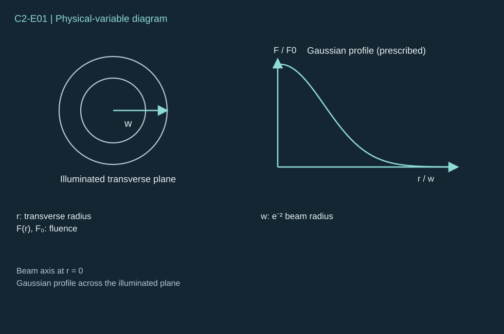

Fluence varies across the beam; the quoted radius fixes its definition.

能量密度沿光束横向变化；所给半径明确其定义。

**Step 2 — Integrate the beam plane.** The annular area is $2\pi r\,dr$. Substitute $x=2r^2/w^2$, giving $dx=4r\,dr/w^2$. Limits remain zero and infinity. The integral converges. The exponential decays to zero at infinity.

**步骤 2——积分光束平面。** 环形面积为 $2\pi r\,dr$。令 $x=2r^2/w^2$，则 $dx=4r\,dr/w^2$。积分限仍为零与无穷远。积分收敛，指数函数在无穷远趋零。

**Symbols before Eq. (C2-E02).**

**式（C2-E02）前的符号定义。**

| First individual definition / 第一项单独定义 | Second individual definition / 第二项单独定义 |
| --- | --- |
| $E_L$ is total incident pulse energy (J) $E_L$ 为总入射脉冲能量（J） | $F_0$ is on-axis fluence (J m⁻²) $F_0$ 为轴上能量密度（J m⁻²） |
| $w>0$ — Transverse Gaussian beam radius at the e⁻² level (m) $w>0$ — 横向高斯光束 e⁻² 半径（m） | $r\ge0$ — Transverse distance from the laser-beam axis (m) $r\ge0$ — 到激光光束轴线的横向距离（m） |
| $x=2r^2/w^2$ is a dimensionless substitution variable $x=2r^2/w^2$ 为无量纲换元变量 | $\pi$ is the circular constant (dimensionless) $\pi$ 为圆周率（无量纲） |

**Conventions and conditions.** $e^x$ is the exponential; $\int$ and brackets denote integration and endpoint evaluation.

**约定与条件。** $e^x$ 为指数函数；$\int$ 与方括号表示积分及端点求值。

(C2-E02) · Exact integral of the prescribed profile / 给定分布的精确积分

$$
\begin{aligned}E_L&=2\pi F_0\int_0^\infty r e^{-2r^2/w^2}\,dr\\&=\frac{\pi w^2F_0}{2}\int_0^\infty e^{-x}\,dx\\&=\frac{\pi w^2F_0}{2}[-e^{-x}]_0^\infty=\frac{\pi w^2F_0}{2}.\end{aligned}
$$

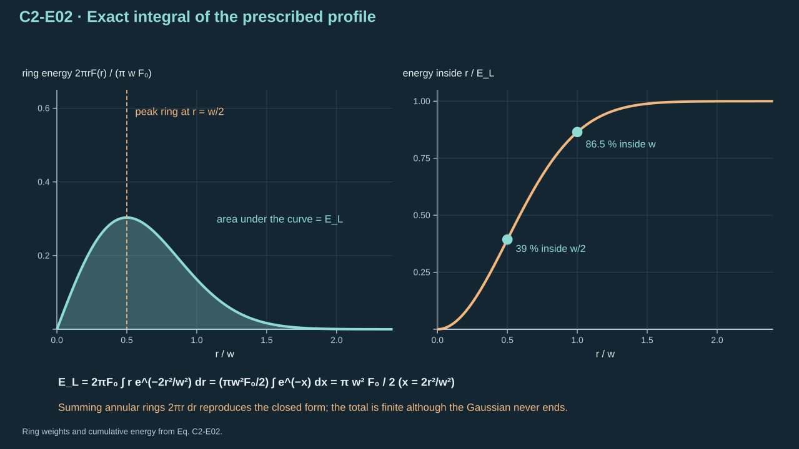

The Gaussian energy follows from summing annular contributions.

高斯光束能量来自环带贡献之和。

**Step 3 — Calculate intercepted energy.** End the same integral at centered aperture radius $b_a$ (m). Divide by total beam energy. Off-axis or irregular absorbers require their actual area integral.

**步骤 3——计算截获能量。** 将同一积分上限取为居中孔径半径 $b_a$（m），再除以总光束能量。偏轴或不规则吸收体须按实际区域积分。

**Symbols before Eq. (C2-E03).**

**式（C2-E03）前的符号定义。**

| First individual definition / 第一项单独定义 | Second individual definition / 第二项单独定义 |
| --- | --- |
| $f_{\mathrm{geo}}$ is intercepted energy fraction (dimensionless), with label geo meaning geometry $f_{\mathrm{geo}}$ 为截获能量比例（无量纲），geo 下标表示几何 | $b_a\ge0$ is centered absorber-aperture radius (m) $b_a\ge0$ 为同轴吸收体窗口半径（m） |
| $F(r)$ is Gaussian fluence (J m⁻²) $F(r)$ 为高斯能量密度（J m⁻²） | $r$ is transverse integration distance (m) $r$ 为横向积分距离（m） |
| $E_L>0$ is total pulse energy (J) $E_L>0$ 为总脉冲能量（J） | $w>0$ is beam radius (m) $w>0$ 为光束半径（m） |
| $\pi$ is the circular constant (dimensionless) $\pi$ 为圆周率（无量纲） |  |

**Conventions and conditions.** $\exp$ and $\int$ denote exponential and integration.

**约定与条件。** $\exp$ 和 $\int$ 表示指数函数与积分。

(C2-E03) · Derived interception fraction / 推导得到的截获比例

$$
f_{\mathrm{geo}}=\frac{\int_0^{b_a}F(r)2\pi r\,dr}{E_L}=1-\exp(-2b_a^2/w^2),\qquad 0\le f_{\mathrm{geo}}\le1
$$

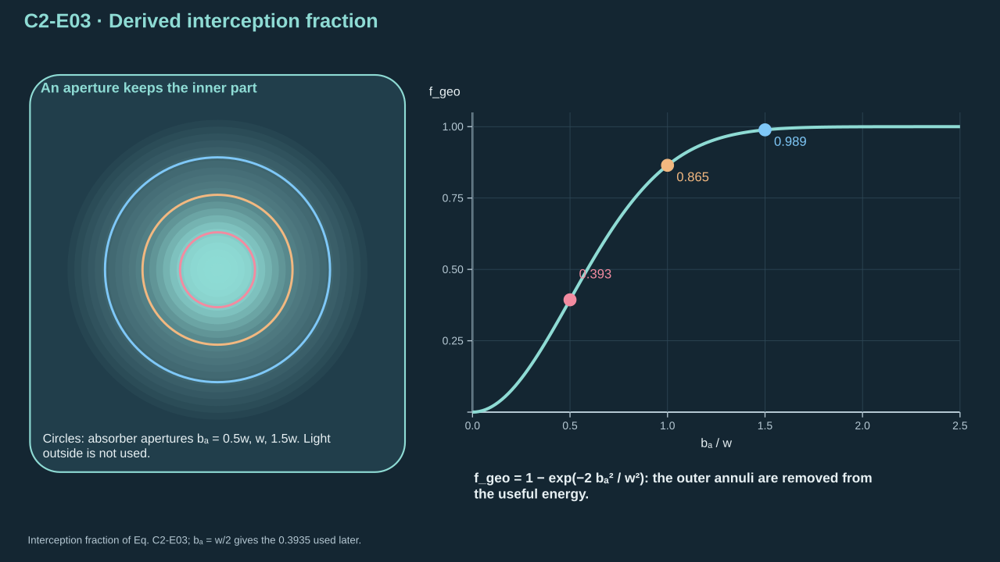

The aperture removes the outer annuli from the useful incident energy.

窗口使外侧环带不再计入有用入射能量。

**Step 4 — Include pulse duration.** Normalize the temporal pulse shape to unit integral. A rectangular pulse has height equal to reciprocal duration. Shorter duration raises irradiance at fixed fluence. Incident energy stays fixed.

**步骤 4——加入脉冲时长。** 将时间脉冲形状归一化为单位积分。矩形脉冲高度等于时长的倒数。能量面密度固定时，缩短时长会提高辐照度，入射能量保持不变。

**Symbols before Eq. (C2-E04).**

**式（C2-E04）前的符号定义。**

| First individual definition / 第一项单独定义 | Second individual definition / 第二项单独定义 |
| --- | --- |
| $f(t)\ge0$ is normalized pulse shape (s⁻¹) $f(t)\ge0$ 为归一化脉冲形状（s⁻¹） | $t$ is time (s) $t$ 为时间（s） |
| $I(r,t)$ is irradiance (W m⁻²) $I(r,t)$ 为辐照度（W m⁻²） | $F(r)$ — Local laser fluence (J m⁻²) $F(r)$ — 局部激光能量面密度（J m⁻²） |
| $F_0$ — On-axis laser fluence (J m⁻²) $F_0$ — 轴上激光能量面密度（J m⁻²） | $r$ is transverse distance (m) $r$ 为横向距离（m） |
| $I_{\mathrm{peak}}$ is central peak irradiance (W m⁻²) $I_{\mathrm{peak}}$ 为中心峰值辐照度（W m⁻²） | $\tau_L>0$ is rectangular laser-pulse duration (s), with L naming laser $\tau_L>0$ 为矩形激光脉冲时长（s），L 表示激光 |

**Conventions and conditions.** $\int$ is time integration.

**约定与条件。** $\int$ 为时间积分。

(C2-E04) · Temporal profile definition / 时间分布的定义

$$
\int_{-\infty}^{\infty} f(t)\,dt=1,\qquad I(r,t)=F(r)f(t),\qquad I_{\mathrm{peak}}=F_0/\tau_L\quad\text{(rectangular pulse)}
$$

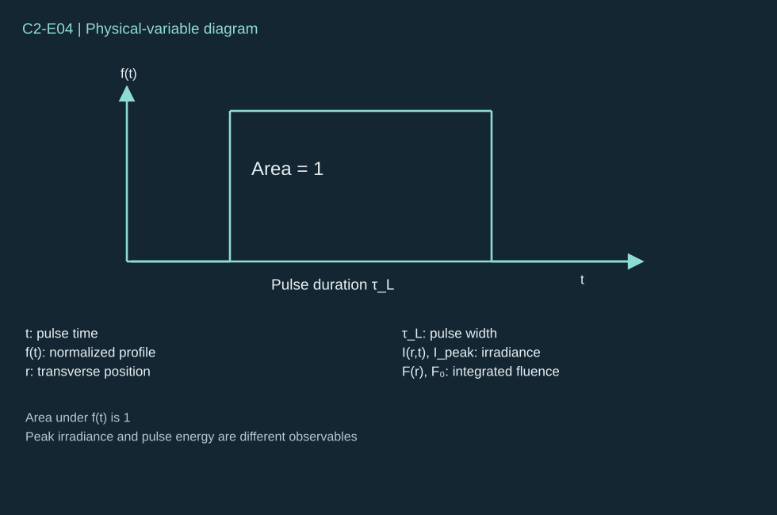

A pulse waveform specifies when the energy is deposited.

脉冲波形规定能量何时沉积。

**Step 5 — Solve absorption transport.** Irradiance loss across a slab equals deposited heat per volume × thickness. Assume constant positive absorption coefficient. Separate and integrate from entry face to depth, then exponentiate. Optical transit is instantaneous relative to thermal evolution.

**步骤 5——求解吸收输运。** 薄层辐照度损失等于单位体积沉积热量乘以厚度。假设吸收系数为正常数。分离变量，从入射面积分至指定深度，再取指数。相对于热演化，将光传播视为瞬时过程。

**Symbols before Eq. (C2-E05).**

**式（C2-E05）前的符号定义。**

| First individual definition / 第一项单独定义 | Second individual definition / 第二项单独定义 |
| --- | --- |
| $z\ge0$ is absorber depth (m) $z\ge0$ 为吸收体深度（m） | $I(z)>0$ — Irradiance inside the absorber (W m⁻²) $I(z)>0$ — 吸收体内部辐照度（W m⁻²） |
| $I_{\mathrm{in}}>0$ — Irradiance entering the absorber (W m⁻²) $I_{\mathrm{in}}>0$ — 进入吸收体的辐照度（W m⁻²） | $\mu_a>0$ is constant absorption coefficient (m⁻¹), with a labeling absorption $\mu_a>0$ 为常数吸收系数（m⁻¹），a 表示吸收 |
| $Q_{\mathrm{abs}}$ is volumetric optical heat deposition (W m⁻³) $Q_{\mathrm{abs}}$ 为光学体积生热率（W m⁻³） | $I^{\prime}$ — Dummy irradiance integration variable (W m⁻²) $I^{\prime}$ — 辐照度积分哑变量（W m⁻²） |
| $z^{\prime}$ — Dummy depth integration coordinate (m) $z^{\prime}$ — 深度积分哑坐标（m） | $I$ — Laser irradiance (W m⁻²) $I$ — 激光辐照度（W m⁻²） |

**Conventions and conditions.** $\partial_z$ denotes differentiation in depth; $z$; $\int$ denotes integration; $e^x$ denotes the exponential; Zero input gives identically zero deposition without dividing by irradiance.

**约定与条件。** $\partial_z$ 表示对深度求导；$z$ 相同；$\int$ 表示积分；$e^x$ 表示指数函数；零输入时沉积恒为零，无须除以辐照度。

(C2-E05) · Beer–Lambert constitutive model and solution / Beer–Lambert 本构模型及其解

$$
\begin{aligned}\partial_z I&=-\mu_a I,& Q_{\mathrm{abs}}&=\mu_a I,\\ \int_{I_{\mathrm{in}}}^{I(z)}\frac{dI^{\prime}}{I^{\prime}}&=-\int_0^z\mu_a\,dz^{\prime},&I(z)&=I_{\mathrm{in}}e^{-\mu_a z}.\end{aligned}
$$

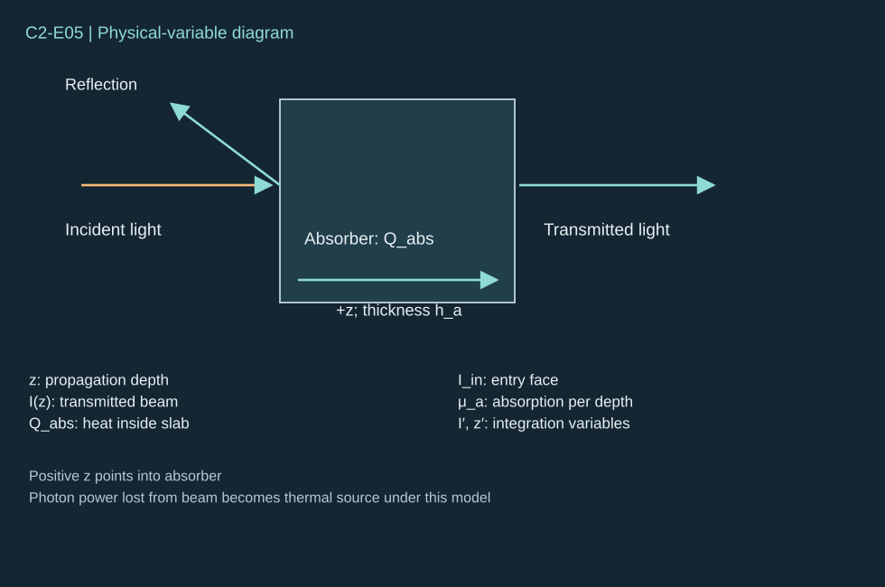

The absorber deposits heat over a finite optical depth.

吸收体在有限光学深度内沉积热量。

**Step 6 — Integrate deposited heat.** Integrate the volume source over depth to obtain absorbed power/area. Integrate pulse time and intercepted area to obtain energy. Apply the entering fraction from front-face reflection once. The defined effective absorptance already contains that reflection.

**步骤 6——积分沉积热。** 对体积源沿深度积分，得到单位面积吸收功率。再对脉冲时间及截获面积积分，得到能量。前表面反射造成的入射比例计入一次。所定义有效吸收率已包含该反射。

**Symbols before Eq. (C2-E06).**

**式（C2-E06）前的符号定义。**

| First individual definition / 第一项单独定义 | Second individual definition / 第二项单独定义 |
| --- | --- |
| $h_a>0$ is uniform absorber thickness (m) $h_a>0$ 为均匀吸收体厚度（m） | $z$ is depth (m) $z$ 为深度（m） |
| $Q_{\mathrm{abs}}$ is volumetric heat source (W m⁻³) $Q_{\mathrm{abs}}$ 为体积热源（W m⁻³） | $I_{\mathrm{in}}$ is irradiance entering the slab (W m⁻²) $I_{\mathrm{in}}$ 为进入薄层的辐照度（W m⁻²） |
| $\mu_a$ is absorption coefficient (m⁻¹) $\mu_a$ 为吸收系数（m⁻¹） | $\mathcal R_\lambda\in[0,1]$ — Front-face reflected energy fraction (dimensionless) $\mathcal R_\lambda\in[0,1]$ — 前表面反射能量比例（无量纲） |
| $A_\lambda$ is effective incident-light absorptance (dimensionless) $A_\lambda$ 为相对于入射光的有效吸收率（无量纲） | $f_{\mathrm{geo}}$ is intercepted fraction (dimensionless) $f_{\mathrm{geo}}$ 为截获比例（无量纲） |
| $E_L$ — Incident laser-pulse energy (J) $E_L$ — 入射激光脉冲能量（J） | $E_{\mathrm{abs}}$ — Absorbed optical energy (J) $E_{\mathrm{abs}}$ — 吸收光能（J） |
| $\Omega_a$ is absorbing volume (m³) $\Omega_a$ 为吸收体体积（m³） | $dV$ its volume element (m³) $dV$ 为其体积元（m³） |
| $t$ — Time (s) $t$ — 时间（s） | $dt$ — Time integration element (s) $dt$ — 时间积分微元（s） |
| $\lambda$ — Laser wavelength (m) $\lambda$ — 激光波长（m） |  |

**Conventions and conditions.** $\int$ is integration; $e^x$ is the exponential.

**约定与条件。** $\int$ 为积分；$e^x$ 为指数函数。

(C2-E06) · Derived optical-energy balance / 推导得到的光能平衡

$$
\begin{aligned}\int_0^{h_a}Q_{\mathrm{abs}}\,dz&=I_{\mathrm{in}}(1-e^{-\mu_a h_a}),\\ A_\lambda&=(1-\mathcal R_\lambda)(1-e^{-\mu_a h_a}),\\ E_{\mathrm{abs}}&=f_{\mathrm{geo}}A_\lambda E_L=\int\!\int_{\Omega_a}Q_{\mathrm{abs}}\,dV\,dt.\end{aligned}
$$

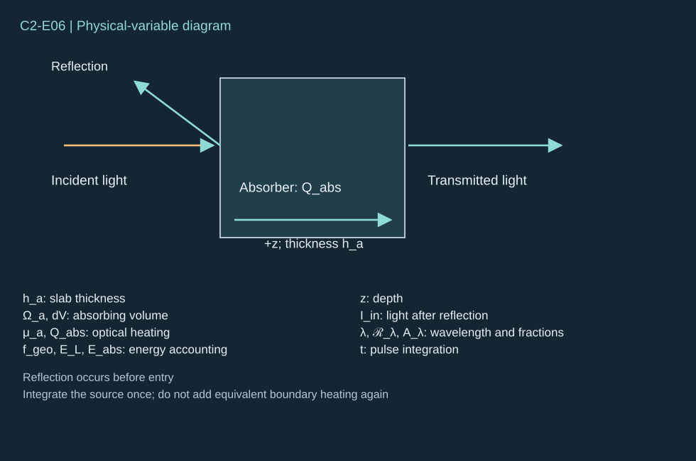

Interception, reflection, and internal absorption each act once.

截获、反射与内部吸收各作用一次。

Absorptance approaches zero at zero optical thickness. At large thickness, it approaches the entering fraction. $Q_{\mathrm{abs}}$ has units W m⁻³; its volume–time integral has units J. Scattering, multiple reflection, saturation and plasma formation require other models. A boundary source can replace an equivalent resolved layer. Including both duplicates the deposited energy.

光学厚度趋零时，吸收率趋零。厚度很大时，吸收率趋于进入比例。$Q_{\mathrm{abs}}$ 单位为 W m⁻³，其体积—时间积分为 J。散射、多次反射、饱和及等离子体形成需其他模型。等效边界热源可替代解析层，同时加入两者会重复计入能量。

Strohm et al. optically activated PbS-loaded PFP at 1064 nm. Wei et al. used gold-containing PFH nanoemulsion. These studies establish formulation-specific optical activation routes. Universal threshold, jet speed and transfer yield remain unestablished. Absorber placement and formulation require experimental inputs. [[R6]](../reference/sources.html#r6) [[R7]](../reference/sources.html#r7)

Strohm 等用 1064 nm 激光激活含 PbS 的 PFP。Wei 等采用含金 PFH 纳米乳液。这些研究确立了特定配方的光学激活路径。通用阈值、射流速率及转印率尚未确立。吸收体位置与配方须由实验给定。 [[R6]](../reference/sources.html#r6) [[R7]](../reference/sources.html#r7)

## 2.2 Heat delivery and event time

## 2.2 热输送与事件时间

**Step 7 — Conserve thermal energy.** Before phase change, conduction and absorption change sensible enthalpy. Assume constant properties in nearly incompressible phases. Omit viscous heating and pressure work. Use near-constant-pressure heat capacity. Moving liquid advects heat; a solid absorber has zero velocity. Conductive flux points down the temperature gradient. Its negative divergence supplies heat influx.

**步骤 7——热能守恒。** 相变前，传导与吸收改变显焓。近不可压缩相采用常物性，忽略黏性热与压力功，使用近恒压热容。运动液体对流输热，固体吸收体速度为零。传导热通量指向温度降低方向，其负散度表示热流入。

**Symbols before Eq. (C2-E07).**

**式（C2-E07）前的符号定义。**

| First individual definition / 第一项单独定义 | Second individual definition / 第二项单独定义 |
| --- | --- |
| $\boldsymbol q$ is conductive heat flux (W m⁻²) $\boldsymbol q$ 为传导热通量（W m⁻²） | $k>0$ is thermal conductivity (W m⁻¹ K⁻¹) $k>0$ 为导热系数（W m⁻¹ K⁻¹） |
| $T$ is temperature (K) $T$ 为温度（K） | $\rho>0$ is phase density (kg m⁻³) $\rho>0$ 为该相密度（kg m⁻³） |
| $c_p>0$ is constant specific heat capacity (J kg⁻¹ K⁻¹) $c_p>0$ 为常数比热容（J kg⁻¹ K⁻¹） | $t$ is time (s) $t$ 为时间（s） |
| $\boldsymbol u$ is material velocity (m s⁻¹) $\boldsymbol u$ 为物质速度（m s⁻¹） | $Q_{\mathrm{abs}}$ is optical heating (W m⁻³) $Q_{\mathrm{abs}}$ 为光生热率（W m⁻³） |

**Conventions and conditions.** $D/Dt$ is the material derivative; $\partial_t$ is the fixed-position time derivative; $\nabla$ and $\nabla\cdot$ are spatial gradient and divergence (m⁻¹); the centered dot here is a vector contraction, not punctuation.

**约定与条件。** $D/Dt$ 为物质导数；$\partial_t$ 为固定位置时间导数；$\nabla$ 与 $\nabla\cdot$ 为空间梯度和散度（m⁻¹）；式中的中心点表示向量缩并，不是标点。

(C2-E07) · Reduced heat equation and Fourier constitutive law / 简化热传导方程与傅里叶本构定律

$$
\boldsymbol q=-k\nabla T,\qquad \rho c_p\frac{DT}{Dt}=\rho c_p(\partial_tT+\boldsymbol u\cdot\nabla T)=-\nabla\cdot\boldsymbol q+Q_{\mathrm{abs}}=\nabla\cdot(k\nabla T)+Q_{\mathrm{abs}}
$$

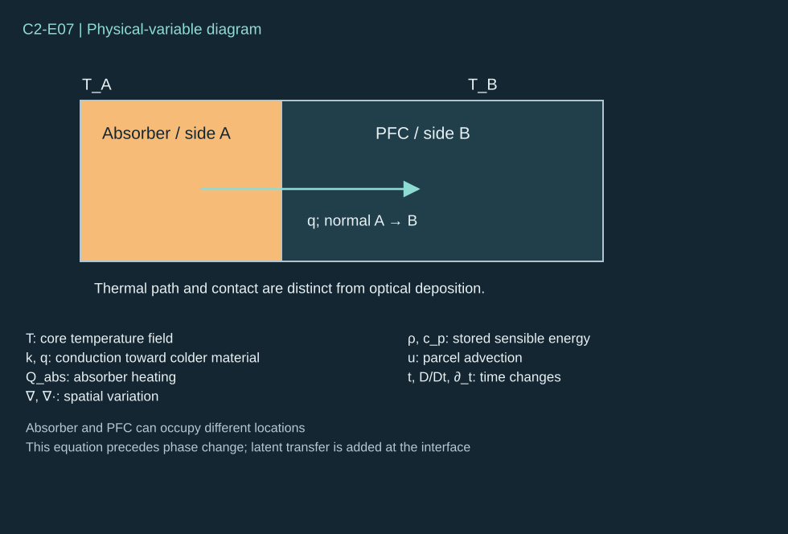

Heating the absorber and heating the PFC are separate parts of the thermal path.

加热吸收体与加热 PFC 是热路径中的不同环节。

**Step 8 — Close thermal contacts.** Orient the normal from material A into B. Positive normal heat flux travels from A to B. Without surface heat storage, flux is continuous. Nonnegative contact resistance permits a temperature jump. Zero resistance gives temperature continuity. This contact differs from the phase-change interface below.

**步骤 8——闭合热接触。** 法向从材料 A 指向 B，正法向热通量由 A 流向 B。无界面热储存时，通量连续。非负接触热阻允许温度跳跃，零热阻给出温度连续。该接触不同于下文相变界面。

**Symbols before Eq. (C2-E08).**

**式（C2-E08）前的符号定义。**

| First individual definition / 第一项单独定义 | Second individual definition / 第二项单独定义 |
| --- | --- |
| $q_n$ is signed normal heat flux (W m⁻²) $q_n$ 为带符号法向热通量（W m⁻²） | $\boldsymbol q_A$ — Conductive heat flux in material A (W m⁻²) $\boldsymbol q_A$ — 材料 A 中的传导热通量（W m⁻²） |
| $\boldsymbol q_B$ — Conductive heat flux in material B (W m⁻²) $\boldsymbol q_B$ — 材料 B 中的传导热通量（W m⁻²） | $\boldsymbol n_{AB}$ is unit normal from A into B (dimensionless) $\boldsymbol n_{AB}$ 为从 A 指向 B 的单位法向（无量纲） |
| $T_A$ — Temperature on contact side A (K) $T_A$ — 接触面 A 侧温度（K） | $T_B$ — Temperature on contact side B (K) $T_B$ — 接触面 B 侧温度（K） |
| $\mathcal R_T\ge0$ is area-specific thermal contact resistance (m² K W⁻¹) $\mathcal R_T\ge0$ 为单位面积热接触阻力（m² K W⁻¹） |  |

**Conventions and conditions.** $\cdot$ denotes a vector dot product.

**约定与条件。** $\cdot$ 表示向量点积。

(C2-E08) · Thermal-contact boundary conditions / 热接触边界条件

$$
q_n=\boldsymbol q_A\cdot\boldsymbol n_{AB}=\boldsymbol q_B\cdot\boldsymbol n_{AB},\qquad T_A-T_B=\mathcal R_T q_n
$$

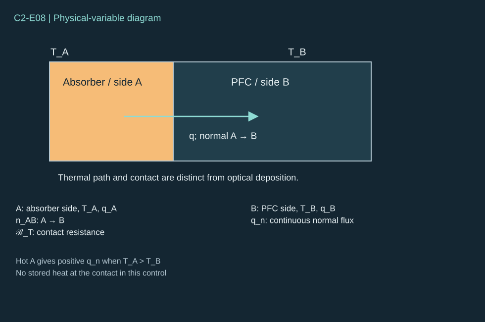

Contact resistance delays heat transfer even after the light has been absorbed.

即使光已被吸收，接触热阻仍会延迟热传递。

**Step 9 — Derive diffusion scales.** Divide the motionless heat equation by volumetric heat capacity. Estimate its time derivative and spatial second derivative over the heating distance. Balance them to obtain diffusion time and penetration length. These are scales rather than sharp thermal fronts. Heating duration may include conduction after the optical pulse.

**步骤 9——推导扩散尺度。** 将静止介质热方程除以体积热容。按加热距离估算时间导数与空间二阶导数。平衡两者，得到扩散时间和渗透长度。它们是尺度估计，并非尖锐热前沿。加热时长可包含光脉冲之后的传导。

**Symbols before Eq. (C2-E09).**

**式（C2-E09）前的符号定义。**

| First individual definition / 第一项单独定义 | Second individual definition / 第二项单独定义 |
| --- | --- |
| $\alpha>0$ is thermal diffusivity (m² s⁻¹) $\alpha>0$ 为热扩散率（m² s⁻¹） | $k$ — Thermal conductivity (W m⁻¹ K⁻¹) $k$ — 导热系数（W m⁻¹ K⁻¹） |
| $\rho$ — Local material mass density (kg m⁻³) $\rho$ — 局部材料质量密度（kg m⁻³） | $c_p$ — Specific heat capacity at constant pressure (J kg⁻¹ K⁻¹) $c_p$ — 定压比热容（J kg⁻¹ K⁻¹） |
| $\Delta T\ne0$ is characteristic temperature change (K) $\Delta T\ne0$ 为特征温度变化（K） | $L_h>0$ is heating distance (m) $L_h>0$ 为加热距离（m） |
| $t_{\mathrm{th}}$ is diffusion time estimate (s) $t_{\mathrm{th}}$ 为扩散时间估计（s） | $\tau_h>0$ is available heating duration (s) $\tau_h>0$ 为可用加热时长（s） |
| $\delta_T$ is penetration estimate (m) $\delta_T$ 为渗透深度估计（m） |  |

**Conventions and conditions.** $\sim$ means order-of-magnitude scaling, not equality.

**约定与条件。** $\sim$ 表示量级尺度关系，不表示严格相等。

(C2-E09) · Diffusive scaling derived from the heat equation / 由热传导方程推导的扩散尺度关系

$$
\alpha=\frac{k}{\rho c_p},\qquad \frac{\Delta T}{t_{\mathrm{th}}}\sim\alpha\frac{\Delta T}{L_h^2},\qquad t_{\mathrm{th}}\sim\frac{L_h^2}{\alpha},\qquad \delta_T\sim\sqrt{\alpha\tau_h}
$$

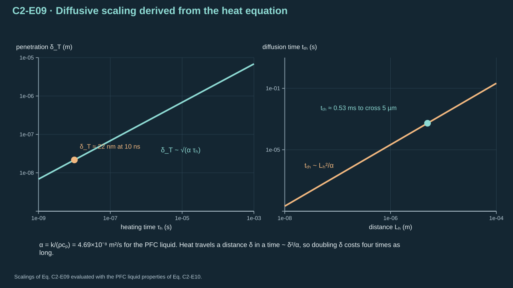

Compare heat penetration with the distance to the PFC, not only with beam width.

应比较热渗透尺度与到达 PFC 的距离，而不只是光束宽度。

**Thermal example.** Prescribe density 1630 kg m⁻³, heat capacity 654 J kg⁻¹ K⁻¹, and conductivity 0.050 W m⁻¹ K⁻¹. The rounded near-293 K heat capacity uses the cited NIST datum. Density and conductivity are teaching inputs. Heating distance is 5 μm; duration is 10 ns.

**热学示例。** 规定密度 1630 kg m⁻³、热容 654 J kg⁻¹ K⁻¹、导热率 0.050 W m⁻¹ K⁻¹。近 293 K 的舍入热容采用所引 NIST 数据。密度与导热率为教学输入。加热距离为 5 μm，时长为 10 ns。

**Symbols before Eq. (C2-E10).**

**式（C2-E10）前的符号定义。**

| First individual definition / 第一项单独定义 | Second individual definition / 第二项单独定义 |
| --- | --- |
| $\alpha_d$ is declared PFC-liquid diffusivity (m² s⁻¹), with d labeling droplet liquid $\alpha_d$ 为所声明 PFC 液体的热扩散率（m² s⁻¹），d 表示液滴液体 | $t_{\mathrm{th}}$ is diffusion-time estimate (s) $t_{\mathrm{th}}$ 为扩散时间估计（s） |
| $\delta_T$ is penetration estimate (m) $\delta_T$ 为渗透深度估计（m） |  |

**Conventions and conditions.** The numerator 0.050 is conductivity in W m⁻¹ K⁻¹; 1630 is density in kg m⁻³; 654 is specific heat in J kg⁻¹ K⁻¹; $5\times10^{-6}$ is distance in m; $10^{-8}$ is duration in s; Powers are numerical exponents, and $\sim$ denotes a scale estimate.

**约定与条件。** 分子 0.050 为导热系数，单位 W m⁻¹ K⁻¹；1630 为密度，单位 kg m⁻³；654 为比热容，单位 J kg⁻¹ K⁻¹；$5\times10^{-6}$ 为距离，单位 m；$10^{-8}$ 为时长，单位 s；幂为数值指数，$\sim$ 表示尺度估计。

(C2-E10) · Declared-input thermal calculation / 采用明确给定输入的热学计算

$$
\begin{aligned}\alpha_d&=\frac{0.050}{1630(654)}=4.69034\times10^{-8}\ \mathrm{m^2\,s^{-1}},\\t_{\mathrm{th}}&\sim\frac{(5\times10^{-6})^2}{4.69034\times10^{-8}}=5.33010\times10^{-4}\ \mathrm{s},\\\delta_T&\sim\sqrt{(4.69034\times10^{-8})(10^{-8})}=2.16572\times10^{-8}\ \mathrm{m}.\end{aligned}
$$

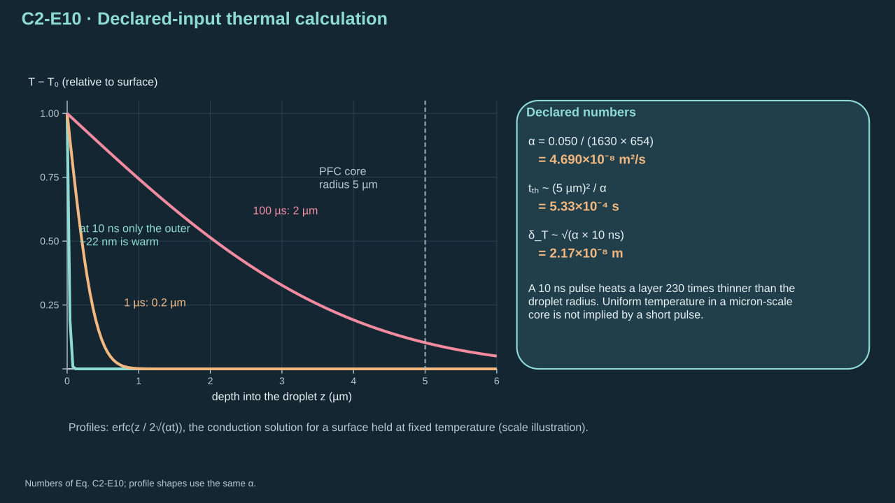

A short pulse does not imply uniform temperature in a micron-scale core.

短脉冲不意味着微米级核心内温度均匀。

Penetration is 0.00433 of the heating distance. Uniform core temperature requires distributed heating or additional diffusion time. At 100 nm, the diffusion estimate falls to 0.213 μs. That still exceeds 10 ns. Hotspots, aggregation and shell contact can dominate local heating. Optical breakdown requires its own optical conditions and observations.

渗透长度为加热距离的 0.00433 倍。核心均温需要分布式加热或额外扩散时间。距离降至 100 nm 时，扩散估计降至 0.213 μs，仍长于 10 ns。热点、团聚和壳层接触可主导局部加热。光学击穿需独立的光学条件及观测依据。

## 2.3 Vapor pressure, confinement and activation

## 2.3 蒸气压、约束与激活

**Step 10 — Set initial core pressure.** A spherical PFC–carrier interface creates capillary pressure. Add shell-supported overpressure when present. This static reference omits acceleration and shell-rate effects. Those require a dynamic constitutive law.

**步骤 10——规定初始核心压力。** 球形 PFC—载液界面产生毛细压力。存在壳层承压时，加上壳层过压。静态参照忽略加速度与壳层速率效应，后者需动力学本构规律。

**Symbols before Eq. (C2-E11).**

**式（C2-E11）前的符号定义。**

| First individual definition / 第一项单独定义 | Second individual definition / 第二项单独定义 |
| --- | --- |
| $p_d$ is initial PFC-liquid pressure (Pa) $p_d$ 为初始 PFC 液体压力（Pa） | $p_c$ carrier pressure (Pa) $p_c$ 为载液压力（Pa） |
| $a>0$ is PFC-core radius (m) $a>0$ 为 PFC 核心半径（m） | $\sigma_{pc}\ge0$ is PFC–carrier interfacial tension (N m⁻¹), with pc naming those phases $\sigma_{pc}\ge0$ 为 PFC–载液界面张力（N m⁻¹），pc 表示这两个相 |
| $\Pi_{\mathrm{shell}}$ is shell-supported excess pressure (Pa) $\Pi_{\mathrm{shell}}$ 为壳层支撑超压（Pa） |  |

**Conventions and conditions.** $\simeq$ is the static spherical approximation; The numerical interfacial tension 0.020 is a teaching input in N m⁻¹, the radii are in m, and 1 kPa = 1000 Pa.

**约定与条件。** $\simeq$ 表示静态球形近似；数值界面张力 0.020 是教学输入，单位 N m⁻¹；半径单位为 m；1 kPa = 1000 Pa。

(C2-E11) · Static capillary and shell-pressure control / 静态毛细压力与壳层压力对照模型

$$
p_d\simeq p_c+\frac{2\sigma_{pc}}{a}+\Pi_{\mathrm{shell}},\qquad \frac{2(0.020)}{5\times10^{-6}}=8.00\ \mathrm{kPa},\qquad\frac{2(0.020)}{10^{-7}}=400\ \mathrm{kPa}
$$

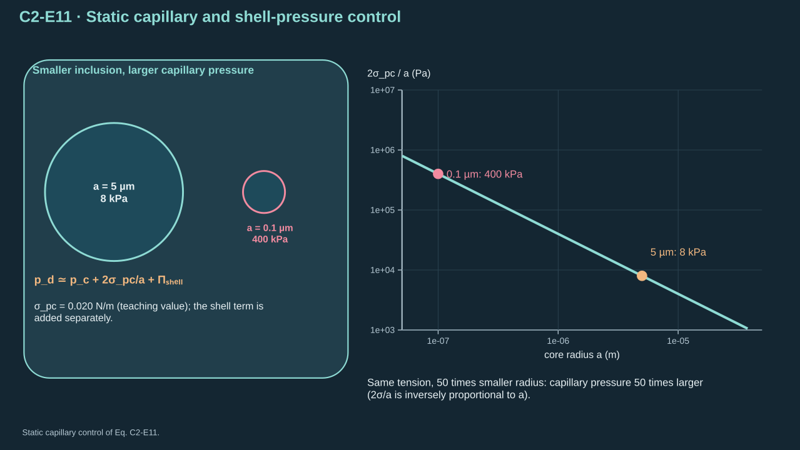

The smaller inclusion has a larger capillary contribution at the same tension.

界面张力相同时，较小夹杂的毛细压力贡献更大。

Specify the compound for every quoted boiling point. NIST entries below describe neat compounds. Tabulated boiling ranges represent different datasets, not formulation uncertainty. Divide molar heat capacity or enthalpy by molar mass for mass-specific values. [[R8]](../reference/sources.html#r8) [[R9]](../reference/sources.html#r9) [[R15]](../reference/sources.html#r15)

每个沸点须注明具体化合物。下列 NIST 条目描述纯物质。表中沸点范围来自不同数据集，并非配方不确定度。摩尔热容或焓除以摩尔质量，得到质量比值。 [[R8]](../reference/sources.html#r8) [[R9]](../reference/sources.html#r9) [[R15]](../reference/sources.html#r15)

| Compound and identity 化合物与身份 | Bulk reference 体相参照 | Proper scope 正确用途 |
| --- | --- | --- |
| PFP: C₅F₁₂; CAS 678-26-2; molar mass 0.2880343 kg mol⁻¹ PFP：C₅F₁₂；CAS 678-26-2；摩尔质量 0.2880343 kg mol⁻¹ | Normal-boiling entries 302.6–303.2 K; liquid heat-capacity datum 188.3 J mol⁻¹ K⁻¹ at 293 K, giving 653.74 J kg⁻¹ K⁻¹. 正常沸点条目 302.6–303.2 K；293 K 液体热容数据为 188.3 J mol⁻¹ K⁻¹，对应 653.74 J kg⁻¹ K⁻¹。 | Compound-specific thermal reference; not a coated-droplet activation law. 特定化合物热学参照；不是包覆液滴激活定律。 |
| PFH: C₆F₁₄; CAS 355-42-0; molar mass 0.3380418 kg mol⁻¹ PFH：C₆F₁₄；CAS 355-42-0；摩尔质量 0.3380418 kg mol⁻¹ | Normal-boiling entries 330.3–333 K; vaporization enthalpy 31.5 kJ mol⁻¹ at 316 K, giving 93.18 kJ kg⁻¹. 正常沸点条目 330.3–333 K；316 K 汽化焓为 31.5 kJ mol⁻¹，对应 93.18 kJ kg⁻¹。 | Retain temperature and dataset; do not transfer this value to every PFC. 保留温度及数据集；不能将此值套用到所有 PFC。 |
| Water: H₂O; molar mass 0.0180153 kg mol⁻¹ 水：H₂O；摩尔质量 0.0180153 kg mol⁻¹ | Normal-boiling compilation approximately 373.17 K. 正常沸点汇编约为 373.17 K。 | PFC-free thermal comparison at matched temperature and pressure. 在相同温度与压力下的不含 PFC 热学参照。 |

**Step 11 — Evaluate equilibrium vapor pressure.** Use the NIST Barber–Cady Antoine fit within its temperature range. Pressure divided by one bar makes the logarithm dimensionless. The coefficients are empirical inputs. [[R8]](../reference/sources.html#r8)

**步骤 11——计算平衡蒸气压。** 在温度适用范围内采用 NIST Barber–Cady Antoine 拟合。压力除以一 bar，使对数自变量无量纲。系数为经验输入。 [[R8]](../reference/sources.html#r8)

**Symbols before Eq. (C2-E12).**

**式（C2-E12）前的符号定义。**

| First individual definition / 第一项单独定义 | Second individual definition / 第二项单独定义 |
| --- | --- |
| $p_{\mathrm{sat,PFP}}(T)$ is bulk equilibrium PFP vapor pressure (Pa), sat labeling saturation $p_{\mathrm{sat,PFP}}(T)$ 为体相平衡 PFP 蒸汽压（Pa），sat 表示饱和 | $T$ is absolute temperature in the stated range (K) $T$ 为所给范围内的绝对温度（K） |

**Conventions and conditions.** $\log_{10}$ is the base-ten logarithm; One bar equals $10^5$ Pa; Empirical coefficient 4.2063 is dimensionless; 1103.454 K and 39.77 K have temperature units; The denominator is positive throughout the stated domain.

**约定与条件。** $\log_{10}$ 为常用对数；一巴等于 $10^5$ Pa；经验系数 4.2063 无量纲；1103.454 K 和 39.77 K 具有温度单位；所给范围内分母为正。

(C2-E12) · Verified empirical PFP property correlation / 已核验的 PFP 物性经验关联式

$$
\log_{10}\!\left(\frac{p_{\mathrm{sat,PFP}}(T)}{10^5\ \mathrm{Pa}}\right)=4.2063-\frac{1103.454\ \mathrm{K}}{T-39.77\ \mathrm{K}},\qquad282.82\ \mathrm{K}\le T\le337.94\ \mathrm{K}
$$

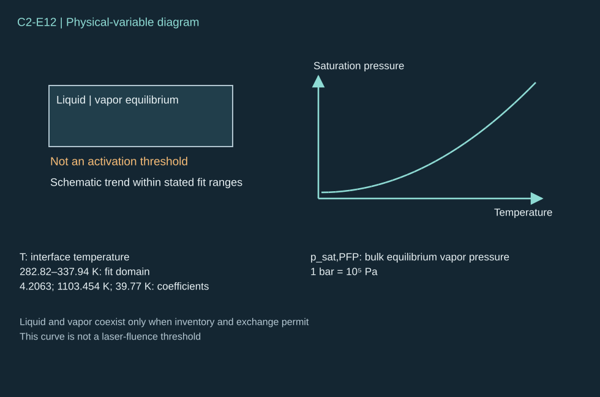

The saturation curve concerns an equilibrium state, not automatic activation.

饱和曲线描述平衡状态，而不是自动激活。

Eq. (C2-E12) gives PFP pressures of 70.60 kPa at 293 K, 103.35 kPa at 303 K, and 204.33 kPa at 323 K. Use water coefficients within their stated interval. They give 2.315 kPa at 293 K and 12.248 kPa at 323 K. These are calculated reference values. [[R15]](../reference/sources.html#r15)

式（C2-E12）给出 PFP 蒸气压：293 K 时 70.60 kPa，303 K 时 103.35 kPa，323 K 时 204.33 kPa。水系数须在注明温区内使用。所得值为 293 K 时 2.315 kPa、323 K 时 12.248 kPa。这些是计算参照值。 [[R15]](../reference/sources.html#r15)

**Symbols before Eq. (C2-E13).**

**式（C2-E13）前的符号定义。**

| First individual definition / 第一项单独定义 | Second individual definition / 第二项单独定义 |
| --- | --- |
| $p_{\mathrm{sat,w}}$ is bulk equilibrium water vapor pressure (Pa), w labeling water $p_{\mathrm{sat,w}}$ 为体相平衡水蒸汽压（Pa），w 表示水 | $T$ is temperature (K), restricted to either listed interval $T$ 为温度（K），限定在两个所列区间之一 |
| $T/\mathrm K$ is the numerical temperature in kelvin (dimensionless) $T/\mathrm K$ 为以开尔文计的温度数值（无量纲） |  |

**Conventions and conditions.** $\log_{10}$ is the base-ten logarithm of pressure relative to one bar ($10^5$ Pa); The leading coefficients are dimensionless; all coefficients multiplied by K have temperature units; No value is assigned to the 303–304 K gap by these two branches.

**约定与条件。** $\log_{10}$ 为相对于一巴（$10^5$ Pa）的压力比值的常用对数；首项系数无量纲；乘以 K 的系数具有温度单位；这两个分支未给出 303–304 K 间隙的值。

(C2-E13) · Verified empirical water property correlations / 已核验的水物性经验关联式

$$
\log_{10}\!\left(\frac{p_{\mathrm{sat,w}}(T)}{10^5\ \mathrm{Pa}}\right)=\begin{cases}5.40221-1838.675\ \mathrm{K}/(T-31.737\ \mathrm{K}),&273\le T/\mathrm{K}\le303,\\5.20389-1733.926\ \mathrm{K}/(T-39.485\ \mathrm{K}),&304\le T/\mathrm{K}\le333.\end{cases}
$$

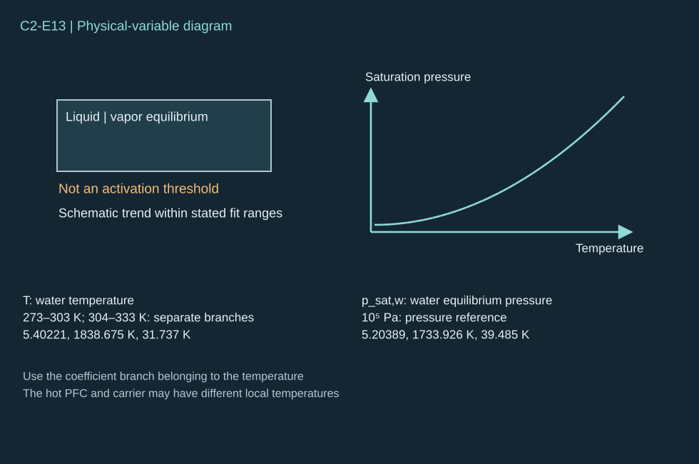

Water provides a matched-temperature reference, not a guaranteed vapor reservoir.

水提供同温参照，却不是有保证的蒸汽库。

At 323 K and 100 kPa carrier pressure, the 5 μm core has 108 kPa liquid pressure. This is below the 204.33 kPa PFP equilibrium reference. The 100 nm core has 500 kPa liquid pressure, above that reference. Bulk driving is positive for the larger core and nonpositive for the smaller core. This control assumes constant tension and zero shell stress. Measured onset temperatures remain unestablished.

在 323 K、载液压力 100 kPa 下，5 μm 核心液压为 108 kPa，低于 204.33 kPa 的 PFP 平衡参照。100 nm 核心液压为 500 kPa，高于该参照。大核心体相驱动为正，小核心驱动不为正。此对照假设张力恒定、壳层应力为零。实测起始温度尚未确立。

**Step 12 — Construct nucleus free energy.** Place a vapor nucleus inside liquid PFC. Assume local isothermality and a bulk liquid reservoir. New interface costs tension × area. Favorable vapor gains driving pressure × volume. Use vapor–PFC tension for this internal interface. Eq. (C2-E11) uses PFC–carrier tension at the outer interface.

**步骤 12——建立汽核自由能。** 汽核位于液态 PFC 内部。假设局部等温与体相液体储库。新界面消耗张力 × 面积，有利蒸气获得驱动压差 × 体积。内部界面采用蒸气—PFC 张力。式（C2-E11）外界面采用 PFC—载液张力。

**Symbols before Eq. (C2-E14).**

**式（C2-E14）前的符号定义。**

| First individual definition / 第一项单独定义 | Second individual definition / 第二项单独定义 |
| --- | --- |
| $\Delta p_n$ is vapor-nucleation driving pressure (Pa), n labeling nucleation $\Delta p_n$ 为汽化成核驱动压差（Pa），n 表示成核 | $p_{\mathrm{sat,PFC}}(T_i)$ is bulk PFC saturation pressure at local interface temperature $T_i$ (Pa and K) $p_{\mathrm{sat,PFC}}(T_i)$ 为局部界面温度 $T_i$ 下的体相 PFC 饱和蒸汽压（Pa 和 K） |
| $p_d$ is PFC-liquid pressure (Pa) $p_d$ 为 PFC 液体压力（Pa） | $W(r_n)$ is nucleus formation free energy (J) $W(r_n)$ 为汽核形成自由能（J） |
| $r_n\ge0$ is vapor-nucleus radius (m) $r_n\ge0$ 为汽核半径（m） | $\sigma_{vp}>0$ is vapor–PFC tension (N m⁻¹), vp naming the interface $\sigma_{vp}>0$ 为蒸汽–PFC 张力（N m⁻¹），vp 表示该界面 |
| $\pi$ is the circular constant (dimensionless) $\pi$ 为圆周率（无量纲） | $T_i$ — Local phase-interface temperature (K) $T_i$ — 局部相界面温度（K） |

**Conventions and conditions.** The model assumes fixed $T_i,p_d$; $r_n$ small compared with the PFC core.

**约定与条件。** 模型假设 $T_i,p_d$ 固定，且 $r_n$ 远小于 PFC 核心。

(C2-E14) · Classical homogeneous capillarity approximation / 经典均相成核的毛细近似

$$
\Delta p_n=p_{\mathrm{sat,PFC}}(T_i)-p_d,\qquad W(r_n)=4\pi\sigma_{vp}r_n^2-\frac{4\pi}{3}\Delta p_n r_n^3
$$

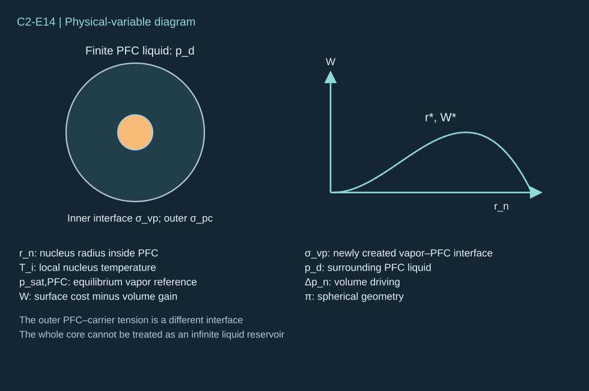

The barrier belongs to creating a new internal vapor interface.

势垒来自生成新的内部蒸汽界面。

**Step 13 — Find the critical branch.** Differentiate both radius powers. For positive driving, divide the nonzero-radius bracket by positive driving pressure. The second derivative is negative at the critical radius. It is a barrier maximum. For nonpositive driving, the derivative stays positive at positive radius. No positive critical-radius branch exists in that case.

**步骤 13——求临界分支。** 对两个半径幂求导。正驱动时，将非零半径括号除以正驱动压差。临界半径处二阶导数为负，对应势垒最大值。驱动不为正时，所有正半径处导数为正，因此不存在正临界半径分支。

**Symbols before Eq. (C2-E15).**

**式（C2-E15）前的符号定义。**

| First individual definition / 第一项单独定义 | Second individual definition / 第二项单独定义 |
| --- | --- |
| $W$ is nucleus free energy (J) $W$ 为汽核自由能（J） | $r_n>0$ is nucleus radius (m) $r_n>0$ 为汽核半径（m） |
| $\sigma_{vp}>0$ is vapor–PFC interfacial tension (N m⁻¹) $\sigma_{vp}>0$ 为蒸汽–PFC 界面张力（N m⁻¹） | $\Delta p_n$ is fixed driving pressure (Pa) $\Delta p_n$ 为固定驱动压差（Pa） |
| $r_*$ is the positive critical radius (m), with star labeling the stationary point and requiring $\Delta p_n>0$ $r_*$ 为正临界半径（m），星号标记驻点，且要求 $\Delta p_n>0$ | $\pi$ is the circular constant (dimensionless) $\pi$ 为圆周率（无量纲） |

**Conventions and conditions.** $d/dr_n$ is radius differentiation, $|_{r_*}$ denotes evaluation there; The first derivative has units J m⁻¹ and the second J m⁻².

**约定与条件。** $d/dr_n$ 为对半径求导，$|_{r_*}$ 表示在该点求值；一阶导数单位为 J m⁻¹，二阶导数为 J m⁻²。

(C2-E15) · Derived critical radius and branch check / 推导得到的临界半径与分支检验

$$
\begin{aligned}\frac{dW}{dr_n}&=8\pi\sigma_{vp}r_n-4\pi\Delta p_n r_n^2=4\pi r_n(2\sigma_{vp}-\Delta p_n r_n),\\r_*&=2\sigma_{vp}/\Delta p_n\quad(\Delta p_n>0),\\\left.\frac{d^2W}{dr_n^2}\right|_{r_*}&=8\pi\sigma_{vp}-8\pi\Delta p_n r_*=-8\pi\sigma_{vp}<0.\end{aligned}
$$

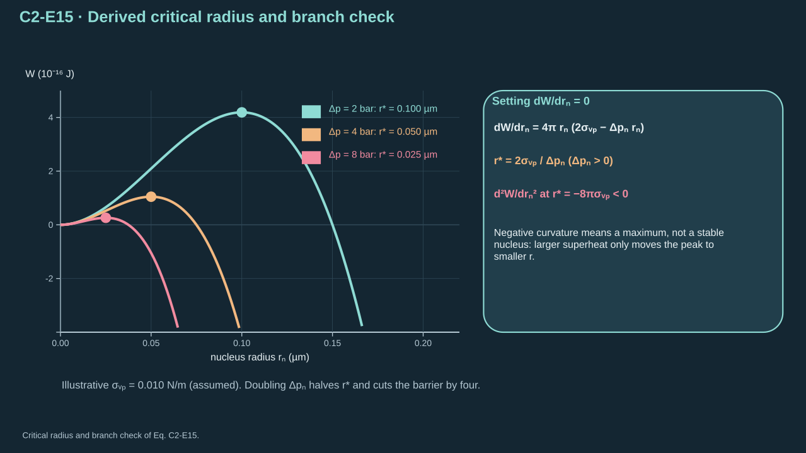

The stationary point is a maximum, not a stable equilibrium nucleus.

该驻点是最大值，不是稳定平衡汽核。

**Step 14 — Evaluate the barrier.** Substitute the squared and cubed critical radius. Subtract the coefficients explicitly. Increasing driving pressure lowers the barrier. Finite positive driving and tension leave a positive barrier.

**步骤 14——计算势垒。** 代入临界半径的平方与三次方，并明确相减系数。增大驱动压差会降低势垒。有限正驱动与正张力仍给出正势垒。

**Symbols before Eq. (C2-E16).**

**式（C2-E16）前的符号定义。**

| First individual definition / 第一项单独定义 | Second individual definition / 第二项单独定义 |
| --- | --- |
| $W_*=W(r_*)$ is critical-nucleus free-energy barrier (J), with star labeling the critical value $W_*=W(r_*)$ 为临界汽核自由能势垒（J），星号标记临界值 | $\sigma_{vp}>0$ is vapor–PFC interfacial tension (N m⁻¹) $\sigma_{vp}>0$ 为蒸汽–PFC 界面张力（N m⁻¹） |
| $\Delta p_n>0$ is driving pressure (Pa) $\Delta p_n>0$ 为驱动压差（Pa） | $\pi$ is the circular constant (dimensionless) $\pi$ 为圆周率（无量纲） |

**Conventions and conditions.** superscripts 2 and 3 are powers; This result inherits the homogeneous, locally isothermal, small-nucleus assumptions.

**约定与条件。** 上标 2、3 表示幂；该结果继承均匀成核、局部等温及小汽核假设。

(C2-E16) · Derived homogeneous barrier height / 推导得到的均相成核势垒高度

$$
\begin{aligned}W_*&=4\pi\sigma_{vp}\frac{4\sigma_{vp}^2}{\Delta p_n^2}-\frac{4\pi}{3}\Delta p_n\frac{8\sigma_{vp}^3}{\Delta p_n^3}\\&=\left(16-\frac{32}{3}\right)\frac{\pi\sigma_{vp}^3}{\Delta p_n^2}=\frac{16\pi\sigma_{vp}^3}{3\Delta p_n^2}.\end{aligned}
$$

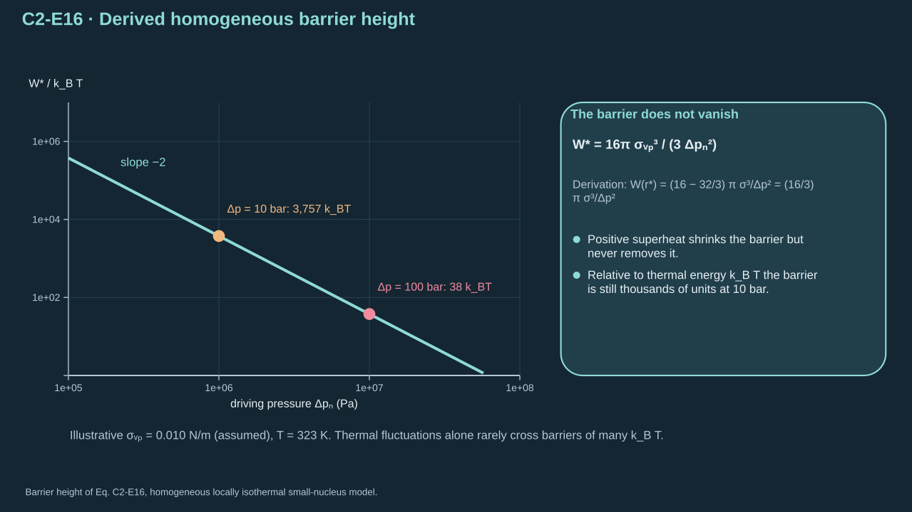

Positive superheat driving does not make the nucleation barrier vanish.

正的过热驱动力并不会使成核势垒消失。

The barrier unit is $\mathrm{(N/m)^3/Pa^2=N\,m=J}$. Tension/pressure gives critical-radius units m. A nucleus comparable to core size violates the reservoir approximation. Surfaces, defects, dissolved gas and wetting can favor heterogeneous nucleation. An imposed seed defines post-nucleation dynamics. Onset prediction then remains unestablished.

势垒单位为 $\mathrm{(N/m)^3/Pa^2=N\,m=J}$。张力／压力给出临界半径单位 m。汽核接近核心尺寸时，储库近似失效。表面、缺陷、溶解气体与润湿可促进异质成核。人为种子规定成核后的动力学，起始预测仍未确立。

**Step 15 — Derive activation probability.** Assume independent Poisson events. In a short interval, survival loses event expectation × current survival. Integrate the logarithmic derivative from initial survival one. Spatially and temporally varying rates fit this model. The rate itself requires a separate law. Use measured activation behavior when homogeneous nucleation is unsuitable.

**步骤 15——推导激活概率。** 假设独立 Poisson 事件。短时间内，存活概率减少量为事件期望数乘当前存活概率。从初始存活概率一积分对数导数。模型允许速率随时空变化。速率本身需独立规律。均质成核不适用时，应采用测量激活规律。

**Symbols before Eq. (C2-E17).**

**式（C2-E17）前的符号定义。**

| First individual definition / 第一项单独定义 | Second individual definition / 第二项单独定义 |
| --- | --- |
| $J(T,p)\ge0$ is prescribed nucleation rate (m⁻³ s⁻¹) at local temperature $T$ (K) and pressure $p$ (Pa) $J(T,p)\ge0$ 为给定的成核速率（m⁻³ s⁻¹），取决于局部温度 $T$（K）与压力 $p$（Pa） | $V_d(t)$ denotes the remaining liquid-core region and its volume (m³), d labeling droplet $V_d(t)$ 表示剩余液核区域及其体积（m³），d 表示液滴 |
| $\Lambda(t)$ is total event rate (s⁻¹) $\Lambda(t)$ 为总事件速率（s⁻¹） | $S(t)$ is no-event survival probability (dimensionless) $S(t)$ 为未发生事件的概率（无量纲） |
| $P_{\mathrm{act}}$ activation probability (dimensionless) $P_{\mathrm{act}}$ 为激活概率（无量纲） | $t\ge0$ — Time (s) $t\ge0$ — 时间（s） |
| $dV$ is volume element (m³) $dV$ 为体积元（m³） | $T$ — Thermodynamic temperature (K) $T$ — 热力学温度（K） |
| $p$ — Local or prescribed thermodynamic pressure as specified (Pa) $p$ — 按情景指定的局部或给定热力学压力（Pa） |  |

**Conventions and conditions.** $d/dt$, $\int$, $\ln$, and $e^x$ denote differentiation, integration, natural logarithm, and exponential; The derivation assumes finite integrated nonnegative rate and independent Poisson events.

**约定与条件。** $d/dt$、$\int$、$\ln$、$e^x$ 表示求导、积分、自然对数和指数函数；推导要求积分非负速率有限，且事件满足独立 Poisson 模型。

(C2-E17) · Derived probability under a prescribed Poisson rate / 给定泊松事件率下推导的概率

$$
\begin{aligned}\Lambda(t)&=\int_{V_d(t)}J(T, p)\,dV,\qquad\frac{dS}{dt}=-\Lambda(t)S,\qquad S(0)=1,\\\ln S(t)&=-\int_0^t\Lambda(t^{\prime})\,dt^{\prime},\qquad P_{\mathrm{act}}(t)=1-S(t)=1-e^{-\int_0^t\int_{V_d(t^{\prime})}J(T,p)\,dV\,dt^{\prime}}.\end{aligned}
$$

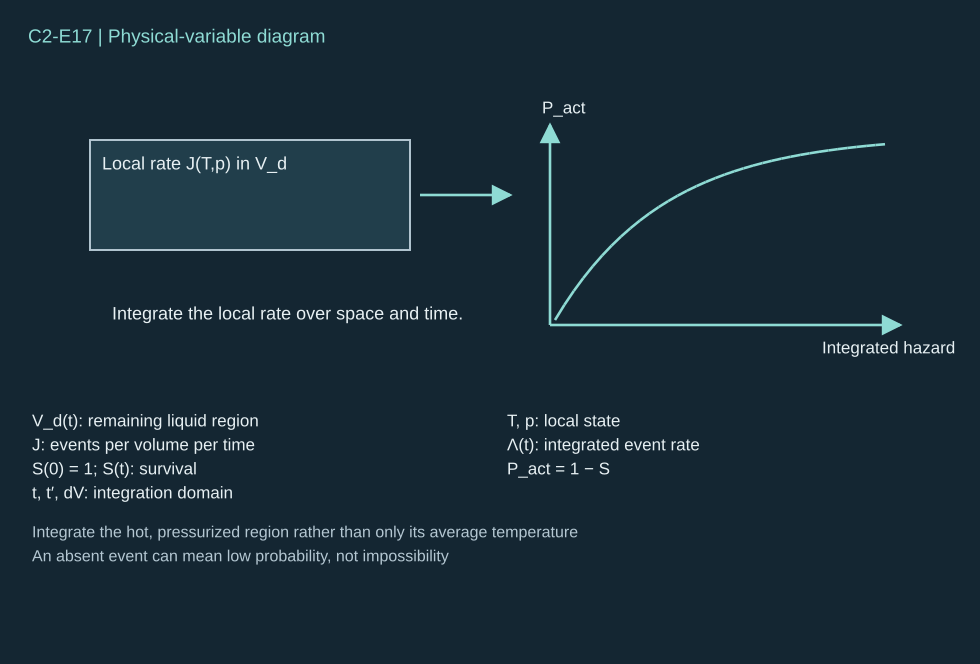

Activation probability requires the rate and the time spent in the activating state.

激活概率需要速率及处于可激活状态的时长。

## 2.4 Phase mass and energy balances

## 2.4 相质量与能量平衡

**Step 16 — Conserve PFC inventory.** Initial mass equals liquid density × core volume. Without external supply, liquid, vapor, dissolved and escaped PFC sum to that mass. Escaped mass is cumulative. It differs from vapor retained inside the bubble. Water supplies no additional PFC.

**步骤 16——PFC 物质量守恒。** 初始质量等于液体密度 × 核心体积。无外部供给时，液体、蒸气、溶解及逸出 PFC 之和等于初始质量。逸出质量按累计记账，与气泡内保留蒸气不同。水不能补充 PFC。

**Symbols before Eq. (C2-E18).**

**式（C2-E18）前的符号定义。**

| First individual definition / 第一项单独定义 | Second individual definition / 第二项单独定义 |
| --- | --- |
| $m_{\mathrm{PFC},0}$ is initial PFC mass (kg), 0 labeling the initial state $m_{\mathrm{PFC},0}$ 为初始 PFC 质量（kg），0 表示初始状态 | $\rho_d>0$ is initial PFC-liquid density (kg m⁻³), d labeling droplet $\rho_d>0$ 为初始 PFC 液体密度（kg m⁻³），d 表示液滴 |
| $a_0>0$ is initial core radius (m) $a_0>0$ 为初始核心半径（m） | $m_l$ — Remaining liquid-PFC mass (kg) $m_l$ — 剩余液态 PFC 质量（kg） |
| $m_v$ — PFC vapor mass (kg) $m_v$ — PFC 蒸气质量（kg） | $m_{\mathrm{diss}}$ — Dissolved PFC mass (kg) $m_{\mathrm{diss}}$ — 溶解 PFC 质量（kg） |
| $m_{\mathrm{esc}}\ge0$ — Cumulative escaped PFC mass (kg) $m_{\mathrm{esc}}\ge0$ — 累计逸出 PFC 质量（kg） | $\pi$ is the circular constant (dimensionless) $\pi$ 为圆周率（无量纲） |

**Conventions and conditions.** the l, v, diss, and esc labels name those compartments; The bound assumes no subsequent PFC supply.

**约定与条件。** l、v、diss、esc 分别标记这些部分；质量上界假设后续没有 PFC 供应。

(C2-E18) · Exact compound-mass ledger under the stated closed supply / 所述封闭供给条件下化合物质量的精确收支

$$
m_{\mathrm{PFC},0}=\frac{4\pi}{3}\rho_da_0^3,\qquad m_l+m_v+m_{\mathrm{diss}}+m_{\mathrm{esc}}=m_{\mathrm{PFC},0},\qquad 0\le m_v\le m_{\mathrm{PFC},0}
$$

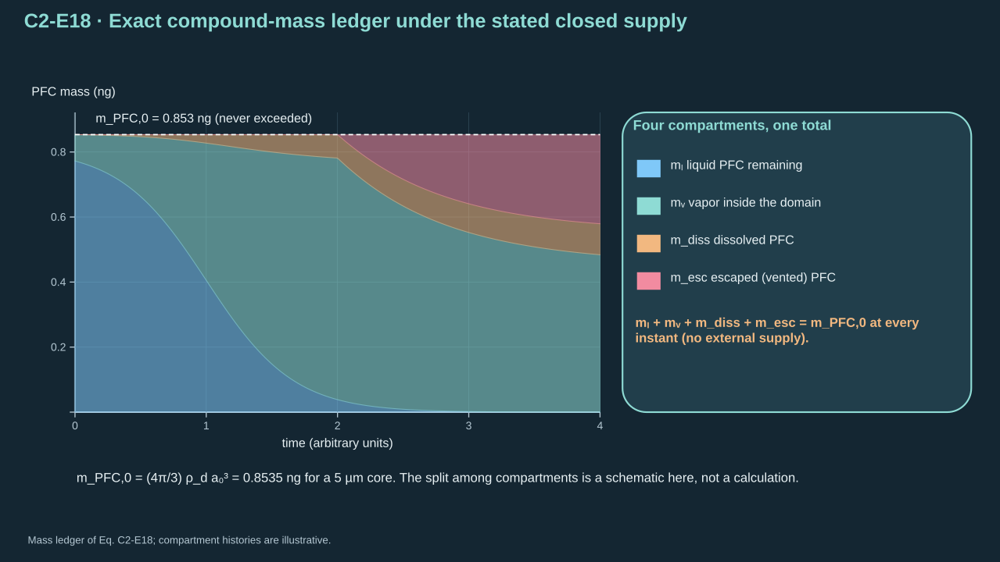

The compound ledger survives expansion, condensation, dissolution, and venting.

化合物账目在膨胀、凝结、溶解及排气过程中均成立。

**Step 17 — Identify the phase-change surface.** Integrate species flux over its contacted interface. Full spherical area requires full species contact and uniform flux. Residual PFC in water can have a smaller vaporization surface.

**步骤 17——确定相变表面。** 在组分实际接触的界面上积分通量。采用完整球面面积需该组分接触全表面且通量均匀。水中残留 PFC 可具有更小汽化表面。

**Symbols before Eq. (C2-E19).**

**式（C2-E19）前的符号定义。**

| First individual definition / 第一项单独定义 | Second individual definition / 第二项单独定义 |
| --- | --- |
| $m_{v,s}$ is vapor mass of species $s$ (kg), where $s$ labels a specified species such as PFC or water $m_{v,s}$ 为组分 $s$ 的蒸汽质量（kg） | $j_s$ is signed liquid-to-vapor mass flux (kg m⁻² s⁻¹) $j_s$ 为带符号液到汽质量通量（kg m⁻² s⁻¹） |
| $\Gamma_s$ is the species-contacting interface (—) $\Gamma_s$ 为该组分接触的界面（—） | $dA$ is its area element (m²) $dA$ 为面积元（m²） |
| $R>0$ is spherical interface radius (m) only in the special second formula $R>0$ 仅在第二个特殊式中表示球形界面半径（m） | $\pi$ is the circular constant (dimensionless) $\pi$ 为圆周率（无量纲） |
| $s$ — Species index (dimensionless) $s$ — 组分指标（无量纲） |  |

**Conventions and conditions.** a dot is a time derivative (kg s⁻¹); the phase label isolates the phase-change contribution, excluding escape and dissolution; $\int$ is surface integration.

**约定与条件。** 上点表示时间导数（kg s⁻¹）；phase 标记单独的相变贡献，不含逸出与溶解；$\int$ 为面积积分。

(C2-E19) · Species phase-mass balance / 组分的分相质量平衡

$$
\left.\dot m_{v,s}\right|_{\mathrm{phase}}=\int_{\Gamma_s}j_s\,dA,\qquad \left.\dot m_{v,s}\right|_{\mathrm{phase}}=4\pi R^2j_s\quad\text{only for uniform complete spherical contact}
$$

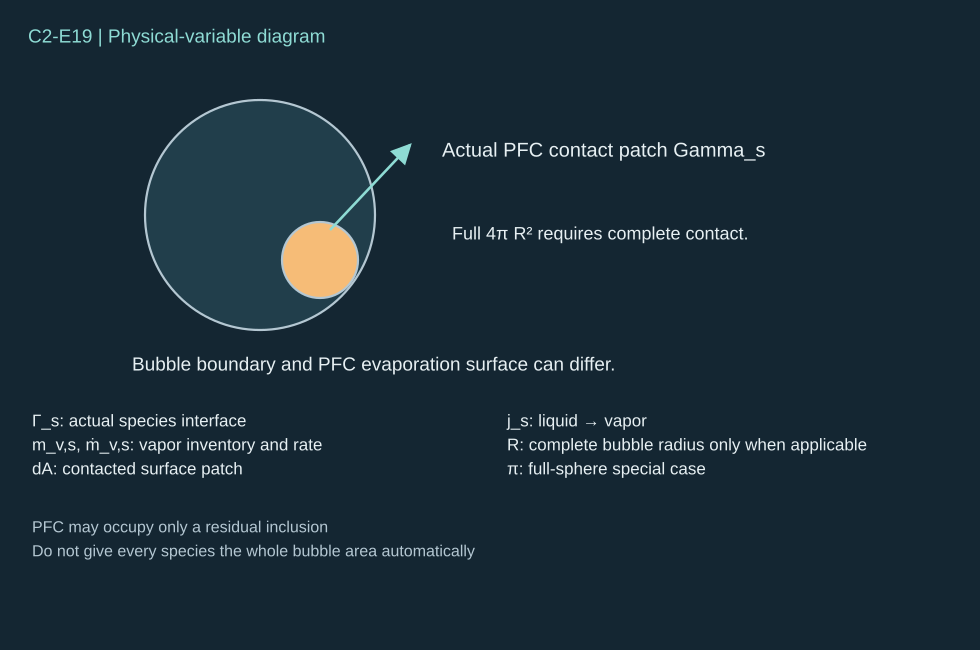

A bubble surface and a PFC evaporation surface need not be identical.

气泡表面与 PFC 蒸发表面未必相同。

**Step 18 — Derive velocity slip.** A single-component phase boundary has equal mass flux on both sides. Inside a bubble, the liquid-to-vapor normal points inward. Project liquid velocity minus interface velocity onto that normal. The result is wall speed minus radial liquid speed. Solve for liquid speed. Equating potential-flow speed to wall speed then assumes small slip.

**步骤 18——推导速度滑移。** 单组分相界面两侧质量通量相等。气泡内液体指向蒸气的法向朝内。将液体速度减界面速度投影至该法向，得到壁面速度减径向液速。由此求液速。将势流液速等同壁速需要小滑移假设。

**Symbols before Eq. (C2-E20).**

**式（C2-E20）前的符号定义。**

| First individual definition / 第一项单独定义 | Second individual definition / 第二项单独定义 |
| --- | --- |
| $j_s$ is single-component phase mass flux (kg m⁻² s⁻¹), s labeling that component $j_s$ 为单组分相变质量通量（kg m⁻² s⁻¹），s 标记该组分 | $\rho_l$ — Adjacent liquid density (kg m⁻³) $\rho_l$ — 邻接液体密度（kg m⁻³） |
| $\rho_v>0$ — Adjacent vapor density (kg m⁻³) $\rho_v>0$ — 邻接蒸气密度（kg m⁻³） | $\boldsymbol u_l$ — Adjacent liquid velocity (m s⁻¹) $\boldsymbol u_l$ — 邻接液体速度（m s⁻¹） |
| $\boldsymbol u_v$ — Adjacent vapor velocity (m s⁻¹) $\boldsymbol u_v$ — 邻接蒸气速度（m s⁻¹） | $\boldsymbol v_\Gamma$ is interface velocity (m s⁻¹) $\boldsymbol v_\Gamma$ 为界面速度（m s⁻¹） |
| $\boldsymbol n$ is unit normal liquid→vapor (dimensionless) $\boldsymbol n$ 为液→汽单位法向（无量纲） | $\boldsymbol e_r$ outward radial unit vector (dimensionless) $\boldsymbol e_r$ 为向外径向单位向量（无量纲） |
| $R>0$ is bubble radius (m) $R>0$ 为气泡半径（m） | $\dot R$ its time derivative (m s⁻¹) $\dot R$ 为其时间导数（m s⁻¹） |
| $u_l(R)$ is outward radial liquid velocity at the interface (m s⁻¹) $u_l(R)$ 为界面处向外径向液速（m s⁻¹） |  |

**Conventions and conditions.** $\cdot$ is a vector dot product.

**约定与条件。** $\cdot$ 为向量点积。

(C2-E20) · Exact single-component interface mass jump / 单组分界面的精确质量跃迁条件

$$
\begin{aligned}j_s&=\rho_l(\boldsymbol u_l-\boldsymbol v_\Gamma)\cdot\boldsymbol n=\rho_v(\boldsymbol u_v-\boldsymbol v_\Gamma)\cdot\boldsymbol n,\\\boldsymbol n&=-\boldsymbol e_r,\quad\boldsymbol v_\Gamma=\dot R\boldsymbol e_r,\quad j_s=\rho_l[\dot R-u_l(R)],\\u_l(R)&=\dot R-j_s/\rho_l.\end{aligned}
$$

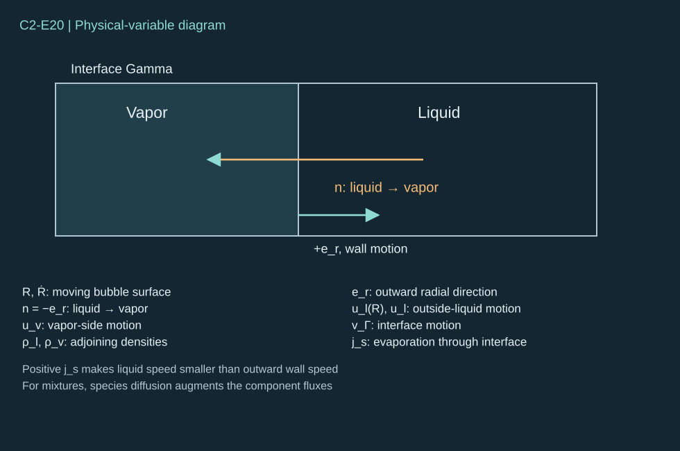

The interface need not move at the same speed as the adjacent liquid.

界面不必以邻接液体的速度运动。

Require $|j_s|/\rho_l$ below a relevant liquid or interface speed scale. At a turning point, use finite event speed instead of zero wall speed. Strong evaporation can add recoil stress. Check it before reusing Chapter 1’s simple wall stress. Mixtures require species diffusion, composition conditions and common mass balance.

要求 $|j_s|/\rho_l$ 小于相关液体或界面速率尺度。转折点处采用有限事件速率，避免除以零壁速。强蒸发可增加反冲应力。复用第一章简单壁面应力前须检验反冲。混合物需要组分扩散、组成条件和共同质量平衡。

**Step 19 — Derive the Stefan sign.** Omit surface heat storage and kinetic/mechanical jump corrections. Liquid-side conductive influx minus vapor-side outflux supplies phase-change enthalpy. Evaluate both enthalpies at matching temperature and reference conventions. Reversing heat supply gives negative flux. Condensation then releases latent enthalpy.

**步骤 19——推导 Stefan 符号。** 忽略界面热储存及动能、力学跳跃修正。液侧传导流入减汽侧流出，供给相变焓。两侧焓采用一致温度与参考约定。反转供热会产生负通量，凝结释放潜焓。

**Symbols before Eq. (C2-E21).**

**式（C2-E21）前的符号定义。**

| First individual definition / 第一项单独定义 | Second individual definition / 第二项单独定义 |
| --- | --- |
| $L_{v,s}>0$ is latent enthalpy per species mass (J kg⁻¹) $L_{v,s}>0$ 为单位组分质量的潜焓（J kg⁻¹） | $h_{v,s}$ — Specific vapor enthalpy of species s at the actual boundary state (J kg⁻¹) $h_{v,s}$ — 实际边界状态下组分 s 的蒸气比焓（J kg⁻¹） |
| $h_{l,s}$ — Specific liquid enthalpy of species s at the interface (J kg⁻¹) $h_{l,s}$ — 界面处组分 s 的液体比焓（J kg⁻¹） | $j_s$ is signed evaporation flux (kg m⁻² s⁻¹) $j_s$ 为带符号蒸发通量（kg m⁻² s⁻¹） |
| $\boldsymbol q_l$ — Liquid-side conductive heat flux (W m⁻²) $\boldsymbol q_l$ — 液体侧传导热通量（W m⁻²） | $\boldsymbol q_v$ — Vapor-side conductive heat flux (W m⁻²) $\boldsymbol q_v$ — 蒸气侧传导热通量（W m⁻²） |
| $\boldsymbol n$ points liquid→vapor (dimensionless) $\boldsymbol n$ 从液指向汽（无量纲） | $\eta\in\{l,v\}$ labels phase (dimensionless) $\eta\in\{l,v\}$ 表示相（无量纲） |
| $k_\eta$ — Thermal conductivity of the selected phase (W m⁻¹ K⁻¹) $k_\eta$ — 所选相的导热系数（W m⁻¹ K⁻¹） | $T_\eta$ — Temperature of the selected phase (K) $T_\eta$ — 所选相的温度（K） |

**Conventions and conditions.** $\nabla$ is spatial gradient (m⁻¹); $\cdot$ is a vector dot product; All terms in the heat jump have units W m⁻².

**约定与条件。** $\nabla$ 为空间梯度（m⁻¹）；$\cdot$ 为向量点积；热跳跃式各项单位均为 W m⁻²。

(C2-E21) · Reduced interfacial energy jump and Fourier law / 简化界面能量跃迁条件与傅里叶定律

$$
L_{v,s}=h_{v,s}-h_{l,s}>0,\qquad j_sL_{v,s}=(\boldsymbol q_l-\boldsymbol q_v)\cdot\boldsymbol n,\qquad\boldsymbol q_\eta=-k_\eta\nabla T_\eta\quad(\eta=l,v)
$$

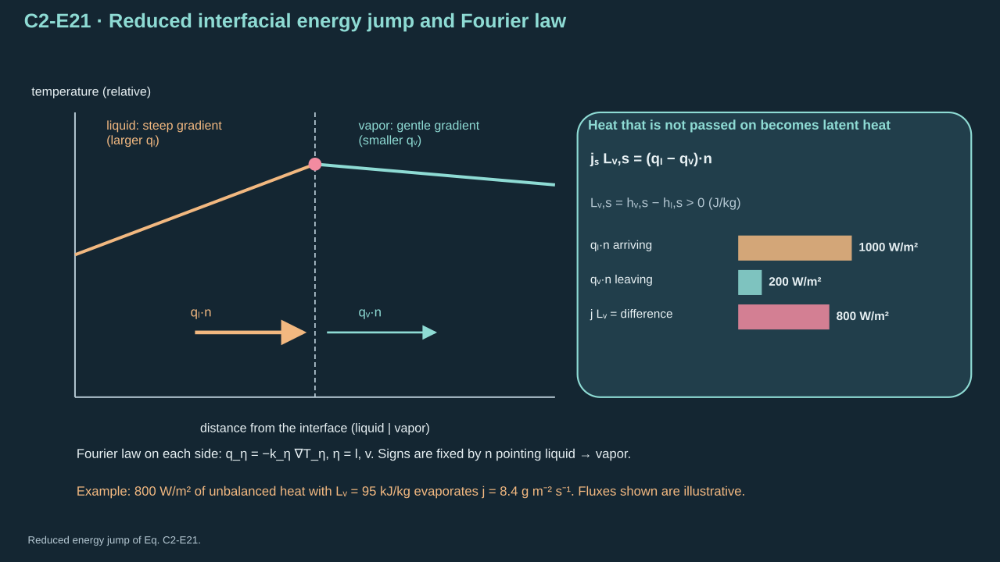

The liquid-to-vapor normal fixes the signs of heat and phase flux.

液到汽法向确定热通量及相变通量符号。

For a sign control, prescribe normal heat supply 0.95 MW m⁻², zero vapor-side loss, and latent enthalpy 95 kJ kg⁻¹. Stefan flux is 10 kg m⁻² s⁻¹. With adjacent density 1000 kg m⁻³, slip is 0.010 m s⁻¹. With PFC density 1630 kg m⁻³, slip is 0.006135 m s⁻¹. Density belongs to the actual evaporating phase. Reversing heat reverses flux and slip. This checks units and sign. Actual nanoemulsion interface state remains unestablished.

符号对照给定法向供热 0.95 MW m⁻²、汽侧损失为零、潜焓 95 kJ kg⁻¹。Stefan 通量为 10 kg m⁻² s⁻¹。邻接密度取 1000 kg m⁻³ 时，滑移为 0.010 m s⁻¹。PFC 密度取 1630 kg m⁻³ 时，滑移为 0.006135 m s⁻¹。密度应属于实际蒸发相。反转供热会反转通量与滑移。这检验单位与符号。实际纳米乳液界面状态尚未确立。

**Step 20 — Apply the bubble first law.** Use a uniform-state open vapor control volume. Incoming mass carries enthalpy, including entry flow work. Expansion performs work on the surroundings. Count conductive heat separately. Omit resolved internal kinetic energy and surface storage. Outgoing mass carries its own boundary enthalpy. Each flux requires a consistent boundary state.

**步骤 20——应用气泡第一定律。** 将蒸气作为均匀状态开放控制体。流入质量携带焓，包括进入所需流动功。膨胀对外做功，传导热单独计入。忽略解析内部动能和界面储存。流出质量携带其边界焓。各通量均需一致边界状态。

**Symbols before Eq. (C2-E22).**

**式（C2-E22）前的符号定义。**

| First individual definition / 第一项单独定义 | Second individual definition / 第二项单独定义 |
| --- | --- |
| $U_b$ is bubble internal energy (J) $U_b$ 为气泡内能（J） | $\dot Q_b$ is net conductive heat into the bubble (W), excluding transported mass enthalpy $\dot Q_b$ 为进入气泡的净传导热（W），不含随质量输运的焓 |
| $p_b$ is uniform absolute bubble pressure (Pa) $p_b$ 为均匀绝对气泡压力（Pa） | $V_b$ is bubble volume (m³) $V_b$ 为气泡体积（m³） |
| $R>0$ is radius in the spherical control (m) $R>0$ 为球形参照的半径（m） | $h_{v,s}$ is boundary specific vapor enthalpy of species s (J kg⁻¹) $h_{v,s}$ 为组分 s 的边界蒸汽比焓（J kg⁻¹） |
| $\dot m_{v,s}$ is its signed net mass-entry rate (kg s⁻¹) $\dot m_{v,s}$ 为其带符号净流入质量速率（kg s⁻¹） | $s=1,\ldots,N_s$ — Species index, from 1 through the declared species count (dimensionless) $s=1,\ldots,N_s$ — 从 1 到所声明组分数的组分指标（无量纲） |
| $\pi$ is the circular constant (dimensionless) $\pi$ 为圆周率（无量纲） | $N_s$ — Number of declared species (dimensionless) $N_s$ — 声明的组分数（无量纲） |

**Conventions and conditions.** $\sum$ is summation; a dot is a time derivative; Distinct entry/exit states require distinct summed boundary terms.

**约定与条件。** $\sum$ 为求和；上点为时间导数；不同流入／流出状态要求分别求和其边界项。

(C2-E22) · Uniform-state open-bubble first-law model / 均匀状态开放气泡的热力学第一定律模型

$$
\dot U_b=\dot Q_b-p_b\dot V_b+\sum_{s=1}^{N_s}h_{v,s}\dot m_{v,s},\qquad V_b=\frac{4\pi}{3}R^3,\qquad\dot V_b=4\pi R^2\dot R
$$

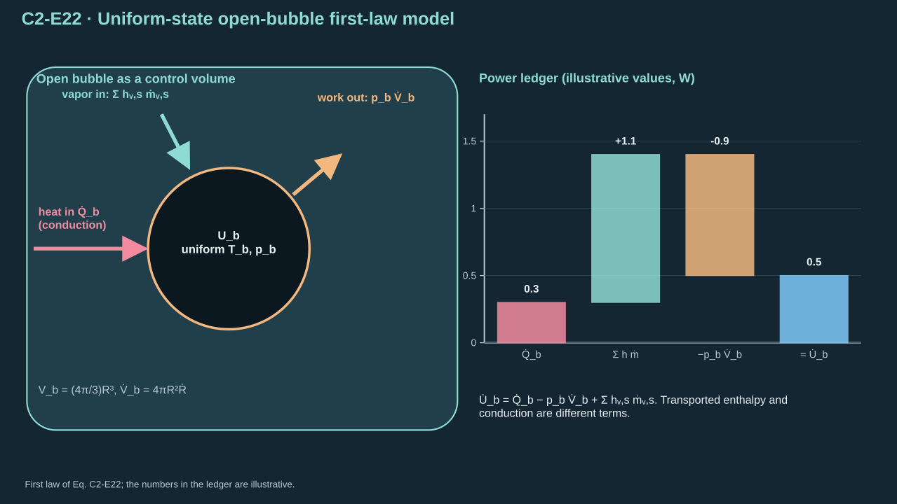

Mass enthalpy and conductive heat are different terms in the bubble ledger.

质量焓与传导热是气泡账目中的不同项。

**Step 21 — Expand the temperature derivative.** Assume common temperature and ideal species energies dependent on temperature. Differentiate each mass × specific-energy product. Constant-volume specific heat is the specific-energy derivative. Subtract bulk internal energy from boundary enthalpy. This gives pressure flow work when both states match. Different entry temperature adds a sensible internal-energy difference. The expansion retains changing vapor mass explicitly.

**步骤 21——展开温度导数。** 假设共同温度，理想组分内能随温度变化。对各质量 × 比内能乘积求导。定容比热等于比内能温度导数。边界焓减去体相比内能，在状态一致时给出压力流动功。入口温度不同时，还包含显内能差。展开式明确保留蒸气质量变化。

**Symbols before Eq. (C2-E23).**

**式（C2-E23）前的符号定义。**

| First individual definition / 第一项单独定义 | Second individual definition / 第二项单独定义 |
| --- | --- |
| $U_b$ is internal energy (J) $U_b$ 为内能（J） | $m_{v,s}$ is species vapor mass (kg) $m_{v,s}$ 为组分蒸汽质量（kg） |
| $e_s(T_b)$ is specific internal energy using a consistent reference (J kg⁻¹) $e_s(T_b)$ 为采用一致参考的比内能（J kg⁻¹） | $T_b$ is common bubble temperature (K) $T_b$ 为共同气泡温度（K） |
| $c_{v,s}=de_s/dT_b$ is constant-volume specific heat (J kg⁻¹ K⁻¹) $c_{v,s}=de_s/dT_b$ 为定容比热（J kg⁻¹ K⁻¹） | $h_{v,s}$ is actual boundary specific enthalpy (J kg⁻¹) $h_{v,s}$ 为实际边界比焓（J kg⁻¹） |
| $\dot Q_b$ is conductive heat input (W) $\dot Q_b$ 为传导热输入（W） | $p_b$ — Uniform total absolute bubble pressure (Pa) $p_b$ — 均匀总绝对气泡压力（Pa） |
| $V_b$ — Bubble volume (m³) $V_b$ — 气泡体积（m³） | $s=1,\ldots,N_s$ — Species index, from 1 through the declared species count (dimensionless) $s=1,\ldots,N_s$ — 从 1 到所声明组分数的组分指标（无量纲） |
| $N_s$ — Number of declared species (dimensionless) $N_s$ — 声明的组分数（无量纲） |  |

**Conventions and conditions.** a dot denotes a time derivative; $d/dT_b$ is temperature differentiation; Boundary temperature may differ from $T_b$ and must then be used in $h_{v,s}$.

**约定与条件。** 上点表示时间导数；$d/dT_b$ 为温度求导；边界温度可不同于 $T_b$，此时 $h_{v,s}$ 必须使用边界温度。

(C2-E23) · Product-rule derivation of thermal closure / 通过乘积求导法则推导热学闭合关系

$$
\begin{aligned}U_b&=\sum_{s=1}^{N_s}m_{v,s}e_s(T_b),\qquad c_{v,s}=de_s/dT_b,\\\dot U_b&=\left(\sum_s m_{v,s}c_{v,s}\right)\dot T_b+\sum_s e_s\dot m_{v,s},\\\left(\sum_s m_{v,s}c_{v,s}\right)\dot T_b&=\dot Q_b-p_b\dot V_b+\sum_s(h_{v,s}-e_s)\dot m_{v,s}.\end{aligned}
$$

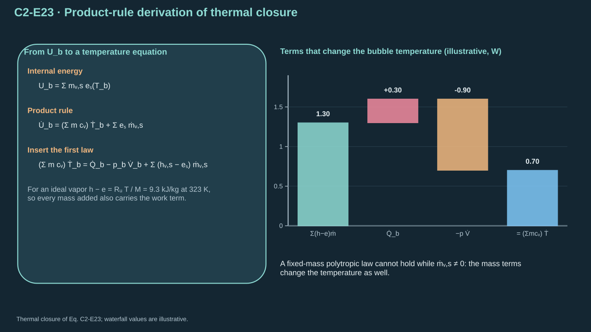

A variable vapor mass makes a fixed-mass polytropic shortcut conditional.

蒸汽质量变化，使固定质量多方捷径只能有条件成立。

Use consistent enthalpy references in Stefan and bubble balances. Interface heat creates the specified incoming vapor enthalpy. Adding another latent source to Eq. (C2-E22) duplicates that conversion. Fixed-mass adiabatic expansion lowers bubble energy. Cooling and condensation can lower pressure. Slow mass exchange can retain vapor and cushion collapse. Dissolution, permanent gas and escape need separate balances.

Stefan 与气泡平衡采用一致焓参考。界面热产生指定的流入蒸气焓。再向式（C2-E22）加入潜热源会重复计入转化。固定质量绝热膨胀降低气泡能量。冷却与凝结可降低压力。质量交换慢时可保留蒸气并缓冲塌缩。溶解、非凝结气体及逸出需独立平衡。

Specify nonzero seed volume, species masses and temperature after nucleation. Also specify initial interface shape and velocity. All seeds must satisfy inventory and energy balances. Onset probability leaves these states unresolved. Before vapor appears, use liquid heating and activation equations. Zero vapor heat capacity excludes starting with the bubble temperature equation.

成核后须指定非零种子体积、组分质量和温度，以及初始界面形状和速度。所有种子均须满足物质与能量平衡。起始概率不能确定这些状态。蒸气出现前采用液体加热及激活方程。蒸气热容为零时，不能用气泡温度方程启动。

**Step 22 — Close pressure with an EOS.** In a dilute ideal mixture, each partial pressure follows species moles, common temperature and volume. Sum all species, including permanent gas. High-density compression requires a real-fluid or mixture EOS. Antoine saturation and a fixed polytropic exponent leave that state closure unresolved.

**步骤 22——用状态方程闭合压力。** 稀薄理想混合物中，各分压由组分摩尔数、共同温度和体积决定。求和所有组分，包括非凝结气体。高密度压缩需要真实流体或混合物状态方程。Antoine 饱和关系与固定多方指数不能闭合该状态。

**Symbols before Eq. (C2-E24).**

**式（C2-E24）前的符号定义。**

| First individual definition / 第一项单独定义 | Second individual definition / 第二项单独定义 |
| --- | --- |
| $p_{v,s}$ is ideal partial pressure of species s (Pa), v naming the vapor-domain component $p_{v,s}$ 为组分 s 的理想分压（Pa），v 标记蒸汽域组分 | $V_b>0$ is bubble volume (m³) $V_b>0$ 为气泡体积（m³） |
| $m_{v,s}\ge0$ is its mass (kg) $m_{v,s}\ge0$ 为其质量（kg） | $M_s>0$ is molar mass (kg mol⁻¹) $M_s>0$ 为摩尔质量（kg mol⁻¹） |
| $R_u=8.314462618$ J mol⁻¹ K⁻¹ is the universal gas constant $R_u=8.314462618$ J mol⁻¹ K⁻¹ 为通用气体常数 | $T_b>0$ is bulk temperature (K) $T_b>0$ 为体相温度（K） |
| $p_b$ is total pressure (Pa) $p_b$ 为总压力（Pa） | $s=1,\ldots,N_s$ — Species index, from 1 through the declared species count (dimensionless) $s=1,\ldots,N_s$ — 从 1 到所声明组分数的组分指标（无量纲） |
| $\mathcal P$ is a specified equation-of-state function (—) $\mathcal P$ 为明确的状态方程函数（—） | $\rho_b$ mixture density (kg m⁻³) $\rho_b$ 为混合物密度（kg m⁻³） |
| $e_b$ specific internal energy (J kg⁻¹) $e_b$ 为比内能（J kg⁻¹） | $\boldsymbol Y$ the species mass-fraction vector (dimensionless, entries summing to one) $\boldsymbol Y$ 为组分质量分数向量（无量纲，各分量之和为一） |
| $N_s$ — Number of declared species (dimensionless) $N_s$ — 声明的组分数（无量纲） |  |

**Conventions and conditions.** $\sum$ is summation; EOS means equation of state.

**约定与条件。** $\sum$ 为求和；EOS 指状态方程。

(C2-E24) · Ideal-mixture constitutive control and required refinement / 理想混合物本构对照模型与所需改进

$$
p_{v,s}V_b=\frac{m_{v,s}}{M_s}R_uT_b,\qquad p_b=\sum_{s=1}^{N_s}p_{v,s},\qquad p_b=\mathcal P(\rho_b,e_b,\boldsymbol Y)\quad\text{for a stated real-mixture EOS}
$$

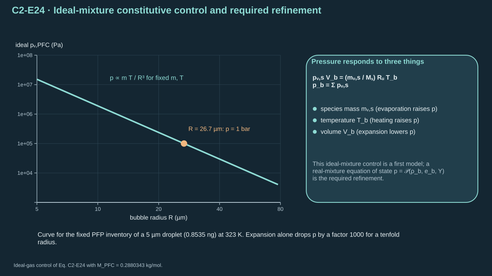

The pressure responds to species masses, temperature, and changing volume.

压力响应组分质量、温度及体积变化。

**Step 23 — Separate pressure-change terms.** Require positive species mass, temperature, pressure and volume. Take the ideal-law logarithm and differentiate. The terms represent mass change, temperature change and compression. At zero species mass, use Eq. (C2-E24) directly.

**步骤 23——分离压力变化项。** 要求组分质量、温度、压力及体积为正。对理想定律取对数并求导，分离质量变化、温度变化及压缩项。组分质量为零时，直接采用式（C2-E24）。

**Symbols before Eq. (C2-E25).**

**式（C2-E25）前的符号定义。**

| First individual definition / 第一项单独定义 | Second individual definition / 第二项单独定义 |
| --- | --- |
| $p_{v,s}>0$ is species partial pressure (Pa) $p_{v,s}>0$ 为组分分压（Pa） | $m_{v,s}>0$ is its vapor-domain mass (kg), s labeling species $m_{v,s}>0$ 为其蒸汽域质量（kg），s 表示组分 |
| $T_b>0$ is bubble temperature (K) $T_b>0$ 为气泡温度（K） | $V_b>0$ is volume (m³) $V_b>0$ 为体积（m³） |
| $R>0$ is radius for a spherical bubble (m) $R>0$ 为球形气泡半径（m） |  |

**Conventions and conditions.** a dot is a time derivative; Every ratio has units s⁻¹; the final equality uses $V_b=4\pi R^3/3$ and is restricted to spherical geometry.

**约定与条件。** 上点表示时间导数；各比值单位均为 s⁻¹；最后一个等式使用 $V_b=4\pi R^3/3$，仅限球形几何。

(C2-E25) · Derived ideal-pressure evolution identity / 推导得到的理想气体压力演化恒等式

$$
\frac{\dot p_{v,s}}{p_{v,s}}=\frac{\dot m_{v,s}}{m_{v,s}}+\frac{\dot T_b}{T_b}-\frac{\dot V_b}{V_b}=\frac{\dot m_{v,s}}{m_{v,s}}+\frac{\dot T_b}{T_b}-3\frac{\dot R}{R}\quad\text{(sphere)}
$$

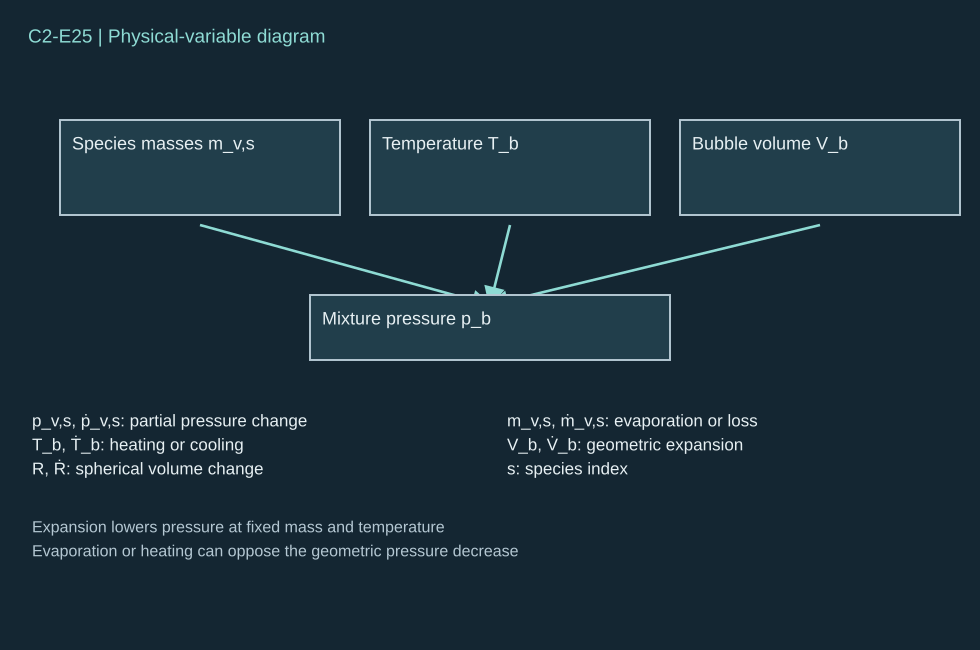

A radius-only gas law hides mass and thermal changes.

仅由半径决定的气体定律会隐藏质量与热变化。

**Step 24 — Limit saturation by inventory.** Prescribe temperature and free vapor volume in a closed nondissolving control. Saturated mass equals pressure × volume/(gas constant × temperature). If it exceeds supply, all PFC vaporizes and partial pressure falls below saturation. Assume rapid equilibrium, negligible curvature corrections and coexistence conditions. This algebra supplies an equilibrium control, not a rate law.

**步骤 24——用物质量限制饱和。** 在封闭、无溶解对照中给定温度及自由蒸气体积。饱和质量等于压力 × 体积／（气体常数 × 温度）。所需质量超过供给时，PFC 全部汽化，分压低于饱和。假设快速平衡、曲率修正可忽略并满足共存条件。该代数关系是平衡对照，并非速率规律。

**Symbols before Eq. (C2-E26).**

**式（C2-E26）前的符号定义。**

| First individual definition / 第一项单独定义 | Second individual definition / 第二项单独定义 |
| --- | --- |
| $m_{v,\mathrm{eq}}$ is equilibrium PFC vapor mass (kg), eq labeling the restricted equilibrium control $m_{v,\mathrm{eq}}$ 为平衡 PFC 蒸汽质量（kg），eq 标记受限平衡参照 | $m_{\mathrm{PFC},0}$ is finite initial supply (kg) $m_{\mathrm{PFC},0}$ 为有限初始供应（kg） |
| $M_{\mathrm{PFC}}$ is PFC molar mass (kg mol⁻¹) $M_{\mathrm{PFC}}$ 为 PFC 摩尔质量（kg mol⁻¹） | $p_{\mathrm{sat,PFC}}(T_b)$ is bulk saturation pressure (Pa) $p_{\mathrm{sat,PFC}}(T_b)$ 为体相饱和蒸汽压（Pa） |
| $p_{v,\mathrm{PFC,eq}}$ is ideal equilibrium PFC partial pressure (Pa) $p_{v,\mathrm{PFC,eq}}$ 为理想平衡 PFC 分压（Pa） | $T_b>0$ is prescribed temperature (K) $T_b>0$ 为给定温度（K） |
| $V_b>0$ is available vapor volume (m³) $V_b>0$ 为可用蒸汽体积（m³） | $R_u$ is universal gas constant (J mol⁻¹ K⁻¹) $R_u$ 为通用气体常数（J mol⁻¹ K⁻¹） |

**Conventions and conditions.** The supply is closed and nondissolving, and mass exchange is assumed fast; $\min$ selects the lesser nonnegative argument.

**约定与条件。** 供应闭合且不溶解，并假设质量交换迅速；$\min$ 选择较小非负值。

(C2-E26) · Finite-inventory equilibrium benchmark / 有限存量的平衡基准模型

$$
m_{v,\mathrm{eq}}=\min\!\left[m_{\mathrm{PFC},0},\frac{M_{\mathrm{PFC}}p_{\mathrm{sat,PFC}}(T_b)V_b}{R_uT_b}\right],\qquad p_{v,\mathrm{PFC,eq}}=\min\!\left[p_{\mathrm{sat,PFC}}(T_b),\frac{m_{\mathrm{PFC},0}R_uT_b}{M_{\mathrm{PFC}}V_b}\right]
$$

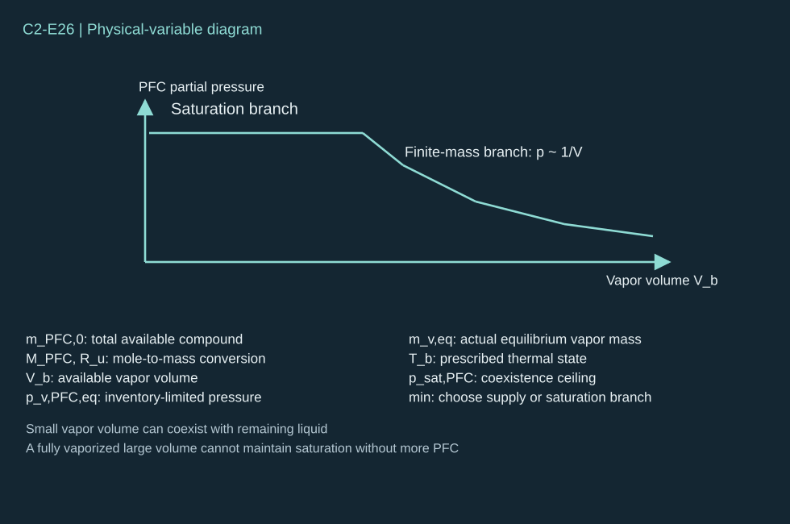

The saturation branch ends when the finite liquid inventory is exhausted.

有限液体库存耗尽时，饱和分支终止。

## 2.5 Single-core numerical example

## 2.5 单核心数值示例

Prescribe a 5 μm PFP-like liquid core at 293 K. Final vapor reference temperature is 323 K. Use density 1630 kg m⁻³, liquid heat capacity 654 J kg⁻¹ K⁻¹, and latent enthalpy 95 kJ kg⁻¹. Molar mass is the named PFP value. Size, density, constant coefficients and final state are teaching inputs. The latent value is not a 323 K NIST datum. Verified nanoformulation properties remain unestablished.

规定 293 K、半径 5 μm 的类 PFP 液核。最终蒸气参照温度为 323 K。采用密度 1630 kg m⁻³、液体热容 654 J kg⁻¹ K⁻¹、潜焓 95 kJ kg⁻¹。摩尔质量采用具名 PFP 数值。尺寸、密度、常系数及最终状态为教学输入。潜焓并非 323 K 的 NIST 数据。已验证纳米配方物性尚未确立。

**Step 25 — Calculate initial mass.** Cube radius in meters. Multiply by density and the sphere-volume factor. One nanogram equals $10^{-12}$ kg.

**步骤 25——计算初始质量。** 将以米计的半径取三次方，乘以密度和球体积系数。一纳克等于 $10^{-12}$ kg。

**Symbols before Eq. (C2-E27).**

**式（C2-E27）前的符号定义。**

| First individual definition / 第一项单独定义 | Second individual definition / 第二项单独定义 |
| --- | --- |
| $m_{\mathrm{PFC},0}$ is initial PFC mass (kg), 0 labeling initial state $m_{\mathrm{PFC},0}$ 为初始 PFC 质量（kg），0 表示初态 | $\pi$ is the circular constant (dimensionless) $\pi$ 为圆周率（无量纲） |

**Conventions and conditions.** 1630 is density in kg m⁻³; $5\times10^{-6}$ is initial radius in m; the cube is a power; ng denotes nanogram; $1$ ng = $10^{-12}$ kg.

**约定与条件。** 1630 为以 kg m⁻³ 计的密度；$5\times10^{-6}$ 为以 m 计的初始半径；立方表示幂；ng 为纳克；$1$ ng = $10^{-12}$ kg。

(C2-E27) · Finite-mass worked calculation / 有限质量的完整示例计算

$$
m_{\mathrm{PFC},0}=\frac{4\pi}{3}(1630)(5\times10^{-6})^3=8.534660\times10^{-13}\ \mathrm{kg}=0.853466\ \mathrm{ng}
$$

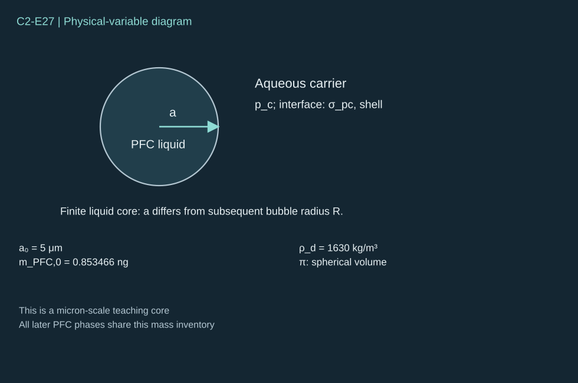

A mass ledger begins with the actual core volume.

质量账目从实际核心体积开始。

**Step 26 — Estimate preparation enthalpy.** Prescribe heating followed by vaporization near constant pressure. Use constant heat capacity and latent enthalpy. Sensible energy equals mass × heat capacity × temperature rise. Latent energy equals mass × latent enthalpy. This screen omits pressure-path detail, carrier heat, shell work, gradients and losses. Activation threshold and jet energy remain unestablished.

**步骤 26——估算制备焓。** 规定近恒压下先加热再汽化，采用恒定热容和潜焓。显热等于质量 × 热容 × 温升，潜热等于质量 × 潜焓。该筛选省略详细压力路径、载液加热、壳层功、梯度及损失。激活阈值与射流能量尚未确立。

**Symbols before Eq. (C2-E28).**

**式（C2-E28）前的符号定义。**

| First individual definition / 第一项单独定义 | Second individual definition / 第二项单独定义 |
| --- | --- |
| $Q_{\mathrm{sens}}$ — Estimated sensible preparation energy (J) $Q_{\mathrm{sens}}$ — 估计的显热制备能量（J） | $Q_{\mathrm{lat}}$ — Estimated latent preparation energy (J) $Q_{\mathrm{lat}}$ — 估计的潜热制备能量（J） |
| $Q_{\mathrm{prep}}$ — Estimated total preparation energy (J) $Q_{\mathrm{prep}}$ — 估计的总制备能量（J） | $m_{\mathrm{PFC},0}$ is mass (kg) $m_{\mathrm{PFC},0}$ 为质量（kg） |
| $c_{p,d}=654$ J kg⁻¹ K⁻¹ is constant liquid heat capacity $c_{p,d}=654$ J kg⁻¹ K⁻¹ 为常液相比热容 | $T_*=323$ K is final reference temperature, star labeling the selected state rather than a critical nucleus $T_*=323$ K 为最终参照温度，此处星号标记所选状态，不是临界汽核 |
| $T_0=293$ K is initial temperature $T_0=293$ K 为初始温度 | $L_v=95000$ J kg⁻¹ is declared latent enthalpy $L_v=95000$ J kg⁻¹ 为声明的潜焓 |

**Conventions and conditions.** nJ means $10^{-9}$ J; $\approx$ denotes the constant-property preparation estimate.

**约定与条件。** nJ 表示 $10^{-9}$ J；$\approx$ 表示常性质制备估计。

(C2-E28) · Declared preparation-path enthalpy estimate / 给定制备路径的焓估算

$$
\begin{aligned}Q_{\mathrm{sens}}&\approx m_{\mathrm{PFC},0}c_{p,d}(T_*-T_0)=(8.534660\times10^{-13})(654)(323-293)=16.7450\ \mathrm{nJ},\\Q_{\mathrm{lat}}&\approx m_{\mathrm{PFC},0}L_v=(8.534660\times10^{-13})(95000)=81.0793\ \mathrm{nJ},\\Q_{\mathrm{prep}}&\approx Q_{\mathrm{sens}}+Q_{\mathrm{lat}}=97.8243\ \mathrm{nJ}.\end{aligned}
$$

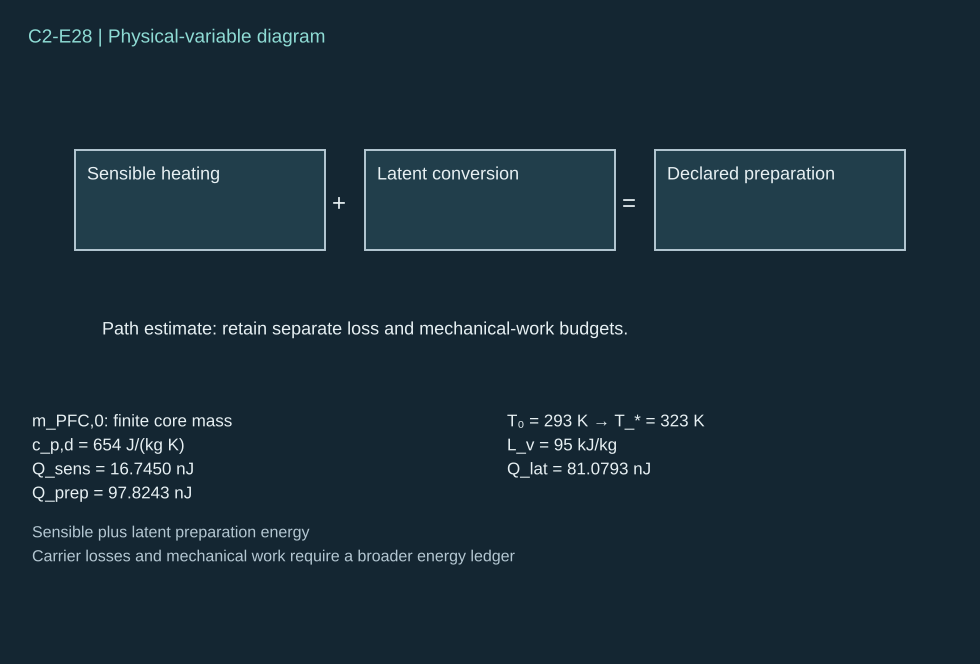

Most of this declared preparation estimate is latent enthalpy.

该制备估计中的大部分能量是潜焓。

**Refine the enthalpy path.** At near-constant pressure, heat subcooled liquid to saturation. Vaporize it, then heat vapor to the final temperature. Integrate each phase heat capacity over its own interval. The 97.82 nJ screen instead applies liquid heat capacity over 30 K plus fixed latent enthalpy. Exact endpoint enthalpy requires vapor heat capacity and the actual pressure path.

**细化焓路径。** 近恒压下先将过冷液体加热至饱和，再汽化，然后将蒸气加热至最终温度。分别在各温区积分对应相热容。97.82 nJ 筛选则在整个 30 K 温升使用液体热容，再加固定潜焓。精确终态焓需要蒸气热容及实际压力路径。

**Symbols before Eq. (C2-E29).**

**式（C2-E29）前的符号定义。**

| First individual definition / 第一项单独定义 | Second individual definition / 第二项单独定义 |
| --- | --- |
| $Q_{\mathrm{iso}}$ is heat needed for the stated constant-pressure preparation path (J), iso labeling isobaric $Q_{\mathrm{iso}}$ 为所述恒压制备路径的需热（J），iso 表示等压 | $m_{\mathrm{PFC},0}$ is conserved PFC mass (kg) $m_{\mathrm{PFC},0}$ 为守恒 PFC 质量（kg） |
| $p$ is prescribed constant pressure (Pa) $p$ 为给定常压力（Pa） | $T_0$ — Initial liquid temperature (K) $T_0$ — 初始液体温度（K） |
| $T_{\mathrm{sat}}$ — Liquid–vapor coexistence temperature at the prescribed pressure (K) $T_{\mathrm{sat}}$ — 给定压力下的液—汽共存温度（K） | $T_*$ — Selected final vapor temperature on the constant-pressure path (K) $T_*$ — 恒压路径上选定的最终蒸气温度（K） |
| $T$ is dummy integration temperature (K) $T$ 为积分哑温度（K） | $c_{p,l}$ — Temperature- and pressure-dependent liquid specific heat at constant pressure (J kg⁻¹ K⁻¹) $c_{p,l}$ — 依赖温度与压力的液体定压比热（J kg⁻¹ K⁻¹） |
| $c_{p,v}$ — Temperature- and pressure-dependent vapor specific heat at constant pressure (J kg⁻¹ K⁻¹) $c_{p,v}$ — 依赖温度与压力的蒸气定压比热（J kg⁻¹ K⁻¹） | $L_v(T_{\mathrm{sat}},p)$ is latent enthalpy at coexistence (J kg⁻¹) $L_v(T_{\mathrm{sat}},p)$ 为共存状态潜焓（J kg⁻¹） |

**Conventions and conditions.** $\int$ denotes temperature integration; No heat losses or other work are included; pressure work is already contained in this enthalpy path.

**约定与条件。** $\int$ 为温度积分；未计入热损失或其他做功；压力功已包含在该焓路径中。

(C2-E29) · Refined constant-pressure enthalpy path / 细化的恒压焓变化路径

$$
Q_{\mathrm{iso}}=m_{\mathrm{PFC},0}\!\left[\int_{T_0}^{T_{\mathrm{sat}}}c_{p,l}(T,p)\,dT+L_v(T_{\mathrm{sat}},p)+\int_{T_{\mathrm{sat}}}^{T_*}c_{p,v}(T,p)\,dT\right],\qquad T_0<T_{\mathrm{sat}}\le T_*
$$

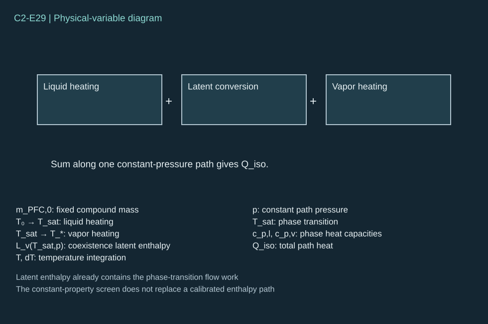

A rigorous preparation path uses the heat capacity of each phase over its own interval.

严谨制备路径在各相自身温区使用对应比热容。

**Step 27 — Calculate an inventory radius.** Fully vaporize the supply at 323 K and 100 kPa PFC partial pressure. Use the ideal-vapor control. Equate gas-law volume to initial volume × expansion factor. Cancel the positive sphere factor and take the positive cube root. The resulting radius belongs to the prescribed state. Dynamical maximum remains unestablished.

**步骤 27——计算物质量对应半径。** 在 323 K、PFC 分压 100 kPa 下完全汽化该供给，采用理想蒸气对照。令气体定律体积等于初始体积乘膨胀倍数。约去正球体系数并取正立方根。所得半径属于指定状态。动力学最大值尚未确立。

**Symbols before Eq. (C2-E30).**

**式（C2-E30）前的符号定义。**

| First individual definition / 第一项单独定义 | Second individual definition / 第二项单独定义 |
| --- | --- |
| $R_{b,\mathrm{inv}}>0$ is ideal inventory-state bubble radius (m), b naming bubble and inv naming inventory $R_{b,\mathrm{inv}}>0$ 为理想库存状态气泡半径（m），b 表示气泡，inv 表示库存 | $a_0=5$ μm is initial core radius $a_0=5$ μm 为初始核心半径 |
| $m_{\mathrm{PFC},0}$ is initial mass (kg) $m_{\mathrm{PFC},0}$ 为初始质量（kg） | $\rho_d=1630$ kg m⁻³ is original liquid density $\rho_d=1630$ kg m⁻³ 为初始液体密度 |
| $R_u=8.314462618$ J mol⁻¹ K⁻¹ is gas constant $R_u=8.314462618$ J mol⁻¹ K⁻¹ 为气体常数 | $T_*=323$ K is chosen final reference $T_*=323$ K 为选定最终参照 |
| $M_{\mathrm{PFC}}=0.2880343$ kg mol⁻¹ is PFP molar mass $M_{\mathrm{PFC}}=0.2880343$ kg mol⁻¹ 为 PFP 摩尔质量 | $p_{v,\mathrm{PFC}}=10^5$ Pa is chosen partial pressure $p_{v,\mathrm{PFC}}=10^5$ Pa 为所选分压 |
| $\pi$ is the circular constant (dimensionless) $\pi$ 为圆周率（无量纲） |  |

**Conventions and conditions.** powers 3 and 1/3 denote cube and positive cube root; The ratio is dimensionless.

**约定与条件。** 幂 3 和 1/3 表示立方及正立方根；该比值无量纲。

(C2-E30) · Derived ideal-vapor inventory radius / 由理想蒸气存量推导的半径

$$
\begin{aligned}\frac{4\pi}{3}R_{b,\mathrm{inv}}^3&=\frac{m_{\mathrm{PFC},0}R_uT_*}{M_{\mathrm{PFC}}p_{v,\mathrm{PFC}}}=\frac{4\pi}{3}\rho_da_0^3\frac{R_uT_*}{M_{\mathrm{PFC}}p_{v,\mathrm{PFC}}},\\\left(\frac{R_{b,\mathrm{inv}}}{a_0}\right)^3&=\frac{\rho_dR_uT_*}{M_{\mathrm{PFC}}p_{v,\mathrm{PFC}}}=151.9778,\\R_{b,\mathrm{inv}}&=a_0(151.9778)^{1/3}=26.6827\ \mu\mathrm m.\end{aligned}
$$

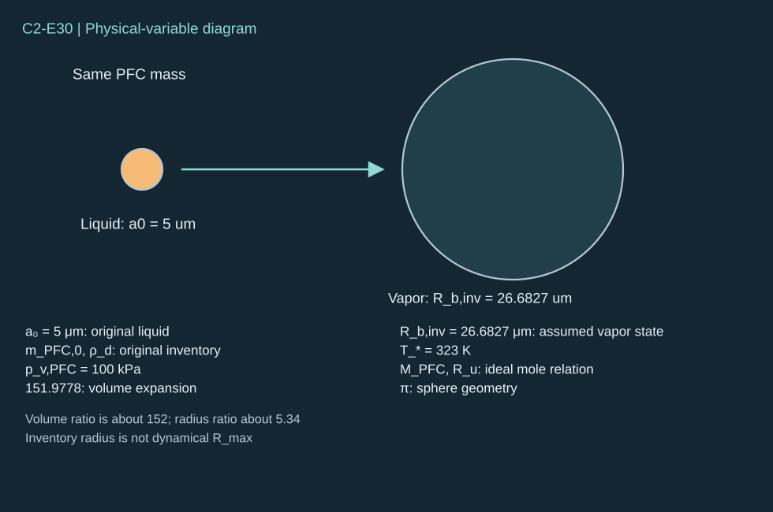

The expansion ratio follows from mass conservation at a stated pressure and temperature.

膨胀比来自指定压力与温度下的质量守恒。

At 323 K, 100 kPa lies below PFP saturation at 204.33 kPa. The control is fully vaporized and unsaturated. Substituting its computed radius into the ideal law recovers 100 kPa. At 30 μm, the entire inventory supplies 70.36 kPa PFC pressure. Sustained saturation there requires more PFC. Water vapor or gas adds pressure with separate mass and energy balances.

323 K 时，100 kPa 低于 PFP 饱和压 204.33 kPa。对照完全汽化且未饱和。将所得半径代回理想定律可恢复 100 kPa。30 μm 时，全部物质量提供 70.36 kPa PFC 分压。维持该尺寸饱和需要更多 PFC。水蒸气或气体可增加压力，但需独立质量与能量平衡。

**Step 28 — Compare absorbed and preparation energies.** Prescribe incident energy 1 μJ and beam radius 20 μm. Use centered aperture radius 10 μm, thickness 5 μm, absorption coefficient $2\times10^5$ m⁻¹, and reflection 0.10. Calculate interception and absorptance first. This hypothetical slab is independent of the cited activation experiments.

**步骤 28——比较吸收与制备能量。** 规定入射能量 1 μJ、光束半径 20 μm。居中孔径半径为 10 μm，厚度 5 μm，吸收系数 $2\times10^5$ m⁻¹，反射比例 0.10。先计算截获与吸收率。该假想薄层独立于所引激活实验。

**Symbols before Eq. (C2-E31).**

**式（C2-E31）前的符号定义。**

| First individual definition / 第一项单独定义 | Second individual definition / 第二项单独定义 |
| --- | --- |
| $f_{\mathrm{geo}}$ is interception fraction (dimensionless) $f_{\mathrm{geo}}$ 为截获比例（无量纲） | $A_\lambda$ is effective absorptance at the chosen wavelength $\lambda$ (m) $A_\lambda$ 为所选波长 $\lambda$（m）处的有效吸收率 |
| $E_{\mathrm{abs}}$ is absorbed energy (J) $E_{\mathrm{abs}}$ 为吸收能量（J） | $Q_{\mathrm{prep}}$ is declared preparation-energy estimate (J) $Q_{\mathrm{prep}}$ 为声明的制备能量估计（J） |
| $\eta_{\mathrm{th,min}}$ is the minimum heat-delivery fraction in this loss-excluding estimate, th naming thermal and min minimum (dimensionless) $\eta_{\mathrm{th,min}}$ 为该不含损失估计中的最低热输送比例，th 表示热学，min 表示最低（无量纲） | $\lambda$ — Laser wavelength (m) $\lambda$ — 激光波长（m） |

**Conventions and conditions.** both are dimensionless; The 10 and 20 are aperture and beam radii in the same μm unit; 0.10 is reflection fraction; $2\times10^5$ is absorption coefficient in m⁻¹; $5\times10^{-6}$ is thickness in m; μJ and nJ mean $10^{-6}$ J; $10^{-9}$ J; $e^x$ is the exponential.

**约定与条件。** 两者无量纲；10 和 20 是使用相同 μm 单位的窗口与光束半径；0.10 是反射比例；$2\times10^5$ 是以 m⁻¹ 计的吸收系数；$5\times10^{-6}$ 是以 m 计的厚度；μJ 与 nJ 分别为 $10^{-6}$ J 和 $10^{-9}$ J；$e^x$ 为指数函数。

(C2-E31) · Declared optical-to-heat energy screen / 给定光能转热能过程的能量筛查

$$
\begin{aligned}f_{\mathrm{geo}}&=1-e^{-2(10/20)^2}=0.393469,\\A_\lambda&=(1-0.10)[1-e^{-(2\times10^5)(5\times10^{-6})}]=0.568909,\\E_{\mathrm{abs}}&=(0.393469)(0.568909)(1\ \mu\mathrm J)=223.848\ \mathrm{nJ},\\\eta_{\mathrm{th,min}}&=Q_{\mathrm{prep}}/E_{\mathrm{abs}}=97.8243/223.848=0.437012.\end{aligned}
$$

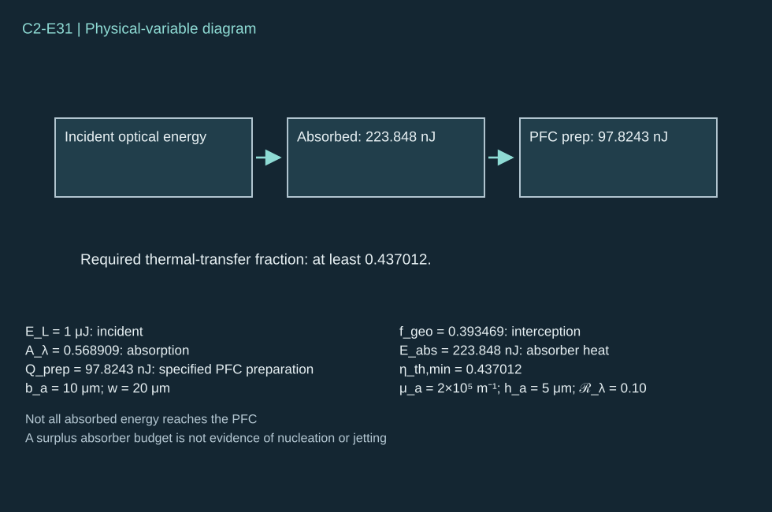

The preparation estimate demands at least 43.7% of the declared absorbed energy.

该制备估计要求至少 43.7% 的所声明吸收能量。

At 20% delivery, core heat is 44.77 nJ, below 97.82 nJ. At 50%, 111.92 nJ clears that screen. Nucleation, uniformity, shell opening and useful work remain unestablished. With fixed coefficients and states, halving radius reduces mass and preparation enthalpy eightfold. Ideal expansion factor stays fixed; capillary pressure doubles. Size changes inventory, diffusion distance and confinement together.

20% 输送时，核心热量为 44.77 nJ，低于 97.82 nJ。50% 时，111.92 nJ 超过筛选值。成核、均温、壳层开启及有用功尚未确立。系数与状态固定时，半径减半使质量与制备焓降至八分之一。理想膨胀倍数不变，毛细压力加倍。尺寸同时改变物质量、扩散距离与约束。

**Use in Chapter 3.** Twenty-five identical 5 μm cores contain 21.3367 ng PFC. Their preparation screens sum to 2.44561 μJ. These totals describe source mass and enthalpy. Available jet energy requires a separate conversion calculation. The optical slab above does not calibrate those cells. Chapter 3 states cell separation and conversion assumptions before calculating output.

**第三章的应用。** 二十五个相同 5 μm 核心含 21.3367 ng PFC，制备筛选值合计 2.44561 μJ。这些总量描述源质量和焓。可用射流能量需另算转换。上文光学薄层没有标定这些单元。第三章先规定单元分隔及转换假设，再计算输出。

**Missing formulation inputs.** Specify compound, purity, size distribution, shell and interface laws. Measure absorber spectrum, loading, location and thermal contact. Supply carrier transport, activation statistics, phase kinetics, permanent gas and high-state EOS. Project threshold, pressure maximum and jet velocity: Not established. Chapter 3 uses specified site histories for array calculations.

**缺失配方输入。** 须规定化合物、纯度、尺寸分布、壳层及界面规律。测量吸收体光谱、载量、位置及热接触。给出载液输运、激活统计、相变动力学、非凝结气体及高状态状态方程。项目阈值、最高压力和射流速率尚未确立。第三章采用规定的位点历程计算阵列。

## 2.6 Oral questions

## 2.6 口头问题

### Absorption increases, but no useful jet forms. Which links would you investigate?

### 吸收增加，却未形成有用射流。你会检验哪些环节？

Explain the mechanism, assumptions, and limits in your own words.

用自己的话解释机制、假设与限制。

\*\*Reference answer and mastery criteria / 参考答案与掌握标准\*\*

**Symbols before Eq. (C2-E32).**

**式（C2-E32）前的符号定义。**

| First individual definition / 第一项单独定义 | Second individual definition / 第二项单独定义 |
| --- | --- |
| $E_L$ — Incident laser-pulse energy (J) $E_L$ — 入射激光脉冲能量（J） | $E_{\mathrm{abs}}$ — Absorbed optical energy (J) $E_{\mathrm{abs}}$ — 吸收光能（J） |
| $w>0$ is Gaussian beam radius (m) $w>0$ 为高斯光束半径（m） | $F_0$ is central fluence (J m⁻²) $F_0$ 为中心能量密度（J m⁻²） |
| $\pi$ is the circular constant (dimensionless) $\pi$ 为圆周率（无量纲） | $f_{\mathrm{geo}}$ — Intercepted incident-energy fraction (dimensionless) $f_{\mathrm{geo}}$ — 截获的入射能量比例（无量纲） |
| $A_\lambda$ — Effective absorptance of incident light (dimensionless) $A_\lambda$ — 相对于入射光的有效吸收率（无量纲） | $\lambda$ labeling wavelength (m) $\lambda$ 标记波长（m） |
| $t_{\mathrm{th}}$ is diffusion-time estimate (s) $t_{\mathrm{th}}$ 为扩散时间估计（s） | $L_h>0$ is heating distance (m) $L_h>0$ 为加热距离（m） |
| $\alpha>0$ is diffusivity (m² s⁻¹) $\alpha>0$ 为扩散率（m² s⁻¹） | $\tau_h$ is heating duration (s) $\tau_h$ 为加热时长（s） |
| $\delta_T$ is penetration scale (m) $\delta_T$ 为渗透尺度（m） |  |

**Conventions and conditions.** $\sim$ denotes scaling.

**约定与条件。** $\sim$ 表示尺度关系。

(C2-E32) · Original formulas for Defense 1 / 答辩问题 1 的原始公式

$$
E_L=\frac{\pi w^2F_0}{2},\qquad E_{\mathrm{abs}}=f_{\mathrm{geo}}A_\lambda E_L,\qquad t_{\mathrm{th}}\sim L_h^2/\alpha,\qquad\delta_T\sim\sqrt{\alpha\tau_h}
$$

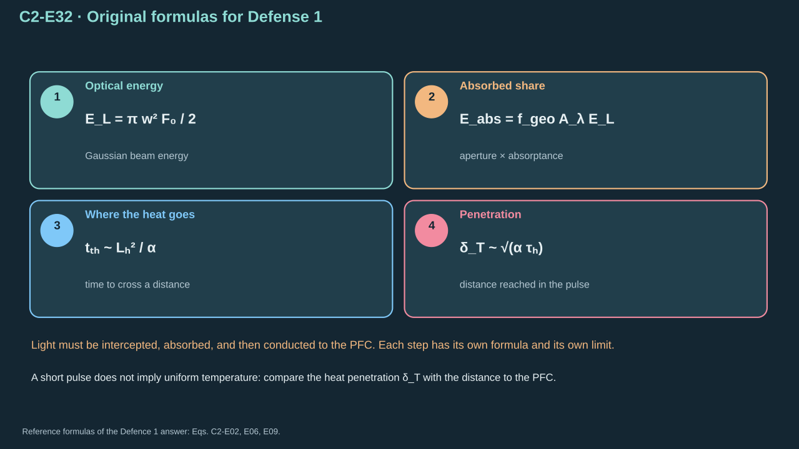

Original optical and thermal formulas used in the reference answer.

参考答案使用的原始光学与热学公式。

Locate the absorber first. A smaller spot raises fluence at fixed energy. A shorter pulse raises irradiance at fixed fluence. Heat reaching PFC depends on interception, spectrum, thickness, reflection and absorber position. Compare core distance with thermal penetration and include contact resistance. The 5 μm, 10 ns control penetrates about 22 nm. Surface heating leaves uniform core temperature unestablished. Distributed absorbers require their actual deposition geometry.

先确定吸收体位置。能量固定时，小光斑提高能量面密度；面密度固定时，短脉冲提高辐照度。到达 PFC 的热取决于截获、光谱、厚度、反射和吸收体位置。比较核心距离与热渗透，并计入接触热阻。5 μm、10 ns 对照渗透约 22 nm。表面加热下核心均温尚未确立。分布吸收体需采用实际沉积几何。

The example absorbs 223.85 nJ against a 97.82 nJ preparation screen. Delivery must exceed 43.7% before additional losses. Passing this screen leaves onset unresolved. Activation, phase inventory, pressure work and jet direction require separate calculations. Match optical and geometric inputs in the PFC-free control.

示例吸收 223.85 nJ，制备筛选为 97.82 nJ。未计额外损失时，输送比例已须超过 43.7%。通过筛选仍未确定起始。激活、相变物质量、压力功及射流方向需分别计算。不含 PFC 对照须匹配光学与几何输入。

#### Review criteria

#### 审阅标准

* Distinguishes incident energy, absorbed energy, irradiance, and heat delivered to PFC; traces absorber location and heat-transfer time.

  区分入射能量、吸收能量、辐照度与送达 PFC 的热量；追踪吸收体位置及热传递时间。
* Explains how spot size, duration, penetration, and a finite energy budget affect the source without calling an energy screen an activation threshold.

  说明光斑、时长、渗透及有限能量预算如何影响源，而不将能量筛选称为激活阈值。
* Identifies activation and geometry-dependent pressure-to-jet conversion as additional stages, and specifies a fair PFC-free comparison.

  指出激活与依赖几何的压力到射流转化是额外阶段，并给出公平的不含 PFC 对照。

### Explain confinement and activation probability in a low-boiling nanodroplet.

### 解释低沸点纳米液滴中的约束及激活概率。

Explain the mechanism, assumptions, and limits in your own words.

用自己的话解释机制、假设与限制。

\*\*Reference answer and mastery criteria / 参考答案与掌握标准\*\*

**Symbols before Eq. (C2-E33).**

**式（C2-E33）前的符号定义。**

| First individual definition / 第一项单独定义 | Second individual definition / 第二项单独定义 |
| --- | --- |
| $p_d$ — Initial liquid-PFC core pressure (Pa) $p_d$ — 初始液态 PFC 核压力（Pa） | $p_c$ — Carrier-liquid pressure (Pa) $p_c$ — 载液压力（Pa） |
| $\Pi_{\mathrm{shell}}$ — Shell-supported excess pressure (Pa) $\Pi_{\mathrm{shell}}$ — 壳层支撑超压（Pa） | $a>0$ is core radius (m) $a>0$ 为核心半径（m） |
| $\sigma_{pc}$ is PFC–carrier tension (N m⁻¹) $\sigma_{pc}$ 为 PFC–载液张力（N m⁻¹） | $p_{\mathrm{sat,PFC}}(T_i)$ is equilibrium PFC vapor pressure (Pa) at local interface temperature $T_i$ (K) $p_{\mathrm{sat,PFC}}(T_i)$ 为局部界面温度 $T_i$（K）处的平衡 PFC 蒸汽压（Pa） |
| $\Delta p_n>0$ is nucleation driving pressure (Pa) $\Delta p_n>0$ 为成核驱动压差（Pa） | $\sigma_{vp}>0$ is vapor–PFC tension (N m⁻¹) $\sigma_{vp}>0$ 为蒸汽–PFC 张力（N m⁻¹） |
| $r_*$ is critical nucleus radius (m) $r_*$ 为临界汽核半径（m） | $W_*$ is barrier (J) $W_*$ 为势垒（J） |
| $\pi$ is the circular constant (dimensionless) $\pi$ 为圆周率（无量纲） | $T_i$ — Local phase-interface temperature (K) $T_i$ — 局部相界面温度（K） |

**Conventions and conditions.** star labels critical values; $\simeq$ denotes the static core-pressure approximation; Critical formulas assume homogeneous small-nucleus capillarity.

**约定与条件。** 星号标记临界值；$\simeq$ 表示静态核压力近似；临界公式假设均匀小汽核毛细模型。

(C2-E33) · Original formulas for Defense 2 / 答辩问题 2 的原始公式

$$
p_d\simeq p_c+2\sigma_{pc}/a+\Pi_{\mathrm{shell}},\quad \Delta p_n=p_{\mathrm{sat,PFC}}(T_i)-p_d,\quad r_*=2\sigma_{vp}/\Delta p_n,\quad W_*=16\pi\sigma_{vp}^3/(3\Delta p_n^2)\quad(\Delta p_n>0)
$$

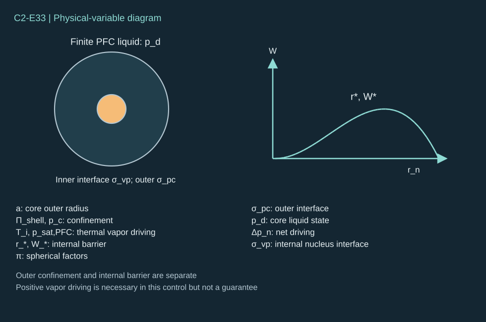

Original confinement and nucleation formulas used in the reference answer.

参考答案使用的原始约束与成核公式。

**Symbols before Eq. (C2-E34).**

**式（C2-E34）前的符号定义。**

| First individual definition / 第一项单独定义 | Second individual definition / 第二项单独定义 |
| --- | --- |
| $P_{\mathrm{act}}$ is activation probability (dimensionless) $P_{\mathrm{act}}$ 为激活概率（无量纲） | $J(T,p)\ge0$ is supplied Poisson event rate (m⁻³ s⁻¹), evaluated at local temperature $T$ (K) and pressure $p$ (Pa) $J(T,p)\ge0$ 为给定 Poisson 事件速率（m⁻³ s⁻¹），取局部温度 $T$（K）与压力 $p$（Pa） |
| $V_d(t^{\prime})$ is remaining PFC-liquid region, d labeling droplet (m³) $V_d(t^{\prime})$ 为剩余 PFC 液体区域，d 表示液滴（m³） | $t\ge0$ — Time (s) $t\ge0$ — 时间（s） |
| $dV$ is volume element (m³) $dV$ 为体积元（m³） | $T$ — Thermodynamic temperature (K) $T$ — 热力学温度（K） |
| $p$ — Local or prescribed thermodynamic pressure as specified (Pa) $p$ — 按情景指定的局部或给定热力学压力（Pa） |  |

**Conventions and conditions.** $\int$ is integration; $\exp$ is the natural exponential; Independent events and finite integrated rate are assumed.

**约定与条件。** $\int$ 为积分；$\exp$ 为自然指数函数；假设事件独立且积分速率有限。

(C2-E34) · Original activation-probability formula / 原始激活概率公式

$$
P_{\mathrm{act}}=1-\exp\!\left[-\int_0^t\int_{V_d(t^{\prime})}J(T,p)\,dV\,dt^{\prime}\right]
$$

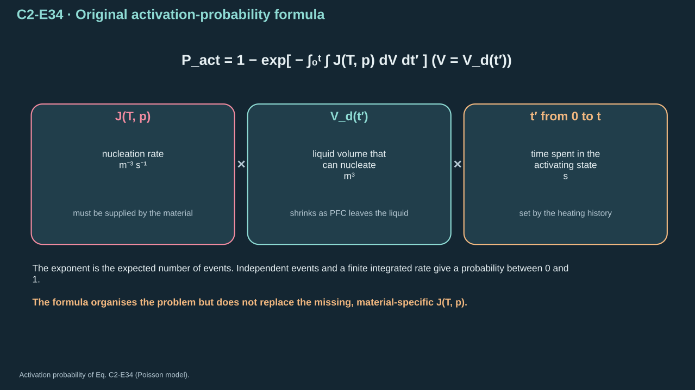

The probability formula does not replace the missing material-specific rate.

概率公式不能替代缺失的材料特定速率。

Bulk boiling describes coexistence at specified pressure. Core pressure also includes inverse-radius capillarity and shell stress. At 323 K, the 5 μm control has positive PFP driving at 108 kPa. The 100 nm control has nonpositive driving at 500 kPa. Positive driving still leaves a nucleation barrier. Internal vapor–PFC tension sets that barrier. Rate and hot-state duration determine activation probability. Heterogeneous systems may need measured activation laws.

体相沸腾描述指定压力下的共存。核心压力还包含反半径毛细压力及壳层应力。323 K 时，5 μm 对照在 108 kPa 具有正 PFP 驱动，100 nm 对照在 500 kPa 的驱动不为正。正驱动仍有成核势垒，势垒由内部蒸气—PFC 张力决定。速率与热态时长决定激活概率。异质系统可能需测量激活规律。

One failed exposure can reflect insufficient heat, confinement, low probability or unsuitable nucleation sites. A seeded simulation predicts evolution from its prescribed seed. Optical onset remains unestablished. Measure absorbed energy, onset statistics, shell/core state and bubble evolution under matched exposure.

单次失败可由热量不足、约束、低概率或不合适成核位点导致。种子模拟预测从指定种子开始的演化。光学起始仍未确立。应在匹配照射下测量吸收能量、起始统计、壳层／核心状态及气泡演化。

#### Review criteria

#### 审阅标准

* Explains bulk saturation versus the pressure inside a finite core, including inverse-radius capillarity and shell stress.

  解释体相饱和与有限核心内部压力的区别，包含反半径毛细压力及壳层应力。
* Distinguishes the PFC–carrier and vapor–PFC tensions and explains the positive-driving branch, barrier, and finite hot-state duration.

  区分 PFC–载液与蒸汽–PFC 张力，并解释正驱动分支、势垒及有限热状态时长。
* Treats activation statistically when appropriate and separates seeded dynamics from a demonstrated onset prediction.

  适当时以统计过程看待激活，并区分种子后的动力学与已证明的起始预测。

### Build a conserving pressure history. What does an inventory radius establish?

### 建立守恒的压力历程。物质量对应半径能确立什么？

Explain the mechanism, assumptions, and limits in your own words.

用自己的话解释机制、假设与限制。

\*\*Reference answer and mastery criteria / 参考答案与掌握标准\*\*

**Symbols before Eq. (C2-E35).**

**式（C2-E35）前的符号定义。**

| First individual definition / 第一项单独定义 | Second individual definition / 第二项单独定义 |
| --- | --- |
| $m_{\mathrm{PFC},0}$ is initial PFC mass (kg) $m_{\mathrm{PFC},0}$ 为初始 PFC 质量（kg） | $\rho_d$ is initial liquid density (kg m⁻³) $\rho_d$ 为初始液体密度（kg m⁻³） |
| $a_0$ is initial core radius (m) $a_0$ 为初始核心半径（m） | $m_l$ — Remaining liquid-PFC mass (kg) $m_l$ — 剩余液态 PFC 质量（kg） |
| $m_v$ — PFC vapor mass (kg) $m_v$ — PFC 蒸气质量（kg） | $m_{\mathrm{diss}}$ — Dissolved PFC mass (kg) $m_{\mathrm{diss}}$ — 溶解 PFC 质量（kg） |
| $m_{\mathrm{esc}}$ — Cumulative escaped PFC mass (kg) $m_{\mathrm{esc}}$ — 累计逸出 PFC 质量（kg） | $p_{v,\mathrm{PFC}}$ is ideal PFC partial pressure (Pa) $p_{v,\mathrm{PFC}}$ 为理想 PFC 分压（Pa） |
| $V_b>0$ is bubble volume (m³) $V_b>0$ 为气泡体积（m³） | $M_{\mathrm{PFC}}$ is molar mass (kg mol⁻¹) $M_{\mathrm{PFC}}$ 为摩尔质量（kg mol⁻¹） |
| $R_u$ is universal gas constant (J mol⁻¹ K⁻¹) $R_u$ 为通用气体常数（J mol⁻¹ K⁻¹） | $T_b>0$ is bulk temperature (K) $T_b>0$ 为体相温度（K） |
| $\pi$ is the circular constant (dimensionless) $\pi$ 为圆周率（无量纲） |  |

**Conventions and conditions.** 0 denotes initial state and other subscripts name compartments; No external compound supply is allowed.

**约定与条件。** 0 表示初态，其余下标标记分区；不允许外部化合物供应。

(C2-E35) · Original inventory and pressure formulas for Defense 3 / 答辩问题 3 的原始存量与压力公式

$$
m_{\mathrm{PFC},0}=\frac{4\pi}{3}\rho_da_0^3,\qquad m_l+m_v+m_{\mathrm{diss}}+m_{\mathrm{esc}}=m_{\mathrm{PFC},0},\qquad p_{v,\mathrm{PFC}}V_b=\frac{m_v}{M_{\mathrm{PFC}}}R_uT_b
$$

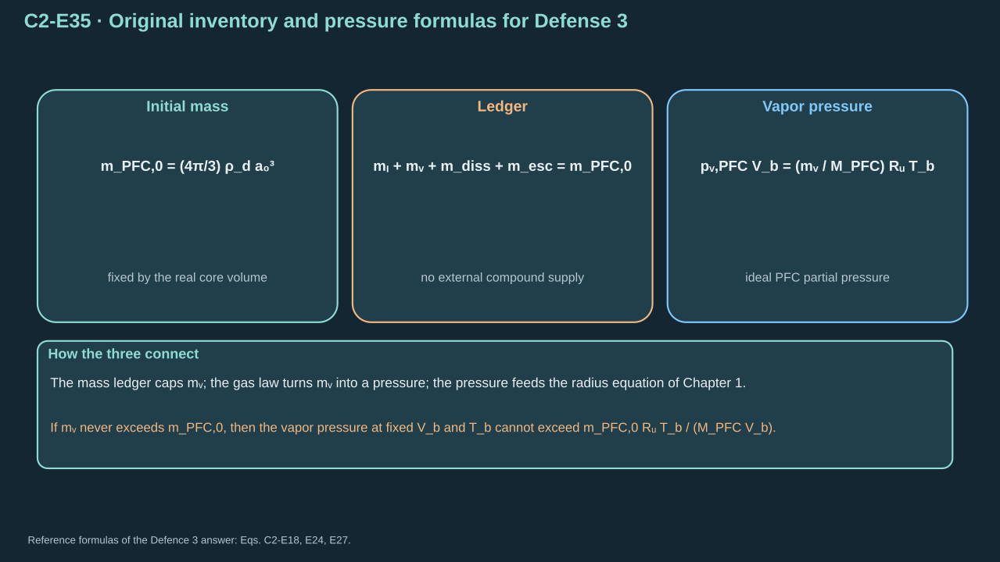

Original finite-inventory formulas used in the reference answer.

参考答案使用的原始有限库存公式。

**Symbols before Eq. (C2-E36).**

**式（C2-E36）前的符号定义。**

| First individual definition / 第一项单独定义 | Second individual definition / 第二项单独定义 |
| --- | --- |
| $j_s$ is signed phase flux (kg m⁻² s⁻¹) $j_s$ 为带符号相变通量（kg m⁻² s⁻¹） | $L_{v,s}$ is latent enthalpy (J kg⁻¹) $L_{v,s}$ 为潜焓（J kg⁻¹） |
| $\boldsymbol q_l$ — Liquid-side conductive heat flux (W m⁻²) $\boldsymbol q_l$ — 液体侧传导热通量（W m⁻²） | $\boldsymbol q_v$ — Vapor-side conductive heat flux (W m⁻²) $\boldsymbol q_v$ — 蒸气侧传导热通量（W m⁻²） |
| $\boldsymbol n$ is unit liquid→vapor normal (dimensionless) $\boldsymbol n$ 为液→汽单位法向（无量纲） | $U_b$ is bubble internal energy (J) $U_b$ 为气泡内能（J） |
| $\dot Q_b$ is conductive heat input excluding mass enthalpy (W) $\dot Q_b$ 为不含质量焓的传导热输入（W） | $p_b$ is pressure (Pa) $p_b$ 为压力（Pa） |
| $V_b$ is volume (m³) $V_b$ 为体积（m³） | $h_{v,s}$ is boundary specific vapor enthalpy (J kg⁻¹) $h_{v,s}$ 为边界蒸汽比焓（J kg⁻¹） |
| $m_{v,s}$ is species mass (kg) $m_{v,s}$ 为组分质量（kg） | $R$ is spherical bubble radius (m) $R$ 为球形气泡半径（m） |
| $\dot R$ its wall speed (m s⁻¹) $\dot R$ 为壁速（m s⁻¹） | $u_l(R)$ adjacent radial liquid speed (m s⁻¹) $u_l(R)$ 为邻接径向液速（m s⁻¹） |
| $\rho_l$ liquid density (kg m⁻³) $\rho_l$ 为液体密度（kg m⁻³） |  |

**Conventions and conditions.** $\sum_s$ sums all declared species; A dot is a time derivative and $\cdot$ is a vector dot product; Interface heat and slip formulas assume the stated single-component reduced jump.

**约定与条件。** $\sum_s$ 对所有声明组分求和；上点表示时间导数，$\cdot$ 表示向量点积；界面热及滑移公式采用所声明单组分简化跳跃假设。

(C2-E36) · Original phase-energy and velocity-slip formulas / 原始相变能量与速度滑移公式

$$
j_sL_{v,s}=(\boldsymbol q_l-\boldsymbol q_v)\cdot\boldsymbol n,\qquad\dot U_b=\dot Q_b-p_b\dot V_b+\sum_s h_{v,s}\dot m_{v,s},\qquad u_l(R)=\dot R-j_s/\rho_l
$$

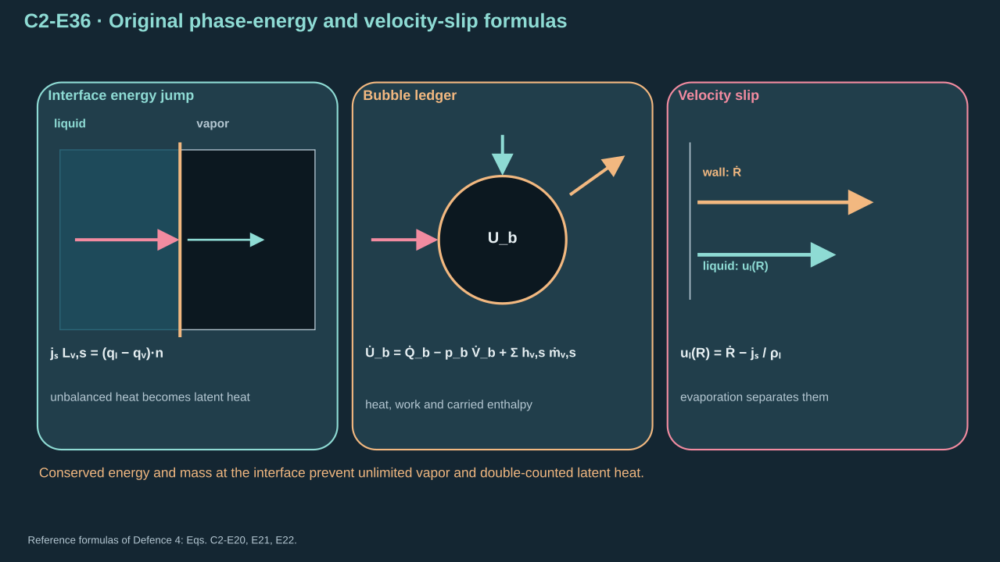

Original conservation formulas prevent unlimited vapor and duplicated latent energy.

原始守恒公式防止无限蒸汽及重复潜热计入。

Conserve measured or declared PFC across liquid, vapor, dissolved and escaped compartments. Ideal PFC pressure follows vapor mass, temperature and volume. Total pressure also includes water vapor and permanent gas. Sustained saturation needs liquid supply and rapid heat/mass exchange. Once fully vaporized, fixed-temperature expansion lowers PFC pressure. The 5 μm core contains 0.8535 ng. Its 323 K, 100 kPa inventory radius is 26.68 μm. At 30 μm, its ideal PFC pressure is 70.36 kPa. Dynamical maximum remains unestablished.

在液体、蒸气、溶解及逸出分区间守恒测得或声明的 PFC。理想 PFC 压力由蒸气质量、温度和体积决定。总压还含水蒸气及非凝结气体。持续饱和需液体供给和快速传热传质。全部汽化后，恒温膨胀降低 PFC 压力。5 μm 核心含 0.8535 ng。323 K、100 kPa 下物质量对应半径为 26.68 μm。30 μm 时理想 PFC 分压为 70.36 kPa。动力学最大值尚未确立。

Use Stefan balance for signed phase flux. Use the open first law for work and transported enthalpy. Count phase conversion once. Check slip and recoil before using simple Rayleigh–Plesset closure. Rapid compression can retain vapor; permanent gas persists after condensation. Refine high-state EOS, thermal transport and geometry as needed. Chapters 1 and 3 determine directional carrier motion. Inventory expansion leaves jet speed unresolved.

采用 Stefan 平衡计算带符号相变通量，用开放第一定律计入功和输运焓。相变转化计入一次。使用简单 Rayleigh–Plesset 闭合前须检查滑移与反冲。快速压缩可保留蒸气，凝结后非凝结气体仍存在。按需细化高状态状态方程、热输运与几何。第一、三章确定载液定向运动。物质量膨胀仍未确定射流速率。

#### Review criteria

#### 审阅标准

* Conserves finite PFC across all relevant compartments and explains when saturation can and cannot be sustained.

  在所有相关分区间守恒有限 PFC，并说明饱和何时可维持、何时不能。
* Explains signed Stefan transfer, open-system enthalpy and pressure work, and avoids duplicated latent heat; recognizes phase-change velocity slip.

  解释带符号 Stefan 传输、开放系统焓与压力功，并避免重复潜热；认识相变速度滑移。
* Separates assumed inventory state from nonlinear dynamics and useful carrier-jet output; identifies retained vapor, gas, and EOS limits.

  区分假定库存状态、非线性动力学及有用载液射流输出；指出残留蒸汽、气体及 EOS 限制。

---

# Chapter 3: Arrays, finite jets and measurable impact

# 第 3 章：阵列、有限射流与可测冲击

## 1. Array inputs and outputs

## 1. 阵列输入与输出

Follow a finite array from cavity motion to emitted jet and receiver pressure. Chapter 2 supplies each site’s heat, PFC inventory and pressure history. Here, mechanical controls use declared source histories. Target PFC maximum speed: Not established. Carrier liquid supplies most moving mass. Cavity pressure, jet speed, surface pressure and buried-interface traction require separate observables.

本章从有限阵列空腔运动追踪至喷出射流和受载压力。第二章提供各位点热量、PFC 物质量及压力历程。这里的力学对照采用给定源历程。目标 PFC 最大速率尚未确立。载液构成主要运动质量。腔内压力、射流速率、表面压力及埋藏界面牵引须分别定义观测量。

First fix bubble centers in Cartesian coordinates. Omit translation, gravity, walls, coalescence and shape modes. Require nearly spherical cavities with radius much smaller than separation. Also require low wall Mach and rapid pressure communication. Collapse controls start at maximum radius with zero speed and constant positive driving pressure. PFC pressures require Chapter 2 coupling. The later launch model resolves actual walls, outlets and interfaces. Its liquid-to-gas normal gives positive cylindrical-jet and negative cavity curvature.

首先在笛卡尔坐标中固定气泡中心。忽略平移、重力、壁面、合并及形状模态。要求空腔近球形且半径远小于间距，并满足低壁面马赫数及快速压力通信。塌缩对照从最大半径、零速率和恒定正驱动压差开始。PFC 压力需耦合第二章。后续发射模型解析实际壁面、出口及界面。液体指向气体的法向给出圆柱射流正曲率及空腔负曲率。

| Symbol 符号 | Physical meaning 物理意义 | SI units SI 单位 | Role and convention 作用与约定 |
| --- | --- | --- | --- |
| $i$ | Index of the bubble being evaluated 当前评估气泡的编号 | 1 | Integer from 1 to the activated-bubble count; selects the local radial equation. 从 1 到已激活气泡数的整数；选择局部径向方程。 |
| $j$ | Index of a neighboring bubble 相邻气泡的编号 | 1 | In an interaction sum the evaluated site is excluded: j ≠ i. 相互作用求和中排除当前位点：j ≠ i。 |
| $N_d$ | Fabricated droplet-site count 制造的液滴位点数 | 1 | Counts available sites; it does not imply every site activates. 计数可用位点；不意味着每个位点都激活。 |
| $N_b$ | Activated-bubble count 已激活气泡数 | 1 | Counts actual bubble sources used in the interaction equations. 计数相互作用方程中实际使用的气泡源。 |
| $R_i$ | Radius of bubble i 气泡 i 的半径 | m | Moving radial coordinate of the selected bubble; Newton dots denote its time derivatives. 选定气泡的运动径向坐标；牛顿点号表示其时间导数。 |
| $d_{ij}$ | Bubble-center separation 气泡中心间距 | m | Distance between centers i and j; reciprocal distance weights dilute interactions. 中心 i 与 j 的距离；距离倒数加权稀疏相互作用。 |
| $s$ | Nearest-vertex array pitch 阵列相邻顶点间距 | m | Defined nearest-neighbor spacing in the regular-polygon control. 正多边形对照中定义的最近邻间距。 |
| $R_{\max}$ | Maximum bubble radius 最大气泡半径 | m | Reference radius for the specified collapse control and geometric interaction parameter. 指定塌缩对照与几何相互作用参数采用的参考半径。 |
| $\rho$ | Carrier-liquid density 载液密度 | kg m⁻³ | Sets bubble-exterior inertia and emitted liquid mass; not PFC-vapor density. 决定泡外惯性与喷出液体质量；不是 PFC 蒸气密度。 |
| $\mu$ | Carrier dynamic viscosity 载液动力黏度 | Pa s | Controls viscous stresses and jet dissipation in the stated liquid model. 在指定液体模型中控制黏性应力及射流耗散。 |
| $\sigma_b$ | Bubble-interface surface tension 气泡界面表面张力 | N m⁻¹ | Bubble capillary coefficient; need not equal the jet-interface coefficient. 气泡毛细系数；不必等于射流界面系数。 |
| $\sigma_j$ | Jet-interface surface tension 射流界面表面张力 | N m⁻¹ | Coefficient for the emitted jet and its capillary disturbance growth. 喷出射流及其毛细扰动增长使用的系数。 |
| $c$ | Liquid sound speed 液体声速 | m s⁻¹ | Sets acoustic transit and ideal early-contact impedance, not a universal jet-speed ceiling. 决定声传播时间及理想早期接触阻抗，并非通用射流速度上限。 |
| $\phi$ | Velocity potential 速度势 | m² s⁻¹ | Its spatial gradient gives the adopted potential-flow velocity. 其空间梯度给出所采用的势流速度。 |
| $\Pi$ | Pressure impulse per unit area 单位面积压力冲量 | Pa s | Pressure integrated over a stated time interval; distinct from total force impulse. 指定时间区间内的压力积分；与总力冲量不同。 |
| $\boldsymbol u$ | Liquid velocity field 液体速度场 | m s⁻¹ | Vector field needed to distinguish focusing, jet formation and transport. 用于区分聚焦、射流形成与输运的矢量场。 |
| $E$ | Specified mechanical energy 指定力学能量 | J | The subscript identifies its budget; optical, bubble and jet energies are not interchangeable. 下标标识预算对象；光能、气泡能与射流能不能混同。 |
| $m$ | Finite moving-liquid mass 有限运动液体质量 | kg | Mass of the declared jet or control volume used in energy and momentum bounds. 能量与动量界限中所声明射流或控制体的质量。 |
| $P$ | Directional liquid momentum 液体方向动量 | N s | Projection of moving-liquid momentum along the selected transfer direction. 运动液体动量沿选定转印方向的投影。 |
| $\mathcal J$ | Delivered force impulse 传递的力冲量 | N s | Time integral of force at the specified target; not pressure impulse per area. 指定目标处的力对时间的积分；不是单位面积压力冲量。 |
| $a_j$ | Jet radius 射流半径 | m | Half the declared circular jet diameter; sets lateral-release and capillary scales. 所声明圆形射流直径的一半；决定侧向释放与毛细尺度。 |
| $d_j$ | Jet diameter 射流直径 | m | Transverse size used with emitted length to determine finite jet volume. 与喷出长度共同确定有限射流体积的横向尺寸。 |
| $L_j$ | Finite emitted-jet length 有限喷出射流长度 | m | Longitudinal liquid inventory; must not be replaced by an unlimited steady stream. 液体纵向存量；不能替换为无限稳态液流。 |
| $H$ | Flight gap 飞行间隙 | m | Distance traveled by the emitted liquid before reaching the specified target. 喷出液体到达指定目标之前经过的距离。 |
| $z$ | Jet axial coordinate 射流轴向坐标 | m | Coordinate along the transport direction used for slice conservation. 用于切片守恒的输运方向坐标。 |
| $S$ | Neighbor reciprocal-distance sum 邻距倒数和 | m⁻¹ | Finite sum of the inverse center separations in the regular-array control. 规则阵列对照中中心间距倒数的有限和。 |
| $\chi$ | Dimensionless interaction parameter 无量纲相互作用参数 | 1 | Maximum radius multiplied by S; quantifies interaction within the adopted dilute model. 最大半径乘以 S；量化所采用稀疏模型中的相互作用。 |
| $C(\chi)$ | Formal collapse-time coefficient 形式塌缩时间系数 | 1 | Result of the stated array-control integral; not a pressure amplification factor. 指定阵列对照积分的结果；不是压力放大系数。 |
| $b_i$ | Radial source strength of bubble i 气泡 i 的径向源强度 | m³ s⁻¹ | Defined by radius squared times wall velocity in the monopole-flow control. 在单极流动对照中定义为半径平方乘壁面速度。 |
| $\Gamma$ | Moving liquid interface 运动液体界面 | — | Geometric surface carrying kinematic and traction conditions; not fracture energy. 承载运动学及牵引条件的几何曲面；不是断裂能。 |
| $\Omega$ | Liquid spatial domain 液体空间域 | — | Region occupied by liquid in the spatial-flow problem. 空间流动问题中液体占据的区域。 |
| $\boldsymbol n$ | Outward liquid unit normal 液体外向单位法向 | 1 | Points out of liquid; fixes traction and signed curvature. 指向液体外部；确定牵引及带符号曲率。 |
| $\kappa$ | Signed interfacial curvature 带符号界面曲率 | m⁻¹ | Sum of principal curvatures for the stated normal convention. 在指定法向约定下的两主曲率之和。 |
| $g$ | Disturbance growth rate 扰动增长率 | s⁻¹ | Exponential capillary growth coefficient; this symbol is not gravitational acceleration. 指数毛细增长系数；该符号不是重力加速度。 |
| $\delta$ | Jet-radius disturbance amplitude 射流半径扰动振幅 | m | Small deviation from the undeformed jet; linear growth ceases to apply at large amplitude. 相对未变形射流的小偏差；大振幅时线性增长不再适用。 |
| $k$ | Axial disturbance wavenumber 轴向扰动波数 | m⁻¹ | Spatial oscillation frequency along the jet; not thermal conductivity. 沿射流的空间振荡频率；不是导热系数。 |
| $q$ | Dimensionless disturbance wavenumber 无量纲扰动波数 | 1 | Defined as axial wavenumber multiplied by jet radius. 定义为轴向波数乘射流半径。 |
| $I_0$ | Modified Bessel function of order zero 零阶修正 Bessel 函数 | 1 | Dimensionless radial eigenfunction in the cylindrical capillary control. 圆柱毛细对照中的无量纲径向特征函数。 |
| $I_1$ | Modified Bessel function of order one 一阶修正 Bessel 函数 | 1 | Used with I₀ in the stated disturbance dispersion relation. 在指定扰动色散关系中与 I₀ 共同使用。 |
| $Z_l$ | Liquid acoustic impedance 液体声阻抗 | Pa s m⁻¹ | Density times sound speed in the adopted one-dimensional early-contact model. 在所采用的一维早期接触模型中为密度乘声速。 |
| $Z_r$ | Receiver acoustic impedance 接收体声阻抗 | Pa s m⁻¹ | Determines early wave matching; finite thickness and motion can invalidate the half-space control. 决定早期波匹配；有限厚度与运动可能使半空间对照失效。 |
| $A_o$ | Pressure observation area 压力观测面积 | m² | Fixed footprint over which the reported load is spatially averaged. 用于对报告载荷进行空间平均的固定范围。 |
| $\tau_o$ | Pressure averaging interval 压力平均时间区间 | s | Specified time window; changing it changes the observable pressure. 指定时间窗口；改变它会改变可观测压力。 |
| $p_{\mathrm{obs}}$ | Observed mean excess pressure 观测平均超压 | Pa | Area/time average on the defined target; differs from a brief local pressure spike. 指定目标上的面积／时间平均；不同于短暂局部压力尖峰。 |

Step 1 — Distinguish core inventory, carrier volume, pitch, fluence and activation time. Sum separate-cell outputs after calculating finite jets and arrival times. Shared-domain bubbles modify common liquid inertia and surrounding pressure. Regular spacing defines geometry. Count-proportional pressure remains unestablished.

步骤 1——分别考察核心物质量、载液体积、节距、能量面密度及激活时间。独立单元须先计算有限射流及到达时间，再求和输出。共域气泡改变共同液体惯性与周围压力。规则间距定义几何，压力与数量成比例尚未确立。

**Symbols before Eq. (C3-E01).**

**式（C3-E01）前的符号定义。**

| First individual definition / 第一项单独定义 | Second individual definition / 第二项单独定义 |
| --- | --- |
| $N_d$ is positive integer site count (dimensionless) $N_d$ 是正整数位点数（无量纲） | $N_b$ is the random activated count (dimensionless) $N_b$ 为随机已激活数量（无量纲） |
| $p_a\in(0,1]$ is identical independent activation probability (dimensionless) $p_a\in(0,1]$ 为相同且相互独立的激活概率（无量纲） | $\mathbb E$ — Expectation operator (—) $\mathbb E$ — 期望算子（—） |
| $\operatorname{Var}$ — Variance operator (—) $\operatorname{Var}$ — 方差算子（—） | $\Pr$ — Probability operator (—) $\Pr$ — 概率算子（—） |
| $\mathrm{CV}$ is standard deviation divided by nonzero mean (dimensionless) $\mathrm{CV}$ 是标准差除以非零均值（无量纲） |  |

**Conventions and conditions.** All are dimensionless.

**约定与条件。** 所有量均无量纲。

(C3-E01) · Independent-event statistical model / 独立事件的统计模型

$$
\begin{aligned}\mathbb E[N_b]&=N_dp_a,\quad \operatorname{Var}(N_b)=N_dp_a(1-p_a),\\ \mathrm{CV}(N_b)&=\frac{\sqrt{N_dp_a(1-p_a)}}{N_dp_a}=\sqrt{\frac{1-p_a}{N_dp_a}},\quad \Pr(N_b=N_d)=p_a^{N_d}.\end{aligned}
$$

Count reproducibility and complete activation are different tests.

数量重复性与全部激活是不同检验。

With 25 independent sites and activation probability 0.95, mean count is 23.75. Relative standard deviation is 4.588%. Complete activation probability is 0.27739. Common heating or mechanical feedback can violate independence. Measure site activation before inferring load symmetry.

二十五个独立位点、激活概率 0.95 时，平均数量为 23.75，相对标准差为 4.588%，全部激活概率为 0.27739。共同加热或力学反馈可破坏独立性。推断载荷对称性前须测量各位点激活。

**Symbols before Eq. (C3-E02).**

**式（C3-E02）前的符号定义。**

| First individual definition / 第一项单独定义 | Second individual definition / 第二项单独定义 |
| --- | --- |
| $F(r)$ is Gaussian pulse fluence at radial distance $r$ (J m⁻²) $F(r)$ 是径向距离 $r$ 处的 Gaussian 脉冲通量（J m⁻²） | $F_0>0$ is central fluence (J m⁻²) $F_0>0$ 为中心通量（J m⁻²） |
| $R_A>0$ encloses the array (m) $R_A>0$ 包围阵列（m） | $w>0$ is the Gaussian 1/e² radius (m) $w>0$ 为 Gaussian 的 1/e² 半径（m） |
| $\epsilon\in(0,1)$ is allowed fractional edge decrease (dimensionless) $\epsilon\in(0,1)$ 是允许的边缘相对降低量（无量纲） | $r$ — Transverse distance from the laser axis (m) $r$ — 到激光轴线的横向距离（m） |

**Conventions and conditions.** $\exp$ and $\ln$ are exponential and natural logarithm of dimensionless arguments.

**约定与条件。** $\exp$、$\ln$ 分别为无量纲自变量的指数及自然对数。

(C3-E02) · Derived optical-uniformity condition / 推导得到的光学均匀性条件

$$
\frac{F(R_A)}{F_0}=\exp(-2R_A^2/w^2)\ge1-\epsilon\ \Longrightarrow\ w^2\ge\frac{2R_A^2}{-\ln(1-\epsilon)}\ \Longrightarrow\ w\ge R_A\sqrt{\frac{2}{-\ln(1-\epsilon)}}.
$$

An optical condition can be checked before solving cavity mechanics.

求解腔体力学前即可检验光学条件。

Logarithms preserve order; multiplying by minus one reverses it. The allowed decrease lies between zero and one, keeping the denominator positive. A 10% decrease requires beam radius ≥ 4.35688 × array radius. Wider beams improve this fluence uniformity while exposing more surrounding area. Core absorption still requires site-specific calculation.

对数保持不等式方向，乘负一使方向反转。允许下降比例介于零与一之间，分母因此为正。下降不超过 10% 要求光束半径 ≥ 4.35688 × 阵列半径。宽光束改善该能量面密度均匀性，同时照射更多外围区域。核心吸收仍需逐位点计算。

## 2. Leading bubble interaction

## 2. 主阶气泡相互作用

Step 2 — Derive one spherical source potential. Incompressibility fixes volume flux across concentric spheres. Integrate radial velocity with zero potential at infinity. At a distant bubble, this potential is nearly uniform over its surface. Its fixed-position time derivative gives the leading Bernoulli pressure correction.

步骤 2——推导单个球形源速度势。不可压缩性使同心球面体积流量相等。积分径向速度，并取无穷远速度势为零。远处气泡表面上的该速度势近似均匀。固定位置时间导数给出主阶伯努利压力修正。

**Symbols before Eq. (C3-E03).**

**式（C3-E03）前的符号定义。**

| First individual definition / 第一项单独定义 | Second individual definition / 第二项单独定义 |
| --- | --- |
| $j$ labels the emitting bubble (dimensionless) $j$ 标记发射气泡（无量纲） | $i\ne j$ a receiving center (dimensionless) $i\ne j$ 标记接收中心（无量纲） |
| $R_j(t)>0$ — Time-dependent radius of source bubble j (m) $R_j(t)>0$ — 源气泡 j 的随时间变化半径（m） | $r_j\ge R_j$ — Radial distance from the center of source bubble j (m) $r_j\ge R_j$ — 到源气泡 j 中心的径向距离（m） |
| $t$ is time (s) $t$ 为时间（s） | $\dot R_j$ — Wall radial velocity of source bubble j (m s⁻¹) $\dot R_j$ — 源气泡 j 的壁面径向速度（m s⁻¹） |
| $\ddot R_j$ — Wall radial acceleration of source bubble j (m s⁻²) $\ddot R_j$ — 源气泡 j 的壁面径向加速度（m s⁻²） | $u_j$ is radial velocity (m s⁻¹) $u_j$ 为径向速度（m s⁻¹） |
| $\phi_j$ is velocity potential (m² s⁻¹) $\phi_j$ 为速度势（m² s⁻¹） | $\pi$ is dimensionless $\pi$ 无量纲 |
| $d_{ij}>0$ — Fixed separation between source j and observation center i (m) $d_{ij}>0$ — 源 j 与观察中心 i 之间的固定距离（m） | $\xi$ — Dummy radial integration coordinate (m) $\xi$ — 径向积分哑坐标（m） |

**Conventions and conditions.** $\partial_t$ holds position fixed; $\int$ is radial integration, $\infty$ the zero-potential far field.

**约定与条件。** $\partial_t$ 保持位置固定；$\int$ 为径向积分，$\infty$ 为速度势为零的远场。

(C3-E03) · Continuity and potential integration / 连续性关系与势函数积分

$$
\begin{aligned}4\pi r_j^2u_j(r_j,t)&=4\pi R_j^2\dot R_j,\\ \phi_j(r_j,t)&=\int_{\infty}^{r_j}\frac{R_j^2\dot R_j}{\xi^2}\,d\xi=-\frac{R_j^2\dot R_j}{r_j},\\ \partial_t\phi_j\big|_{r_j=d_{ij}}&=-\frac{2R_j\dot R_j^2+R_j^2\ddot R_j}{d_{ij}}.\end{aligned}
$$

A moving spherical volume produces a monopole potential.

运动球体体积产生单极子速度势。

**Symbols before Eq. (C3-E04).**

**式（C3-E04）前的符号定义。**

| First individual definition / 第一项单独定义 | Second individual definition / 第二项单独定义 |
| --- | --- |
| $i$ — Bubble index over the declared activated sources (dimensionless) $i$ — 遍历声明的已激活源的气泡指标（无量纲） | $j$ — Bubble index over the declared activated sources (dimensionless) $j$ — 遍历声明的已激活源的气泡指标（无量纲） |
| $p'_{j\to i}$ is source $j$'s pressure disturbance at $i$ (Pa) $p'_{j\to i}$ 是源 $j$ 在 $i$ 处的压力扰动（Pa） | $p_{\mathrm{ext},i}$ external pressure (Pa) $p_{\mathrm{ext},i}$ 为外压（Pa） |
| $p_\infty$ remote pressure (Pa) $p_\infty$ 为远场压力（Pa） | $\rho$ is constant carrier density (kg m⁻³) $\rho$ 为恒定载液密度（kg m⁻³） |
| $\phi_j$ is potential (m² s⁻¹) $\phi_j$ 为速度势（m² s⁻¹） | $t$ is time (s), $\partial_t$ its fixed-position derivative $t$ 为时间（s），$\partial_t$ 为固定位置导数 |
| $R_j$ — Radius of source bubble j (m) $R_j$ — 源气泡 j 的半径（m） | $d_{ij}$ — Bubble-center separation (m) $d_{ij}$ — 气泡中心间距（m） |
| $N_b$ — Activated-bubble count (dimensionless) $N_b$ — 已激活气泡数（无量纲） |  |

**Conventions and conditions.** $\sum_{j\ne i}$ adds all other sources; $\simeq$ marks the leading far-separated approximation; $i\ne j$; each index runs from 1 to $N_b$; Newton dots on a radius denote its time derivatives..

**约定与条件。** $\sum_{j\ne i}$ 对其他源求和；$\simeq$ 表示充分分离时的首阶近似；$i\ne j$；每个指标从 1 遍历至 $N_b$；半径上的牛顿点号表示其时间导数。。

(C3-E04) · Leading unsteady-Bernoulli approximation / 非定常伯努利方程的首阶近似

$$
p'_{j\to i}\simeq-\rho\partial_t\phi_j(d_{ij},t)=\frac{\rho}{d_{ij}}(R_j^2\ddot R_j+2R_j\dot R_j^2),\qquad p_{\mathrm{ext},i}\simeq p_\infty+\sum_{j\ne i}p'_{j\to i}.
$$

The correction changes surrounding pressure; it is not a new energy reservoir.

该修正改变周围压力，并不增加新的能量库。

The product rule gives both numerator terms. Each term/separation has units m² s⁻²; multiplying density gives pressure. Require small squared-speed, nonuniform-pressure, translation and reflected-field corrections. Positive volume acceleration raises surrounding pressure. Other event stages can reverse the correction. Bremond et al. observed shielding and delayed interior collapse. Their spherical model failed at final jetting. This is an interaction benchmark with different activation conditions. [Bremond et al. (2006)](https://doi.org/10.1103/PhysRevLett.96.224501)

乘积法则给出分子两项。每项除以间距的单位为 m² s⁻²，乘密度得到压力。要求速度平方、非均匀压力、平移及反射场修正较小。正体积加速度提高周围压力，其他事件阶段可反转修正。Bremond 等观测到屏蔽及内部气泡延迟塌缩。其球形模型在最终射流阶段失效。该研究提供不同激活条件下的相互作用基准。[Bremond 等（2006）](https://doi.org/10.1103/PhysRevLett.96.224501)

**Symbols before Eq. (C3-E05).**

**式（C3-E05）前的符号定义。**

| First individual definition / 第一项单独定义 | Second individual definition / 第二项单独定义 |
| --- | --- |
| $i$ — Bubble index over the declared activated sources (dimensionless) $i$ — 遍历声明的已激活源的气泡指标（无量纲） | $j$ — Bubble index over the declared activated sources (dimensionless) $j$ — 遍历声明的已激活源的气泡指标（无量纲） |
| $R_i$ — Radius of bubble i (m) $R_i$ — 气泡 i 的半径（m） | $R_j$ — Radius of source bubble j (m) $R_j$ — 源气泡 j 的半径（m） |
| $d_{ij}>0$ — Bubble-center separation (m) $d_{ij}>0$ — 气泡中心间距（m） | $p_{b,i}$ is bubble $i$'s internal pressure (Pa) $p_{b,i}$ 为第 $i$ 个气泡内压（Pa） |
| $p_\infty$ remote pressure (Pa) $p_\infty$ 为远场压力（Pa） | $\sigma_b$ is bubble–carrier tension (N m⁻¹) $\sigma_b$ 为泡—载液张力（N m⁻¹） |
| $\mu$ carrier dynamic viscosity (Pa s) $\mu$ 为载液动力黏度（Pa s） | $\rho$ carrier density (kg m⁻³) $\rho$ 为载液密度（kg m⁻³） |
| $B_i$ is the isolated radial driving expression (m² s⁻²) $B_i$ 为孤立泡径向驱动表达式（m² s⁻²） | $\dot R_j$ — Wall radial velocity of source bubble j (m s⁻¹) $\dot R_j$ — 源气泡 j 的壁面径向速度（m s⁻¹） |
| $\ddot R_j$ — Wall radial acceleration of source bubble j (m s⁻²) $\ddot R_j$ — 源气泡 j 的壁面径向加速度（m s⁻²） | $\dot R_i$ — Wall radial velocity of bubble i (m s⁻¹) $\dot R_i$ — 气泡 i 的壁面径向速度（m s⁻¹） |
| $\ddot R_i$ — Wall radial acceleration of bubble i (m s⁻²) $\ddot R_i$ — 气泡 i 的壁面径向加速度（m s⁻²） |  |

**Conventions and conditions.** $\sum_{j\ne i}$ sums other sources; Every term has unit m² s⁻².

**约定与条件。** $\sum_{j\ne i}$ 对其他源求和；各项单位均为 m² s⁻²。

(C3-E05) · Coupled spherical approximation / 耦合球形近似

$$
\begin{aligned}R_i\ddot R_i+\frac32\dot R_i^2+\sum_{j\ne i}\frac{R_j^2\ddot R_j+2R_j\dot R_j^2}{d_{ij}}&=B_i,\\ B_i&=\frac{p_{b,i}-p_\infty-2\sigma_b/R_i-4\mu\dot R_i/R_i}{\rho}.\end{aligned}
$$

Substitute the corrected external pressure into each radial balance.

将修正外压代入各径向平衡。

Step 3 — Move neighbor pressure to the left in Eq. (C3-E05). The result couples bubble accelerations. Each site retains its own phase-pressure law. Infinite separation removes coupling and recovers the isolated equation. Radius comparable to separation violates the approximation.

步骤 3——在式（C3-E05）中将邻居压力移至左侧，得到气泡加速度耦合。各位点保留独立相变压力规律。间距趋于无穷远时，耦合消失并恢复单泡方程。半径接近间距时，近似失效。

## 3. Three-, four- and five-bubble examples

## 3. 三、四、五气泡示例

Step 4 — Place identical cavities on a regular polygon. Give them identical initial states and pressure histories. Cyclic symmetry equates their neighbor-distance sums and permits a shared radius. Calculate each sum from polygon distances. Pitch means adjacent-vertex distance.

步骤 4——将相同空腔置于正多边形顶点，给定相同初态及压力历程。循环对称性使邻居距离和相同，允许共同半径。根据多边形距离计算各和。节距指相邻顶点距离。

**Symbols before Eq. (C3-E06).**

**式（C3-E06）前的符号定义。**

| First individual definition / 第一项单独定义 | Second individual definition / 第二项单独定义 |
| --- | --- |
| $N\in\{3,4,5\}$ is regular-polygon bubble count (dimensionless) $N\in\{3,4,5\}$ 为正多边形气泡数（无量纲） | $k=1,\ldots,N-1$ counts steps from one vertex (dimensionless) $k=1,\ldots,N-1$ 为从一个顶点出发的步数（无量纲） |
| $s>0$ — Nearest-vertex array pitch (m) $s>0$ — 阵列相邻顶点间距（m） | $d_k>0$ — Bubble-center separation across k polygon steps (m) $d_k>0$ — 相隔 k 个多边形步长的气泡中心距离（m） |
| $S_N$ is the reciprocal-distance sum (m⁻¹) $S_N$ 为距离倒数和（m⁻¹） | $\varphi_g$ is the dimensionless golden ratio $\varphi_g$ 为无量纲黄金比 |
| $\pi$ — Circle constant (dimensionless) $\pi$ — 圆周率（无量纲） |  |

**Conventions and conditions.** $k$-step center distances (m); $\sin$ takes angles in radians; $\sum$ sums the stated polygon steps; $k$ runs from 1 to $N-1$..

**约定与条件。** $\sin$ 的角度采用弧度；$\sum$ 对规定步数求和；$\sum$ 对规定多边形步数求和；$k$ 从 1 遍历至 $N-1$。。

(C3-E06) · Exact polygon geometry / 精确的多边形几何关系

$$
\begin{aligned}d_k&=s\frac{\sin(k\pi/N)}{\sin(\pi/N)},\qquad S_N=\sum_{k=1}^{N-1}\frac1{d_k},\\ S_3&=\frac2s,\qquad S_4=\frac{2+1/\sqrt2}{s},\qquad S_5=\frac{2+2/\varphi_g}{s},\quad\varphi_g=\frac{1+\sqrt5}{2}.\end{aligned}
$$

Equal geometric sums justify a shared radial trajectory in this constrained control.

相同几何和使这一约束对照可采用共同径向轨迹。

**Symbols before Eq. (C3-E07).**

**式（C3-E07）前的符号定义。**

| First individual definition / 第一项单独定义 | Second individual definition / 第二项单独定义 |
| --- | --- |
| $p_\infty$ — Constant Remote carrier pressure (Pa) $p_\infty$ — 恒定的远场载液压力（Pa） | $p_b$ — Constant Uniform internal bubble pressure in the stated control (Pa) $p_b$ — 恒定的指定对照中的均匀气泡内部压力（Pa） |
| $\Delta p_c>0$ their collapse-driving difference (Pa) $\Delta p_c>0$ 为其塌缩驱动压差（Pa） | $S=S_N\ge0$ is the fixed reciprocal-distance sum (m⁻¹) $S=S_N\ge0$ 为固定距离倒数和（m⁻¹） |
| $R(t)>0$ — Shared time-dependent bubble radius (m) $R(t)>0$ — 共同的随时间变化气泡半径（m） | $R_{\max}>0$ — Maximum bubble radius (m) $R_{\max}>0$ — 最大气泡半径（m） |
| $t=0$ the initial time (s) $t=0$ 为初始时刻（s） | $\rho>0$ is carrier density (kg m⁻³) $\rho>0$ 为载液密度（kg m⁻³） |
| $SR$ is dimensionless $SR$ 无量纲 | $\dot R$ — Bubble-wall radial velocity (m s⁻¹) $\dot R$ — 气泡壁面径向速度（m s⁻¹） |
| $\ddot R$ — Bubble-wall radial acceleration (m s⁻²) $\ddot R$ — 气泡壁面径向加速度（m s⁻²） |  |

**Conventions and conditions.** Dots are time derivatives; Surface tension and viscosity are omitted in this ideal control.

**约定与条件。** 点为时间导数；本理想对照忽略表面张力及黏度。

(C3-E07) · Symmetric constant-pressure collapse control / 对称恒压塌缩对照模型

$$
\begin{aligned}\Delta p_c&=p_\infty-p_b>0,\qquad S=S_N,\\ (1+SR)R\ddot R+\left(\frac32+2SR\right)\dot R^2&=-\frac{\Delta p_c}{\rho},\qquad R(0)=R_{\max},\quad\dot R(0)=0.\end{aligned}
$$

Substitution of the common radius collects the two interaction contributions.

代入共同半径后合并两种相互作用贡献。

Step 5 — Solve on the inward branch. Away from the turning point, express squared speed as a radius function. The chain rule gives its derivative as twice wall acceleration. The linear equation’s integrating factor is radius cubed × interaction factor. Check that choice with the displayed logarithmic derivatives. Extend continuously to zero initial speed.

步骤 5——在向内分支求解。转折点之外，将速度平方表示为半径函数。链式法则给出其导数为壁面加速度两倍。线性方程积分因子为半径三次方 × 相互作用因子。用显示的对数导数验证该选择。连续延拓至初始零速度。

**Symbols before Eq. (C3-E08).**

**式（C3-E08）前的符号定义。**

| First individual definition / 第一项单独定义 | Second individual definition / 第二项单独定义 |
| --- | --- |
| $y(R)\ge0$ is squared wall speed (m² s⁻²) $y(R)\ge0$ 为壁速平方（m² s⁻²） | $y'=dy/dR$ (m s⁻²) $y'=dy/dR$（m s⁻²） |
| $R>0$ is radius (m) and dots its time derivatives $R>0$ 为半径（m），点表示其时间导数 | $S\ge0$ is neighbor sum (m⁻¹) $S\ge0$ 为邻距和（m⁻¹） |
| $\rho>0$ density (kg m⁻³) $\rho>0$ 为密度（kg m⁻³） | $\Delta p_c>0$ pressure difference (Pa) $\Delta p_c>0$ 为压差（Pa） |
| $\ell_*>0$ is an arbitrary constant reference length (m), inserted solely to make the logarithm dimensionless $\ell_*>0$ 为任意恒定参考长度（m），仅用来使对数无量纲，并在积分因子中抵消 | $\dot R$ — Bubble-wall radial velocity (m s⁻¹) $\dot R$ — 气泡壁面径向速度（m s⁻¹） |
| $\ddot R$ — Bubble-wall radial acceleration (m s⁻²) $\ddot R$ — 气泡壁面径向加速度（m s⁻²） |  |

**Conventions and conditions.** it cancels from the integrating factor; $\ln$ is natural logarithm; $d/dR$ differentiates in radius; Division by $\dot R$ is used only on the moving branch.

**约定与条件。** $\ln$ 为自然对数；$d/dR$ 对半径求导；仅在运动分支除以 $\dot R$。

(C3-E08) · Chain rule and integrating-factor derivation / 链式法则与积分因子推导

$$
\begin{aligned}y(R)&=\dot R^2,\quad \frac{dy}{dR}=\frac{2\dot R\ddot R}{\dot R}=2\ddot R\quad(\dot R\ne0),\\ y'+\frac{3+4SR}{R(1+SR)}y&=-\frac{2\Delta p_c}{\rho R(1+SR)},\\ \frac{3+4SR}{R(1+SR)}&=\frac3R+\frac S{1+SR}=\frac{d}{dR}\ln[R^3(1+SR)/\ell_*^3],\\ \frac{d}{dR}\left[R^3(1+SR)y\right]&=-\frac{2\Delta p_c}{\rho}R^2.\end{aligned}
$$

Every term of the integrating factor can be reconstructed from the radial equation.

积分因子的每一项均可从径向方程重构。

**Symbols before Eq. (C3-E09).**

**式（C3-E09）前的符号定义。**

| First individual definition / 第一项单独定义 | Second individual definition / 第二项单独定义 |
| --- | --- |
| $R\in(0,R_{\max}]$ — Shared instantaneous bubble radius (m) $R\in(0,R_{\max}]$ — 共同瞬时气泡半径（m） | $R_{\max}$ — Maximum bubble radius (m) $R_{\max}$ — 最大气泡半径（m） |
| $\xi$ is dummy radius (m), dots radius time derivatives $\xi$ 为积分半径（m），点为半径时间导数 | $y=\dot R^2$ (m² s⁻²) $y=\dot R^2$（m² s⁻²） |
| $S\ge0$ neighbor sum (m⁻¹) $S\ge0$ 为邻距和（m⁻¹） | $\rho>0$ density (kg m⁻³) $\rho>0$ 为密度（kg m⁻³） |
| $\Delta p_c>0$ pressure difference (Pa) $\Delta p_c>0$ 为压差（Pa） | $\dot R$ — Bubble-wall radial velocity (m s⁻¹) $\dot R$ — 气泡壁面径向速度（m s⁻¹） |
| $\ddot R$ — Bubble-wall radial acceleration (m s⁻²) $\ddot R$ — 气泡壁面径向加速度（m s⁻²） |  |

**Conventions and conditions.** Brackets mean upper minus lower endpoint, $\int$ definite integration and $\sqrt{\ }$ the nonnegative root; the explicit minus sign selects collapse.

**约定与条件。** 方括号表示上端减下端，$\int$ 为定积分，$\sqrt{\ }$ 取非负根；显式负号选择塌缩。

(C3-E09) · Integrated solution on the inward branch / 向内运动分支上的积分解

$$
\begin{aligned}[R^3(1+SR)y]_{R_{\max}}^R&=-\frac{2\Delta p_c}{\rho}\int_{R_{\max}}^R\xi^2d\xi=\frac{2\Delta p_c}{3\rho}(R_{\max}^3-R^3),\\ \dot R^2&=\frac{2\Delta p_c}{3\rho}\frac{R_{\max}^3-R^3}{R^3(1+SR)},\qquad \dot R=-\sqrt{\frac{2\Delta p_c}{3\rho}\frac{R_{\max}^3-R^3}{R^3(1+SR)}}.\end{aligned}
$$

The initial condition removes the integration constant and the physical branch fixes the sign.

初值消去积分常数，物理分支固定符号。

**Symbols before Eq. (C3-E10).**

**式（C3-E10）前的符号定义。**

| First individual definition / 第一项单独定义 | Second individual definition / 第二项单独定义 |
| --- | --- |
| $t_c$ is formal collapse time (s) $t_c$ 为形式塌缩时间（s） | $R$ — Shared instantaneous bubble radius (m) $R$ — 共同瞬时气泡半径（m） |
| $R_{\max}>0$ — Maximum bubble radius (m) $R_{\max}>0$ — 最大气泡半径（m） | $\dot R$ wall velocity (m s⁻¹), $\|\ \|$ absolute value $\dot R$ 为壁速（m s⁻¹），$\|\ \|$ 为绝对值 |
| $\rho$ is density (kg m⁻³) $\rho$ 为密度（kg m⁻³） | $\Delta p_c>0$ pressure difference (Pa) $\Delta p_c>0$ 为压差（Pa） |
| $S\ge0$ neighbor sum (m⁻¹) $S\ge0$ 为邻距和（m⁻¹） | $x\in[0,1]$ is dimensionless integration radius $x\in[0,1]$ 为无量纲积分半径 |
| $\chi\ge0$ interaction strength (dimensionless) $\chi\ge0$ 为相互作用强度（无量纲） | $C$ — Collapse-time coefficient as a function of interaction strength (dimensionless) $C$ — 相互作用强度的塌缩时间系数函数（无量纲） |
| $C'=dC/d\chi$ — Derivative of that coefficient with respect to interaction strength (dimensionless) $C'=dC/d\chi$ — 该系数对相互作用强度的导数（无量纲） |  |

**Conventions and conditions.** integrals are convergent improper integrals at $x=1$.

**约定与条件。** 积分在 $x=1$ 处为收敛广义积分。

(C3-E10) · Collapse-time quadrature and sign check / 塌缩时间的求积表达式与符号检验

$$
\begin{aligned}t_c&=\int_0^{R_{\max}}\frac{dR}{|\dot R|}=R_{\max}\sqrt{\frac{\rho}{\Delta p_c}}\,C(\chi),\quad x=R/R_{\max},\quad\chi=SR_{\max},\\ C(\chi)&=\sqrt{\frac32}\int_0^1\sqrt{\frac{x^3(1+\chi x)}{1-x^3}}\,dx,\\ C'(\chi)&=\frac12\sqrt{\frac32}\int_0^1\frac{x^{5/2}}{\sqrt{(1-x^3)(1+\chi x)}}\,dx>0\quad(\chi\ge0).\end{aligned}
$$

Shared-liquid interaction increases this constrained collapse time.

共享液体相互作用使这一约束塌缩时间增加。

The upper-endpoint singularity is an integrable inverse square root. The differentiated integrand is positive with the same endpoint behavior. This supports differentiation and monotonicity. Zero interaction recovers Rayleigh coefficient 0.9146813565. Use radius 30 μm, pitch 200 μm, density 1000 kg m⁻³ and pressure 100 kPa. Radius/separation is 0.15. These leading-order controls have no certified approximation error.

上端点为可积的平方根反比奇异性。求导后的被积函数为正且具有相同端点形式，支持求导与单调性。零相互作用恢复瑞利系数 0.9146813565。采用半径 30 μm、节距 200 μm、密度 1000 kg m⁻³、压差 100 kPa。半径／间距为 0.15。这些主阶对照未给出经认证近似误差。

| Configuration 构型 | $\chi$ $\chi$ | $C(\chi)$ $C(\chi)$ | Formal time (μs) 形式时间（μs） |
| --- | --- | --- | --- |
| Isolated 孤立 | 0 0 | 0.914681 0.914681 | 2.744044 2.744044 |
| Triangle 正三角形 | 0.300000 0.300000 | 1.019836 1.019836 | 3.059509 3.059509 |
| Square 正方形 | 0.406066 0.406066 | 1.054396 1.054396 | 3.163188 3.163188 |
| Pentagon 正五边形 | 0.485410 0.485410 | 1.079497 1.079497 | 3.238492 3.238492 |

Step 6 — Include pair terms in shared-liquid energy. Green’s identity converts the interaction integral to the cavity boundary. Liquid-domain outward normal points into the cavity. Outward wall speed gives negative liquid-normal velocity. Two negative boundary factors yield positive cross energy for synchronized motion.

步骤 6——共同液体能量中计入成对项。格林恒等式将相互作用积分转至空腔边界。液域外法向指向腔内。向外壁速给出负液域法向速度。同步运动的两个负边界因子产生正交叉能量。

**Symbols before Eq. (C3-E11).**

**式（C3-E11）前的符号定义。**

| First individual definition / 第一项单独定义 | Second individual definition / 第二项单独定义 |
| --- | --- |
| $K_N$ is leading cluster liquid kinetic energy (J) $K_N$ 为首阶气泡群液体动能（J） | $N$ count (dimensionless) $N$ 为数量（无量纲） |
| $i$ — Index of the bubble being evaluated (dimensionless) $i$ — 当前评估气泡的编号（无量纲） | $j$ — Index of a neighboring bubble (dimensionless) $j$ — 相邻气泡的编号（无量纲） |
| $R_i$ — Radius of bubble i (m) $R_i$ — 气泡 i 的半径（m） | $R_j$ — Radius of source bubble j (m) $R_j$ — 源气泡 j 的半径（m） |
| $r_i$ radial distance from $i$ (m) $r_i$ 为至 $i$ 的径距（m） | $d_{ij}$ center separation (m) $d_{ij}$ 为中心间距（m） |
| $R$ common radius (m) $R$ 为共同半径（m） | $R_{\max}$ its initial maximum (m) $R_{\max}$ 为其初始最大值（m） |
| $R_{\max,N}$ fixed-total-work maximum (m) $R_{\max,N}$ 为固定总做功最大半径（m） | $R_*$ isolated reference radius (all m) $R_*$ 为孤立参考半径（均为 m） |
| $b_i=R_i^2\dot R_i$ — Volume-source strength of bubble i (m³ s⁻¹) $b_i=R_i^2\dot R_i$ — 气泡 i 的体积源强度（m³ s⁻¹） | $b_j=R_j^2\dot R_j$ — Volume-source strength of bubble j (m³ s⁻¹) $b_j=R_j^2\dot R_j$ — 气泡 j 的体积源强度（m³ s⁻¹） |
| $\phi_i$ — Velocity potential of source bubble i (m² s⁻¹) $\phi_i$ — 源气泡 i 的速度势（m² s⁻¹） | $\phi_j$ — Velocity potential of source bubble j (m² s⁻¹) $\phi_j$ — 源气泡 j 的速度势（m² s⁻¹） |
| $\Omega$ liquid domain (—) $\Omega$ 为液体域（—） | $\Gamma_j$ bubble boundary (—) $\Gamma_j$ 为泡边界（—） |
| $dV$ — Volume integration element (m³) $dV$ — 体积积分微元（m³） | $dA$ — Area integration element (m²) $dA$ — 面积积分微元（m²） |
| $dr_i$ — Radial integration element from center i (m) $dr_i$ — 以中心 i 为原点的径向积分微元（m） | $S$ equal reciprocal-distance sum (m⁻¹) $S$ 为相同距离倒数和（m⁻¹） |
| $\rho$ density (kg m⁻³) $\rho$ 为密度（kg m⁻³） | $\Delta p_c$ pressure difference (Pa) $\Delta p_c$ 为压差（Pa） |
| $E_{B,\mathrm{tot}}$ fixed initial work (J) $E_{B,\mathrm{tot}}$ 为固定初始做功（J） | $\pi$ dimensionless $\pi$ 无量纲 |

**Conventions and conditions.** dots are time derivatives; $\nabla$ gradient, $\partial_n$ liquid-outward normal derivative; $i<j$ counts each unordered pair once; $|\ |$ is vector norm and $\infty$ the far radial endpoint; Far separation justifies retaining self and leading pair integrals; $*$ labels a reference.

**约定与条件。** 点为时间导数；$\nabla$ 为梯度，$\partial_n$ 为液体外法向导数；$i<j$ 将各无序对计一次；$|\ |$ 为向量范数，$\infty$ 为径向远端；充分分离使保留自身及首阶两泡积分成立；$*$ 标记参考。

(C3-E11) · Leading-model energy check and fixed-total-work comparison / 首阶模型的能量检验与固定总功比较

$$
\begin{aligned}b_i&=R_i^2\dot R_i,\quad \phi_i=-b_i/r_i,\quad K_N\simeq\frac{\rho}{2}\sum_{i,j=1}^{N}\int_\Omega\nabla\phi_i\cdot\nabla\phi_j\,dV,\\ \int_\Omega|\nabla\phi_i|^2\,dV&\simeq4\pi b_i^2\int_{R_i}^\infty r_i^{-2}\,dr_i=4\pi R_i^3\dot R_i^2,\\ \int_\Omega\nabla\phi_i\cdot\nabla\phi_j\,dV&\simeq\int_{\Gamma_j}\phi_i\partial_n\phi_j\,dA\simeq(-b_i/d_{ij})(-\dot R_j)4\pi R_j^2=\frac{4\pi b_ib_j}{d_{ij}}\quad(i\ne j),\\ K_N&\simeq2\pi\rho\sum_i R_i^3\dot R_i^2+4\pi\rho\sum_{i<j}\frac{b_ib_j}{d_{ij}}=2\pi\rho NR^3(1+SR)\dot R^2,\\ K_N&=\frac{4\pi N}{3}\Delta p_c(R_{\max}^3-R^3)\quad\text{in the leading symmetric model},\\ E_{B,\mathrm{tot}}&=N\frac{4\pi}{3}\Delta p_c R_{\max,N}^3=\frac{4\pi}{3}\Delta p_c R_*^3,\quad R_{\max,N}=R_*N^{-1/3}.\end{aligned}
$$

The integrated trajectory conserves the leading energy budget.

积分轨迹守恒首阶能量预算。

The inverse-square integral gives reciprocal lower radius. The infinity endpoint vanishes. A distant harmonic source is nearly constant over the emitting surface. Ordered cross terms appear twice; unordered pairs therefore carry coefficient four. Identical sums give bubble count × neighbor sum/2. Inserting Eq. (C3-E09) cancels the interaction factor and recovers pressure work. At fixed total work, take the positive cube root. From isolated radius 30 μm, three, four and five radii become 20.80084, 18.89882 and 17.54411 μm. At 200 μm pitch, times are 2.05687, 1.89946 and 1.77980 μs. Smaller cavities explain the shorter times. Stronger jets and improved optical efficiency remain unestablished.

平方反比积分给出下限半径的倒数，无穷远端点为零。远处调和源在发射球面上近似恒定。有序交叉项出现两次，故无序气泡对的系数为四。相同邻居和给出气泡数 × 邻居距离和／2。代入式（C3-E09），约去相互作用因子并恢复压力功。总功固定时取正立方根。孤立参照半径为 30 μm 时，三、四、五气泡半径分别为 20.80084、18.89882、17.54411 μm。200 μm 节距下，时间为 2.05687、1.89946、1.77980 μs。空腔变小解释时间变短。更强射流及更高光学效率尚未确立。

A center-and-four-arm cross has unequal neighbor sums. With arm length equal to pitch, the center sum is four/pitch. The outer sum is (one + one half + √two)/pitch. Their radii therefore cannot share the same history. Homogenization requires averaging length above pitch and below macroscopic variation length. Volume fraction leaves that separation unresolved.

中心加四臂十字形具有不同邻居和。臂长等于节距时，中心和为四／节距，外点和为（一 + 二分之一 + √二）／节距。因此其半径不能采用共同历程。均匀化要求平均长度大于节距且小于宏观变化长度。体积分数不能确定该尺度分离。

**Symbols before Eq. (C3-E12).**

**式（C3-E12）前的符号定义。**

| First individual definition / 第一项单独定义 | Second individual definition / 第二项单独定义 |
| --- | --- |
| $\phi_b$ is dimensionless instantaneous bubble-volume fraction $\phi_b$ 为无量纲瞬时气泡体积分数 | $V_i$ bubble volume (m³) $V_i$ 为泡体积（m³） |
| $V_\Omega>0$ representative-region volume (m³) $V_\Omega>0$ 为代表区体积（m³） | $N_b$ bubble count (dimensionless) $N_b$ 为泡数（无量纲） |
| $R_i$ — Radius of bubble i (m) $R_i$ — 气泡 i 的半径（m） | $R$ — Shared instantaneous bubble radius (m) $R$ — 共同瞬时气泡半径（m） |
| $s$ — Nearest-vertex array pitch (m) $s$ — 阵列相邻顶点间距（m） | $\pi$ dimensionless $\pi$ 无量纲 |
| $\phi(\boldsymbol x,t)$ is weak far-field potential (m² s⁻¹) $\phi(\boldsymbol x,t)$ 为弱扰动远场势（m² s⁻¹） | $p'$ pressure disturbance (Pa) $p'$ 为压力扰动（Pa） |
| $\boldsymbol x$ observation position (m) $\boldsymbol x$ 为观察位置（m） | $t$ time (s) $t$ 为时间（s） |
| $r_i>0$ distance to source $i$ (m) $r_i>0$ 为至源 $i$ 的距离（m） | $c$ sound speed (m s⁻¹) $c$ 为声速（m s⁻¹） |
| $\rho$ density (kg m⁻³) $\rho$ 为密度（kg m⁻³） | $t-r_i/c$ is retarded time (s) $t-r_i/c$ 为延迟时间（s） |
| $\dot V_i$ — First time derivative of bubble-i volume (m³ s⁻¹) $\dot V_i$ — 气泡 i 体积的一阶时间导数（m³ s⁻¹） | $\ddot V_i$ — Second time derivative of bubble-i volume (m³ s⁻²) $\ddot V_i$ — 气泡 i 体积的二阶时间导数（m³ s⁻²） |
| $i$ — Index of the bubble being evaluated (dimensionless) $i$ — 当前评估气泡的编号（无量纲） |  |

**Conventions and conditions.** Dots on $V_i$ are volume time derivatives (m³ s⁻¹, m³ s⁻²); $\sum$ sums sources; $\simeq$ is a distant, compact, weak-source approximation.

**约定与条件。** $V_i$ 上的点为体积时间导数（m³ s⁻¹、m³ s⁻²）；$\sum$ 对源求和；$\simeq$ 为远距、紧致、弱源近似。

(C3-E12) · Volume-fraction definition and retarded monopole approximation / 体积分数定义与延迟单极源近似

$$
\begin{aligned}\phi_b&=\frac{\sum_{i=1}^{N_b}V_i}{V_\Omega},\quad V_i=\frac{4\pi}{3}R_i^3,\quad\phi_b\big|_{\mathrm{cubic}}=\frac{4\pi R^3}{3s^3},\\ \phi(\boldsymbol x,t)&\simeq-\sum_i\frac{\dot V_i(t-r_i/c)}{4\pi r_i},\qquad p'(\boldsymbol x,t)\simeq\sum_i\frac{\rho}{4\pi r_i}\ddot V_i(t-r_i/c).\end{aligned}
$$

A spatial sum needs source histories and travel times, not only site count.

空间求和需要源历程及传播时间，不能只给位点数。

Step 7 — Use retarded time for a weak compact source. Differentiate far-field potential at fixed observation position to obtain pressure. Bubble volume fraction differs from initial liquid-PFC loading. A planar array needs layer thickness to define region volume. Coupled source histories must be solved before propagation. At 200 μm and 1480 m s⁻¹, travel time is 0.13514 μs. This is short against 3 μs but can exceed nanosecond pulses. Edges, delay and nonlinear shielding remain relevant.

步骤 7——弱紧致源采用延迟时间。固定观察位置求远场速度势时间导数，得到压力。气泡体积分数不同于初始液态 PFC 装载量。平面阵列需层厚才能定义区域体积。传播之前须先求耦合源历程。200 μm、1480 m s⁻¹ 下传播时间为 0.13514 μs，相对 3 μs 很短，却可超过纳秒脉冲。边缘、延迟及非线性屏蔽仍需考虑。

## 4. Spatial launch and focusing budgets

## 4. 空间发射与聚焦预算

Step 8 — Resolve liquid shape during meniscus deformation or re-entry. A radius history gives cavity scale and timing. Directional shape requires the spatial domain. During inertial launch, assume inviscid, irrotational, incompressible carrier and introduce a potential. Interfaces are material surfaces in this control. Appreciable evaporation requires Chapter 2’s mass-flux condition.

步骤 8——在弯月面变形或再入过程中解析液体形状。半径历程给出空腔尺度与时间，定向形状需要空间区域。惯性发射期间，假设载液无黏、无旋、不可压缩，并引入速度势。此对照将界面视为物质面。蒸发显著时须采用第二章质量通量条件。

**Symbols before Eq. (C3-E13).**

**式（C3-E13）前的符号定义。**

| First individual definition / 第一项单独定义 | Second individual definition / 第二项单独定义 |
| --- | --- |
| $\boldsymbol u(\boldsymbol x,t)$ is velocity (m s⁻¹) $\boldsymbol u(\boldsymbol x,t)$ 为速度（m s⁻¹） | $\phi(\boldsymbol x,t)$ potential (m² s⁻¹) $\phi(\boldsymbol x,t)$ 为势（m² s⁻¹） |
| $\boldsymbol x$ spatial position (m) $\boldsymbol x$ 为空间位置（m） | $t$ time (s) $t$ 为时间（s） |
| $\Omega(t)$ the moving liquid domain (—) $\Omega(t)$ 为运动液体域（—） |  |

**Conventions and conditions.** $\nabla$, $\nabla\cdot$ and $\nabla^2$ are spatial gradient, divergence and Laplacian; the central dot is an actual contraction, not an equation separator.

**约定与条件。** $\nabla$、$\nabla\cdot$、$\nabla^2$ 为空间梯度、散度、Laplace 算子；中心点是真正缩并，并非方程分隔符。

(C3-E13) · Potential-flow reduction / 势流简化模型

$$
\boldsymbol u=\nabla\phi,\qquad \nabla\cdot\boldsymbol u=0\ \Longrightarrow\ \nabla^2\phi=0\quad\text{in }\Omega(t).
$$

Geometry enters through the domain and its boundary conditions.

几何通过区域及边界条件进入。

**Symbols before Eq. (C3-E14).**

**式（C3-E14）前的符号定义。**

| First individual definition / 第一项单独定义 | Second individual definition / 第二项单独定义 |
| --- | --- |
| $\boldsymbol X$ is a material interface point (m) $\boldsymbol X$ 为材料界面点（m） | $t$ is time (s), $d/dt$ its trajectory derivative $t$ 为时间（s），$d/dt$ 为轨迹导数 |
| $\boldsymbol u$ is liquid velocity (m s⁻¹) $\boldsymbol u$ 为液速（m s⁻¹） | $\boldsymbol V_w$ prescribed wall velocity (m s⁻¹) $\boldsymbol V_w$ 为规定壁速（m s⁻¹） |
| $\boldsymbol n$ is outward from liquid toward gas or solid, unitless (dimensionless) $\boldsymbol n$ 从液体指向气体或固体，是无量纲单位法向（无量纲） | $V_n$ normal interface speed (m s⁻¹), $\partial_n\phi=\nabla\phi\cdot\boldsymbol n$ $V_n$ 为界面法向速度（m s⁻¹），$\partial_n\phi=\nabla\phi\cdot\boldsymbol n$ |
| $\phi$ potential (m² s⁻¹) $\phi$ 为势（m² s⁻¹） | $\Gamma$ is the complete moving interface (—) $\Gamma$ 为完整运动界面（—） |
| $\phi_\Gamma$ its potential (m² s⁻¹) $\phi_\Gamma$ 为其势（m² s⁻¹） | $\Gamma_0$ — Prescribed initial interface geometry (—) $\Gamma_0$ — 给定初始界面几何（—） |
| $\phi_0$ — Prescribed initial velocity potential (m² s⁻¹) $\phi_0$ — 给定初始速度势（m² s⁻¹） |  |

**Conventions and conditions.** Arrows indicate the stated far-field limit.

**约定与条件。** 箭头表示规定远场极限。

(C3-E14) · Kinematic, initial and wall conditions / 运动学条件、初始条件与壁面条件

$$
\begin{aligned}\frac{d\boldsymbol X}{dt}&=\boldsymbol u(\boldsymbol X,t),\quad V_n=\partial_n\phi,\quad \partial_n\phi=\boldsymbol V_w\cdot\boldsymbol n\quad\text{on walls},\\ (\Gamma,\phi_\Gamma)_{t=0}&=(\Gamma_0,\phi_0),\qquad \phi\to0\quad\text{in a quiescent far field}.\end{aligned}
$$

A potential equation without initial shape and wall data cannot predict a jet.

无初始形状及壁面数据的势方程无法预测射流。

**Symbols before Eq. (C3-E15).**

**式（C3-E15）前的符号定义。**

| First individual definition / 第一项单独定义 | Second individual definition / 第二项单独定义 |
| --- | --- |
| $p_l$ — Interface-liquid pressure (Pa) $p_l$ — 界面液体压力（Pa） | $p_g$ — Adjacent gas pressure (Pa) $p_g$ — 邻接气体压力（Pa） |
| $p_\infty$ — Remote carrier pressure (Pa) $p_\infty$ — 远场载液压力（Pa） | $\sigma$ is the tension appropriate to that interface (N m⁻¹) $\sigma$ 为对应界面张力（N m⁻¹） |
| $\kappa$ is signed total curvature (m⁻¹), $\nabla_s\cdot$ surface divergence $\kappa$ 为带符号总曲率（m⁻¹），$\nabla_s\cdot$ 为表面散度 | $\boldsymbol n$ the liquid-to-gas unit normal (dimensionless) $\boldsymbol n$ 为液体指向气体的单位法向（无量纲） |
| $R$ inner-cavity radius (m) $R$ 为内部腔体半径（m） | $a_j$ exterior-cylinder radius (m) $a_j$ 为外部圆柱半径（m） |
| $\phi_\Gamma$ — Interface velocity potential (m² s⁻¹) $\phi_\Gamma$ — 界面速度势（m² s⁻¹） | $\phi$ — Velocity potential (m² s⁻¹) $\phi$ — 速度势（m² s⁻¹） |
| $\boldsymbol u$ velocity (m s⁻¹) $\boldsymbol u$ 为速度（m s⁻¹） | $\rho$ density (kg m⁻³) $\rho$ 为密度（kg m⁻³） |
| $t$ time (s) $t$ 为时间（s） |  |

**Conventions and conditions.** $D/Dt$ is the material derivative, $\partial_t$ fixed-position derivative, $\nabla$ spatial gradient, $|\ |$ Euclidean norm; labels cavity and jet select geometries.

**约定与条件。** $D/Dt$ 为材料导数，$\partial_t$ 为固定位置导数，$\nabla$ 为空间梯度，$|\ |$ 为 Euclidean 范数；cavity、jet 标签选择几何。

(C3-E15) · Normal stress and material Bernoulli condition / 法向应力与随界面运动的伯努利条件

$$
\begin{aligned}p_l&=p_g+\sigma\kappa,\quad\kappa=\nabla_s\cdot\boldsymbol n,\quad\kappa_{\mathrm{cavity}}=-2/R,\quad\kappa_{\mathrm{jet}}=1/a_j,\\ \frac{D\phi_\Gamma}{Dt}&=\frac12|\nabla\phi|^2+\frac{p_\infty-p_g-\sigma\kappa}{\rho},\qquad \frac D{Dt}=\partial_t+\boldsymbol u\cdot\nabla.\end{aligned}
$$

Signed curvature and the material derivative keep the dynamic condition consistent.

带符号曲率及材料导数使动力学条件自洽。

Step 9 — Apply normal stress in Eq. (C3-E15). Eulerian Bernoulli gives minus half squared speed. Converting to the material derivative adds squared speed, leaving plus half. For a sphere, wall potential is minus radius × wall speed. Its derivative recovers the spherical balance with capillary resistance. The shown gauge uses a quiescent reservoir. Sealed cells need their actual pressure–volume boundary and gauge. Solve the harmonic problem and advance shape and potential. Stop that stage when topology or compressibility changes its assumptions. Distinguish internal re-entry from exterior emission. Peters et al. resolve the free surface explicitly. [[R4]](../reference/sources.html#r4)

步骤 9——在式（C3-E15）应用法向应力。欧拉伯努利式给出负二分之一速度平方。转换为物质导数增加速度平方，留下正二分之一。球形壁面速度势为半径 × 壁速的负值，其导数恢复含毛细阻力的球形平衡。所示参考采用静止储库。密闭单元需实际压力—体积边界及参考。求解调和问题并推进形状和速度势。拓扑或可压缩性改变假设时，该阶段结束。区分内部再入与外部喷射。Peters 等显式解析了自由表面。 [[R4]](../reference/sources.html#r4)

**Symbols before Eq. (C3-E16).**

**式（C3-E16）前的符号定义。**

| First individual definition / 第一项单独定义 | Second individual definition / 第二项单独定义 |
| --- | --- |
| $\Pi(\boldsymbol x)$ — Local pressure impulse per unit area (Pa s) $\Pi(\boldsymbol x)$ — 局部单位面积压力冲量（Pa s） | $\Pi_0$ — Driven-end pressure impulse (Pa s) $\Pi_0$ — 驱动端压力冲量（Pa s） |
| $p$ — Local liquid pressure (Pa) $p$ — 局部液体压力（Pa） | $p_{\mathrm{ref}}$ — Specified reference pressure (Pa) $p_{\mathrm{ref}}$ — 指定参考压力（Pa） |
| $\boldsymbol x$ position (m) $\boldsymbol x$ 为位置（m） | $t$ — Time (s) $t$ — 时间（s） |
| $t_0$ — Pulse start time (s) $t_0$ — 脉冲开始时刻（s） | $\tau_p>0$ — Pressure-pulse duration (s) $\tau_p>0$ — 压力脉冲时长（s） |
| $\Delta\boldsymbol u$ velocity increment (m s⁻¹) $\Delta\boldsymbol u$ 为速度增量（m s⁻¹） | $U$ column speed (m s⁻¹) $U$ 为液柱速度（m s⁻¹） |
| $\rho>0$ density (kg m⁻³) $\rho>0$ 为密度（kg m⁻³） | $z\in[0,L]$ axial coordinate (m) $z\in[0,L]$ 为轴坐标（m） |
| $L>0$ length (m) $L>0$ 为长度（m） | $A>0$ area (m²) $A>0$ 为面积（m²） |
| $m>0$ liquid mass (kg) $m>0$ 为液体质量（kg） | $\mathcal J$ is total directional force impulse (N s) $\mathcal J$ 为总方向力冲量（N s） |
| $E$ kinetic energy (J) $E$ 为动能（J） |  |

**Conventions and conditions.** $\nabla,\nabla^2$ are gradient/Laplacian; $\int$ time integration and vertical bars denote a stated fixed-budget branch; The pulse approximation freezes geometry and neglects integrated convection and viscosity.

**约定与条件。** $\nabla,\nabla^2$ 为梯度／Laplace 算子；$\int$ 为时间积分，竖线表示指定固定预算分支；脉冲近似冻结几何并忽略积分后的对流及黏性。

(C3-E16) · Pressure-impulse control and distinct focusing budgets / 压力冲量对照模型与不同聚焦过程的收支

$$
\begin{aligned}\Pi(\boldsymbol x)&=\int_{t_0}^{t_0+\tau_p}(p-p_{\mathrm{ref}})\,dt,\quad \Delta\boldsymbol u\simeq-\nabla\Pi/\rho,\quad\nabla^2\Pi=0,\\ \Pi(z)&=\Pi_0(1-z/L),\quad U=\frac{\Pi_0}{\rho L},\quad m=\rho AL,\quad\mathcal J=\Pi_0A=mU,\\ U\big|_{\mathcal J\ \mathrm{fixed}}&=\frac{\mathcal J}{m},\quad E=\frac{\mathcal J^2}{2m},\qquad U\big|_{E\ \mathrm{fixed}}=\sqrt{\frac{2E}{m}}.\end{aligned}
$$

The pressure-impulse field and the total energy constraint must be compatible.

压力冲量场必须与总能量约束相容。

Step 10 — Integrate short-pulse momentum and take divergence. The column obeys endpoint impulses and impermeable sidewalls. Its impulse gradient sets initial speed. Smaller area at fixed impulse/area leaves speed unchanged. Quartering mass at fixed total impulse quadruples speed and required energy. At fixed energy, speed doubles and momentum halves. Meniscus focusing therefore needs an energy budget as well as continuity. Fixed geometry requires small pulse displacement and viscous corrections. Acoustic crossings alone leave those conditions unresolved. [[R2]](../reference/sources.html#r2)

步骤 10——积分短脉冲动量并取散度。液柱满足两端冲量及不透侧壁条件。冲量梯度决定初速。单位面积冲量固定时，面积变小不改变速率。总冲量固定、质量降至四分之一时，速率与所需能量均增至四倍。能量固定时，速率加倍而动量减半。弯月面聚焦因此需能量预算及连续性。固定几何要求脉冲位移与黏性修正较小。声传播次数不能确定这些条件。 [[R2]](../reference/sources.html#r2)

**Symbols before Eq. (C3-E17).**

**式（C3-E17）前的符号定义。**

| First individual definition / 第一项单独定义 | Second individual definition / 第二项单独定义 |
| --- | --- |
| $Q$ is steady volume flow (m³ s⁻¹) $Q$ 为稳态体积流量（m³ s⁻¹） | $a_{\mathrm{in}}$ — Solid-tube inlet radius (m) $a_{\mathrm{in}}$ — 固体管入口半径（m） |
| $U_{\mathrm{in}}$ — Uniform inlet speed (m s⁻¹) $U_{\mathrm{in}}$ — 均匀入口速度（m s⁻¹） | $U_j$ — Uniform jet speed (m s⁻¹) $U_j$ — 均匀射流速度（m s⁻¹） |
| $\alpha$ — Jet-to-inlet cross-sectional area ratio (dimensionless) $\alpha$ — 射流截面积与入口截面积之比（无量纲） | $p_{\mathrm{in}}$ — Tube-inlet pressure (Pa) $p_{\mathrm{in}}$ — 管入口压力（Pa） |
| $p_g$ — Adjacent gas pressure (Pa) $p_g$ — 邻接气体压力（Pa） | $\Delta p_{\mathrm{loss}}\ge0$ prescribed loss (Pa) $\Delta p_{\mathrm{loss}}\ge0$ 为给定损失（Pa） |
| $\rho>0$ density (kg m⁻³) $\rho>0$ 为密度（kg m⁻³） | $\sigma_j$ jet–gas tension (N m⁻¹) $\sigma_j$ 为射流—气体张力（N m⁻¹） |
| $\pi$ dimensionless $\pi$ 无量纲 | $a_j$ — Exterior cylindrical-jet radius (m) $a_j$ — 外部圆柱射流半径（m） |

**Conventions and conditions.** The square root requires nonnegative numerator; This is a steady inviscid-core nozzle control with optional loss, not a transient cavity solution; $a_{\mathrm{in}}>a_j>0$; $\alpha=(a_j/a_{\mathrm{in}})^2$ and $0<\alpha<1$..

**约定与条件。** 平方根要求分子非负；它是允许损失的稳态无黏核心喷嘴对照，并非瞬态腔体解；$a_{\mathrm{in}}>a_j>0$；$\alpha=(a_j/a_{\mathrm{in}})^2$ 且 $0<\alpha<1$。。

(C3-E17) · Continuity plus Bernoulli focusing benchmark / 连续性关系与伯努利方程的聚焦基准模型

$$
\begin{aligned}Q&=\pi a_{\mathrm{in}}^2U_{\mathrm{in}}=\pi a_j^2U_j,\qquad \alpha=(a_j/a_{\mathrm{in}})^2,\quad U_{\mathrm{in}}=\alpha U_j,\\ p_{\mathrm{in}}-p_g&=\frac12\rho(U_j^2-U_{\mathrm{in}}^2)+\frac{\sigma_j}{a_j}+\Delta p_{\mathrm{loss}},\\ U_j&=\sqrt{\frac{2[p_{\mathrm{in}}-p_g-\sigma_j/a_j-\Delta p_{\mathrm{loss}}]}{\rho(1-\alpha^2)}}\quad(0<\alpha<1).\end{aligned}
$$

Specify either source pressure or flow and solve the compatible remaining quantity.

指定源压力或流量，再求其余相容量。

Use inlet radius 40 μm, outlet radius 10 μm and inlet speed 3 m s⁻¹. Continuity gives outlet speed 48 m s⁻¹. With density 1000 kg m⁻³, tension 0.072 N m⁻¹ and zero loss, overpressure must be 1.1547 MPa. This comprises 1.1475 MPa kinetic increase plus 7.2 kPa capillarity. Fixing overpressure at 0.20 MPa instead gives outlet speed 19.6752 m s⁻¹ and inlet speed 1.22970 m s⁻¹. The original speed with the lower pressure violates the budget. Meniscus evolution still requires Eqs. (C3-E13–15).

采用入口半径 40 μm、出口半径 10 μm、入口速率 3 m s⁻¹。连续性给出出口速率 48 m s⁻¹。密度 1000 kg m⁻³、张力 0.072 N m⁻¹、零损失时，所需过压为 1.1547 MPa，包括 1.1475 MPa 动能增加及 7.2 kPa 毛细压力。改为固定过压 0.20 MPa 时，出口速率为 19.6752 m s⁻¹、入口速率为 1.22970 m s⁻¹。原入口速率与较低压力同时指定会违反预算。弯月面演化仍需式（C3-E13–15）。

**Symbols before Eq. (C3-E18).**

**式（C3-E18）前的符号定义。**

| First individual definition / 第一项单独定义 | Second individual definition / 第二项单独定义 |
| --- | --- |
| $A_j$ is area (m²) $A_j$ 为面积（m²） | $d_j$ — Jet diameter (m) $d_j$ — 射流直径（m） |
| $L_j>0$ — Finite emitted-jet length (m) $L_j>0$ — 有限喷出射流长度（m） | $\rho$ carrier density (kg m⁻³) $\rho$ 为载液密度（kg m⁻³） |
| $m_j>0$ emitted mass (kg) $m_j>0$ 为喷出质量（kg） | $\mathcal M_j$ is the emitted material collection (—) $\mathcal M_j$ 为喷出材料集合（—） |
| $dm$ mass element (kg) $dm$ 为质量微元（kg） | $\boldsymbol u$ velocity field (m s⁻¹) $\boldsymbol u$ 为速度场（m s⁻¹） |
| $U_{\mathrm{rms}}$ mass-weighted root-mean-square speed (m s⁻¹) $U_{\mathrm{rms}}$ 为质量加权均方根速度（m s⁻¹） | $\boldsymbol e_z$ is a unit vector along intended transfer (dimensionless) $\boldsymbol e_z$ 为期望转印方向的单位向量（无量纲） |
| $P_j$ its signed momentum (N s) $P_j$ 为该方向带符号动量（N s） | $E_j$ kinetic energy (J) $E_j$ 为动能（J） |
| $E_{\mathrm{avail}}\ge E_j$ available mechanical energy (J) $E_{\mathrm{avail}}\ge E_j$ 为可用机械能（J） | $\pi$ is dimensionless $\pi$ 无量纲 |

**Conventions and conditions.** the cylinder expression assumes uniform area/density; $\int$ integrates over emitted mass; $|\ |$ denotes vector norm or scalar magnitude.

**约定与条件。** 圆柱式假设面积及密度均匀；$\int$ 对喷出质量积分；$|\ |$ 为向量范数或标量大小。

(C3-E18) · Finite-mass definitions and Cauchy–Schwarz bound / 有限质量定义与柯西–施瓦茨界限

$$
\begin{aligned}A_j&=\pi d_j^2/4,\qquad m_j=\rho A_jL_j,\qquad E_j=\frac12\int_{\mathcal M_j}|\boldsymbol u|^2dm=\frac12m_jU_{\mathrm{rms}}^2,\\ P_j&=\int_{\mathcal M_j}(\boldsymbol u\cdot\boldsymbol e_z)\,dm,\\ |P_j|^2&\le\left(\int_{\mathcal M_j}1\,dm\right)\left(\int_{\mathcal M_j}|\boldsymbol u\cdot\boldsymbol e_z|^2dm\right)\le2m_jE_j,\qquad U_{\mathrm{rms}}\le\sqrt{2E_{\mathrm{avail}}/m_j}.\end{aligned}
$$

Finite jet mass converts an energy budget into a meaningful speed and momentum bound.

有限射流质量将能量预算转化为有意义的速度及动量界。

Step 11 — Apply Cauchy–Schwarz to mass and axial velocity. Bound axial velocity squared by total speed squared. Equality requires uniform speed along the chosen axis. Energy/mass has units m² s⁻². Momentum² and mass × energy share units kg² m² s⁻². The same proof applies to total emitted mass and energy. Lateral flow, opposing jets or tiny fast tips can reduce useful axial momentum.

步骤 11——对质量与轴向速度应用柯西—施瓦茨不等式。用总速率平方界定轴向速度平方。等号要求沿所选轴统一速率。能量／质量单位为 m² s⁻²。动量平方与质量 × 能量均为 kg² m² s⁻²。同一证明适用于总喷出质量与能量。侧向流、相反射流或微小高速前端可降低有用轴向动量。

## 5. Slender-jet transport and stability

## 5. 细射流输运与稳定性

Step 12 — Model an axisymmetric Newtonian jet after launch. Assume negligible surrounding gas, constant density and tension, zero gravity and mass exchange. Radius and axial velocity vary along flight. Integrate area over a fixed slice for exact mass conservation. Divide by positive slice length and take its limit for differentiable fields. Substitute area = π × radius², then divide by positive 2π × radius. Supply initial shape, velocity, inflow and end conditions from the launch model or measurements. Strongly two-dimensional startup necks exceed this approximation.

步骤 12——发射后采用轴对称牛顿射流模型。假设周围气体作用可忽略、密度与张力恒定、无重力及质量交换。半径与轴向速度沿飞行方向变化。对固定小段中的面积积分，得到精确质量守恒。除以正段长，并对可微场取零段长极限。代入面积 = π × 半径²，再除以正 2π × 半径。初始形状、速度、流入及端点条件由发射模型或测量给定。强二维起始颈部超出此近似。

**Symbols before Eq. (C3-E19).**

**式（C3-E19）前的符号定义。**

| First individual definition / 第一项单独定义 | Second individual definition / 第二项单独定义 |
| --- | --- |
| $z$ is axial position (m) $z$ 为轴向位置（m） | $t$ time (s) $t$ 为时间（s） |
| $\Delta z>0$ fixed finite slice length (m) $\Delta z>0$ 为固定有限切片长度（m） | $\xi$ — Dummy axial integration coordinate (m) $\xi$ — 轴向积分哑坐标（m） |
| $a(z,t)>0$ is local jet radius (m) $a(z,t)>0$ 为局部射流半径（m） | $A(z,t)$ area (m²) $A(z,t)$ 为面积（m²） |
| $v(z,t)$ cross-sectional average axial velocity (m s⁻¹) $v(z,t)$ 为截面平均轴速（m s⁻¹） | $\pi$ dimensionless $\pi$ 无量纲 |
| $[Av]$ denotes the volume flux (m³ s⁻¹) evaluated at the stated end $[Av]$ 表示在指定端点评价的体积流率（m³ s⁻¹） | $d\xi$ — Integration-coordinate element (m) $d\xi$ — 积分坐标微元（m） |

**Conventions and conditions.** $\partial_t,\partial_z$ are fixed-coordinate derivatives; $\int$ integrates over the slice; the differential limit requires differentiable fields; The last step divides by positive $2\pi a$.

**约定与条件。** $\partial_t,\partial_z$ 为固定坐标导数；$\int$ 为切片积分；微分极限要求场可微；最后一步除以正的 $2\pi a$。

(C3-E19) · Slender-jet volume conservation / 细长射流的体积守恒

$$
\begin{aligned}A(z,t)&=\pi a(z,t)^2,\\ \partial_t\int_z^{z+\Delta z}A(\xi,t)\,d\xi&=[Av](z,t)-[Av](z+\Delta z,t),\\ \partial_t\frac{1}{\Delta z}\int_z^{z+\Delta z}A\,d\xi+\frac{[Av](z+\Delta z,t)-[Av](z,t)}{\Delta z}&=0,\\ \Delta z\to0:\quad \partial_tA+\partial_z(Av)&=0\ \Longrightarrow\ \partial_ta+v\partial_za=-\frac a2\partial_zv.\end{aligned}
$$

Axial stretching changes radius even before capillary necking grows.

在毛细颈缩增长前，轴向拉伸即会改变半径。

**Symbols before Eq. (C3-E20).**

**式（C3-E20）前的符号定义。**

| First individual definition / 第一项单独定义 | Second individual definition / 第二项单独定义 |
| --- | --- |
| $r\in[0,a]$ — Radial position measured from the liquid-jet axis (m) $r\in[0,a]$ — 从液体射流轴线计量的径向位置（m） | $z$ — Axial liquid-jet coordinate (m) $z$ — 液体射流轴向坐标（m） |
| $t$ time (s) $t$ 为时间（s） | $u_r$ is radial (m s⁻¹) $u_r$ 为径向（m s⁻¹） |
| $v$ axial velocity (m s⁻¹) $v$ 为轴向速度（m s⁻¹） | $a>0$ radius (m) $a>0$ 为半径（m） |
| $A=\pi a^2$ area (m²) $A=\pi a^2$ 为面积（m²） | $\rho$ is density (kg m⁻³) $\rho$ 为密度（kg m⁻³） |
| $\mu$ Newtonian viscosity (Pa s) $\mu$ 为 Newton 黏度（Pa s） | $\sigma_j$ jet–gas tension (N m⁻¹) $\sigma_j$ 为射流—气体张力（N m⁻¹） |
| $\tau_{zz}$ — Axial viscous normal stress (Pa) $\tau_{zz}$ — 轴向黏性法向应力（Pa） | $\tau_{rr}$ — Radial viscous normal stress (Pa) $\tau_{rr}$ — 径向黏性法向应力（Pa） |
| $\kappa$ is outward liquid-to-gas curvature (m⁻¹) $\kappa$ 为液体朝气体外法向曲率（m⁻¹） |  |

**Conventions and conditions.** $\partial_r,\partial_z,\partial_t$ are partial derivatives; $\partial_{zz}$ is a second axial derivative; The axial momentum law is a slender approximation although the geometric curvature is retained in full.

**约定与条件。** $\partial_r,\partial_z,\partial_t$ 为偏导数；$\partial_{zz}$ 为轴向二阶导数；虽然保留完整几何曲率，轴向动量规律仍为细长近似。

(C3-E20) · Newtonian stress and slender axial momentum / 牛顿流体应力与细长射流的轴向动量

$$
\begin{aligned}\partial_r u_r+u_r/r+\partial_zv&=0\ \Longrightarrow\ u_r=-\frac r2\partial_zv,\\ \tau_{zz}&=2\mu\partial_zv,\quad\tau_{rr}=2\mu\partial_ru_r=-\mu\partial_zv,\quad\tau_{zz}-\tau_{rr}=3\mu\partial_zv,\\ \partial_tv+v\partial_zv&=-\frac{\sigma_j}{\rho}\partial_z\kappa+\frac{3\mu}{\rho A}\partial_z(A\partial_zv),\\ \kappa&=\frac1{a\sqrt{1+(\partial_za)^2}}-\frac{\partial_{zz}a}{[1+(\partial_za)^2]^{3/2}}.\end{aligned}
$$

The factor three follows from extensional stress, rather than ordinary shear drag.

因子三来自拉伸应力，而不是普通剪切阻力。

Step 13 — Integrate radial continuity with axis regularity. Insert the radial derivative into Newtonian stresses. Axial minus radial stress gives extensional factor three. Normal stress removes radial stress from pressure. The remaining axial force contains extension and capillary gradient. Divide by mass/length for Eq. (C3-E20). Each acceleration term has units m s⁻². Constant radius and speed give zero acceleration. Axial strain changes radius through Eq. (C3-E19). Eggers and Dupont establish the reduced model and dissipation. Exact curvature still leaves a reduced momentum equation. [[R14]](../reference/sources.html#r14)

步骤 13——结合轴线正则性积分径向连续方程。将径向导数代入牛顿应力。轴向减径向应力给出拉伸系数三。法向应力从压力中消去径向应力。剩余轴向力包含拉伸及毛细梯度。除以单位长度质量，得到式（C3-E20）。各加速度项单位均为 m s⁻²。恒定半径和速率给出零加速度。轴向应变通过式（C3-E19）改变半径。Eggers 与 Dupont 建立了约化模型及耗散。采用精确曲率仍属于约化动量方程。 [[R14]](../reference/sources.html#r14)

**Symbols before Eq. (C3-E21).**

**式（C3-E21）前的符号定义。**

| First individual definition / 第一项单独定义 | Second individual definition / 第二项单独定义 |
| --- | --- |
| $a$ is perturbed radius (m) $a$ 为扰动半径（m） | $a_0>0$ base-cylinder radius (m) $a_0>0$ 为基态圆柱半径（m） |
| $\delta_0$ — Initial small radius-disturbance amplitude (m) $\delta_0$ — 初始微小半径扰动振幅（m） | $\delta(t)$ — Time-dependent small radius-disturbance amplitude (m) $\delta(t)$ — 随时间变化的微小半径扰动振幅（m） |
| $z$ — Axial liquid-column or jet position (m) $z$ — 液柱或射流的轴向位置（m） | $r$ — Radial position measured from the liquid-jet axis (m) $r$ — 从液体射流轴线计量的径向位置（m） |
| $t$ time (s) $t$ 为时间（s） | $U_j$ base axial speed (m s⁻¹) $U_j$ 为基态轴速（m s⁻¹） |
| $k>0$ wavenumber (m⁻¹) $k>0$ 为波数（m⁻¹） | $\kappa$ is curvature (m⁻¹) $\kappa$ 为曲率（m⁻¹） |
| $\psi$ perturbation potential (m² s⁻¹) $\psi$ 为扰动势（m² s⁻¹） | $B\ne0$ its amplitude (m² s⁻¹) $B\ne0$ 为其振幅（m² s⁻¹） |
| $g>0$ — Positive temporal growth rate, not gravitational acceleration (s⁻¹) $g>0$ — 正的时间增长率，并非重力加速度（s⁻¹） | $I_0$ — Modified Bessel function of order zero (dimensionless) $I_0$ — 零阶修正贝塞尔函数（无量纲） |
| $I_1$ — Modified Bessel function of order one (dimensionless) $I_1$ — 一阶修正贝塞尔函数（无量纲） | $q$ dimensionless wavenumber $q$ 为无量纲波数 |
| $\rho$ density (kg m⁻³) $\rho$ 为密度（kg m⁻³） | $\sigma_j$ tension (N m⁻¹) $\sigma_j$ 为张力（N m⁻¹） |

**Conventions and conditions.** $g$ does not denote gravity in this chapter; cosine and exponential have dimensionless arguments; This inviscid infinite-cylinder linear control neglects surrounding-gas dynamics; $0<\delta_0\le\delta(t)\ll a_0$ defines the small-disturbance regime..

**约定与条件。** 本章 $g$ 不表示重力；余弦及指数自变量无量纲；该无黏无限圆柱线性对照忽略周围气体动力学；$0<\delta_0\le\delta(t)\ll a_0$ 定义微小扰动范围。。

(C3-E21) · Inviscid-cylinder instability derivation / 无黏液柱失稳的推导

$$
\begin{aligned}a&=a_0+\delta(t)\cos[k(z-U_jt)],\quad \kappa\simeq a_0^{-1}+(k^2-a_0^{-2})\delta\cos[k(z-U_jt)],\\ \psi&=B I_0(kr)e^{gt}\cos[k(z-U_jt)],\quad\delta=\delta_0e^{gt},\\ g\delta_0&=BkI_1(ka_0),\quad \rho gB I_0(ka_0)=\sigma_j(a_0^{-2}-k^2)\delta_0,\\ g^2&=\frac{\sigma_j}{\rho a_0^3}\,q(1-q^2)\frac{I_1(q)}{I_0(q)},\quad q=ka_0\in(0,1).\end{aligned}
$$

Kinematic and pressure conditions eliminate the potential amplitude and determine growth.

运动学及压力条件消去势振幅，从而确定增长。

Step 14 — Linearize curvature. Reciprocal radius contributes −amplitude/base-radius². Axial curvature contributes wavenumber² × amplitude. Solve Laplace’s equation with the regular modified Bessel function. Its radial derivative gives wavenumber × order-one function. Combine the kinematic condition and linear Bernoulli pressure. Eliminate nonzero potential amplitude for Eq. (C3-E21). Growth requires dimensionless wavenumber below one. Maximization gives 0.697019 and normalized growth rate 0.343339. These match the cylinder benchmark. [MIT, Lecture 11](https://ocw.mit.edu/courses/18-357-interfacial-phenomena-fall-2010/d77da8d5f1bb8b69a62682bc0dbc5845_MIT18_357F10_Lecture11.pdf)

步骤 14——线性化曲率。半径倒数项贡献 −振幅／基准半径²，轴向曲率贡献波数² × 振幅。用正则修正贝塞尔函数求解拉普拉斯方程。其径向导数给出波数 × 一阶函数。结合运动条件与线性伯努利压力，消去非零速度势振幅，得到式（C3-E21）。增长要求无量纲波数小于一。极值计算给出 0.697019 和归一化增长率 0.343339，与圆柱基准一致。[MIT，第 11 讲](https://ocw.mit.edu/courses/18-357-interfacial-phenomena-fall-2010/d77da8d5f1bb8b69a62682bc0dbc5845_MIT18_357F10_Lecture11.pdf)

**Symbols before Eq. (C3-E22).**

**式（C3-E22）前的符号定义。**

| First individual definition / 第一项单独定义 | Second individual definition / 第二项单独定义 |
| --- | --- |
| $t_\sigma$ — Capillary response-time scale (s) $t_\sigma$ — 毛细响应时间尺度（s） | $t_{\mathrm{lin}}$ — Time to the selected small linear threshold (s) $t_{\mathrm{lin}}$ — 达到选定微小线性阈值的时间（s） |
| $t_{\mathrm{flight}}$ — Jet flight time (s) $t_{\mathrm{flight}}$ — 射流飞行时间（s） | $\rho$ density (kg m⁻³) $\rho$ 为密度（kg m⁻³） |
| $a_0$ — Base-cylinder radius (m) $a_0$ — 基态圆柱半径（m） | $d_j$ — Jet diameter (m) $d_j$ — 射流直径（m） |
| $H$ — Liquid-jet flight gap (m) $H$ — 液体射流飞行间隙（m） | $\sigma_j$ tension (N m⁻¹) $\sigma_j$ 为张力（N m⁻¹） |
| $\mu$ viscosity (Pa s) $\mu$ 为黏度（Pa s） | $U_j>0$ uniform speed (m s⁻¹) $U_j>0$ 为均匀速度（m s⁻¹） |
| $g_{\max}>0$ fastest inviscid growth rate (s⁻¹) $g_{\max}>0$ 为最快无黏增长率（s⁻¹） | $\lambda_{\max}$ its wavelength (m) $\lambda_{\max}$ 为其波长（m） |
| $\delta_0$ — Initial small radius-disturbance amplitude (m) $\delta_0$ — 初始微小半径扰动振幅（m） | $\delta_{\mathrm{arr}}$ arrival amplitude (m) $\delta_{\mathrm{arr}}$ 为到达振幅（m） |
| $\pi$ dimensionless $\pi$ 无量纲 | $\mathrm{Re}_j$ — Diameter-based jet Reynolds number (dimensionless) $\mathrm{Re}_j$ — 以直径定义的射流雷诺数（无量纲） |
| $\mathrm{We}_j$ — Diameter-based jet Weber number (dimensionless) $\mathrm{We}_j$ — 以直径定义的射流韦伯数（无量纲） | $\mathrm{Oh}_j$ — Diameter-based jet Ohnesorge number (dimensionless) $\mathrm{Oh}_j$ — 以直径定义的射流奥内佐格数（无量纲） |
| $\delta_{\mathrm{crit}}$ — Chosen small linear-response threshold amplitude (m) $\delta_{\mathrm{crit}}$ — 选定的微小线性响应阈值振幅（m） |  |

**Conventions and conditions.** $\ln,\exp$ are natural logarithm/exponential; Constant base state and a sufficiently long cylinder are assumed for growth; $\delta_0<\delta_{\mathrm{crit}}\ll a_0$; the chosen threshold remains within linear theory..

**约定与条件。** $\ln,\exp$ 为自然对数／指数；增长计算假设基态恒定且圆柱足够长；$\delta_0<\delta_{\mathrm{crit}}\ll a_0$；所选阈值仍处于线性理论范围。。

(C3-E22) · Finite-flight growth and regime diagnostics / 有限飞行时间内的扰动增长与适用区间诊断

$$
\begin{aligned}t_\sigma&=\sqrt{\rho a_0^3/\sigma_j},\quad g_{\max}=0.343339/t_\sigma,\quad\lambda_{\max}=2\pi a_0/0.697019,\\ t_{\mathrm{lin}}&=\frac1{g_{\max}}\ln\left(\frac{\delta_{\mathrm{crit}}}{\delta_0}\right),\qquad\frac{\delta_{\mathrm{arr}}}{a_0}=\frac{\delta_0}{a_0}\exp\left(g_{\max}\frac H{U_j}\right),\quad t_{\mathrm{flight}}=H/U_j,\\ \mathrm{Re}_j&=\frac{\rho U_jd_j}{\mu},\quad\mathrm{We}_j=\frac{\rho U_j^2d_j}{\sigma_j},\quad\mathrm{Oh}_j=\frac{\mu}{\sqrt{\rho\sigma_jd_j}},\qquad d_j=2a_0.\end{aligned}
$$

Compare growth during actual flight against a declared small-amplitude threshold.

比较实际飞行期间增长与明确的小振幅阈值。

Step 15 — Solve exponential growth for a small threshold. Capillary-time² has units kg/(kg s⁻²) = s². Growth vanishes at zero tension and wavenumber endpoints zero and one. A 0.1-radius threshold marks a chosen linearity limit. Extrapolation to full radius gives 17.7 μs in the example. Exact breakup time remains unestablished. A 50 μm jet spans about one fastest wavelength. Finite ends and startup therefore matter. Stretching needs evolving disturbance histories; dense surrounding liquid needs two-fluid stability. Large Weber number leaves coherent arrival unresolved.

步骤 15——由指数增长求小扰动阈值时间。毛细时间平方单位为 kg／（kg s⁻²）= s²。零张力及波数零、一端点处增长为零。0.1 半径阈值标记选定线性范围。示例外推至完整半径得到 17.7 μs，精确破断时间尚未确立。50 μm 射流约含一个最快波长，端部和起始形状因此重要。拉伸需演化扰动历程，密集外液需双流体稳定性。大韦伯数仍不能确定相干到达。

## 6. Impact pressure and finite impulse

## 6. 撞击压力与有限冲量

Step 16 — Separate impact regimes. Steady redirection gives momentum-flux force when outgoing axial momentum vanishes. Initial contact compresses both media and launches waves. Both derive from the same finite incoming jet. Count the load consistently through time. Positive normal velocity points into the stationary receiver. Compressive pressure is excess over precontact pressure.

步骤 16——区分撞击阶段。流出轴向动量为零时，稳态转向给出动量流力。初始接触压缩两介质并发射波。两者均来自同一有限入射射流。载荷须沿时间一致记账。法向正速度指向静止受载体。压缩压力为相对接触前的过压。

**Symbols before Eq. (C3-E23).**

**式（C3-E23）前的符号定义。**

| First individual definition / 第一项单独定义 | Second individual definition / 第二项单独定义 |
| --- | --- |
| $q_j$ is jet dynamic-pressure scale (Pa) $q_j$ 为射流动压尺度（Pa） | $\rho$ density (kg m⁻³) $\rho$ 为密度（kg m⁻³） |
| $U_j>0$ uniform speed (m s⁻¹) $U_j>0$ 为均匀速度（m s⁻¹） | $A_j$ incident area (m²) $A_j$ 为入射面积（m²） |
| $\dot m$ positive mass-flow rate (kg s⁻¹; dot on $m$ here denotes throughflow, not changing the finite emitted mass) $\dot m$ 为正的质量流率（kg s⁻¹；此处 $m$ 上的点表示通过流率，并非有限喷出质量变化） | $F_{\mathrm{steady}}$ receiver-normal steady force (N) $F_{\mathrm{steady}}$ 为接收体法向稳态力（N） |
| $m$ — Liquid-column mass (kg) $m$ — 液柱质量（kg） |  |

**Conventions and conditions.** Complete lateral redirection, fixed receiver, negligible other axial forces and uniform inlet are assumed.

**约定与条件。** 假设完全侧向转流、接收体固定、其他轴向力可忽略且入口均匀。

(C3-E23) · Dynamic-pressure definition and steady momentum flux / 动压定义与稳态动量通量

$$
q_j=\frac12\rho U_j^2,\qquad\dot m=\rho A_jU_j,\qquad F_{\mathrm{steady}}=\dot mU_j=\rho A_jU_j^2=2q_jA_j.
$$

Steady force follows from momentum flux, rather than assigning dynamic pressure everywhere.

稳态力来自动量流率，而非将动压指定至全部表面。

**Symbols before Eq. (C3-E24).**

**式（C3-E24）前的符号定义。**

| First individual definition / 第一项单独定义 | Second individual definition / 第二项单独定义 |
| --- | --- |
| $u$ is liquid normal velocity (m s⁻¹) $u$ 为液体法向速度（m s⁻¹） | $U_j$ its initial incident speed (m s⁻¹) $U_j$ 为初始入射速度（m s⁻¹） |
| $v_i$ common contact velocity (m s⁻¹) $v_i$ 为共同接触速度（m s⁻¹） | $p'$ is linear compressive pressure disturbance (Pa) $p'$ 为线性压缩压力扰动（Pa） |
| $p_{\mathrm{early}}$ contact value (Pa) $p_{\mathrm{early}}$ 为接触值（Pa） | $\rho$ is liquid density (kg m⁻³) $\rho$ 为液体密度（kg m⁻³） |
| $c$ liquid longitudinal sound speed (m s⁻¹) $c$ 为液体纵向声速（m s⁻¹） | $Z_l=\rho c>0$ liquid (Pa s m⁻¹) $Z_l=\rho c>0$ 为液体阻抗（Pa s m⁻¹） |
| $Z_r>0$ receiver longitudinal impedance (Pa s m⁻¹) $Z_r>0$ 为接收体纵向阻抗（Pa s m⁻¹） | $z$ is normal coordinate (m) $z$ 为法向坐标（m） |
| $t$ — Time (s) $t$ — 时间（s） |  |

**Conventions and conditions.** The two differential operators follow right/left characteristics; Both media are locally semi-infinite and initially unpressurized relative to the same contact reference; the receiver is initially at rest.

**约定与条件。** 两个微分算子沿右／左行特征；两介质局部半无限，相对同一接触参考值初始无压力扰动；接收体初始静止。

(C3-E24) · Linear transient wave equations and impact matching / 线性瞬态波动方程与冲击匹配条件

$$
\begin{aligned}\partial_tu&=-\rho^{-1}\partial_zp',\qquad\partial_tp'=-\rho c^2\partial_zu,\quad Z_l=\rho c,\\ (\partial_t+c\partial_z)(u+p'/Z_l)&=0,\quad(\partial_t-c\partial_z)(u-p'/Z_l)=0,\\ p_{\mathrm{early}}&=Z_l(U_j-v_i)=Z_rv_i\ \Longrightarrow\ v_i=\frac{Z_l}{Z_l+Z_r}U_j,\quad p_{\mathrm{early}}=\frac{Z_lZ_r}{Z_l+Z_r}U_j.\end{aligned}
$$

Pressure continuity and equal normal velocity determine the early contact state.

压力连续及相同法向速度确定早期接触状态。

Step 17 — Insert momentum and compression equations into the characteristic derivatives. Pressure and velocity gradients cancel. The upstream liquid wave slows flow to contact velocity. Pressure equals impedance × speed reduction. The receiver wave begins from rest. Match pressure and divide by summed positive impedances. Infinite receiver impedance gives zero contact speed and pressure = density × sound speed × incident speed. Zero receiver impedance gives zero pressure. These limits check compliance and signs. [MIT continuum acoustics](https://ocw.mit.edu/courses/6-013-electromagnetics-and-applications-spring-2009/50a609ff2cc992401a099bca53801474_MIT6_013S09_chap13.pdf)

步骤 17——将动量与压缩方程代入特征导数。压力和速度梯度项抵消。上行液体波将流速降至接触速度，压力等于阻抗 × 速度降幅。受载波从静止开始。匹配压力，再除以正阻抗之和。受载阻抗趋无穷时，接触速度趋零，压力等于密度 × 声速 × 入射速率。受载阻抗趋零时，压力趋零。这些极限检验柔顺性及符号。[MIT 连续介质声学](https://ocw.mit.edu/courses/6-013-electromagnetics-and-applications-spring-2009/50a609ff2cc992401a099bca53801474_MIT6_013S09_chap13.pdf)

**Symbols before Eq. (C3-E25).**

**式（C3-E25）前的符号定义。**

| First individual definition / 第一项单独定义 | Second individual definition / 第二项单独定义 |
| --- | --- |
| $\mathcal J_{\mathrm{rec}}$ is receiver normal contact impulse (N s) $\mathcal J_{\mathrm{rec}}$ 为接收体法向接触冲量（N s） | $P_{\mathrm{in}}$ — Incoming axial liquid momentum (N s) $P_{\mathrm{in}}$ — 入射液体轴向动量（N s） |
| $P_{\mathrm{out}}$ — Outgoing axial liquid momentum (N s) $P_{\mathrm{out}}$ — 出射液体轴向动量（N s） | $m_j$ emitted mass (kg) $m_j$ 为喷出质量（kg） |
| $\rho$ liquid density (kg m⁻³) $\rho$ 为密度（kg m⁻³） | $A_j$ area (m²) $A_j$ 为面积（m²） |
| $a_j$ — Exterior cylindrical-jet radius (m) $a_j$ — 外部圆柱射流半径（m） | $L_j$ — Finite emitted-jet length (m) $L_j$ — 有限喷出射流长度（m） |
| $U_j$ incident speed (m s⁻¹) $U_j$ 为入射速度（m s⁻¹） | $c$ sound speed (m s⁻¹) $c$ 为声速（m s⁻¹） |
| $\tau_{\mathrm{eq}}$ is an impulse-equivalent duration (s) for a fictitious uniform rigid-contact rectangle with zero outgoing axial momentum $\tau_{\mathrm{eq}}$ 为出射轴向动量为零时，假想均匀刚性接触矩形载荷的冲量等效时长（s） | $t_{\mathrm{side}}$ — Side-release time (s) $t_{\mathrm{side}}$ — 侧向释放时间（s） |
| $t_{\mathrm{axial}}$ — Axial-release time (s) $t_{\mathrm{axial}}$ — 轴向释放时间（s） | $t_{\mathrm{early}}$ — Early observation time (s) $t_{\mathrm{early}}$ — 早期观察时间（s） |
| $t_{\mathrm{return}}$ — First receiver-return time (s) $t_{\mathrm{return}}$ — 首个接收体回波时间（s） |  |

**Conventions and conditions.** The liquid momentum balance excludes additional direct source forces or a separate collapse shock; receiver support reactions affect receiver motion but are not counted as a second direct liquid impulse; $\min$ selects the earliest.

**约定与条件。** 液体动量平衡排除额外直接源力或独立塌缩激波；接收体支撑反力影响其运动，但不另算为第二个直接液体冲量；$\min$ 取最早值。

(C3-E25) · Finite momentum and early-impact duration conditions / 有限动量与冲击早期持续时间的条件

$$
\begin{aligned}\mathcal J_{\mathrm{rec}}&=P_{\mathrm{in}}-P_{\mathrm{out}},\quad P_{\mathrm{in}}=m_jU_j=\rho A_jL_jU_j,\\ (\rho cU_j)A_j\tau_{\mathrm{eq}}&=m_jU_j\ \Longrightarrow\ \tau_{\mathrm{eq}}=L_j/c,\\ t_{\mathrm{side}}&=a_j/c,\quad t_{\mathrm{axial}}=L_j/c,\quad t_{\mathrm{early}}\ll\min(t_{\mathrm{side}},t_{\mathrm{axial}},t_{\mathrm{return}}).\end{aligned}
$$

A very large initial pressure has a finite momentum budget and restricted duration.

很大的初始压力仍受有限动量预算及持续时间限制。

Step 18 — Integrate receiver force over the full event. Zero outgoing axial momentum gives stopping impulse. Divide it by full-area water-hammer force for an equivalent duration. A rectangular trace remains unestablished. One-dimensional pressure requires observation before lateral release and receiver reflections. Thin-film bending needs its own response. Rebound increases momentum change. Extra source work or collapse waves require separate balances.

步骤 18——对整个事件的受载力积分。流出轴向动量为零时，得到停止冲量。除以全面积水锤力，求等效时长。矩形压力迹线尚未确立。一维压力要求在侧向卸载及受载反射之前观测。薄膜弯曲需独立响应模型。反弹会增加动量变化。额外源功或塌缩波需独立平衡。

**Symbols before Eq. (C3-E26).**

**式（C3-E26）前的符号定义。**

| First individual definition / 第一项单独定义 | Second individual definition / 第二项单独定义 |
| --- | --- |
| $p_{\mathrm{obs}}$ is signed area–time mean excess pressure (Pa) $p_{\mathrm{obs}}$ 为带符号面积—时间平均超压（Pa） | $p$ local pressure (Pa) $p$ 为局部压力（Pa） |
| $p_{\mathrm{ref}}$ fixed reference (Pa) $p_{\mathrm{ref}}$ 为固定参考值（Pa） | $\boldsymbol x$ position (m) $\boldsymbol x$ 为位置（m） |
| $t$ current time (s) $t$ 为当前时间（s） | $\xi$ — Dummy time in the pressure-observation integral (s) $\xi$ — 压力观察积分中的时间哑变量（s） |
| $A_o>0$ is the fixed observer area (m²) $A_o>0$ 为固定观察面积（m²） | $\tau_o>0$ averaging duration (s) $\tau_o>0$ 为平均时长（s） |
| $dA$ area element (m²) $dA$ 为面积微元（m²） | $\mathcal J_{\mathrm{rec}}\ge0$ total compressive normal impulse over the observed footprint (N s) $\mathcal J_{\mathrm{rec}}\ge0$ 为观察载荷区域上的总法向压缩冲量（N s） |

**Conventions and conditions.** Integrals sum the area and preceding time window; The bound assumes negligible normal viscous stress, so excess pressure equals compressive normal traction; this excess must be nonnegative throughout the full-event footprint budget, with no omitted forces; An arbitrary signed waveform, finite normal viscous stress or a different interface does not satisfy these premises.

**约定与条件。** 积分对面积及前一时间窗口求和；界限假设法向黏性应力可忽略，因而超压等于法向压缩牵引；在采用完整事件冲量预算的整个区域内，该超压须始终非负，且不存在漏项力；任意带符号波形、有限法向黏性应力或另一界面不满足这些前提。

(C3-E26) · Observer definition and conditional impulse bound / 观测量定义与有条件的冲量界限

$$
\begin{aligned}p_{\mathrm{obs}}(t)&=\frac1{A_o\tau_o}\int_{t-\tau_o}^t\int_{A_o}[p(\boldsymbol x,\xi)-p_{\mathrm{ref}}]\,dA\,d\xi,\\ 0\le p_{\mathrm{obs}}(t)&\le\frac{\mathcal J_{\mathrm{rec}}}{A_o\tau_o},\\ &\text{for nonnegative excess pressure, negligible normal viscous stress,}\\ &\text{and full-event footprint impulse }\mathcal J_{\mathrm{rec}}.\end{aligned}
$$

A reported maximum is meaningful only for an unchanged observer.

仅在观察定义不变时，报告的最大值才具有可比较含义。

**Symbols before Eq. (C3-E27).**

**式（C3-E27）前的符号定义。**

| First individual definition / 第一项单独定义 | Second individual definition / 第二项单独定义 |
| --- | --- |
| $E_w$ is outgoing linear plane-wave energy crossing the stated footprint/window (J) $E_w$ 为通过规定面积／时间窗口的单向线性平面波能量（J） | $p'$ its pressure disturbance (Pa) $p'$ 为其压力扰动（Pa） |
| $\overline p$ signed area–time mean (Pa) $\overline p$ 为带符号面积—时间均值（Pa） | $Z_l>0$ constant wave impedance (Pa s m⁻¹) $Z_l>0$ 为恒定波阻抗（Pa s m⁻¹） |
| $A_o>0$ area (m²) $A_o>0$ 为面积（m²） | $\tau_o>0$ duration (s) $\tau_o>0$ 为时长（s） |
| $t$ time (s) $t$ 为时间（s） | $dA$ area element (m²) $dA$ 为面积微元（m²） |

**Conventions and conditions.** $\int$ is area/time integration and $|\ |$ magnitude; The premise is one-way linear pressure–velocity relation $u'=p'/Z_l$, so intensity is $p'^2/Z_l$; This is not an energy bound on arbitrary standing-wave or solid contact traction.

**约定与条件。** $\int$ 为面积／时间积分，$|\ |$ 为大小；前提为单向线性压力—速度关系 $u'=p'/Z_l$，故强度为 $p'^2/Z_l$；它不是任意驻波或固体接触牵引的能量界。

(C3-E27) · One-way-wave energy and finite-observer Cauchy–Schwarz bound / 单向行波能量与有限观测条件下的柯西–施瓦茨界限

$$
\begin{aligned}E_w&=\int_0^{\tau_o}\int_{A_o}\frac{p'^2}{Z_l}\,dA\,dt,\qquad \overline p=\frac1{A_o\tau_o}\int_0^{\tau_o}\int_{A_o}p'\,dA\,dt,\\ |\overline p|^2&\le\frac1{A_o\tau_o}\int_0^{\tau_o}\int_{A_o}p'^2\,dA\,dt=\frac{Z_lE_w}{A_o\tau_o}.\end{aligned}
$$

Finite area and time prevent an unmeasured point spike from standing in for delivered loading.

有限面积及时间避免用未测量点尖峰代替实际传递载荷。

Step 19 — Bound nonnegative load in a subwindow by full impulse. This gives Eq. (C3-E26). For a one-way linear wave, apply Cauchy–Schwarz over area × duration. Insert wave energy for Eq. (C3-E27). Keep these different assumptions with their bounds. Smaller windows or areas can raise averages at fixed energy. Pointwise mesh spikes leave measured maxima unestablished. Single-shot and repeatable intact-transfer maxima need separate admissible conditions.

步骤 19——用全事件冲量界定子窗口内非负载荷，得到式（C3-E26）。单向线性波中，对面积 × 时长应用柯西—施瓦茨不等式，代入波能得到式（C3-E27）。两类界限须分别保留各自假设。能量固定时，小窗口或面积可提高平均值。网格点峰仍未确立测量最大值。单发及可重复完整转印最大值需分别规定可接受条件。

**Symbols before Eq. (C3-E28).**

**式（C3-E28）前的符号定义。**

| First individual definition / 第一项单独定义 | Second individual definition / 第二项单独定义 |
| --- | --- |
| $\rho(\boldsymbol x,t)$ is compressible density (kg m⁻³) $\rho(\boldsymbol x,t)$ 为可压缩密度（kg m⁻³） | $\boldsymbol u$ velocity (m s⁻¹) $\boldsymbol u$ 为速度（m s⁻¹） |
| $p$ absolute thermodynamic pressure (Pa) $p$ 为绝对热力学压力（Pa） | $e$ specific internal energy (J kg⁻¹) $e$ 为比内能（J kg⁻¹） |
| $e_t$ total specific energy (J kg⁻¹) $e_t$ 为总比能（J kg⁻¹） | $\boldsymbol I$ is identity tensor (dimensionless) $\boldsymbol I$ 为单位张量（无量纲） |
| $\boldsymbol\tau$ viscous stress (Pa) $\boldsymbol\tau$ 为黏性应力（Pa） | $\boldsymbol q$ conductive heat flux (W m⁻²) $\boldsymbol q$ 为导热通量（W m⁻²） |
| $Q_{\mathrm{abs}}$ optical volumetric heating (W m⁻³; zero after heating if no continued absorption) $Q_{\mathrm{abs}}$ 为光学体积加热（W m⁻³；加热后若无继续吸收则为零） | $\mathcal P$ is the adopted equation-of-state function (—) $\mathcal P$ 为采用的状态方程函数（—） |
| $Y_k$ species mass fractions (dimensionless) $Y_k$ 为组分质量分数（无量纲） | $k$ — Species index, not the jet-instability wavenumber (dimensionless) $k$ — 组分指标，并非射流失稳波数（无量纲） |
| $\boldsymbol x$ position (m) $\boldsymbol x$ 为位置（m） | $t$ time (s), $\partial_t$ fixed-position derivative $t$ 为时间（s），$\partial_t$ 为固定位置导数 |

**Conventions and conditions.** $\nabla\cdot$ tensor/vector divergence, $\otimes$ tensor product and $\cdot$ contraction; $|\ |$ velocity norm.

**约定与条件。** $\nabla\cdot$ 为张量／向量散度，$\otimes$ 为张量积、$\cdot$ 为缩并；$|\ |$ 为速度范数。

(C3-E28) · Compressible bulk conservation and required constitutive closure / 可压缩体相守恒律与所需本构闭合关系

$$
\begin{aligned}\partial_t\rho+\nabla\cdot(\rho\boldsymbol u)&=0,\\ \partial_t(\rho\boldsymbol u)+\nabla\cdot(\rho\boldsymbol u\otimes\boldsymbol u+p\boldsymbol I-\boldsymbol\tau)&=0,\\ \partial_t(\rho e_t)+\nabla\cdot[(\rho e_t+p)\boldsymbol u-\boldsymbol\tau\cdot\boldsymbol u+\boldsymbol q]&=Q_{\mathrm{abs}},\quad e_t=e+|\boldsymbol u|^2/2,\quad p=\mathcal P(\rho,e,\{Y_k\}).\end{aligned}
$$

Strong compression requires conservative evolution with an appropriate equation of state.

强压缩需要采用适当状态方程的守恒演化。

Step 20 — Restore compressible conservation at appreciable Mach number. Conserve mass, momentum and total energy. Include pressure and viscous traction in momentum flux. Energy flux contains pressure work, viscous work and heat. Count optical heating once. Close species, phase jumps, material laws and solid response. Inherit source and incoming-jet states consistently. Sound speed flags model refinement. Universal jet-speed ceiling: Not established. Missing: source conversion, geometry, inventories, damage limits and observer. [[R5]](../reference/sources.html#r5)

步骤 20——马赫数显著时恢复可压缩守恒。守恒质量、动量及总能量。动量通量计入压力与黏性牵引。能量通量包含压力功、黏性功及热。光学加热计入一次。闭合组分、相界面跳跃、材料规律和固体响应。须一致继承源状态与入射射流。声速提示细化模型。通用射流速率上限尚未确立。缺失：源转换、几何、物质量、损伤限及观测条件。 [[R5]](../reference/sources.html#r5)

## 7. Twenty-five-cell worked example

## 7. 二十五单元计算示例

Prescribe 25 separate cells in a 5 × 5 pattern at 200 μm pitch. Each contains Chapter 2’s PFP teaching inventory and 50 pL carrier. Equal allocation assumes ideal patterned/addressed illumination and stipulated interception. This differs from the broad Gaussian control. The polygon interaction solution does not multiply these separate-cell pressures. The 5 μm core is a teaching input.

规定二十五个独立单元，按 5 × 5 排列，节距 200 μm。每个含第二章 PFP 教学物质量及 50 pL 载液。相等分配假设理想图案／寻址照明及指定截获比例。这不同于宽高斯光束对照。多边形相互作用解不能用作独立单元压力倍数。5 μm 核心为教学输入。

Step 21 — Allocate optical energy before assuming conversion. Incident energy is 25 μJ, interception 0.8 and absorptance 0.5. Equal allocation gives 400 nJ absorbed/site. Assume 40% reaches PFC by the activation deadline. The resulting 160 nJ exceeds the 97.82 nJ preparation screen. Uniform temperature and onset timing remain unestablished. Separately assume final jet energy is 0.5% of absorbed energy. Thermal and kinetic fractions track successive transfers of the same energy.

步骤 21——先分配光能，再假设转换。入射能量为 25 μJ，截获比例 0.8，吸收率 0.5。均分后每位点吸收 400 nJ。假设激活期限前 40% 到达 PFC，所得 160 nJ 超过 97.82 nJ 制备筛选。均温及起始时序尚未确立。另假设最终射流能量为吸收能量的 0.5%。热与动能比例追踪同一能量的先后传递。

**Symbols before Eq. (C3-E29).**

**式（C3-E29）前的符号定义。**

| First individual definition / 第一项单独定义 | Second individual definition / 第二项单独定义 |
| --- | --- |
| $E_L$ is incident laser energy (J) $E_L$ 为入射激光能（J） | $E_{\mathrm{abs,tot}}$ total absorbed energy (J) $E_{\mathrm{abs,tot}}$ 为总吸收能（J） |
| $E_{\mathrm{abs,site}}$ per-site absorbed energy (J) $E_{\mathrm{abs,site}}$ 为单个位点吸收能（J） | $E_{\mathrm{PFC,deadline}}$ energy delivered to that PFC inventory by the activation deadline (J) $E_{\mathrm{PFC,deadline}}$ 为激活截止前到达该 PFC 储量的能量（J） |
| $E_j$ final per-jet kinetic energy (J) $E_j$ 为最终单射流动能（J） | $E_{j,\mathrm{tot}}$ total jet energy (J; μJ = 10⁻⁶ J, nJ = 10⁻⁹ J) $E_{j,\mathrm{tot}}$ 为总射流动能（J；μJ = 10⁻⁶ J，nJ = 10⁻⁹ J） |
| $N_d=25$ is site count (dimensionless) $N_d=25$ 为位点数（无量纲） | $f_{\mathrm{geo}}=0.8$ intercepted fraction (dimensionless) $f_{\mathrm{geo}}=0.8$ 为截获比例（无量纲） |
| $A_\lambda=0.5$ effective absorptance at laser wavelength $\lambda$ (m) $A_\lambda=0.5$ 为激光波长 $\lambda$（m）处有效吸收率 | $f_T=0.40$ stipulated thermal fraction (dimensionless) $f_T=0.40$ 为假设热比例（无量纲） |
| $\eta_j=0.005$ stipulated absorbed-to-jet kinetic efficiency (dimensionless) $\eta_j=0.005$ 为假设吸收能至射流动能效率（无量纲） | $\lambda$ — Laser wavelength (m) $\lambda$ — 激光波长（m） |

**Conventions and conditions.** Subscripts label reservoirs/stages.

**约定与条件。** 下标区分能量库／阶段。

(C3-E29) · Declared optical and mechanical allocation / 明确给定的光能与机械能分配

$$
\begin{aligned}E_{\mathrm{abs,tot}}&=f_{\mathrm{geo}}A_\lambda E_L=(0.8)(0.5)(25\,\mu\mathrm J)=10\,\mu\mathrm J,\\ E_{\mathrm{abs,site}}&=E_{\mathrm{abs,tot}}/N_d=400\,\mathrm{nJ},\quad E_{\mathrm{PFC,deadline}}=f_T E_{\mathrm{abs,site}}=160\,\mathrm{nJ},\\ E_j&=\eta_j E_{\mathrm{abs,site}}=2.00\,\mathrm{nJ},\quad E_{j,\mathrm{tot}}=N_dE_j=50.0\,\mathrm{nJ}.\end{aligned}
$$

Energy allocations follow the project chain without double counting.

沿项目因果链分配能量，并避免重复计数。

**Symbols before Eq. (C3-E30).**

**式（C3-E30）前的符号定义。**

| First individual definition / 第一项单独定义 | Second individual definition / 第二项单独定义 |
| --- | --- |
| $m_j$ is per-jet carrier mass (kg) $m_j$ 为单射流载液质量（kg） | $\rho=1000$ kg m⁻³ carrier density $\rho=1000$ kg m⁻³ 为载液密度 |
| $d_j=10\times10^{-6}$ m diameter $d_j=10\times10^{-6}$ m 直径及 $L_j=50\times10^{-6}$ m 喷出长度用于第一行 | $L_j=50\times10^{-6}$ — Specified emitted jet length (m) $L_j=50\times10^{-6}$ — 指定喷出射流长度（m） |
| $E_j=2.00\times10^{-9}$ J is per-jet kinetic energy $E_j=2.00\times10^{-9}$ J 为单射流动能 | $U_j$ uniform speed (m s⁻¹) $U_j$ 为均匀速度（m s⁻¹） |
| $q_j=\rho U_j^2/2$ dynamic pressure (Pa) $q_j=\rho U_j^2/2$ 为动压（Pa） | $p_{\mathrm{rigid,early}}$ early rigid-contact pressure (Pa; MPa = 10⁶ Pa) $p_{\mathrm{rigid,early}}$ 为早期刚性接触压力（Pa；MPa = 10⁶ Pa） |
| $c=1480$ m s⁻¹ is stipulated sound speed $c=1480$ m s⁻¹ 为给定声速 | $P_j$ — Signed jet momentum along the transfer direction (N s) $P_j$ — 沿转印方向的带符号射流动量（N s） |
| $P_{\mathrm{tot}}$ — Total aligned incoming jet momentum (N s) $P_{\mathrm{tot}}$ — 总对齐入射射流动量（N s） | $\pi$ dimensionless $\pi$ 无量纲 |

**Conventions and conditions.** Uniform direction, full activation and independent cells are assumed.

**约定与条件。** 假设方向相同、全部激活且单元独立。

(C3-E30) · Worked finite jet mass, speed and pressure scales / 有限射流质量、速度与压力尺度的示例计算

$$
\begin{aligned}m_j&=(1000\,\mathrm{kg\,m^{-3}})\frac{\pi(10\times10^{-6}\,\mathrm m)^2}{4}(50\times10^{-6}\,\mathrm m)\simeq3.926991\times10^{-12}\,\mathrm{kg},\\ U_j&=\sqrt{\frac{2(2.00\times10^{-9}\,\mathrm J)}{3.926991\times10^{-12}\,\mathrm{kg}}}\simeq31.91538\,\mathrm{m\,s^{-1}},\\ q_j&\simeq0.5092958\,\mathrm{MPa},\quad p_{\mathrm{rigid,early}}=\rho cU_j\simeq47.23477\,\mathrm{MPa},\\ P_j&=m_jU_j\simeq1.253314\times10^{-10}\,\mathrm{N\,s},\quad P_{\mathrm{tot}}=25P_j\simeq3.133285\times10^{-9}\,\mathrm{N\,s}.\end{aligned}
$$

The finite state carried to Chapter 4 includes mass and energy, not only a pressure peak.

传入第四章的有限状态包含质量及能量，而非只有压力峰值。

| Checked quantity 已核验量 | Result 结果 | Interpretation 解释 |
| --- | --- | --- |
| Emitted volume per site 各位点喷出体积 | 3.926991 pL 3.926991 pL | Below the 50-pL carrier inventory 小于 50 pL 载液储量 |
| Total emitted mass 总喷出质量 | 98.17477 ng 98.17477 ng | 25 independent finite jets 25 个独立有限射流 |
| Emission duration estimate 发射时长估计 | 1.566643 μs 1.566643 μs | Length divided by assigned uniform speed 长度除以给定均匀速度 |
| Flight across 100 μm air gap 飞越 100 μm 气隙 | 3.133285 μs 3.133285 μs | No dense-liquid drag assumed 假设无稠密液体阻力 |
| Impulse-equivalent early duration 冲量等效早期时长 | 33.78378 ns 33.78378 ns | Not a predicted rectangular pulse 并非预测矩形脉冲 |
| Side-release scale 侧向释放尺度 | 3.378378 ns 3.378378 ns | Central 1D impact requires still earlier observation 中心一维冲击要求更早观察 |
| Reynolds / Weber / Ohnesorge Reynolds／Weber／Ohnesorge 数 | 319.1538 / 141.4711 / 0.0372678 319.1538 / 141.4711 / 0.0372678 | Diameter-based diagnostics 以直径定义的诊断量 |
| Capillary time / fastest wavelength 毛细时间／最快波长 | 1.317616 μs / 45.07184 μm 1.317616 μs／45.07184 μm | Radius-based infinite-cylinder benchmark 以半径定义的无限圆柱对照 |
| Arrival disturbance from 1% initial amplitude 初始 1% 振幅的到达扰动 | 2.26247% of radius 半径的 2.26247% | Linear control permits coherent arrival 线性对照允许相干到达 |
| 1% to 10% radius linear-threshold time 半径 1% 到 10% 的线性阈值时间 | 8.836529 μs 8.836529 μs | A declared validity screen, not pinch-off time 声明的适用性筛查，并非夹断时间 |
| Formal extrapolation from 1% to full radius 1% 到整个半径的形式外推 | 17.67306 μs 17.67306 μs | Reproduces source estimate outside linear validity 还原原文估计，但超出线性适用范围 |

Properties and efficiencies are stipulated water-like teaching inputs. The 47.2348 MPa value is an early rigid-contact scale. Its spatial validity lasts nanoseconds. Sustaining it over 1.5666 μs requires 46.37 times available axial momentum. Energy stays 2.00 nJ/site and 50.0 nJ total. Chapter 4 tests opening work along the actual force path. High initial pressure can coexist with insufficient fracture work.

物性及效率为给定类水教学输入。47.2348 MPa 是初始刚性接触尺度，其空间适用时间为纳秒级。维持至 1.5666 μs 需要可用轴向动量的 46.37 倍。能量仍为每位点 2.00 nJ、总计 50.0 nJ。第四章检验实际传力路径中的张开功。高初压可与断裂功不足同时出现。

## Three-stage resolver

## 三阶段求解器

Apply the chapter’s balances to a finite-volume solver. The worked lesson covers equations, code, output readers, and checks.

将本章平衡方程用于有限体积求解器。示例课程包括方程、代码、输出读取与核验。

| Stage 阶段 | Recorded outcome 记录结果 |
| --- | --- |
| Stage 1: model and solver 阶段一：模型与求解器 | CLOSED\_LOOSENED: accepted with recorded waivers. CLOSED\_LOOSENED：按记录的豁免接受关闭。 |
| Stage 2: calculation campaign 阶段二：计算任务 | STAGE2\_LOOSENED\_CLOSED: accepted with recorded waivers. STAGE2\_LOOSENED\_CLOSED：按记录的豁免接受关闭。 |
| Stage 3: engineering report 阶段三：工程报告 | Reporting, independent arithmetic, and delivery are complete. 报告、独立算术核验与交付已完成。 |

Maximum: Not established. Missing: 18 attained objectives and certificates.

最大值：尚未建立。缺少：18 项已达到的目标及证书。

* [Three-stage resolver](../learning-records/resolver-progress/index.html)

  [三阶段求解器](../learning-records/resolver-progress/index.html?lang=zh)

## 8. Oral questions

## 8. 口头问题

### How would you calculate a 25-site array under fixed energy?

### 如何在固定能量下计算二十五位点阵列？

Explain the mechanism, assumptions, and limits in your own words.

用自己的话解释机制、假设与限制。

\*\*Reference answer and mastery criteria / 参考答案与掌握标准\*\*

**Symbols before Eq. (C3-E31).**

**式（C3-E31）前的符号定义。**

| First individual definition / 第一项单独定义 | Second individual definition / 第二项单独定义 |
| --- | --- |
| $i$ — Bubble index over the declared activated sources (dimensionless) $i$ — 遍历声明的已激活源的气泡指标（无量纲） | $j$ — Bubble index over the declared activated sources (dimensionless) $j$ — 遍历声明的已激活源的气泡指标（无量纲） |
| $R_i$ — Radius of bubble i (m) $R_i$ — 气泡 i 的半径（m） | $R_j$ — Radius of source bubble j (m) $R_j$ — 源气泡 j 的半径（m） |
| $d_{ij}$ — Bubble-center separation (m) $d_{ij}$ — 气泡中心间距（m） | $p_{b,i}$ — Constant Internal pressure of bubble i (Pa) $p_{b,i}$ — 恒定的气泡 i 的内部压力（Pa） |
| $p_\infty$ — Constant Remote carrier pressure (Pa) $p_\infty$ — 恒定的远场载液压力（Pa） | $\Delta p_c>0$ — Positive constant ideal-collapse pressure difference (Pa) $\Delta p_c>0$ — 正的恒定理想塌缩压差（Pa） |
| $\sigma_b$ tension (N m⁻¹) $\sigma_b$ 为张力（N m⁻¹） | $\mu$ viscosity (Pa s) $\mu$ 为黏度（Pa s） |
| $\rho$ carrier density (kg m⁻³), $\sum$ sums neighbors $\rho$ 为载液密度（kg m⁻³），$\sum$ 对邻泡求和 | $N$ is count (dimensionless) $N$ 为数量（无量纲） |
| $E_{B,\mathrm{tot}}$ fixed total initial pressure work (J) $E_{B,\mathrm{tot}}$ 为固定初始总压力做功（J） | $R_{\max,N}$ per-bubble maximum radius (m) $R_{\max,N}$ 为单泡最大半径（m） |
| $R_*$ isolated reference radius (m) $R_*$ 为孤立参考半径（m） | $\pi$ dimensionless $\pi$ 无量纲 |
| $\dot R_j$ — Wall radial velocity of source bubble j (m s⁻¹) $\dot R_j$ — 源气泡 j 的壁面径向速度（m s⁻¹） | $\ddot R_j$ — Wall radial acceleration of source bubble j (m s⁻²) $\ddot R_j$ — 源气泡 j 的壁面径向加速度（m s⁻²） |
| $\dot R_i$ — Wall radial velocity of bubble i (m s⁻¹) $\dot R_i$ — 气泡 i 的壁面径向速度（m s⁻¹） | $\ddot R_i$ — Wall radial acceleration of bubble i (m s⁻²) $\ddot R_i$ — 气泡 i 的壁面径向加速度（m s⁻²） |

**Conventions and conditions.** $*$ reference label; The coupled row requires far separation; the fixed-work row assumes identical constant-pressure ideal cavities.

**约定与条件。** $*$ 为参考标签；耦合行要求充分分离；固定做功行假设相同恒定压力理想腔体。

(C3-E31) · Reference answer: original interaction and allocation formulas / 参考答案：原始相互作用与分配公式

$$
\begin{aligned}R_i\ddot R_i+\frac32\dot R_i^2&=\frac{p_{b,i}-p_\infty-2\sigma_b/R_i-4\mu\dot R_i/R_i}{\rho}-\sum_{j\ne i}\frac{R_j^2\ddot R_j+2R_j\dot R_j^2}{d_{ij}},\\ E_{B,\mathrm{tot}}&=N\frac{4\pi}{3}\Delta p_cR_{\max,N}^3,\qquad R_{\max,N}=R_*N^{-1/3}.\end{aligned}
$$

Use connectivity and source allocation before any sum of outputs.

求和输出前先确定液体连通性及源分配。

Check core size, carrier supply, pitch, fluence and activation time separately. Identify hydraulic separation. For separate cells, sum calculated jet energies and aligned momenta. Pressure stays local unless fields overlap at a defined observer. For connected bubbles, solve coupled source histories and liquid inertia. Regular spacing leaves edges and failed activation relevant. Polygon controls delay collapse at fixed radius. Fixed-total-work controls shrink radii as count increases. Count-proportional useful pressure remains unestablished.

分别检查核心尺寸、载液供给、节距、能量面密度及激活时间，并辨认水力分隔。独立单元中，求和已算射流能量及同向动量。压力保持局部量，除非场在指定观测处重叠。共域气泡需求耦合源历程及液体惯性。规则间距仍有边缘与激活失败影响。固定半径多边形对照延迟塌缩，固定总功对照则随数量增加缩小半径。压力与数量成比例尚未确立。

Twenty-five independent sites at probability 0.95 all activate in 27.7% of shots. Measure each site’s activation and arrival delay. Preserve the common energy budget during propagation. Contact, coalescence, distortion and strong waves exceed the monopole model. Its analytic table supplies a conditional control.

二十五个独立位点、概率 0.95 时，全部激活占发射次数的 27.7%。测量各位点激活及到达延迟。传播时保持共同能量预算。接触、合并、变形及强波超出单极模型。解析表提供有条件对照。

#### Review criteria

#### 审阅标准

* Distinguishes optical/statistical uniformity from hydraulic independence, including activation and arrival-time evidence.

  区分光学／统计均匀性与液压独立性，并说明激活及到达时序证据。
* Explains neighbor-pressure coupling and fixed-total-energy allocation without multiplying single-bubble pressure by count.

  解释邻泡压力耦合及固定总能量分配，避免把单泡压力直接乘数量。
* States the separated-spherical and weak-wave limits, and keeps the polygon control separate from the independent-cell example.

  说明分离球形及弱波限制，并把多边形对照与独立单元算例分开。

### Which launch and transport calculations establish useful jet momentum?

### 哪些发射及输运计算能确定有用射流动量？

Explain the mechanism, assumptions, and limits in your own words.

用自己的话解释机制、假设与限制。

\*\*Reference answer and mastery criteria / 参考答案与掌握标准\*\*

**Symbols before Eq. (C3-E32).**

**式（C3-E32）前的符号定义。**

| First individual definition / 第一项单独定义 | Second individual definition / 第二项单独定义 |
| --- | --- |
| $U_{\mathrm{rms}}$ is mass-weighted speed (m s⁻¹) $U_{\mathrm{rms}}$ 为质量加权速度（m s⁻¹） | $U_j$ uniform benchmark speed (m s⁻¹) $U_j$ 为均匀对照速度（m s⁻¹） |
| $m_j>0$ emitted carrier mass (kg) $m_j>0$ 为喷出载液质量（kg） | $E_{\mathrm{avail}}$ — Available mechanical-energy budget (J) $E_{\mathrm{avail}}$ — 可用力学能量预算（J） |
| $E_j$ — Jet kinetic energy (J) $E_j$ — 射流动能（J） | $P_j$ directional momentum (N s) $P_j$ 为方向动量（N s） |
| $a_0$ — Base-cylinder radius (m) $a_0$ — 基态圆柱半径（m） | $H$ — Liquid-jet flight gap (m) $H$ — 液体射流飞行间隙（m） |
| $\delta_0$ — Initial small radius-disturbance amplitude (m) $\delta_0$ — 初始微小半径扰动振幅（m） | $\delta_{\mathrm{arr}}$ — Disturbance amplitude at arrival (m) $\delta_{\mathrm{arr}}$ — 到达时的扰动振幅（m） |
| $g_{\max}$ fastest cylinder growth rate (s⁻¹), $\exp$ exponential of dimensionless argument $g_{\max}$ 为最快圆柱增长率（s⁻¹），$\exp$ 为无量纲自变量的指数 |  |

**Conventions and conditions.** Growth assumes constant inviscid base cylinder and a small perturbation in negligible surrounding gas.

**约定与条件。** 增长假设恒定无黏基态圆柱、微小扰动及周围气体动力学可忽略。

(C3-E32) · Reference answer: original finite-mass and growth formulas / 参考答案：原始有限质量与扰动增长公式

$$
U_{\mathrm{rms}}\le\sqrt{\frac{2E_{\mathrm{avail}}}{m_j}},\qquad P_j^2\le2m_jE_j,\qquad \frac{\delta_{\mathrm{arr}}}{a_0}=\frac{\delta_0}{a_0}\exp(g_{\max}H/U_j).
$$

Speed, focusing and survival must refer to the same emitted liquid state.

速度、聚焦及存活须指向同一喷出液体状态。

Jet shape requires interfaces, source pressure, walls, outlets and energy balance. Fixed impulse and fixed energy impose different focusing limits. Quartering mass at fixed impulse quadruples speed and energy demand. At fixed energy it doubles speed and halves momentum. Report tip speed, finite mass, mass-weighted speed, axial momentum and energy separately.

射流形状需要界面、源压力、壁面、出口及能量平衡。固定冲量与固定能量施加不同聚焦限制。固定冲量下质量降至四分之一，速率及能量需求增至四倍。固定能量下速率加倍、动量减半。分别报告前端速率、有限质量、质量加权速率、轴向动量及能量。

Use slender-jet balances after launch. Compare disturbance growth with actual flight duration. In the example, a 1% disturbance grows to 2.26% during 3.133 μs. This supports coherent arrival within the cylinder approximation. The 17.7 μs extrapolation leaves exact breakup unresolved. Finite ends, startup, stretch, viscosity and surrounding liquid can change survival. Measure shape and delivered mass through time.

发射后采用细射流平衡。将扰动增长与实际飞行时长比较。示例中，1% 扰动在 3.133 μs 内增长至 2.26%，支持圆柱近似内的相干到达。17.7 μs 外推仍未确定精确破断。端部、起始形状、拉伸、黏性及外液可改变存续。测量随时间变化的形状和到达质量。

#### Review criteria

#### 审阅标准

* Explains why spatial interface geometry and source/wall conditions are required for a directional emitted jet.

  解释定向喷出射流为什么需要空间界面几何及源／壁面条件。
* Separates fixed impulse, fixed energy and fixed impulse per area; connects finite mass to speed, momentum and focusing cost.

  区分固定冲量、固定能量及固定单位面积冲量，将有限质量联系至速度、动量及聚焦代价。
* Uses flight-time versus disturbance-growth reasoning and acknowledges nonlinear/finite-length breakdown instead of guaranteeing breakup-free arrival.

  用飞行时间与扰动增长推理，并承认非线性／有限长度失效，避免保证无断裂到达。

### A 47 MPa initial impact fails transfer. Explain the budget and observer.

### 47 MPa 初始撞击未实现转印。解释预算及观测条件。

Explain the mechanism, assumptions, and limits in your own words.

用自己的话解释机制、假设与限制。

\*\*Reference answer and mastery criteria / 参考答案与掌握标准\*\*

**Symbols before Eq. (C3-E33).**

**式（C3-E33）前的符号定义。**

| First individual definition / 第一项单独定义 | Second individual definition / 第二项单独定义 |
| --- | --- |
| $p_{\mathrm{early}}$ is early compressive impact scale (Pa) $p_{\mathrm{early}}$ 为早期压缩冲击尺度（Pa） | $p_{\mathrm{obs}}$ signed finite-observer mean (Pa) $p_{\mathrm{obs}}$ 为带符号有限观察均值（Pa） |
| $Z_l$ — Liquid longitudinal wave impedance (Pa s m⁻¹) $Z_l$ — 液体纵向波阻抗（Pa s m⁻¹） | $Z_r>0$ — Receiver longitudinal wave impedance (Pa s m⁻¹) $Z_r>0$ — 接收体纵向波阻抗（Pa s m⁻¹） |
| $\rho$ carrier density (kg m⁻³) $\rho$ 为载液密度（kg m⁻³） | $c$ sound speed (m s⁻¹) $c$ 为声速（m s⁻¹） |
| $U_j$ incident speed (m s⁻¹) $U_j$ 为入射速度（m s⁻¹） | $L_j$ finite jet length (m) $L_j$ 为有限射流长度（m） |
| $\tau_{\mathrm{eq}}$ rigid stopping-impulse equivalent duration (s) $\tau_{\mathrm{eq}}$ 为刚性停止冲量等效时长（s） | $A_o$ observation area (m²) $A_o$ 为观察面积（m²） |
| $dA$ element (m²) $dA$ 为面积微元（m²） | $\tau_o$ averaging duration (s) $\tau_o$ 为平均时长（s） |
| $t$ current time (s) $t$ 为当前时间（s） | $\xi$ — Dummy time in the pressure-observation integral (s) $\xi$ — 压力观察积分中的时间哑变量（s） |
| $p$ — Local liquid pressure (Pa) $p$ — 局部液体压力（Pa） | $p_{\mathrm{ref}}$ — Specified reference pressure (Pa) $p_{\mathrm{ref}}$ — 指定参考压力（Pa） |
| $\boldsymbol x$ — Spatial observation position (m) $\boldsymbol x$ — 空间观察位置（m） |  |

**Conventions and conditions.** $\int$ integrates local pressure $p(\boldsymbol x,\xi)$ over the footprint/window, with position $\boldsymbol x$ (m) implicit; Impact is locally one-dimensional and linear; equivalent duration assumes zero outgoing axial momentum and no added force source.

**约定与条件。** $\int$ 将局部压力 $p(\boldsymbol x,\xi)$ 在载荷区域／窗口积分，位置 $\boldsymbol x$（m）为隐含自变量；冲击局部一维且线性；等效时长假设出射轴向动量为零且无额外力源。

(C3-E33) · Reference answer: original impact and observer formulas / 参考答案：原始冲击与观测量公式

$$
p_{\mathrm{early}}\simeq\frac{Z_lZ_r}{Z_l+Z_r}U_j,\quad Z_l=\rho c,\qquad \tau_{\mathrm{eq}}=\frac{L_j}{c},\qquad p_{\mathrm{obs}}(t)=\frac1{A_o\tau_o}\int_{t-\tau_o}^t\int_{A_o}(p-p_{\mathrm{ref}})\,dA\,d\xi.
$$

A finite impact scale is an input to load-path analysis, not proof of intact release.

有限冲击尺度是传力路径分析的输入，并非完整释放的证明。

Initial rigid-contact compression gives the 47.2348 MPa scale. Per-jet incoming state is 3.92699 ng, 2 nJ and 1.25331 × 10⁻¹⁰ N s. Equivalent full-area duration is 33.78 ns. Lateral release begins on about 3.38 ns. Resolve actual pressure and receiver response. Specify location, reference, footprint, bandwidth and averaging interval. Check momentum and energy against that same incoming state.

初始刚性接触压缩给出 47.2348 MPa 尺度。每束入射状态为 3.92699 ng、2 nJ 和 1.25331 × 10⁻¹⁰ N s。等效全面积时长为 33.78 ns，侧向卸载约在 3.38 ns 出现。须解析实际压力及受载响应。注明位置、参考、面积、带宽及平均时窗。用同一入射状态检查动量和能量。

Chapter 4 transmits loads through the liquid/film/PVC path. It tests interface strength, fracture work and payload damage. A 50 nJ jet budget may fail release despite high initial pressure. A maximum requires optical damage limits, PFC and carrier supply, geometry, finite mass and observer. Report verified single shots separately from repeatable intact transfer. Universal maximum: Not established.

第四章沿液体／薄膜／PVC 路径传递载荷，检验界面强度、断裂功及载荷损伤。初压高时，50 nJ 射流预算仍可能无法释放。最大值需光学损伤限、PFC 与载液供给、几何、有限质量和观测条件。已验证单发结果与可重复完整转印分别报告。通用最大值尚未确立。

#### Review criteria

#### 审阅标准

* Distinguishes dynamic pressure, early impedance pressure, finite observed pressure and buried-interface opening traction.

  区分动压、早期阻抗压力、有限观察压力及埋藏界面张开牵引。
* Explains finite mass/energy/impulse and duration, retaining the exact 25-cell state for fracture analysis.

  解释有限质量／能量／冲量及持续时间，并保留明确的 25 单元状态用于断裂分析。
* Defines the observer and operating constraints, separates single-shot output from repeatable intact transfer, and identifies unresolved geometry/material evidence.

  定义观察量及运行约束，分开单次输出与可重复完整转印，并指出尚缺的几何／材料证据。

---

# Chapter 4: Fracture and transfer

# 第 4 章：断裂与转印

## 1. Intended-interface release

## 1. 目标界面释放

Connect the arriving jet to film deformation, crack growth and departure. Useful transfer ends with intact attachment at the intended receiver location. Chapter 3 supplies velocity, mass, momentum, energy, footprint and arrival history. Specify the exposed surface carrying that load. The output is opening and fracture at the release interface. These surfaces can lie at different stack positions.

本章将到达射流连接至薄膜变形、裂纹增长及离开。有效转印以完整对象附着于目标位置结束。第三章提供速度、质量、动量、能量、作用面积及到达历程。须注明承受该载荷的外露表面。输出是释放界面的张开与断裂，两表面可位于叠层不同位置。

Use Cartesian coordinates with the initial film horizontal. Positive vertical points along intended departure. Start the film at rest with specified adhesion and pre-existing delamination. Plate examples fix the donor reference face. A moving donor needs momentum and power balances. Pressure compresses the exposed face. Interface opening depends on relative face separation. Either prescribe fluid traction or resolve compatible fluid–solid velocities and opposite tractions. Count the interface load once.

采用笛卡尔坐标，初始薄膜水平。竖直正方向为预期离开方向。薄膜初始静止，给定粘附及已有脱层。板示例固定供体参考面。运动供体需动量与功率平衡。压力压缩外露面，界面张开取决于两面的相对分离。可给定流体牵引，或解析相容流固速度及相反牵引。界面载荷计入一次。

| Architecture 结构方案 | Force path 传力路径 | What must be solved 需要求解的内容 |
| --- | --- | --- |
| Direct liquid-to-film actuation 液体直接致动薄膜 | Liquid or jet → exposed film → release interface. 液体或射流 → 外露薄膜 → 释放界面。 | Fluid traction, film deformation and interface separation. 流体牵引、薄膜变形及界面分离。 |
| Intact PVC-mediated actuation 完整PVC层介导致动 | Liquid or jet → PVC → contact or bond → film → release interface. 液体或射流 → PVC → 接触或粘接层 → 薄膜 → 释放界面。 | PVC inertia, thickness, compliance, reflections, contact and the transmitted traction. PVC的惯性、厚度、柔顺性、反射、接触及传递牵引。 |
| Sealed cavity 封闭腔体 | Finite vapor source → cavity wall or stamp → release interface. 有限蒸气源 → 腔壁或印章 → 释放界面。 | Coupled cavity thermodynamics, bulging and fracture; an outgoing jet need not exist. 耦合腔体热力学、鼓起与断裂；不一定存在出射射流。 |

Intact PVC blocks liquid passage. An incident jet first loads PVC. Direct film loading requires an actual opening or rupture. Sealed cavities and open pockets have different force paths. Appendix A compares these hydrogel architectures.

完整 PVC 阻挡液体穿透，入射射流首先加载 PVC。直接加载薄膜需要实际开口或破裂。密闭空腔与开放液腔具有不同传力路径。附录 A 比较这些水凝胶结构。

### Symbols and model limits

### 符号与模型范围

| Symbol 符号 | Physical meaning 物理意义 | SI units SI 单位 | Role and convention 作用与约定 |
| --- | --- | --- | --- |
| $\boldsymbol n_f$ | Solid-to-liquid unit normal 固体指向液体的单位法向 | 1 | At a film with liquid below, it points downward; pressure traction can still push upward. 对于下方接触液体的薄膜，该法向向下；压力牵引仍可向上推动。 |
| $\boldsymbol t_l$ | Liquid traction on the solid 液体施加于固体的牵引 | Pa | Stress contracted with the specified normal at the exposed face. 外露面上应力与指定法向的收缩。 |
| $p$ | Liquid absolute pressure 液体绝对压力 | Pa | Acts compressively on the exposed face; release-interface opening depends on structural motion. 对外露面产生压缩作用；释放界面张开取决于结构运动。 |
| $q$ | Signed transverse applied load 带符号横向外加载荷 | Pa | Positive in the upward film-opening direction; distinguishes applied pressure from net reactions. 沿薄膜向上张开方向取正；区分外加压力与净反力。 |
| $w$ | Film transverse displacement 薄膜横向位移 | m | Positive upward; its spatial profile determines bending and interface opening. 向上取正；其空间分布决定弯曲与界面张开。 |
| $\dot w$ | Film transverse velocity 薄膜横向速度 | m s⁻¹ | First time derivative of displacement; enters kinetic energy and power. 位移的一阶时间导数；进入动能及功率计算。 |
| $\ddot w$ | Film transverse acceleration 薄膜横向加速度 | m s⁻² | Second time derivative of displacement; gives the areal inertial load. 位移的二阶时间导数；给出单位面积惯性载荷。 |
| $h_f$ | Film thickness 薄膜厚度 | m | Controls areal mass and the cubic thickness dependence of bending rigidity. 控制面质量及弯曲刚度对厚度的三次方依赖。 |
| $\rho_f$ | Film mass density 薄膜质量密度 | kg m⁻³ | Solid density used in areal mass; distinct from the incoming liquid density. 面质量采用的固体密度；与入射液体密度不同。 |
| $E_f$ | Film Young’s modulus 薄膜杨氏模量 | Pa | Elastic stiffness for the declared thin-plate constitutive control. 指定薄板本构对照的弹性刚度参数。 |
| $\nu_f$ | Film Poisson’s ratio 薄膜泊松比 | 1 | Relates transverse and longitudinal elastic strains within the adopted isotropic model. 在所采用各向同性模型中关联横向与纵向弹性应变。 |
| $D_f$ | Film bending rigidity 薄膜弯曲刚度 | N m | Combines modulus, thickness and Poisson’s ratio; not a diffusivity or strain-rate tensor. 结合模量、厚度与泊松比；不是扩散率或应变率张量。 |
| $\Gamma$ | Practical interfacial fracture energy 实际界面断裂能 | J m⁻² | Resistance per newly released area under the relevant mode and rate; not a geometric surface here. 相关模式与速率下单位新释放面积的阻力；此处不是几何曲面。 |
| $G$ | Mechanical energy-release rate 力学能量释放率 | J m⁻² | Energy available per incremental crack area; compared with fracture resistance. 单位增量裂纹面积可获得的能量；与断裂阻力比较。 |
| $T_{\max}$ | Peak tensile cohesive traction 峰值拉伸内聚牵引 | Pa | Local cohesive strength; not equivalent to interfacial fracture energy. 局部内聚强度；不等同于界面断裂能。 |
| $\delta$ | Relative opening of the release interface 释放界面相对张开量 | m | Relative displacement across the bonded interface; not the absolute displacement of one film. 粘接界面两侧的相对位移；不是某一薄膜的绝对位移。 |
| $a$ | Circular released/blister radius 圆形释放／鼓泡区域半径 | m | Defines the crack front and domain size in the clamped circular-plate control. 在固支圆板对照中定义裂纹前缘与区域尺度。 |
| $t$ | Time 时间 | s | Independent coordinate for pulse loading, inertia and fracture evolution. 脉冲受载、惯性及断裂演化的独立坐标。 |
| $\nabla_\parallel$ | Film-plane spatial gradient 薄膜平面空间梯度 | m⁻¹ | Differentiates within the plate plane; it is an operator rather than a material parameter. 在薄板平面内求导；是算子，而非材料参数。 |

## 2. Fluid stress and solid loading

## 2. 流体应力与固体加载

Step 1 — Adopt Newtonian liquid stress. Orient the normal from solid into liquid. Stress contracted with this normal gives liquid traction on solid. For liquid below a film, the normal points down. Positive pressure pushes the film up while compressing its exposed face. Opening another interface requires deformation and relative motion.

步骤 1——采用牛顿液体应力。法向由固体指向液体，应力与该法向收缩给出液体对固体的牵引。液体位于薄膜下方时，法向向下，正压力将薄膜向上推，同时压缩外露面。另一个界面的张开需要变形及相对运动。

**Symbols before Eq. (C4-E01).**

**式（C4-E01）前的符号定义。**

| First individual definition / 第一项单独定义 | Second individual definition / 第二项单独定义 |
| --- | --- |
| $\boldsymbol u(\boldsymbol x,t)$ is liquid velocity (m s⁻¹) $\boldsymbol u(\boldsymbol x,t)$为液体速度（m s⁻¹） | $\boldsymbol x$ position (m) $\boldsymbol x$为位置（m） |
| $t$ time (s) $t$为时间（s） | $\boldsymbol D_u$ is strain-rate tensor (s⁻¹) $\boldsymbol D_u$为应变率张量（s⁻¹） |
| $\boldsymbol T_l$ liquid Cauchy stress (Pa) $\boldsymbol T_l$为液体柯西应力（Pa） | $p$ liquid pressure (Pa) $p$为液体压力（Pa） |
| $\mu\ge0$ dynamic viscosity (Pa s) $\mu\ge0$为动力黏度（Pa s） | $\boldsymbol I$ the dimensionless identity tensor $\boldsymbol I$为无量纲单位张量 |
| $\boldsymbol n_f$ is the unit solid-to-liquid normal (dimensionless) $\boldsymbol n_f$为固体指向液体的单位法向（无量纲） | $\boldsymbol t_l$ is traction on the solid (Pa) $\boldsymbol t_l$为固体上的牵引（Pa） |

**Conventions and conditions.** $\nabla$ is the spatial gradient (m⁻¹); superscript $\mathsf T$ transposes a tensor; Subscripts u, l and f label velocity strain, liquid and film surface.

**约定与条件。** $\nabla$为空间梯度（m⁻¹）；上标$\mathsf T$表示张量转置；下标u、l、f分别标识速度应变、液体及薄膜表面。

(C4-E01) · Constitutive assumption and traction identity / 本构假设与牵引恒等式

$$
\boldsymbol D_u=\frac{\nabla\boldsymbol u+(\nabla\boldsymbol u)^{\mathsf T}}{2},\qquad \boldsymbol T_l=-p\boldsymbol I+2\mu\boldsymbol D_u,\qquad \boldsymbol t_l=\boldsymbol T_l\boldsymbol n_f
$$

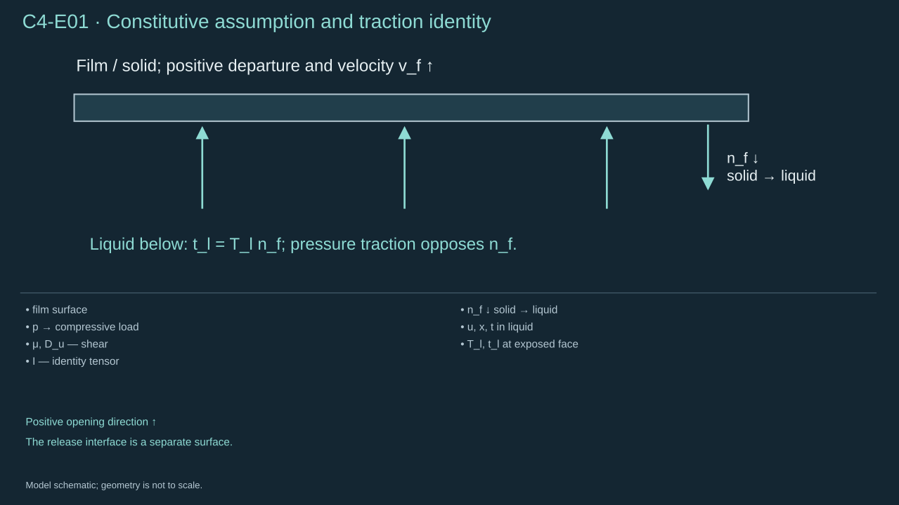

Pressure and shear act at the exposed film face; the drawn normal fixes the traction sign.

压力与剪切作用于薄膜外露面；所画法向决定牵引符号。

Step 2 — Integrate traction over area for force. Integrate force over time for impulse. Dot traction with surface velocity before integrating work. Pressure, impulse and work have units Pa, N s and J. A nearly rigid surface can receive high stress and impulse with little displacement work.

步骤 2——对面积积分牵引得到力，对时间积分力得到冲量。求功时先将牵引与表面速度点乘。压力、冲量与功单位分别为 Pa、N s 和 J。近刚性表面可承受大应力及冲量，同时位移功很小。

**Symbols before Eq. (C4-E02).**

**式（C4-E02）前的符号定义。**

| First individual definition / 第一项单独定义 | Second individual definition / 第二项单独定义 |
| --- | --- |
| $A_f(t)$ is the loaded solid surface (m²) $A_f(t)$为固体受载表面（m²） | $dA$ its surface-area element (m²), and $\int$ denotes integration over the indicated surface or time $dA$为表面积微元（m²），$\int$表示对所示表面或时间积分 |
| $\boldsymbol t_l$ is applied liquid traction (Pa) $\boldsymbol t_l$为液体施加的牵引（Pa） | $\boldsymbol F_l$ its resultant (N) $\boldsymbol F_l$为其合力（N） |
| $\boldsymbol I_l$ its impulse (N s) $\boldsymbol I_l$为其冲量（N s） | $\mathcal W_l$ work delivered to the solid (J) $\mathcal W_l$为传入固体的功（J） |
| $\boldsymbol v_f$ is local solid surface velocity (m s⁻¹) $\boldsymbol v_f$为固体表面局部速度（m s⁻¹） | $t_a$ — Load-event start time (s) $t_a$ — 载荷事件开始时刻（s） |
| $t_b$ — Load-event end time (s) $t_b$ — 载荷事件结束时刻（s） | $t$ — Time (s) $t$ — 时间（s） |
| $dt$ — Time integration element (s) $dt$ — 时间积分微元（s） |  |

**Conventions and conditions.** The vector dot product projects force onto velocity; Subscripts l and f label liquid and film; $t_a<t_b$ fixes the integration interval..

**约定与条件。** 向量点乘将力投影到速度上；下标l和f表示液体与薄膜；$t_a<t_b$ 确定积分区间。。

(C4-E02) · Exact mechanical definitions / 精确的力学定义

$$
\begin{aligned}\boldsymbol F_l(t)&=\int_{A_f(t)}\boldsymbol t_l\,dA,\\ \boldsymbol I_l&=\int_{t_a}^{t_b}\boldsymbol F_l(t)\,dt,\\ \mathcal W_l&=\int_{t_a}^{t_b}\int_{A_f(t)}\boldsymbol t_l\cdot\boldsymbol v_f\,dA\,dt.\end{aligned}
$$

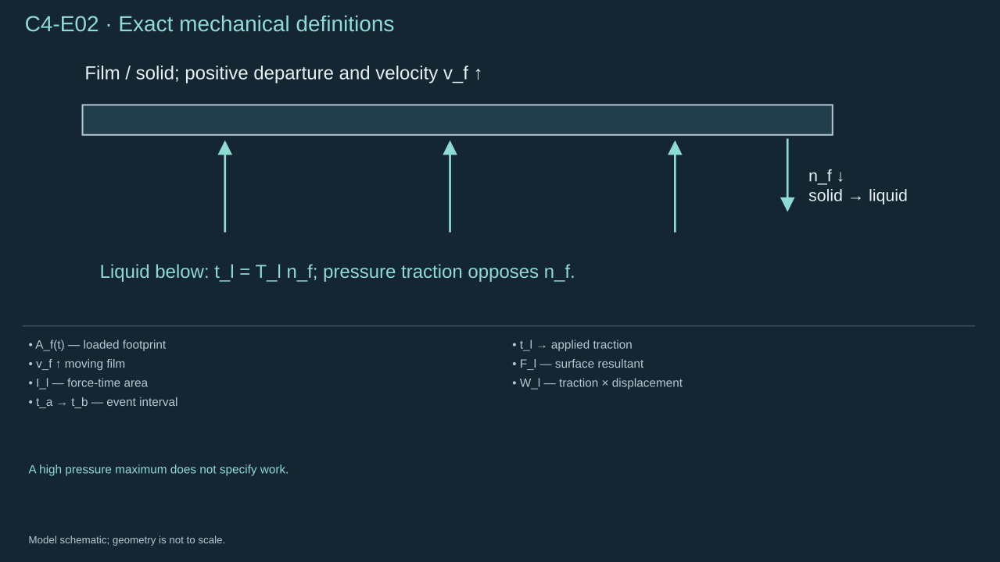

The same footprint supplies force and impulse, but surface motion is additionally required for work.

同一作用范围决定力与冲量，而求功还需要表面运动信息。

## 3. Transient film mechanics

## 3. 瞬态薄膜力学

Step 3 — Adopt a homogeneous isotropic Kirchhoff–Love plate. Assume elastic plane stress, small strain, small slope and thinness relative to deformation length. Through-thickness density integration gives areal mass. Bending stress integration gives stiffness with thickness moment thickness³/12. A bonded laminate needs a common neutral surface and laminate stiffness.

步骤 3——采用均匀各向同性 Kirchhoff–Love 板。假设弹性平面应力、小应变、小斜率，厚度远小于变形长度。沿厚度积分密度得到面质量。积分弯曲应力得到刚度，其中厚度矩为厚度³／12。粘接叠层需共同中性面及叠层刚度。

**Symbols before Eq. (C4-E03).**

**式（C4-E03）前的符号定义。**

| First individual definition / 第一项单独定义 | Second individual definition / 第二项单独定义 |
| --- | --- |
| $m_A>0$ is film areal mass (kg m⁻²) $m_A>0$为薄膜面密度（kg m⁻²） | $D_f>0$ bending stiffness (N m) $D_f>0$为弯曲刚度（N m） |
| $\rho_f>0$ constant density (kg m⁻³) $\rho_f>0$为恒定密度（kg m⁻³） | $h_f>0$ film thickness (m) $h_f>0$为薄膜厚度（m） |
| $E_f>0$ Young’s modulus (Pa) $E_f>0$为杨氏模量（Pa） | $-1<\nu_f<1/2$ Poisson’s ratio (dimensionless) $-1<\nu_f<1/2$为泊松比（无量纲） |
| $z$ is thickness coordinate (m), zero at the neutral midplane $z$为厚度坐标（m），中性面处为零 | $dz$ is its integration element (m) $dz$为其积分微元（m） |

**Conventions and conditions.** $\int$ is definite thickness integration; Subscripts A and f label areal quantity and film.

**约定与条件。** $\int$表示沿厚度定积分；下标A与f标识面量与薄膜。

(C4-E03) · Derived plate parameters under constitutive assumptions / 在本构假设下推导的板参数

$$
m_A=\int_{-h_f/2}^{h_f/2}\rho_f\,dz=\rho_fh_f,\qquad D_f=\frac{E_f}{1-\nu_f^2}\int_{-h_f/2}^{h_f/2}z^2\,dz=\frac{E_fh_f^3}{12(1-\nu_f^2)}
$$

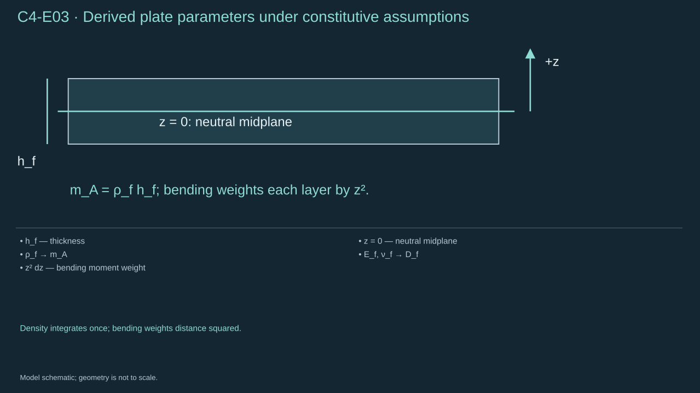

Areal inertia and bending stiffness come from different thickness integrals.

面惯性与弯曲刚度来自不同的厚度积分。

Step 4 — Write kinetic, bending and pretension energies. Curvature is the displacement’s second spatial derivative. Poisson ratio couples the two curvature directions and twist. Hold pretension uniform; its energy penalizes slope. Shape stores elastic energy, while velocity carries kinetic energy.

步骤 4——写出动能、弯曲能及预张力能。曲率为位移空间二阶导数。泊松比耦合两方向曲率与扭曲。预张力保持均匀，其能量随斜率增加。形状储存弹性能，速度携带动能。

**Symbols before Eq. (C4-E04).**

**式（C4-E04）前的符号定义。**

| First individual definition / 第一项单独定义 | Second individual definition / 第二项单独定义 |
| --- | --- |
| $\Omega_f$ is the reference film plane (m²) $\Omega_f$为薄膜参考平面（m²） | $dA$ its area element (m²) $dA$为面积微元（m²） |
| $w(x,y,t)$ vertical displacement (m) $w(x,y,t)$为竖直位移（m） | $x$ — First Cartesian in-plane coordinate (m) $x$ — 第一笛卡尔面内坐标（m） |
| $y$ — Second Cartesian in-plane coordinate (m) $y$ — 第二笛卡尔面内坐标（m） | $t$ time (s) $t$为时间（s） |
| $m_A$ is areal mass (kg m⁻²) $m_A$为面密度（kg m⁻²） | $D_f$ bending stiffness (N m) $D_f$为弯曲刚度（N m） |
| $\nu_f$ Poisson’s ratio $\nu_f$为泊松比 | $T_0\ge0$ prescribed isotropic tensile force per edge length (N m⁻¹) $T_0\ge0$为给定各向同性单位边长拉力（N m⁻¹） |
| $K_f$ — Film kinetic energy (J) $K_f$ — 薄膜动能（J） | $U_b$ — Plate bending energy, not bubble internal energy in this unit (J) $U_b$ — 板弯曲能，本单元不表示气泡内能（J） |
| $U_T$ — Stored pretension energy (J) $U_T$ — 预张力储能（J） |  |

**Conventions and conditions.** A dot differentiates in time; subscripts $xx,yy,xy$ differentiate twice in the indicated coordinates, giving curvatures (m⁻¹); $\nabla_\parallel$ is the in-plane gradient; $|\ |$ denotes Euclidean magnitude; $\int$ denotes area integration; Labels f, b, T identify film, bending and tension.

**约定与条件。** 上点表示时间导数；下标$xx,yy,xy$表示对所示坐标求二阶导数，得到曲率（m⁻¹）；$\nabla_\parallel$为面内梯度；$|\ |$为欧氏模长；$\int$表示面积积分；标签f、b、T分别指薄膜、弯曲与张力。

(C4-E04) · Linear-plate energy model / 线性板的能量模型

$$
\begin{aligned}K_f&=\frac{m_A}{2}\int_{\Omega_f}\dot w^2\,dA,\\U_b&=\frac{D_f}{2}\int_{\Omega_f}\left[w_{xx}^2+w_{yy}^2+2\nu_fw_{xx}w_{yy}+2(1-\nu_f)w_{xy}^2\right]dA,\\U_T&=\frac{T_0}{2}\int_{\Omega_f}|\nabla_\parallel w|^2\,dA.\end{aligned}
$$

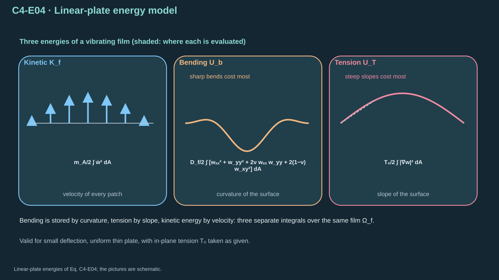

Bending energy is stored by curvature; inertia depends on velocity.

曲率储存弯曲能，速度决定惯性动能。

Step 5 — Vary displacement at a fixed clamped boundary. Integrate bending terms by parts twice. Displacement variation and its normal slope vanish at the clamp, eliminating boundary terms. Integrate tension once to obtain minus the Laplacian. Every transverse-balance term has pressure units.

步骤 5——在固定夹持边界下变分位移。弯曲项分部积分两次。夹持处位移变分及其法向斜率为零，消去边界项。张力项分部积分一次，得到负拉普拉斯。横向平衡各项均为压力单位。

**Symbols before Eq. (C4-E40).**

**式（C4-E40）前的符号定义。**

| First individual definition / 第一项单独定义 | Second individual definition / 第二项单独定义 |
| --- | --- |
| $\Omega_f$ is the smooth reference film plane (m²), $\partial\Omega_f$ its boundary $\Omega_f$为光滑薄膜参考平面（m²），$\partial\Omega_f$为其边界 | $dA$ area element (m²) $dA$为面积微元（m²） |
| $d\ell$ boundary arc-length element (m) $d\ell$为边界弧长微元（m） | $w$ is displacement (m) $w$为位移（m） |
| $\delta w$ an admissible infinitesimal variation (m) $\delta w$为容许无穷小变分（m） | $\delta U_b$ — Bending-energy variation (J) $\delta U_b$ — 弯曲能变分（J） |
| $\delta U_T$ — Pretension-energy variation (J) $\delta U_T$ — 预张力能变分（J） | $\alpha$ — Cartesian in-plane direction index, taking 1 or 2 (dimensionless) $\alpha$ — 取 1 或 2 的笛卡尔面内方向指标（无量纲） |
| $\beta$ — Cartesian in-plane direction index, taking 1 or 2 (dimensionless) $\beta$ — 取 1 或 2 的笛卡尔面内方向指标（无量纲） | $w_{\alpha\beta}=\partial_\alpha\partial_\beta w$ is curvature (m⁻¹) $w_{\alpha\beta}=\partial_\alpha\partial_\beta w$为曲率（m⁻¹） |
| $D_f$ is bending stiffness (N m) $D_f$为弯曲刚度（N m） | $\nu_f$ Poisson’s ratio $\nu_f$为泊松比 |
| $T_0$ pretension (N m⁻¹) $T_0$为预张力（N m⁻¹） | $B_{\alpha\beta}$ the bending-energy tensor conjugate to curvature (N) $B_{\alpha\beta}$为与曲率共轭的弯曲能张量（N） |
| $\delta_{\alpha\beta}$ is the dimensionless Kronecker identity, distinct from variation notation $\delta_{\alpha\beta}$为无量纲Kronecker单位张量，与变分记号不同 | $n_\alpha$ — Component of the outward in-plane unit normal (dimensionless) $n_\alpha$ — 面内外单位法向的分量（无量纲） |
| $n_\beta$ — Component of the outward in-plane unit normal (dimensionless) $n_\beta$ — 面内外单位法向的分量（无量纲） | $\boldsymbol0$ is zero gradient (dimensionless) $\boldsymbol0$为零梯度（无量纲） |

**Conventions and conditions.** $\partial_\alpha$ is coordinate differentiation (m⁻¹); $\partial_n$ its derivative; $\nabla_\parallel$ and $\nabla_\parallel^2$ are in-plane gradient and Laplacian; $\int,\oint$ denote area and closed-boundary integrals; $\Rightarrow$ uses zero tangential derivative of an identically zero boundary variation plus the prescribed zero normal derivative; $\sum_{\alpha,\beta=1}^{2}$ sums all four index pairs..

**约定与条件。** $\partial_\alpha$为坐标求导（m⁻¹）；$\partial_n$为沿该法向求导；$\nabla_\parallel$及$\nabla_\parallel^2$为面内梯度及拉普拉斯算子；$\int,\oint$分别表示面积积分与闭合边界积分；$\Rightarrow$使用恒为零的边界变分具有零切向导数，并结合给定零法向导数；$\sum_{\alpha,\beta=1}^{2}$ 对四种指标组合求和。。

(C4-E40) · Explicit integration-by-parts boundary terms / 明确写出的分部积分边界项

$$
\begin{aligned}B_{\alpha\beta}&=D_f[(1-\nu_f)w_{\alpha\beta}+\nu_f\delta_{\alpha\beta}\nabla_\parallel^2w],\\\delta U_b&=\sum_{\alpha,\beta=1}^{2}\int_{\Omega_f}B_{\alpha\beta}\partial_\alpha\partial_\beta(\delta w)\,dA\\&=\sum_{\alpha,\beta=1}^{2}\oint_{\partial\Omega_f}n_\alpha B_{\alpha\beta}\partial_\beta(\delta w)\,d\ell-\sum_{\alpha,\beta=1}^{2}\int_{\Omega_f}(\partial_\alpha B_{\alpha\beta})\partial_\beta(\delta w)\,dA\\&=\sum_{\alpha,\beta=1}^{2}\oint_{\partial\Omega_f}[n_\alpha B_{\alpha\beta}\partial_\beta(\delta w)-n_\beta(\partial_\alpha B_{\alpha\beta})\delta w]\,d\ell+\sum_{\alpha,\beta=1}^{2}\int_{\Omega_f}(\partial_\beta\partial_\alpha B_{\alpha\beta})\delta w\,dA,\\\delta U_T&=T_0\oint_{\partial\Omega_f}\delta w\,\partial_nw\,d\ell-T_0\int_{\Omega_f}\delta w\nabla_\parallel^2w\,dA,\\\delta w=0,\quad\partial_n\delta w=0&\ \Longrightarrow\ \nabla_\parallel\delta w=\boldsymbol0\quad\text{on the fixed clamp}.\end{aligned}
$$

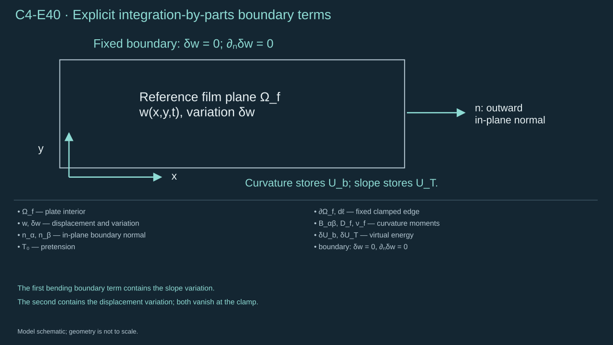

Two integrations by parts expose the boundary moment and shear terms before they are removed.

两次分部积分先明确显示边界弯矩与剪力项，再依据条件将其消去。

**Symbols before Eq. (C4-E05).**

**式（C4-E05）前的符号定义。**

| First individual definition / 第一项单独定义 | Second individual definition / 第二项单独定义 |
| --- | --- |
| $\delta w$ is a displacement variation (m) $\delta w$为位移变分（m） | $U_b$ — Plate bending energy, not bubble internal energy in this unit (J) $U_b$ — 板弯曲能，本单元不表示气泡内能（J） |
| $U_T$ — Stored pretension energy (J) $U_T$ — 预张力储能（J） | $D_f$ is bending stiffness (N m) $D_f$为弯曲刚度（N m） |
| $\nu_f$ is dimensionless Poisson’s ratio $\nu_f$为无量纲泊松比 | $T_0$ is uniform pretension (N m⁻¹) $T_0$为均匀预张力（N m⁻¹） |
| $w$ is transverse displacement (m) $w$为横向位移（m） | $x$ — First Cartesian in-plane coordinate (m) $x$ — 第一笛卡尔面内坐标（m） |
| $y$ — Second Cartesian in-plane coordinate (m) $y$ — 第二笛卡尔面内坐标（m） | $\Omega_f$ is film area (m²) $\Omega_f$为薄膜面积（m²） |
| $dA$ is its element (m²) $dA$为面积微元（m²） |  |

**Conventions and conditions.** Subscripts $xxxx,xxyy,yyyy$ denote the indicated fourth derivatives (m⁻³); $\nabla_\parallel^2=\partial_x^2+\partial_y^2$ is the in-plane Laplacian; $\nabla_\parallel^4$ is that Laplacian applied twice; $\int$ is area integration; The variations and their normal slopes vanish at a clamped boundary; $\delta$ denotes an infinitesimal admissible variation, not physical crack opening here.

**约定与条件。** 下标$xxxx,xxyy,yyyy$表示所示四阶导数（m⁻³）；$\nabla_\parallel^2=\partial_x^2+\partial_y^2$为面内拉普拉斯算子；$\nabla_\parallel^4$为将该算子作用两次；$\int$表示面积积分；夹持边界处变分及其法向斜率均为零；$\delta$在此表示无穷小容许变分，而非物理裂纹张开。

(C4-E05) · Derived variational identity for fixed clamps / 固定夹持条件下推导的变分恒等式

$$
\begin{aligned}\delta U_b&=D_f\int_{\Omega_f}\left[w_{xxxx}+\{2\nu_f+2(1-\nu_f)\}w_{xxyy}+w_{yyyy}\right]\delta w\,dA\\&=D_f\int_{\Omega_f}(w_{xxxx}+2w_{xxyy}+w_{yyyy})\delta w\,dA=D_f\int_{\Omega_f}\nabla_\parallel^4w\,\delta w\,dA,\\\delta U_T&=-T_0\int_{\Omega_f}\nabla_\parallel^2w\,\delta w\,dA.\end{aligned}
$$

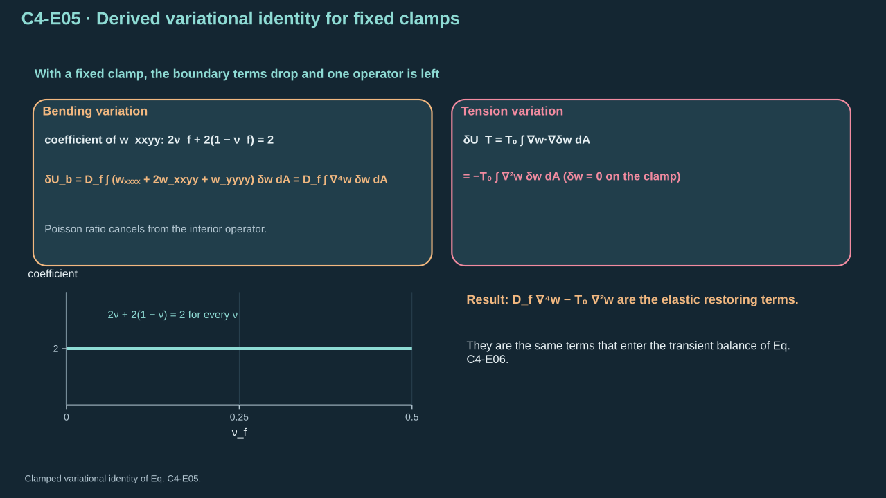

A fixed clamp removes the boundary virtual-work terms.

固定夹持边界使边界虚功项消失。

**Symbols before Eq. (C4-E06).**

**式（C4-E06）前的符号定义。**

| First individual definition / 第一项单独定义 | Second individual definition / 第二项单独定义 |
| --- | --- |
| $w(\boldsymbol x,t)$ is film displacement in the positive departure direction (m) $w(\boldsymbol x,t)$为沿正离开方向的薄膜位移（m） | $\boldsymbol x=(x,y)$ is in-plane position (m) $\boldsymbol x=(x,y)$为面内位置（m） |
| $t$ time (s) $t$为时间（s） | $\dot w$ — Film transverse velocity (m s⁻¹) $\dot w$ — 薄膜横向速度（m s⁻¹） |
| $\ddot w$ — Film transverse acceleration (m s⁻²) $\ddot w$ — 薄膜横向加速度（m s⁻²） | $m_A$ is areal mass (kg m⁻²) $m_A$为面密度（kg m⁻²） |
| $D_f$ bending stiffness (N m) $D_f$为弯曲刚度（N m） | $T_0\ge0$ pretension (N m⁻¹) $T_0\ge0$为预张力（N m⁻¹） |
| $p_{\rm load}$ is net applied transverse traction projected positively (Pa) $p_{\rm load}$为沿正方向投影的净外加横向牵引（Pa） | $t_{\rm coh}\ge0$ is an opening-resisting cohesive traction magnitude (Pa) $t_{\rm coh}\ge0$为抵抗张开的内聚牵引幅值（Pa） |

**Conventions and conditions.** $\nabla_\parallel^2$ is in-plane Laplacian (m⁻²), and $\nabla_\parallel^4$ its square; $\partial_n$ differentiates along the outward in-plane boundary normal; Initial zero is displacement or velocity according to its row; Labels load and coh identify applied and cohesive forces.

**约定与条件。** $\nabla_\parallel^2$为面内拉普拉斯算子（m⁻²），$\nabla_\parallel^4$为其平方；$\partial_n$表示沿面内边界外法向求导；初始零值按对应行分别表示位移或速度；标签load和coh表示外载与内聚力。

(C4-E06) · Reduced transient momentum balance with explicit initial/boundary data / 含明确初始与边界数据的简化瞬态动量平衡

$$
\begin{aligned}m_A\ddot w+D_f\nabla_\parallel^4w-T_0\nabla_\parallel^2w&=p_{\rm load}-t_{\rm coh},\\w(\boldsymbol x,0)=0,\quad\dot w(\boldsymbol x,0)&=0,\\w=0,\quad\partial_n w&=0\quad\text{on a clamped edge}.\end{aligned}
$$

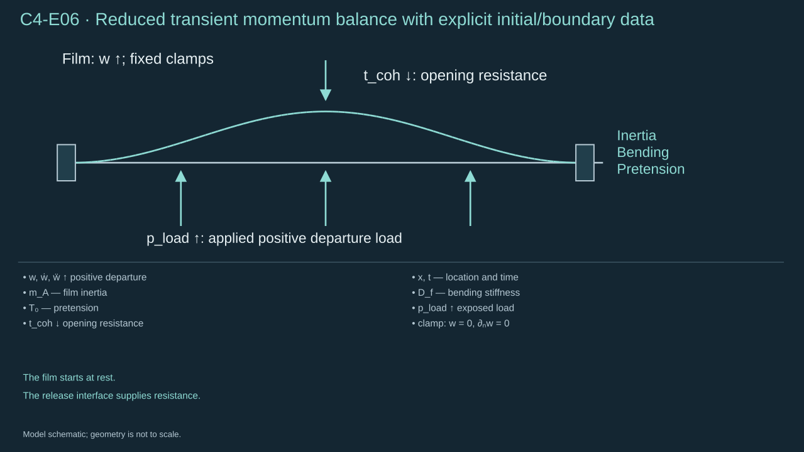

Film acceleration balances applied traction, elastic restoring forces and cohesive resistance.

薄膜加速度由外加牵引、弹性恢复力与内聚阻力的平衡决定。

The fixed clamp also has zero velocity and normal velocity slope. Multiply the plate equation by velocity and integrate. Inertia differentiates kinetic energy. Two bending integrations by parts differentiate bending energy. One tension integration differentiates pretension energy. Cohesive power removes energy from plate motion. The interface law partitions recoverable and irreversible parts.

固定夹持处速度及法向速度斜率也为零。将板方程乘速度并积分。惯性项给出动能导数。弯曲项两次分部积分给出弯曲能导数，张力项一次积分给出预张力能导数。内聚功率从板运动取走能量。界面规律区分可恢复与不可逆部分。

**Symbols before Eq. (C4-E41).**

**式（C4-E41）前的符号定义。**

| First individual definition / 第一项单独定义 | Second individual definition / 第二项单独定义 |
| --- | --- |
| $\Omega_f$ is reference film area (m²) $\Omega_f$为薄膜参考面积（m²） | $dA$ its area element (m²) $dA$为面积微元（m²） |
| $w$ displacement (m) $w$为位移（m） | $\dot w$ — Film transverse velocity (m s⁻¹) $\dot w$ — 薄膜横向速度（m s⁻¹） |
| $\ddot w$ — Film transverse acceleration (m s⁻²) $\ddot w$ — 薄膜横向加速度（m s⁻²） | $m_A$ is areal mass (kg m⁻²) $m_A$为面密度（kg m⁻²） |
| $D_f$ bending stiffness (N m) $D_f$为弯曲刚度（N m） | $T_0$ constant pretension (N m⁻¹) $T_0$为恒定预张力（N m⁻¹） |
| $p_{\rm load}$ applied transverse traction (Pa) $p_{\rm load}$为外加横向牵引（Pa） | $t_{\rm coh}$ resisting cohesive traction (Pa) $t_{\rm coh}$为抵抗内聚牵引（Pa） |
| $K_f$ — Film kinetic energy (J) $K_f$ — 薄膜动能（J） | $U_b$ — Plate bending energy, not bubble internal energy in this unit (J) $U_b$ — 板弯曲能，本单元不表示气泡内能（J） |
| $U_T$ — Stored pretension energy (J) $U_T$ — 预张力储能（J） | $t$ is time (s) $t$为时间（s） |

**Conventions and conditions.** $d/dt$ is its derivative; $\nabla_\parallel^2$ is planar Laplacian and $\nabla_\parallel^4$ its square; $\int$ is area integration; The derivatives are valid for the stated constant parameters and sufficiently regular fields at a fixed clamp with zero velocity and normal velocity slope; Every row has power units W; f, b, T, load and coh label film, bending, tension, applied and cohesive.

**约定与条件。** $d/dt$为时间导数；$\nabla_\parallel^2$为平面拉普拉斯算子，$\nabla_\parallel^4$为其平方；$\int$表示面积积分；导数适用于所述恒定参数、足够正则的场，以及速度和法向速度斜率均为零的固定夹持边界；各行单位均为功率W；f、b、T、load、coh分别表示薄膜、弯曲、张力、外加及内聚。

(C4-E41) · Transient plate power identity under fixed clamps / 固定夹持条件下瞬态板的功率恒等式

$$
\begin{aligned}\int_{\Omega_f}m_A\ddot w\dot w\,dA&=\frac{dK_f}{dt},\qquad \int_{\Omega_f}D_f\nabla_\parallel^4w\dot w\,dA=\frac{dU_b}{dt},\\-\int_{\Omega_f}T_0\nabla_\parallel^2w\dot w\,dA&=\frac{dU_T}{dt},\\\frac{d}{dt}(K_f+U_b+U_T)&=\int_{\Omega_f}p_{\rm load}\dot w\,dA-\int_{\Omega_f}t_{\rm coh}\dot w\,dA.\end{aligned}
$$

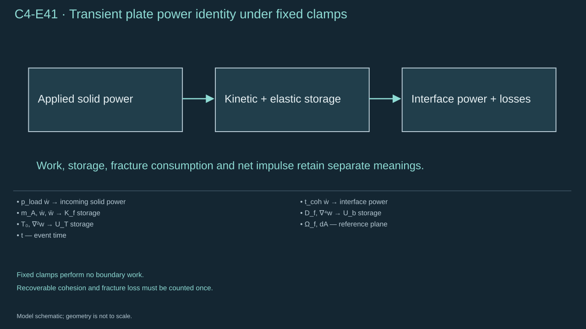

The transient plate equation conserves power between applied work, motion, shape and interface response.

瞬态薄板方程在外加功、运动、形状与界面响应之间保持功率守恒。

This is an exact balance within the reduced plate assumptions. Bending units are N m × m⁻³ = Pa. Tension units are N m⁻¹ × m⁻¹ = Pa. Zero mass gives quasistatic balance. Zero stiffness, tension and cohesion gives free areal acceleration. Large slope, stretching, plasticity, anisotropy, finite thickness or contact needs refinement. The cited static benchmark agrees with the stiffness formulation. This derivation retains inertia. [MIT plate benchmark](https://ocw.mit.edu/courses/2-080j-structural-mechanics-fall-2013/resources/mit2_080jf13_lecture7/)

这是约化板假设内的精确平衡。弯曲单位为 N m × m⁻³ = Pa，张力单位为 N m⁻¹ × m⁻¹ = Pa。质量取零得到准静态平衡，刚度、张力及内聚力取零得到自由面加速度。大斜率、拉伸、塑性、各向异性、有限厚度或接触需细化。所引静态基准与刚度形式一致，本推导保留惯性。[MIT 板基准](https://ocw.mit.edu/courses/2-080j-structural-mechanics-fall-2013/resources/mit2_080jf13_lecture7/)

Step 6 — Include PVC mechanics. Give each sheet its own areal mass, stiffness and support. Transmitted traction acts oppositely on the sheets by Newton’s third law. Determine it through contact or bond closure. A fully bonded laminate additionally requires in-plane compatibility and composite stiffness.

步骤 6——计入 PVC 力学。各片层具有独立面质量、刚度和支撑。根据牛顿第三定律，传递牵引在两片层上方向相反。须通过接触或粘接规律确定牵引。完全粘接叠层还需要面内相容性及复合刚度。

**Symbols before Eq. (C4-E07).**

**式（C4-E07）前的符号定义。**

| First individual definition / 第一项单独定义 | Second individual definition / 第二项单独定义 |
| --- | --- |
| $w_P$ — PVC displacement along the common positive direction (m) $w_P$ — 沿共同正方向的 PVC 位移（m） | $w$ — Film displacement along the same positive direction as PVC displacement (m) $w$ — 与 PVC 位移采用相同正方向的薄膜位移（m） |
| $m_{A,P}$ — PVC areal mass (kg m⁻²) $m_{A,P}$ — PVC 面密度（kg m⁻²） | $m_A$ — Film areal mass (kg m⁻²) $m_A$ — 薄膜面密度（kg m⁻²） |
| $D_P$ — PVC bending stiffness (N m) $D_P$ — PVC 弯曲刚度（N m） | $D_f$ — Film bending rigidity (N m) $D_f$ — 薄膜弯曲刚度（N m） |
| $T_P$ — Prescribed PVC pretension (N m⁻¹) $T_P$ — 给定 PVC 预张力（N m⁻¹） | $T_0$ — Prescribed isotropic tensile force per edge length (N m⁻¹) $T_0$ — 给定的单位边长各向同性拉力（N m⁻¹） |
| $p_{\rm liq}$ is net liquid traction on PVC (Pa) $p_{\rm liq}$为液体作用于PVC的净牵引（Pa） | $t_{P\to f}$ transmitted PVC-to-film traction projected positively (Pa) $t_{P\to f}$为沿正方向投影的PVC传向薄膜牵引（Pa） |
| $t_{\rm coh}$ film-release resistance (Pa) $t_{\rm coh}$为薄膜释放阻力（Pa） |  |

**Conventions and conditions.** double dots are accelerations (m s⁻²); $\nabla_\parallel^2$ is the in-plane Laplacian and $\nabla_\parallel^4$ its square; P labels PVC, f film, A areal, liq liquid and coh cohesion; the arrow labels the transmission direction; Each sheet has its actual initial and support conditions; No value of transmitted traction is supplied without an additional contact/bond closure.

**约定与条件。** 双上点为加速度（m s⁻²）；$\nabla_\parallel^2$为面内拉普拉斯算子，$\nabla_\parallel^4$为其平方；P表示PVC，f表示薄膜，A表示面量，liq表示液体，coh表示内聚；箭头标识传递方向；每层均具有自身实际初始及支承条件；若无附加接触／粘接闭合关系，传递牵引就尚未确定。

(C4-E07) · Conditional coupled-sheet model / 有条件的耦合薄片模型

$$
\begin{aligned}m_{A,P}\ddot w_P+D_P\nabla_\parallel^4w_P-T_P\nabla_\parallel^2w_P&=p_{\rm liq}-t_{P\to f},\\m_A\ddot w+D_f\nabla_\parallel^4w-T_0\nabla_\parallel^2w&=t_{P\to f}-t_{\rm coh}.\end{aligned}
$$

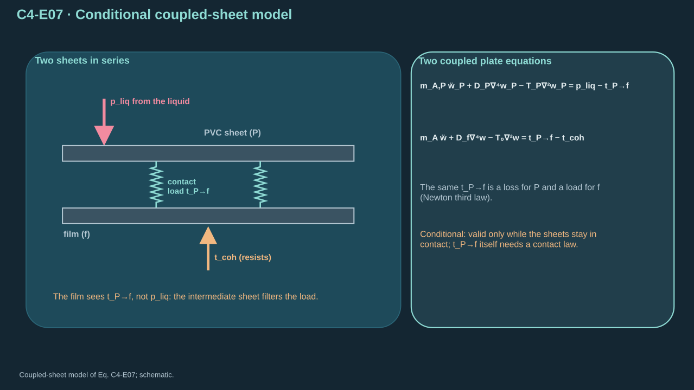

The PVC-to-film load follows intermediate-sheet motion and contact.

PVC传向薄膜的载荷由中间片层运动与接触决定。

Step 7 — Integrate the film equation over the pulse. Retain restoring and cohesive impulses. A free velocity jump requires both small relative to applied impulse. A film bonded to rigid donor across the footprint fails that condition. Count resolved fluid inertia once.

步骤 7——在脉冲期间积分薄膜方程，保留恢复力与内聚力冲量。自由速度跃变要求两者相对外加冲量较小。整个作用区粘接于刚性供体的薄膜不满足该条件。解析流体惯性计入一次。

**Symbols before Eq. (C4-E08).**

**式（C4-E08）前的符号定义。**

| First individual definition / 第一项单独定义 | Second individual definition / 第二项单独定义 |
| --- | --- |
| $m_A$ is film areal mass (kg m⁻²) $m_A$为薄膜面密度（kg m⁻²） | $w(\boldsymbol x,t)$ vertical displacement (m) $w(\boldsymbol x,t)$为竖直位移（m） |
| $\boldsymbol x$ in-plane position (m) $\boldsymbol x$为面内位置（m） | $\dot w$ velocity (m s⁻¹) $\dot w$为速度（m s⁻¹） |
| $t_a$ — Load-event start time (s) $t_a$ — 载荷事件开始时刻（s） | $t_b$ — Load-event end time (s) $t_b$ — 载荷事件结束时刻（s） |
| $t$ — Time (s) $t$ — 时间（s） | $dt$ — Time integration element (s) $dt$ — 时间积分微元（s） |
| $J_A$ is local applied impulse per area (Pa s) $J_A$为局部单位面积外加冲量（Pa s） | $p_{\rm load}$ net applied traction (Pa) $p_{\rm load}$为净外加牵引（Pa） |
| $t_{\rm coh}$ cohesive resistance (Pa) $t_{\rm coh}$为内聚阻力（Pa） | $D_f$ bending stiffness (N m) $D_f$为弯曲刚度（N m） |
| $T_0$ pretension (N m⁻¹) $T_0$为预张力（N m⁻¹） |  |

**Conventions and conditions.** $\nabla_\parallel^2$ and $\nabla_\parallel^4$ are the in-plane Laplacian and its square; $\int$ integrates the actual local load/response during the pulse; Labels A, f, load and coh mean areal, film, applied and cohesive.

**约定与条件。** $\nabla_\parallel^2$与$\nabla_\parallel^4$为面内拉普拉斯算子及其平方；$\int$表示对脉冲期间实际局部载荷／响应积分；标签A、f、load、coh分别表示面量、薄膜、外加及内聚。

(C4-E08) · Exact time integral within the reduced plate model / 简化板模型内的精确时间积分

$$
m_A[\dot w(\boldsymbol x,t_b)-\dot w(\boldsymbol x,t_a)]=J_A-\int_{t_a}^{t_b}[D_f\nabla_\parallel^4w-T_0\nabla_\parallel^2w+t_{\rm coh}]\,dt,\qquad J_A=\int_{t_a}^{t_b}p_{\rm load}\,dt
$$

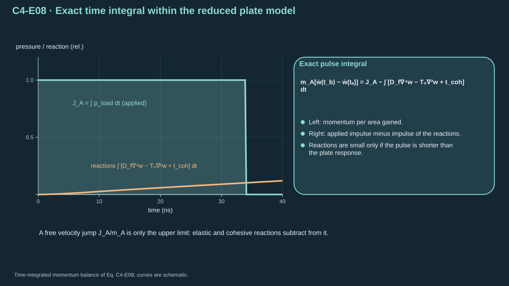

Pulse integration exposes the reactions that can invalidate a free velocity jump.

脉冲积分明确显示哪些反作用冲量会使自由速度跃变失效。

**Symbols before Eq. (C4-E09).**

**式（C4-E09）前的符号定义。**

| First individual definition / 第一项单独定义 | Second individual definition / 第二项单独定义 |
| --- | --- |
| $\Delta\dot w$ is the film velocity change from rest (m s⁻¹) $\Delta\dot w$为薄膜从静止开始的速度变化（m s⁻¹） | $J_A$ is local applied impulse per area (Pa s) $J_A$为局部单位面积外加冲量（Pa s） |
| $m_A>0$ film areal mass (kg m⁻²) $m_A>0$为薄膜面密度（kg m⁻²） | $\mathcal E_A$ resulting kinetic energy per area (J m⁻²) $\mathcal E_A$为所得单位面积动能（J m⁻²） |

**Conventions and conditions.** $\simeq$ marks negligible restoring/cohesive impulse during the pulse, not guaranteed transmission through an adhered stack; Subscript A labels quantities per area; $\Delta$ denotes final-minus-initial difference, and a dot is a time derivative.

**约定与条件。** $\simeq$表示脉冲期间恢复力／内聚力冲量可忽略，而非保证粘接叠层中的载荷传递；下标A表示单位面积量；$\Delta$表示终值减初值，上点为时间导数。

(C4-E09) · Short-pulse free-response approximation / 短脉冲后的自由响应近似

$$
\Delta\dot w\simeq\frac{J_A}{m_A},\qquad \mathcal E_A\simeq\frac12m_A(\Delta\dot w)^2=\frac{J_A^2}{2m_A}
$$

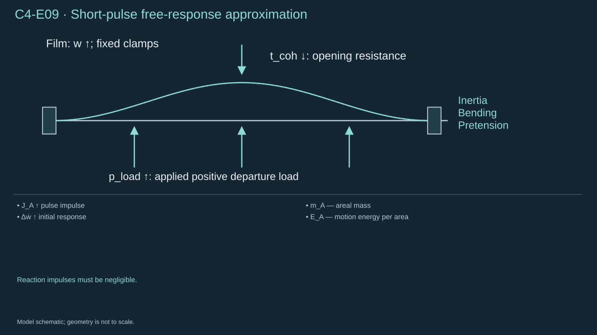

Impulse creates film kinetic energy that may subsequently feed deformation and fracture.

冲量产生薄膜动能，之后才可能转入变形与断裂。

Balance inertia with bending and tension over the deformation length. Compare the resulting response times with pulse duration. Small-opening cohesive stiffness gives a third time. Slow duration alone leaves equilibrium unresolved when pulse edges or crack growth are rapid.

在变形长度上分别平衡惯性与弯曲、张力。比较所得响应时间与脉冲时长。小张开内聚刚度给出第三种时间。脉冲边缘或裂纹增长快速时，单凭长时长仍未确立平衡。

**Symbols before Eq. (C4-E10).**

**式（C4-E10）前的符号定义。**

| First individual definition / 第一项单独定义 | Second individual definition / 第二项单独定义 |
| --- | --- |
| $t_b^{\rm scale}$ — Bending response-time estimate (s) $t_b^{\rm scale}$ — 弯曲响应时间估计（s） | $t_T^{\rm scale}$ — Pretension response-time estimate (s) $t_T^{\rm scale}$ — 预张力响应时间估计（s） |
| $t_n^{\rm scale}$ — Normal-cohesion response-time estimate (s) $t_n^{\rm scale}$ — 法向内聚响应时间估计（s） | $a_f>0$ is lateral deformation length (m) $a_f>0$为横向变形长度（m） |
| $m_A>0$ areal mass (kg m⁻²) $m_A>0$为面密度（kg m⁻²） | $D_f>0$ bending stiffness (N m) $D_f>0$为弯曲刚度（N m） |
| $T_0>0$ pretension (N m⁻¹) $T_0>0$为预张力（N m⁻¹） | $K_n>0$ small-opening normal cohesive stiffness (Pa m⁻¹) $K_n>0$为小张开法向内聚刚度（Pa m⁻¹） |

**Conventions and conditions.** superscript scale labels estimates and subscripts b, T, n identify the restoring mechanisms; $\sqrt{\ }$ is the positive root; If pretension or cohesion is absent, its corresponding timescale is omitted rather than divided by zero.

**约定与条件。** 上标scale表示估计，下标b、T、n标识恢复机制；$\sqrt{\ }$取正根；若预张力或内聚机制不存在，则不使用对应时间尺度，不能除以零。

(C4-E10) · Derived term-balance estimates / 通过各项平衡推导的估算

$$
t_b^{\rm scale}=a_f^2\sqrt{\frac{m_A}{D_f}},\qquad t_T^{\rm scale}=a_f\sqrt{\frac{m_A}{T_0}},\qquad t_n^{\rm scale}=\sqrt{\frac{m_A}{K_n}}
$$

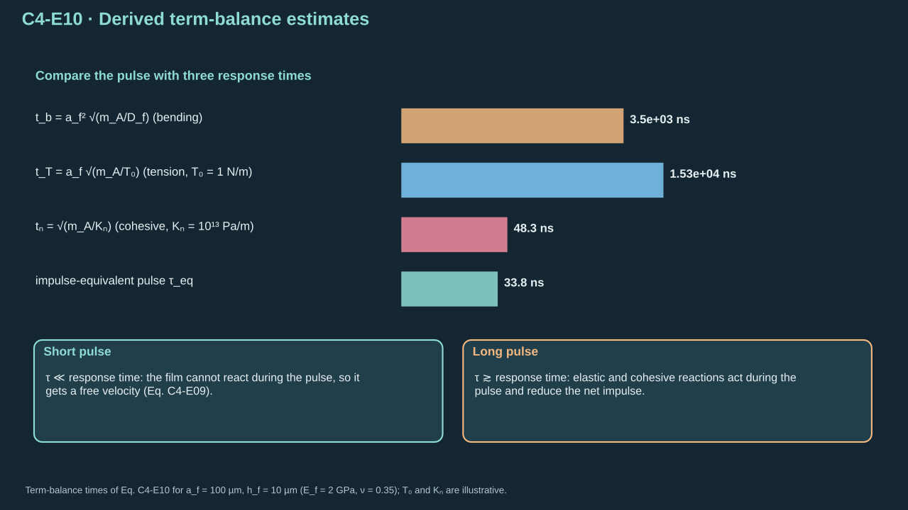

Pulse duration must be compared with the response scales of the actual load path.

脉冲持续时间须与实际传力路径的响应尺度比较。

## 4. Interface strength and fracture work

## 4. 界面强度与断裂功

Step 8 — Specify loading control before crack driving force. Peak tensile traction is local strength in Pa. Reversible adhesion work is a surface-energy difference. Practical fracture energy includes dissipation and has units J m⁻². For quasistatic conservative mechanics, differentiate potential by crack area at fixed source control. Mode mixture, temperature and crack speed can change resistance.

步骤 8——计算裂纹驱动力前规定加载控制。峰值拉伸牵引是 Pa 单位局部强度。可逆粘附功是表面能差。实际断裂能包含耗散，单位为 J m⁻²。准静态保守力学中，在固定源控制下对裂纹面积求势能导数。模态混合、温度及裂纹速度可改变阻力。

**Symbols before Eq. (C4-E11).**

**式（C4-E11）前的符号定义。**

| First individual definition / 第一项单独定义 | Second individual definition / 第二项单独定义 |
| --- | --- |
| $G$ is quasistatic energy-release rate (J m⁻²) $G$为准静态能量释放率（J m⁻²） | $\mathcal P$ total mechanical potential including the external loading system (J) $\mathcal P$为包含外部加载系统的总力学势能（J） |
| $A_c$ crack area (m²), and $\partial/\partial A_c$ a partial derivative $A_c$为裂纹面积（m²），$\partial/\partial A_c$为偏导数 | $\mathcal C$ labels the held loading control, such as pressure or displacement (—) $\mathcal C$标识保持不变的加载控制量，例如压力或位移，而非材料系数（—） |
| $\Gamma$ is fracture resistance (J m⁻²) $\Gamma$为断裂阻力（J m⁻²） | $\psi$ mode-mixture parameter (dimensionless) $\psi$为模态混合参数（无量纲） |
| $T_i$ interface temperature (K) $T_i$为界面温度（K） | $v_c$ crack-front speed (m s⁻¹) $v_c$为裂纹前沿速度（m s⁻¹） |

**Conventions and conditions.** it is not a material coefficient; Subscripts c and i label crack and interface; The inequality is an energetic propagation criterion for the specified fracture model, not a sufficient transfer criterion.

**约定与条件。** 下标c与i表示裂纹及界面；此不等式是指定断裂模型的能量扩展判据，而非充分转印判据。

(C4-E11) · Definition with quasistatic fracture criterion / 定义与准静态断裂判据

$$
G=-\left.\frac{\partial\mathcal P}{\partial A_c}\right|_{\mathcal C},\qquad G\ge\Gamma(\psi,T_i,v_c)
$$

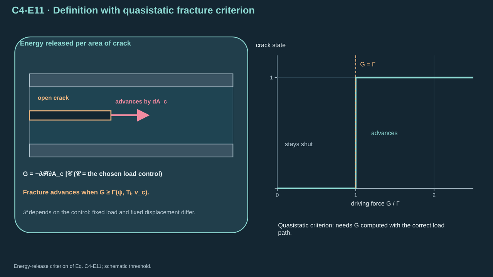

A crack is driven by energy per newly separated area, under a specified load control.

裂纹由每单位新分离面积的可用能量驱动，且加载控制必须明确。

Comparing pressure with fracture energy requires a deformation length and mechanical law. Competing paths include intended release, another bond’s failure and payload tearing. Feng et al. show how interface kinetics alter path competition. Measure rate and temperature dependence for the actual PFC stack. Their PDMS values require separate justification before reuse. [[R10]](../reference/sources.html#r10)

压力与断裂能比较需要变形长度及力学规律。竞争路径包括目标释放、其他粘接失效及载荷撕裂。Feng 等说明界面动力学如何改变路径竞争。实际 PFC 叠层须测量速率及温度依赖性。复用其 PDMS 数值需要独立依据。 [[R10]](../reference/sources.html#r10)

Retain kinetic energy during rapid fracture. The chosen crack-front balance includes elastic storage, inertia, fracture consumption and other loss. Count cohesive dissipation once through the selected fracture energy. Crack path still requires structural and interface equations.

快速断裂时保留动能。所选裂纹前沿平衡包括弹性储存、惯性、断裂消耗及其他损失。所选断裂能中的内聚耗散计入一次。裂纹路径仍需结构与界面方程。

**Symbols before Eq. (C4-E12).**

**式（C4-E12）前的符号定义。**

| First individual definition / 第一项单独定义 | Second individual definition / 第二项单独定义 |
| --- | --- |
| $P_{\rm load}$ is mechanical power delivered to the solid (W) $P_{\rm load}$为传入固体的力学功率（W） | $K_f$ its kinetic energy (J) $K_f$为固体动能（J） |
| $U_f$ its recoverable elastic energy including any recoverable interface energy (J), and $d/dt$ the time derivative with $t$ in s $U_f$为可恢复弹性能，含任何可恢复界面能（J），$d/dt$为时间导数 | $\mathcal L_c$ is the active crack-front line (—) $\mathcal L_c$为活跃裂纹前沿曲线（—） |
| $d\ell$ is its arc-length element (m) $d\ell$为弧长微元（m） | $v_c\ge0$ is front speed (m s⁻¹) $v_c\ge0$为前沿速度（m s⁻¹） |
| $\Gamma$ fracture energy (J m⁻²) $\Gamma$为断裂能（J m⁻²） | $\psi$ dimensionless mode mixture $\psi$为无量纲模态混合参数 |
| $T_i$ interface temperature (K) $T_i$为界面温度（K） | $P_{\rm other}\ge0$ is additional nonfracture dissipation (W) $P_{\rm other}\ge0$为其他非断裂耗散（W） |
| $t$ — Time (s) $t$ — 时间（s） |  |

**Conventions and conditions.** $\int$ integrates along the front; Labels load, f, c, i and other denote applied, solid film, crack, interface and remaining dissipative processes.

**约定与条件。** $\int$表示沿前沿积分；标签load、f、c、i、other分别表示外加、固体薄膜、裂纹、界面及其余耗散过程。

(C4-E12) · Conditional dynamic energy balance / 有条件的动态能量平衡

$$
P_{\rm load}=\frac{d}{dt}(K_f+U_f)+\int_{\mathcal L_c}\Gamma(\psi,T_i,v_c)v_c\,d\ell+P_{\rm other}
$$

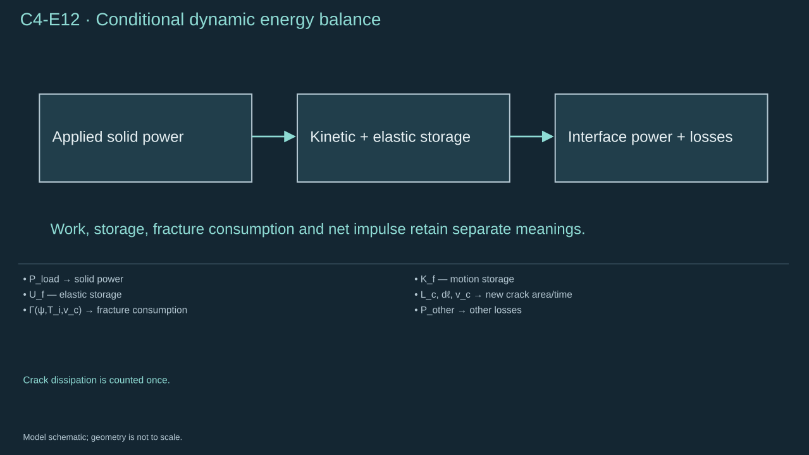

Dynamic loading can store kinetic energy before or during crack advance.

动态载荷可在裂纹扩展前或扩展中储存动能。

## 5. Circular blister benchmark

## 5. 圆形鼓泡基准

Step 9 — Define pressure-controlled delamination. A pre-existing circular crack lies beneath a thin isotropic plate. The bonded region clamps its edge. A reservoir maintains uniform positive pressure as radius varies. Omit inertia, pretension and stretching. Center displacement and curvature are regular without point force or singular moment. This benchmark has different loading from the transient jet array.

步骤 9——定义压力控制脱层。薄各向同性板下已有圆形裂纹，粘接外区夹持其边缘。半径变化时，储库维持均匀正压差。忽略惯性、预张力及拉伸。中心无点力或奇异弯矩，位移和曲率正则。该基准加载不同于瞬态射流阵列。

**Symbols before Eq. (C4-E13).**

**式（C4-E13）前的符号定义。**

| First individual definition / 第一项单独定义 | Second individual definition / 第二项单独定义 |
| --- | --- |
| $r\in[0,b]$ is radius in the plate plane (m) $r\in[0,b]$为板平面内半径（m） | $b>0$ delamination radius (m) $b>0$为脱层半径（m） |
| $w(r)$ opening displacement (m) $w(r)$为张开位移（m） | $p_0>0$ externally maintained pressure difference (Pa) $p_0>0$为外部保持的压差（Pa） |
| $D_f>0$ bending stiffness (N m) $D_f>0$为弯曲刚度（N m） | $\mathscr L_r$ is the axisymmetric planar Laplacian (m⁻²) $\mathscr L_r$为轴对称平面拉普拉斯算子（m⁻²） |
| $f$ is an arbitrary smooth radial function (—) $f$为任意光滑径向函数（—） | $g=\mathscr L_rw$ has units m⁻¹ $g=\mathscr L_rw$的单位为m⁻¹ |

**Conventions and conditions.** $d/dr$ and a prime denote radial differentiation; the operator at $r=0$ is its regular limit; Labels r, f and 0 denote radial operator, film/arbitrary function according to context, and maintained load; The two zero values prescribe edge displacement and slope.

**约定与条件。** $d/dr$及撇号表示径向求导；$r=0$处算子取正则极限；标签r、f、0分别表示径向算子、薄膜／任意函数（依语境）及恒定载荷；两个零值指定边缘位移与斜率。

(C4-E13) · Quasistatic plate boundary-value model / 准静态板的边值模型

$$
\mathscr L_rg=\frac{p_0}{D_f},\qquad g=\mathscr L_rw,\qquad \mathscr L_r f=\frac1r\frac{d}{dr}\left(r\frac{df}{dr}\right),\qquad w(b)=0,\quad w^{\prime}(b)=0
$$

Uniform pressure loads a clamped circular delamination with regular central fields.

均匀压力作用于边缘夹持的圆形脱层，中心场必须正则。

Step 10 — Solve the curvature sum. Multiply its radial Laplacian equation by radius and integrate. Divide by radius away from the center. Regular curvature gradient excludes the inverse-radius term. Integrate again for the constant curvature offset. The edge slope will determine it.

步骤 10——求曲率和。将径向拉普拉斯方程乘半径并积分。中心之外除以半径。曲率梯度正则性排除半径反比项。再次积分得到常曲率偏置，随后由边缘斜率确定。

**Symbols before Eq. (C4-E14).**

**式（C4-E14）前的符号定义。**

| First individual definition / 第一项单独定义 | Second individual definition / 第二项单独定义 |
| --- | --- |
| $r\in(0,b]$ is radial coordinate (m) $r\in(0,b]$为径向坐标（m） | $b$ is delamination radius (m) $b$为脱层半径（m） |
| $g(r)=\mathscr L_rw$ is the curvature sum (m⁻¹), with a prime and $d/dr$ denoting radial differentiation $g(r)=\mathscr L_rw$为曲率和（m⁻¹），撇号及$d/dr$表示径向求导 | $p_0$ is maintained pressure difference (Pa) $p_0$为恒定压差（Pa） |
| $D_f$ bending stiffness (N m) $D_f$为弯曲刚度（N m） | $C_1$ — Curvature integration constant (m⁻¹) $C_1$ — 曲率积分常数（m⁻¹） |
| $C_2$ — Curvature integration constant (m⁻¹) $C_2$ — 曲率积分常数（m⁻¹） | $\mathscr L_r$ is the radial Laplacian (m⁻²) $\mathscr L_r$为径向拉普拉斯算子（m⁻²） |
| $w$ displacement (m) $w$为位移（m） |  |

**Conventions and conditions.** $C_1=0$ follows from regular central curvature gradient and absence of a point load; the subscript 0 labels the maintained pressure, not the initial liquid pressure.

**约定与条件。** $C_1=0$来自中心曲率梯度正则及无点载荷条件；下标0标识恒定压力，而非液体初始压力。

(C4-E14) · Derived first two radial integrations / 推导中的前两次径向积分

$$
\begin{aligned}\frac{d}{dr}(rg^{\prime})&=\frac{p_0r}{D_f},\\rg^{\prime}&=\frac{p_0r^2}{2D_f}+C_1,\\g^{\prime}&=\frac{p_0r}{2D_f}+\frac{C_1}{r},\quad C_1=0,\\g(r)&=\frac{p_0r^2}{4D_f}+C_2.\end{aligned}
$$

Regularity removes the singular integration constant before edge conditions are used.

在使用边缘条件之前，正则性先排除奇异积分常数。

Step 11 — Integrate curvature to displacement. Center regularity removes the inverse-radius slope. Integration leaves quartic, quadratic and constant terms. Zero edge slope fixes curvature offset. Zero edge displacement fixes the remaining constant.

步骤 11——由曲率积分至位移。中心正则性消去半径反比斜率。积分留下四次、二次及常数项。边缘零斜率确定曲率偏置，边缘零位移确定剩余常数。

**Symbols before Eq. (C4-E15).**

**式（C4-E15）前的符号定义。**

| First individual definition / 第一项单独定义 | Second individual definition / 第二项单独定义 |
| --- | --- |
| $r\in(0,b]$ is radial position (m) $r\in(0,b]$为径向位置（m） | $b$ delamination radius (m) $b$为脱层半径（m） |
| $w$ displacement (m) $w$为位移（m） | $g$ curvature sum (m⁻¹) $g$为曲率和（m⁻¹） |
| $w^{\prime}$ is dimensionless slope $w^{\prime}$为无量纲斜率 | $p_0$ is maintained pressure (Pa) $p_0$为恒定压力（Pa） |
| $D_f$ bending stiffness (N m) $D_f$为弯曲刚度（N m） | $C_2$ curvature integration constant (m⁻¹) $C_2$为曲率积分常数（m⁻¹） |
| $C_3$ — Displacement integration constant (m) $C_3$ — 位移积分常数（m） | $C_4$ — Displacement integration constant (m) $C_4$ — 位移积分常数（m） |

**Conventions and conditions.** A prime and $d/dr$ are radial derivatives; $C_3=0$ excludes a central inverse-radius slope; All rows are regular-limit solutions at the centre; Subscripts 2,3,4 index distinct constants, not derivative orders.

**约定与条件。** 撇号及$d/dr$为径向导数；$C_3=0$排除中心反比于半径的斜率；各行在中心均取正则极限；下标2、3、4标识不同常数，而非导数阶数。

(C4-E15) · Derived second pair of radial integrations / 推导中的后两次径向积分

$$
\begin{aligned}\frac{d}{dr}(rw^{\prime})&=rg=\frac{p_0r^3}{4D_f}+C_2r,\\rw^{\prime}&=\frac{p_0r^4}{16D_f}+\frac{C_2r^2}{2}+C_3,\quad C_3=0,\\w^{\prime}&=\frac{p_0r^3}{16D_f}+\frac{C_2r}{2},\\w(r)&=\frac{p_0r^4}{64D_f}+\frac{C_2r^2}{4}+C_4.\end{aligned}
$$

The regular displacement contains quartic, quadratic and constant contributions.

正则位移含四次项、二次项与常数项。

**Symbols before Eq. (C4-E16).**

**式（C4-E16）前的符号定义。**

| First individual definition / 第一项单独定义 | Second individual definition / 第二项单独定义 |
| --- | --- |
| $w(r)$ is displacement (m) $w(r)$为位移（m） | $w^{\prime}$ radial slope (dimensionless) $w^{\prime}$为径向斜率（无量纲） |
| $r\in[0,b]$ radial position (m) $r\in[0,b]$为径向位置（m） | $b>0$ delamination radius (m), allowing division by $b$ $b>0$为脱层半径（m），因此可以除以$b$ |
| $p_0>0$ is maintained pressure (Pa) $p_0>0$为恒定压力（Pa） | $D_f>0$ bending stiffness (N m) $D_f>0$为弯曲刚度（N m） |
| $C_2$ curvature constant (m⁻¹) $C_2$为曲率常数（m⁻¹） | $C_4$ displacement constant (m) $C_4$为位移常数（m） |

**Conventions and conditions.** The prime denotes $d/dr$; $\Rightarrow$ denotes the algebraic consequence of each clamped boundary condition; Subscripts 2 and 4 label constants, and f labels film.

**约定与条件。** 撇号表示$d/dr$；$\Rightarrow$表示各夹持边界条件的代数结果；下标2与4标识常数，f表示薄膜。

(C4-E16) · Exact solution of the stated linear-plate benchmark / 所述线性板基准问题的精确解

$$
\begin{aligned}0=w^{\prime}(b)&=\frac{p_0b^3}{16D_f}+\frac{C_2b}{2}\quad\Rightarrow\quad C_2=-\frac{p_0b^2}{8D_f},\\0=w(b)&=\frac{p_0b^4}{64D_f}-\frac{p_0b^4}{32D_f}+C_4\quad\Rightarrow\quad C_4=\frac{p_0b^4}{64D_f},\\w(r)&=\frac{p_0}{64D_f}(r^4-2b^2r^2+b^4)=\frac{p_0}{64D_f}(b^2-r^2)^2.\end{aligned}
$$

Applying both edge conditions fixes the unique regular blister profile.

同时应用两个边缘条件，确定唯一正则鼓泡轮廓。

Step 12 — Substitute the solution to check it. Radial Laplacian of radius² is four. That of radius⁴ is sixteen × radius². Applying twice gives sixty-four. Edge displacement and slope vanish. Positive pressure opens the center; larger stiffness reduces opening. Units are Pa × m⁴/(N m) = m. MIT Lecture 7, Eq. 7.24 gives the same clamped-circle solution.

步骤 12——代回解进行检验。半径²的径向拉普拉斯为四，半径⁴的结果为十六 × 半径²，作用两次得六十四。边缘位移和斜率为零。正压使中心张开，刚度增大使张开减小。单位为 Pa × m⁴／（N m）= m。MIT 第 7 讲式 7.24 给出相同夹持圆板解。

**Symbols before Eq. (C4-E17).**

**式（C4-E17）前的符号定义。**

| First individual definition / 第一项单独定义 | Second individual definition / 第二项单独定义 |
| --- | --- |
| $\mathscr L_r$ is the radial planar Laplacian (m⁻²), and superscript 2 on the operator means composition twice $\mathscr L_r$为径向平面拉普拉斯算子（m⁻²），算子上的上标2表示连续作用两次 | $r$ is radial position (m) $r$为径向位置（m） |
| $b$ delamination radius (m) $b$为脱层半径（m） | $w$ blister displacement (m), and its prime is radial slope $w$为鼓泡位移（m），其撇号为径向斜率 |
| $D_f$ is bending stiffness (N m) $D_f$为弯曲刚度（N m） | $p_0$ maintained pressure (Pa) $p_0$为恒定压力（Pa） |
| $\mathscr L_r(r^2)$ is dimensionless $\mathscr L_r(r^2)$无量纲 | $\mathscr L_r(r^4)$ has units m² $\mathscr L_r(r^4)$单位为m² |

**Conventions and conditions.** superscripts on $r$ are powers; Literal 4 and 16 are numerical coefficients; The slope expression vanishes at $r=0$; $r=b$.

**约定与条件。** $r$上的上标表示幂；数字4与16是数值系数；斜率式在$r=0$及$r=b$均为零。

(C4-E17) · Governing-equation and boundary verification / 控制方程与边界条件核验

$$
\mathscr L_r(r^2)=4,\qquad \mathscr L_r(r^4)=16r^2,\qquad D_f\mathscr L_r^2w=p_0,\qquad w^{\prime}(r)=\frac{p_0r(r^2-b^2)}{16D_f}
$$

Direct radial differentiation verifies the pressure balance and regular clamped profile.

直接径向求导可检验压力平衡及正则夹持轮廓。

Step 13 — Integrate opening for cavity volume. The axisymmetric area element includes radius × radial increment. Expand the profile square and integrate each power. Evaluate both limits. The first two endpoint terms cancel, leaving the sixth-power term.

步骤 13——积分张开位移求空腔体积。轴对称面积微元包含半径 × 径向增量。展开轮廓平方并积分各幂。计算上下限，前两端点项相消，留下六次幂项。

**Symbols before Eq. (C4-E18).**

**式（C4-E18）前的符号定义。**

| First individual definition / 第一项单独定义 | Second individual definition / 第二项单独定义 |
| --- | --- |
| $V_{\rm bl}$ is added blister volume (m³) $V_{\rm bl}$为新增鼓泡体积（m³） | $w(r)$ displacement (m) $w(r)$为位移（m） |
| $r\in[0,b]$ radial integration coordinate (m) $r\in[0,b]$为径向积分坐标（m） | $dr$ its integration element (m) $dr$为积分微元（m） |
| $b$ delamination radius (m) $b$为脱层半径（m） | $p_0$ is maintained pressure (Pa) $p_0$为恒定压力（Pa） |
| $D_f$ bending stiffness (N m) $D_f$为弯曲刚度（N m） | $\pi$ the dimensionless circle constant $\pi$为无量纲圆周率 |

**Conventions and conditions.** $\int$ is radial integration; Subscript bl labels the blister; superscripts on lengths are powers; $[\ ]_0^b$ denotes antiderivative at the upper endpoint minus its value at zero.

**约定与条件。** $\int$表示径向积分；下标bl表示鼓泡；长度上的上标均表示幂；$[\ ]_0^b$表示原函数在上端点的值减去其零端点值。

(C4-E18) · Exact geometric volume integral for the benchmark / 基准模型的精确几何体积积分

$$
\begin{aligned}V_{\rm bl}&=2\pi\int_0^b w(r)r\,dr=\frac{\pi p_0}{32D_f}\int_0^b(b^4r-2b^2r^3+r^5)\,dr,\\&=\frac{\pi p_0}{32D_f}\left[\frac{b^4r^2}{2}-\frac{b^2r^4}{2}+\frac{r^6}{6}\right]_0^b=\frac{\pi p_0b^6}{192D_f}.\end{aligned}
$$

Blister volume sums the opening of all concentric annuli.

鼓泡体积等于各同心圆环张开贡献之和。

Step 14 — Include reservoir work in potential. At fixed crack radius, volume is linear in pressure. Elastic storage is half pressure × volume. Reservoir potential is minus pressure × volume. Their sum is minus the half-product. Omitting reservoir work reverses the pressure-controlled driving-force sign.

步骤 14——在势能中计入储库功。裂纹半径固定时，体积随压力线性变化。弹性储存为压力 × 体积的一半，储库势能为压力 × 体积的负值。总和为负半积。省略储库功会反转压力控制驱动力符号。

**Symbols before Eq. (C4-E19).**

**式（C4-E19）前的符号定义。**

| First individual definition / 第一项单独定义 | Second individual definition / 第二项单独定义 |
| --- | --- |
| $C_b>0$ is blister volume compliance (m³ Pa⁻¹), defined by the pressure derivative at fixed radius, including the regular zero-load value $C_b>0$为鼓泡体积柔度（m³ Pa⁻¹），由固定半径下的压力导数定义，包含正则零载荷值 | $V_{\rm bl}\ge0$ is added volume (m³) $V_{\rm bl}\ge0$为新增体积（m³） |
| $p_0\ge0$ maintained pressure (Pa) $p_0\ge0$为恒定压力（Pa） | $b>0$ crack radius (m) $b>0$为裂纹半径（m） |
| $D_f>0$ bending stiffness (N m) $D_f>0$为弯曲刚度（N m） | $U_b$ is stored plate bending energy (J) $U_b$为板弯曲储能（J） |
| $\mathcal P$ plate-plus-pressure-reservoir potential (J) $\mathcal P$为板与恒压储库的总势能（J） | $v$ a dummy volume along the fixed-radius elastic loading curve (m³), with $dv$ its element (m³) $v$为固定半径弹性加载曲线上的虚拟体积变量（m³） |
| $dv$ — Dummy-volume integration element (m³) $dv$ — 体积哑变量积分微元（m³） |  |

**Conventions and conditions.** $\partial/\partial p_0$ is the pressure derivative; the vertical bar holds radius fixed; $\int$ integrates that loading curve; Subscripts b and bl label blister compliance/bending and blister volume, respectively; the meanings are explicitly fixed here; No crack-area variation is taken during the loading-curve integral; For positive pressure, compliance also equals volume divided by pressure; at zero pressure the derivative avoids division by zero.

**约定与条件。** $\partial/\partial p_0$为压力导数；竖线表示保持半径不变；$\int$表示该加载曲线积分；下标b与bl分别表示鼓泡柔度／弯曲及鼓泡体积，此处已明确其含义；在加载曲线积分过程中不改变裂纹面积；正压力时，柔度也等于体积除以压力；零压力时采用导数避免除以零。

(C4-E19) · Derived potential under maintained-pressure control / 维持压力控制条件下推导的势能

$$
C_b=\left.\frac{\partial V_{\rm bl}}{\partial p_0}\right|_b=\frac{\pi b^6}{192D_f},\qquad V_{\rm bl}=C_bp_0,\qquad U_b=\int_0^{V_{\rm bl}}\frac{v}{C_b}\,dv=\frac{V_{\rm bl}^2}{2C_b}=\frac{p_0V_{\rm bl}}2,\qquad \mathcal P=U_b-p_0V_{\rm bl}=-\frac{\pi p_0^2b^6}{384D_f}
$$

Source work changes the sign of the relevant total potential.

压力源做功改变相关总势能的符号。

Step 15 — Differentiate potential by crack radius. Divide by the area derivative, retaining numerical factors. Positive pressure gives positive release rate. Growing compliance lowers plate-plus-reservoir potential. Doubling radius at fixed pressure multiplies driving force by sixteen.

步骤 15——对裂纹半径求势能导数，再除以面积导数，并保留数值系数。正压给出正能量释放率。柔顺性增加降低板与储库总势能。压力固定时，半径加倍使驱动力增至十六倍。

**Symbols before Eq. (C4-E20).**

**式（C4-E20）前的符号定义。**

| First individual definition / 第一项单独定义 | Second individual definition / 第二项单独定义 |
| --- | --- |
| $A_c$ is delaminated area (m²) $A_c$为脱层面积（m²） | $b>0$ its radius (m) $b>0$为其半径（m） |
| $\pi$ the circle constant (dimensionless) $\pi$为圆周率（无量纲） | $\mathcal P$ total potential including maintained pressure (J) $\mathcal P$为包含恒压源的总势能（J） |
| $p_0$ fixed pressure difference (Pa) $p_0$为固定压差（Pa） | $D_f$ bending stiffness (N m) $D_f$为弯曲刚度（N m） |
| $G_{p_0}$ is energy-release rate under that control (J m⁻²) $G_{p_0}$为该控制方式下的能量释放率（J m⁻²） |  |

**Conventions and conditions.** $d/db$ differentiates in radius; the vertical bar and subscript $p_0$ indicate held pressure; Subscript c labels crack area; all length superscripts are powers; Positive $b$ makes the area derivative nonzero.

**约定与条件。** $d/db$表示按半径求导；竖线及下标$p_0$表示保持压力不变；下标c表示裂纹面积；长度上的上标均为幂；$b$为正保证面积导数非零。

(C4-E20) · Derived quasistatic energy-release rate / 推导得到的准静态能量释放率

$$
\begin{aligned}A_c&=\pi b^2,\qquad \left.\frac{d\mathcal P}{db}\right|_{p_0}=-\frac{6\pi p_0^2b^5}{384D_f},\qquad\frac{dA_c}{db}=2\pi b,\\G_{p_0}&=-\frac{(d\mathcal P/db)_{p_0}}{dA_c/db}=\frac{p_0^2b^4}{128D_f}.\end{aligned}
$$

Geometry and compliance convert pressure into fracture energy per area.

几何与柔度将压力转换为单位面积断裂能。

**Symbols before Eq. (C4-E21).**

**式（C4-E21）前的符号定义。**

| First individual definition / 第一项单独定义 | Second individual definition / 第二项单独定义 |
| --- | --- |
| $p_{0,\rm crit}>0$ is critical maintained pressure (Pa) for constant fracture resistance $\Gamma>0$ (J m⁻²) $p_{0,\rm crit}>0$为恒定断裂阻力$\Gamma>0$（J m⁻²）对应的临界恒压（Pa） | $D_f>0$ is bending stiffness (N m) $D_f>0$为弯曲刚度（N m） |
| $b>0$ delamination radius (m) $b>0$为脱层半径（m） | $p_0\ge0$ applied maintained pressure (Pa) $p_0\ge0$为外加恒压（Pa） |
| $G_{p_0}$ the corresponding energy-release rate (J m⁻²) $G_{p_0}$为相应能量释放率（J m⁻²） | $\Gamma$ — Practical interfacial fracture energy (J m⁻²) $\Gamma$ — 实际界面断裂能（J m⁻²） |

**Conventions and conditions.** $\sqrt{\ }$ is the positive root; subscript crit labels the onset threshold; The quotient $G_{p_0}/\Gamma$ is dimensionless; This onset criterion assumes an existing crack and the quasistatic bending model.

**约定与条件。** $\sqrt{\ }$取正根；下标crit表示起始阈值；比值$G_{p_0}/\Gamma$无量纲；此起始判据假设存在预裂纹，并采用准静态弯曲模型。

(C4-E21) · Derived onset threshold within the benchmark / 基准模型内推导的起始阈值

$$
p_{0,\rm crit}=\frac{\sqrt{128D_f\Gamma}}{b^2},\qquad \frac{G_{p_0}}{\Gamma}=\left(\frac{p_0}{p_{0,\rm crit}}\right)^2
$$

The pressure threshold depends on crack geometry and fracture resistance, not pressure alone.

压力阈值取决于裂纹几何及断裂阻力，而非压力本身。

Step 16 — Change to fixed volume. Remove continuing reservoir work and eliminate pressure through compliance. Differentiate plate storage at fixed volume. Reinsert instantaneous pressure for comparison. The same state gives the same instantaneous expression. Radius growth increases fixed-pressure driving and decreases fixed-volume driving. Constant resistance therefore gives different stability under these controls. A sealed PFC cavity has evolving mass and temperature. Its trajectory needs a thermodynamic closure.

步骤 16——改为固定体积。取消持续储库功，通过柔顺性消去压力。在固定体积下对板储能求导，再代回瞬时压力进行比较。同一状态给出相同瞬时形式。半径增长使定压驱动增加、定容驱动减小。阻力恒定时，两类控制具有不同稳定性。密闭 PFC 空腔质量和温度会演化，其轨迹需要热力学闭合。

**Symbols before Eq. (C4-E22).**

**式（C4-E22）前的符号定义。**

| First individual definition / 第一项单独定义 | Second individual definition / 第二项单独定义 |
| --- | --- |
| $\bar V>0$ is imposed fixed added volume (m³) $\bar V>0$为强制固定的新增体积（m³） | $U_b$ plate bending energy (J) $U_b$为板弯曲能（J） |
| $C_b$ volume compliance (m³ Pa⁻¹) $C_b$为体积柔度（m³ Pa⁻¹） | $D_f$ bending stiffness (N m) $D_f$为弯曲刚度（N m） |
| $b>0$ crack radius (m) $b>0$为裂纹半径（m） | $p(b)$ the pressure required at that radius (Pa) $p(b)$为该半径处所需压力（Pa） |
| $G_{\bar V}$ — Energy-release rate at fixed added volume (J m⁻²) $G_{\bar V}$ — 固定新增体积下的能量释放率（J m⁻²） | $G_{p_0}$ — Energy-release rate at fixed maintained pressure (J m⁻²) $G_{p_0}$ — 固定恒定压力下的能量释放率（J m⁻²） |
| $p_0$ is maintained pressure (Pa) $p_0$为恒定压力（Pa） | $\pi$ the circle constant, and $\propto$ means proportional at fixed other parameters (dimensionless) $\pi$为圆周率，$\propto$表示其他参数固定时成正比（无量纲） |

**Conventions and conditions.** $d/db$ is radius differentiation holding $\bar V$ fixed; The bar labels controlled volume, not averaging; The fixed-volume system here supplies no additional pressure-source work.

**约定与条件。** $d/db$表示保持$\bar V$不变的半径求导；横线标识受控体积，而非平均；此恒容系统不再提供额外压力源功。

(C4-E22) · Derived loading-control comparison / 推导得到的加载控制方式比较

$$
\begin{aligned}U_b\big|_{\bar V}&=\frac{\bar V^2}{2C_b}=\frac{96D_f\bar V^2}{\pi b^6},\qquad p(b)=\frac{192D_f\bar V}{\pi b^6},\\G_{\bar V}&=-\frac{dU_b/db}{2\pi b}=\frac{288D_f\bar V^2}{\pi^2b^8}=\frac{p(b)^2b^4}{128D_f},\\G_{p_0}&\propto b^4\ \text{at fixed }p_0,\qquad G_{\bar V}\propto b^{-8}\ \text{at fixed }\bar V.\end{aligned}
$$

Fixed pressure and fixed volume lead to opposite changes in driving force as the crack grows.

裂纹扩展时，恒压与恒容控制使驱动力发生相反变化。

### Blister calculation

### 鼓泡计算

Prescribe modulus 2 GPa, thickness 10 μm, Poisson ratio 0.35, crack radius 100 μm and fracture energy 0.10 J m⁻². These source-course inputs describe the illustrative plate. They do not specify the later 1 μm payload or PVC formulation. Convert thickness to meters before cubing. Evaluate stiffness and the positive onset root.

规定模量 2 GPa、厚度 10 μm、泊松比 0.35、裂纹半径 100 μm、断裂能 0.10 J m⁻²。这些源课程输入描述示例板，未指定后续 1 μm 载荷或 PVC 配方。厚度先换算为米再取三次方。计算刚度及正起始根。

**Symbols before Eq. (C4-E23).**

**式（C4-E23）前的符号定义。**

| First individual definition / 第一项单独定义 | Second individual definition / 第二项单独定义 |
| --- | --- |
| $D_f$ is film bending stiffness (N m) $D_f$为薄膜弯曲刚度（N m） | $p_{0,\rm crit}$ the positive critical maintained pressure (Pa) $p_{0,\rm crit}$为正临界恒压（Pa） |

**Conventions and conditions.** The substituted teaching Young’s modulus is 2.00×10⁹ Pa, thickness 10.0×10⁻⁶ m, Poisson’s ratio 0.35, crack radius 100×10⁻⁶ m, and fracture resistance 0.10 J m⁻²; Pa, N, m, J and kPa denote pascal, newton, metre, joule and kilopascal; $\sqrt{\ }$ is the positive root; superscripts are powers; Subscript f labels the film and crit the onset threshold.

**约定与条件。** 代入的教学杨氏模量为2.00×10⁹ Pa，厚度10.0×10⁻⁶ m，泊松比0.35，裂纹半径100×10⁻⁶ m，断裂阻力0.10 J m⁻²；Pa、N、m、J及kPa分别为帕、牛顿、米、焦耳及千帕；$\sqrt{\ }$取正根；上标表示幂；下标f表示薄膜，crit表示起始阈值。

(C4-E23) · Checked teaching substitution / 已核验的教学参数代入

$$
\begin{aligned}D_f&=\frac{(2.00\times10^9\ {\rm Pa})(10.0\times10^{-6}\ {\rm m})^3}{12(1-0.35^2)}=1.899335\times10^{-7}\ {\rm N\,m},\\p_{0,\rm crit}&=\frac{\sqrt{128(1.899335\times10^{-7}\ {\rm N\,m})(0.10\ {\rm J\,m^{-2}})}}{(100\times10^{-6}\ {\rm m})^2}=155.921\ {\rm kPa}.\end{aligned}
$$

The stated plate and interface yield a conditional 156 kPa maintained-pressure threshold.

所给薄板与界面产生约156 kPa的条件性恒压阈值。

Check opening, volume and stress at onset. Edge moment magnitude is pressure × radius²/8. Outer-surface bending stress is six × moment/thickness². The hypothetical plate reaches about 11.7 MPa edge stress. Allowable strength is missing. Thickness/radius is 0.10. Finite-thickness error requires assessment before claiming accuracy.

在起始点检查张开、体积及应力。边缘弯矩大小为压力 × 半径²／8，外表面弯曲应力为六 × 弯矩／厚度²。假想板边缘应力约 11.7 MPa。缺失允许强度。厚度／半径为 0.10，声称精度前须评估有限厚度误差。

**Symbols before Eq. (C4-E24).**

**式（C4-E24）前的符号定义。**

| First individual definition / 第一项单独定义 | Second individual definition / 第二项单独定义 |
| --- | --- |
| $w(0)$ is centre displacement (m) $w(0)$为中心位移（m） | $h_f=10$ μm thickness (m) $h_f=10$ μm为厚度（m） |
| $b=100$ μm crack radius (m) $b=100$ μm为裂纹半径（m） | $D_f=1.899335$×10⁻⁷ N m bending stiffness $D_f=1.899335$×10⁻⁷ N m为弯曲刚度 |
| $p_{0,\rm crit}=155.921$ kPa maintained threshold (Pa) $p_{0,\rm crit}=155.921$ kPa为恒压阈值（Pa） | $V_{\rm bl}$ is blister volume (m³) $V_{\rm bl}$为鼓泡体积（m³） |
| $M_r(b)$ radial bending moment per edge length (N) $M_r(b)$为单位边长径向弯矩（N） | $\sigma_{rr}$ radial normal bending stress (Pa) $\sigma_{rr}$为径向法向弯曲应力（Pa） |
| $\pi$ the circle constant (dimensionless) $\pi$为圆周率（无量纲） |  |

**Conventions and conditions.** Subscript edge labels its outer-surface value at the clamped edge; r labels radial direction; $|\ |$ denotes magnitude; μm and MPa are micrometre and megapascal; This stress result uses the same linear isotropic plate assumptions.

**约定与条件。** 下标edge表示夹持边缘厚度外表面的值；r表示径向；$|\ |$表示幅值；μm与MPa分别为微米及兆帕；应力结果采用相同线性各向同性薄板假设。

(C4-E24) · Magnitude, geometric-validity and competing-failure checks / 数量级、几何适用性与竞争失效模式检验

$$
\begin{aligned}w(0)&=\frac{p_{0,\rm crit}b^4}{64D_f}=1.28270\ \mu{\rm m},\qquad \frac{w(0)}{h_f}=0.12827,\\V_{\rm bl}&=\frac{\pi p_{0,\rm crit}b^6}{192D_f}=1.34324\times10^{-14}\ {\rm m^3},\\|M_r(b)|&=\frac{p_{0,\rm crit}b^2}{8},\qquad |\sigma_{rr}|_{\rm edge}=\frac{6|M_r(b)|}{h_f^2}=11.6941\ {\rm MPa}.\end{aligned}
$$

A fracture threshold must be checked against deflection validity and payload bending stress.

断裂阈值必须同时检验挠度适用性与对象弯曲应力。

## 6. Cohesive strength and separation work

## 6. 内聚强度与分离功

Step 17 — Adopt triangular tensile traction–separation behavior. Initial slope sets opening stiffness, peak sets initiation strength, and final opening completes separation. This is a declared interface model. Compression needs contact closure. Unloading needs elastic recovery and damage history. Mixed modes need a coupling law.

步骤 17——采用三角形拉伸牵引—分离规律。初始斜率规定张开刚度，峰值规定起始强度，最终张开完成分离。这是给定界面模型。压缩需要接触闭合，卸载需要弹性恢复和损伤历程，混合模态需要耦合规律。

**Symbols before Eq. (C4-E25).**

**式（C4-E25）前的符号定义。**

| First individual definition / 第一项单独定义 | Second individual definition / 第二项单独定义 |
| --- | --- |
| $\delta\ge0$ now denotes physical relative tensile opening (m), not variational notation $\delta\ge0$此处表示物理相对拉伸张开（m），不再是变分符号 | $t_n(\delta)$ is tensile cohesive traction magnitude (Pa) $t_n(\delta)$为拉伸内聚牵引幅值（Pa） |
| $K_n>0$ initial normal stiffness (Pa m⁻¹) $K_n>0$为初始法向刚度（Pa m⁻¹） | $T_{\max}>0$ peak tensile traction (Pa) $T_{\max}>0$为峰值拉伸牵引（Pa） |
| $\delta_0=T_{\max}/K_n$ peak-traction opening (m) $\delta_0=T_{\max}/K_n$为峰值牵引处张开（m） | $\delta_c>\delta_0$ complete-separation opening (m) $\delta_c>\delta_0$为完全分离张开（m） |

**Conventions and conditions.** Subscripts n, 0 and c label normal, peak onset and final separation; max labels the maximum; The law assumes monotonically increasing opening and a strictly positive softening interval; Compression and unloading are not specified by this formula.

**约定与条件。** 下标n、0、c分别表示法向、峰值起始及最终分离；max表示最大值；关系假设张开单调增大，且软化区间严格为正；此式未指定压缩与卸载行为。

(C4-E25) · Adopted monotonic tensile cohesive law / 采用的单调拉伸内聚定律

$$
\delta_0=\frac{T_{\max}}{K_n},\qquad t_n(\delta)=\begin{cases}K_n\delta,&0\le\delta\le\delta_0,\\T_{\max}\dfrac{\delta_c-\delta}{\delta_c-\delta_0},&\delta_0<\delta<\delta_c,\\0,&\delta\ge\delta_c.\end{cases}
$$

The traction–separation curve contains strength, stiffness and a finite separation distance.

牵引—分离曲线包含强度、刚度及有限分离距离。

Step 18 — Integrate ascending and descending branches. Each contributes one triangle area. With admissible opening order, their sum depends on peak traction and final opening. Units are Pa m = J m⁻². Peak location still affects stiffness and initiation dynamics.

步骤 18——积分上升与下降分支。每段贡献一个三角形面积。张开顺序允许时，总面积取决于峰值牵引及最终张开。单位为 Pa m = J m⁻²。峰值位置仍影响刚度及起始动力学。

**Symbols before Eq. (C4-E26).**

**式（C4-E26）前的符号定义。**

| First individual definition / 第一项单独定义 | Second individual definition / 第二项单独定义 |
| --- | --- |
| $\Gamma>0$ is the fracture energy of the adopted monotonic law (J m⁻²) $\Gamma>0$为所采用单调关系的断裂能（J m⁻²） | $\delta$ tensile opening integration variable (m) $\delta$为拉伸张开积分变量（m） |
| $d\delta$ its element (m) $d\delta$为其微元（m） | $t_n$ is tensile cohesive traction (Pa) $t_n$为拉伸内聚牵引（Pa） |
| $K_n>0$ initial stiffness (Pa m⁻¹) $K_n>0$为初始刚度（Pa m⁻¹） | $T_{\max}>0$ peak traction (Pa) $T_{\max}>0$为峰值牵引（Pa） |
| $\delta_0$ opening at the peak (m) $\delta_0$为峰值处张开（m） | $\delta_c>\delta_0$ final separation opening (m) $\delta_c>\delta_0$为最终分离张开（m） |

**Conventions and conditions.** $\int$ integrates traction against opening; endpoint brackets mean upper minus lower value; Subscripts n, 0, c and max label normal, peak onset, final separation and maximum; The last inequality enforces a nonzero softening branch; it is a model-admissibility condition.

**约定与条件。** $\int$表示牵引对张开的积分；端点方括号表示上端值减下端值；下标n、0、c、max分别表示法向、峰值起始、最终分离与最大值；末行不等式保证非零软化分支，是模型的可接受条件。

(C4-E26) · Exact work integral of the adopted cohesive law / 所采用内聚定律的精确功积分

$$
\begin{aligned}\Gamma&=\int_0^{\delta_c}t_n(\delta)\,d\delta\\&=\frac{K_n\delta_0^2}{2}+\frac{T_{\max}}{\delta_c-\delta_0}\left[\delta_c\delta-\frac{\delta^2}{2}\right]_{\delta_0}^{\delta_c}\\&=\frac{T_{\max}\delta_0}{2}+\frac{T_{\max}(\delta_c-\delta_0)}{2}=\frac{T_{\max}\delta_c}{2},\\\delta_c&=\frac{2\Gamma}{T_{\max}},\qquad K_n>\frac{T_{\max}^2}{2\Gamma}\quad\text{for }\delta_0<\delta_c.\end{aligned}
$$

Complete separation needs the entire traction–opening area, not merely the peak value.

完全分离需要完整牵引—张开曲线面积，而不仅仅达到峰值。

**Symbols before Eq. (C4-E27).**

**式（C4-E27）前的符号定义。**

| First individual definition / 第一项单独定义 | Second individual definition / 第二项单独定义 |
| --- | --- |
| $\Gamma$ is assumed fracture energy (J m⁻²) $\Gamma$为假设断裂能（J m⁻²） | $T_{\max}$ assumed peak tensile traction (Pa) $T_{\max}$为假设峰值拉伸牵引（Pa） |
| $K_n$ assumed initial normal stiffness (Pa m⁻¹) $K_n$为假设初始法向刚度（Pa m⁻¹） | $\delta_0$ peak-traction opening (m) $\delta_0$为峰值牵引处张开（m） |
| $\delta_c$ final tensile separation (m) $\delta_c$为最终拉伸分离（m） |  |

**Conventions and conditions.** MPa and nm denote megapascal and nanometre; $\Rightarrow$ denotes substitution into the triangular law; These are separate illustrative cohesive parameters, not measurements of the film release interface; Subscripts max, n, 0 and c identify peak, normal, peak opening and complete opening.

**约定与条件。** MPa与nm表示兆帕与纳米；$\Rightarrow$表示代入三角形关系；这些是独立内聚教学参数，而非薄膜释放界面的测量；下标max、n、0、c分别标识峰值、法向、峰值张开与完全张开。

(C4-E27) · Cohesive admissibility teaching calculation / 内聚模型容许条件的教学计算

$$
\Gamma=0.005\ {\rm J\,m^{-2}},\quad T_{\max}=0.10\ {\rm MPa},\quad K_n=10^{13}\ {\rm Pa\,m^{-1}}\quad\Rightarrow\quad\delta_0=10\ {\rm nm},\quad\delta_c=100\ {\rm nm}
$$

The example has distinct peak and final separation openings.

本例具有不同的峰值张开与最终分离张开。

## 7. Array-to-film calculation

## 7. 阵列至薄膜计算

Step 19 — Carry forward the finite source. Chapter 2’s inventory feeds 25 independent Chapter 3 cells. Patterned/addressed illumination gives equal prescribed allocation. Total absorbed energy is 10 μJ. Declared jet conversion 0.005 gives 50 nJ kinetic energy. Each jet has density 1000 kg m⁻³, diameter 10 μm and length 50 μm. Recompute mass and momentum without rounded speed. Separate cells carry no interacting-bubble multiplier.

步骤 19——继续使用有限源。第二章物质量供给第三章二十五个独立单元。图案／寻址照明给定相等分配。总吸收能量为 10 μJ，给定射流转换率 0.005 得到 50 nJ 动能。各射流密度 1000 kg m⁻³、直径 10 μm、长度 50 μm。用未舍入速率重算质量和动量。独立单元不采用相互作用倍数。

**Symbols before Eq. (C4-E28).**

**式（C4-E28）前的符号定义。**

| First individual definition / 第一项单独定义 | Second individual definition / 第二项单独定义 |
| --- | --- |
| $m_j$ is carrier mass in one uniform cylindrical jet (kg) $m_j$为单股均匀圆柱射流的载液质量（kg） | $\rho=1000$ kg m⁻³ carrier density $\rho=1000$ kg m⁻³为载液密度 |
| $d_j=10$ μm jet diameter $d_j=10$ μm为射流直径 | $L_j=50$ μm jet length $L_j=50$ μm为长度 |
| $\pi$ the circle constant (dimensionless) $\pi$为圆周率（无量纲） | $E_j=2.00$ nJ is assigned kinetic energy per jet (J) $E_j=2.00$ nJ为指定单射流动能（J） |
| $U_j$ its uniform speed (m s⁻¹) $U_j$为其均匀速度（m s⁻¹） | $N=25$ independent identically supplied jets (dimensionless) $N=25$为独立且供给相同的射流数（无量纲） |
| $E_{\rm in}$ total incoming kinetic energy (J) $E_{\rm in}$为总入射动能（J） | $I_{\rm in}$ aligned incoming momentum (N s) $I_{\rm in}$为同向入射动量（N s） |

**Conventions and conditions.** $\sqrt{\ }$ is the positive root; Subscripts j and in label single jet and incoming array; nJ is nanojoule; Simultaneous aligned arrival is assumed for the directional sum, but pressure fields are not added as N times a peak.

**约定与条件。** $\sqrt{\ }$取正根；下标j、in分别标识单射流与入射阵列；nJ为纳焦耳；方向求和假设同时同向到达，但不将压力场按N倍峰值相加。

(C4-E28) · Finite incoming state inherited from the teaching source / 沿用教学源模型的有限入射状态

$$
\begin{aligned}m_j&=\frac{\rho\pi d_j^2L_j}{4}=3.926990817\times10^{-12}\ {\rm kg},\\U_j&=\sqrt{\frac{2E_j}{m_j}}=31.9153824\ {\rm m\,s^{-1}},\\E_{\rm in}&=NE_j=50.0\ {\rm nJ},\qquad I_{\rm in}=Nm_jU_j=3.133285343\times10^{-9}\ {\rm N\,s}.\end{aligned}
$$

Finite jet energy and aligned momentum provide the input to solid coupling.

有限射流能量与同向动量提供固体耦合输入。

Step 20 — Declare solid coupling. Payload area is 1 mm², thickness 1 μm and density 2330 kg m⁻³. It starts at rest without stored recoverable energy. Assign 20% jet energy to deformation, release and departure. Assign 50% aligned momentum as net opening-direction payload impulse after reactions. Both fractions require measurement or coupled calculation. Boiling point and rigid-contact pressure leave them unresolved.

步骤 20——规定固体耦合。载荷面积为 1 mm²、厚度 1 μm、密度 2330 kg m⁻³，初始静止且无可恢复储能。分配 20% 射流能量用于变形、释放及离开。传力反作用之后，将 50% 同向动量分配为净张开方向载荷冲量。两比例均需测量或耦合计算。沸点与刚性接触压力不能确定它们。

**Symbols before Eq. (C4-E29).**

**式（C4-E29）前的符号定义。**

| First individual definition / 第一项单独定义 | Second individual definition / 第二项单独定义 |
| --- | --- |
| $m_f$ is payload mass (kg) $m_f$为对象质量（kg） | $\rho_f=2330$ kg m⁻³ density $\rho_f=2330$ kg m⁻³为密度 |
| $A_f=1.00$ mm² = 1.00×10⁻⁶ m² release area (m²) $A_f=1.00$ mm² = 1.00×10⁻⁶ m²为释放面积（m²） | $h_f=1.00$ μm = 1.00×10⁻⁶ m thickness $h_f=1.00$ μm = 1.00×10⁻⁶ m为厚度 |
| $E_{\rm solid}$ is assigned useful solid energy (J) $E_{\rm solid}$为指定有效固体能量（J） | $E_{\rm in}$ incoming jet kinetic energy (J) $E_{\rm in}$为入射射流动能（J） |
| $\eta_E=0.20$ a dimensionless energy-allocation assumption $\eta_E=0.20$为无量纲能量分配假设 | $I_{\rm net}$ is assigned net opening-direction payload impulse after all load-path reactions (N s) $I_{\rm net}$为考虑全部传力路径反作用后的净张开方向对象冲量（N s） |
| $I_{\rm in}$ aligned incoming momentum (N s) $I_{\rm in}$为同向入射动量（N s） | $\eta_I=0.50$ a dimensionless impulse assumption $\eta_I=0.50$为无量纲冲量假设 |

**Conventions and conditions.** Labels f, in, solid, net, E and I identify film, incoming, useful solid allocation, net, energy and impulse; The numerical first-row factors represent density, area and thickness in SI units.

**约定与条件。** 标签f、in、solid、net、E、I分别标识薄膜、入射、有效固体分配、净量、能量与冲量；第一行数值因子分别是SI制密度、面积及厚度。

(C4-E29) · Explicit conditional solid-coupling allocation / 明确给定且有条件的固体耦合分配

$$
\begin{aligned}m_f&=\rho_fA_fh_f=(2330)(1.00\times10^{-6})(1.00\times10^{-6})\ {\rm kg}=2.33\times10^{-9}\ {\rm kg},\\E_{\rm solid}&=\eta_EE_{\rm in}=0.20(50.0\ {\rm nJ})=10.0\ {\rm nJ},\\I_{\rm net}&=\eta_II_{\rm in}=0.50(3.133285343\times10^{-9}\ {\rm N\,s})=1.566642672\times10^{-9}\ {\rm N\,s}.\end{aligned}
$$

Declared coupling converts incoming jet budgets into conditional payload budgets.

明确声明的耦合将入射射流预算转换为条件性对象预算。

Step 21 — Apply global necessary conditions. Separation costs fracture energy × intended area. Minimum translation costs half mass × minimum speed². Net impulse must reach mass × minimum speed. Residual bending, rotation, loss and competing fracture add demands. Failure excludes this assumed case. Passing leaves full transfer unresolved. Exact complete impulse from rest fixes final center-of-mass speed.

步骤 21——应用整体必要条件。分离消耗断裂能 × 目标面积。最低平动消耗质量 × 最低速率²的一半。净冲量须达到质量 × 最低速率。残余弯曲、旋转、损失及竞争断裂会增加需求。失败可排除该假设情形，通过仍未确立完整转印。静止开始的精确总冲量决定最终质心速率。

**Symbols before Eq. (C4-E30).**

**式（C4-E30）前的符号定义。**

| First individual definition / 第一项单独定义 | Second individual definition / 第二项单独定义 |
| --- | --- |
| $E_{\rm req}(v_f)$ is minimum fracture-plus-translation energy (J) $E_{\rm req}(v_f)$为最低断裂加平动能量（J） | $I_{\rm req}(v_f)$ required net impulse for the minimum departure speed (N s) $I_{\rm req}(v_f)$为达到最低离开速度所需净冲量（N s） |
| $v_f\ge0$ that required speed (m s⁻¹) $v_f\ge0$为所需速度（m s⁻¹） | $m_f>0$ payload mass (kg) $m_f>0$为对象质量（kg） |
| $A_f$ full intended release area (m²) $A_f$为全部目标释放面积（m²） | $\Gamma\ge0$ assumed uniform fracture energy (J m⁻²) $\Gamma\ge0$为假设均匀断裂能（J m⁻²） |
| $E_{\rm solid}$ is assigned available solid energy (J) $E_{\rm solid}$为指定可用固体能量（J） | $I_{\rm net}$ is net opening-direction impulse after interface/support reactions (N s) $I_{\rm net}$为考虑界面／支承反作用后的净张开方向冲量（N s） |

**Conventions and conditions.** Subscripts req, f, solid and net identify required, payload, useful solid and net quantities; The inequalities are necessary under the stated zero-initial-energy/no-additional-source assumptions; they are not spatial fracture solutions.

**约定与条件。** 下标req、f、solid、net分别标识所需、对象、有效固体及净量；在所述零初始能量／无额外源假设下，不等式是必要条件，而非空间断裂解。

(C4-E30) · Necessary global energy and momentum screens / 全局能量与动量的必要条件筛查

$$
E_{\rm req}(v_f)=\Gamma A_f+\frac12m_fv_f^2,\qquad I_{\rm req}(v_f)=m_fv_f,\qquad E_{\rm solid}\ge E_{\rm req}(v_f),\qquad I_{\rm net}\ge I_{\rm req}(v_f)
$$

The full intended release area, not a pressure peak, determines the fracture-energy cost.

决定断裂能消耗的是全部目标释放面积，而非压力峰值。

**Symbols before Eq. (C4-E31).**

**式（C4-E31）前的符号定义。**

| First individual definition / 第一项单独定义 | Second individual definition / 第二项单独定义 |
| --- | --- |
| $\Gamma$ is assumed uniform release fracture energy (J m⁻²) $\Gamma$为假设均匀释放断裂能（J m⁻²） | $A_f=1.00$×10⁻⁶ m² intended full release area (m²) $A_f=1.00$×10⁻⁶ m²为全部目标释放面积（m²） |
| $E_{\rm solid}=10.0$ nJ assigned available solid energy (J) $E_{\rm solid}=10.0$ nJ为指定可用固体能量（J） |  |

**Conventions and conditions.** nJ is nanojoule; $\Rightarrow$ denotes numerical substitution; The comparison assumes no initially stored recoverable energy and no additional post-impact source; Subscript f labels film area, and solid labels the assigned useful energy.

**约定与条件。** nJ为纳焦耳；$\Rightarrow$表示数值代入；比较假设没有初始储存的可恢复能量，也没有额外冲击后源；下标f表示薄膜面积，solid表示指定有效能量。

(C4-E31) · Failed release-energy screen / 未通过的释放能量筛查

$$
\Gamma=0.020\ {\rm J\,m^{-2}}\quad\Rightarrow\quad \Gamma A_f=(0.020)(1.00\times10^{-6})\ {\rm J}=20.0\ {\rm nJ}>E_{\rm solid}=10.0\ {\rm nJ}
$$

The assigned source cannot release the whole interface even before departure energy is added.

即使尚未计入离开动能，所指定源也无法释放整个界面。

The stated energy failure excludes that case. The 47.23 MPa local transient creates no extra energy. Its footprint cannot automatically cover 1 mm² or sustain full-duration loading. Local damage is possible. Now change fracture energy to 0.005 J m⁻². Require minimum departure speed 0.50 m s⁻¹. Keep incoming jets and coupling fixed, then repeat both screens.

给定能量条件失败，排除该情形。47.23 MPa 局部瞬态不会产生额外能量，其作用区不会自动覆盖 1 mm² 或维持整个加载时长，并可能造成局部损伤。现将断裂能改为 0.005 J m⁻²，要求最低离开速率 0.50 m s⁻¹。保持入射射流及耦合不变，重算两类筛选。

**Symbols before Eq. (C4-E32).**

**式（C4-E32）前的符号定义。**

| First individual definition / 第一项单独定义 | Second individual definition / 第二项单独定义 |
| --- | --- |
| $\Gamma=0.005$ J m⁻² is the changed teaching fracture energy $\Gamma=0.005$ J m⁻²为改变后的教学断裂能 | $A_f=1.00$×10⁻⁶ m² is release area (m²) $A_f=1.00$×10⁻⁶ m²为释放面积（m²） |
| $m_f=2.33$×10⁻⁹ kg is payload mass (kg) $m_f=2.33$×10⁻⁹ kg为对象质量（kg） | $v_f=0.50$ m s⁻¹ is minimum required departure speed $v_f=0.50$ m s⁻¹为最低所需离开速度 |
| $E_{\rm req}$ is minimum fracture-plus-translation energy (J) $E_{\rm req}$为最低断裂加平动能（J） | $I_{\rm req}$ required net impulse (N s) $I_{\rm req}$为所需净冲量（N s） |
| $I_{\rm net}=1.566642672$×10⁻⁹ N s the assigned actual net impulse $I_{\rm net}=1.566642672$×10⁻⁹ N s为指定实际净冲量 |  |

**Conventions and conditions.** nJ is nanojoule; Subscripts req, f and net label required, payload and net; The 10.0 nJ comparator is assigned solid energy; The first-row numbers are SI mass and speed.

**约定与条件。** nJ为纳焦耳；下标req、f、net分别标识所需、对象及净量；10.0 nJ比较值是指定固体能量；第一行数值为SI制质量与速度。

(C4-E32) · Passed necessary release and minimum-speed screens / 通过的释放与最低速度必要条件筛查

$$
\begin{aligned}\Gamma A_f&=5.00\ {\rm nJ},\qquad \frac12m_fv_f^2=\frac12(2.33\times10^{-9})(0.50)^2\ {\rm J}=0.29125\ {\rm nJ},\\E_{\rm req}(0.50\ {\rm m\,s^{-1}})&=5.29125\ {\rm nJ}<10.0\ {\rm nJ},\\I_{\rm req}(0.50\ {\rm m\,s^{-1}})&=(2.33\times10^{-9})(0.50)\ {\rm N\,s}=1.165\times10^{-9}\ {\rm N\,s}<I_{\rm net}.\end{aligned}
$$

Reducing the assumed fracture cost allows the necessary budgets to pass.

降低假设断裂消耗后，必要预算可以通过。

Step 22 — Match energy to exact impulse. Complete assigned impulse gives final speed 0.67238 m s⁻¹. This exceeds the 0.50 m s⁻¹ minimum. Its kinetic energy is 0.52669 nJ; minimum-speed energy is 0.29125 nJ. Adding actual kinetic energy still fits the 10 nJ low-fracture budget. Exact 0.50 m s⁻¹ would require counter-impulse or different coupling. Energy and momentum must share a physical force path.

步骤 22——使能量与精确冲量一致。完整分配冲量给出最终速率 0.67238 m s⁻¹，高于 0.50 m s⁻¹ 最低要求。对应动能为 0.52669 nJ，最低速率动能为 0.29125 nJ。计入实际动能后仍满足 10 nJ 低断裂能预算。精确 0.50 m s⁻¹ 需反向冲量或不同耦合。能量和动量须对应同一实际传力路径。

**Symbols before Eq. (C4-E33).**

**式（C4-E33）前的符号定义。**

| First individual definition / 第一项单独定义 | Second individual definition / 第二项单独定义 |
| --- | --- |
| $v_{\rm CM}$ is actual final centre-of-mass speed (m s⁻¹) if the specified $I_{\rm net}$ is the complete net impulse from rest (N s) $v_{\rm CM}$为实际最终质心速度（m s⁻¹），条件是所给$I_{\rm net}$为从静止开始受到的全部净冲量（N s） | $m_f=2.33$×10⁻⁹ kg is payload mass (kg) $m_f=2.33$×10⁻⁹ kg为对象质量（kg） |
| $K_{\rm CM}$ centre-of-mass kinetic energy (J) $K_{\rm CM}$为质心动能（J） | $\Gamma=0.005$ J m⁻² fracture energy $\Gamma=0.005$ J m⁻²为断裂能 |
| $A_f=1.00$×10⁻⁶ m² release area (m²) $A_f=1.00$×10⁻⁶ m²为释放面积（m²） | $E_{\rm solid}=10.0$ nJ assigned available energy (J) $E_{\rm solid}=10.0$ nJ为指定可用能量（J） |
| $I_{\rm net}$ — Net opening-direction impulse after all load-path reactions (N s) $I_{\rm net}$ — 考虑全部载荷路径反作用后的净张开方向冲量（N s） |  |

**Conventions and conditions.** CM labels centre of mass and net labels impulse after all reactions; nJ denotes nanojoule; Rotation, shape motion and dissipation still require additional positive energy beyond the terms shown.

**约定与条件。** CM标识质心，net表示考虑全部反作用后的冲量；nJ为纳焦耳；转动、形状运动及耗散仍需在所示项之外增加正能量。

(C4-E33) · Energy–momentum compatibility check / 能量–动量相容性检验

$$
v_{\rm CM}=\frac{I_{\rm net}}{m_f}=0.672378829\ {\rm m\,s^{-1}},\qquad K_{\rm CM}=\frac{I_{\rm net}^2}{2m_f}=0.526688683\ {\rm nJ},\qquad \Gamma A_f+K_{\rm CM}=5.526688683\ {\rm nJ}<E_{\rm solid}
$$

The stated impulse and low-fracture-energy budget are mutually consistent at the implied speed.

所给冲量与低断裂能预算在其决定的速度处相互相容。

**Missing stack calibration.** Coupling fractions, fracture energy, cohesive strength and PVC transmission remain unmeasured. The screens give conditional feasibility or exclusion. Resolve crack coverage, puncture, bending, torque, competing release and intact arrival.

**缺失叠层标定。** 耦合比例、断裂能、内聚强度及 PVC 传递尚未测量。筛选给出有条件可行性或排除。须解析裂纹覆盖、穿刺、弯曲、扭矩、竞争释放及完整到达。

## 8. Placement and reset

## 8. 落位与复位

Step 23 — Track payload flight after release. With negligible drag and gravity, lateral offset equals normal gap × tangent of departure angle. Use payload gap rather than liquid-jet gap. Array nonuniformity can add torque despite sufficient net impulse. The receiver must arrest motion, avoid damage and rebound, and provide final adhesion.

步骤 23——追踪释放后的载荷飞行。阻力与重力可忽略时，横向偏移等于法向间隙 × 离开角正切。采用载荷间隙而非液体射流间隙。阵列不均匀可在净冲量足够时增加扭矩。受载体须停止运动、避免损伤及反弹，并提供最终粘附。

**Symbols before Eq. (C4-E34).**

**式（C4-E34）前的符号定义。**

| First individual definition / 第一项单独定义 | Second individual definition / 第二项单独定义 |
| --- | --- |
| $\Delta x$ is lateral payload offset (m) $\Delta x$为对象横向偏移（m） | $H_f>0$ normal payload flight gap (m) $H_f>0$为对象法向飞行间隙（m） |
| $\theta\in(-\pi/2,\pi/2)$ departure angle relative to the target normal (rad) $\theta\in(-\pi/2,\pi/2)$为相对目标法向的离开角（rad） |  |

**Conventions and conditions.** $\tan$ is tangent; the numerical angle is converted from degrees to radians for evaluation; μm is micrometre and $\Rightarrow$ denotes substitution; Subscript f labels film/payload flight, not liquid-jet travel; The relation assumes straight flight without significant drag, gravity or rotation-dependent aerodynamic force; $\Delta$ marks position difference.

**约定与条件。** $\tan$为正切；数值角度由度转换为弧度计算；μm为微米，$\Rightarrow$表示代入；下标f标识薄膜／对象飞行，而非液体射流运动；关系假设直线飞行，且无显著阻力、重力或随转动变化的气动力；$\Delta$表示位置差。

(C4-E34) · Ballistic placement estimate / 弹道式定位估算

$$
\Delta x=H_f\tan\theta,\qquad H_f=100\ \mu{\rm m},\quad\theta=1^{\circ}\quad\Rightarrow\quad\Delta x=1.74551\ \mu{\rm m}
$$

A finite receiving gap converts angular error into placement error.

有限接收间隙将角度误差转换为落位误差。

Cooling, condensation, remaining inventory, shell integrity and trapped gas set the next shot. Persistent cavities can change absorption, wetting and transmission. Repeatable transfer requires activation, useful output, selective release, survival, landing and reset. Report single-shot pressure records separately from the repeatable transfer window.

冷却、凝结、剩余物质量、壳层完整性及滞留气体决定下一次发射。残留空腔可改变吸收、润湿和传递。可重复转印需要激活、有用输出、选择性释放、完整存续、落位及复位。单发压力纪录与可重复转印窗口分别报告。

Measure deposited energy and activation statistics. Track cavity shape, lifetime and arriving jet mass, speed and direction. Record exposed and buried load histories, PVC/film motion and crack growth. Verify final integrity, position and next-shot state. Each missing link needs its corresponding measurement or model.

测量沉积能量及激活统计。追踪空腔形状、寿命及到达射流质量、速率、方向。记录外露与埋藏载荷历程、PVC／薄膜运动及裂纹增长。核验最终完整性、位置与下一发状态。每个缺失环节需对应测量或模型。

## Oral questions

## 口头问题

### Trace a 47 MPa impact through the film/PVC stack. What limits release?

### 追踪 47 MPa 撞击在薄膜／PVC 叠层中的传递。什么限制释放？

Explain the mechanism, assumptions, and limits in your own words.

用自己的话解释机制、假设与限制。

\*\*Reference answer and mastery criteria / 参考答案与掌握标准\*\*

**Symbols before Eq. (C4-E35).**

**式（C4-E35）前的符号定义。**

| First individual definition / 第一项单独定义 | Second individual definition / 第二项单独定义 |
| --- | --- |
| $\boldsymbol t_l$ — Liquid traction on the solid (Pa) $\boldsymbol t_l$ — 液体作用于固体的牵引（Pa） | $\boldsymbol T_l$ liquid stress tensor (Pa) $\boldsymbol T_l$为液体应力张量（Pa） |
| $\boldsymbol n_f$ solid-to-liquid unit normal (dimensionless) $\boldsymbol n_f$为固体指向液体的单位法向（无量纲） | $\boldsymbol I_l$ applied liquid impulse (N s) $\boldsymbol I_l$为液体外加冲量（N s） |
| $\mathcal W_l$ delivered work (J) $\mathcal W_l$为传递功（J） | $A_f(t)$ is loaded surface (m²) $A_f(t)$为受载表面（m²） |
| $dA$ its element (m²) $dA$为其微元（m²） | $\boldsymbol v_f$ surface velocity (m s⁻¹) $\boldsymbol v_f$为表面速度（m s⁻¹） |
| $t_a$ — Load-event start time (s) $t_a$ — 载荷事件开始时刻（s） | $t_b$ — Load-event end time (s) $t_b$ — 载荷事件结束时刻（s） |
| $t$ — Time (s) $t$ — 时间（s） | $dt$ — Time integration element (s) $dt$ — 时间积分微元（s） |

**Conventions and conditions.** $\int$ means surface/time integration; the dot denotes a vector projection; Subscripts l and f label liquid and film; The same identities first load PVC if it is the exposed layer; $t_a<t_b$ fixes the integration interval..

**约定与条件。** 原公式：$\boldsymbol t_l$为流体施加于固体的牵引（Pa）；$\int$表示表面／时间积分；点乘表示向量投影；下标l、f表示液体与薄膜；若PVC为外露层，同一恒等式首先加载PVC；$t_a<t_b$ 确定积分区间。。

(C4-E35) · Original load, impulse and work formulas / 原始载荷、冲量与功公式

$$
\boldsymbol t_l=\boldsymbol T_l\boldsymbol n_f,\qquad \boldsymbol I_l=\int_{t_a}^{t_b}\int_{A_f(t)}\boldsymbol t_l\,dA\,dt,\qquad \mathcal W_l=\int_{t_a}^{t_b}\int_{A_f(t)}\boldsymbol t_l\cdot\boldsymbol v_f\,dA\,dt
$$

Reference answer: pressure, impulse and work describe different parts of the transmission path.

参考答案：压力、冲量与功描述传递路径中的不同部分。

**Symbols before Eq. (C4-E36).**

**式（C4-E36）前的符号定义。**

| First individual definition / 第一项单独定义 | Second individual definition / 第二项单独定义 |
| --- | --- |
| $E_{\rm solid}$ — Assigned useful solid-energy budget (J) $E_{\rm solid}$ — 指定的有效固体能量预算（J） | $\Gamma$ uniform release fracture energy (J m⁻²) $\Gamma$为均匀释放断裂能（J m⁻²） |
| $A_f$ intended full release area (m²) $A_f$为全部目标释放面积（m²） | $m_f$ payload mass (kg) $m_f$为对象质量（kg） |
| $v_f$ minimum required departure speed (m s⁻¹) $v_f$为最低所需离开速度（m s⁻¹） | $I_{\rm net}$ net opening impulse after all reactions (N s) $I_{\rm net}$为考虑全部反作用后的净张开冲量（N s） |

**Conventions and conditions.** The payload initially rests and has no additional recoverable source; Subscripts solid, f and net label useful solid allocation, payload and net impulse.

**约定与条件。** 原必要筛选：$E_{\rm solid}$为指定可用固体能量（J）；对象初始静止，且无额外可恢复源；下标solid、f、net标识有效固体分配、对象及净冲量。

(C4-E36) · Original global screens / 原始全局筛查公式

$$
E_{\rm solid}\ge\Gamma A_f+\frac12m_fv_f^2,\qquad I_{\rm net}\ge m_fv_f
$$

Reference answer: finite energy and net impulse must reach the intended interface.

参考答案：有限能量与净冲量必须到达目标界面。

The 47.23 MPa scale describes initial local compression at a rigid receiver. Footprint, duration and transmission still require calculation. Twenty-five jets carry 50 nJ; assigned useful solid energy is 10 nJ. Releasing 1 mm² at 0.020 J m⁻² costs 20 nJ before translation. This case fails its energy condition. Direct impact first loads film; intact PVC first carries the load. Film loading follows PVC motion and contact. A lower-fracture case still needs crack coverage and payload integrity.

47.23 MPa 尺度描述刚性受载体初始局部压缩。作用面积、时长及传递仍需计算。二十五束射流携带 50 nJ，分配有用固体能量为 10 nJ。以 0.020 J m⁻² 释放 1 mm²，在平动之前已需 20 nJ。该情形能量条件失败。直接撞击先加载薄膜，完整 PVC 则先承载。薄膜载荷取决于 PVC 运动与接触。低断裂能情形仍需裂纹覆盖及载荷完整性。

#### Review criteria

#### 审阅标准

* Distinguish local compressive pressure from opening traction, impulse and delivered work.

  区分局部压缩压力、张开牵引、冲量与传递功。
* Explain why the stated 10 nJ budget cannot pay the 20 nJ full-area release cost.

  解释为什么所给10 nJ预算无法支付20 nJ整面积释放消耗。
* Trace direct and PVC-mediated force paths, identify unknown transmission, and retain spatial/competing-failure checks.

  追踪直接及PVC介导传力路径，指出未知传递关系，并保留空间／竞争失效检验。

### When does the 156 kPa blister threshold apply?

### 156 kPa 鼓泡阈值适用于哪些条件？

Explain the mechanism, assumptions, and limits in your own words.

用自己的话解释机制、假设与限制。

\*\*Reference answer and mastery criteria / 参考答案与掌握标准\*\*

**Symbols before Eq. (C4-E37).**

**式（C4-E37）前的符号定义。**

| First individual definition / 第一项单独定义 | Second individual definition / 第二项单独定义 |
| --- | --- |
| $w(r)$ — Blister opening displacement (m) $w(r)$ — 鼓泡张开位移（m） | $r\in[0,b]$ radial position (m) $r\in[0,b]$为径向位置（m） |
| $b>0$ existing circular crack radius (m) $b>0$为预存圆裂纹半径（m） | $p_0\ge0$ uniform maintained pressure difference (Pa) $p_0\ge0$为均匀恒定压差（Pa） |
| $D_f>0$ linear plate bending stiffness (N m) $D_f>0$为线性薄板弯曲刚度（N m） | $G_{p_0}$ fixed-pressure energy-release rate (J m⁻²) $G_{p_0}$为恒压能量释放率（J m⁻²） |
| $\Gamma>0$ constant fracture resistance (J m⁻²) $\Gamma>0$为恒定断裂阻力（J m⁻²） | $p_{0,\rm crit}$ positive onset pressure (Pa) $p_{0,\rm crit}$为正起始压力（Pa） |

**Conventions and conditions.** $\sqrt{\ }$ is the positive root; Subscripts f, 0 and crit denote film, maintained load and threshold; These expressions require regular centre and a clamped crack edge, quasistatic bending, and negligible stretching/pretension.

**约定与条件。** 原鼓泡公式：$w(r)$为张开位移（m）；$\sqrt{\ }$取正根；下标f、0、crit分别表示薄膜、恒定载荷与阈值；表达式要求中心正则、裂纹边缘夹持、准静态弯曲，且拉伸／预张力可忽略。

(C4-E37) · Original pressure-controlled benchmark formulas / 原始压力控制基准模型公式

$$
w(r)=\frac{p_0}{64D_f}(b^2-r^2)^2,\qquad G_{p_0}=\frac{p_0^2b^4}{128D_f},\qquad p_{0,\rm crit}=\frac{\sqrt{128D_f\Gamma}}{b^2}
$$

Reference answer: this pressure threshold follows a particular geometry and loading control.

参考答案：此压力阈值源于特定几何及加载控制。

The blister threshold follows from the clamped-plate solution, volume integration and reservoir work. Differentiate total potential by crack area. Assume an existing circular crack, slow uniform bending, negligible stretching, pretension and inertia. A brief local jet needs a different loading history. Intact PVC also changes the loaded structure. Fixed pressure increases driving with crack radius. Fixed volume lowers pressure and driving during growth. A sealed PFC cavity needs evolving pressure, volume and temperature. Rapid release needs transmitted traction, inertia, crack kinetics and energy balance. Check payload stress alongside interface release.

鼓泡阈值来自夹持板解、体积积分及储库功，再对裂纹面积求总势能导数。假设已有圆裂纹、缓慢均匀弯曲、拉伸、预张力及惯性可忽略。短局部射流需要不同加载历程。完整 PVC 也会改变受载结构。固定压力时，驱动随裂纹半径增加；固定体积时，增长使压力与驱动降低。密闭 PFC 空腔需演化压力、体积和温度。快速释放需传递牵引、惯性、裂纹动力学及能量平衡。界面释放同时须检查载荷应力。

#### Review criteria

#### 审阅标准

* Reconstruct pressure → plate opening → volume → source-inclusive potential → energy-release rate.

  重构压力 → 薄板张开 → 体积 → 含源势能 → 能量释放率。
* Identify the clamped existing crack, uniform maintained pressure and quasistatic small-deflection assumptions.

  指出夹持预裂纹、均匀恒压及准静态小挠度假设。
* Explain why short/localized loads, fixed volume, sealed thermodynamics or PVC transmission require another calculation.

  解释短时／局部载荷、恒容、封闭热力学或PVC传递为什么需要另一计算。

### Both global screens pass. What measurements establish repeatable intact transfer?

### 两项整体筛选均通过。哪些测量能确立可重复完整转印？

Explain the mechanism, assumptions, and limits in your own words.

用自己的话解释机制、假设与限制。

\*\*Reference answer and mastery criteria / 参考答案与掌握标准\*\*

**Symbols before Eq. (C4-E38).**

**式（C4-E38）前的符号定义。**

| First individual definition / 第一项单独定义 | Second individual definition / 第二项单独定义 |
| --- | --- |
| $\Gamma$ — Practical interfacial fracture energy (J m⁻²) $\Gamma$ — 实际界面断裂能（J m⁻²） | $\delta$ physical opening integration variable (m) $\delta$为物理张开积分变量（m） |
| $d\delta$ its element (m) $d\delta$为其微元（m） | $\delta_c$ complete opening (m) $\delta_c$为完全张开（m） |
| $t_n$ tensile cohesive traction (Pa) $t_n$为拉伸内聚牵引（Pa） | $T_{\max}$ peak tensile traction (Pa) $T_{\max}$为峰值拉伸牵引（Pa） |
| $G$ is energy available per new crack area (J m⁻²) $G$为单位新增裂纹面积可用能量（J m⁻²） | $\psi$ dimensionless mode mixture $\psi$为无量纲模态混合参数 |
| $T_i$ interface temperature (K) $T_i$为界面温度（K） | $v_c$ crack speed (m s⁻¹) $v_c$为裂纹速度（m s⁻¹） |

**Conventions and conditions.** The half-product applies to the adopted triangular monotonic law; $\int$ denotes opening integration; Subscripts n, c, i and max identify normal, crack/final opening, interface and maximum.

**约定与条件。** 原界面公式：$\Gamma$为单位面积拉伸内聚断裂功（J m⁻²）；一半乘积适用于所采用的三角形单调关系；$\int$表示张开积分；下标n、c、i、max分别表示法向、裂纹／最终张开、界面与最大值。

(C4-E38) · Original cohesive work and fracture criteria / 原始内聚功与断裂判据

$$
\Gamma=\int_0^{\delta_c}t_n(\delta)\,d\delta=\frac12T_{\max}\delta_c,\qquad G\ge\Gamma(\psi,T_i,v_c)
$$

Reference answer: successful release requires both initiation and separation work at the correct interface.

参考答案：成功释放需要在正确界面上同时满足起始与分离功要求。

**Symbols before Eq. (C4-E39).**

**式（C4-E39）前的符号定义。**

| First individual definition / 第一项单独定义 | Second individual definition / 第二项单独定义 |
| --- | --- |
| $E_{\rm solid}$ — Assigned useful solid-energy budget (J) $E_{\rm solid}$ — 指定的有效固体能量预算（J） | $\Gamma$ fracture energy (J m⁻²) $\Gamma$为断裂能（J m⁻²） |
| $A_f$ full release area (m²) $A_f$为全部释放面积（m²） | $m_f$ payload mass (kg) $m_f$为对象质量（kg） |
| $v_f$ minimum departure speed (m s⁻¹) $v_f$为最低离开速度（m s⁻¹） | $I_{\rm net}$ net opening impulse (N s) $I_{\rm net}$为净张开冲量（N s） |
| $\Delta x$ is lateral payload offset (m) $\Delta x$为对象横向偏移（m） | $H_f$ normal payload flight gap (m) $H_f$为对象法向飞行间隙（m） |
| $\theta$ departure angle relative to receiver normal, and $\tan$ tangent (rad) $\theta$为相对接收面法向的离开角，$\tan$为正切（rad） |  |

**Conventions and conditions.** The screens assume initial rest without another energy source; the placement relation assumes straight short flight; Subscripts solid, f and net label useful solid energy, payload and net impulse.

**约定与条件。** 原筛选与落位关系：$E_{\rm solid}$为可用有效固体能量（J）；筛选假设初始静止且无其他能量源；落位关系假设短时直线飞行；下标solid、f、net标识有效固体能量、对象及净冲量。

(C4-E39) · Original necessary operating-window checks / 原始工作窗口的必要条件检验

$$
E_{\rm solid}\ge\Gamma A_f+\frac12m_fv_f^2,\qquad I_{\rm net}\ge m_fv_f,\qquad \Delta x=H_f\tan\theta
$$

Reference answer: passing global budgets starts, rather than completes, the transfer argument.

参考答案：通过整体预算是转印论证的起点，而非终点。

The low-fracture case passes assigned energy and minimum-impulse conditions. Complete transfer: Not established. Missing: local initiation, full crack coverage and payload survival. Compression needs conversion into relative interface opening. Exclude unintended release, puncture, tearing and excessive bending. Keep exact impulse consistent with final translation. Then check tilt, flight, landing adhesion and rebound. Synchronize solid motion, crack growth and integrity measurements. Repeated shots require cooling, condensation and remaining-inventory checks. Report single-shot output separately from repeatable intact transfer.

低断裂能情形通过分配能量及最低冲量条件。完整转印尚未确立。缺失：局部起始、完整裂纹覆盖及载荷存续。压缩载荷须转化为界面相对张开。须排除意外释放、穿刺、撕裂及过度弯曲。精确冲量与最终平动保持一致。再检查倾斜、飞行、落位粘附及反弹。同步测量固体运动、裂纹增长和完整性。重复发射需检查冷却、凝结及剩余物质量。单发输出与可重复完整转印分别报告。

#### Review criteria

#### 审阅标准

* Distinguish local strength initiation, full separation work and competing fracture paths.

  区分局部强度起始、完整分离功及竞争断裂路径。
* Keep energy and actual net impulse consistent and explain why spatial crack coverage and payload damage remain unresolved.

  保持能量与实际净冲量相容，并解释为什么空间裂纹覆盖和对象损伤仍未确定。
* Connect correct release to placement, landing and repeatable thermal/phase reset, proposing observations for the missing links.

  将正确释放连接至落位、着陆及可重复热／相变复位，并为缺失环节提出观测。

---

# Chapter 5: Jet-on-rigid-wall calculation

# 第 5 章：刚性壁面射流计算

## 1. Problem, inputs and conventions

## 1. 问题、输入与约定

Find the pressure that a liquid jet of prescribed speed exerts on a rigid wall. Follow three links in order. Theory gives a closed-form reference. A one-dimensional finite-volume code calculates the planar history. An axisymmetric COMSOL model verifies the finite jet.

求给定速度的液体射流作用于刚性壁面的压力。依次沿三个环节推进。理论给出封闭形式的参照。一维有限体积程序计算平面历程。轴对称 COMSOL 模型核验有限射流。

Fix the coordinates first. The rigid wall lies at $z=0$. The liquid occupies $z>0$ and moves toward $-z$. The radial coordinate $r$ measures distance from the jet axis. Time $t=0$ is the first contact of the liquid front with the wall. The jet radius $a$ and the incoming speed $U$ are supplied.

先固定坐标。刚性壁面位于 $z=0$。液体占据 $z>0$ 并朝 $-z$ 运动。径向坐标 $r$ 为到射流轴线的距离。时间 $t=0$ 为液体前沿首次接触壁面的时刻。射流半径 $a$ 与入射速度 $U$ 为给定值。

State the assumptions. The liquid is the only phase. There is no gas cushion, splash, wall elasticity or cavitation. The wall is flat, rigid and frictionless. The jet side is free, so its pressure is released to the reference pressure $p_j$. Only the first arrival is modelled, up to about one sound-crossing time of the jet radius.

说明假设。液体是唯一的相。不含气垫、飞溅、壁面弹性或空化。壁面平坦、刚性且无摩擦。射流侧面为自由面，其压力释放到参考压力 $p_j$。仅模拟首次到达，时长约为声波穿过射流半径所需时间的一倍。

Chapter 3 bounds the speed a source can give a finite jet. This chapter maps a given speed to a wall pressure. Whether a real source reaches that speed is not decided here. Physical validation against an experiment: Not established. Missing: a measured wall pressure for a real jet.

第三章界定了能源能给有限射流的速度上限。本章把给定速度映射为壁面压力。真实能源能否达到该速度，本章不作判断。对照实验的物理验证：尚未确立。缺少：真实射流的壁面压力实测。

| Input 输入 | Value 取值 | Role 作用 |
| --- | --- | --- |
| Jet radius $a$ 射流半径 $a$ | 1 μm (also 0.5 and 2 μm) 1 μm（另取 0.5 与 2 μm） | Length scale of the jet and the wall sensor. 射流与壁面传感区的长度尺度。 |
| Incoming speed $U$ 入射速度 $U$ | 99.02724 m s⁻¹ (also 50 and 150) 99.02724 m s⁻¹（另取 50 与 150） | Prescribed, uniform and not predicted. 给定、均匀，并非预测值。 |
| Reference density $\rho_j$ 参考密度 $\rho_j$ | 998.1539919 kg m⁻³ 998.1539919 kg m⁻³ | Density of the undisturbed jet. 未扰动射流的密度。 |
| Reference pressure $p_j$ 参考压力 $p_j$ | 101325 Pa 101325 Pa | Pressure of the jet and of the released side. 射流及释放侧的压力。 |
| Stiffness $\gamma$, $\Pi$ 刚度 $\gamma$、$\Pi$ | 4.4 and 600 MPa 4.4 与 600 MPa | Parameters of the liquid law in Eq. (C5-E01). 式（C5-E01）液体律的参数。 |
| Viscosity $\mu$ 黏度 $\mu$ | 1 mPa s 1 mPa s | Small; used only in the COMSOL model. 很小；仅用于 COMSOL 模型。 |
| Column length $H$ 液柱长度 $H$ | 4a 4a | Distance from the wall to the inflow boundary. 壁面到入流边界的距离。 || Symbol 符号 | Physical meaning 物理意义 | SI units SI 单位 | Role and convention 作用与约定 |
| --- | --- | --- | --- |
| $a$ | Jet radius 射流半径 | m | Radius of the liquid column; also the length scale of the wall sensor. 液柱半径；也是壁面传感区的长度尺度。 |
| $U$ | Prescribed impact speed 给定撞击速度 | m s⁻¹ | Uniform speed of the incoming liquid toward the wall; supplied, not predicted. 入射液体朝壁面的均匀速度；为给定值而非预测值。 |
| $z$ | Axial coordinate from the wall 距壁面的轴向坐标 | m | z = 0 is the rigid wall; the liquid lies at z > 0 and moves toward −z. z = 0 为刚性壁面；液体位于 z > 0 并朝 −z 运动。 |
| $r$ | Radial coordinate 径向坐标 | m | Distance from the jet axis in the axisymmetric model. 轴对称模型中到射流轴线的距离。 |
| $t$ | Time from first contact 自首次接触起的时间 | s | Zero when the liquid front first touches the wall. 液体前沿首次接触壁面时为零。 |
| $\rho$ | Liquid density 液体密度 | kg m⁻³ | Field variable; equals $ρ_{j}$ at the reference pressure. 场变量；在参考压力下等于 $ρ_{j}$。 |
| $\rho_j$ | Reference liquid density 参考液体密度 | kg m⁻³ | 998.1539919 kg m⁻³ at $p_{j}$; the incoming jet state. 在 $p_{j}$ 下为 998.1539919 kg m⁻³；入射射流状态。 |
| $p$ | Absolute pressure 绝对压力 | Pa | Pressure field; excess pressure is p − $p_{j}$. 压力场；超压为 p − $p_{j}$。 |
| $p_j$ | Reference pressure 参考压力 | Pa | 101325 Pa; pressure of the undisturbed jet and of the released side. 101325 Pa；未扰动射流及侧向释放边界的压力。 |
| $\gamma$ | Stiffness exponent 刚度指数 | 1 | 4.4 in the adopted stiffened-gas law. 所采用刚化气体律中的 4.4。 |
| $\Pi$ | Stiffness pressure 刚度压力 | Pa | 6.00 × 10⁸ Pa; sets the liquid compressibility together with γ. 6.00 × 10⁸ Pa；与 γ 共同决定液体可压缩性。 |
| $c$ | Local sound speed 局部声速 | m s⁻¹ | Equals dp/dρ under the square root; varies with pressure. 根号内 dp/dρ 的结果；随压力变化。 |
| $c_0$ | Reference sound speed 参考声速 | m s⁻¹ | 1626.447 m s⁻¹ at the reference state. 参考状态下为 1626.447 m s⁻¹。 |
| $Z_0$ | Reference acoustic impedance 参考声阻抗 | Pa s m⁻¹ | Product $ρ_{j}$ $c_{0}$; the Chapter 3 liquid impedance at the reference state. 乘积 $ρ_{j}$ $c_{0}$；第三章在参考状态下的液体阻抗。 |
| $M$ | Impact Mach number 撞击马赫数 | 1 | U/$c_{0}$; measures how far the jump is from the linear limit. U/$c_{0}$；衡量跳跃偏离线性极限的程度。 |
| $U_s$ | Shock speed relative to the incoming liquid 相对入射液体的激波速度 | m s⁻¹ | Speed at which the compressed region grows into the arriving liquid. 受压区域向入射液体推进的速度。 |
| $x$ | Velocity ratio across the shock 激波两侧速度比 | 1 | U/$U_{s}$; equals the fractional density jump 1 − $ρ_{j}$/$ρ_{1}$. U/$U_{s}$；等于密度相对跃升 1 − $ρ_{j}$/$ρ_{1}$。 |
| $p_H$ | Hugoniot wall pressure Hugoniot 壁面压力 | Pa | Planar, fully confined shock pressure from the energy-conserving jump; the reference. 来自能量守恒跳跃的平面完全受限激波压力；作为参照。 |
| $p_B$ | Barotropic shock pressure 正压激波压力 | Pa | Planar shock pressure under the barotropic law used by both solvers. 两个求解器所用正压律下的平面激波压力。 |
| $\bar p_R$ | Area-weighted wall pressure 面积加权壁面压力 | Pa | Mean of p over the wall disk r ≤ R; R = a is the full sensor, R = a/2 the centre. p 在壁面圆盘 r ≤ R 上的平均；R = a 为全传感区，R = a/2 为中心区。 |
| $\tau$ | Dimensionless time 无量纲时间 | 1 | $c_{0}$ t / a; one unit is the time for sound to cross the jet radius. $c_{0}$ t / a；一个单位为声波穿过射流半径的时间。 |
| $\Lambda$ | Finite-area peak factor 有限面积峰值因子 | 1 | Peak of the full-sensor mean divided by $p_{H}$. 全传感区平均峰值与 $p_{H}$ 之比。 |
| $\dot K$ | Incident kinetic-energy flux 入射动能通量 | W | ½ $ρ_{j}$ U³ π a²; liquid energy crossing a plane, not work on the wall. ½ $ρ_{j}$ U³ π a²；穿过平面的液体能量，并非对壁面做功。 |
| $\dot m$ | Incident mass flow rate 入射质量流率 | kg s⁻¹ | $ρ_{j}$ U π a²; mass crossing the observation plane per unit time. $ρ_{j}$ U π a²；单位时间穿过观察平面的质量。 |
| $\varepsilon$ | Relative error 相对误差 | 1 | Absolute difference divided by the stated reference value. 绝对差除以所注明的参考值。 |

## 2. Theory: the liquid law and the acoustic limit

## 2. 理论：液体律与声学极限

Step 1 — Adopt a pressure law that depends on density alone. Eq. (C5-E01) is the stiffened-gas form. It is an adopted constitutive law, not a derivation from first principles. [[R17]](../reference/sources.html#r17) Both solvers below integrate this same law.

步骤 1——采用仅依赖于密度的压力律。式（C5-E01）为刚化气体形式。它是采用的本构律，并非由第一性原理推导。 [[R17]](../reference/sources.html#r17) 下文两个求解器积分的都是这同一条定律。

**Symbols before Eq. (C5-E01).**

**式（C5-E01）前的符号定义。**

| First individual definition / 第一项单独定义 | Second individual definition / 第二项单独定义 |
| --- | --- |
| $p$ — Absolute pressure (Pa) $p$ — 绝对压力（Pa） | $\rho$ — Liquid density (kg m⁻³) $\rho$ — 液体密度（kg m⁻³） |
| $\rho_j$ — Reference density 998.1539919 at the reference pressure (kg m⁻³) $\rho_j$ — 参考压力下的参考密度 998.1539919（kg m⁻³） | $p_j$ — Reference pressure 101325 (Pa) $p_j$ — 参考压力 101325（Pa） |
| $\Pi$ — Stiffness pressure 6.00 × 10⁸ (Pa) $\Pi$ — 刚度压力 6.00 × 10⁸（Pa） | $\gamma$ — Stiffness exponent 4.4 (dimensionless) $\gamma$ — 刚度指数 4.4（无量纲） |
| $c$ — Local sound speed (m s⁻¹) $c$ — 局部声速（m s⁻¹） | $c_0$ — Reference sound speed (m s⁻¹) $c_0$ — 参考声速（m s⁻¹） |
| $d/d\rho$ — Derivative operator with respect to density (m³ kg⁻¹) $d/d\rho$ — 对密度的导数算符（m³ kg⁻¹） |  |

**Conventions and conditions.** Pressure depends on density alone (barotropic); Valid while temperature change is negligible; The law fixes $c_{0}$ = 1626.447 m s⁻¹.

**约定与条件。** 压力仅依赖于密度（正压）；温度变化可忽略时成立；该律给出 $c_{0}$ = 1626.447 m s⁻¹。

(C5-E01) · Adopted barotropic stiffened-gas law and exact sound speed / 采用的正压刚化气体律与精确声速

$$
\begin{aligned}p(\rho)&=(p_j+\Pi)\left(\frac{\rho}{\rho_j}\right)^{\gamma}-\Pi,\\ c^{2}&=\frac{dp}{d\rho}=\frac{\gamma\,[\,p(\rho)+\Pi\,]}{\rho},\qquad c_0=\sqrt{\frac{\gamma\,(p_j+\Pi)}{\rho_j}}.\end{aligned}
$$

One density-only law fixes pressure and sound speed for every later step.

一条仅含密度的状态律为后续每一步确定压力与声速。

Step 2 — Differentiate the law. The factor $(\rho/\rho_j)^{\gamma}$ gives $dp/d\rho=\gamma(p_j+\Pi)\rho^{\gamma-1}/\rho_j^{\gamma}$. Replace $(p_j+\Pi)(\rho/\rho_j)^{\gamma}$ by $p+\Pi$. This gives $c^2=\gamma(p+\Pi)/\rho$. At the reference state, $c_0^2=4.4\times6.00101325\times10^{8}/998.1539919$. Hence $c_0=1626.447$ m s⁻¹. The check is dimensional: pressure over density is a squared speed.

步骤 2——对该律求导。因子 $(\rho/\rho_j)^{\gamma}$ 给出 $dp/d\rho=\gamma(p_j+\Pi)\rho^{\gamma-1}/\rho_j^{\gamma}$。将 $(p_j+\Pi)(\rho/\rho_j)^{\gamma}$ 替换为 $p+\Pi$，得到 $c^2=\gamma(p+\Pi)/\rho$。在参考状态下，$c_0^2=4.4\times6.00101325\times10^{8}/998.1539919$，故 $c_0=1626.447$ m s⁻¹。量纲检验：压力除以密度是速度的平方。

Step 3 — Take the rigid-wall limit of the Chapter 3 contact pressure. Chapter 3 matched liquid and receiver impedances and found the early pressure of Eq. (C3-E24). A rigid wall has $Z_r\to\infty$. The common contact velocity then tends to zero. The pressure tends to $Z_0U$ with $Z_0=\rho_jc_0=1.6234\times10^{6}$ Pa s m⁻¹. The opposite limit $Z_r\to0$ gives zero pressure, as a free surface should.

步骤 3——取第三章接触压力的刚性壁面极限。第三章匹配了液体与接收体的阻抗，得到式（C3-E24）的早期压力。刚性壁面有 $Z_r\to\infty$。共同接触速度趋于零，压力趋于 $Z_0U$，其中 $Z_0=\rho_jc_0=1.6234\times10^{6}$ Pa s m⁻¹。相反的极限 $Z_r\to0$ 给出零压力，符合自由面。

**Symbols before Eq. (C5-E02).**

**式（C5-E02）前的符号定义。**

| First individual definition / 第一项单独定义 | Second individual definition / 第二项单独定义 |
| --- | --- |
| $p_{\mathrm{early}}$ — Early compressive contact pressure from Chapter 3 matching (Pa) $p_{\mathrm{early}}$ — 第三章匹配得到的早期压缩接触压力（Pa） | $Z_l$ — Liquid longitudinal impedance (Pa s m⁻¹) $Z_l$ — 液体纵向阻抗（Pa s m⁻¹） |
| $Z_r$ — Receiver longitudinal impedance (Pa s m⁻¹) $Z_r$ — 接收体纵向阻抗（Pa s m⁻¹） | $U$ — Prescribed incoming speed 99.027 (m s⁻¹) $U$ — 给定入射速度 99.027（m s⁻¹） |
| $Z_0$ — Reference acoustic impedance $ρ_{j}$ $c_{0}$ (Pa s m⁻¹) $Z_0$ — 参考声阻抗 $ρ_{j}$ $c_{0}$（Pa s m⁻¹） | $p_A$ — Absolute acoustic wall pressure (Pa) $p_A$ — 绝对声学壁面压力（Pa） |
| $p_j$ — Reference pressure (Pa) $p_j$ — 参考压力（Pa） | $\rho_j$ — Reference density (kg m⁻³) $\rho_j$ — 参考密度（kg m⁻³） |
| $c_0$ — Reference sound speed (m s⁻¹) $c_0$ — 参考声速（m s⁻¹） |  |

**Conventions and conditions.** $Z_{l}$ = $Z_{0}$ at linear order; Rigid wall: $Z_{r}$ → ∞ gives zero contact velocity; $Z_{0}$ U = 160.765 MPa at U = 99.027 m s⁻¹.

**约定与条件。** 线性阶下 $Z_{l}$ = $Z_{0}$；刚性壁面：$Z_{r}$ → ∞ 使接触速度为零；U = 99.027 m s⁻¹ 时 $Z_{0}$ U = 160.765 MPa。

(C5-E02) · Rigid-wall limit of the Chapter 3 acoustic matching / 第三章声学匹配的刚性壁面极限

$$
\begin{aligned}p_{\mathrm{early}}&=\frac{Z_lZ_r}{Z_l+Z_r}\,U\ \xrightarrow{\ Z_r\to\infty\ }\ Z_0U,\qquad Z_0=\rho_jc_0,\\ p_A&=p_j+Z_0U.\end{aligned}
$$

Letting the receiver impedance grow without bound turns the Chapter 3 contact pressure into ρc times speed.

令接收体阻抗趋于无穷，第三章的接触压力变为 ρc 乘速度。

At $U=99.027$ m s⁻¹ the excess pressure $Z_0U$ is 160.765 MPa. The absolute value $p_A$ is 160.867 MPa. This is a linear estimate. It holds for $U/c_0\ll1$. The next section removes that restriction.

在 $U=99.027$ m s⁻¹ 时，超压 $Z_0U$ 为 160.765 MPa，绝对值 $p_A$ 为 160.867 MPa。这是线性估计，适用于 $U/c_0\ll1$。下一节去掉这一限制。

## 3. Theory: the stopping shock and the Hugoniot pressure

## 3. 理论：停止激波与 Hugoniot 压力

Step 4 — Describe the stopping shock. At first contact a shock leaves the wall and travels toward $+z$ at lab speed $S$. Liquid behind it is at rest against the wall. Liquid ahead of it moves toward the wall at speed $U$. Its speed relative to the incoming liquid is $U_s=U+S$. Work in the frame of the shock. Liquid enters at speed $U_s$ and leaves at speed $S=U_s-U$.

步骤 4——描述停止激波。首次接触时，激波离开壁面，以实验室速度 $S$ 朝 $+z$ 传播。激波后的液体相对壁面静止，激波前的液体以速度 $U$ 朝壁面运动。它相对入射液体的速度为 $U_s=U+S$。取激波参考系：液体以速度 $U_s$ 流入，以速度 $S=U_s-U$ 流出。

Mass balance across the front gives $\rho_jU_s=\rho_1S$. Momentum balance gives $p_j+\rho_jU_s^2=p_1+\rho_1S^2$. Substitute $\rho_1S=\rho_jU_s$ into the second relation. Then $p_1-p_j=\rho_jU_s(U_s-S)=\rho_jU_sU$. These are the two relations of Eq. (C5-E03). They are exact for a planar steady shock and need no equation of state. [[R16]](../reference/sources.html#r16)

跨波前的质量平衡给出 $\rho_jU_s=\rho_1S$。动量平衡给出 $p_j+\rho_jU_s^2=p_1+\rho_1S^2$。把 $\rho_1S=\rho_jU_s$ 代入第二式，得 $p_1-p_j=\rho_jU_s(U_s-S)=\rho_jU_sU$。这就是式（C5-E03）的两个关系。它们对平面定常激波精确成立，且不需要状态方程。 [[R16]](../reference/sources.html#r16)

**Symbols before Eq. (C5-E03).**

**式（C5-E03）前的符号定义。**

| First individual definition / 第一项单独定义 | Second individual definition / 第二项单独定义 |
| --- | --- |
| $\rho_1$ — Density behind the shock (kg m⁻³) $\rho_1$ — 激波后密度（kg m⁻³） | $\rho_j$ — Density of the incoming liquid (kg m⁻³) $\rho_j$ — 入射液体密度（kg m⁻³） |
| $U_s$ — Shock speed relative to the incoming liquid (m s⁻¹) $U_s$ — 相对入射液体的激波速度（m s⁻¹） | $U$ — Incoming liquid speed toward the wall (m s⁻¹) $U$ — 入射液体朝壁面的速度（m s⁻¹） |
| $p_1$ — Absolute pressure behind the shock (Pa) $p_1$ — 激波后绝对压力（Pa） | $p_j$ — Absolute pressure ahead of the shock (Pa) $p_j$ — 激波前绝对压力（Pa） |
| $x$ — Velocity ratio U/$U_{s}$ (dimensionless) $x$ — 速度比 U/$U_{s}$（无量纲） |  |

**Conventions and conditions.** Liquid behind the shock is at rest against the wall; Mass and momentum jump conditions need no equation of state; In the frame of the shock the incoming speed is $U_{s}$ and the outgoing speed is $U_{s}$ − U.

**约定与条件。** 激波后的液体相对壁面静止；质量与动量跳跃条件不需要状态方程；在激波参考系中，入流速度为 $U_{s}$，出流速度为 $U_{s}$ − U。

(C5-E03) · Mass and momentum jump across the stopping shock / 停止激波两侧的质量与动量跳跃

$$
\begin{aligned}\rho_1\,(U_s-U)&=\rho_j\,U_s,\\ p_1-p_j&=\rho_j\,U_s\,U,\\ x&\equiv\frac{U}{U_s}=1-\frac{\rho_j}{\rho_1}.\end{aligned}
$$

A shock that stops the liquid obeys mass and momentum balance across its thin front.

使液体停止的激波，其薄波前两侧服从质量与动量平衡。

Step 5 — Close the jump with energy conservation. The specific internal energy of the stiffened-gas liquid is $e=(p+\gamma\Pi)/[(\gamma-1)\rho]$. Energy conservation across the shock requires $e_1-e_j=\tfrac12(p_1+p_j)(1/\rho_j-1/\rho_1)$. Write $\rho_1=\rho_j/(1-x)$ with $x=U/U_s$. Put $\Delta=p_1-p_j$ and $B=p_j+\gamma\Pi$. Multiply the energy relation by $(\gamma-1)\rho_j$. It becomes $\Delta(1-x)-Bx=\tfrac12(\gamma-1)x(2p_j+\Delta)$.

步骤 5——用能量守恒封闭跳跃。刚化气体液体的比内能为 $e=(p+\gamma\Pi)/[(\gamma-1)\rho]$。跨激波的能量守恒要求 $e_1-e_j=\tfrac12(p_1+p_j)(1/\rho_j-1/\rho_1)$。令 $\rho_1=\rho_j/(1-x)$，其中 $x=U/U_s$。记 $\Delta=p_1-p_j$、$B=p_j+\gamma\Pi$。将能量关系乘以 $(\gamma-1)\rho_j$，得 $\Delta(1-x)-Bx=\tfrac12(\gamma-1)x(2p_j+\Delta)$。

Collect the terms in $\Delta$. Then $\Delta\,[1-(\gamma+1)x/2]=\gamma(p_j+\Pi)\,x$. Momentum gives $\Delta=\rho_jU^2/x$. Insert it and use $c_0^2=\gamma(p_j+\Pi)/\rho_j$. The result is $x^2+\tfrac12(\gamma+1)M^2x-M^2=0$ with $M=U/c_0$. Its positive root is $x=-k+\sqrt{k^2+M^2}$ with $k=(\gamma+1)M^2/4$. The Hugoniot pressure follows as $p_H=p_j+\rho_jU^2/x$. [[R16]](../reference/sources.html#r16)

合并 $\Delta$ 的项，得 $\Delta\,[1-(\gamma+1)x/2]=\gamma(p_j+\Pi)\,x$。动量关系给出 $\Delta=\rho_jU^2/x$。代入并使用 $c_0^2=\gamma(p_j+\Pi)/\rho_j$，得到 $x^2+\tfrac12(\gamma+1)M^2x-M^2=0$，其中 $M=U/c_0$。其正根为 $x=-k+\sqrt{k^2+M^2}$，$k=(\gamma+1)M^2/4$。Hugoniot 压力为 $p_H=p_j+\rho_jU^2/x$。 [[R16]](../reference/sources.html#r16)

**Symbols before Eq. (C5-E04).**

**式（C5-E04）前的符号定义。**

| First individual definition / 第一项单独定义 | Second individual definition / 第二项单独定义 |
| --- | --- |
| $e$ — Specific internal energy of the stiffened-gas liquid (J kg⁻¹) $e$ — 刚化气体液体的比内能（J kg⁻¹） | $e_1$ — Specific internal energy behind the shock (J kg⁻¹) $e_1$ — 激波后比内能（J kg⁻¹） |
| $e_j$ — Specific internal energy of the incoming liquid (J kg⁻¹) $e_j$ — 入射液体比内能（J kg⁻¹） | $k$ — Auxiliary constant (γ+1)M²/4 (dimensionless) $k$ — 辅助常数 (γ+1)M²/4（无量纲） |
| $M$ — Impact Mach number U/$c_{0}$ (dimensionless) $M$ — 撞击马赫数 U/$c_{0}$（无量纲） | $x$ — Velocity ratio U/$U_{s}$ from Eq. (C5-E03) (dimensionless) $x$ — 来自式（C5-E03）的速度比 U/$U_{s}$（无量纲） |
| $p_H$ — Hugoniot wall pressure (Pa) $p_H$ — Hugoniot 壁面压力（Pa） | $\gamma$ — Stiffness exponent 4.4 (dimensionless) $\gamma$ — 刚度指数 4.4（无量纲） |
| $\Pi$ — Stiffness pressure 6.00 × 10⁸ (Pa) $\Pi$ — 刚度压力 6.00 × 10⁸（Pa） | $c_0$ — Reference sound speed (m s⁻¹) $c_0$ — 参考声速（m s⁻¹） |
| $U$ — Prescribed impact speed (m s⁻¹) $U$ — 给定撞击速度（m s⁻¹） |  |

**Conventions and conditions.** Energy closure assumes a fully caloric stiffened gas; Root x is positive and below 1; M → 0 recovers $p_{H}$ → $p_{j}$ + $Z_{0}$ U.

**约定与条件。** 能量闭合假设为完全量热的刚化气体；根 x 为正且小于 1；M → 0 时回到 $p_{H}$ → $p_{j}$ + $Z_{0}$ U。

(C5-E04) · Energy-conserving Hugoniot pressure in closed form / 能量守恒的 Hugoniot 压力封闭形式

$$
\begin{aligned}e(p,\rho)&=\frac{p+\gamma\Pi}{(\gamma-1)\,\rho},\qquad e_1-e_j=\tfrac12\,(p_1+p_j)\left(\frac1{\rho_j}-\frac1{\rho_1}\right),\\ &x^{2}+\frac{(\gamma+1)M^{2}}{2}\,x-M^{2}=0\ \Longrightarrow\ x=-k+\sqrt{k^{2}+M^{2}},\\ &k=\frac{(\gamma+1)M^{2}}{4},\qquad M=\frac{U}{c_0},\qquad p_H=p_j+\frac{\rho_jU^{2}}{x}.\end{aligned}
$$

Energy conservation closes the jump and gives one closed-form reference pressure.

能量守恒使跳跃条件封闭，并给出唯一的封闭形式参照压力。

Check the limits and the number. For $M\to0$, $x\to M$ and $p_H\to p_j+\rho_jc_0U$, which is Eq. (C5-E02). At $U=99.02724$ m s⁻¹, $M=0.060886$, $k=0.0050046$ and $x=0.056086$. Hence $U_s=1765.62$ m s⁻¹, $\rho_1/\rho_j=1.0594$ and $p_H=174.6229$ MPa. A separate bisection on the energy residual in the C++ code gives the same 174.622895 MPa.

检验极限与数值。当 $M\to0$ 时，$x\to M$，$p_H\to p_j+\rho_jc_0U$，即式（C5-E02）。在 $U=99.02724$ m s⁻¹ 时，$M=0.060886$，$k=0.0050046$，$x=0.056086$。于是 $U_s=1765.62$ m s⁻¹，$\rho_1/\rho_j=1.0594$，$p_H=174.6229$ MPa。C++ 程序对能量残差另作二分求根，得到相同的 174.622895 MPa。

Step 6 — Keep the density-only law and drop the energy equation. This is the model that both solvers integrate. Mass and momentum still give $\rho_1=\rho_j(U+S)/S$ and $p_1-p_j=\rho_j(U+S)U$. The law of Eq. (C5-E01) must also give $p_1$ at the density $\rho_1$. Solve this condition for the root $S_B$.

步骤 6——保留仅含密度的定律并舍去能量方程。这是两个求解器积分的模型。质量与动量仍给出 $\rho_1=\rho_j(U+S)/S$ 与 $p_1-p_j=\rho_j(U+S)U$。式（C5-E01）的定律还须在密度 $\rho_1$ 处给出 $p_1$。对该条件求根 $S_B$。

**Symbols before Eq. (C5-E05).**

**式（C5-E05）前的符号定义。**

| First individual definition / 第一项单独定义 | Second individual definition / 第二项单独定义 |
| --- | --- |
| $S$ — Lab-frame shock speed toward +z (m s⁻¹) $S$ — 实验室参考系中朝 +z 的激波速度（m s⁻¹） | $S_B$ — Root of the barotropic condition (m s⁻¹) $S_B$ — 正压条件的根（m s⁻¹） |
| $\rho_1$ — Density behind the shock (kg m⁻³) $\rho_1$ — 激波后密度（kg m⁻³） | $\rho_j$ — Incoming density (kg m⁻³) $\rho_j$ — 入射密度（kg m⁻³） |
| $U$ — Incoming speed (m s⁻¹) $U$ — 入射速度（m s⁻¹） | $U_s$ — Shock speed relative to the incoming liquid (m s⁻¹) $U_s$ — 相对入射液体的激波速度（m s⁻¹） |
| $p(\rho_1)$ — Pressure from the law of Eq. (C5-E01) at density $ρ_{1}$ (Pa) $p(\rho_1)$ — 由式（C5-E01）在密度 $ρ_{1}$ 处给出的压力（Pa） | $p_j$ — Incoming pressure (Pa) $p_j$ — 入射压力（Pa） |
| $p_B$ — Barotropic shock pressure (Pa) $p_B$ — 正压激波压力（Pa） |  |

**Conventions and conditions.** Mass and momentum are kept; the energy equation is dropped; $S_{B}$ solves p($ρ_{1}$) = $p_{j}$ + $ρ_{j}$(U+S)U; This is the law both solvers integrate.

**约定与条件。** 保留质量与动量；舍去能量方程；$S_{B}$ 求解 p($ρ_{1}$) = $p_{j}$ + $ρ_{j}$(U+S)U；两个求解器积分的正是这一定律。

(C5-E05) · Barotropic shock pressure used by both solvers / 两个求解器所用的正压激波压力

$$
\begin{aligned}\rho_1&=\rho_j\,\frac{U+S}{S},\qquad U_s=U+S,\\ p(\rho_1)&=p_j+\rho_j\,(U+S)\,U,\qquad p_B=p_j+\rho_j\,(U+S_B)\,U.\end{aligned}
$$

Replacing the energy equation by the density-only law shifts the planar pressure by a fraction of a percent.

以仅含密度的定律替代能量方程，使平面压力改变不足百分之一。

At the nominal speed $S_B=1661.86$ m s⁻¹ and $p_B=174.155$ MPa. This lies 0.268% below $p_H$. The gap is the effect of dropping the energy equation. The acoustic estimate of Eq. (C5-E02) lies 7.9% below $p_H$ in absolute pressure. The nonlinear factor is $(p_H-p_j)/(Z_0U)=U_s/c_0=1.0856$.

在名义速度下 $S_B=1661.86$ m s⁻¹，$p_B=174.155$ MPa，比 $p_H$ 低 0.268%。该差值是舍去能量方程的影响。式（C5-E02）的声学估计在绝对压力上比 $p_H$ 低 7.9%。非线性因子为 $(p_H-p_j)/(Z_0U)=U_s/c_0=1.0856$。

## 4. Theory: the finite sensor, edge release and scales

## 4. 理论：有限传感区、边缘释放与尺度

Step 7 — Define what is measured. The planar result of Section 3 holds under a column that fills the wall. A real jet has a free side from the first instant. Report the wall pressure as a mean over a fixed disk. Eq. (C5-E06) uses the axisymmetric area weight $2r\,dr/R^2$. The disk radius $R$ is $a$ for the full sensor and $a/2$ for the centre. This follows the fixed-observer rule of Eq. (C3-E26).

步骤 7——定义被测量。第 3 节的平面结果适用于充满壁面的液柱。真实射流自首次接触起就有自由侧边。将壁面压力报告为固定圆盘上的平均值。式（C5-E06）采用轴对称面积权重 $2r\,dr/R^2$。圆盘半径 $R$ 对全传感区取 $a$，对中心区取 $a/2$。这遵循式（C3-E26）的固定观测量规则。

**Symbols before Eq. (C5-E06).**

**式（C5-E06）前的符号定义。**

| First individual definition / 第一项单独定义 | Second individual definition / 第二项单独定义 |
| --- | --- |
| $\bar p_R$ — Area-weighted mean absolute pressure on the wall disk (Pa) $\bar p_R$ — 壁面圆盘上的面积加权平均绝对压力（Pa） | $R$ — Sensor radius, a or a/2 (m) $R$ — 传感区半径，取 a 或 a/2（m） |
| $p(r,0,t)$ — Wall pressure at radius r, z = 0 (Pa) $p(r,0,t)$ — 半径 r、z = 0 处的壁面压力（Pa） | $r$ — Radial coordinate (m) $r$ — 径向坐标（m） |
| $a$ — Jet radius (m) $a$ — 射流半径（m） | $t$ — Time from first contact (s) $t$ — 自首次接触起的时间（s） |
| $\tau$ — Dimensionless time $c_{0}$ t / a (dimensionless) $\tau$ — 无量纲时间 $c_{0}$ t / a（无量纲） | $c_0$ — Reference sound speed (m s⁻¹) $c_0$ — 参考声速（m s⁻¹） |
| $\Lambda$ — Finite-area peak factor (dimensionless) $\Lambda$ — 有限面积峰值因子（无量纲） | $p_H$ — Hugoniot wall pressure (Pa) $p_H$ — Hugoniot 壁面压力（Pa） |

**Conventions and conditions.** The weight 2r/R² is the area element of an axisymmetric disk; A line average along r without that weight is a different observable; Peak is taken over the first-arrival window.

**约定与条件。** 权重 2r/R² 是轴对称圆盘的面积微元；沿 r 不带该权重的线平均是另一个观测量；峰值取自首次到达时间窗。

(C5-E06) · Area-weighted wall observer and dimensionless time / 面积加权壁面观测量与无量纲时间

$$
\begin{aligned}\bar p_R(t)&=\frac{2}{R^{2}}\int_0^{R}p(r,0,t)\,r\,dr,\qquad R\in\left\{a,\ \tfrac a2\right\},\\ \tau&=\frac{c_0\,t}{a},\qquad \Lambda=\frac{\max_t\,\bar p_a(t)}{p_H}.\end{aligned}
$$

The reported wall pressure is a mean over a fixed disk with area weights.

所报告的壁面压力是固定圆盘上带面积权重的平均值。

Step 8 — Estimate the effect of the free side. Pressure release starts at the edge $r=a$ at first contact. Let it advance inward at $c_0$. After the dimensionless time $\tau=c_0t/a$ it has reached the annulus $a(1-\tau)<r\le a$. The fraction of the disk area in that annulus is $f_{\mathrm{rel}}=1-(1-\tau)^2$. If the annulus keeps no excess pressure and the core keeps $p_H$, the mean falls to $p_H(1-\tau)^2$. This is a scale estimate. It fixes the sign and size of the gap, not its value.

步骤 8——估计自由侧边的影响。压力释放自首次接触起从边缘 $r=a$ 开始，设其以 $c_0$ 向内推进。经无量纲时间 $\tau=c_0t/a$ 后，它到达环带 $a(1-\tau)<r\le a$。该环带占圆盘面积的比例为 $f_{\mathrm{rel}}=1-(1-\tau)^2$。若环带不保留超压而核心保持 $p_H$，平均值降为 $p_H(1-\tau)^2$。这是尺度估计，它确定差值的符号与大小，而不确定其数值。

**Symbols before Eq. (C5-E07).**

**式（C5-E07）前的符号定义。**

| First individual definition / 第一项单独定义 | Second individual definition / 第二项单独定义 |
| --- | --- |
| $f_{\mathrm{rel}}$ — Fraction of the wall disk reached by edge release (dimensionless) $f_{\mathrm{rel}}$ — 边缘释放已到达的壁面圆盘面积分数（无量纲） | $\tau$ — Dimensionless time $c_{0}$ t / a (dimensionless) $\tau$ — 无量纲时间 $c_{0}$ t / a（无量纲） |
| $\bar p_a$ — Full-sensor mean wall pressure (Pa) $\bar p_a$ — 全传感区平均壁面压力（Pa） | $p_H$ — Hugoniot wall pressure (Pa) $p_H$ — Hugoniot 壁面压力（Pa） |
| $a$ — Jet radius (m) $a$ — 射流半径（m） | $c_0$ — Sound speed carrying the release inward (m s⁻¹) $c_0$ — 向内传播释放的声速（m s⁻¹） |

**Conventions and conditions.** Order-of-magnitude scale, not a prediction; Assumes a release front advancing inward at $c_{0}$ from r = a; Pressure inside the front is taken equal to $p_{H}$.

**约定与条件。** 数量级尺度估计，并非预测；假设释放前沿自 r = a 起以 $c_{0}$ 向内推进；前沿内部压力取为 $p_{H}$。

(C5-E07) · Edge-release scale estimate for the finite sensor / 有限传感区的边缘释放尺度估计

$$
\begin{aligned}f_{\mathrm{rel}}(\tau)&=1-(1-\tau)^{2},\qquad 0\le\tau\le1,\\ \frac{\bar p_a(\tau)}{p_H}&\approx 1-f_{\mathrm{rel}}(\tau)=(1-\tau)^{2}\quad\text{if the released annulus keeps no excess pressure.}\end{aligned}
$$

Because the jet edge is free from first contact, an annulus relaxes while the core holds p\_H.

射流边缘自首次接触起即为自由面，环带松弛而核心仍保持 p\_H。

Step 9 — Count the energy that crosses a plane upstream of the wall. The plane $z=2a$ is hit by the incident liquid before the reflected shock arrives. The reflected shock needs about $2a/(U_s-U)=1.20$ ns to climb back for $a=1$ μm. Use the window $t_w=1$ ns. The kinetic-energy flux $\dot K=\tfrac12\rho_jU^3\pi a^2$ is 1.5226 mW. Energy through the plane in 1 ns is 1.5226 pJ. This is liquid energy crossing a plane. A rigid wall does no work on the liquid, so it receives none.

步骤 9——计量穿过壁面上游平面的能量。入射液体在反射激波到达之前先经过平面 $z=2a$。对 $a=1$ μm，反射激波返回该平面约需 $2a/(U_s-U)=1.20$ ns。取时间窗 $t_w=1$ ns。动能通量 $\dot K=\tfrac12\rho_jU^3\pi a^2$ 为 1.5226 mW，1 ns 内穿过平面的能量为 1.5226 pJ。这是穿过平面的液体能量。刚性壁面不对液体做功，因此也不接收功。

**Symbols before Eq. (C5-E08).**

**式（C5-E08）前的符号定义。**

| First individual definition / 第一项单独定义 | Second individual definition / 第二项单独定义 |
| --- | --- |
| $A_j$ — Jet cross-section area (m²) $A_j$ — 射流横截面积（m²） | $a$ — Jet radius (m) $a$ — 射流半径（m） |
| $\dot m$ — Incident mass flow rate (kg s⁻¹) $\dot m$ — 入射质量流率（kg s⁻¹） | $\dot K$ — Incident kinetic-energy flux (W) $\dot K$ — 入射动能通量（W） |
| $K$ — Kinetic energy crossing the plane up to time t (J) $K$ — 截至时间 t 穿过平面的动能（J） | $\rho_j$ — Incoming density (kg m⁻³) $\rho_j$ — 入射密度（kg m⁻³） |
| $U$ — Incoming speed (m s⁻¹) $U$ — 入射速度（m s⁻¹） | $t_w$ — Incident-flux window (s) $t_w$ — 入射通量时间窗（s） |
| $U_s$ — Shock speed relative to the incoming liquid (m s⁻¹) $U_s$ — 相对入射液体的激波速度（m s⁻¹） |  |

**Conventions and conditions.** Plane z = 2a lies upstream of the wall; The window ends before the reflected shock reaches the plane; Flux is liquid energy crossing the plane; the rigid wall receives no work.

**约定与条件。** 平面 z = 2a 位于壁面上游；时间窗在反射激波到达该平面之前结束；通量是穿过平面的液体能量；刚性壁面不接收功。

(C5-E08) · Incident mass and kinetic-energy flux through the observation plane / 穿过观察平面的入射质量与动能通量

$$
\begin{aligned}A_j&=\pi a^{2},\qquad \dot m=\rho_j\,U\,A_j,\qquad \dot K=\tfrac12\,\rho_j\,U^{3}A_j,\\ K(t)&=\dot K\,t\quad\text{for }t\le t_w,\qquad t_w<\frac{2a}{U_s-U}.\end{aligned}
$$

The energy delivered to the plane is a kinetic-energy flux times the window, which bounds nothing at the wall.

到达平面的能量等于动能通量乘以时间窗，它并不约束壁面。

Step 10 — State the validity range. The nominal Mach number is $M=0.0609$. The tested range is $0.031\le M\le0.092$. The sound-crossing time of the jet radius is $a/c_0=0.615$ ns for $a=1$ μm. The compression behind the shock is only 5.9%. That is why the barotropic law stays within 0.27% of the energy law. No conclusion is claimed outside this range.

步骤 10——说明适用范围。名义马赫数为 $M=0.0609$，检验范围为 $0.031\le M\le0.092$。$a=1$ μm 时，声波穿过射流半径的时间 $a/c_0$ 为 0.615 ns。激波后的压缩仅 5.9%，因此正压律与能量律相差不超过 0.27%。超出此范围不作任何结论。

**Symbols before Eq. (C5-E09).**

**式（C5-E09）前的符号定义。**

| First individual definition / 第一项单独定义 | Second individual definition / 第二项单独定义 |
| --- | --- |
| $M$ — Impact Mach number (dimensionless) $M$ — 撞击马赫数（无量纲） | $U$ — Prescribed speed, 50 to 150 (m s⁻¹) $U$ — 给定速度，50 至 150（m s⁻¹） |
| $c_0$ — Reference sound speed (m s⁻¹) $c_0$ — 参考声速（m s⁻¹） | $t_a$ — Time for sound to cross the jet radius (s) $t_a$ — 声波穿过射流半径的时间（s） |
| $a$ — Jet radius, 0.5 to 2 μm (m) $a$ — 射流半径，0.5 至 2 μm（m） | $\rho_1/\rho_j$ — Compression ratio behind the shock (dimensionless) $\rho_1/\rho_j$ — 激波后压缩比（无量纲） |
| $x$ — Velocity ratio at U = 99.027 m s⁻¹ (dimensionless) $x$ — U = 99.027 m s⁻¹ 时的速度比（无量纲） | $p_H$ — Hugoniot pressure (Pa) $p_H$ — Hugoniot 压力（Pa） |
| $p_B$ — Barotropic pressure (Pa) $p_B$ — 正压压力（Pa） |  |

**Conventions and conditions.** Tested range of M is 0.031 to 0.092; a = 1 μm gives $t_{a}$ = 0.615 ns; Compression of 5.9% keeps the barotropic law close to the energy law.

**约定与条件。** M 的检验范围为 0.031 至 0.092；a = 1 μm 时 $t_{a}$ = 0.615 ns；5.9% 的压缩使正压律接近能量律。

(C5-E09) · Dimensionless groups and validity range of the model / 模型的无量纲数与适用范围

$$
\begin{aligned}M&=\frac{U}{c_0}\in[0.031,\ 0.092],\qquad t_a=\frac{a}{c_0},\\ \frac{\rho_1}{\rho_j}&=\frac{1}{1-x}=1.0594,\qquad \frac{p_H-p_B}{p_H}=0.268\%.\end{aligned}
$$

Small Mach number and small compression are what let a barotropic liquid stand in for the full energy law.

小马赫数与小压缩，使正压液体可以替代完整能量律。

## 5. Calculation: the one-dimensional reference solver

## 5. 计算：一维参考求解器

Step 11 — Write the planar problem as conservation laws. Eq. (C5-E10) holds mass and momentum in conservative form. Conservative form lets a shock form and move at the correct speed. The wall is a mirrored state with $u=0$. The inflow boundary holds the state $(\rho_j,-U)$. The initial state is the uniform inflow state.

步骤 11——把平面问题写成守恒律。式（C5-E10）以守恒形式表示质量与动量。守恒形式使激波得以形成并以正确速度运动。壁面为 $u=0$ 的镜像状态。入流边界保持状态 $(\rho_j,-U)$，初态为均匀入流状态。

**Symbols before Eq. (C5-E10).**

**式（C5-E10）前的符号定义。**

| First individual definition / 第一项单独定义 | Second individual definition / 第二项单独定义 |
| --- | --- |
| $\rho$ — Liquid density (kg m⁻³) $\rho$ — 液体密度（kg m⁻³） | $u$ — Axial velocity, negative toward the wall (m s⁻¹) $u$ — 轴向速度，朝壁面为负（m s⁻¹） |
| $p(\rho)$ — Pressure from Eq. (C5-E01) (Pa) $p(\rho)$ — 来自式（C5-E01）的压力（Pa） | $z$ — Axial coordinate from the wall (m) $z$ — 距壁面的轴向坐标（m） |
| $t$ — Time (s) $t$ — 时间（s） | $H$ — Column length 4 μm (m) $H$ — 液柱长度 4 μm（m） |
| $\rho_j$ — Inflow density (kg m⁻³) $\rho_j$ — 入流密度（kg m⁻³） | $U$ — Inflow speed (m s⁻¹) $U$ — 入流速度（m s⁻¹） |
| $\partial_t$ — Partial derivative with respect to time (s⁻¹) $\partial_t$ — 对时间的偏导数（s⁻¹） | $\partial_z$ — Partial derivative with respect to axial position (m⁻¹) $\partial_z$ — 对轴向位置的偏导数（m⁻¹） |

**Conventions and conditions.** Planar column, no radial variation; Viscosity omitted in this reference; Initial state is the uniform inflow state.

**约定与条件。** 平面液柱，无径向变化；该参考解忽略黏性；初态为均匀入流状态。

(C5-E10) · One-dimensional conservative equations of the reference solver / 参考求解器的一维守恒方程

$$
\begin{aligned}\partial_t\rho+\partial_z(\rho u)&=0,\\ \partial_t(\rho u)+\partial_z\!\left(\rho u^{2}+p(\rho)\right)&=0,\\ u(0,t)=0,&\qquad (\rho,u)\big|_{z=H}=(\rho_j,\,-U).\end{aligned}
$$

Mass and momentum in conservative form let a shock form and travel at the correct speed.

守恒形式的质量与动量方程使激波得以形成并以正确速度传播。

Step 12 — Discretize with a dissipative flux and a two-stage time step. Cell size is $\Delta z=H/N=4\ \mu\mathrm m/4000=1$ nm. The face flux averages the two physical fluxes and subtracts $\alpha/2$ times the state jump. The speed $\alpha$ is the larger value of $|u|+c$ on the two sides. [[R19]](../reference/sources.html#r19) [[R18]](../reference/sources.html#r18) The Heun step is a predictor followed by the average of two spatial operators. It is second order in time and first order in space.

步骤 12——用耗散通量与两步时间推进离散。单元尺寸 $\Delta z=H/N=4\ \mu\mathrm m/4000=1$ nm。界面通量取两侧物理通量的平均，再减去状态跳跃的 $\alpha/2$ 倍。速度 $\alpha$ 取两侧 $|u|+c$ 的较大者。 [[R19]](../reference/sources.html#r19) [[R18]](../reference/sources.html#r18) Heun 步先预测，再取两次空间算子的平均。它在时间上为二阶，在空间上为一阶。

**Symbols before Eq. (C5-E11).**

**式（C5-E11）前的符号定义。**

| First individual definition / 第一项单独定义 | Second individual definition / 第二项单独定义 |
| --- | --- |
| $\boldsymbol Q$ — Vector of conserved variables ρ and ρu (kg m⁻³; kg m⁻² s⁻¹) $\boldsymbol Q$ — 守恒变量向量 ρ 与 ρu（kg m⁻³; kg m⁻² s⁻¹） | $\boldsymbol F$ — Physical flux vector (kg m⁻² s⁻¹; Pa) $\boldsymbol F$ — 物理通量向量（kg m⁻² s⁻¹; Pa） |
| $N$ — Number of cells, 4000 (dimensionless) $N$ — 网格单元数，4000（无量纲） | $H$ — Column length 4 μm (m) $H$ — 液柱长度 4 μm（m） |
| $\Delta z$ — Cell size H/N, 1 nm (m) $\Delta z$ — 单元尺寸 H/N，1 nm（m） | $\boldsymbol F_{i+\frac12}$ — Numerical flux at the face between cells i and i+1 (kg m⁻² s⁻¹; Pa) $\boldsymbol F_{i+\frac12}$ — 单元 i 与 i+1 之间界面的数值通量（kg m⁻² s⁻¹; Pa） |
| $\boldsymbol Q_L$ — State left of the face (kg m⁻³; kg m⁻² s⁻¹) $\boldsymbol Q_L$ — 界面左侧状态（kg m⁻³; kg m⁻² s⁻¹） | $\boldsymbol Q_R$ — State right of the face (kg m⁻³; kg m⁻² s⁻¹) $\boldsymbol Q_R$ — 界面右侧状态（kg m⁻³; kg m⁻² s⁻¹） |
| $\alpha$ — Largest local wave speed (Rusanov) (m s⁻¹) $\alpha$ — 最大局部波速（Rusanov）（m s⁻¹） | $c_L$ — Sound speed of Eq. (C5-E01) left of the face (m s⁻¹) $c_L$ — 界面左侧由式（C5-E01）给出的声速（m s⁻¹） |
| $c_R$ — Sound speed of Eq. (C5-E01) right of the face (m s⁻¹) $c_R$ — 界面右侧由式（C5-E01）给出的声速（m s⁻¹） | $\mathcal L$ — Spatial operator −∂\_z F discretized by the face fluxes (kg m⁻³ s⁻¹; Pa m⁻¹) $\mathcal L$ — 由界面通量离散的空间算子 −∂\_z F（kg m⁻³ s⁻¹; Pa m⁻¹） |
| $\Delta t$ — Time step 0.4 Δz / (U + 1.2 $c_{wall}$) (s) $\Delta t$ — 时间步 0.4 Δz / (U + 1.2 $c_{wall}$)（s） | $\boldsymbol Q^{*}$ — Predictor state (kg m⁻³; kg m⁻² s⁻¹) $\boldsymbol Q^{*}$ — 预测态（kg m⁻³; kg m⁻² s⁻¹） |
| $\boldsymbol Q^{n}$ — Old state (kg m⁻³; kg m⁻² s⁻¹) $\boldsymbol Q^{n}$ — 旧状态（kg m⁻³; kg m⁻² s⁻¹） | $\boldsymbol Q^{n+1}$ — New state (kg m⁻³; kg m⁻² s⁻¹) $\boldsymbol Q^{n+1}$ — 新状态（kg m⁻³; kg m⁻² s⁻¹） |

**Conventions and conditions.** First-order in space, second-order in time (Heun); Dissipation scales with α, so shocks stay stable; Face fluxes at the wall use a mirrored ghost state.

**约定与条件。** 空间一阶、时间二阶（Heun）；耗散量与 α 成比例，激波保持稳定；壁面界面通量采用镜像虚拟状态。

(C5-E11) · Rusanov flux with Heun time stepping / Rusanov 通量与 Heun 时间推进

$$
\begin{aligned}\boldsymbol Q&=\begin{pmatrix}\rho\\ \rho u\end{pmatrix},\quad \boldsymbol F=\begin{pmatrix}\rho u\\ \rho u^{2}+p\end{pmatrix},\quad \Delta z=\frac{H}{N},\\ \boldsymbol F_{i+\frac12}&=\tfrac12(\boldsymbol F_L+\boldsymbol F_R)-\tfrac12\,\alpha\,(\boldsymbol Q_R-\boldsymbol Q_L),\quad \alpha=\max(|u_L|+c_L,\ |u_R|+c_R),\\ \boldsymbol Q^{*}&=\boldsymbol Q^{n}+\Delta t\,\mathcal L(\boldsymbol Q^{n}),\quad \boldsymbol Q^{n+1}=\boldsymbol Q^{n}+\tfrac12\Delta t\,[\mathcal L(\boldsymbol Q^{n})+\mathcal L(\boldsymbol Q^{*})].\end{aligned}
$$

A simple dissipative flux and a two-stage time step are enough to carry the shock to the wall.

简单的耗散通量与两步时间推进足以把激波推进到壁面。

Step 13 — Read the planar reference. Run the code for the confined column at $U=99.02724$ m s⁻¹. Average the wall pressure over 0.2 to 2 ns. Compare it with the exact planar pressures. Every entry names its reference value.

步骤 13——读取平面参考解。对受限液柱在 $U=99.02724$ m s⁻¹ 下运行程序，取 0.2 至 2 ns 的壁面压力平均值，并与精确平面压力比较。每一项都注明其参考值。

| Quantity 量 | Value (MPa, absolute) 数值（MPa，绝对压力） | Relative to $p_B$ 相对 $p_B$ | Relative to $p_H$ 相对 $p_H$ |
| --- | --- | --- | --- |
| Acoustic estimate $p_A$ 声学估计 $p_A$ | 160.867 160.867 | −7.63% −7.63% | −7.88% −7.88% |
| Barotropic shock $p_B$ 正压激波 $p_B$ | 174.155 174.155 | 0 (reference) 0（参照） | −0.27% −0.27% |
| Hugoniot $p_H$ Hugoniot $p_H$ | 174.623 174.623 | +0.27% +0.27% | 0 (reference) 0（参照） |
| C++ plateau, 4000 cells C++ 平台，4000 单元 | 174.148 174.148 | −0.004% −0.004% | −0.27% −0.27% |

The C++ plateau agrees with the barotropic shock to 0.004%. This is the check that the discretization reproduces its own exact law. The remaining 0.27% to $p_H$ is the energy equation that the model omits.

C++ 平台与正压激波的偏差为 0.004%。这检验了离散格式再现了它自身的精确定律。与 $p_H$ 相差的 0.27% 来自模型舍去的能量方程。

## 6. Verification: the COMSOL axisymmetric model

## 6. 核验：COMSOL 轴对称模型

Step 14 — State the finite-element model. It is a compressible laminar-flow study in axisymmetric $(r,z)$ coordinates. Eq. (C5-E12) adds radial motion and a small viscosity to the same liquid. The density follows the pressure through the inverse of Eq. (C5-E01). There is no gas phase.

步骤 14——给出有限元模型。它是轴对称 $(r,z)$ 坐标下的可压缩层流研究。式（C5-E12）在同一种液体上增加径向运动与很小的黏性。密度通过式（C5-E01）的逆关系随压力变化。不含气相。

**Symbols before Eq. (C5-E12).**

**式（C5-E12）前的符号定义。**

| First individual definition / 第一项单独定义 | Second individual definition / 第二项单独定义 |
| --- | --- |
| $\rho$ — Liquid density (kg m⁻³) $\rho$ — 液体密度（kg m⁻³） | $\boldsymbol u$ — Velocity vector with components ($u_{r}$, w) (m s⁻¹) $\boldsymbol u$ — 速度向量，分量为 ($u_{r}$, w)（m s⁻¹） |
| $p$ — Absolute pressure (Pa) $p$ — 绝对压力（Pa） | $\mu$ — Dynamic viscosity 1 mPa s (Pa s) $\mu$ — 动力黏度 1 mPa s（Pa s） |
| $\boldsymbol I$ — Identity tensor (dimensionless) $\boldsymbol I$ — 单位张量（无量纲） | $\rho_j$ — Reference density (kg m⁻³) $\rho_j$ — 参考密度（kg m⁻³） |
| $p_j$ — Reference pressure (Pa) $p_j$ — 参考压力（Pa） | $\Pi$ — Stiffness pressure of Eq. (C5-E01) (Pa) $\Pi$ — 式（C5-E01）的刚度压力（Pa） |
| $\gamma$ — Stiffness exponent of Eq. (C5-E01) (dimensionless) $\gamma$ — 式（C5-E01）的刚度指数（无量纲） | $\nabla$ — Gradient in axisymmetric (r, z) coordinates (m⁻¹) $\nabla$ — 轴对称 (r, z) 坐标中的梯度（m⁻¹） |
| $\mathsf T$ — Transpose (dimensionless) $\mathsf T$ — 转置（无量纲） |  |

**Conventions and conditions.** Axisymmetric compressible laminar flow, no gas phase; Density follows pressure through the inverse of Eq. (C5-E01); Viscosity is small and does not set the plateau.

**约定与条件。** 轴对称可压缩层流，无气相；密度通过式（C5-E01）的逆关系随压力变化；黏性很小，不决定压力平台。

(C5-E12) · Axisymmetric compressible flow equations of the COMSOL model / COMSOL 模型的轴对称可压缩流动方程

$$
\begin{aligned}\partial_t\rho+\nabla\!\cdot(\rho\boldsymbol u)&=0,\\ \rho\left(\partial_t\boldsymbol u+\boldsymbol u\!\cdot\!\nabla\boldsymbol u\right)&=-\nabla p+\nabla\!\cdot\!\left[\mu\left(\nabla\boldsymbol u+\nabla\boldsymbol u^{\mathsf T}\right)-\tfrac23\mu\,(\nabla\!\cdot\boldsymbol u)\,\boldsymbol I\right],\\ \rho&=\rho_j\left(\frac{p+\Pi}{p_j+\Pi}\right)^{1/\gamma}.\end{aligned}
$$

The finite-element model solves the same liquid with radial motion and a small viscosity added.

有限元模型求解同一种液体，并增加径向运动与很小的黏性。

Step 15 — Set the boundaries and the initial state. The domain is $0\le r\le a$ and $0\le z\le4a$. The wall is a slip wall. The inflow boundary carries the speed $U$. The side boundary is an outlet at $p_j$, which creates the free side. The liquid starts with a thin onset layer $w=-U\tanh(z/\delta)$, $\delta=0.02a$, so that the wall holds it at rest at $t=0$.

步骤 15——设定边界与初态。计算域为 $0\le r\le a$、$0\le z\le4a$。壁面为滑移壁面。入流边界给定速度 $U$。侧边界为压力 $p_j$ 的出口，由此形成自由侧边。液体以薄过渡层 $w=-U\tanh(z/\delta)$、$\delta=0.02a$ 开始，使壁面在 $t=0$ 时将其约束为静止。

**Symbols before Eq. (C5-E13).**

**式（C5-E13）前的符号定义。**

| First individual definition / 第一项单独定义 | Second individual definition / 第二项单独定义 |
| --- | --- |
| $\boldsymbol n$ — Unit normal to the boundary (dimensionless) $\boldsymbol n$ — 边界单位法向量（无量纲） | $\boldsymbol u$ — Velocity vector (m s⁻¹) $\boldsymbol u$ — 速度向量（m s⁻¹） |
| $u_z$ — Axial velocity component (m s⁻¹) $u_z$ — 轴向速度分量（m s⁻¹） | $w$ — Axial velocity w(r,z,t) (m s⁻¹) $w$ — 轴向速度 w(r,z,t)（m s⁻¹） |
| $\boldsymbol e_z$ — Unit vector along +z (dimensionless) $\boldsymbol e_z$ — 沿 +z 的单位向量（无量纲） | $U$ — Inflow speed (m s⁻¹) $U$ — 入流速度（m s⁻¹） |
| $a$ — Jet radius (m) $a$ — 射流半径（m） | $p_j$ — Release pressure and initial pressure (Pa) $p_j$ — 释放压力与初始压力（Pa） |
| $\delta$ — Onset thickness 0.02 a (m) $\delta$ — 起始过渡厚度 0.02 a（m） | $\tanh$ — Hyperbolic tangent (dimensionless) $\tanh$ — 双曲正切（无量纲） |

**Conventions and conditions.** Domain r from 0 to a and z from 0 to 4a; The release side stands for a free jet surface; Axisymmetric normals are $n_{r}$ and $n_{z}$.

**约定与条件。** 计算域 r 从 0 到 a，z 从 0 到 4a；释放侧代表射流自由表面；轴对称法向分量为 $n_{r}$ 与 $n_{z}$。

(C5-E13) · Boundary and initial conditions of the axisymmetric model / 轴对称模型的边界条件与初始条件

$$
\begin{aligned}&\text{wall }z=0:\ \boldsymbol u\!\cdot\!\boldsymbol n=0\ (\text{slip}),\qquad \text{axis }r=0:\ \partial_ru_z=0,\\ &\text{inflow }z=4a:\ \boldsymbol u=-U\,\boldsymbol e_z,\qquad \text{side }r=a:\ p=p_j\ (\text{release}),\\ &\text{initial: }\ w(r,z,0)=-U\tanh\frac{z}{\delta},\quad p(r,z,0)=p_j,\quad \delta=0.02a.\end{aligned}
$$

A free side and a rigid slip wall are the only boundaries that change the planar picture.

自由侧边与刚性滑移壁面是仅有的改变平面图景的边界。

Step 16 — Fix the observers before the comparison. Eq. (C5-E14) defines the transport observers at the plane $z=2a$ and the area-weighted wall pressure at $z=0$. The same integrals serve every mesh and every case. Mass flux and kinetic-energy flux through the plane check the prescribed inflow. The mass-flux-weighted incident speed over 0 to 1 ns is 99.0272 m s⁻¹, which differs from $U$ by less than $10^{-5}$ percent. The incident energy over the same window is 1.52258 pJ, which differs from Eq. (C5-E08) by less than $10^{-5}$ percent.

步骤 16——比较之前先固定观测量。式（C5-E14）定义了平面 $z=2a$ 处的输运观测量与 $z=0$ 处的面积加权壁面压力。同一组积分适用于每一种网格和每一个工况。穿过平面的质量通量与动能通量用于检验给定的入流。0 至 1 ns 内质量通量加权的入射速度为 99.0272 m s⁻¹，与 $U$ 的偏差小于百分之 $10^{-5}$。同一时间窗内的入射能量为 1.52258 pJ，与式（C5-E08）的偏差小于百分之 $10^{-5}$。

**Symbols before Eq. (C5-E14).**

**式（C5-E14）前的符号定义。**

| First individual definition / 第一项单独定义 | Second individual definition / 第二项单独定义 |
| --- | --- |
| $\dot m_p$ — Computed mass flow through the plane (kg s⁻¹) $\dot m_p$ — 计算得到的穿过平面的质量流率（kg s⁻¹） | $\dot K_p$ — Computed kinetic-energy flux through the plane (W) $\dot K_p$ — 计算得到的穿过平面的动能通量（W） |
| $U_{\mathrm{inc}}$ — Mass-flux-weighted incident speed (m s⁻¹) $U_{\mathrm{inc}}$ — 质量通量加权的入射速度（m s⁻¹） | $\bar p_R$ — Area-weighted wall pressure of Eq. (C5-E06) (Pa) $\bar p_R$ — 式（C5-E06）的面积加权壁面压力（Pa） |
| $w$ — Axial velocity (m s⁻¹) $w$ — 轴向速度（m s⁻¹） | $u_r$ — Radial velocity (m s⁻¹) $u_r$ — 径向速度（m s⁻¹） |
| $\rho$ — Density (kg m⁻³) $\rho$ — 密度（kg m⁻³） | $\max(-w,0)$ — Positive part of the inward axial speed (m s⁻¹) $\max(-w,0)$ — 朝壁面轴向速度的正部（m s⁻¹） |
| $t_w$ — Incident-flux window 1 ns (s) $t_w$ — 入射通量时间窗 1 ns（s） | $a$ — Jet radius (m) $a$ — 射流半径（m） |
| $R$ — Sensor radius (m) $R$ — 传感区半径（m） | $r$ — Radial coordinate (m) $r$ — 径向坐标（m） |

**Conventions and conditions.** Integrals use the 2πr weight of the axisymmetric model; Only inward flux counts at the plane; These are the numbers that check the transport and the wall observer.

**约定与条件。** 积分采用轴对称模型的 2πr 权重；平面处仅计入朝壁面的通量；这些数用于检验输运与壁面观测量。

(C5-E14) · Observers evaluated in the COMSOL model / COMSOL 模型中计算的观测量

$$
\begin{aligned}\dot m_p&=\int_0^{a}\rho\,\max(-w,0)\,2\pi r\,dr\Big|_{z=2a},\qquad \dot K_p=\int_0^{a}\tfrac12\rho\,(u_r^{2}+w^{2})\max(-w,0)\,2\pi r\,dr\Big|_{z=2a},\\ U_{\mathrm{inc}}&=\frac{\int_0^{t_w}\!\!\int_0^a\rho\,\max(-w,0)\,(-w)\,2\pi r\,dr\,dt}{\int_0^{t_w}\dot m_p\,dt},\qquad \bar p_R=\frac{\int_0^R p\,2\pi r\,dr}{\pi R^{2}}\Big|_{z=0}.\end{aligned}
$$

One set of fixed integrals defines every number reported from the finite-element model.

一组固定的积分定义了有限元模型报告的每个数值。

## 7. Verification: convergence, balances and the cross-check

## 7. 核验：收敛、平衡与交叉检验

Step 17 — Judge mesh convergence by the peak of the full-sensor mean. Global refinement beyond about 64,000 elements exceeds the available memory. The peak forms about 0.03 ns after contact and within about 0.05 $a$ of the wall. So refine only a wall band $r\le a$, $z\le0.15a$ and keep the rest of the mesh fixed. Eq. (C5-E15) defines the relative error and the successive change. The denominator of the change is the previous, coarser value.

步骤 17——以全传感区平均的峰值判断网格收敛。全局加密超过约 64,000 单元时超出可用内存。峰值在接触后约 0.03 ns、距壁面约 0.05 $a$ 以内形成。因此仅加密壁面带 $r\le a$、$z\le0.15a$，其余网格保持不变。式（C5-E15）定义了相对误差与逐次变化量，变化量的分母为前一个较粗网格的值。

**Symbols before Eq. (C5-E15).**

**式（C5-E15）前的符号定义。**

| First individual definition / 第一项单独定义 | Second individual definition / 第二项单独定义 |
| --- | --- |
| $\varepsilon$ — Relative error (dimensionless) $\varepsilon$ — 相对误差（无量纲） | $X$ — Computed quantity (units of the compared quantity) $X$ — 被评价的计算量（units of the compared quantity） |
| $X_{\mathrm{ref}}$ — Stated reference value (units of the compared quantity) $X_{\mathrm{ref}}$ — 所注明的参考值（units of the compared quantity） | $\Delta_k$ — Successive change on refinement step k (dimensionless) $\Delta_k$ — 第 k 次加密的相邻变化（无量纲） |
| $\bar P_k$ — Peak full-sensor wall pressure on band size $h_{k}$ (Pa) $\bar P_k$ — 带宽 $h_{k}$ 上的全传感区壁面压力峰值（Pa） | $\bar p_a$ — Full-sensor mean wall pressure (Pa) $\bar p_a$ — 全传感区平均壁面压力（Pa） |
| $h_k$ — Maximum element size in the wall band r ≤ a, z ≤ 0.15 a (m) $h_k$ — 壁面加密带 r ≤ a、z ≤ 0.15 a 内的最大单元尺寸（m） | $k$ — Refinement index, 1 to 4 (dimensionless) $k$ — 加密序号，取 1 至 4（无量纲） |

**Conventions and conditions.** Every error names its reference value; Output spacing is 0.001 ns; The band is refined alone because global refinement exceeds memory.

**约定与条件。** 每个误差都注明其参考值；输出间隔为 0.001 ns；仅加密壁面带，因为全局加密超出内存。

(C5-E15) · Relative error and successive-refinement change / 相对误差与逐次加密变化量

$$
\begin{aligned}\varepsilon(X;X_{\mathrm{ref}})&=\frac{|X-X_{\mathrm{ref}}|}{|X_{\mathrm{ref}}|},\qquad \Delta_k=\varepsilon\!\left(\bar P_k;\ \bar P_{k-1}\right),\\ \bar P_k&=\max_{0\le t\le0.3\,\mathrm{ns}}\bar p_a(t)\ \text{on band size }h_k,\qquad h_k=\frac{a}{40},\frac{a}{80},\frac{a}{160},\frac{a}{320}.\end{aligned}
$$

Mesh convergence is judged by how little the peak moves when only the wall band is refined.

网格收敛以仅加密壁面带时峰值的变化量大小来判断。

| Band size $h$ 加密带尺寸 $h$ | Elements 单元数 | Peak full sensor (MPa) 全传感区峰值（MPa） | Change $\Delta_k$ 变化量 $\Delta_k$ | Peak / $p_H$ 峰值 / $p_H$ | Peak centre $r\le a/2$ (MPa) 中心区峰值 $r\le a/2$（MPa） |
| --- | --- | --- | --- | --- | --- |
| $a/40$ $a/40$ | 16,176 16,176 | 166.593 166.593 | — — | 0.9540 0.9540 | 175.607 175.607 |
| $a/80$ $a/80$ | 18,468 18,468 | 163.299 163.299 | 1.98% 1.98% | 0.9352 0.9352 | 174.302 174.302 |
| $a/160$ $a/160$ | 26,776 26,776 | 162.579 162.579 | 0.44% 0.44% | 0.9310 0.9310 | 174.284 174.284 |
| $a/320$ $a/320$ | 57,668 57,668 | 162.608 162.608 | 0.02% 0.02% | 0.9312 0.9312 | 174.373 174.373 |

The successive changes fall from 1.98% to 0.44% and then to 0.02%. The converged full-sensor peak is 162.6 MPa. It is 0.931 of $p_H$, that is 6.9% below the reference. The converged centre-disk peak is 174.37 MPa, 0.14% from $p_H$.

逐次变化量由 1.98% 降至 0.44%，再降至 0.02%。收敛的全传感区峰值为 162.6 MPa，为 $p_H$ 的 0.931 倍，即比参照值低 6.9%。收敛的中心圆盘峰值为 174.37 MPa，与 $p_H$ 相差 0.14%。

Step 18 — Check the time step. A run with strict steps and relative tolerance $10^{-3}$ on the 16,136-element mesh gives a full-sensor peak of 168.106 MPa. The automatic-step run gives 169.359 MPa. They differ by 0.74% of the automatic value. A time-step study at the finest band is not done.

步骤 18——检查时间步。在 16,136 单元网格上，采用严格步长、相对容差 $10^{-3}$ 的运行给出全传感区峰值 168.106 MPa，自动步长运行给出 169.359 MPa，二者相差自动步长值的 0.74%。最细加密带上的时间步研究尚未进行。

Step 19 — Audit the conservation laws. Close the column on the sides so nothing leaves sideways. Eq. (C5-E16) then compares the change of axial momentum and of mass with their own boundary integrals over 0 to 3 ns. The momentum residual is 0.106% and the mass residual is 0.018%. These residuals test the solver, not the physics.

步骤 19——审计守恒律。将液柱侧面封闭，使侧向无流出。式（C5-E16）在 0 至 3 ns 内把轴向动量与质量的变化同各自的边界积分比较。动量残差为 0.106%，质量残差为 0.018%。这些残差检验的是求解器，而不是物理。

**Symbols before Eq. (C5-E16).**

**式（C5-E16）前的符号定义。**

| First individual definition / 第一项单独定义 | Second individual definition / 第二项单独定义 |
| --- | --- |
| $P_z$ — Axial momentum of the liquid in the domain (kg m s⁻¹) $P_z$ — 计算域内液体的轴向动量（kg m s⁻¹） | $F_{\mathrm{wall}}$ — Pressure force on the wall, ∫ p dA (N) $F_{\mathrm{wall}}$ — 壁面压力，∫ p dA（N） |
| $F_{\mathrm{top}}$ — Inflow pressure force plus momentum flux, ∫(p + ρw²) dA (N) $F_{\mathrm{top}}$ — 入流压力加动量通量，∫(p + ρw²) dA（N） | $M$ — Liquid mass in the domain (kg) $M$ — 计算域内液体质量（kg） |
| $\dot m_{\mathrm{top}}$ — Net mass flow into the domain through the top (kg s⁻¹) $\dot m_{\mathrm{top}}$ — 经顶部净流入计算域的质量流率（kg s⁻¹） | $V$ — Domain volume (axisymmetric) (m³) $V$ — 计算域体积（轴对称）（m³） |
| $e_P$ — Momentum balance residual (dimensionless) $e_P$ — 动量平衡残差（无量纲） | $e_M$ — Mass balance residual (dimensionless) $e_M$ — 质量平衡残差（无量纲） |
| $t$ — Current time (s) $t$ — 当前时间（s） | $t\prime$ — Integration variable (s) $t\prime$ — 积分变量（s） |
| $w$ — Axial velocity (m s⁻¹) $w$ — 轴向速度（m s⁻¹） |  |

**Conventions and conditions.** Confined case: side wall set to slip so nothing leaves sideways; Forces are signed with +z positive; Balance is checked over 0 to 3 ns.

**约定与条件。** 受限情形：侧壁取滑移，侧向无流出；力以 +z 为正；在 0 至 3 ns 内检验平衡。

(C5-E16) · Time-integrated momentum and mass balance of the confined model / 受限模型的时间积分动量与质量平衡

$$
\begin{aligned}\Delta P_z(t)&=P_z(t)-P_z(0)=\int_0^{t}\left(F_{\mathrm{wall}}-F_{\mathrm{top}}\right)dt',\qquad P_z=\int_V\rho w\,dV,\\ \Delta M(t)&=M(t)-M(0)=-\int_0^{t}\dot m_{\mathrm{top}}\,dt',\qquad M=\int_V\rho\,dV,\\ e_P&=\frac{\max_t|\Delta P_z-\int(F_{\mathrm{wall}}-F_{\mathrm{top}})dt'|}{\max_t|\Delta P_z|},\quad e_M\ \text{defined likewise.}\end{aligned}
$$

Integrating forces and flows over the event must reproduce the change in momentum and mass.

对整个事件的力与流量积分，必须再现动量与质量的变化。

Step 20 — Compare the two solvers on the same problem. Both integrate the confined planar column with the same law, inputs, wall and inflow. Interpolate the C++ history onto the 361 COMSOL sample times between 0.2 and 2.0 ns. Eq. (C5-E17) gives a relative L2 difference of 0.034% and a largest pointwise difference of 0.096%. The plateaus are 174.205 MPa (COMSOL) and 174.148 MPa (C++), a difference of 0.032%. The COMSOL plateau lies 0.24% below $p_H$ and 0.028% above $p_B$.

步骤 20——在同一问题上比较两个求解器。二者以相同的定律、输入、壁面和入流积分受限平面液柱。把 C++ 历程插值到 0.2 至 2.0 ns 间的 361 个 COMSOL 样本时刻。式（C5-E17）给出相对 L2 差 0.034%，最大逐点差 0.096%。平台分别为 174.205 MPa（COMSOL）与 174.148 MPa（C++），相差 0.032%。COMSOL 平台比 $p_H$ 低 0.24%，比 $p_B$ 高 0.028%。

**Symbols before Eq. (C5-E17).**

**式（C5-E17）前的符号定义。**

| First individual definition / 第一项单独定义 | Second individual definition / 第二项单独定义 |
| --- | --- |
| $\delta_2$ — Relative L2 difference of the two wall histories (dimensionless) $\delta_2$ — 两条壁面压力历程的相对 L2 差（无量纲） | $\delta_\infty$ — Largest pointwise relative difference (dimensionless) $\delta_\infty$ — 最大逐点相对差（无量纲） |
| $p^{C}_m$ — COMSOL wall pressure at sample m (Pa) $p^{C}_m$ — 样本 m 处的 COMSOL 壁面压力（Pa） | $p^{X}_m$ — C++ wall pressure interpolated to the same time (Pa) $p^{X}_m$ — 线性插值到同一时刻的 C++ 壁面压力（Pa） |
| $N_s$ — Number of common samples, 361 (dimensionless) $N_s$ — 共同样本数，361（无量纲） | $m$ — Sample index (dimensionless) $m$ — 样本序号（无量纲） |
| $\bar p_{\mathrm{pl}}$ — Plateau pressure, mean over the window (Pa) $\bar p_{\mathrm{pl}}$ — 压力平台，窗口内平均（Pa） | $t_m$ — Sample time spaced by 5 ps (s) $t_m$ — 间隔 5 ps 的样本时间（s） |

**Conventions and conditions.** Both solvers use the same law, inputs, wall and inflow; The window starts after the arrival transient; Agreement tests the implementation of one model.

**约定与条件。** 两个求解器采用同一定律、输入、壁面与入流；时间窗在到达瞬态之后开始；一致性检验的是同一模型的实现。

(C5-E17) · Cross-solver comparison metrics for the confined column / 受限液柱的跨求解器比较指标

$$
\begin{aligned}\delta_{2}&=\sqrt{\frac{\sum_{m=1}^{N_s}\left(p^{C}_m-p^{X}_m\right)^{2}}{\sum_{m=1}^{N_s}\left(p^{X}_m\right)^{2}}},\qquad \delta_{\infty}=\max_m\frac{|p^{C}_m-p^{X}_m|}{p^{X}_m},\\ \bar p_{\mathrm{pl}}&=\frac{1}{N_s}\sum_{m=1}^{N_s}p_m,\qquad t_m\in[0.2,\ 2.0]\ \mathrm{ns},\quad N_s=361.\end{aligned}
$$

Two codes with different numerics reach the same plateau history, which checks the implementation.

两个数值方法不同的程序得到同一平台历程，这检验了实现的正确性。

The agreement shows that two codes with different numerics implement the same model. It does not show that the model matches a real jet.

该一致性表明数值方法不同的两个程序实现了同一个模型。它并不表明该模型与真实射流一致。

## 8. Sensitivity and the delivered relations

## 8. 敏感性与交付关系

Step 21 — Vary the speed and the radius at the converged band size $h=a/160$. Eq. (C5-E18) defines the peak factor $\Lambda_i$ of each case and its spread. Five cases cover $U=50$ to 150 m s⁻¹ and $a=0.5$ to 2 μm. These ranges are scenario choices, not confidence intervals.

步骤 21——在收敛的加密带尺寸 $h=a/160$ 下改变速度与半径。式（C5-E18）定义了各工况的峰值因子 $\Lambda_i$ 及其离散度。五个工况覆盖 $U=50$ 至 150 m s⁻¹、$a=0.5$ 至 2 μm。这些范围是情景选择，并非置信区间。

| $U$ (m s⁻¹) $U$（m s⁻¹） | $a$ (μm) $a$（μm） | $p_H$ (MPa) $p_H$（MPa） | Peak full sensor (MPa) 全传感区峰值（MPa） | $\Lambda$ $\Lambda$ | Centre error vs $p_H$ 中心区相对 $p_H$ 误差 |
| --- | --- | --- | --- | --- | --- |
| 50 50 | 1 1 | 84.712 84.712 | 78.860 78.860 | 0.9309 0.9309 | 0.04% 0.04% |
| 99.03 99.03 | 1 1 | 174.623 174.623 | 162.579 162.579 | 0.9310 0.9310 | 0.19% 0.19% |
| 150 150 | 1 1 | 275.817 275.817 | 256.594 256.594 | 0.9303 0.9303 | 0.43% 0.43% |
| 99.03 99.03 | 0.5 0.5 | 174.623 174.623 | 162.455 162.455 | 0.9303 0.9303 | 0.17% 0.17% |
| 99.03 99.03 | 2 2 | 174.623 174.623 | 162.637 162.637 | 0.9314 0.9314 | 0.18% 0.18% |

**Symbols before Eq. (C5-E18).**

**式（C5-E18）前的符号定义。**

| First individual definition / 第一项单独定义 | Second individual definition / 第二项单独定义 |
| --- | --- |
| $\Lambda_i$ — Peak factor of case i (dimensionless) $\Lambda_i$ — 工况 i 的峰值因子（无量纲） | $\bar p_{a,i}$ — Full-sensor wall pressure of case i (Pa) $\bar p_{a,i}$ — 工况 i 的全传感区壁面压力（Pa） |
| $p_{H,i}$ — Hugoniot pressure of case i from Eq. (C5-E04) (Pa) $p_{H,i}$ — 工况 i 由式（C5-E04）得到的 Hugoniot 压力（Pa） | $i$ — Case index over the five converged cases (dimensionless) $i$ — 五个收敛工况的序号（无量纲） |
| $\sigma_\Lambda$ — Relative spread of the peak factor (dimensionless) $\sigma_\Lambda$ — 峰值因子的相对离散度（无量纲） | $\overline{\Lambda}$ — Mean peak factor over the cases (dimensionless) $\overline{\Lambda}$ — 各工况峰值因子的平均（无量纲） |
| $g(\tau)$ — Common normalized pressure history (dimensionless) $g(\tau)$ — 共同的无量纲压力历程（无量纲） | $\tau$ — Dimensionless time $c_{0}$ t / a (dimensionless) $\tau$ — 无量纲时间 $c_{0}$ t / a（无量纲） |

**Conventions and conditions.** Cases vary U from 50 to 150 m s⁻¹ and a from 0.5 to 2 μm; The ranges are scenario choices, not confidence intervals; Collapse is checked only up to τ = 0.49.

**约定与条件。** 各工况使 U 在 50 至 150 m s⁻¹、a 在 0.5 至 2 μm 之间变化；这些范围是情景选择，并非置信区间；仅检验 τ ≤ 0.49 内的坍缩。

(C5-E18) · Scaling collapse and spread of the finite-area factor / 有限面积因子的尺度坍缩与离散度

$$
\begin{aligned}\Lambda_i&=\frac{\max_t\,\bar p_{a,i}(t)}{p_{H,i}},\qquad i\in\{\text{five cases}\},\\ \sigma_\Lambda&=\frac{\max_i\Lambda_i-\min_i\Lambda_i}{\overline{\Lambda}},\qquad \frac{\bar p_{a}(\tau)}{p_H}=g(\tau)\ \text{for all cases, }\tau\le0.49.\end{aligned}
$$

When pressure is scaled by p\_H and time by a/c\_0, all five cases fall on one history.

当压力以 p\_H 无量纲化、时间以 a/c\_0 无量纲化后，五个工况落在同一历程上。

The five peak factors lie between 0.9303 and 0.9314. Their spread is 0.12% of the mean. The scaled histories coincide for $\tau\le0.49$, the longest time covered by the band runs.

五个峰值因子介于 0.9303 与 0.9314 之间，离散度为平均值的 0.12%。无量纲历程在 $\tau\le0.49$ 内重合，这是加密带运行覆盖的最长时间。

Step 22 — Read the gap with the scale estimate. The peak occurs at 0.029 ns, so $\tau_{\mathrm{pk}}=0.0472$. Eq. (C5-E07) then gives $f_{\mathrm{rel}}=0.0921$ and a full-release value of $(1-\tau_{\mathrm{pk}})^2=0.908$. The computed factor 0.931 lies between 0.908 and 1. So the annulus keeps about a quarter of its excess pressure. The gap exists because the free side acts from the first instant. It is not a mesh effect, since the band refinement changes the peak by only 0.02% at the finest level.

步骤 22——用尺度估计解读该差值。峰值出现在 0.029 ns，故 $\tau_{\mathrm{pk}}=0.0472$。式（C5-E07）给出 $f_{\mathrm{rel}}=0.0921$，完全释放值为 $(1-\tau_{\mathrm{pk}})^2=0.908$。算得的因子 0.931 介于 0.908 与 1 之间，说明环带保留了约四分之一的超压。该差值的出现，是因为自由侧边自首次接触起就在起作用。它不是网格效应，因为加密带在最细一级仅使峰值改变 0.02%。

Step 23 — State the delivered relations. Eq. (C5-E19) collects them. The centre disk follows the Hugoniot pressure. The full sensor follows $0.931\,p_H$. The high-pressure interval lasts about $a/c_0$, which is 0.61 ns for $a=1$ μm. The pressure map multiplies the Chapter 3 ceiling $Z_0U$ by the factor $U_s/c_0=1.0856$.

步骤 23——陈述交付的关系。式（C5-E19）汇总如下。中心圆盘遵循 Hugoniot 压力，全传感区遵循 $0.931\,p_H$。高压阶段持续约 $a/c_0$，对 $a=1$ μm 为 0.61 ns。压力映射把第三章的上限 $Z_0U$ 乘以因子 $U_s/c_0=1.0856$。

**Symbols before Eq. (C5-E19).**

**式（C5-E19）前的符号定义。**

| First individual definition / 第一项单独定义 | Second individual definition / 第二项单独定义 |
| --- | --- |
| $\bar p_{a/2}$ — Centre-disk wall pressure, r ≤ a/2 (Pa) $\bar p_{a/2}$ — 中心圆盘壁面压力，r ≤ a/2（Pa） | $\bar p_a$ — Full-sensor wall pressure, r ≤ a (Pa) $\bar p_a$ — 全传感区壁面压力，r ≤ a（Pa） |
| $p_H(U)$ — Hugoniot pressure at the given speed (Pa) $p_H(U)$ — 给定速度下的 Hugoniot 压力（Pa） | $\Lambda$ — Finite-area peak factor 0.931 (dimensionless) $\Lambda$ — 有限面积峰值因子 0.931（无量纲） |
| $t_{\mathrm{hi}}$ — Duration of the high-pressure interval (s) $t_{\mathrm{hi}}$ — 高压阶段的持续时间（s） | $a$ — Jet radius (m) $a$ — 射流半径（m） |
| $c_0$ — Reference sound speed (m s⁻¹) $c_0$ — 参考声速（m s⁻¹） | $Z_0$ — Reference acoustic impedance (Pa s m⁻¹) $Z_0$ — 参考声阻抗（Pa s m⁻¹） |
| $U_s$ — Shock speed relative to the incoming liquid (m s⁻¹) $U_s$ — 相对入射液体的激波速度（m s⁻¹） | $p_j$ — Reference pressure (Pa) $p_j$ — 参考压力（Pa） |

**Conventions and conditions.** Valid for liquid-only, barotropic, rigid flat wall, first arrival; U/$c_{0}$ between 0.031 and 0.092; Wall tension after τ ≈ 1 is not physical here because cavitation is not modelled.

**约定与条件。** 适用于纯液体、正压、刚性平壁、首次到达；U/$c_{0}$ 在 0.031 至 0.092 之间；τ ≈ 1 之后的壁面拉应力在此不具物理意义，因为未建立空化模型。

(C5-E19) · Delivered rigid-wall relations and link to the Chapter 3 ceiling / 交付的刚性壁面关系及其与第三章上限的联系

$$
\begin{aligned}\max_t\bar p_{a/2}&=p_H(U)\,(1\pm0.0043),\qquad \max_t\bar p_{a}=\Lambda\,p_H(U),\quad \Lambda=0.931,\\ t_{\mathrm{hi}}&\simeq\frac{a}{c_0},\qquad \frac{p_H-p_j}{Z_0U}=\frac{U_s}{c_0}=1.0856.\end{aligned}
$$

The result is a speed-to-pressure map; whether a given source produces that speed belongs to Chapters 1 to 3.

所得结果是“速度到压力”的映射；某一能源能否产生该速度属于第一至第三章。

State the limits. The result holds for a liquid-only barotropic column, a rigid flat wall and the first arrival. The tested ranges are $0.031\le M\le0.092$ and $0.5\le a\le2$ μm. After $\tau\approx1$ the computed wall pressure turns negative in absolute value, which is not physical here because cavitation is not modelled. A gas cushion, an elastic wall and the bubble-to-jet physics upstream are not covered.

说明局限。该结果适用于纯液体正压液柱、刚性平壁与首次到达。检验范围为 $0.031\le M\le0.092$ 与 $0.5\le a\le2$ μm。$\tau\approx1$ 之后，算得的壁面压力绝对值变为负，这在此不具物理意义，因为未建立空化模型。气垫、弹性壁面以及上游的气泡到射流物理均未涵盖。

## 9. Oral questions

## 9. 口头问题

### Which wall pressure does this chain establish for a prescribed 99.03 m/s jet, and what stays conditional?

### 该链条对给定的 99.03 m/s 射流确立了何种壁面压力？哪些仍是有条件的？

Explain the mechanism, assumptions, and limits in your own words.

用自己的话解释机制、假设与限制。

\*\*Reference answer and mastery criteria / 参考答案与掌握标准\*\*

**Symbols before Eq. (C5-E20).**

**式（C5-E20）前的符号定义。**

| First individual definition / 第一项单独定义 | Second individual definition / 第二项单独定义 |
| --- | --- |
| $p_{\mathrm{wall}}$ — Mean wall pressure over the stated disk (Pa) $p_{\mathrm{wall}}$ — 所述圆盘上的平均壁面压力（Pa） | $p_j$ — Reference pressure (Pa) $p_j$ — 参考压力（Pa） |
| $U_s/c_0$ — Nonlinear factor 1.0856 (dimensionless) $U_s/c_0$ — 非线性因子 1.0856（无量纲） | $Z_0$ — Reference acoustic impedance (Pa s m⁻¹) $Z_0$ — 参考声阻抗（Pa s m⁻¹） |
| $U$ — Impact speed (m s⁻¹) $U$ — 撞击速度（m s⁻¹） | $\Lambda$ — Finite-area peak factor (dimensionless) $\Lambda$ — 有限面积峰值因子（无量纲） |
| $p_H$ — Hugoniot pressure (Pa) $p_H$ — Hugoniot 压力（Pa） | $E_{\mathrm{av}}$ — Kinetic energy available to the jet (Chapter 3) (J) $E_{\mathrm{av}}$ — 可用于射流的动能（第三章）（J） |
| $m_j$ — Jet mass (Chapter 3) (kg) $m_j$ — 射流质量（第三章）（kg） |  |

**Conventions and conditions.** The speed bound is conditional on how much energy reaches the jet; The pressure map is conditional on U; Together they form one conditional chain.

**约定与条件。** 速度上界取决于有多少能量到达射流；压力映射取决于 U；二者合成一条有条件的链。

(C5-E20) · Reference formulas: speed bound and pressure map together / 参考公式：速度上界与压力映射合并

$$
\begin{aligned}p_{\mathrm{wall}}&\le p_j+\frac{U_s}{c_0}\,Z_0\,U\quad(\text{centre disk}),\qquad p_{\mathrm{wall}}\approx\Lambda\,p_H\quad(\text{full sensor}),\\ U&\le\sqrt{\frac{2E_{\mathrm{av}}}{m_j}}\quad(\text{Chapter 3 energy bound}).\end{aligned}
$$

A speed bound and a pressure map are two separate claims joined only by the prescribed speed.

速度上界与压力映射是两个独立结论，仅通过给定速度相连。

Start from the energy bound. Chapter 3 limits the speed by the energy available to the finite jet mass. This chapter takes the speed as given and maps it to pressure. At 99.027 m s⁻¹ the linear ceiling is 160.765 MPa excess. The nonlinear factor 1.0856 gives 174.52 MPa excess, which is the Hugoniot level. Over the full sensor the peak is 0.931 of the absolute Hugoniot pressure, 162.6 MPa. These numbers hold for the prescribed speed. They say nothing on whether a source delivers that speed.

从能量上界出发。第三章用有限射流质量可得的能量来限制速度。本章把速度当作给定值并映射为压力。在 99.027 m s⁻¹ 时，线性上限为 160.765 MPa 超压。非线性因子 1.0856 给出 174.52 MPa 超压，即 Hugoniot 水平。在整个传感区上，峰值为绝对 Hugoniot 压力的 0.931 倍，即 162.6 MPa。这些数值对应于给定速度，并不说明能源能否提供该速度。

A bound and a map are different claims. The bound says a speed cannot be exceeded. The map says what pressure follows from a speed under stated assumptions. Neither is a prediction of the pressure a given laser pulse produces. That needs the upstream chain of Chapters 1 to 3 and a measurement.

上界与映射是不同的结论。上界说明速度不可超过某值。映射说明在所述假设下某一速度对应何种压力。二者都不是对给定激光脉冲所产生压力的预测。那需要第一至第三章的上游链条以及实测。

#### Review criteria

#### 审阅标准

* Separates the Chapter 3 speed bound from the speed-to-pressure map and states that the speed is prescribed.

  区分第三章的速度上界与速度到压力的映射，并说明速度为给定值。
* Quotes the linear ceiling, the Hugoniot level and the full-sensor factor with their reference values.

  引用线性上限、Hugoniot 水平和全传感区因子，并注明各自的参照值。
* Names the conditions: liquid only, rigid flat wall, barotropic law, first arrival and the tested ranges.

  指出条件：纯液体、刚性平壁、正压律、首次到达以及检验范围。

### Is the 6.9% gap between the full-sensor peak and the Hugoniot pressure a mesh artifact or edge release? Which evidence decides?

### 全传感区峰值与 Hugoniot 压力之间 6.9% 的差值是网格伪影还是边缘释放？哪些证据能决定？

Explain the mechanism, assumptions, and limits in your own words.

用自己的话解释机制、假设与限制。

\*\*Reference answer and mastery criteria / 参考答案与掌握标准\*\*

**Symbols before Eq. (C5-E21).**

**式（C5-E21）前的符号定义。**

| First individual definition / 第一项单独定义 | Second individual definition / 第二项单独定义 |
| --- | --- |
| $\Lambda$ — Finite-area peak factor (dimensionless) $\Lambda$ — 有限面积峰值因子（无量纲） | $\bar P_{\max}$ — Peak full-sensor pressure (Pa) $\bar P_{\max}$ — 全传感区压力峰值（Pa） |
| $p_H$ — Hugoniot pressure (Pa) $p_H$ — Hugoniot 压力（Pa） | $f_{\mathrm{rel}}$ — Released area fraction from Eq. (C5-E07) (dimensionless) $f_{\mathrm{rel}}$ — 来自式（C5-E07）的已释放面积分数（无量纲） |
| $\kappa$ — Fraction of the excess lost inside the released annulus (dimensionless) $\kappa$ — 释放环带内损失的超压比例（无量纲） | $\tau_{\mathrm{pk}}$ — Dimensionless time of the peak (dimensionless) $\tau_{\mathrm{pk}}$ — 峰值出现的无量纲时间（无量纲） |
| $t_{\mathrm{pk}}$ — Time of the peak, 0.029 ns (s) $t_{\mathrm{pk}}$ — 峰值时刻，0.029 ns（s） | $c_0$ — Reference sound speed (m s⁻¹) $c_0$ — 参考声速（m s⁻¹） |
| $a$ — Jet radius (m) $a$ — 射流半径（m） |  |

**Conventions and conditions.** κ = 1 means the annulus keeps no excess pressure; Computed κ lies between 0 and 1; The estimate explains the sign and size of the gap, not its digits.

**约定与条件。** κ = 1 表示环带不保留超压；算得的 κ 介于 0 与 1 之间；该估计解释差值的符号与大小，而非具体数字。

(C5-E21) · Reference formulas: edge-release explanation of the finite-area factor / 参考公式：用边缘释放解释有限面积因子

$$
\begin{aligned}\Lambda&=\frac{\bar P_{\max}}{p_H}\approx 1-\kappa\,f_{\mathrm{rel}}(\tau_{\mathrm{pk}}),\quad f_{\mathrm{rel}}(\tau)=1-(1-\tau)^{2},\\ \tau_{\mathrm{pk}}&=\frac{c_0t_{\mathrm{pk}}}{a},\qquad t_{\mathrm{pk}}=0.029\ \mathrm{ns},\quad \kappa=\frac{1-\Lambda}{f_{\mathrm{rel}}(\tau_{\mathrm{pk}})}.\end{aligned}
$$

A released annulus that keeps part of its excess pressure accounts for a peak factor between 0.908 and 1.

释放环带保留部分超压，可解释峰值因子介于 0.908 与 1 之间。

The free side of the jet acts from first contact. A release front from the edge reaches the radius $a(1-\tau)$ at dimensionless time $\tau$. At the peak time 0.029 ns, $\tau=0.0472$ and the released annulus holds 9.2% of the disk area. Full release of that annulus gives $0.908\,p_H$. The computed factor 0.931 requires the annulus to keep about a quarter of its excess pressure. The sign and size agree with the scale estimate.

射流的自由侧边自首次接触起就在起作用。边缘的释放前沿在无量纲时间 $\tau$ 到达半径 $a(1-\tau)$。在峰值时刻 0.029 ns，$\tau=0.0472$，已释放环带占圆盘面积的 9.2%。该环带完全释放时给出 $0.908\,p_H$。算得的因子 0.931 要求环带保留约四分之一的超压。符号与大小与尺度估计一致。

Evidence against a mesh artifact: the band refinement changes the peak by 1.98%, 0.44% and 0.02%. The factor is the same within 0.12% for five speeds and radii. The centre disk, which the release has not reached, stays within 0.43% of $p_H$. A mesh artifact would not be confined to the full-area average and would not collapse with $\tau$.

反对网格伪影的证据：加密带使峰值依次改变 1.98%、0.44% 和 0.02%；五组速度与半径下该因子的偏差在 0.12% 以内；释放尚未到达的中心圆盘保持在 $p_H$ 的 0.43% 以内。网格伪影不会只出现在全面积平均上，也不会随 $\tau$ 坍缩。

#### Review criteria

#### 审阅标准

* Explains the free side acting from first contact and the released annulus with the area fraction of Eq. (C5-E07).

  解释自由侧边自首次接触起的作用，并用式（C5-E07）的面积分数说明已释放环带。
* Uses the band-refinement sequence, the centre disk and the five-case collapse as separate pieces of evidence.

  把加密带序列、中心圆盘和五工况坍缩作为各自独立的证据。
* States that the scale estimate fixes sign and size, not the digits, and that 0.931 comes from the simulation.

  说明尺度估计只确定符号与大小而非数字，0.931 来自模拟。

### What does the 0.034% solver agreement establish, and which uses of the 162.6 MPa result stay unsupported?

### 0.034% 的求解器一致性确立了什么？162.6 MPa 的哪些用途仍无依据？

Explain the mechanism, assumptions, and limits in your own words.

用自己的话解释机制、假设与限制。

\*\*Reference answer and mastery criteria / 参考答案与掌握标准\*\*

**Symbols before Eq. (C5-E22).**

**式（C5-E22）前的符号定义。**

| First individual definition / 第一项单独定义 | Second individual definition / 第二项单独定义 |
| --- | --- |
| $M$ — Impact Mach number (dimensionless) $M$ — 撞击马赫数（无量纲） | $a$ — Jet radius (m) $a$ — 射流半径（m） |
| $\tau$ — Dimensionless time $c_{0}$ t / a (dimensionless) $\tau$ — 无量纲时间 $c_{0}$ t / a（无量纲） | $\delta_2$ — Relative L2 difference between the two solvers (dimensionless) $\delta_2$ — 两个求解器间的相对 L2 差（无量纲） |
| $\mu\mathrm m$ — Micrometre, 10⁻⁶ m (m) $\mu\mathrm m$ — 微米，10⁻⁶ m（m） |  |

**Conventions and conditions.** Gas cushion, splash, elastic wall and cavitation are outside the model; Pressure after τ ≈ 1 includes negative absolute values and is not physical here; Agreement of two solvers of one model is verification, not validation.

**约定与条件。** 气垫、飞溅、弹性壁面与空化均在模型之外；τ ≈ 1 之后的压力含负的绝对值，在此不具物理意义；同一模型的两个求解器一致属于核验，而非验证。

(C5-E22) · Reference formulas: validity range and limits of the verification / 参考公式：适用范围与核验的局限

$$
\begin{aligned}\text{valid for}\quad &M\in[0.031,\,0.092],\ \ a\in[0.5,\,2]\ \mu\mathrm m,\ \ \tau\le 1,\\ &\text{liquid only, rigid flat wall, barotropic law of Eq. (C5-E01)},\\ \delta_2&=0.034\%\ \Longrightarrow\ \text{implementation agrees;}\\ &\text{the model is not tested against experiment.}\end{aligned}
$$

The verification covers one model over a stated range; it does not reach beyond that range.

核验只覆盖所述范围内的单一模型，不超出该范围。

The relative L2 difference of 0.034% between the C++ and COMSOL histories shows that two implementations of one model agree. Both use the same stiffened-gas law, inputs, wall and inflow. A shared modelling error would appear in both. So the agreement cannot validate the law, the neglect of gas or the rigid wall. It supports a statement about numerics only.

C++ 与 COMSOL 历程之间 0.034% 的相对 L2 差表明同一模型的两个实现是一致的。二者使用相同的刚化气体律、输入、壁面和入流。共同的建模误差会同时出现在两者之中。因此这一致性不能验证该定律、对气相的忽略或刚性壁面，它只支持关于数值的陈述。

The 162.6 MPa result is supported as a numerical result for a liquid-only column at $0.031\le M\le0.092$ and $0.5\le a\le2$ μm during the first arrival. It is not supported as a prediction of a measured wall pressure, as a value after $\tau\approx1$, or as a value with a gas cushion or an elastic wall. Physical validation: Not established. Missing: a measured wall pressure for a real jet.

162.6 MPa 作为数值结果成立，条件是纯液体液柱、$0.031\le M\le0.092$、$0.5\le a\le2$ μm 且处于首次到达阶段。它不支持作为实测壁面压力的预测，不支持 $\tau\approx1$ 之后的数值，也不支持含气垫或弹性壁面的情形。物理验证：尚未确立。缺少：真实射流的壁面压力实测。

#### Review criteria

#### 审阅标准

* Distinguishes verification of an implementation from validation of the model against experiment.

  区分对实现的核验与对模型的实验验证。
* Lists the supported range: liquid only, rigid flat wall, tested Mach and radius ranges, first arrival.

  列出支持的范围：纯液体、刚性平壁、检验过的马赫数与半径范围、首次到达。
* Names unsupported uses: a measured pressure, times after $\tau\approx1$, a gas cushion and an elastic wall.

  指出无依据的用途：实测压力、$\tau\approx1$ 之后的时间、气垫与弹性壁面。

---

# Appendix A: Hydrogel versus liquid platforms

# 附录 A：水凝胶与液体平台

## Hydrogel support and transfer performance

## 水凝胶支撑与转印性能

Hydrogel can locate PFC droplets, support liquid patterns and conform under small preload. Its network also stores energy, dissipates motion and changes transport. It can tear. Compare absorbed energy, phase source, motion, selective release, intact placement and reset. Smaller cavities or higher pressure leave overall improvement unresolved.

水凝胶可定位 PFC 液滴、支撑液体图案，并在小预载下贴合。其网络也储存能量、耗散运动、改变输运，并可能撕裂。应比较吸收能量、相变源、运动、选择性释放、完整落位及复位。空腔更小或压力更高仍未确定整体改善。

| Architecture 结构方案 | Where displaced material can go 被排开材料的去向 | Benefit to test; new cost 待检验的收益与新增代价 |
| --- | --- | --- |
| Conventional liquid site containing PFC 含 PFC 的常规液体位点 | Toward an exposed meniscus or defined outlet; the carrier remains a liquid. 朝暴露液面或明确出口运动；载液保持液体状态。 | Direct liquid displacement; wetting drift, spreading and neighboring flows can vary. 直接排开液体；润湿漂移、铺展和邻近流动可能发生变化。 |
| Open liquid pocket supported by gel 凝胶支撑的开放液腔 | Liquid leaves an opening while the gel wall deforms. 液体经开口离开，同时凝胶壁发生变形。 | A located outlet and compliant support; moving walls consume, return or redirect energy. 定位出口与柔顺支撑；运动壁面会消耗、返还能量或改变其方向。 |
| PFC embedded directly in bulk gel PFC 直接嵌入体相凝胶 | Initially into network deformation; an external liquid path must exist or be created. 起初转化为网络变形；必须已有或形成通往外部的液体路径。 | Stable inclusion locations; large strain, trapped vapor, network rupture and solid contamination. 稳定的夹杂位置；大应变、滞留蒸气、网络破裂及固体污染。 |
| Sealed cavity under a gel/composite stamp 凝胶／复合印章下的密封腔体 | Boundary bulging and pressure transmission rather than an open liquid outlet. 通过边界鼓起与压力传递，而不是开放液体出口。 | Distributed deformation and local peeling; this can be a blister actuator with a different release mechanism. 分布式变形与局部剥离；它可以是具有不同释放机制的鼓泡致动器。 |

Li et al. demonstrated a sealed hydrogel-composite stamp. Laser heating formed water vapor, deformed covering layers and released a platelet. This establishes a pressure–deformation–fracture route. External PFC jetting from bulk gel remains unestablished. The millisecond event requires separate justification before informing microsecond material laws. [[R11]](../reference/sources.html#r11)

Li 等展示了密闭水凝胶复合印章。激光加热形成水蒸气，使覆盖层变形并释放片状对象。这确立了压力—变形—断裂路径。体相凝胶中的 PFC 外部喷射尚未确立。毫秒事件用于微秒材料规律前，须另给依据。 [[R11]](../reference/sources.html#r11)

## 1. Intact spherical model

## 1. 完整球形模型

Use an infinite homogeneous isotropic incompressible neo-Hookean medium. Its network remains continuous and intact. Existing cavity radii are stress-free $R_{\mathrm{ref}}>0$ and current $R(t)>0$. Material lies outside the cavity. Far-field radial stress is $-p_\infty(t)$. Internal pressure $p_b(t)$ is spatially uniform. Interface tension $\sigma$ is constant. Tensile Cauchy stress is positive. Radius points outward; positive speed means expansion. Omit gravity, nearby boundaries, outlets, drainage, damage, shell stress and phase slip.

采用无限、均匀、各向同性、不可压缩 neo-Hookean 介质，网络连续且完整。已有空腔无应力半径为 $R_{\mathrm{ref}}>0$，当前半径为 $R(t)>0$。材料位于空腔外。远场径向应力为 $-p_\infty(t)$，内压 $p_b(t)$ 空间均匀，界面张力 $\sigma$ 恒定。拉伸 Cauchy 应力取正。径向向外，正速率表示膨胀。忽略重力、附近边界、出口、排水、损伤、壳层应力及相变滑移。

Initially $t=0$, $R=R_{\mathrm{ref}}$, $\dot R=0$, and the network is unstretched. Mechanical equilibrium requires $p_b(0)-p_\infty(0)=2\sigma/R_{\mathrm{ref}}$. Laser and phase dynamics must supply later $p_b(t)$. Polymerization around a loaded inclusion can create a different stress-free shape. Initial liquid-core radius $a_0$ defines PFC inventory. Determine it separately from reference and vapor-cavity radii.

初始 $t=0$、$R=R_{\mathrm{ref}}$、$\dot R=0$，网络未伸长。力学平衡要求 $p_b(0)-p_\infty(0)=2\sigma/R_{\mathrm{ref}}$。后续 $p_b(t)$ 由激光及相变动力学提供。围绕受载夹杂聚合可产生不同无应力形状。初始液核半径 $a_0$ 定义 PFC 物质量，应与参考半径及蒸气空腔半径分别确定。

| Symbol 符号 | Physical meaning 物理意义 | SI units SI 单位 | Role and convention 作用与约定 |
| --- | --- | --- | --- |
| $t$ | Time 时间 | s | Independent coordinate of the transient cavity event; the reference state is specified at zero. 瞬态腔体事件的独立坐标；参考状态规定在零时刻。 |
| $r_0$ | Reference material radial coordinate 参考材料径向坐标 | m | Labels a material shell in the stress-free configuration; held fixed for material motion. 标识无应力构形中的材料壳层；追踪材料运动时保持不变。 |
| $r$ | Current material radial coordinate 当前材料径向坐标 | m | Current position of the shell labeled by r₀; distinct from current wall radius R. 由 r₀ 标识的壳层当前所在位置；不同于当前壁面半径 R。 |
| $R_{\mathrm{ref}}$ | Stress-free reference cavity radius 无应力参考腔体半径 | m | Reference geometry for network stretch; not automatically an observed loaded cavity radius. 网络伸长的参考几何；不能自动等同于观测到的受载腔体半径。 |
| $R$ | Current cavity radius 当前腔体半径 | m | Locates the moving cavity boundary in the current configuration. 定位当前构形中的运动腔体边界。 |
| $\dot R$ | Cavity wall radial velocity 腔体壁面径向速度 | m s⁻¹ | First time derivative of R; positive expansion and negative inward motion. R 的一阶时间导数；正值表示膨胀，负值表示向内运动。 |
| $\ddot R$ | Cavity wall radial acceleration 腔体壁面径向加速度 | m s⁻² | Second time derivative of R in the inertial radial balance. 惯性径向平衡中的 R 的二阶时间导数。 |
| $a_0$ | Initial liquid-PFC core radius 初始液态 PFC 核半径 | m | Inventory geometry; neither R nor the network reference radius is silently substituted for it. 存量几何；不能默默用 R 或网络参考半径替代它。 |
| $\lambda_r$ | Radial principal stretch 径向主伸长 | 1 | Ratio of current to reference radial line elements at a material shell. 材料壳层处当前与参考径向线元的比值。 |
| $\lambda_\theta$ | First tangential principal stretch 第一切向主伸长 | 1 | Circumferential line-element ratio in the θ direction. θ 方向周向线元的比值。 |
| $\lambda_\phi$ | Second tangential principal stretch 第二切向主伸长 | 1 | Circumferential line-element ratio in the φ direction; equals the other tangential stretch under spherical symmetry. φ 方向周向线元的比值；在球对称下等于另一切向伸长。 |
| $\mathbf F$ | Deformation-gradient tensor 变形梯度张量 | 1 | Maps reference line elements into the current configuration. 将参考线元映射到当前构形。 |
| $\mathbf B$ | Left Cauchy–Green tensor 左 Cauchy—Green 张量 | 1 | Product of deformation gradient and its transpose; enters the neo-Hookean stress. 变形梯度与其转置的乘积；进入 neo-Hookean 应力。 |
| $G_g$ | Gel-network shear modulus 凝胶网络剪切模量 | Pa | Elastic material parameter controlling stored network resistance; relevant strain/rate dependence must be validated. 控制所储存网络阻力的弹性材料参数；相关应变／速率依赖需验证。 |
| $\eta_g$ | Represented Kelvin–Voigt viscosity 所描述的 Kelvin—Voigt 黏度 | Pa s | Coefficient of the adopted viscous stress; avoid counting the same solvent dissipation twice. 所采用黏性应力的系数；避免对同一溶剂耗散重复计数。 |
| $\rho_g$ | Effective medium mass density 有效介质质量密度 | kg m⁻³ | Density of the moving surrounding medium, not the PFC core or vapor alone. 周围运动介质的密度，不是单独的 PFC 核或蒸气密度。 |
| $\sigma$ | Cavity-interface tension 腔体界面张力 | N m⁻¹ | Constant coefficient for the declared interface; separate from network elastic stress. 指定界面的恒定系数；与网络弹性应力不同。 |
| $\mathbf T^e$ | Elastic Cauchy-stress tensor 弹性 Cauchy 应力张量 | Pa | Tensile-positive stress contributed by the network constitutive law; e denotes elasticity. 网络本构规律产生的应力，拉伸为正；e 表示弹性。 |
| $\mathbf T$ | Total Cauchy-stress tensor 总 Cauchy 应力张量 | Pa | Includes elastic and represented viscous contributions in the radial momentum balance. 包含径向动量平衡中的弹性及所描述黏性贡献。 |
| $\chi$ | Incompressibility multiplier 不可压缩约束乘子 | Pa | Unknown isotropic stress multiplier; unlike Chapter 3’s interaction parameter, it has pressure units here. 未知各向同性应力乘子；与第三章的相互作用参数不同，此处具有压力单位。 |
| $p_b$ | Uniform cavity absolute pressure 均匀腔内绝对压力 | Pa | Supplied by the laser/phase source calculation, not derived from the elastic resistance. 由激光／相变源计算提供，不由弹性阻力推导。 |
| $p_\infty$ | Far-field absolute pressure 远场绝对压力 | Pa | Sets the exterior radial-traction condition under the stated stress convention. 在指定应力约定下确定外部径向牵引条件。 |
| $p_{\mathrm{el}}$ | Signed elastic cavity resistance 带符号弹性腔体阻力 | Pa | Stress-difference integral resisting expansion; its intact-network formula is not a fracture threshold. 抵抗膨胀的应力差积分；其完整网络公式不是断裂阈值。 |
| $u_r$ | Radial material velocity 材料径向速度 | m s⁻¹ | Velocity of the surrounding material, consistent with the stated no-phase-slip control. 周围材料的速度，与所声明无相间滑移对照一致。 |
| $\mathbf D$ | Symmetric velocity-gradient tensor 对称速度梯度张量 | s⁻¹ | Strain-rate tensor used by the represented viscous constitutive law. 所描述黏性本构规律使用的应变率张量。 |
| $W_g$ | Stored network elastic work 储存的网络弹性功 | J | Integrated recoverable network work measured from the stress-free reference cavity. 从无应力参考腔体起算的可恢复网络功积分。 |
| $K_g$ | Surrounding-medium kinetic energy 周围介质动能 | J | Integrated energy of the radial exterior motion. 外部径向运动能量的积分。 |
| $E_\sigma$ | Cavity surface energy 腔体表面能 | J | Interface-area energy under the declared constant-tension assumption. 指定恒张力假设下的界面面积能量。 |
| $P_{\mathrm{dis}}$ | Nonnegative viscous dissipation power 非负黏性耗散功率 | W | Rate of irreversible mechanical-energy loss; differs from recoverable storage. 不可逆力学能损失速率；不同于可恢复储能。 |
| $\tau_e$ | Event duration 事件持续时间 | s | Specified loading/evolution time used to test material-response assumptions. 检验材料响应假设采用的指定受载／演化时间。 |
| $\tau_{\mathrm{rel}}$ | Measured stress-relaxation time 测量的应力松弛时间 | s | Independently identified memory time; not Kelvin–Voigt retardation time. 独立确定的记忆时间；不是 Kelvin—Voigt 延迟时间。 |
| $L_g$ | Specified gel communication length 指定凝胶传播长度 | m | Distance over which shear support or solvent drainage must communicate. 剪切支撑或溶剂排水需要传播的距离。 |
| $\mathrm{De}$ | Deborah number Deborah 数 | 1 | Stress-relaxation time divided by event duration in the declared memory test. 在指定记忆检验中为应力松弛时间除以事件持续时间。 |
| $t_s$ | Shear communication time 剪切传播时间 | s | Small-disturbance elastic communication scale over Lg; not a universal cavity-collapse time. 跨越 Lg 的小扰动弹性传播尺度；不是通用腔体塌缩时间。 |
| $t_{\mathrm{poro}}$ | Poroelastic drainage time scale 孔弹性排水时间尺度 | s | Diffusion-scale solvent/network pressure equilibration under the stated linear approximation. 在指定线性近似下溶剂／网络压力平衡的扩散时间尺度。 |

Powers, products and comparisons use ordinary meanings. Subscripts label directions, materials or states. $d/dr$ differentiates current radius. Partial derivatives fix other coordinates. $\int$ uses the stated limits; $\lim$ denotes limits; $\pi$ is dimensionless. Each display defines all visible symbols. Gaudron, Warnez and Johnsen supply the nonlinear-elastic cavity framework. The transformations and work calculation below follow the stated spherical assumptions. [[R13]](../reference/sources.html#r13)

幂、乘积及比较采用通常意义。下标表示方向、材料或状态。$d/dr$ 对当前半径求导，偏导固定其他坐标。$\int$ 采用所写积分限，$\lim$ 表示极限，$\pi$ 为无量纲常数。每个公式前定义全部符号。Gaudron、Warnez 与 Johnsen 提供非线性弹性空腔框架。下文变换与功计算基于已声明球形假设。 [[R13]](../reference/sources.html#r13)

## 2. Elastic pressure derivation

## 2. 弹性压力推导

Step 1 — Conserve material volume. Follow a shell from reference to current radius. Incompressibility preserves volume between shell and cavity. Differentiate at fixed time for radial stretch. Every divided radius is strictly positive.

步骤 1——材料体积守恒。跟踪球壳从参考半径至当前半径。不可压缩性保持球壳与空腔之间的体积。在固定时间求导，得到径向伸长。所有被除半径均严格为正。

**Symbols before Eq. (A-E01).**

**式（A-E01）前的符号定义。**

| First individual definition / 第一项单独定义 | Second individual definition / 第二项单独定义 |
| --- | --- |
| $r_0\geq R_{\mathrm{ref}}>0$ — Reference material radius (m) $r_0\geq R_{\mathrm{ref}}>0$ — 参考物质半径（m） | $r\geq R>0$ — Current material radius (m) $r\geq R>0$ — 当前物质半径（m） |
| $R_{\mathrm{ref}}$ — Stress-free reference cavity radius (m) $R_{\mathrm{ref}}$ — 无应力参考腔体半径（m） | $R$ — Current cavity radius (m) $R$ — 当前腔体半径（m） |
| $\lambda_r$ — Radial principal stretch (dimensionless) $\lambda_r$ — 径向主伸长比（无量纲） | $\lambda_\theta$ — Polar tangential principal stretch (dimensionless) $\lambda_\theta$ — 极角切向主伸长比（无量纲） |
| $\lambda_\phi$ — Azimuthal tangential principal stretch (dimensionless) $\lambda_\phi$ — 方位角切向主伸长比（无量纲） | $\theta$ — Polar tangential coordinate label (—) $\theta$ — 极角切向坐标标记（—） |
| $\phi$ — Azimuthal tangential coordinate label (—) $\phi$ — 方位角切向坐标标记（—） |  |

**Conventions and conditions.** $\partial r/\partial r_0$ is the derivative with respect to the reference material coordinate at fixed time.

**约定与条件。** $\partial r/\partial r_0$ 表示构形映射中固定时刻的材料坐标导数。

(A-E01) · Exact kinematics under incompressibility / 不可压缩条件下的精确运动学关系

$$
\begin{aligned}r^3-R^3&=r_0^3-R_{\mathrm{ref}}^3,\\3r^2\frac{\partial r}{\partial r_0}&=3r_0^2,\\\lambda_r:=\frac{\partial r}{\partial r_0}&=\frac{r_0^2}{r^2},\qquad\lambda_\theta=\lambda_\phi=\frac{r}{r_0},\\\lambda_r\lambda_\theta\lambda_\phi&=1.\end{aligned}
$$

The same network shell moves outward while thinning radially and stretching tangentially.

同一网络球壳向外移动，同时径向变薄、切向伸长。

Step 2 — Apply neo-Hookean stress. Each principal stress contains a common incompressibility multiplier and stretch contribution. Subtract radial from tangential stress to remove the multiplier. This constitutive assumption requires material validation.

步骤 2——应用 neo-Hookean 应力。各主应力包含共同不可压缩乘子及伸长项。切向减径向应力，消去乘子。该本构假设需要材料验证。

**Symbols before Eq. (A-E02).**

**式（A-E02）前的符号定义。**

| First individual definition / 第一项单独定义 | Second individual definition / 第二项单独定义 |
| --- | --- |
| $\mathbf T^e$ — Elastic Cauchy stress tensor, tension positive (Pa) $\mathbf T^e$ — 拉伸取正的弹性柯西应力张量（Pa） | $\chi$ is the incompressibility multiplier (Pa) $\chi$ 为不可压缩约束乘子（Pa） |
| $\mathbf I$ is the dimensionless identity tensor $\mathbf I$ 为无量纲单位张量 | $G_g>0$ is network shear modulus (Pa) $G_g>0$ 为网络剪切模量（Pa） |
| $\mathbf F$ is the dimensionless deformation gradient $\mathbf F$ 为无量纲变形梯度 | $\mathbf B$ its left Cauchy–Green tensor (dimensionless) $\mathbf B$ 为左 Cauchy–Green 张量（无量纲） |
| $\lambda_r$ — Radial principal stretch (dimensionless) $\lambda_r$ — 径向主伸长比（无量纲） | $\lambda_\theta$ — Polar tangential principal stretch (dimensionless) $\lambda_\theta$ — 极角切向主伸长比（无量纲） |
| $r$ — Current material radius (m) $r$ — 当前物质半径（m） | $r_0>0$ — Reference material radius (m) $r_0>0$ — 参考物质半径（m） |
| $T^e_{rr}$ — Radial elastic Cauchy stress (Pa) $T^e_{rr}$ — 径向弹性柯西应力（Pa） | $T^e_{\theta\theta}$ — Polar tangential elastic Cauchy stress (Pa) $T^e_{\theta\theta}$ — 极角切向弹性柯西应力（Pa） |
| $T^e_{\phi\phi}$ — Azimuthal tangential elastic Cauchy stress (Pa) $T^e_{\phi\phi}$ — 方位角切向弹性柯西应力（Pa） |  |

**Conventions and conditions.** $\mathsf T$ denotes transpose; Elastic stress is positive in tension..

**约定与条件。** $\mathsf T$ 表示转置；弹性应力以拉伸为正。。

(A-E02) · Constitutive assumption and exact subtraction / 本构假设与精确相减关系

$$
\begin{aligned}\mathbf T^e&=-\chi\mathbf I+G_g\mathbf B,\qquad\mathbf B=\mathbf F\mathbf F^{\mathsf T},\\T^e_{rr}&=-\chi+G_g\lambda_r^2,\qquad T^e_{\theta\theta}=T^e_{\phi\phi}=-\chi+G_g\lambda_\theta^2,\\T^e_{\theta\theta}-T^e_{rr}&=G_g\left[\left(\frac r{r_0}\right)^2-\left(\frac{r_0}r\right)^4\right].\end{aligned}
$$

Radial and tangential stretches produce different network stresses around the cavity.

空腔周围的径向与切向伸长产生不同的网络应力。

Step 3 — Integrate spherical elastic balance. Radial stress derivative equals twice tangential-minus-radial stress divided by radius. Wall and far-field tractions determine elastic resistance. The same stress-difference integral enters dynamic balance later. That use retains the separate dynamic inertia.

步骤 3——积分球形弹性平衡。径向应力导数等于切向减径向应力的两倍除以半径。壁面及远场牵引确定弹性阻力。同一应力差积分随后进入动力学平衡，同时保留独立动力学惯性。

**Symbols before Eq. (A-E03).**

**式（A-E03）前的符号定义。**

| First individual definition / 第一项单独定义 | Second individual definition / 第二项单独定义 |
| --- | --- |
| $T^e_{rr}$ — Radial elastic Cauchy stress (Pa) $T^e_{rr}$ — 径向弹性柯西应力（Pa） | $T^e_{\theta\theta}$ — Polar tangential elastic Cauchy stress (Pa) $T^e_{\theta\theta}$ — 极角切向弹性柯西应力（Pa） |
| $r$ is current radius (m) $r$ 为当前半径（m） | $r_0=r_0(r)$ the reference coordinate (m) $r_0=r_0(r)$ 为参考坐标（m） |
| $R>0$ the cavity radius (m) $R>0$ 为腔体半径（m） | $p_b$ — Cavity pressure (Pa) $p_b$ — 空腔压力（Pa） |
| $p_\infty$ — Far-field pressure (Pa) $p_\infty$ — 远场压力（Pa） | $\sigma\geq0$ is constant tension (N m⁻¹) $\sigma\geq0$ 为恒定张力（N m⁻¹） |
| $G_g>0$ is shear modulus (Pa) $G_g>0$ 为剪切模量（Pa） | $p_{\mathrm{el}}$ is the signed elastic resistance (Pa) $p_{\mathrm{el}}$ 为带符号的弹性阻力（Pa） |

**Conventions and conditions.** $d/dr$ differentiates in $r$, $\int_R^\infty$ integrates over exterior material, and $\infty$ labels the infinite far field.

**约定与条件。** $d/dr$ 表示对 $r$ 求导，$\int_R^\infty$ 对外部材料积分，$\infty$ 标记无限远场。

(A-E03) · Static balance defining the elastic resistance / 定义弹性阻力的静态平衡

$$
\begin{aligned}\frac{dT^e_{rr}}{dr}&=\frac{2}{r}(T^e_{\theta\theta}-T^e_{rr}),\\T^e_{rr}(\infty)&=-p_\infty,\qquad T^e_{rr}(R)=-p_b+\frac{2\sigma}{R},\\p_{\mathrm{el}}(R):=p_b-p_\infty-\frac{2\sigma}{R}&=2G_g\int_R^\infty\left[\left(\frac r{r_0}\right)^2-\left(\frac{r_0}r\right)^4\right]\frac{dr}{r}.\end{aligned}
$$

The wall pressure supports capillary traction and the accumulated elastic resistance.

壁面压力同时支撑毛细牵引与积分后的弹性阻力。

Step 4 — Transform radius with its Jacobian. For $R>R_{\mathrm{ref}}$, set $q=r_0/r$. It rises from $R_{\mathrm{ref}}/R$ to one. Differentiate its cube and cancel the positive square. Finite exterior positions have positive $1-q^3$. The undeformed transformation is degenerate. Evaluate its zero resistance directly.

步骤 4——连同雅可比变换半径。$R>R_{\mathrm{ref}}$ 时令 $q=r_0/r$，它从 $R_{\mathrm{ref}}/R$ 增至一。对其三次方求导并约去正平方。有限外域位置满足 $1-q^3>0$。未变形时换元退化，直接计算零阻力。

**Symbols before Eq. (A-E04).**

**式（A-E04）前的符号定义。**

| First individual definition / 第一项单独定义 | Second individual definition / 第二项单独定义 |
| --- | --- |
| $q=r_0/r$ is a positive dimensionless coordinate ratio $q=r_0/r$ 为正的无量纲坐标比 | $r_0$ — Reference material radius (m) $r_0$ — 参考物质半径（m） |
| $r$ — Current material radius (m) $r$ — 当前物质半径（m） | $R>R_{\mathrm{ref}}>0$ — Current cavity radius (m) $R>R_{\mathrm{ref}}>0$ — 当前腔体半径（m） |
| $R_{\mathrm{ref}}$ — Stress-free reference cavity radius (m) $R_{\mathrm{ref}}$ — 无应力参考腔体半径（m） | $q(R)$ — Coordinate-ratio value at the cavity wall (dimensionless) $q(R)$ — 空腔壁面处的坐标比值（无量纲） |
| $q(\infty)$ denote endpoint values (dimensionless) $q(\infty)$ 表示端点值（无量纲） | $dq$ — Dimensionless coordinate-ratio integration element (dimensionless) $dq$ — 无量纲坐标比积分微元（无量纲） |
| $dr$ — Current-radius integration element (m) $dr$ — 当前半径积分微元（m） |  |

**Conventions and conditions.** $\infty$ denotes the far-field limit; The factorization $1-q^6=(1-q^3)(1+q^3)$ applies for $q<1$ before taking the endpoint limit.

**约定与条件。** $\infty$ 表示远场极限；因式分解 $1-q^6=(1-q^3)(1+q^3)$ 先在 $q<1$ 时使用，再取端点极限。

(A-E04) · Exact change of variable for expansion / 膨胀过程的精确变量代换

$$
\begin{aligned}q^3&=1-\frac{R^3-R_{\mathrm{ref}}^3}{r^3},\qquad q(R)=\frac{R_{\mathrm{ref}}}{R},\qquad q(\infty)=1,\\3q^2\,dq&=3(1-q^3)\frac{dr}{r},\qquad \frac{dr}{r}=\frac{q^2\,dq}{1-q^3},\\\left(q^{-2}-q^4\right)\frac{dr}{r}&=\frac{1-q^6}{1-q^3}\,dq=(1+q^3)\,dq.\end{aligned}
$$

The material coordinate ratio converts a spatial stress integral into a regular polynomial integral.

材料坐标比将空间应力积分转化为正则的多项式积分。

**Symbols before Eq. (A-E05).**

**式（A-E05）前的符号定义。**

| First individual definition / 第一项单独定义 | Second individual definition / 第二项单独定义 |
| --- | --- |
| $p_{\mathrm{el}}$ is elastic cavity resistance (Pa) $p_{\mathrm{el}}$ 为弹性腔体阻力（Pa） | $G_g>0$ is network shear modulus (Pa) $G_g>0$ 为网络剪切模量（Pa） |
| $R\geq R_{\mathrm{ref}}>0$ — Current cavity radius (m) $R\geq R_{\mathrm{ref}}>0$ — 当前腔体半径（m） | $R_{\mathrm{ref}}$ — Stress-free reference cavity radius (m) $R_{\mathrm{ref}}$ — 无应力参考腔体半径（m） |
| $q$ is the dimensionless integration variable $q$ 为无量纲积分变量 |  |

**Conventions and conditions.** $\int$ is a definite integral; $[f(q)]_a^b$ means upper-endpoint minus lower-endpoint evaluation of the bracketed function.

**约定与条件。** $\int$ 为定积分；$[f(q)]_a^b$ 表示括号中函数的上端点值减去下端点值。

(A-E05) · Derived neo-Hookean elastic resistance / 推导得到的新胡克弹性阻力

$$
\begin{aligned}p_{\mathrm{el}}(R)&=2G_g\int_{R_{\mathrm{ref}}/R}^{1}(1+q^3)\,dq\\&=2G_g\left[q+\frac{q^4}{4}\right]_{R_{\mathrm{ref}}/R}^{1}\\&=2G_g\left[\frac54-\frac{R_{\mathrm{ref}}}{R}-\frac14\left(\frac{R_{\mathrm{ref}}}{R}\right)^4\right]\\&=\frac{G_g}{2}\left[5-4\frac{R_{\mathrm{ref}}}{R}-\left(\frac{R_{\mathrm{ref}}}{R}\right)^4\right].\end{aligned}
$$

Elastic resistance follows from the full stretch field, not from a guessed constant pressure.

弹性阻力来自完整伸长场，而不是猜测的恒定压力。

The rows apply Eq. (A-E04), integrate $1+q^3$, evaluate endpoints, then multiply. This reproduces Gaudron et al., Eq. (2.18). Large expansion approaches a constitutive pressure plateau. Fracture threshold remains unestablished. Finite geometry, prestress, stiffening or rupture can change the response. [[R13]](../reference/sources.html#r13)

各行依次应用式（A-E04）、积分 $1+q^3$、计算端点并相乘。这恢复 Gaudron 等式（2.18）。大膨胀趋于本构压力平台。断裂阈值尚未确立。有限几何、预应力、硬化或破裂可改变响应。 [[R13]](../reference/sources.html#r13)

**Symbols before Eq. (A-E06).**

**式（A-E06）前的符号定义。**

| First individual definition / 第一项单独定义 | Second individual definition / 第二项单独定义 |
| --- | --- |
| $p_{\mathrm{el}}$ is pressure resistance (Pa) $p_{\mathrm{el}}$ 为压力阻力（Pa） | $G_g>0$ is shear modulus (Pa) $G_g>0$ 为剪切模量（Pa） |
| $R\geq R_{\mathrm{ref}}>0$ — Current cavity radius (m) $R\geq R_{\mathrm{ref}}>0$ — 当前腔体半径（m） | $R_{\mathrm{ref}}$ — Stress-free reference cavity radius (m) $R_{\mathrm{ref}}$ — 无应力参考腔体半径（m） |

**Conventions and conditions.** $d/dR$ is the radius derivative (giving Pa m⁻¹ here); $\lim$ takes the positive large-radius-ratio limit; $\infty$ denotes an unbounded ratio.

**约定与条件。** $d/dR$ 表示半径导数（此处单位为 Pa m⁻¹）；$\lim$ 取正的大半径比极限；$\infty$ 表示比值无界。

(A-E06) · Limiting-state and sign checks / 极限状态与符号检验

$$
\begin{aligned}p_{\mathrm{el}}(R_{\mathrm{ref}})&=\frac{G_g}{2}(5-4-1)=0,\\\frac{dp_{\mathrm{el}}}{dR}&=2G_g\left(\frac{R_{\mathrm{ref}}}{R^2}+\frac{R_{\mathrm{ref}}^4}{R^5}\right)>0,\\\lim_{R/R_{\mathrm{ref}}\to\infty}p_{\mathrm{el}}(R)&=\frac52G_g.\end{aligned}
$$

Zero deformation gives zero elastic resistance, and positive expansion raises it monotonically.

零变形给出零弹性阻力，正向膨胀使阻力单调增大。

## 3. Elastic work

## 3. 弹性功

Step 5 — Integrate pressure against volume change. Multiply elastic pressure by spherical area. Insert Eq. (A-E05) and integrate each dummy-radius power. The antiderivative of $\xi^{-2}$ is $-1/\xi$. Keep both endpoints to enforce zero reference work.

步骤 5——对体积变化积分压力功。将弹性压力乘球面面积，代入式（A-E05），积分各哑半径幂。$\xi^{-2}$ 的原函数为 $-1/\xi$。保留两端点，使参考功为零。

**Symbols before Eq. (A-E07).**

**式（A-E07）前的符号定义。**

| First individual definition / 第一项单独定义 | Second individual definition / 第二项单独定义 |
| --- | --- |
| $W_g$ is stored elastic work relative to the unstretched state (J) $W_g$ 为相对未伸长状态的储存弹性功（J） | $p_{\mathrm{el}}(\xi)$ is signed elastic resistance (Pa) $p_{\mathrm{el}}(\xi)$ 为带符号弹性阻力（Pa） |
| $G_g>0$ is modulus (Pa) $G_g>0$ 为模量（Pa） | $R\geq R_{\mathrm{ref}}>0$ — Current cavity radius (m) $R\geq R_{\mathrm{ref}}>0$ — 当前腔体半径（m） |
| $R_{\mathrm{ref}}$ — Stress-free reference cavity radius (m) $R_{\mathrm{ref}}$ — 无应力参考腔体半径（m） | $d\xi$ is its differential (m) $d\xi$ 为其微分（m） |
| $\pi$ is the circle constant (dimensionless) $\pi$ 为圆周率（无量纲） | $\xi$ — Dummy cavity-radius integration coordinate (m) $\xi$ — 空腔半径积分哑坐标（m） |

**Conventions and conditions.** $[\ ]_{R_{\mathrm{ref}}}^{R}$ denotes endpoint subtraction.

**约定与条件。** $[\ ]_{R_{\mathrm{ref}}}^{R}$ 表示端点相减。

(A-E07) · Exact work integral within the elastic model / 弹性模型内的精确功积分

$$
\begin{aligned}W_g(R)&=4\pi\int_{R_{\mathrm{ref}}}^{R}p_{\mathrm{el}}(\xi)\xi^2\,d\xi\\&=2\pi G_g\int_{R_{\mathrm{ref}}}^{R}\left(5\xi^2-4R_{\mathrm{ref}}\xi-R_{\mathrm{ref}}^4\xi^{-2}\right)d\xi\\&=2\pi G_g\left[\frac{5\xi^3}{3}-2R_{\mathrm{ref}}\xi^2+\frac{R_{\mathrm{ref}}^4}{\xi}\right]_{R_{\mathrm{ref}}}^{R}\\&=2\pi G_g\left[\frac{5R^3}{3}-2R_{\mathrm{ref}}R^2+\frac{R_{\mathrm{ref}}^4}{R}-\frac{2R_{\mathrm{ref}}^3}{3}\right].\end{aligned}
$$

The area factor converts radius increments into cavity volume increments before integrating work.

先用面积因子将半径增量转化为腔体体积增量，再积分功。

The lower endpoint is $(5/3-2+1)R_{\mathrm{ref}}^3=2R_{\mathrm{ref}}^3/3$. Subtract it in the final row. Pressure can plateau while work grows with volume. Units are Pa m³ = J. Differentiating work recovers pressure × area.

下端点为 $(5/3-2+1)R_{\mathrm{ref}}^3=2R_{\mathrm{ref}}^3/3$，在末行减去。压力可形成平台而功随体积增加。单位为 Pa m³ = J。对功求导可恢复压力 × 面积。

**Symbols before Eq. (A-E08).**

**式（A-E08）前的符号定义。**

| First individual definition / 第一项单独定义 | Second individual definition / 第二项单独定义 |
| --- | --- |
| $W_g$ is elastic work (J) $W_g$ 为弹性功（J） | $p_{\mathrm{el}}$ resistance (Pa) $p_{\mathrm{el}}$ 为阻力（Pa） |
| $G_g>0$ shear modulus (Pa) $G_g>0$ 为剪切模量（Pa） | $R$ — Current cavity radius (m) $R$ — 当前腔体半径（m） |
| $R_{\mathrm{ref}}>0$ — Stress-free reference cavity radius (m) $R_{\mathrm{ref}}>0$ — 无应力参考腔体半径（m） | $\delta R=R-R_{\mathrm{ref}}$ a small radius change (m), with $\|\delta R\|/R_{\mathrm{ref}}\ll1$ $\delta R=R-R_{\mathrm{ref}}$ 为小半径变化（m），满足 $\|\delta R\|/R_{\mathrm{ref}}\ll1$ |
| $\pi$ is dimensionless $\pi$ 为无量纲量 |  |

**Conventions and conditions.** $d/dR$ is differentiation in radius; $O$ denotes terms bounded by a constant times the indicated scale as that ratio tends to zero.

**约定与条件。** $d/dR$ 表示对半径求导；$O$ 表示当该比值趋于零时，被某常数乘所示尺度界定的项。

(A-E08) · Work-conjugacy and small-deformation checks / 功共轭关系与小变形检验

$$
\begin{aligned}\frac{dW_g}{dR}&=2\pi G_g\left(5R^2-4R_{\mathrm{ref}}R-\frac{R_{\mathrm{ref}}^4}{R^2}\right)=4\pi R^2p_{\mathrm{el}}(R),\\R=R_{\mathrm{ref}}+\delta R\colon\qquad p_{\mathrm{el}}&=\frac{4G_g\delta R}{R_{\mathrm{ref}}}+O\!\left(G_g\frac{\delta R^2}{R_{\mathrm{ref}}^2}\right),\\W_g&=8\pi G_gR_{\mathrm{ref}}\delta R^2+O(G_g\delta R^3).\end{aligned}
$$

Near the reference cavity, pressure is linear in radius change and stored work is quadratic.

在参考腔体附近，压力与半径变化呈线性关系，储存功则呈二次关系。

Differentiate Eq. (A-E05) at reference radius for the linear term. Integrate it with area $4\pi R_{\mathrm{ref}}^2$ for quadratic work. A reference-volume strain-energy integral also recovers Eq. (A-E07). Intact hyperelastic storage is reversible. Its useful return depends on timing and geometry. Distinguish stored energy from irreversible heat loss.

在参考半径对式（A-E05）求导，得到线性项。乘面积 $4\pi R_{\mathrm{ref}}^2$ 后积分，得到二次功。参考体积应变能积分也恢复式（A-E07）。完整超弹性储能可逆，其有用返还取决于时序和几何。应区分储能与不可逆热损失。

## 4. Inertia and viscous loss

## 4. 惯性与黏性损失

Step 6 — Add Kelvin–Voigt viscosity. Total stress adds $2\eta_g\mathbf D$ to elastic stress. $\mathbf D$ is symmetric velocity gradient. Incompressibility and equal material/wall normal velocity give the radial field. Expansion produces negative radial gradient and positive tangential extension.

步骤 6——加入 Kelvin–Voigt 黏性。总应力在弹性应力上加入 $2\eta_g\mathbf D$，其中 $\mathbf D$ 为对称速度梯度。不可压缩性及材料／壁面法向速度相等给出径向流场。膨胀产生负径向梯度及正切向伸长。

**Symbols before Eq. (A-E09).**

**式（A-E09）前的符号定义。**

| First individual definition / 第一项单独定义 | Second individual definition / 第二项单独定义 |
| --- | --- |
| $\mathbf T$ — Total Cauchy stress tensor (Pa) $\mathbf T$ — 总柯西应力张量（Pa） | $\mathbf T^e$ — Elastic Cauchy stress tensor, tension positive (Pa) $\mathbf T^e$ — 拉伸取正的弹性柯西应力张量（Pa） |
| $\eta_g\geq0$ is the chosen medium viscosity (Pa s) $\eta_g\geq0$ 为所选介质黏度（Pa s） | $\mathbf D$ — Material strain-rate tensor (s⁻¹) $\mathbf D$ — 物质应变率张量（s⁻¹） |
| $u_r$ is radial material speed (m s⁻¹) $u_r$ 为径向材料速度（m s⁻¹） | $r\geq R(t)>0$ is current position (m) $r\geq R(t)>0$ 为当前位置（m） |
| $R$ wall radius (m) $R$ 为壁面半径（m） | $t$ time (s) $t$ 为时间（s） |
| $\dot R$ wall speed (m s⁻¹) $\dot R$ 为泡壁速度（m s⁻¹） | $T_{rr}$ — Total radial Cauchy stress (Pa) $T_{rr}$ — 总径向柯西应力（Pa） |
| $T_{\theta\theta}$ — Total polar tangential Cauchy stress (Pa) $T_{\theta\theta}$ — 总极角切向柯西应力（Pa） | $T^e_{rr}$ — Radial elastic Cauchy stress (Pa) $T^e_{rr}$ — 径向弹性柯西应力（Pa） |
| $T^e_{\theta\theta}$ — Polar tangential elastic Cauchy stress (Pa) $T^e_{\theta\theta}$ — 极角切向弹性柯西应力（Pa） | $D_{rr}$ — Radial strain-rate component (s⁻¹) $D_{rr}$ — 径向应变率分量（s⁻¹） |
| $D_{\theta\theta}$ — Polar tangential strain-rate component (s⁻¹) $D_{\theta\theta}$ — 极角切向应变率分量（s⁻¹） | $D_{\phi\phi}$ — Azimuthal tangential strain-rate component (s⁻¹) $D_{\phi\phi}$ — 方位角切向应变率分量（s⁻¹） |

**Conventions and conditions.** $\partial/\partial r$ is the fixed-time spatial derivative.

**约定与条件。** $\partial/\partial r$ 为固定时刻的空间导数。

(A-E09) · Kelvin–Voigt closure and exact radial kinematics / Kelvin–Voigt 闭合关系与精确径向运动学

$$
\begin{aligned}\mathbf T&=\mathbf T^e+2\eta_g\mathbf D,\qquad u_r(r,t)=\frac{R^2\dot R}{r^2},\\D_{rr}&=\frac{\partial u_r}{\partial r}=-\frac{2R^2\dot R}{r^3},\qquad D_{\theta\theta}=D_{\phi\phi}=\frac{u_r}{r}=\frac{R^2\dot R}{r^3},\\T_{\theta\theta}-T_{rr}&=T^e_{\theta\theta}-T^e_{rr}+\frac{6\eta_gR^2\dot R}{r^3}.\end{aligned}
$$

The viscous term derives from the surrounding-medium strain rate, not from bubble mass.

黏性项来自周围介质的应变率，而不是气泡质量。

Step 7 — Integrate radial momentum. Retain fixed-position and convective acceleration. Eq. (A-E09) gives an integrable acceleration field. Wall total stress is $-p_b+2\sigma/R$; far-field stress is $-p_\infty$. Integrate their difference to fix the signs.

步骤 7——积分径向动量。保留固定位置及对流加速度。式（A-E09）给出可积加速度场。壁面总应力为 $-p_b+2\sigma/R$，远场为 $-p_\infty$。积分两者之差以确定符号。

**Symbols before Eq. (A-E10).**

**式（A-E10）前的符号定义。**

| First individual definition / 第一项单独定义 | Second individual definition / 第二项单独定义 |
| --- | --- |
| $a_r$ is material radial acceleration (m s⁻²) $a_r$ 为材料径向加速度（m s⁻²） | $u_r$ radial speed (m s⁻¹) $u_r$ 为径向速度（m s⁻¹） |
| $r\geq R>0$ — Current material radial position outside the cavity (m) $r\geq R>0$ — 空腔外部的当前物质径向位置（m） | $t$ time (s) $t$ 为时间（s） |
| $\dot R$ — Cavity-wall radial velocity (m s⁻¹) $\dot R$ — 空腔壁面径向速度（m s⁻¹） | $\ddot R$ wall speed/acceleration (m s⁻¹, m s⁻²) $\ddot R$ 为泡壁速度／加速度（m s⁻¹、m s⁻²） |
| $\rho_g>0$ is density (kg m⁻³) $\rho_g>0$ 为密度（kg m⁻³） | $\eta_g\geq0$ viscosity (Pa s) $\eta_g\geq0$ 为黏度（Pa s） |
| $T_{rr}$ — Total radial Cauchy stress (Pa) $T_{rr}$ — 总径向柯西应力（Pa） | $T_{\theta\theta}$ — Total polar tangential Cauchy stress (Pa) $T_{\theta\theta}$ — 总极角切向柯西应力（Pa） |
| $R$ — Current cavity radius (m) $R$ — 当前腔体半径（m） |  |

**Conventions and conditions.** $\partial$ denotes fixed-other-coordinate derivatives and the integrals run through the exterior to infinity; Integrated acceleration times density has units Pa.

**约定与条件。** $\partial$ 表示保持其他坐标不变的偏导，积分经外部材料到无穷远；积分后的加速度乘以密度的单位为 Pa。

(A-E10) · Momentum law and explicitly evaluated integrals / 动量定律与明确求值的积分

$$
\begin{aligned}a_r&:=\frac{\partial u_r}{\partial t}+u_r\frac{\partial u_r}{\partial r}=\frac{2R\dot R^2+R^2\ddot R}{r^2}-\frac{2R^4\dot R^2}{r^5},\\\rho_g a_r&=\frac{\partial T_{rr}}{\partial r}+\frac{2}{r}(T_{rr}-T_{\theta\theta}),\\\rho_g\int_R^\infty a_r\,dr&=\rho_g\left[R\ddot R+2\dot R^2-\frac{\dot R^2}{2}\right]=\rho_g\left(R\ddot R+\frac32\dot R^2\right),\\2\int_R^\infty\frac{6\eta_gR^2\dot R}{r^4}\,dr&=12\eta_gR^2\dot R\left(\frac{1}{3R^3}\right)=\frac{4\eta_g\dot R}{R}.\end{aligned}
$$

Integrating the material acceleration and the viscous stress difference gives their distinct radial contributions.

对材料加速度与黏性应力差积分，得到各自不同的径向贡献。

**Symbols before Eq. (A-E11).**

**式（A-E11）前的符号定义。**

| First individual definition / 第一项单独定义 | Second individual definition / 第二项单独定义 |
| --- | --- |
| $\rho_g$ is effective medium density (kg m⁻³) $\rho_g$ 为有效介质密度（kg m⁻³） | $R>0$ is the cavity radius (m) $R>0$ 为腔体半径（m） |
| $\dot R$ — Cavity-wall radial velocity (m s⁻¹) $\dot R$ — 空腔壁面径向速度（m s⁻¹） | $\ddot R$ — Cavity-wall radial acceleration (m s⁻²) $\ddot R$ — 空腔壁面径向加速度（m s⁻²） |
| $p_b$ — Cavity pressure (Pa) $p_b$ — 空腔压力（Pa） | $p_\infty$ — Far-field pressure (Pa) $p_\infty$ — 远场压力（Pa） |
| $p_{\mathrm{el}}(R)$ — Signed elastic cavity-pressure resistance (Pa) $p_{\mathrm{el}}(R)$ — 带符号弹性空腔压力阻力（Pa） | $\sigma$ is tension (N m⁻¹) $\sigma$ 为张力（N m⁻¹） |
| $\eta_g$ is the represented medium viscosity (Pa s) $\eta_g$ 为所描述介质的黏度（Pa s） |  |

**Conventions and conditions.** Each term has units Pa.

**约定与条件。** 每一项的单位均为 Pa。

(A-E11) · Derived intact-medium radial control / 推导得到的完整介质径向对照模型

$$
\rho_g\left(R\ddot R+\frac32\dot R^2\right)=p_b-p_\infty-\frac{2\sigma}{R}-p_{\mathrm{el}}(R)-\frac{4\eta_g\dot R}{R}.
$$

The spherical control quantifies cavity work and wall motion before any directional-flow calculation.

球形控制模型先量化腔体功与泡壁运动，再进行定向流动计算。

Integrating the stress derivative gives far-field minus wall stress. Subtract both stress-difference integrals for Eq. (A-E11). Setting $G_g=0$ recovers the liquid model. Viscosity resists expansion and collapse with opposite pressure signs. If fitted $\eta_g$ includes solvent loss, count that dissipation once. Separate solvent/network models need relative-motion closure. Appreciable phase slip changes the wall-kinematic assumption.

积分应力导数得到远场减壁面应力。减去两种应力差积分，得到式（A-E11）。取 $G_g=0$ 恢复液体模型。黏性以相反压力符号阻碍膨胀与塌缩。拟合 $\eta_g$ 已包含溶剂损失时，该耗散计入一次。独立溶剂／网络模型需要相对运动闭合。显著相变滑移会改变壁面运动假设。

Step 8 — Multiply by volume-change rate. The radial field gives kinetic energy. The checked elastic-work derivative supplies storage rate. Viscosity changes signed acceleration but always dissipates mechanical energy. Its loss contains squared speed.

步骤 8——乘体积变化率。径向流场给出动能，已检验弹性功导数给出储能率。黏性改变带符号加速度，但始终耗散机械能，损失包含速度平方。

**Symbols before Eq. (A-E12).**

**式（A-E12）前的符号定义。**

| First individual definition / 第一项单独定义 | Second individual definition / 第二项单独定义 |
| --- | --- |
| $K_g$ — Surrounding-medium kinetic energy (J) $K_g$ — 周围介质动能（J） | $W_g$ — Stored network elastic work (J) $W_g$ — 储存的网络弹性功（J） |
| $E_\sigma$ — Interface energy (J) $E_\sigma$ — 界面能（J） | $\rho_g$ density (kg m⁻³) $\rho_g$ 为密度（kg m⁻³） |
| $R>0$ radius (m) $R>0$ 为半径（m） | $\dot R$ wall speed (m s⁻¹) $\dot R$ 为泡壁速度（m s⁻¹） |
| $\sigma$ tension (N m⁻¹) $\sigma$ 为张力（N m⁻¹） | $\dot V$ is cavity volume-change rate (m³ s⁻¹) $\dot V$ 为腔体体积变化率（m³ s⁻¹） |
| $p_b$ — Cavity pressure (Pa) $p_b$ — 空腔压力（Pa） | $p_\infty$ — Far-field pressure (Pa) $p_\infty$ — 远场压力（Pa） |
| $P_{\mathrm{dis}}$ nonnegative viscous power (W) $P_{\mathrm{dis}}$ 为非负黏性功率（W） | $\eta_g\geq0$ viscosity (Pa s) $\eta_g\geq0$ 为黏度（Pa s） |
| $t$ time (s) $t$ 为时间（s） | $\pi$ the circle constant (dimensionless) $\pi$ 为圆周率（无量纲） |

**Conventions and conditions.** $d/dt$ is the full time derivative.

**约定与条件。** $d/dt$ 为全时间导数。

(A-E12) · Derived mechanical energy balance / 推导得到的机械能平衡

$$
\begin{aligned}K_g&=2\pi\rho_gR^3\dot R^2,\qquad E_\sigma=4\pi\sigma R^2,\qquad \dot V=4\pi R^2\dot R,\\\frac{d}{dt}(K_g+W_g+E_\sigma)&=(p_b-p_\infty)\dot V-P_{\mathrm{dis}},\\P_{\mathrm{dis}}&=16\pi\eta_gR\dot R^2\geq0.\end{aligned}
$$

Pressure work divides into inertia, recoverable network energy, surface energy and viscous loss.

压力功分配到惯性、可恢复的网络能、表面能和黏性损耗。

## 5. Pressure and work example

## 5. 压力与功示例

Prescribe shear modulus 20 kPa, reference radius 5 µm, current radius 30 µm and density 1000 kg m⁻³. These are teaching inputs. Calculate resistance and stored work first. Sixfold wall stretch assumes an intact neo-Hookean network. Validate that assumption for any proposed gel.

规定剪切模量 20 kPa、参考半径 5 µm、当前半径 30 µm、密度 1000 kg m⁻³。这些为教学输入。先计算阻力及储存功。六倍壁面伸长假设 neo-Hookean 网络保持完整。用于实际凝胶前须验证该假设。

**Symbols before Eq. (A-E13).**

**式（A-E13）前的符号定义。**

| First individual definition / 第一项单独定义 | Second individual definition / 第二项单独定义 |
| --- | --- |
| $p_{\mathrm{el}}$ is elastic resistance (Pa) $p_{\mathrm{el}}$ 为弹性阻力（Pa） | $W_g$ is stored elastic work (J) $W_g$ 为储存弹性功（J） |
| $\pi$ is dimensionless $\pi$ 为无量纲量 | $G_g=20000$ — Substituted network shear modulus (Pa) $G_g=20000$ — 代入的网络剪切模量（Pa） |
| $R_{\mathrm{ref}}=5\times10^{-6}$ — Substituted reference cavity radius (m) $R_{\mathrm{ref}}=5\times10^{-6}$ — 代入的参考空腔半径（m） | $R=30\times10^{-6}$ — Substituted current cavity radius (m) $R=30\times10^{-6}$ — 代入的当前空腔半径（m） |

**Conventions and conditions.** The numbers 5 and 30 in radius ratios both use µm. Powers denote numerical exponents; Pa means pascal, J joule, and the cross denotes multiplication..

**约定与条件。** 半径比值中的数值 5 与 30 均采用 µm。幂表示数值指数；Pa 为帕斯卡，J 为焦耳，叉号表示乘法。。

(A-E13) · Teaching-input substitution / 教学输入参数的代入

$$
\begin{aligned}p_{\mathrm{el}}&=\frac{20000}{2}\left[5-4\left(\frac5{30}\right)-\left(\frac5{30}\right)^4\right]=43325.6173\ \mathrm{Pa},\\W_g&=2\pi(20000)\left[\frac53(30\times10^{-6})^3-2(5\times10^{-6})(30\times10^{-6})^2\right.\\&\hspace{30mm}\left.+\frac{(5\times10^{-6})^4}{30\times10^{-6}}-\frac23(5\times10^{-6})^3\right]\\&=4.51603944\times10^{-9}\ \mathrm J.\end{aligned}
$$

This soft network still stores several nanojoules when the cavity radius expands sixfold.

腔体半径膨胀六倍时，即使这个柔软网络也会储存数纳焦耳能量。

Prescribe net work pressure 100 kPa over the same volume increase. This gives 11.2574 nJ. Network storage consumes 40.1163%. Residual 6.74133 nJ bounds kinetic, surface and loss increments in this artificial ledger. External jet energy remains unestablished. Use the surface-energy increment so initial energy cancels consistently.

在相同体积增量上规定净做功压力 100 kPa，得到 11.2574 nJ。网络储存占 40.1163%。剩余 6.74133 nJ 是该人工账目中动能、表面能及损失增量的上界。外部射流能量尚未确立。采用表面能增量，使初始能量一致相消。

**Symbols before Eq. (A-E14).**

**式（A-E14）前的符号定义。**

| First individual definition / 第一项单独定义 | Second individual definition / 第二项单独定义 |
| --- | --- |
| $\Delta V$ is expanded cavity volume (m³) $\Delta V$ 为腔体膨胀体积（m³） | $R=30$ µm (m) $R=30$ µm（m） |
| $R_{\mathrm{ref}}=5$ — Stress-free reference cavity radius (m) $R_{\mathrm{ref}}=5$ — 无应力参考腔体半径（m） | $\Delta p_w=100000$ Pa is a constant illustrative net pressure-work input $\Delta p_w=100000$ Pa 为恒定的示例净压力功输入 |
| $W_{100}$ is the resulting work scale (J), with subscript 100 labeling its 100 kPa input $W_{100}$ 为由此得到的功尺度（J），下标 100 标记其 100 kPa 输入 | $W_g=4.51603944$ nJ is stored network work (J) $W_g=4.51603944$ nJ 为储存网络功（J） |
| $\pi$ is dimensionless $\pi$ 为无量纲量 |  |

**Conventions and conditions.** nJ means $10^{-9}$ J.

**约定与条件。** nJ 表示 $10^{-9}$ J。

(A-E14) · Finite work-budget comparison / 有限功预算的比较

$$
\begin{aligned}\Delta V&=\frac{4\pi}{3}(R^3-R_{\mathrm{ref}}^3)=1.12573737\times10^{-13}\ \mathrm{m^3},\\W_{100}&:=\Delta p_w\Delta V=11.2573737\ \mathrm{nJ},\\\frac{W_g}{W_{100}}&=0.401162791,\qquad W_{100}-W_g=6.74133424\ \mathrm{nJ}.\end{aligned}
$$

The elastic cost occupies a finite fraction of the work budget even though its pressure is below 100 kPa.

即使弹性压力低于 100 kPa，其能量代价也占据功预算的有限份额。

Prescribe viscosity 0.010 Pa s, radius 30 µm and inward speed −10 m s⁻¹. The signed momentum contribution is +13.3333 kPa. Dissipative power is +1.50796 mW. Positive collapse resistance still removes energy. Total dissipation requires integration over the velocity history.

规定黏度 0.010 Pa s、半径 30 µm、向内速度 −10 m s⁻¹。带符号动量项为 +13.3333 kPa，耗散功率为 +1.50796 mW。正塌缩阻力仍消耗能量。总耗散需对速度历程积分。

**Symbols before Eq. (A-E15).**

**式（A-E15）前的符号定义。**

| First individual definition / 第一项单独定义 | Second individual definition / 第二项单独定义 |
| --- | --- |
| $p_{\mathrm{visc,RHS}}$ is the signed viscous pressure term on the radial equation's right-hand side (Pa) $p_{\mathrm{visc,RHS}}$ 为径向方程右侧的带符号黏性压力项（Pa） | $P_{\mathrm{dis}}$ is dissipated power (W) $P_{\mathrm{dis}}$ 为耗散功率（W） |
| $\eta_g=0.010$ Pa s is illustrative viscosity $\eta_g=0.010$ Pa s 为示例黏度 | $R=30\times10^{-6}$ m radius $R=30\times10^{-6}$ m 为半径 |
| $\dot R=-10$ m s⁻¹ wall speed $\dot R=-10$ m s⁻¹ 为泡壁速度 | $\pi$ the circle constant (dimensionless) $\pi$ 为圆周率（无量纲） |

**Conventions and conditions.** RHS labels that side; The number 100 is the squared speed in m² s⁻².

**约定与条件。** RHS 标记右侧；数值 100 为以 m² s⁻² 表示的速度平方。

(A-E15) · Signed-pressure and positive-loss check / 有符号压力与正耗散检验

$$
\begin{aligned}p_{\mathrm{visc,RHS}}&=-\frac{4\eta_g\dot R}{R}=-\frac{4(0.010)(-10)}{30\times10^{-6}}=13333.3333\ \mathrm{Pa},\\P_{\mathrm{dis}}&=16\pi\eta_gR\dot R^2=16\pi(0.010)(30\times10^{-6})(100)=1.50796447\times10^{-3}\ \mathrm W.\end{aligned}
$$

Inward motion changes the pressure sign but leaves dissipated power positive.

向内运动改变压力项符号，但耗散功率仍为正。

## 6. Material memory and transport times

## 6. 材料记忆与输运时间

Step 9 — Compare measured relaxation time with event duration. Large Deborah number means stress memory persists during the event. Infinite stiffness remains unestablished. Small Deborah number permits relaxation. Confinement and solvent drainage remain separate questions. A relaxation spectrum can require several times.

步骤 9——比较实测松弛时间与事件时长。大 Deborah 数表示应力记忆在事件期间持续，无限刚度尚未确立。小 Deborah 数允许松弛。约束与溶剂排水是独立问题。松弛谱可需要多个时间尺度。

**Symbols before Eq. (A-E16).**

**式（A-E16）前的符号定义。**

| First individual definition / 第一项单独定义 | Second individual definition / 第二项单独定义 |
| --- | --- |
| $\mathrm{De}$ is the dimensionless event Deborah number $\mathrm{De}$ 为无量纲事件 Deborah 数 | $\tau_{\mathrm{rel}}>0$ is an independently identified network stress-relaxation time (s) $\tau_{\mathrm{rel}}>0$ 为独立确定的网络应力松弛时间（s） |
| $\tau_e>0$ is the specified cavity/jet event duration (s) $\tau_e>0$ 为指定的腔体／射流事件持续时间（s） |  |

**Conventions and conditions.** Subscripts rel and e label relaxation and event respectively.

**约定与条件。** 下标 rel、e 分别表示松弛与事件。

(A-E16) · Response-time definition / 响应时间的定义

$$
\mathrm{De}:=\frac{\tau_{\mathrm{rel}}}{\tau_e}.
$$

The event duration determines which part of the network response can act before the jet or load arrives.

事件持续时间决定网络响应的哪一部分能在射流或载荷到达前发挥作用。

In Kelvin–Voigt shear, held strain leaves constant elastic stress after strain rate vanishes. Releasing stress instead gives exponential strain recovery. Its retardation time is $\eta_g/G_g$. Distinguish this recovery time from stress relaxation.

Kelvin–Voigt 剪切中，保持应变时，应变率消失后弹性应力恒定。释放应力则产生指数应变恢复，其迟滞时间为 $\eta_g/G_g$。应区分恢复时间与应力松弛。

**Symbols before Eq. (A-E17).**

**式（A-E17）前的符号定义。**

| First individual definition / 第一项单独定义 | Second individual definition / 第二项单独定义 |
| --- | --- |
| $T_{\mathrm{sh}}$ is shear stress (Pa) $T_{\mathrm{sh}}$ 为剪切应力（Pa） | $\gamma$ is dimensionless small shear strain $\gamma$ 为无量纲小剪切应变 |
| $\dot\gamma$ its rate (s⁻¹) $\dot\gamma$ 为其速率（s⁻¹） | $G_g>0$ shear modulus (Pa) $G_g>0$ 为剪切模量（Pa） |
| $\eta_g>0$ viscosity (Pa s) $\eta_g>0$ 为黏度（Pa s） | $t\geq0$ is time after release (s) $t\geq0$ 为卸载后的时间（s） |
| $\gamma_0$ initial strain (dimensionless) $\gamma_0$ 为初始应变（无量纲） | $\tau_{\mathrm{KV}}$ the Kelvin–Voigt zero-stress recovery/retardation time (s), and $\exp$ the exponential of a dimensionless argument $\tau_{\mathrm{KV}}$ 为 Kelvin–Voigt 零应力恢复／迟滞时间（s），$\exp$ 表示对无量纲参数取指数 |

**Conventions and conditions.** sh and KV are labels, not multiplication.

**约定与条件。** sh 与 KV 是标签，不是乘法。

(A-E17) · Linear constitutive check for the chosen dashpot / 所选黏性阻尼元件的线性本构检验

$$
\begin{aligned}T_{\mathrm{sh}}&=G_g\gamma+\eta_g\dot\gamma,\\T_{\mathrm{sh}}=0:\quad\dot\gamma&=-\frac{G_g}{\eta_g}\gamma,\qquad\gamma(t)=\gamma_0\exp(-t/\tau_{\mathrm{KV}}),\qquad\tau_{\mathrm{KV}}:=\frac{\eta_g}{G_g}.\end{aligned}
$$

Kelvin–Voigt strain recovery illustrates what its parameter ratio means and what it does not mean.

Kelvin–Voigt 应变恢复说明其参数比值的意义及不能代表的意义。

Step 10 — Compare spatial communication times. Shear speed estimates small-strain network motion. Ideal liquid collapse estimates radial carrier inertia. Use comparison length 30 µm for both. Their time ratio is 2.44464. Global shear equilibration can therefore be slow relative to liquid collapse. Check nonradial support dynamics. The spherical equation already retains radial inertia.

步骤 10——比较空间通信时间。剪切波速估算小应变网络运动，理想液体塌缩估算径向载液惯性。两者采用比较长度 30 µm。时间比为 2.44464，整体剪切平衡可慢于液体塌缩。须检查非径向支撑动力学。球形方程已经保留径向惯性。

**Symbols before Eq. (A-E18).**

**式（A-E18）前的符号定义。**

| First individual definition / 第一项单独定义 | Second individual definition / 第二项单独定义 |
| --- | --- |
| $c_s$ is a small-strain shear speed estimate (m s⁻¹) $c_s$ 为小应变剪切波速估计（m s⁻¹） | $G_g=20000$ Pa modulus $G_g=20000$ Pa 为模量 |
| $\rho_g=1000$ kg m⁻³ medium density $\rho_g=1000$ kg m⁻³ 为介质密度 | $L_g=30$ µm comparison length $L_g=30$ µm 为比较长度 |
| $t_s$ its shear crossing time (s) $t_s$ 为该长度上的剪切传播时间（s） | $t_{c,\mathrm{liq}}$ is ideal empty-liquid-cavity collapse time (s) $t_{c,\mathrm{liq}}$ 为理想空液体腔的塌缩时间（s） |
| $R_{\max}=30$ µm maximum radius $R_{\max}=30$ µm 为最大半径 | $\rho_l=1000$ kg m⁻³ liquid density $\rho_l=1000$ kg m⁻³ 为液体密度 |
| $\Delta p_c=100000$ Pa collapse pressure gap $\Delta p_c=100000$ Pa 为塌缩压力差 |  |

**Conventions and conditions.** The coefficient is the Rayleigh integral; liq labels the liquid control, $\simeq$ is an estimate, and µs means $10^{-6}$ s.

**约定与条件。** 系数来自 Rayleigh 积分；liq 标记液体控制模型，$\simeq$ 表示估计，µs 表示 $10^{-6}$ s。

(A-E18) · Teaching response-time comparison / 响应时间的教学比较

$$
\begin{aligned}c_s&\simeq\sqrt{G_g/\rho_g}=4.47213595\ \mathrm{m\,s^{-1}},\qquad t_s:=L_g/c_s=6.70820393\ \mathrm{\mu s},\\t_{c,\mathrm{liq}}&=0.9146813565\,R_{\max}\sqrt{\rho_l/\Delta p_c}=2.74404407\ \mathrm{\mu s},\qquad\frac{t_s}{t_{c,\mathrm{liq}}}=2.44464147.\end{aligned}
$$

The gel communication estimate exceeds the ideal liquid-collapse reference for the declared inputs.

对已声明输入，凝胶传播时间估计大于理想液体塌缩参考时间。

Low shear modulus leaves rapid compression resistance unresolved. Longitudinal motion also depends on bulk modulus. Restore compressibility for finite acoustic travel or high wall speed. The incompressible spherical control idealizes that propagation. Shock pressure and arrival time require a compressible model.

低剪切模量仍未确定快速压缩阻力。纵向运动还取决于体积模量。有限声传播或高壁速时须恢复可压缩性。不可压缩球形对照将传播理想化。激波压力及到达时间需要可压缩模型。

**Symbols before Eq. (A-E19).**

**式（A-E19）前的符号定义。**

| First individual definition / 第一项单独定义 | Second individual definition / 第二项单独定义 |
| --- | --- |
| $c_L$ is longitudinal wave speed estimate (m s⁻¹) in a separate small-strain compressible extension $c_L$ 为独立小应变可压缩扩展中的纵波波速估计（m s⁻¹） | $K_g^{\mathrm{bulk}}>0$ is bulk modulus (Pa), distinctly labeled from kinetic energy $K_g$ $K_g^{\mathrm{bulk}}>0$ 为体积模量（Pa），其明确标签使之区别于动能 $K_g$ |
| $G_g$ shear modulus (Pa) $G_g$ 为剪切模量（Pa） | $\rho_g$ density (kg m⁻³) $\rho_g$ 为密度（kg m⁻³） |
| $L_g$ length (m) $L_g$ 为长度（m） | $t_L$ longitudinal crossing time (s) $t_L$ 为纵波传播时间（s） |
| $M_w$ dimensionless wall Mach number $M_w$ 为无量纲泡壁 Mach 数 | $\dot R$ wall speed (m s⁻¹) $\dot R$ 为泡壁速度（m s⁻¹） |
| $K_g$ — Surrounding-medium kinetic energy (J) $K_g$ — 周围介质动能（J） |  |

**Conventions and conditions.** $|\ |$ takes absolute value; $\simeq$ denotes an estimate.

**约定与条件。** $|\ |$ 表示绝对值；$\simeq$ 表示估计。

(A-E19) · Separate compressibility diagnostic / 独立的可压缩性诊断

$$
c_L\simeq\sqrt{\frac{K_g^{\mathrm{bulk}}+4G_g/3}{\rho_g}},\qquad t_L:=\frac{L_g}{c_L},\qquad M_w:=\frac{|\dot R|}{c_L}.
$$

Shear and longitudinal propagation test different aspects of a water-rich gel's transient response.

剪切与纵向传播检验富水凝胶瞬态响应的不同方面。

Step 11 — Derive drainage in a separate two-phase model. Assume small perturbations in uniform gel. Adopt Darcy relative solvent flux and constant storage modulus. Solvent conservation gives pressure diffusion. Large-strain interface drainage requires additional coupling.

步骤 11——在独立两相模型中推导排水。假设均匀凝胶的小扰动，采用 Darcy 相对溶剂通量及恒定储存模量。溶剂守恒给出压力扩散。大应变界面排水需要额外耦合。

**Symbols before Eq. (A-E20).**

**式（A-E20）前的符号定义。**

| First individual definition / 第一项单独定义 | Second individual definition / 第二项单独定义 |
| --- | --- |
| $\mathbf j_l$ is relative solvent volume flux (m s⁻¹) $\mathbf j_l$ 为相对溶剂体积通量（m s⁻¹） | $k_{\mathrm{perm}}>0$ permeability (m²) $k_{\mathrm{perm}}>0$ 为渗透率（m²） |
| $\mu_l>0$ solvent viscosity (Pa s) $\mu_l>0$ 为溶剂黏度（Pa s） | $p_{\mathrm{pore}}$ incremental pore pressure (Pa) $p_{\mathrm{pore}}$ 为增量孔隙压力（Pa） |
| $M_d>0$ storage/constrained drained modulus adopted for this scalar approximation (Pa) $M_d>0$ 为该标量近似采用的储存／受约束排水模量（Pa） | $t$ time (s) $t$ 为时间（s） |
| $D_{\mathrm{poro}}$ diffusion coefficient (m² s⁻¹) $D_{\mathrm{poro}}$ 为扩散系数（m² s⁻¹） | $L_g$ drainage length (m) $L_g$ 为排水长度（m） |
| $t_{\mathrm{poro}}$ drainage time estimate (s) $t_{\mathrm{poro}}$ 为排水时间估计（s） |  |

**Conventions and conditions.** $\nabla$, $\nabla\cdot$, $\nabla^2$ are gradient, divergence and Laplacian in space; the dot here is the vector divergence operator, not an equation separator; $\sim$ means scaling estimate.

**约定与条件。** $\nabla$、$\nabla\cdot$、$\nabla^2$ 为空间梯度、散度和 Laplace 算子；此处点号属于向量散度算子，不是方程分隔符；$\sim$ 表示尺度估计。

(A-E20) · Darcy/storage approximation and derived diffusion / 达西流动与储存近似及所推导的扩散关系

$$
\begin{aligned}\mathbf j_l&=-\frac{k_{\mathrm{perm}}}{\mu_l}\nabla p_{\mathrm{pore}},\qquad\frac{1}{M_d}\frac{\partial p_{\mathrm{pore}}}{\partial t}+\nabla\cdot\mathbf j_l=0,\\\frac{\partial p_{\mathrm{pore}}}{\partial t}&=D_{\mathrm{poro}}\nabla^2p_{\mathrm{pore}},\qquad D_{\mathrm{poro}}:=\frac{k_{\mathrm{perm}}M_d}{\mu_l},\\t_{\mathrm{poro}}&\sim\frac{L_g^2}{D_{\mathrm{poro}}}=\frac{\mu_lL_g^2}{k_{\mathrm{perm}}M_d}.\end{aligned}
$$

Pressure gradients drive solvent through the network, producing a length-dependent drainage time.

压力梯度驱动溶剂通过网络，产生依赖长度的排水时间。

Insert Darcy flux into conservation. Constant coefficients factor out of the derivatives. Balance time and second spatial derivatives over $L_g$ for drainage time. Primary measurements support this scaling; actual permeability and modulus require characterization. Prescribe permeability $10^{-17}$ m², modulus 60 kPa, viscosity 0.001 Pa s and length 30 µm. Drainage time is 1.5 s. A 3 µs event is approximately undrained at that length. Local solvent motion remains possible. [Primary drainage study](https://pubs.rsc.org/en/content/articlehtml/2021/sm/d0sm02243h).

将 Darcy 通量代入守恒，常系数移出导数。按 $L_g$ 平衡时间导数与空间二阶导数，得到排水时间。原始测量支持该尺度，实际渗透率与模量须表征。规定渗透率 $10^{-17}$ m²、模量 60 kPa、黏度 0.001 Pa s、长度 30 µm，排水时间为 1.5 s。该长度上的 3 µs 事件近似不排水，局部溶剂运动仍可能发生。[原始排水研究](https://pubs.rsc.org/en/content/articlehtml/2021/sm/d0sm02243h)。

## 7. Architecture tests and operating windows

## 7. 结构检验与工作窗口

Gel stabilization of PFC jets: Not established. Brujan et al. observed deformation, recoil, both jet directions and boundary-material ejection. Their reported 960 m s⁻¹ maximum belongs to one laser-bubble/gel geometry. It supplies a counterexample to universal stabilization. PFC transfer limits require their own measurements. [[R12]](../reference/sources.html#r12)

凝胶稳定 PFC 射流尚未确立。Brujan 等观测到变形、回弹、双向射流及边界材料喷出。其报告的 960 m s⁻¹ 最大值属于特定激光气泡／凝胶几何，可反驳普遍稳定化判断。PFC 转印极限需要独立测量。 [[R12]](../reference/sources.html#r12)

Test all four architectures. Open pockets need coupled liquid momentum, wall traction and outlet shape. Bulk embedding needs an existing or rupture-created liquid path. Alternatively, identify solid deformation as the actuator. Sealed cavities need pressure–layer–fracture coupling. In film/PVC stacks, distinguish direct film loading from transmission through intact PVC. Specify release interface and payload stress for each route.

检验四种结构。开放液腔需耦合液体动量、壁面牵引及出口形状。体相嵌入需已有或破裂形成的液体通路，也可明确固体变形作为致动机制。密闭空腔需压力—层运动—断裂耦合。薄膜／PVC 叠层中，区分直接薄膜加载与完整 PVC 传递。各路径均须规定释放界面及载荷应力。

| Control or observation 控制或观测 | What it discriminates 可区分的机制 |
| --- | --- |
| Match PFC inventory, distribution, shell survival, absorber position, initial temperature and measured absorbed energy. 匹配 PFC 物质量、分布、壳层存活、吸收体位置、初始温度及实测吸收能量。 | Separates optical/activation changes from mechanical support changes; equal incident energy alone does not do this. 将光学／激活变化与力学支撑变化区分开；仅使入射能量相等做不到这一点。 |
| Synchronize cavity contour, gel/film motion, emitted liquid composition, finite jet mass, speed, angle and arrival. 同步记录腔体轮廓、凝胶／薄膜运动、喷出液体成分、有限射流质量、速度、角度及到达时间。 | Distinguishes a liquid jet, a recoil-driven second jet, solid fragments and a membrane/blister actuator. 区分液体射流、回弹驱动的第二股射流、固体碎片及膜片／鼓泡致动器。 |
| Specify pressure location, area, bandwidth and time window; record displacement and crack progression. 明确压力位置、面积、带宽及时间窗口；记录位移和裂纹进展。 | Connects fluid output to interface work and selective release rather than an isolated peak. 将流体输出连接到界面功和选择性释放，而不是孤立峰值。 |
| Across independent events, compare angular spread, mass/speed variation, breakup, release success, damage and placement error. 在独立事件间比较角度分散、质量／速度变异、破碎、释放成功率、损伤及定位误差。 | Tests repeatability at a useful delivered load; a lower speed variation with insufficient release is not an improved process. 在有用的实际传递载荷下检验重复性；若载荷不足以释放，仅速度变异降低不代表工艺改善。 |
| Measure cooling, retained vapor, swelling, residue, network damage and reset before repeated pulses. 重复脉冲前测量冷却、滞留蒸气、溶胀、残留物、网络损伤及复位。 | Tests whether positional benefits survive reuse and whether activation/geometry drift accumulates. 检验定位优势能否在复用中持续，以及激活／几何漂移是否累积。 |

Report verified single-event pressure or finite-mass speed separately from repeatable intact transfer. Gel can trade peak speed for peeling control or lower scatter. Improved alignment can coexist with reduced useful impulse. The radial formula leaves these tradeoffs unresolved. Missing: rate laws, inclusion/reference geometry, phase and damage kinetics, outlet evolution, release and landing laws.

已验证单事件压力或有限质量速率，与可重复完整转印分别报告。凝胶可用峰值速率换取剥离控制或更小离散。更好对准可与更低有用冲量共存。径向公式仍未确定这些权衡。缺失：速率规律、夹杂／参考几何、相变和损伤动力学、出口演化、释放与落位规律。

## Finite-energy cavitation models

## 有限能量空化模型

Compare an existing outlet in rigid and gel-confined cavities. At 2 nJ source work and a 5 μm outlet radius, peak speeds are 15.376 and 1.625 m/s. The sealed control emits zero liquid.

比较刚性腔体与凝胶约束腔体中的已有出口。源功为 2 nJ，出口半径为 5 μm 时，峰值速度分别为 15.376 与 1.625 m/s。密闭对照排液量为零。

These initialized ideal-gas controls describe expansion through an existing channel. Laser activation, PFC phase change, rupture, collapse jets, and impact remain outside their scope.

这些给定初态的理想气体对照描述经已有通道的膨胀排液。激光激活、PFC 相变、破裂、塌缩射流与冲击不在其范围内。

[Read the model derivation](../modeling/minimal-cavitation/index.html) · [53-step COMSOL guide](../modeling/minimal-cavitation/STEP_BY_STEP.html)

[阅读模型推导](../modeling/minimal-cavitation/index.html?lang=zh) · [53 步 COMSOL 指南](../modeling/minimal-cavitation/STEP_BY_STEP.html?lang=zh)

[Download model files](../modeling/minimal-cavitation/Minimal_Cavitation_Models_20261010.zip)

[下载模型文件](../modeling/minimal-cavitation/Minimal_Cavitation_Models_20261010.zip)

## PFC droplets in hydrogel

## 水凝胶中的 PFC 液滴

Compare PFP and PFH across droplet size, gel modulus, and viscosity. The model retains finite PFC mass and a liquid shell. Sixty stationary and six seeded transient comparisons pass.

按液滴尺寸、凝胶模量与黏度比较 PFP 和 PFH。模型保留有限 PFC 质量与液体壳层。60 项稳态及 6 项预设种子瞬态对照通过。

Reported velocities are radial wall speeds. Exterior emission is zero. Target activation, rupture, collapse jets, and impact pressure remain unvalidated.

报告速度为径向壁面速度。外部排出量为零。目标系统的激活、破裂、塌缩射流与冲击压力仍未验证。

[Read the bilingual study and parameter comparison](../modeling/embedded-pfc-feasibility/index.html)

[阅读双语研究与参数比较](../modeling/embedded-pfc-feasibility/index.html?lang=zh)

[Download study files](../modeling/embedded-pfc-feasibility/Embedded_PFC_Feasibility_Public_20261011.zip)

[下载研究文件](../modeling/embedded-pfc-feasibility/Embedded_PFC_Feasibility_Public_20261011.zip)

## 8. Oral questions

## 8. 口头问题

### Trace matter and force paths in the three gel actuators.

### 追踪三种凝胶致动器中的物质与传力路径。

Explain the mechanism, assumptions, and limits in your own words.

用自己的话解释机制、假设与限制。

\*\*Reference answer and mastery criteria / 参考答案与掌握标准\*\*

**Symbols before Eq. (A-E21).**

**式（A-E21）前的符号定义。**

| First individual definition / 第一项单独定义 | Second individual definition / 第二项单独定义 |
| --- | --- |
| $\rho_g$ is effective exterior density (kg m⁻³) $\rho_g$ 为外部有效密度（kg m⁻³） | $R>0$ cavity radius (m) $R>0$ 为腔体半径（m） |
| $\dot R$ — Cavity-wall radial velocity (m s⁻¹) $\dot R$ — 空腔壁面径向速度（m s⁻¹） | $\ddot R$ — Cavity-wall radial acceleration (m s⁻²) $\ddot R$ — 空腔壁面径向加速度（m s⁻²） |
| $p_b$ — Cavity pressure (Pa) $p_b$ — 空腔压力（Pa） | $p_\infty$ — Far-field pressure (Pa) $p_\infty$ — 远场压力（Pa） |
| $p_{\mathrm{el}}$ — Signed elastic cavity resistance (Pa) $p_{\mathrm{el}}$ — 带符号弹性腔体阻力（Pa） | $\sigma$ tension (N m⁻¹) $\sigma$ 为张力（N m⁻¹） |
| $\eta_g$ represented medium viscosity (Pa s) $\eta_g$ 为所描述介质的黏度（Pa s） |  |

**Conventions and conditions.** This quoted original formula has the intact spherical, no-slip assumptions of Eq; (A-E11).

**约定与条件。** 这一引用的原始公式采用式（A-E11）的完整球形、无滑移假设。

(A-E21) · Original radial control recalled / 回顾原始径向对照模型

$$
\rho_g\left(R\ddot R+\frac32\dot R^2\right)=p_b-p_\infty-\frac{2\sigma}{R}-p_{\mathrm{el}}(R)-\frac{4\eta_g\dot R}{R}.
$$

A radial model describes expansion and resistance; it does not manufacture an outlet.

径向模型描述膨胀及阻力，不会凭空产生出口。

Identify where displaced matter can go. Liquid sites and open pockets can emit carrier through an outlet. Bulk inclusions may inflate without external liquid emission. Rupture or channels add damage and contamination mechanisms. Sealed cavities can bend covers and drive cracks without an emitted jet. The hydrogel stamp paper establishes this sealed pressure–deformation–release route.

先确定排开材料的去向。液体位点与开放液腔可经出口喷出载液。体相夹杂可能膨胀而无外部液体喷出。破裂或通道会增加损伤及污染机制。密闭空腔可弯曲覆盖层并驱动裂纹，而无需喷出射流。水凝胶印章论文确立了该密闭压力—变形—释放路径。

The spherical model gives intact-medium pressure and work. Jet direction needs a spatial moving-interface model. Blisters and intact PVC paths need solid/interface mechanics. State the required closure for each architecture. Activation leaves carrier emission and selective transfer unresolved.

球形模型给出完整介质中的压力和功。射流方向需空间运动界面模型，鼓泡与完整 PVC 路径需固体／界面力学。各结构须注明所需闭合。激活仍未确定载液喷出与选择性转印。

#### Review criteria

#### 审阅标准

* Identifies the displaced-material path and distinguishes external liquid flow from solid deformation or damage.

  明确被排开材料的路径，区分外部液体流动、固体变形与损伤。
* Connects pressure to an explicit outlet or solid/interface load path and states what the spherical equation cannot calculate.

  将压力连接到明确出口或固体／界面载荷路径，并说明球形方程不能计算什么。
* Uses the hydrogel paper as architecture-specific evidence and keeps the other possibilities conditional rather than discarded.

  将水凝胶论文作为特定结构的证据，保留其他条件性可能，而不是排除它们。

### Explain the 5Gg/2 plateau and its work requirement.

### 解释 5Gg/2 平台及其功需求。

Explain the mechanism, assumptions, and limits in your own words.

用自己的话解释机制、假设与限制。

\*\*Reference answer and mastery criteria / 参考答案与掌握标准\*\*

**Symbols before Eq. (A-E22).**

**式（A-E22）前的符号定义。**

| First individual definition / 第一项单独定义 | Second individual definition / 第二项单独定义 |
| --- | --- |
| $p_{\mathrm{el}}$ is elastic resistance (Pa) $p_{\mathrm{el}}$ 为弹性阻力（Pa） | $W_g$ stored work (J) $W_g$ 为储存功（J） |
| $G_g>0$ shear modulus (Pa) $G_g>0$ 为剪切模量（Pa） | $R\geq R_{\mathrm{ref}}>0$ — Current cavity radius (m) $R\geq R_{\mathrm{ref}}>0$ — 当前腔体半径（m） |
| $R_{\mathrm{ref}}$ — Stress-free reference cavity radius (m) $R_{\mathrm{ref}}$ — 无应力参考腔体半径（m） | $\pi$ is dimensionless $\pi$ 为无量纲量 |

**Conventions and conditions.** These quote Eqs; (A-E05) and (A-E07) for the intact infinite incompressible neo-Hookean medium.

**约定与条件。** 这些公式引用式（A-E05）与（A-E07），适用于完整、无限、不可压缩 neo-Hookean 介质。

(A-E22) · Original pressure and work formulas recalled / 回顾原始压力与功公式

$$
\begin{aligned}p_{\mathrm{el}}(R)&=\frac{G_g}{2}\left[5-4\frac{R_{\mathrm{ref}}}{R}-\left(\frac{R_{\mathrm{ref}}}{R}\right)^4\right],\\W_g(R)&=2\pi G_g\left[\frac{5R^3}{3}-2R_{\mathrm{ref}}R^2+\frac{R_{\mathrm{ref}}^4}{R}-\frac{2R_{\mathrm{ref}}^3}{3}\right].\end{aligned}
$$

Pressure resistance and elastic work answer different parts of the feasibility calculation.

压力阻力与弹性功回答可行性计算中的不同部分。

At modulus 20 kPa and 5 → 30 µm expansion, resistance is 43.3256 kPa. Network work is 4.51604 nJ. Constant net pressure 100 kPa supplies 11.2574 nJ over the same volume. Storage is 40.1163%. Remaining surface, viscous and kinetic demands require the full work balance. Reference 5 µm describes the cavity/network state. PFC core size needs separate identification.

模量 20 kPa、5 → 30 µm 膨胀时，阻力为 43.3256 kPa，网络功为 4.51604 nJ。同一体积上恒定净压 100 kPa 提供 11.2574 nJ，储存占 40.1163%。其余表面、黏性及动能需求须用完整功平衡检查。5 µm 参考描述空腔／网络状态。PFC 核心尺寸须单独辨认。

The $5G_g/2$ plateau follows the intact constitutive model. Fracture and jet stability remain unestablished. Work still grows with volume; real networks can stiffen or tear. Recoil may return storage late, sideways or into damage. Viscous dissipation stays nonnegative. Useful conversion requires phase-pressure history, moving geometry and energy partition.

$5G_g/2$ 平台来自完整本构模型。断裂与射流稳定性尚未确立。功仍随体积增长，实际网络可硬化或撕裂。回弹可能将储能延迟、侧向或通过损伤返还。黏性耗散保持非负。有用转换需要相变压力历程、运动几何及能量分配。

#### Review criteria

#### 审阅标准

* Explains the stretch-based elastic origin, zero reference resistance, and constitutive rather than fracture meaning of the plateau.

  说明基于伸长的弹性来源、参考状态零阻力，以及平台属于本构而非断裂意义。
* Uses pressure times volume change to interpret the 4.51604 nJ storage and its 40.1163% benchmark fraction without calling it a predicted jet energy.

  用压力乘体积变化解释 4.51604 nJ 储存及其 40.1163% 示例比例，不将其称为预测射流能量。
* Separates recoverable storage from irreversible viscosity and identifies damage, timing and nonspherical flow as unresolved links.

  区分可恢复储存与不可逆黏性，指出损伤、时序和非球形流动仍是未闭合环节。

### Which matched measurements establish improved PFC transfer with gel?

### 哪些匹配测量能确立凝胶改善 PFC 转印？

Explain the mechanism, assumptions, and limits in your own words.

用自己的话解释机制、假设与限制。

\*\*Reference answer and mastery criteria / 参考答案与掌握标准\*\*

**Symbols before Eq. (A-E23).**

**式（A-E23）前的符号定义。**

| First individual definition / 第一项单独定义 | Second individual definition / 第二项单独定义 |
| --- | --- |
| $\mathrm{De}$ is dimensionless event Deborah number $\mathrm{De}$ 为无量纲事件 Deborah 数 | $\tau_{\mathrm{rel}}$ measured stress-memory time (s) $\tau_{\mathrm{rel}}$ 为实测应力记忆时间（s） |
| $\tau_e$ event duration (s) $\tau_e$ 为事件持续时间（s） | $t_s$ — Shear crossing-time estimate (s) $t_s$ — 剪切跨越时间估计（s） |
| $t_{\mathrm{poro}}$ — Drainage-time estimate (s) $t_{\mathrm{poro}}$ — 排水时间估计（s） | $L_g$ is a specified length (m) $L_g$ 为指定长度（m） |
| $G_g$ shear modulus (Pa) $G_g$ 为剪切模量（Pa） | $\rho_g$ density (kg m⁻³) $\rho_g$ 为密度（kg m⁻³） |
| $\mu_l$ solvent viscosity (Pa s) $\mu_l$ 为溶剂黏度（Pa s） | $k_{\mathrm{perm}}$ permeability (m²) $k_{\mathrm{perm}}$ 为渗透率（m²） |
| $M_d$ adopted drained storage modulus (Pa) $M_d$ 为所采用的排水储存模量（Pa） |  |

**Conventions and conditions.** $\sim$ denotes scaling and the square root is the small-strain shear-speed estimate; These recall Eqs; (A-E16), (A-E18) and (A-E20).

**约定与条件。** $\sim$ 表示尺度关系，平方根为小应变剪切波速估计；这些公式引用式（A-E16）、（A-E18）、（A-E20）。

(A-E23) · Original event-response formulas recalled / 回顾原始事件响应公式

$$
\mathrm{De}=\frac{\tau_{\mathrm{rel}}}{\tau_e},\qquad t_s=\frac{L_g}{\sqrt{G_g/\rho_g}},\qquad t_{\mathrm{poro}}\sim\frac{\mu_lL_g^2}{k_{\mathrm{perm}}M_d}.
$$

Three timescale comparisons constrain three different physical assumptions.

三个时间尺度比较分别约束三个不同的物理假设。

**Symbols before Eq. (A-E24).**

**式（A-E24）前的符号定义。**

| First individual definition / 第一项单独定义 | Second individual definition / 第二项单独定义 |
| --- | --- |
| $\mathbf J_{\mathrm{target}}$ is vector impulse delivered to the specified target (N s) $\mathbf J_{\mathrm{target}}$ 为传递到指定目标的向量冲量（N s） | $\mathbf t_{\mathrm{load}}$ is external load traction (Pa) $\mathbf t_{\mathrm{load}}$ 为外加载荷牵引（Pa） |
| $A_t$ target loading area (m²) $A_t$ 为目标受载面积（m²） | $t_0$ — Specified event start time (s) $t_0$ — 指定事件开始时刻（s） |
| $t_1$ — Specified event end time (s) $t_1$ — 指定事件结束时刻（s） | $W_{\mathrm{sep,min}}$ is necessary fracture-work budget (J) $W_{\mathrm{sep,min}}$ 为必要断裂功预算（J） |
| $A_{\mathrm{rel}}$ intended released interface area (m²) $A_{\mathrm{rel}}$ 为目标释放界面面积（m²） | $\Gamma_c$ relevant interface fracture energy (J m⁻²), conditional on mode and rate $\Gamma_c$ 为相关界面断裂能（J m⁻²），取决于模态与速率 |
| $dA$ — Area integration element (m²) $dA$ — 面积积分微元（m²） | $dt$ — Time integration element (s) $dt$ — 时间积分微元（s） |

**Conventions and conditions.** Neither integral alone proves crack onset or intact landing.

**约定与条件。** 这两个积分都不能独自证明裂纹起始或完整落点。

(A-E24) · Original load and interface-work accounting / 原始载荷与界面功的收支核算

$$
\mathbf J_{\mathrm{target}}=\int_{t_0}^{t_1}\int_{A_t}\mathbf t_{\mathrm{load}}\,dA\,dt,\qquad W_{\mathrm{sep,min}}=\int_{A_{\mathrm{rel}}}\Gamma_c\,dA.
$$

A fair comparison follows the delivered load into the intended interface and the final placement.

公平比较要跟踪实际载荷进入目标界面及最终定位。

Compare all architectures with matched PFC inventory, absorber, absorbed energy and initial temperature. Match outlet and release interface where possible. Measure unavoidable architecture changes and report conditional comparisons. Characterize network response at event strain, rate and temperature. Test shell survival and heat deposition. Shear estimate 6.7082 µs differs from liquid-collapse reference 2.7440 µs. Actual gel-cavity time and longitudinal load remain unresolved.

比较各结构时匹配 PFC 物质量、吸收体、吸收能量及初温。条件允许时匹配出口及释放界面。测量不可避免的结构变化，并报告有条件比较。在事件应变、速率及温度下表征网络。检验壳层存续和热沉积。剪切估计 6.7082 µs 不同于液体塌缩参照 2.7440 µs。实际凝胶空腔时间及纵向载荷仍未确定。

Synchronize cavity, liquid composition, solid motion, calibrated load and crack images. Compare independent-shot distributions, intact placement, contamination and reset. Stabilization means reduced angle, speed, mass or footprint variability at sufficient load. One smaller bubble leaves that result unestablished. Report single-event maxima separately from repeatable transfer. Missing rate mechanics, permeability, phase kinetics or fracture data remain explicit inputs.

同步记录空腔、液体组成、固体运动、标定载荷及裂纹图像。比较独立发射分布、完整落位、污染和复位。稳定化意味着载荷足够时角度、速率、质量或面积变异降低。单个更小气泡仍未确立该结果。单事件最大值与可重复转印分别报告。速率力学、渗透率、相变动力学或断裂数据仍列为明确缺失输入。

#### Review criteria

#### 审阅标准

* Defines a fair absorbed-energy/material/geometry comparison while retaining each architecture and both film/PVC load paths.

  定义公平的吸收能量／材料／几何比较，同时保留每种结构及两条薄膜／PVC 载荷路径。
* Distinguishes stress memory, shear communication, solvent drainage and longitudinal compression, with the assumptions of each estimate.

  区分应力记忆、剪切传播、溶剂排水与纵向压缩，并说明各估计的假设。
* Links synchronized mechanism measurements to useful impulse, selective fracture, intact placement, variability and reset; separates extreme output from repeatable transfer.

  将同步机制测量连接到有效冲量、选择性断裂、完整定位、变异与复位；区分极端输出与可重复转印。